# Adaptive Eviction Policies

> **One line:** The fixed policies (LRU, LFU) each make one permanent bet — on recency or on frequency — and lose whenever the workload doesn't match; *adaptive* eviction policies (ARC, 2Q, W-TinyLFU, S3-FIFO) watch their own eviction mistakes, usually via cheap "ghost" lists that remember recently-evicted *keys*, and continuously shift the balance between recency and frequency so the cache tunes itself to the traffic it's actually seeing — while CLOCK/second-chance is the orthogonal trick for approximating LRU cheaply under heavy concurrency.

---

## Table of Contents
1. [Why You Must Master This](#1-why-you-must-master-this)
2. [The Mental Model](#2-the-mental-model)
3. [The Ghost List — Learning From Your Own Evictions](#3-the-ghost-list--learning-from-your-own-evictions)
4. [ARC — Adaptive Replacement Cache](#4-arc--adaptive-replacement-cache)
5. [2Q — Two Queues, Cheaply Scan-Resistant](#5-2q--two-queues-cheaply-scan-resistant)
6. [W-TinyLFU — Admission-Based, Best-in-Class Hit Ratio](#6-w-tinylfu--admission-based-best-in-class-hit-ratio)
7. [S3-FIFO — Modern, FIFO-Friendly Scan Resistance](#7-s3-fifo--modern-fifo-friendly-scan-resistance)
8. [CLOCK / Second-Chance — Cheap LRU for Concurrency](#8-clock--second-chance--cheap-lru-for-concurrency)
9. [Choosing & Where They Actually Run](#9-choosing--where-they-actually-run)
10. [Worked Example — Picking a Policy for a Mixed Workload](#10-worked-example--picking-a-policy-for-a-mixed-workload)
11. [Real-Life Use Cases](#11-real-life-use-cases)
12. [Failure Modes](#12-failure-modes)
13. [🏋️ Practice Drills](#-practice-drills)
14. [🎤 Interview Q&A Bank](#-interview-qa-bank)
15. [🎯 Staff+ Nuances](#-staff-nuances)
16. [Cheat Sheet](#16-cheat-sheet)
17. [Connections & Further Reading](#17-connections--further-reading)

---

## 1. Why You Must Master This

[Cache_Eviction_Policies.md](./Cache_Eviction_Policies.md) teaches LRU, LFU, and segmented LRU as the workhorses, and mentions ARC, 2Q, and W-TinyLFU only at Staff+ nuance depth. This file is the promotion of that nuance into a proper treatment — the *production-grade* policies that real caches ship, and *why* they beat the textbook ones.

- **These are what actually runs in the systems you name.** Caffeine (the default cache for most modern JVM apps) ships W-TinyLFU; ZFS's page cache *is* ARC; PostgreSQL's buffer manager uses a CLOCK variant (clock-sweep); RocksDB and OS page caches use CLOCK/second-chance; 2Q is in the PostgreSQL buffer-manager lineage. If you claim to know caching, "which policy does Caffeine use and why" is fair game — and "LRU" is the wrong answer.
- **They fix the specific weaknesses you just learned LRU and LFU have.** LRU dies to a one-time scan; LFU has cold-start and never forgets. Adaptive policies are engineered *answers* to exactly those failures — and being able to say "SLRU fixes scan pollution, W-TinyLFU adds an admission filter on top so one-hit-wonders never even displace hot data" shows you understand the failures, not just the names.
- **The unifying idea — learn from your own mistakes via ghost lists — is elegant and transferable.** Remembering the *keys* you evicted (cheap metadata, not the values) so a subsequent hit tells you "you evicted that too soon" is a beautiful, cheap feedback loop. It generalizes: it's the same "keep a shadow of what you threw away to measure your own error" instinct that shows up in shadow caches, A/B counterfactuals, and eviction simulators.
- **CLOCK matters for a reason people forget: concurrency.** Exact LRU requires moving a node to the head of a list on *every* access, which means taking a lock on every read — a scalability killer under high concurrency. CLOCK approximates LRU with a single reference bit and no per-read list surgery, which is *why* operating systems and databases use it. That "the best policy on paper loses to a cheaper one because of lock contention" insight is a genuine Staff+ signal.

> **The core problem it solves:** *a fixed eviction policy is a permanent bet on one access pattern (recency or frequency) that loses when the real workload differs or shifts — adaptive policies remove the bet by measuring their own eviction errors and re-balancing automatically, and CLOCK removes the per-access lock that makes exact LRU too expensive to run concurrently.*

**Prerequisites:** [Cache_Eviction_Policies.md](./Cache_Eviction_Policies.md) — LRU/LFU/SLRU and the scan-pollution and cold-start problems these policies exist to fix; [Probabilistic_Data_Structures.md](./Probabilistic_Data_Structures.md) — the Count-Min Sketch that powers W-TinyLFU's admission filter.

---

## 2. The Mental Model

A fixed policy is a gambler who always bets the same way. LRU always bets "recent → soon again." LFU always bets "popular → popular again." Each is right for some workloads and wrong for others, and *neither can change its mind* as the traffic shifts from, say, a scan-heavy batch window to a Zipfian daytime pattern.

An **adaptive** policy is a gambler who *keeps score of its own losing bets and adjusts*. It maintains a little memory of the items it recently evicted; every time one of those evicted items is requested again soon after, that's proof the eviction was premature — a scored loss — and the policy nudges itself toward the strategy that *would* have kept that item. Over time it converges on the recency/frequency mix that matches the actual workload, with no human tuning.

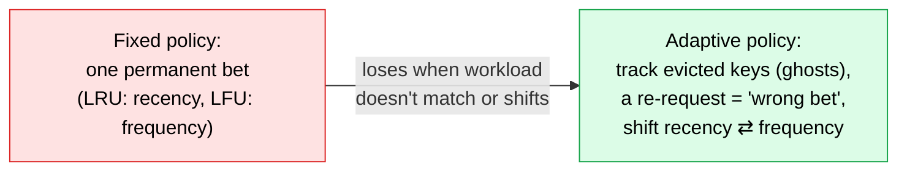

> **Hold onto this:** every adaptive policy in this file is a feedback loop — it *measures its own eviction mistakes* (usually via ghost lists of recently-evicted keys) and shifts the recency-vs-frequency balance toward whatever the current traffic rewards. The fixed policies can't do this; that's the entire reason these exist. (CLOCK is the exception — it's not about adaptivity but about making LRU-*like* behavior cheap under concurrency.)


> The purple banner is the shared trick — ghost lists remember evicted *keys* (metadata only) so the cache learns from its own misses. ARC and W-TinyLFU are the two headline designs; 2Q, S3-FIFO, and CLOCK fill out the practical spectrum.

---

## 3. The Ghost List — Learning From Your Own Evictions

The single idea that unifies ARC, 2Q, and (in spirit) W-TinyLFU is the **ghost list** (also called a *shadow list* or *non-resident history*).

- When the cache evicts an item, it drops the item's **value** (freeing the memory — that's the whole point of eviction) but *keeps the item's **key*** in a small side list — the ghost list. The ghost costs only a few bytes (a key + a pointer), not the size of the value.
- Later, if a request comes in for a key that's a **ghost hit** — not in the cache, but present in the ghost list — the cache has learned something precise: *"I evicted this key, and it was wanted again soon after. My eviction decision was wrong."*
- That ghost hit is a **free training signal**. It tells the policy exactly which strategy would have avoided the miss, so the policy can grow the segment/strategy that would have retained the item.

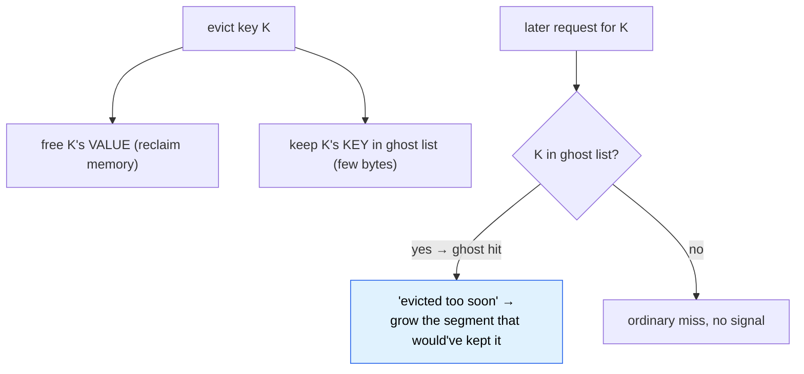

**Why this is clever:** it lets the cache measure the *counterfactual* — "what would my hit ratio have been if I'd made a different eviction choice?" — without the cost of actually storing the evicted data. You get the feedback of a larger cache at the memory cost of a list of keys. This is the mechanism behind ARC's and 2Q's adaptivity, and it's the reason those policies can converge on the right recency/frequency balance automatically.

> **The one takeaway:** a ghost list keeps the *keys* of recently-evicted items (cheap metadata, not the values) so that a later request for a ghost is an unambiguous "I evicted that too soon" signal — turning the cache's own misses into a free, precise training signal for tuning the policy.

---

## 4. ARC — Adaptive Replacement Cache

**ARC** (IBM Research, Megiddo & Modha, 2003) is the canonical adaptive policy. It balances recency and frequency automatically and is provably scan-resistant.

**The structure — four lists:**
- **T1** — items seen **once** recently (the *recency* cache), LRU-ordered.
- **T2** — items seen **twice or more** (the *frequency* cache), LRU-ordered.
- **B1** — *ghost* list of keys recently evicted from T1 (recency ghosts).
- **B2** — *ghost* list of keys recently evicted from T2 (frequency ghosts).

T1 + T2 hold the actual cached data (total size = cache capacity `c`). B1 + B2 hold only keys.

**The adaptive parameter `p`:** ARC keeps a target size `p` for T1 (so T2 targets `c − p`). It moves `p` based on ghost hits:
- **A hit in B1** (you re-requested something evicted from the *recency* list) means "I should have kept more recent items" → **increase `p`** (grow T1, favor recency).
- **A hit in B2** (you re-requested something evicted from the *frequency* list) means "I should have kept more frequent items" → **decrease `p`** (grow T2, favor frequency).

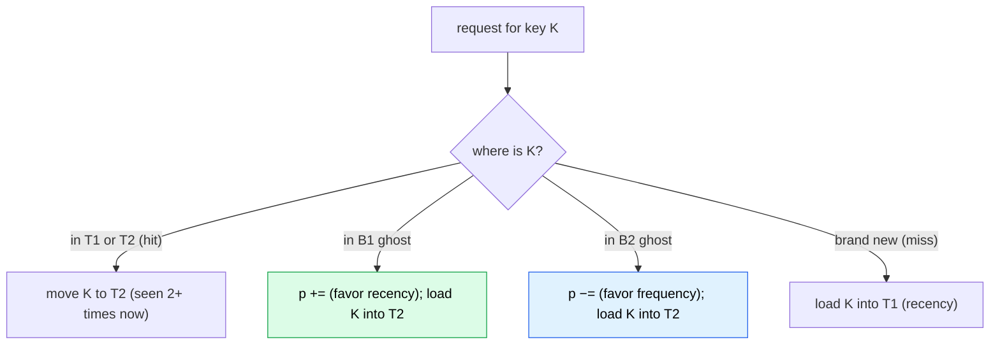

**Why it's scan-resistant:** a one-time scan brings keys into T1 (seen once). They're never re-requested, so they drain out of T1 without ever reaching T2 — the frequency cache (real working set) is untouched, exactly like SLRU's protected segment. But unlike fixed SLRU, ARC *also* adjusts how much room recency vs. frequency each get, so it adapts to *how* scan-heavy the workload is right now.

**Real home:** ZFS's **ARC** (the "Adaptive Replacement Cache" in ZFS is literally this algorithm) is the famous production deployment. **The catch:** the original ARC is *patented by IBM*, which is a major reason many open-source systems (PostgreSQL, and Caffeine's authors) chose 2Q or invented W-TinyLFU instead of adopting ARC directly — a genuinely important historical/practical footnote.

> **The one takeaway:** ARC runs a recency list (T1) and a frequency list (T2) side by side and uses two ghost lists (B1/B2) to move a dividing line `p` — a ghost hit on the recency side grows recency, a ghost hit on the frequency side grows frequency — so it self-tunes the balance and is scan-resistant, but its IBM patent pushed much of the open-source world toward alternatives.

---

## 5. 2Q — Two Queues, Cheaply Scan-Resistant

**2Q** (Johnson & Shasha, 1994) predates ARC and gets most of the scan resistance for less machinery and no patent. It's the intuition behind SLRU, made concrete with two queues.

- **A1 (in)** — a **FIFO** queue for *first-time* accesses. New keys enter here.
- **Am (main)** — an **LRU** queue for keys that have *proven* reuse.
- **A1out** — a *ghost* FIFO of keys recently evicted from A1 (keys only).

The promotion rule is the scan-resistance mechanism:
- A brand-new key goes into **A1 (FIFO)**. If it's never touched again, it ages out of A1 without ever entering the valuable LRU region — a scan just flows through A1 and drains.
- If a key is requested *while it's a ghost in A1out* (i.e., it was evicted from A1 but wanted again), *that* is the signal of genuine reuse, and it's promoted into **Am (LRU)**.

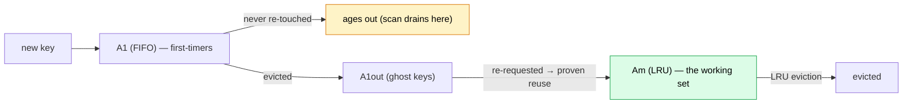

**2Q vs. ARC:** 2Q is *simpler* and *patent-free* but its queue-size ratios are **tuning parameters you set** (e.g., A1 ≈ 25% of capacity), whereas ARC *adapts* the split automatically. 2Q is scan-resistant like ARC; it just doesn't self-tune the recency/frequency balance to the same degree. It sits in the **PostgreSQL buffer-manager lineage** and many textbook buffer caches.

> **The one takeaway:** 2Q keeps first-timers in a FIFO probation queue and only promotes a key to the main LRU region if it's re-requested *after* being evicted from probation (proven via a ghost list) — giving ARC-like scan resistance with less machinery and no patent, at the cost of hand-tuned queue sizes instead of automatic adaptation.

---

## 6. W-TinyLFU — Admission-Based, Best-in-Class Hit Ratio

**W-TinyLFU** (Windowed TinyLFU; Einziger, Friedman, Manes) is what **Caffeine** ships and what backs Go's **Ristretto**. It's covered in [Cache_Eviction_Policies.md](./Cache_Eviction_Policies.md) §7; here's the adaptive-policy framing and why it's often the best choice.

Its insight is orthogonal to everything above: don't just decide *who leaves* (eviction), decide *who's allowed in* (**admission**). Even a perfect eviction policy wastes capacity if it keeps admitting one-hit-wonders that displace genuinely hot data before being evicted themselves.

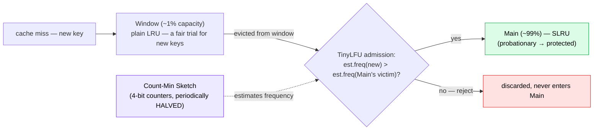

- **Window (~1%, LRU):** absorbs bursts and gives every brand-new key a cheap trial without immediately winning a frequency contest — the fix for TinyLFU's own cold-start blind spot.
- **Admission filter (Count-Min Sketch):** a key evicted from the window is admitted to Main *only if* its estimated frequency (from the [CMS](./Probabilistic_Data_Structures.md)) beats the frequency of the item it would displace. One-hit-wonders lose this contest and are rejected at the door.
- **Main (~99%, SLRU):** internally probationary/protected for scan resistance.
- **Adaptivity:** the sketch is periodically **halved** so it tracks *recent* frequency (not all-time — the fix for LFU's "never forgets"), and modern Caffeine *adaptively resizes the window* itself using a hill-climbing search that reacts to hit-ratio feedback — making it genuinely adaptive, not just a fixed combination.

**Why it wins:** Caffeine's published benchmarks show W-TinyLFU matching or beating ARC and LIRS hit ratios across standard traces (database, search, OLTP, web) while spending only a few *bytes* of sketch per entry instead of an exact per-key counter. It combines LRU's recency bias (window), LFU's frequency protection (sketch), and SLRU's scan resistance (main) in one design.

> **The one takeaway:** W-TinyLFU adds an *admission* filter — a Count-Min Sketch that rejects a new key unless its estimated recent frequency beats the victim it would evict — on top of a small LRU window and a scan-resistant SLRU main, giving best-in-class hit ratios for a few bytes of overhead, which is why Caffeine (and Ristretto) default to it.

---

## 7. S3-FIFO — Modern, FIFO-Friendly Scan Resistance

**S3-FIFO** ("Simple, Scalable, Static-of-3 FIFO"; Yang et al., 2023) is a recent policy built on a contrarian observation: **plain FIFO queues, not LRU, are the right primitive** when you care about concurrency and simplicity — because FIFO needs no per-access reordering (no lock on every read), unlike LRU.

- **Three FIFO queues:** a **small** queue (~10%, catches one-hit-wonders), a **main** queue (~90%, the working set), and a **ghost** queue (keys only).
- New keys enter the **small** FIFO. If evicted from small without a second access, they go to the **ghost** queue. A key that gets a hit while in small (or re-appears via ghost) is promoted to **main**.
- Because one-hit-wonders are caught and dropped by the small queue quickly, and everything is FIFO (no per-read reordering), S3-FIFO is **scan-resistant *and* highly concurrent** — it achieves LRU-competitive or better hit ratios with far less lock contention.

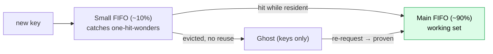

It's newer and less battle-tested than ARC/2Q/W-TinyLFU, but it's an important signal of *where the field is going* — toward FIFO-based designs that trade a hair of hit ratio for massive concurrency gains. Worth naming to show you follow the current research.

> **The one takeaway:** S3-FIFO uses three plain FIFO queues (small + main + ghost) instead of LRU lists, quickly discarding one-hit-wonders from the small queue, to get scan resistance *and* excellent concurrency — because FIFO needs no per-access reordering — representing the modern trend away from lock-heavy LRU.

---

## 8. CLOCK / Second-Chance — Cheap LRU for Concurrency

CLOCK is a different axis entirely: it's not about *adapting* recency vs. frequency — it's about approximating LRU **without paying LRU's concurrency cost.**

**The problem with exact LRU under concurrency:** exact LRU must move an item to the head of the recency list on *every access*, which requires taking a lock (or atomic pointer surgery) on every read. Under high read concurrency, that lock becomes the bottleneck — the eviction bookkeeping, not the work, limits throughput.

**CLOCK's fix (second-chance):**
- Arrange the cache entries in a **circular buffer** (the "clock face") with a single hand (pointer). Each entry has one **reference bit**.
- On **access**, just set the entry's reference bit to 1 — *no list surgery, no lock on the hot path*, just a bit flip.
- On **eviction**, sweep the hand forward: if the entry under the hand has reference bit **1**, clear it to 0 (a "second chance") and move on; if it's **0**, evict that entry. The hand keeps moving until it finds a 0.

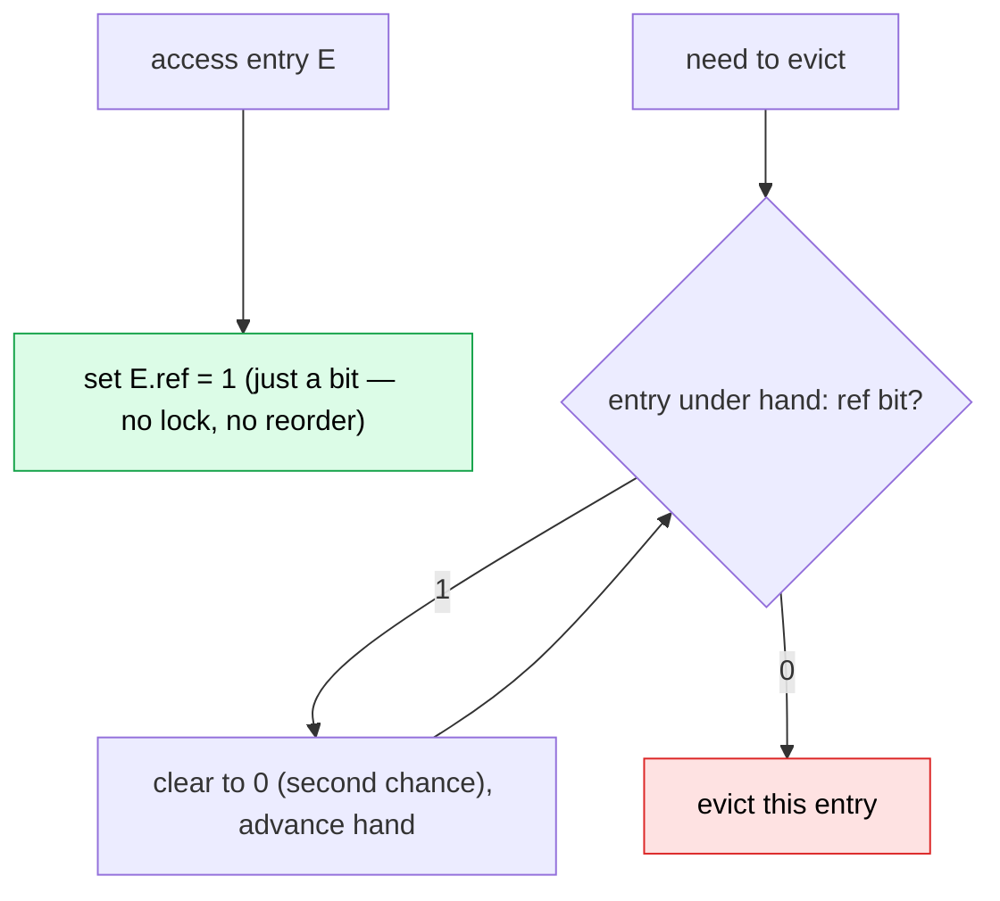

- The reference bit means "was this touched since the hand last passed?" — a cheap 1-bit approximation of recency. CLOCK's hit ratio is within a few percent of true LRU.
- **GCLOCK / CLOCK-Pro** extend it with a *counter* instead of a single bit (approximating LFU/LIRS) for better scan resistance.

**Real homes:** operating-system **page replacement** (Linux's page reclaim is CLOCK-derived), **PostgreSQL's buffer manager** (clock-sweep with a usage counter), and many database buffer pools — precisely because these are extreme-concurrency environments where exact LRU's per-access lock would be fatal. This is the same reason CPU caches use pseudo-LRU (PLRU) in hardware.

> **The one takeaway:** CLOCK/second-chance approximates LRU using a circular buffer and a single reference bit set on access (no per-read lock or list reordering) and evicts by sweeping a hand that gives touched entries a "second chance" — which is why operating systems and databases, where read concurrency is extreme, use CLOCK instead of exact LRU.

---

## 9. Choosing & Where They Actually Run

You almost never *implement* these — you *choose a system that ships one* and configure it. So the practical skill is knowing which policy lives where and when to prefer it.

| Policy | Adaptivity | Scan-resistant? | Concurrency | Real homes |
|---|---|---|---|---|
| **LRU** (baseline) | none (recency bet) | ❌ (scan wipes it) | poor (lock/reorder per access) | Redis (approx), Memcached, simple caches |
| **LFU** (baseline) | none (frequency bet) | good | moderate | Redis (approx, with decay) |
| **ARC** | ✅ auto recency⇄frequency | ✅ | moderate | **ZFS ARC** (⚠ IBM patent) |
| **2Q** | partial (fixed ratios) | ✅ | moderate | PostgreSQL buffer lineage |
| **W-TinyLFU** | ✅ (adaptive window + decaying sketch) | ✅ | good | **Caffeine** (JVM default), **Ristretto** (Go) |
| **S3-FIFO** | partial | ✅ | ✅✅ excellent (FIFO) | research → emerging cache libs |
| **CLOCK / clock-sweep** | none (LRU approx) | moderate (GCLOCK better) | ✅✅ excellent (bit flip) | **Linux page cache**, **PostgreSQL**, RocksDB |

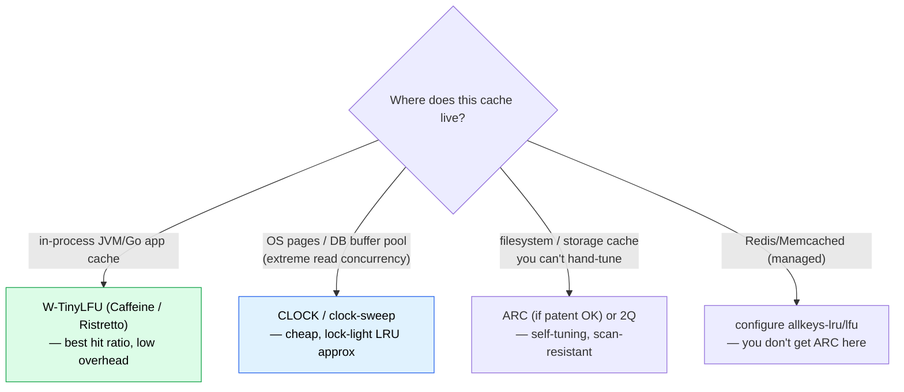

> **The habit:** match the policy to the *environment*, not to a hit-ratio leaderboard — W-TinyLFU for in-process app caches (best ratio, and you get it free with Caffeine), CLOCK for OS/DB buffer pools (concurrency dominates), ARC/2Q for self-tuning storage caches, and remember that a managed Redis/Memcached only offers approximate LRU/LFU, so "use ARC" isn't an option there.

---

## 10. Worked Example — Picking a Policy for a Mixed Workload

**The prompt:** "A JVM microservice keeps a local in-process cache of user-profile objects. Traffic is Zipfian (a hot minority of users dominate), but a nightly job iterates *every* user once to recompute recommendations, and the service runs at high request concurrency across many threads. What eviction policy, and why not plain LRU?"

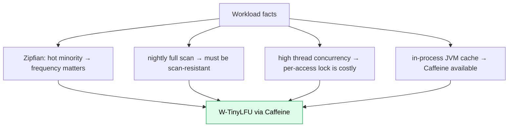

**Why plain LRU is disqualified — three independent reasons:**
1. **Scan pollution:** the nightly full-user iteration touches all users once, flooding LRU's MRU end and evicting the genuinely-hot minority every night right before morning traffic (the [Cache_Eviction_Policies.md](./Cache_Eviction_Policies.md) §6 failure).
2. **No frequency awareness:** a hot user idle for a few minutes gets evicted by LRU even though they're durably popular — LFU-style frequency protection would keep them.
3. **Concurrency cost:** exact LRU reorders a list on every read, requiring a lock per access — under high thread concurrency that lock contends and caps throughput.

**Why W-TinyLFU (Caffeine) is the answer:**
- **Admission filter** (Count-Min Sketch) rejects the nightly scan's one-touch users before they can displace hot users — the scan's keys have frequency ≈1 and lose the admission contest. Scan pollution solved *at the door*.
- **Frequency-aware:** the sketch protects durably-popular users through idle periods; the periodic halving keeps it tracking *recent* popularity so yesterday's hot user doesn't block today's.
- **Recency window** gives brand-new trending users a fair trial.
- **Concurrency:** Caffeine is engineered for exactly this — it records accesses in *ring buffers* and replays them asynchronously, so the read hot path doesn't take a global lock, unlike a naive LRU.

**Closing the loop — the decision:**
- The workload has **all three** of the properties that break plain LRU (scan, frequency, concurrency), and it's an **in-process JVM cache** — which is precisely W-TinyLFU's home turf and a one-line dependency (Caffeine). So the answer isn't "hand-roll SLRU" or "use ARC" (ARC's patent and lack of a great JVM library make it a poor fit here); it's "use Caffeine's default, which *is* W-TinyLFU."
- **Consequence:** hit ratio stays high through the nightly scan (admission filter), through idle periods for hot users (frequency), and through concurrency spikes (lock-light design) — three problems solved by one well-chosen library default, versus three separate hand-rolled fixes on top of LRU. This is the recurring lesson: adaptive policies exist so you *don't* patch LRU three times; pick the policy whose design already answers your workload's failures.

---

## 11. Real-Life Use Cases

| Situation | Policy | The decision it forces |
|---|---|---|
| In-process JVM app cache, best hit ratio wanted | W-TinyLFU (Caffeine) | Get admission filtering + adaptivity for free; don't hand-roll SLRU |
| Go in-process cache at high throughput | W-TinyLFU (Ristretto) | Same benefits, concurrency-oriented implementation |
| ZFS / filesystem cache | ARC | Self-tuning recency/frequency for unpredictable file access (patent is licensed there) |
| PostgreSQL / OS buffer pool | CLOCK (clock-sweep) | Extreme concurrency demands a bit-flip, not a per-access lock |
| Storage cache you can't hand-tune, no patent constraint | ARC or 2Q | Let the cache adapt rather than guessing segment sizes |
| Cache library targeting massive concurrency | S3-FIFO | FIFO primitive avoids per-access reordering; modern trend |
| Managed Redis/Memcached | (only) approximate LRU/LFU | You don't get ARC/W-TinyLFU here — pick `allkeys-lru`/`allkeys-lfu` and rely on sampling |
| Workload alternates scan-heavy and Zipfian phases | ARC or W-TinyLFU | Fixed policies mis-serve one phase; adaptivity tracks the shift |

> **The habit:** identify the environment (in-process vs. OS/DB buffer vs. managed store) and the workload's failure triggers (scan? frequency? concurrency? phase shifts?), then pick the policy whose *design already answers* those — and remember that in a managed cache you're limited to approximate LRU/LFU regardless.

---

## 12. Failure Modes

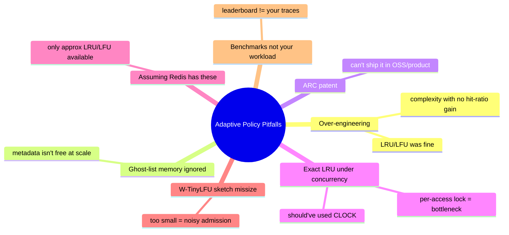

- **Over-engineering when a fixed policy was fine.** *Symptom:* you adopted a complex adaptive policy and hit ratio barely moved. *Root cause:* the workload had clean temporal locality and no scan — plain LRU already captured it. *Fix:* measure first; adaptive policies earn their complexity only when the workload has scans, frequency skew, or phase shifts that a fixed bet mis-serves.
- **Ignoring ghost-list memory.** *Symptom:* memory usage higher than the value data alone predicts. *Root cause:* ghost lists (ARC's B1/B2, 2Q's A1out) store keys for many *non-resident* items — at billions of tiny keys that metadata is a real cost. *Fix:* bound ghost-list size; account for it in capacity planning, just like the per-key eviction metadata in [Cache_Eviction_Policies.md](./Cache_Eviction_Policies.md).
- **Reaching for ARC where you can't license it.** *Symptom:* legal/compliance blocks shipping ARC. *Root cause:* ARC is IBM-patented. *Fix:* use 2Q (patent-free, ARC-like scan resistance) or W-TinyLFU (patent-free, often better hit ratio) — which is exactly why the open-source world did.
- **Running exact LRU under high concurrency.** *Symptom:* throughput plateaus and profiling shows lock contention on the cache's recency list. *Root cause:* exact LRU reorders (and locks) on every read. *Fix:* CLOCK/second-chance (bit flip, no reorder), or a design like Caffeine that buffers accesses and replays them off the hot path.
- **Assuming a managed cache offers these.** *Symptom:* "we'll configure Redis to use ARC." *Root cause:* Redis/Memcached only offer *approximate* LRU/LFU (sampling-based). *Fix:* accept the approximation there; put W-TinyLFU in your *application-level* (in-process) cache tier if you need it.
- **Mis-sizing W-TinyLFU's sketch or window.** *Symptom:* admission decisions are noisy or a genuinely hot new key keeps getting rejected. *Root cause:* the Count-Min Sketch is too small (collision noise) or the window too small (new keys can't earn frequency). *Fix:* use the library's defaults (Caffeine auto-sizes and adaptively resizes the window); only override with measured evidence.
- **Trusting a hit-ratio leaderboard over your own traces.** *Symptom:* the "best" policy from a paper underperforms in production. *Root cause:* policy performance is workload-dependent; a benchmark trace isn't your traffic. *Fix:* replay *your* access logs through candidate policies (a cache simulator) before committing.

---

## 🏋️ Practice Drills

> *Cover the solutions and attempt first — active recall is the point.*

**Drill 1 — Explain a ghost list to an interviewer in 30 seconds.** What does it store, why, and what does a "ghost hit" tell the policy?

<details><summary>Solution</summary>

"When an adaptive cache evicts an item, it frees the item's *value* — that's the point of eviction — but keeps the item's *key* in a small side list called a ghost list, costing only a few bytes per entry. Later, if a request comes in for a key that's in the ghost list (a ghost hit), the cache has learned something exact: it evicted that key and the key was wanted again soon, so the eviction was premature. That's a free training signal — it tells the policy which strategy would have avoided the miss, so the policy grows the segment that would have kept the item. It lets the cache measure the counterfactual 'what if I'd chosen differently' at the memory cost of a key, not a value. ARC's B1/B2 and 2Q's A1out are ghost lists."
</details>

**Drill 2 — ARC's adaptation.** In ARC, a burst of requests hits keys that were recently evicted from T1 (they show up as B1 ghost hits). Which way does `p` move, which segment grows, and what has ARC concluded about the workload?

<details><summary>Solution</summary>

A hit in **B1** means a key evicted from **T1 (the recency list)** was wanted again. ARC concludes it's evicting recent items too aggressively — recency is more valuable for this workload right now — so it **increases `p`**, which **grows T1** (the recency cache) at the expense of T2's target. If instead the ghost hits were in **B2** (frequency ghosts), ARC would *decrease* `p` and grow T2. This two-way tug-of-war driven by which ghost list gets hits is exactly how ARC self-tunes the recency/frequency balance without any manual parameter.
</details>

**Drill 3 — Why does PostgreSQL use CLOCK instead of exact LRU?** And what does W-TinyLFU do differently to stay concurrent?

<details><summary>Solution</summary>

PostgreSQL's buffer manager serves a huge volume of concurrent page accesses. Exact LRU would require moving a page to the head of a recency list on *every* buffer access, which means acquiring a lock on the list per access — under high concurrency that lock becomes the throughput bottleneck. CLOCK (clock-sweep) avoids it: an access just sets a usage bit/counter (no lock, no list reorder), and eviction sweeps a hand giving touched pages a second chance. The hit ratio is within a few percent of true LRU, but there's no per-access contention.

W-TinyLFU (Caffeine) tackles the same concurrency problem differently: instead of updating the recency structure synchronously on each read, it records accesses into per-thread **ring buffers** and *replays* them asynchronously into the eviction policy, so the read hot path is lock-free. Both designs share the insight that *the eviction bookkeeping, not the lookup, is what kills concurrency in a naive LRU* — and both move that bookkeeping off the hot path.
</details>

---

## 🎤 Interview Q&A Bank

**Q1. What makes an eviction policy "adaptive," and what's the core mechanism?**
> An adaptive policy changes its recency-vs-frequency balance based on the workload instead of making one fixed bet. The core mechanism is the *ghost list*: when the cache evicts an item it keeps the item's key (not its value) in a small side list, so a later request for that key is an unambiguous "I evicted this too soon" signal. The policy uses those ghost hits to shift toward whichever strategy would have retained the item — ARC moves a parameter `p` between a recency list and a frequency list based on which ghost list gets hits. It's a feedback loop that measures the cache's own eviction mistakes.

**Q2. Explain ARC.**
> ARC (Adaptive Replacement Cache) keeps four lists: T1 (items seen once, recency), T2 (items seen twice+, frequency), and ghost lists B1 and B2 holding the *keys* recently evicted from T1 and T2. T1+T2 equal the cache size; B1+B2 hold only keys. A target size `p` splits capacity between T1 and T2. A hit in B1 means "I evicted a recent item too soon" → increase `p` (favor recency); a hit in B2 means the same for a frequent item → decrease `p` (favor frequency). So ARC self-tunes the balance and is scan-resistant (scan keys sit in T1 and drain without reaching T2). ZFS's ARC is the famous deployment; note it's IBM-patented, which pushed much of open source to 2Q or W-TinyLFU.

**Q3. Why does Caffeine use W-TinyLFU instead of LRU or ARC?** *(signal: knows the current best practice and why)*
> W-TinyLFU adds an *admission* decision on top of eviction: a Count-Min Sketch estimates a candidate key's recent frequency, and a new key is admitted to the main cache only if its estimated frequency beats the victim it would displace — so one-hit-wonders never even enter, let alone displace hot data. It layers a small LRU window (a fair trial for new keys), the sketch-based admission filter, and an SLRU main (scan resistance), and it halves the sketch periodically to track *recent* frequency. Caffeine's benchmarks show it matching or beating ARC/LIRS hit ratios for a few bytes of overhead per entry, it's patent-free (unlike ARC), and it's engineered to be concurrent (buffered access replay). That combination is why it's the JVM default.

**Q4. When would you choose CLOCK over LRU?**
> When read concurrency is high — OS page caches, database buffer pools. Exact LRU moves an entry to the list head on every access, requiring a lock per read, which becomes the bottleneck under heavy concurrency. CLOCK approximates LRU with a circular buffer and a single reference bit: an access just sets the bit (no lock, no reorder), and eviction sweeps a hand that clears set bits (second chance) and evicts the first entry it finds with a cleared bit. Hit ratio is within a few percent of true LRU but with no per-access contention — which is exactly why PostgreSQL (clock-sweep) and Linux page reclaim use it.

**Q5. What's a ghost list and why doesn't it defeat the purpose of eviction?**
> A ghost list stores the *keys* of recently-evicted items, not their values. Eviction's purpose is to reclaim the *memory* held by values, and the value is still freed — the ghost keeps only a few bytes of key + pointer as metadata. So you get the feedback signal of "was this eviction a mistake?" at a tiny fraction of the memory of actually retaining the data. The trade-off is that ghost lists aren't *free* — at billions of tiny keys the ghost metadata is a real capacity line item and must be bounded.

**Q6. 2Q vs. ARC — what's the difference and why does 2Q still get used?**
> Both are scan-resistant using the "prove reuse before promotion" idea. 2Q keeps first-timers in a FIFO probation queue and only promotes a key to the main LRU region if it's re-requested after being evicted from probation (tracked via a ghost list). The difference: 2Q's queue-size ratios are *fixed parameters you tune*, while ARC *adapts* the recency/frequency split automatically. 2Q is used because it's simpler and — critically — *patent-free*, whereas ARC is IBM-patented. It's in the PostgreSQL buffer-manager lineage. So 2Q trades ARC's automatic adaptation for simplicity and freedom to ship.

**Q7. What's the modern trend in eviction policy research?**
> Toward FIFO-based designs like S3-FIFO that abandon LRU's per-access reordering. The insight is that LRU's requirement to move an item to the list head on every access is a concurrency killer (lock per read), and that plain FIFO queues plus a quick-drop mechanism for one-hit-wonders can achieve LRU-competitive or better hit ratios with far better scalability. S3-FIFO uses a small FIFO to catch one-hit-wonders, a main FIFO for the working set, and a ghost queue — scan-resistant and highly concurrent. It signals the field prioritizing concurrency and simplicity, not just hit ratio on single-threaded traces.

---

## 🎯 Staff+ Nuances

- **The whole family is one idea — "measure your own eviction error and correct it" — plus one orthogonal idea (CLOCK, "approximate cheaply").** Presenting ARC, 2Q, and W-TinyLFU as instances of *adaptive feedback via ghosts/admission*, and CLOCK/S3-FIFO as *the concurrency axis*, is a far stronger framing than a list of acronyms. It lets you reason about a *new* policy you've never seen by asking "what's its feedback signal, and how does it handle concurrency?"
- **Admission and eviction are independent levers, and W-TinyLFU's edge comes from the one everyone forgets.** Every fixed policy answers only "who leaves?" W-TinyLFU's real innovation is answering "who's allowed *in*?" — filtering one-hit-wonders at the door with a frequency sketch. A candidate who frames the improvement as "a cleverer eviction rule" has missed it; the gain is the admission gate. This connects directly to [Probabilistic_Data_Structures.md](./Probabilistic_Data_Structures.md): the Count-Min Sketch *is* the admission brain.
- **The ARC patent is a real engineering-decision driver, not trivia.** It's *why* PostgreSQL didn't adopt ARC, *why* Caffeine's authors built W-TinyLFU, and a live consideration any time someone proposes "just use ARC." Knowing that a superior algorithm can lose in practice to licensing (and that 2Q/W-TinyLFU are the patent-free answers) is exactly the kind of real-world constraint senior engineers weigh.
- **"Best hit ratio" is the wrong sole criterion; concurrency and metadata cost often dominate.** The reason OSes use CLOCK (worse hit ratio than ARC) and the field is moving to S3-FIFO (FIFO, not LRU) is that *the eviction bookkeeping's contention and memory cost matter more than a few points of hit ratio* at real concurrency and scale. A Staff+ answer weighs the *total* cost — lock contention, ghost-list memory, per-entry metadata — not just the leaderboard number.
- **Adaptivity is only worth it when the workload actually shifts or mixes — otherwise it's complexity with no payoff.** If traffic is cleanly Zipfian with no scans, plain LRU already captures nearly all the achievable hit ratio, and an adaptive policy adds machinery for a rounding-error gain. The senior instinct is to *measure* (replay your own traces through a simulator) and reach for adaptivity only when the data shows phase shifts, scans, or frequency skew that a fixed bet mis-serves.
- **Caffeine's asynchronous access recording is the unsung reason it wins in practice.** Its hit-ratio advantage from W-TinyLFU would be undercut if maintaining the policy locked the read path. By recording accesses in ring buffers and replaying them asynchronously into the eviction structures, Caffeine keeps reads lock-free *and* runs a sophisticated policy — the same "move the bookkeeping off the hot path" insight that makes CLOCK viable, applied in software. Policy quality and concurrency engineering are separate wins that must both be present.
- **These policies are configured, not implemented — so the real skill is selection and measurement.** In an interview, the strong move is "for an in-process JVM cache I'd use Caffeine's W-TinyLFU default and validate against our access logs; for a buffer pool I'd expect CLOCK; in managed Redis I only get approximate LRU/LFU so I'd lean on TTLs and key design instead." That maps each policy to its real habitat and constraints — which is what actually comes up in system design, not whiteboarding ARC's list transitions.

---

## 16. Cheat Sheet

```
ADAPTIVE EVICTION POLICIES — caches that tune themselves
══════════════════════════════════════════════════════════════════════

THE UNIFYING TRICK: GHOST LISTS
  on evict: free the VALUE, keep the KEY (few bytes) in a ghost list
  ghost hit = "I evicted that too soon" → FREE signal to re-balance
  measures the counterfactual without storing the data twice

FIXED (one permanent bet — from Cache_Eviction_Policies.md)
  LRU = recency bet  · LFU = frequency bet
  lose on: scans (LRU), cold-start/never-forgets (LFU), concurrency (LRU lock)

ADAPTIVE (feedback via ghosts / admission)
  ARC — T1 recent + T2 frequent + B1/B2 ghosts; move split p
        B1 hit → grow recency ; B2 hit → grow frequency
        scan-resistant, self-tuning · ZFS ARC · ⚠ IBM PATENT
  2Q  — A1(FIFO first-timers) + Am(LRU proven) + A1out ghost
        promote on ghost hit · scan-resistant · patent-free · fixed ratios
        Postgres buffer lineage
  W-TinyLFU — Window LRU(~1%) → Count-Min-Sketch ADMISSION gate → Main SLRU(~99%)
        admit new key ONLY if est.freq > victim's ; sketch HALVED (recency)
        best hit ratio, few bytes/entry, patent-free · CAFFEINE, Ristretto
  S3-FIFO — small+main+ghost FIFO queues; drop one-hit-wonders fast
        scan-resistant + EXCELLENT concurrency (no per-access reorder) · 2023

CONCURRENCY AXIS (approximate LRU cheaply — NOT about adaptivity)
  CLOCK / second-chance — ring + 1 reference bit
    access = set bit (NO lock/reorder) ; evict = sweep hand, clear 1s,
    evict first 0 · ~few % off true LRU · Linux pages, Postgres clock-sweep
  GCLOCK/CLOCK-Pro = counter instead of bit (LFU-ish, better scan resist)

CHOOSE BY ENVIRONMENT (you CONFIGURE, rarely implement)
  in-process JVM/Go cache   → W-TinyLFU (Caffeine/Ristretto) — best ratio
  OS pages / DB buffer pool → CLOCK (concurrency dominates)
  self-tuning storage cache → ARC (if patent OK) or 2Q
  managed Redis/Memcached   → only approx LRU/LFU — no ARC/W-TinyLFU here

WHY NOT ALWAYS ADAPTIVE
  clean Zipfian + no scan → plain LRU already ~optimal ; adaptivity = wasted complexity
  ghost lists cost memory · benchmark YOUR traces, not a leaderboard
  admission (who's let IN) is the lever fixed policies forget
```

---

## 17. Connections & Further Reading

**Prerequisites (learn first):**
- [Cache_Eviction_Policies.md](./Cache_Eviction_Policies.md) — LRU/LFU/SLRU and the scan-pollution, cold-start, and concurrency weaknesses these adaptive policies exist to fix.
- [Probabilistic_Data_Structures.md](./Probabilistic_Data_Structures.md) — the Count-Min Sketch that is W-TinyLFU's admission filter.

**Builds toward / pairs with:**
- [In_Process_vs_Distributed_Cache.md](./In_Process_vs_Distributed_Cache.md) — Caffeine's W-TinyLFU in its natural habitat, the in-process local cache tier; also where off-heap sizing interacts.
- [Distributed_Caching_Redis_Memcached.md](./Distributed_Caching_Redis_Memcached.md) — why managed Redis/Memcached give you only approximate LRU/LFU, not these.
- [Hot_Key_Problem_Multi_Tier_Caching.md](./Hot_Key_Problem_Multi_Tier_Caching.md) — per-node eviction is a local approximation; hot keys stress it.
- [Performance_Metrics.md](./Performance_Metrics.md) — hit ratio as the metric these policies optimize, and how it rolls into P99 latency.
- [05 · B_Tree_vs_LSM_Storage_Engines.md](../05_Databases_Storage/B_Tree_vs_LSM_Storage_Engines.md) — database buffer pools are where CLOCK/clock-sweep actually run.

**Gaps this topic exposes:**
- LIRS and CLOCK-Pro (inter-reference-recency policies) and a dedicated cache-simulation/trace-replay note could deepen the OS/filesystem-cache angle.

**External classics:**
- Megiddo & Modha, *"ARC: A Self-Tuning, Low Overhead Replacement Cache"* (FAST 2003) — the ARC paper.
- Johnson & Shasha, *"2Q: A Low Overhead High Performance Buffer Management Replacement Algorithm"* (VLDB 1994).
- Einziger, Friedman, Manes, *"TinyLFU: A Highly Efficient Cache Admission Policy"* (2017), and [Caffeine's efficiency wiki](https://github.com/ben-manes/caffeine/wiki/Efficiency).
- Yang et al., *"FIFO queues are all you need for cache eviction"* (SOSP 2023) — S3-FIFO.
- *Operating System Concepts* (Silberschatz et al.) — the canonical CLOCK/second-chance treatment.

---

## TL;DR
**Fixed policies (LRU, LFU) make one permanent bet on recency or frequency and lose when the workload differs or shifts; adaptive policies remove the bet by learning from their own eviction mistakes.** The unifying trick is the *ghost list* — keep the *keys* (not values) of recently-evicted items so a later request for one is a free "I evicted that too soon" signal. **ARC** runs a recency list and a frequency list with two ghost lists and self-tunes the split (ZFS uses it, but it's IBM-patented). **2Q** gets ARC-like scan resistance with fixed-ratio queues, patent-free (PostgreSQL lineage). **W-TinyLFU** — Caffeine's and Ristretto's default and often the best hit ratio — adds a Count-Min Sketch *admission* filter that rejects one-hit-wonders at the door, plus a recency window and scan-resistant SLRU main. **S3-FIFO** is the modern FIFO-based design that trades a hair of hit ratio for excellent concurrency. **CLOCK/second-chance** is the orthogonal concurrency trick: approximate LRU with a single reference bit and no per-access lock, which is why OS page caches and database buffer pools (PostgreSQL clock-sweep) use it. **You configure these, rarely implement them — so match the policy to the environment (W-TinyLFU for in-process app caches, CLOCK for buffer pools, ARC/2Q for self-tuning storage), measure against your own traces, and remember a managed Redis only offers approximate LRU/LFU.**
