# CDN (Content Delivery Network)

> **One line:** A CDN is a global network of proxy servers that keeps copies of your content physically close to every user, so most requests never have to cross an ocean to reach your origin server.

---

## Table of Contents
1. [Why You Must Master This](#1-why-you-must-master-this)
2. [The Mental Model](#2-the-mental-model)
3. [Edge PoPs and the Speed-of-Light Problem](#3-edge-pops-and-the-speed-of-light-problem)
4. [Pull vs Push — How Content Gets to the Edge](#4-pull-vs-push--how-content-gets-to-the-edge)
5. [The Cache Hierarchy: Edge → Regional → Origin Shield](#5-the-cache-hierarchy-edge--regional--origin-shield)
6. [TTLs, Cache-Control, and Cache Key Composition](#6-ttls-cache-control-and-cache-key-composition)
7. [Invalidation vs Versioning](#7-invalidation-vs-versioning)
8. [Static vs Dynamic Content: ESI and Edge Compute](#8-static-vs-dynamic-content-esi-and-edge-compute)
9. [Anycast Routing and TLS Termination at the Edge](#9-anycast-routing-and-tls-termination-at-the-edge)
10. [Security: Never Cache PII at the Edge](#10-security-never-cache-pii-at-the-edge)
11. [Cache-Hit Ratio Economics and Real Providers](#11-cache-hit-ratio-economics-and-real-providers)
12. [Worked Example — Launching a Game Patch Globally](#12-worked-example--launching-a-game-patch-globally)
13. [Real-Life Use Cases](#13-real-life-use-cases)
14. [Failure Modes](#14-failure-modes)
15. [🏋️ Practice Drills](#-practice-drills)
16. [🎤 Interview Q&A Bank](#-interview-qa-bank)
17. [🎯 Staff+ Nuances](#-staff-nuances)
18. [Cheat Sheet](#18-cheat-sheet)
19. [Connections & Further Reading](#19-connections--further-reading)

---

## 1. Why You Must Master This

- **It is a workaround for physics, not just engineering.** Light in fiber travels at roughly two-thirds the speed of light in a vacuum (~200,000 km/s, because glass has a refractive index of ~1.47). No software optimization removes the ~170ms round trip between New York and Tokyo — the only fix is to make the trip shorter by moving the *data*, not the *speed of light*. A CDN is the industry's answer to a law of physics.
- **It is the cheapest scaling lever that exists.** A single origin server serving every image, video, and script to a global audience will either fall over under load or bankrupt you in egress fees. Offloading 90-99% of requests to edge caches is often a 10-50x reduction in origin traffic for close to zero application code changes.
- **It is a resilience layer, not just a speed layer.** A well-configured CDN keeps serving the last-known-good version of your site even while your origin is completely down (`stale-if-error`) and absorbs volumetric DDoS attacks that would vaporize a normal server in seconds.
- **Cache invalidation across hundreds of PoPs is one of the two hard problems in computer science — and it is a daily operational reality, not a joke.** Every senior engineer has a story about a stale asset serving broken JS to production users 15 minutes after a "fixed" deploy. Understanding purge lag, versioning, and cache keys is what separates "I added a CDN" from "I run a CDN correctly."

> **The core problem it solves:** *the physical latency of distance, and the operational cost of serving the same bytes to millions of geographically dispersed clients from one place.* A CDN decouples "where the data lives permanently" (the origin) from "where the data is served from" (hundreds of edge locations), trading storage duplication and cache-consistency complexity for latency, origin load, and availability.

**Prerequisites:** [HTTP_Caching.md](./HTTP_Caching.md) — a CDN is HTTP caching applied at a network of shared, third-party proxies instead of one browser; you need `Cache-Control`, `ETag`, and `public`/`private` semantics before this file makes sense. [GSLB.md](./GSLB.md) covers the DNS-level routing that often sits *above* the CDN's own anycast network.

---

## 2. The Mental Model

A CDN is a **chain of 7-Eleven corner stores** in front of one giant, distant warehouse:

- **Origin server = the warehouse.** It has everything — the full, authoritative inventory — but it's in one place, far from most customers, and every trip there costs time and gas.
- **Edge PoP (Point of Presence) = the corner store on your block.** It stocks only what's popular *near it* (milk, bread — or in web terms, the hero image and main JS bundle everyone in Tokyo is requesting). If your item is on the shelf, you're in and out in seconds.
- **Cache miss = "we're out of bread."** The clerk calls the warehouse, gets a shipment, and hands you your item — meanwhile stocking the shelf for the next ten customers who want the same thing.

The naive mental model treats the CDN as "a bit of caching in front of the server." The correct model treats it as **a second, distributed copy of your content that intercepts nearly all traffic before your origin ever sees a byte** — the origin becomes a rarely-visited source of truth, not the thing serving users.

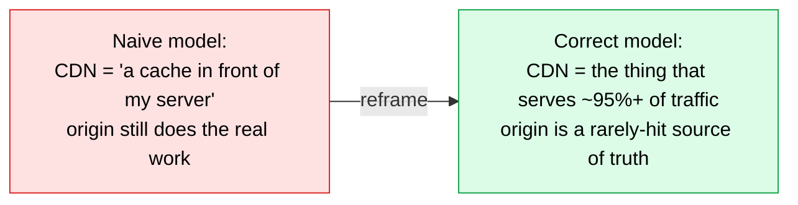

> **Hold onto this:** if you're picturing the origin server as "where the request goes," you have the pre-CDN mental model. Post-CDN, the origin is where a request goes only when 300+ edge nodes have *all* failed to already have the answer.

---

## 3. Edge PoPs and the Speed-of-Light Problem

A **Point of Presence (PoP)** is a data center — sometimes a full facility, sometimes a few racks colocated inside an ISP's building — that terminates user connections and serves cached content. Major CDNs run hundreds to thousands of these: Cloudflare advertises 330+ cities, Akamai over 4,000 points of presence, CloudFront 600+ edge locations across 100+ cities, Fastly a smaller but strategically dense network tuned for low-latency purge.

**Why distance is unavoidable, not just "slow":**

| Route | Great-circle distance | Theoretical min RTT (light in fiber, ~200,000 km/s) | Typical real-world RTT |
|---|---|---|---|
| New York ↔ Tokyo | ~10,850 km | ~108ms (round trip) | 150-180ms |
| New York ↔ London | ~5,570 km | ~56ms | 70-90ms |
| San Francisco ↔ Singapore | ~13,600 km | ~136ms | 180-220ms |
| User ↔ nearby edge PoP (same metro) | ~10-50 km | <1ms | 2-15ms (dominated by last-mile ISP hops, not distance) |

The theoretical minimum already assumes a straight fiber line; real undersea cables curve around coastlines and continental shelves, and every router hop adds serialization and queueing delay — which is why real RTTs run 30-70% above the physics-only floor. **No amount of server-side optimization changes the "150-180ms" row.** The only lever is the last row: put a PoP where the user is, and the 150ms trip only has to happen *once* — from a PoP to the origin, on a cache miss — instead of on every single user request.

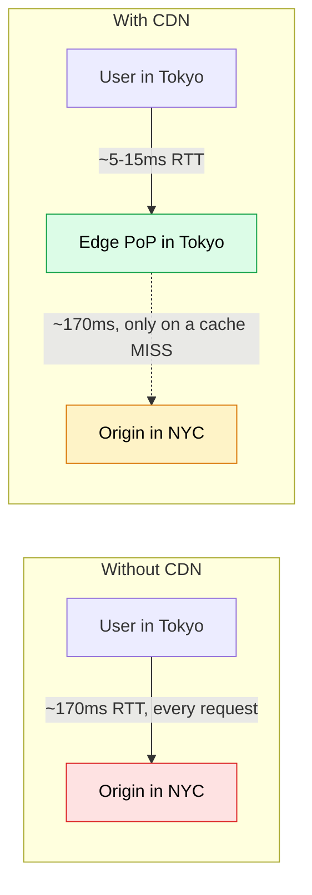

> **Takeaway:** a CDN doesn't make light travel faster — it makes the slow trip a rare event (a cache miss) instead of the default path for every request.

---

## 4. Pull vs Push — How Content Gets to the Edge

Content has to get from the origin onto edge disks somehow. There are two models, and almost every real deployment defaults to the first.

**Pull (origin-pull / lazy caching) — the default for ~95% of CDN usage:**
- The CDN caches nothing until the *first* user requests a given URL. On that first request, the edge PoP sees a miss, fetches from the origin, stores a copy (honoring `Cache-Control`/TTL), and serves it. Every subsequent request at that PoP — for the TTL's duration — is a hit.
- **Why it wins:** zero setup. Point a DNS record at the CDN, set correct cache headers, and it works for your entire catalog of millions of assets without ever telling the CDN what they are.
- **The cost:** the *first* user at *every* PoP pays a full origin round trip (a "cold" PoP). For a long-tail catalog (rarely-requested product images), most PoPs are perpetually cold for most objects — fine, because that traffic is low-volume by definition.

**Push — you upload ahead of demand:**
- You (or your deploy pipeline) proactively copy content to the CDN's storage *before* any user asks for it — via an API, an S3-backed origin the CDN pre-fetches, or a dedicated push target.
- **Why it wins:** eliminates the cold-PoP problem for content you know will get an immediate, massive, synchronized surge — a new game patch, a movie's day-one 4K release, a viral livestream. Without pre-population, the first seconds after launch would be a global thundering herd of simultaneous cache misses hitting the origin at once.
- **The cost:** operational overhead (you must manage what's pushed, and storage costs accrue whether or not it's ever requested), and it doesn't scale to "cache everything" — you can't push your entire long-tail catalog everywhere.

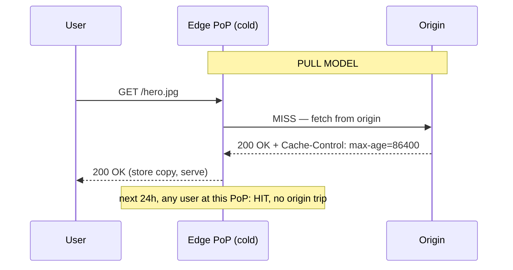

| | Pull (origin-pull) | Push |
|---|---|---|
| **Setup effort** | Near zero — set headers, point DNS | Explicit upload/pre-seed pipeline |
| **First request per PoP** | Miss (cold) | Already warm — hit from second 1 |
| **Best for** | Long-tail catalogs, general web/app traffic | Known, synchronized, high-surge launches |
| **Who uses it** | Nearly everyone, by default | Game patch CDNs, video-on-demand pre-release, firmware rollouts |

> **Takeaway:** pull is "lazy and free," push is "eager and deliberate" — reach for push only when you can *predict* a synchronized spike and want to avoid the thundering herd of a million simultaneous cold misses.


> The first request per PoP pays the full edge-to-origin round trip to fill the cache; every request after that, at that PoP, is served locally in milliseconds — patient once, instant forever after.

---

## 5. The Cache Hierarchy: Edge → Regional → Origin Shield

A CDN is not one flat layer of PoPs all hitting the origin independently — that design would let *every* PoP's first request for a popular object become a separate origin hit, and during a viral spike, hundreds of PoPs missing simultaneously is itself a thundering herd against the origin.

The fix is a **tiered hierarchy**:

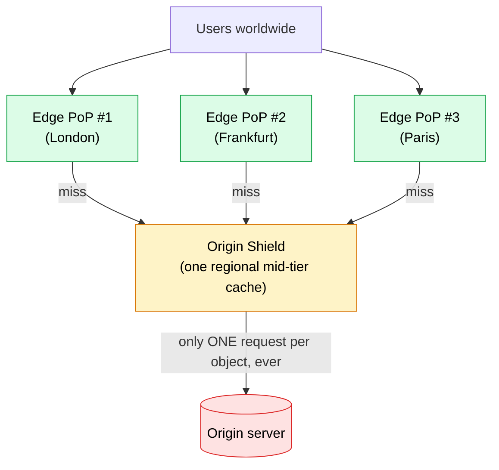

- **Edge PoPs** are the leaves — dozens to hundreds of them, each close to a cluster of users.
- **An origin shield** is a single, designated mid-tier cache (usually placed near the origin itself) that *every* edge PoP is configured to check on a miss, instead of going straight to the origin. CloudFront calls this feature "Origin Shield," Fastly and Akamai call it "tiered distribution / tiered caching."
- **Why it collapses the thundering herd:** without a shield, a viral object missing simultaneously at 300 PoPs generates 300 concurrent origin requests. With a shield, all 300 PoPs' misses converge on the *one* shield node, which itself only forwards a *single* request to the origin (via request coalescing — the shield holds subsequent identical in-flight requests until the first one returns, then serves all of them from that one response). The origin sees **1 request instead of 300** for the same object during the same miss window.
- **The trade-off:** the shield adds one extra hop of latency on a cold miss (edge → shield → origin instead of edge → origin directly), and it becomes a single point of contention for a superhot object. In practice this is almost always worth it — hot-object collapse matters far more than the few extra milliseconds on a rare cold path.
- **Negative caching, a related trick:** shields and edges also briefly cache *error* responses (a `404` or `500`) for a short TTL (often seconds, not the content's normal TTL), so a broken or missing URL that gets hammered doesn't repeatedly retrigger a full origin round trip per request.

> **Takeaway:** the hierarchy turns "N PoPs × 1 miss each" into "1 shield × 1 origin request," which is the entire trick behind surviving a viral spike without your origin falling over.

---

## 6. TTLs, Cache-Control, and Cache Key Composition

The CDN obeys the *same* `Cache-Control` semantics covered in [HTTP_Caching.md](./HTTP_Caching.md) — `max-age`, `s-maxage` (the CDN/shared-cache-specific override of `max-age`), `public`/`private`, `no-store` — but two things matter specifically at CDN scale:

**1. `s-maxage` lets you set a different TTL for shared caches than for the browser.** `Cache-Control: max-age=60, s-maxage=86400` tells the *browser* to treat the response as fresh for 60 seconds, but tells the *CDN* it can hold it for a full day — useful when you want the edge to absorb most traffic for a long time while still letting individual browsers re-validate sooner.

**2. The cache key is not just the URL.** By default, most CDNs key their cache on scheme + host + path (and often the full query string). Two things break this in practice:

- **Irrelevant query parameters fragment the cache.** `/product/42?utm_source=twitter` and `/product/42?utm_source=email` are the *same* content but, with a naive cache key, count as two separate cache entries — each needing its own cold miss. Real CDNs (CloudFront cache policies, Cloudflare Cache Rules, Fastly VCL) let you strip or ignore tracking parameters from the key to collapse them back into one entry and dramatically raise the hit ratio.
- **`Vary` explodes the cache key the other direction, and can be worse.** The origin's `Vary` header tells the CDN "cache a separate copy per distinct value of this request header." `Vary: Accept-Encoding` is safe and common (a gzip'd copy and a brotli copy). `Vary: User-Agent` is a classic footgun — User-Agent strings are nearly unique per device/browser/version combination, so the CDN ends up caching a near-infinite number of "unique" variants of the same page, and the effective hit ratio collapses toward zero because almost every request looks like a first-time visitor to the cache.

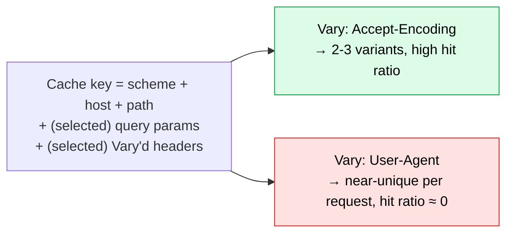

> **Takeaway:** hit ratio is a cache-*key* design problem as much as a TTL problem — a badly composed key can defeat a perfectly reasonable TTL.

---

## 7. Invalidation vs Versioning

You update your site's CSS. Hundreds of PoPs around the world hold a now-stale copy with whatever TTL you set. You have exactly two tools to fix this, and they are not equally good.

**Invalidation (purge) — telling every PoP "throw that out now":**
- You call the CDN's purge API for a URL (or a tag, or "everything"). The CDN has to propagate that instruction to every edge node that might be holding a copy — which, across a network with hundreds to thousands of PoPs, is not instantaneous.
- **Real, commonly-cited propagation times** (vendor-published, order-of-magnitude — always verify against current docs, these change): Cloudflare's single-file/tag purge propagates to its network in on the order of seconds; a "purge everything" operation can take up to ~30 seconds to fully clear. Akamai's Fast Purge targets single-digit seconds for an API-triggered purge. AWS CloudFront invalidations are documented as typically completing within a couple of minutes across all edge locations, though this can extend under load. **The number to internalize isn't the exact figure — it's that purge is never instant across hundreds of independent caches**, and during that propagation window some users see old content and some see new.
- Wildcard/mass invalidations are also often rate-limited or billed per-path on some providers, which discourages "just purge everything on every deploy" as a habit.

**Versioning (cache-busting) — never invalidating at all:**
- Bake a content hash into the filename or path: `app.9f3ab21.js`. When the content changes, the *filename* changes — there is nothing to invalidate, because the old URL still correctly points at the old (now-unreferenced) content, and the new URL is simply a fresh cache miss that every PoP picks up independently and immediately.
- This is why the "perfect caching" pattern from [HTTP_Caching.md](./HTTP_Caching.md) — `Cache-Control: public, max-age=31536000, immutable` on a hashed filename — pairs so well with CDNs: you get a full year of caching with **zero invalidation risk**, because you never reuse a URL for different content.
- The one thing versioning can't avoid: the *entry point* HTML that references the hashed asset names still has to change and be served fresh (short TTL, or no-cache with revalidation) so users pick up the new hashes at all.

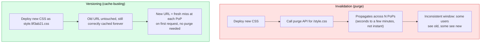

> **Takeaway:** purge is a necessary escape hatch for content you can't rename (a live API response, a CMS page at a fixed URL) but versioning eliminates the entire class of "stale asset" bugs for anything you control the filename of. For the deeper mechanics of stampede protection and staleness trade-offs beyond the CDN specifically, see [Cache_Invalidation_Consistency.md](./Cache_Invalidation_Consistency.md).

---

## 8. Static vs Dynamic Content: ESI and Edge Compute

CDNs started as "static asset only" (images, CSS, JS, video segments) because static files are trivially cacheable — same bytes for every user, for a known TTL. Two developments pushed caching into content that *looks* dynamic:

**Edge Side Includes (ESI):** a markup language (originated at Akamai, now a W3C-adjacent spec, supported by Akamai, Fastly, and Varnish) that lets an otherwise-static page mark small fragments as separately fetched/cached. A product page's layout, header, and footer can be cached for a day, while an `<esi:include src="/fragments/cart-count">` fragment is fetched fresh (or cached for 5 seconds) and stitched in by the edge at request time. This gets you "cache 95% of the page" without an all-or-nothing decision.

**Edge compute (Cloudflare Workers, AWS Lambda@Edge / CloudFront Functions, Fastly Compute@Edge):** actual code running at the PoP, closer to full general-purpose logic than ESI's templating. Common uses:
- **A/B test bucketing and personalization** — decide which variant to serve without a origin round trip.
- **Auth/token checks** — reject an obviously invalid request at the edge before it ever reaches the origin.
- **Image resizing/format negotiation** — serve WebP/AVIF vs JPEG, or a resized thumbnail, computed and cached at the edge on first request.
- **Request/response rewriting** — redirect logic, header injection, geofencing.

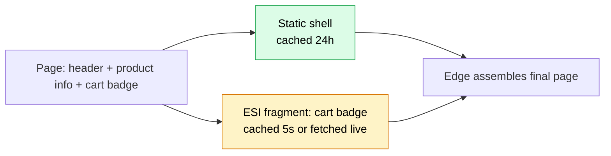

> **Takeaway:** the static/dynamic line isn't binary — ESI and edge compute let you cache *most* of a "dynamic" page and only pay the origin round trip for the genuinely personalized sliver of it.

---

## 9. Anycast Routing and TLS Termination at the Edge

**Anycast** is the network trick that gets a user's packets to the *nearest* PoP without any DNS lookup deciding it. Many PoPs, scattered globally, all announce the *same* IP address via BGP. Internet routers, using ordinary shortest-path routing, naturally forward a given user's packet to whichever announcing PoP is topologically closest (fewest BGP hops/lowest cost) — not necessarily the geographically closest, but usually close enough. This is how Cloudflare and most modern CDNs route: no DNS-level "which region" decision is needed, because the same IP address resolves everywhere and the *network itself* disambiguates. Contrast this with [GSLB.md](./GSLB.md)'s DNS-based approach, where the resolver returns a *different* IP per region and a DNS TTL controls how fast a routing change propagates — anycast changes routes at BGP-convergence speed rather than being bound by a cached DNS answer.

**TLS termination at the edge:** the PoP — not the origin — terminates the user's HTTPS connection. This matters for latency because a TLS handshake costs round trips (1 RTT for TLS 1.3, more for TLS 1.2, zero for a 0-RTT resumption) — terminating that handshake at a PoP 10ms away instead of an origin 170ms away turns a multi-hundred-millisecond handshake into single-digit milliseconds. The edge then either re-encrypts a fresh TLS connection to the origin (common, keeps the origin-facing hop encrypted) or uses a private, already-established connection pool over a trusted network. This is also where the CDN's WAF and DDoS scrubbing sit — malicious traffic is absorbed and filtered before it ever reaches (or even knows the address of) your origin.

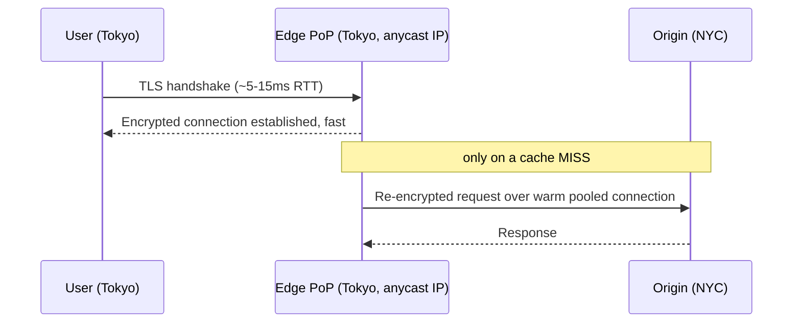

> **Takeaway:** anycast solves *which PoP* a packet reaches without a DNS decision; TLS termination at that PoP turns an expensive long-haul handshake into a cheap local one.

---

## 10. Security: Never Cache PII at the Edge

A CDN edge is a **shared cache** — the same cached response can be served to any user who requests that URL, unless the cache key is explicitly personalized. This makes it categorically dangerous for anything personal:

- **Never mark a personalized response `Cache-Control: public`.** If a "My Account" page, an API response containing another user's name/email/balance, or a response carrying a `Set-Cookie` header for session identity is cached as `public`, the *second* user who requests that URL from the same PoP can be served the *first* user's private page. This is not hypothetical — it is a recognized vulnerability class called **web cache deception**, where an attacker deliberately crafts a URL (e.g. appending `/nonexistent.css` to a personalized endpoint) to trick a cache into storing and later leaking another user's authenticated response.
- **The fix is the same discipline covered in [HTTP_Caching.md](./HTTP_Caching.md):** personalized or sensitive responses must be `Cache-Control: private, no-store` (browser-only, or not cached at all) — never `public` — and a CDN configuration should explicitly exclude authenticated routes, `Set-Cookie`-bearing responses, and any endpoint carrying PII from edge caching rules by default, opting specific safe fragments back in deliberately.
- **A related but distinct risk is cache poisoning** — an attacker manipulates an unkeyed input (an ignored header, a cache-buster query param the origin trusts but the cache key ignores) so that the *cached* response itself becomes malicious for every subsequent visitor, not just leaked to one. Both classes point to the same root cause: **the cache key must fully account for everything that makes a response different, and PII-bearing responses must never enter a shared cache in the first place.**

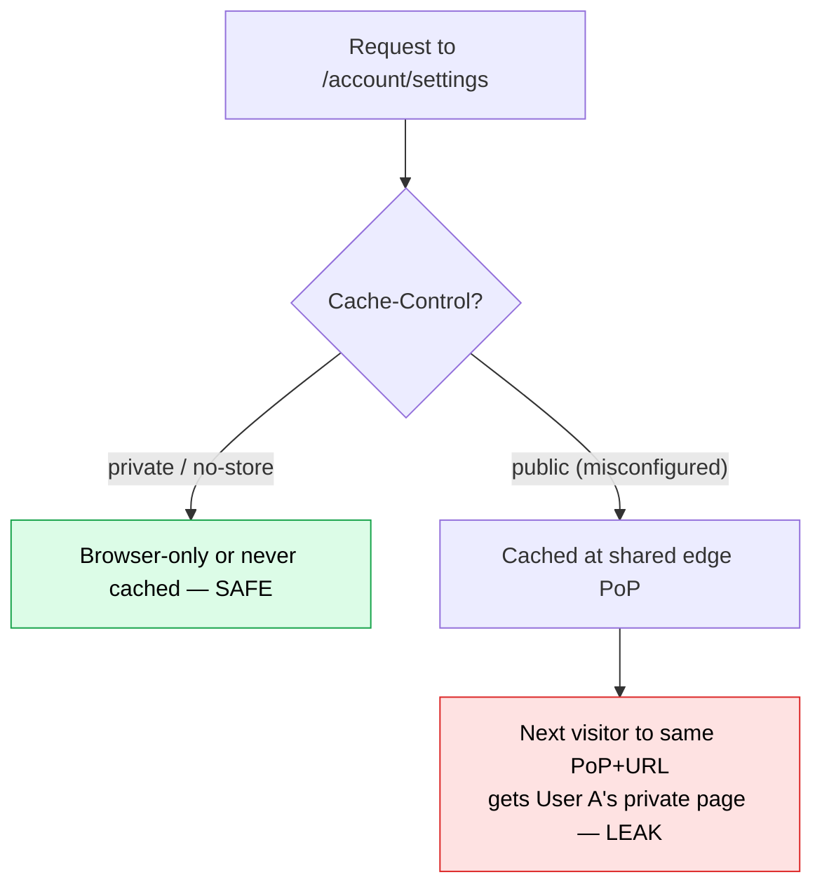

> **Takeaway:** treat "is this response `public`-cacheable at a CDN?" as a security review question, not just a performance one — the default for anything touching auth, session, or personal data must be `private`/`no-store`.

---

## 11. Cache-Hit Ratio Economics and Real Providers

**Hit ratio isn't a vanity metric — it's a direct line item.** Every cache *miss* forwards a request to the origin, which costs origin compute *and* origin egress bandwidth (commonly billed around $0.08-0.09/GB on major clouds before volume discounts). A CDN's own egress to end users is typically cheaper per GB than an origin's, and at high volume many providers negotiate flat or reduced rates — but the bigger lever is simply how *often* the origin has to serve a byte at all.

**Worked arithmetic:** a site serving 10 TB/day of traffic:

| Hit ratio | Traffic hitting origin/day | Origin egress cost/day (@ $0.08/GB) | Monthly cost |
|---|---|---|---|
| 80% | 2 TB | $160 | ~$4,800 |
| 95% | 500 GB | $40 | ~$1,200 |
| 99% | 100 GB | $8 | ~$240 |

Going from an 80% to a 99% hit ratio isn't a 19-percentage-point improvement — it's a **20x reduction** in origin traffic, origin bandwidth cost, and (just as importantly) the number of origin servers you need to provision to survive the miss traffic at all. This is why CDN tuning (cache key hygiene, TTL correctness, origin shield) is treated as a cost project, not just a latency project.

**Real providers, and what each is actually known for:**

| Provider | Known for | Notable feature |
|---|---|---|
| **Cloudflare** | Huge free tier, anycast-everywhere network, 330+ cities | Workers (edge compute), fast global purge |
| **Akamai** | Largest, oldest (founded out of MIT research), ~4,000+ PoPs, deep enterprise/media footprint | Originated ESI; strongest for massive, distributed edge presence |
| **AWS CloudFront** | Deepest integration with AWS (S3, Lambda@Edge, ACM), 600+ edge locations | Origin Shield built-in as a checkbox feature |
| **Fastly** | Varnish-based, real-time (sub-second) purge, VCL config power-users love | Compute@Edge; used by GitHub, Reddit, Stripe |
| **Netflix Open Connect** | Proprietary CDN embedded physically *inside* ISP data centers | Purpose-built for one workload: video, at ISP-adjacent scale |

> **Takeaway:** the hit ratio you achieve is, almost directly, the fraction of your egress bill and origin capacity you get to delete.

---

## 12. Worked Example — Launching a Game Patch Globally

**The prompt:** "Our studio is releasing a 40GB day-one patch. 2 million players worldwide will try to download it within the first hour of unlock. Design the delivery."

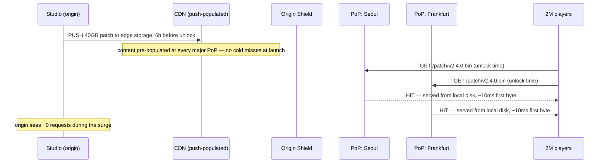

**Closing the loop — the numbers that force each decision:**
- **Why push, not pull:** at unlock, 2M players hit "download" within minutes. Under pull/lazy caching, the *first* request at each of ~300 PoPs would be a cold miss — up to 300 simultaneous 40GB pulls hammering the origin at the exact same second, a textbook thundering herd that no origin fleet is sized for. Pushing the patch to every PoP 6 hours ahead means **every PoP is already warm** before a single player clicks download — the origin's real job is done hours before launch, not during it.
- **Why an origin shield still matters even with push:** for any *long-tail* content around the launch (patch notes translated into 20 languages, per-region promotional assets) that wasn't explicitly pushed, a shield still collapses whatever residual misses occur into one origin request instead of hundreds.
- **Why versioned filenames (`v2.4.0.bin`) rather than a fixed `/patch/latest.bin`:** if a hotfix patch (`v2.4.1`) ships two hours later, the new version is a brand-new URL — an automatic, instant, zero-purge cache miss/repopulation at each PoP, with zero risk of players getting a mixed old/new patch mid-download from a stale cache.
- **The consequence:** the entire design turns on one number — "2 million requests in one hour" — which rules out pull-only delivery and makes push + shield + versioning the only credible answer.

---

## 13. Real-Life Use Cases

| Situation | How CDN concepts apply | The decision it forces |
|-----------|------------------------|------------------------|
| **E-commerce product images/CSS/JS** | Pull model, content-hashed filenames, `max-age=31536000, immutable` | Versioning over purge; near-100% hit ratio achievable |
| **Netflix video streaming** | Push-style pre-positioning via Open Connect boxes physically inside ISPs | Push wins when you can predict demand and own the hardware relationship |
| **New game/firmware release** | Push pre-population ahead of a synchronized unlock time | Push avoids a pull-model thundering herd on launch |
| **News homepage during a breaking event** | Short TTL (`s-maxage=5-10`) + origin shield to absorb a traffic spike on a page that changes minutely | Short TTL trades a little staleness for surviving a 100x traffic surge |
| **Personalized "My Account" page** | Never cached `public`; `private`/`no-store`, or edge compute personalizes a cached shell | Security review, not just a performance one |
| **API responses with per-user data** | ESI/edge compute to cache the static shell, fetch the personalized fragment live | Partial caching instead of all-or-nothing |
| **Global site, single-region origin failing** | `stale-if-error` at the edge keeps serving last-known-good content | CDN becomes an availability layer, not just a speed layer |

> **The habit:** for every asset, ask "can this URL's *filename* change when the content changes?" — if yes, version it and cache forever; if no (a fixed API/CMS URL), you're committed to purge-based invalidation and its propagation lag.

---

## 14. Failure Modes

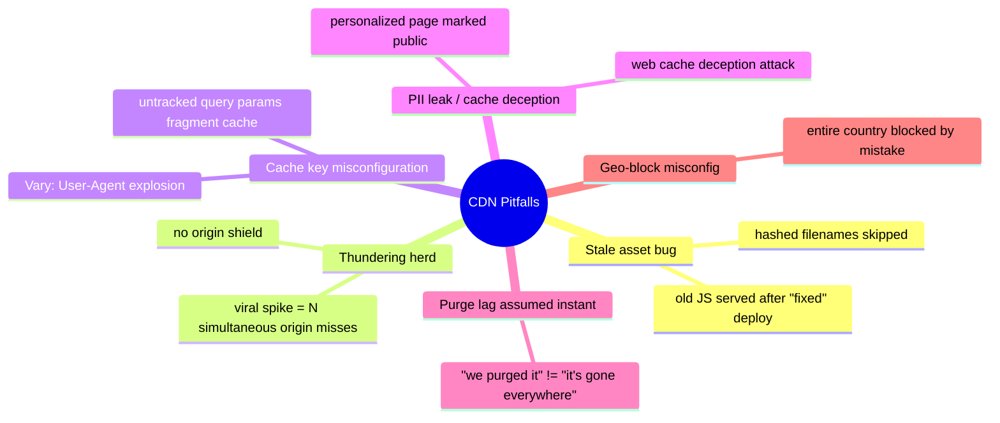

- **Stale asset bug.** *Symptom:* users see a broken page — old JS paired with new HTML, or a CSS regression that "should have been fixed 10 minutes ago." *Root cause:* the deploy relied on purge instead of versioning, and the purge hadn't propagated to every PoP yet (or wasn't triggered for that specific path at all). *Fix:* adopt content-hashed filenames for anything cacheable long-term; reserve purge for the rare fixed-URL resource, and never assume a purge call means "gone everywhere" the instant it returns 200.
- **Thundering herd on a viral spike.** *Symptom:* a suddenly-popular object causes the origin to receive a burst of near-simultaneous requests and falls over. *Root cause:* no origin shield/tiered caching — every PoP's independent cache miss goes straight to the origin. *Fix:* enable origin shield / tiered distribution so all PoPs converge on one mid-tier cache, which itself sends the origin exactly one request via request coalescing.
- **Cache key misconfiguration collapsing hit ratio.** *Symptom:* hit ratio is inexplicably low despite generous TTLs. *Root cause:* `Vary: User-Agent` (or an equivalently high-cardinality header) is fragmenting the cache into near-unique entries, or untracked marketing query parameters (`?utm_source=...`) are doing the same thing on the URL side. *Fix:* audit `Vary` usage down to genuinely necessary headers (`Accept-Encoding` is usually the only one needed); configure the CDN's cache-key policy to strip known-irrelevant query parameters.
- **PII leak via a misconfigured `public` cache.** *Symptom:* one user reports seeing another user's account data. *Root cause:* a personalized or authenticated response was cached as `public` at a shared edge node, or an attacker exploited web cache deception by requesting a crafted URL against a personalized endpoint. *Fix:* default authenticated/personalized routes to `private, no-store`; explicitly allow-list only genuinely shared, non-personal fragments into shared caching.
- **Assuming purge is instant.** *Symptom:* "I purged it, why do some users still see the old version 40 seconds later?" *Root cause:* purge is a propagation operation across hundreds to thousands of independent PoPs — it takes real, non-zero time (seconds to a few minutes depending on provider and purge type), and different PoPs converge at different times. *Fix:* design for eventual convergence (short-lived staleness windows during a purge) or avoid purge entirely via versioning.
- **Geo-blocking misconfiguration.** *Symptom:* an entire country's users suddenly can't reach the site. *Root cause:* an overly broad security/WAF rule (often meant to block one abusive ASN or a specific threat feed) was configured at the country level. *Fix:* scope security rules as narrowly as the actual threat, and always canary a new WAF/geo rule against a small traffic percentage before a full rollout.

---

## 🏋️ Practice Drills

> *Cover the solutions and attempt first — active recall is the point.*

**Drill 1 — Do the latency math.** A user in São Paulo requests a page from an origin in Virginia (great-circle distance ~7,700 km). Estimate the theoretical minimum round-trip time using light in fiber (~200,000 km/s), then explain why a CDN edge PoP in São Paulo changes the number that matters.

<details><summary>Solution</summary>

Round trip = 2 × 7,700 km ÷ 200,000 km/s = 0.077s = **~77ms minimum**, before any router hops, queueing, or the fact that real cable routes aren't straight lines — real-world RTT is typically noticeably higher (commonly 90-120ms for this kind of distance). A CDN PoP in São Paulo doesn't change the *origin's* distance from Virginia — it changes *how often* that 77ms+ trip has to happen. With the PoP, only a cache *miss* pays that cost (a rare event, borne by the PoP-to-origin hop); every cache *hit* is served from São Paulo at local last-mile latency (a few milliseconds), which is what the vast majority of users experience.
</details>

**Drill 2 — Pick invalidation or versioning.** For each asset, decide: purge-based invalidation, or versioned filename? (a) `/static/logo.png`, updated twice a year; (b) `/api/homepage-config` returning JSON that marketing edits live via a CMS at a fixed URL; (c) `/js/app.js`, rebuilt on every deploy.

<details><summary>Solution</summary>

(a) **Versioning** — `logo.a1b2c3.png` with `max-age=31536000, immutable`. It changes rarely, and there's no reason to ever purge — just reference the new hash where the logo is used.

(b) **Purge (invalidation)** — the URL is fixed because the CMS/marketing team expects a stable link, so it can't be renamed per edit. Use a short TTL plus an explicit purge call (or `stale-while-revalidate`) triggered by the CMS save action, and accept a brief propagation window across PoPs.

(c) **Versioning** — this is the textbook case: hash the build output filename on every deploy, reference the new hash from `index.html` (which itself should be short-TTL/no-cache so users pick up the new reference promptly). Zero purge needed for the JS bundle itself.
</details>

**Drill 3 — Design the launch.** You're launching a livestream expected to draw 500,000 concurrent viewers at a scheduled start time. Walk through: pull or push, why an origin shield still matters, and what TTL strategy you'd use for the stream manifest vs the video segments.

<details><summary>Solution</summary>

**Pull is fine here, but only with a shield** — unlike a static file you can push ahead of time, a *live* stream's segments don't exist until they're encoded in real time, so there's nothing to push in advance. What you *can* do is warm the PoPs' connections and DNS resolution ahead of the start time, and rely on the origin shield to ensure that even though 500,000 viewers are all requesting the *same* few-second video segment as it's produced, each PoP's near-simultaneous miss for that segment collapses into one shield request and one origin fetch — not 500,000 (or even "one per PoP") hits on the origin.

**TTL strategy:** the manifest (playlist of available segments) needs a *very* short TTL (a few seconds) since it changes constantly as new segments become available — but it's tiny, so frequent re-fetches are cheap. Each individual video segment, once encoded, is immutable — it can be cached with a long TTL (it will never change again), so once the first viewer at a PoP causes a miss, every other viewer at that PoP for that segment is a hit. This mirrors the "hash-the-filename, cache forever" pattern: segments are already uniquely named by sequence number, so they behave like versioned assets.
</details>

**Drill 4 — Spot the security bug.** A junior engineer sets `Cache-Control: public, max-age=300` on `/api/user/profile`, which returns the logged-in user's name, email, and last four digits of their payment card. What's wrong, and what's the fix?

<details><summary>Solution</summary>

**This is a PII leak waiting to happen.** `public` tells any shared cache — including the CDN's edge PoPs — that it's safe to store this response and serve it to *any* subsequent requester of that same URL, regardless of who they are or whether they're authenticated as a different user. Because the response is personalized per session/user but the cache key (by default, just the URL) doesn't distinguish between users, the second person to hit `/api/user/profile` at that PoP within 5 minutes could be served the *first* user's name, email, and card digits.

**Fix:** set `Cache-Control: private, no-store` (or at minimum `private, max-age=0`) so only the individual user's own browser may cache it, and the CDN's shared cache never stores it at all. If there's a genuine need to cache part of a personalized page at the edge, split it — cache the non-personal shell publicly, and fetch the personalized fragment via edge compute/ESI with `private`/`no-store` semantics of its own.
</details>

---

## 🎤 Interview Q&A Bank

**Q1. "How does a CDN improve latency — what's actually happening under the hood?"**
> It places edge PoPs physically close to users, so most requests are served from a nearby cache instead of crossing the long-haul network to a distant origin. It doesn't speed up the physics of a cross-ocean trip — it makes that trip a rare event (a cache miss, handled once per PoP per TTL window) instead of the path every single request takes. The 150-180ms NY-Tokyo round trip doesn't disappear; it just stops happening on every request.

**Q2. "Pull vs push CDN — when would you use each?"**
> Pull (origin-pull, lazy) caches on first request and is the default for essentially all general web/app traffic — zero setup, works automatically for a huge catalog. Push means proactively uploading content ahead of demand, which you reach for when you can predict a synchronized surge — a game patch, a firmware release, a movie's day-one drop — because without pre-population, the first moment of demand would be a simultaneous cold-miss thundering herd across every PoP at once.

**Q3. "What's an origin shield and why does it matter?"** *(signal: understanding of cache hierarchy, not just "there's an edge cache")*
> It's a mid-tier cache that every edge PoP checks on a miss before going to the origin. Without it, a popular object missing at 300 PoPs simultaneously sends 300 concurrent requests to the origin — a thundering herd. With a shield, all those misses converge on one node, which itself coalesces them into a single origin request. It turns "N PoPs × 1 request each" into "1 shield × 1 origin request," at the cost of one extra hop of latency on the rare cold path.

**Q4. "Why is cache invalidation across a CDN considered hard?"**
> Because purging a URL isn't instant — it has to propagate to every PoP that might be holding a copy, which realistically takes anywhere from a few seconds to a couple of minutes depending on the provider and purge type, and different PoPs converge at different times. During that window, different users legitimately see different versions of the same URL. The better fix, wherever possible, is to sidestep the problem entirely with content-hashed filenames (versioning) so you never have to invalidate — a "stale" URL is simply never reused for new content.

**Q5. "How do you decide what should and shouldn't be cached at the CDN edge?"** *(signal: security awareness, not just performance)*
> Static, non-personalized content with a knowable TTL is the easy case — cache it aggressively, ideally with a versioned filename. Anything personalized or containing PII must default to `private, no-store` — a shared edge cache serving one user's cached response to a different user is a real leak (the "web cache deception" attack class exploits exactly this). For content that's *mostly* static but has a personalized sliver — a page with a cart badge — use ESI or edge compute to cache the shell and fetch the personalized fragment live, rather than making an all-or-nothing decision.

**Q6. "What's the difference between anycast routing and DNS-based GSLB?"**
> Anycast has many PoPs announce the same IP address via BGP, and ordinary internet routing sends a user's packets to the topologically nearest announcer — no DNS decision involved, and route changes propagate at BGP-convergence speed. DNS-based GSLB (see [GSLB.md](./GSLB.md)) returns a *different* IP per region/user, so the routing decision is made once per DNS lookup and is bounded by however long that answer's TTL is cached by resolvers — a region failing over via DNS can take minutes to fully propagate, versus anycast's much faster network-level rerouting.

**Q7. "Your hit ratio dropped from 95% to 60% after a deploy — what would you check?"**
> First suspect the cache key: did the deploy add a new response header the origin now varies on (`Vary: X-New-Header`), or introduce a new query parameter (a cache-buster, an A/B test flag) that the CDN's cache-key policy doesn't know to ignore? Both fragment what used to be one cache entry into many near-unique ones. I'd also check whether TTLs regressed (a config default accidentally shortened `max-age`) or whether a new code path is unintentionally returning `no-store`/`private` on something that used to be cacheable.

**Q8. "How does a CDN help with availability, not just speed?"**
> Beyond serving from cache, most CDNs support `stale-if-error` (or equivalent) — if the origin is down or erroring, the edge keeps serving the last good cached response instead of propagating the failure to the user. Combined with the CDN's own DDoS scrubbing and WAF sitting in front of the origin, the CDN becomes a resilience layer: your site can survive both a traffic spike and a full origin outage from the user's perspective, at least for anything already cached.

---

## 🎯 Staff+ Nuances

- **The origin shield is the single highest-leverage lever most teams under-configure.** It's frequently a checkbox (CloudFront's "Origin Shield," Fastly's "shielding") rather than a redesign, yet it's the difference between "a viral spike collapses my origin" and "a viral spike is invisible to my origin." Senior engineers reach for this before reaching for "add more origin servers."
- **Versioning doesn't fully replace purge — it relocates the hard problem to the HTML/entry-point layer.** The hashed asset is trivially cacheable forever, but the page that *references* it (`index.html`, a service worker's manifest) must still be served fresh enough that clients discover the new hash promptly. Teams that version their JS/CSS but leave `index.html` cached for a day have just moved the staleness bug one layer up, not eliminated it.
- **Anycast has a subtlety that trips people up: it's not naturally session-sticky.** BGP route changes (a link flaps, a route gets withdrawn) can mid-flight redirect a user's packets to a *different* PoP, which is fine for stateless HTTP requests but breaks a long-lived TCP connection or an in-progress TLS session if the new PoP doesn't have that session's state. Production anycast CDNs mitigate this with careful BGP engineering and, where needed, session affinity mechanisms — it's not automatically "just works" for everything.
- **`Vary` and cache-key design deserve more design attention than TTL tuning does.** Engineers obsess over "what should `max-age` be" while a careless `Vary` header or an unstripped query parameter silently caps the achievable hit ratio regardless of TTL. Auditing cache-key composition is usually higher-leverage than TTL micro-optimization.
- **Web cache deception and cache poisoning are under-discussed in interviews but are real production incidents.** Both stem from the same root idea — an input that affects the response isn't fully reflected in the cache key — and both deserve a mention when a candidate is asked to design a caching layer for anything with authenticated users. Naming the vulnerability class signals you've thought past "cache = fast."
- **Push vs pull is really a bet on predictability, and mispredicting is expensive both ways.** Pushing content nobody ends up requesting wastes storage and (on some providers) pre-warming cost across every PoP; relying on pull for a launch you *should* have predicted invites a thundering herd at the worst possible moment (launch day, maximum visibility). The judgment call is in forecasting demand shape, not just picking a model.
- **CDN egress cost, not just latency, increasingly drives the "is this worth caching" decision.** As traffic and video/AI-generated media volumes grow, the pure dollar savings from hit-ratio improvements (see the 20x example in [§11](#11-cache-hit-ratio-economics-and-real-providers)) frequently outweighs the latency argument in the business case that gets a CDN project approved at all.
- **Stale-while-revalidate and stale-if-error blur "caching" into "resilience," and that's deliberate.** Modern edge configuration increasingly treats "serve something, even if slightly wrong or old" as a first-class availability strategy, not a caching afterthought — worth naming explicitly when discussing how a CDN improves uptime, not just P50 latency.

---

## 18. Cheat Sheet

```
CDN — beating the speed of light by moving data closer to users
═══════════════════════════════════════════════════════════════════════════

WHY IT EXISTS
  light in fiber ≈ 200,000 km/s (refractive index ~1.47)
  NY↔Tokyo round trip: ~108ms physics floor, ~150-180ms real-world
  → no code fix removes that; only fix is fewer/shorter trips (edge PoPs)

PULL vs PUSH
  PULL (origin-pull, lazy)   DEFAULT · cache on 1st request · cold miss per PoP
  PUSH (pre-populate)        for PREDICTABLE synchronized surges (game patch, launch)
                             avoids thundering herd at T-zero

CACHE HIERARCHY
  Edge PoP (100s-1000s) → Origin Shield (1 mid-tier node) → Origin
  shield = request coalescing: 300 PoP misses → 1 origin request
  negative caching: briefly cache 404/500s too, don't hammer origin for missing content

TTL / CACHE-CONTROL AT EDGE
  s-maxage overrides max-age for SHARED caches (CDN) vs browser
  cache key = scheme+host+path (+query, +Vary'd headers) — DEFAULT, not fixed
  Vary: Accept-Encoding = safe (2-3 variants)
  Vary: User-Agent = FOOTGUN (near-infinite variants, hit ratio → 0)
  strip tracking query params (utm_*) from cache key to avoid fragmentation

INVALIDATION vs VERSIONING
  purge = propagates across N PoPs, NEVER instant (seconds → few minutes)
  versioning = hash filename (app.9f3ab21.js) → old URL never touched,
               new URL = independent fresh miss per PoP, ZERO purge needed
  prefer versioning; purge is the escape hatch for fixed URLs (CMS, live API)

STATIC vs DYNAMIC
  ESI: cache page shell, fetch small dynamic fragment, edge assembles
  edge compute (Workers/Lambda@Edge/Compute@Edge): personalization, auth
    checks, image resize — logic AT the PoP, no origin round trip

ROUTING & TLS
  anycast: many PoPs announce SAME IP via BGP → router picks nearest, no DNS wait
  vs GSLB/DNS: different IP per region, bound by DNS TTL propagation (see GSLB.md)
  TLS terminates AT the edge → 1-RTT handshake at 10ms, not 170ms to origin
  re-encrypt (or trusted pool) edge→origin on a miss

SECURITY — PII
  NEVER Cache-Control: public on personalized/authenticated responses
  default: private, no-store for anything with Set-Cookie / user data
  "web cache deception" = attacker tricks shared cache into leaking one
    user's response to another — same root cause as bad cache-key design

ECONOMICS (10 TB/day site, $0.08/GB origin egress)
  80% hit ratio → 2 TB/day to origin → ~$4,800/mo
  99% hit ratio → 100 GB/day to origin → ~$240/mo   (20x reduction)
  hit ratio = a cost line item, not just a latency metric

REAL PROVIDERS
  Cloudflare (anycast, 330+ cities, Workers) · Akamai (~4,000 PoPs, invented ESI)
  CloudFront (AWS-native, Origin Shield checkbox) · Fastly (Varnish, sub-second purge)
  Netflix Open Connect (proprietary, boxes inside ISPs)

PITFALLS
  ✗ purge assumed instant → stale asset served minutes later
  ✗ no origin shield → viral spike = thundering herd on origin
  ✗ Vary/query-param cache-key sprawl → hit ratio collapses silently
  ✗ public on personalized response → PII leak / web cache deception
  ✗ overbroad geo/WAF rule → entire country blocked by accident
  ✓ stale-if-error / stale-while-revalidate → CDN becomes an availability layer
```

---

## 19. Connections & Further Reading

**Prerequisites (learn first):**
- [HTTP_Caching.md](./HTTP_Caching.md) — `Cache-Control`, `ETag`, `public`/`private` semantics that the CDN edge obeys and extends with `s-maxage`.

**Builds toward / pairs with:**
- [GSLB.md](./GSLB.md) — the DNS-level routing layer that often sits above or alongside a CDN's own anycast network; contrast anycast (§9) vs DNS-based failover.
- [Cache_Invalidation_Consistency.md](./Cache_Invalidation_Consistency.md) — the deeper treatment of stampede mitigation, stale-while-revalidate, and cache-DB consistency that generalizes beyond CDN purge specifically.
- [Caching_Strategies.md](./Caching_Strategies.md) — cache-aside/write-through patterns; the CDN's pull model is cache-aside applied at a shared network layer.
- [13 · Cloud Native Infrastructure](../13_Cloud_Native_Infrastructure/) — edge compute (Lambda@Edge, Cloudflare Workers) beyond static caching.

**Gaps this topic exposes (candidates for the section's Gap Analysis):**
- A dedicated deep-dive on edge compute platforms (Workers/Lambda@Edge/Compute@Edge) as a general pattern, not just as a CDN feature — currently only touched on here and in 13_Cloud_Native_Infrastructure.
- Web cache deception / cache poisoning as a named security topic — currently mentioned only in passing here; could deserve its own treatment in a security-focused section.

**External classics:**
- [Cloudflare: What is a CDN?](https://www.cloudflare.com/learning/cdn/what-is-a-cdn/) — accessible overview with real network-scale numbers.
- [AWS: How CloudFront Works](https://aws.amazon.com/cloudfront/details/) — origin shield, cache policies, invalidation mechanics from a major vendor.
- [Fastly: Varnish Configuration Language (VCL) docs](https://developer.fastly.com/reference/vcl/) — for readers who want to see cache-key/TTL logic as actual code.
- [PortSwigger Research: Web Cache Deception](https://portswigger.net/research) — the security vulnerability class referenced in §10.

---

## TL;DR
**A CDN is a global network of edge PoPs that turns "every user pays the speed-of-light cost of reaching a distant origin" into "almost every user hits a nearby cache, and only a rare miss pays that cost once per PoP."** Default to the pull model (cache-aside at the edge) and reserve push for predictable synchronized surges; use an origin shield to collapse simultaneous misses across hundreds of PoPs into a single origin request instead of a thundering herd; and prefer content-hashed versioning over purge-based invalidation wherever possible, because purge propagation across hundreds of independent caches is never instant. Compose your cache key deliberately — an unaudited `Vary` header or an untracked query parameter silently destroys hit ratio — and **never let a personalized or PII-bearing response be cached as `public` at a shared edge node**, since that's a direct path to leaking one user's data to another. Done well, hit-ratio improvements aren't just a latency win — a jump from 80% to 99% is a 20x cut in origin egress cost and required origin capacity, which is why CDN tuning is as much a cost and security project as a performance one.
