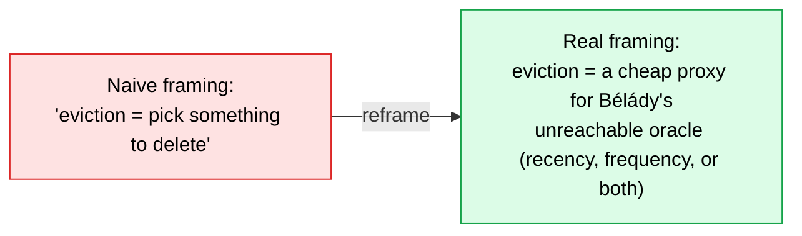
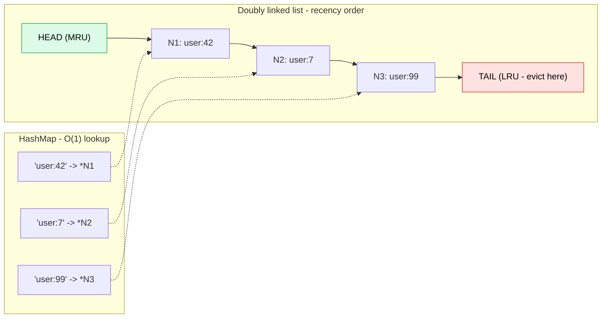
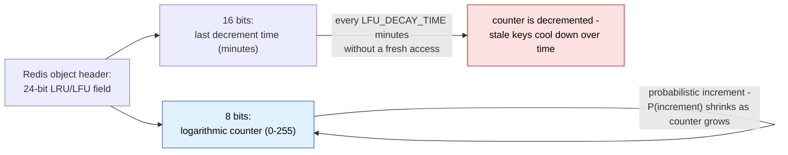
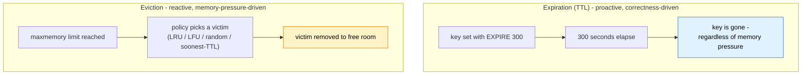
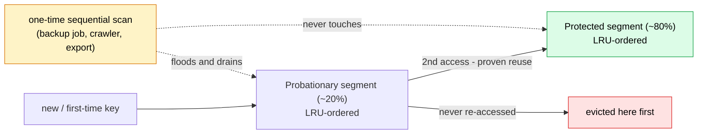
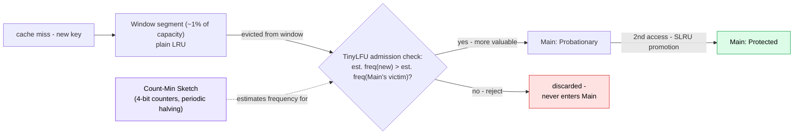
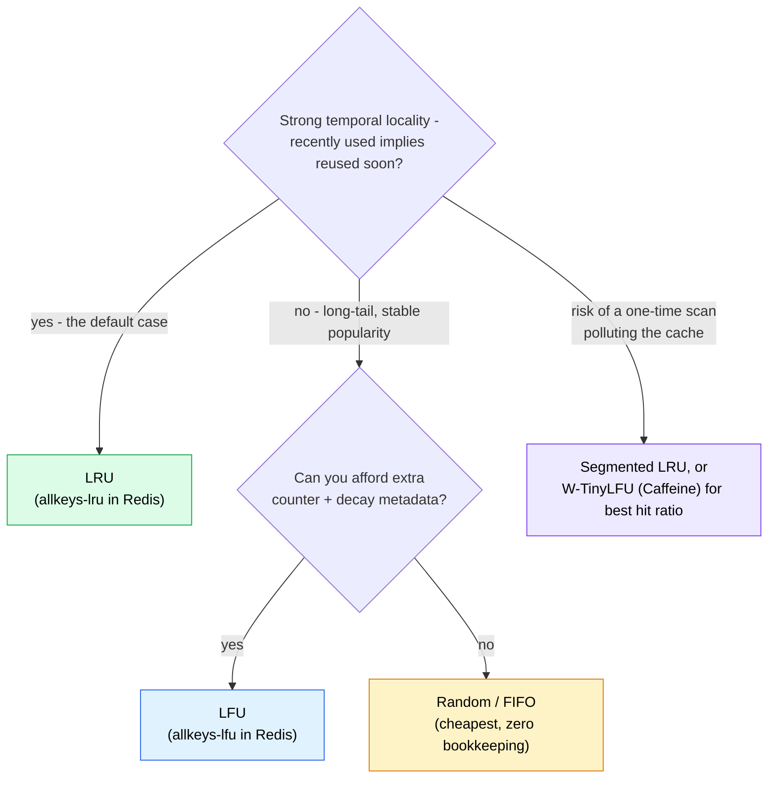
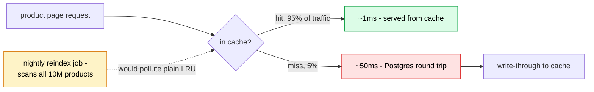
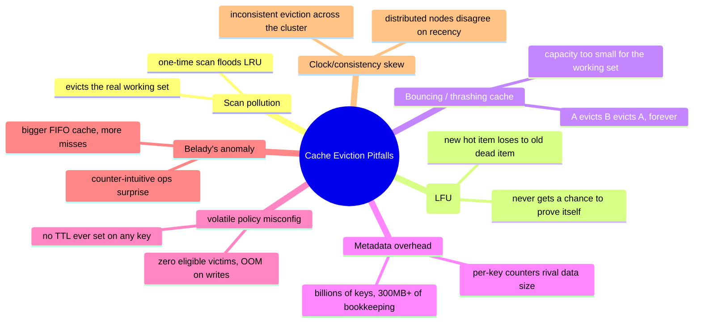

# Cache Eviction Policies

> **One line:** RAM is finite and everything you might ever want is not — an eviction policy is the cheap, real-time rule that decides which cached item to throw away when new data needs the room, and the whole game is picking a proxy for "what won't be needed again soon" without actually being able to see the future.

---

## Table of Contents
1. [Why You Must Master This](#1-why-you-must-master-this)
2. [The Mental Model](#2-the-mental-model)
3. [LRU — Recency as a Proxy for the Future](#3-lru--recency-as-a-proxy-for-the-future)
4. [LFU — Frequency Tracking and the Cold-Start Problem](#4-lfu--frequency-tracking-and-the-cold-start-problem)
5. [FIFO, Random, and TTL — Expiration vs Eviction](#5-fifo-random-and-ttl--expiration-vs-eviction)
6. [Scan Resistance — Segmented LRU](#6-scan-resistance--segmented-lru)
7. [Admission Policies — TinyLFU and W-TinyLFU](#7-admission-policies--tinylfu-and-w-tinylfu)
8. [Redis maxmemory-policy in Practice](#8-redis-maxmemory-policy-in-practice)
9. [Hit-Ratio Math and the Decision Guide](#9-hit-ratio-math-and-the-decision-guide)
10. [Worked Example — Sizing a Product Cache](#10-worked-example--sizing-a-product-cache)
11. [Real-Life Use Cases](#11-real-life-use-cases)
12. [Failure Modes](#12-failure-modes)
13. [🏋️ Practice Drills](#-practice-drills)
14. [🎤 Interview Q&A Bank](#-interview-qa-bank)
15. [🎯 Staff+ Nuances](#-staff-nuances)
16. [Cheat Sheet](#16-cheat-sheet)
17. [Connections & Further Reading](#17-connections--further-reading)

---

## 1. Why You Must Master This

A cache is a bet on finite memory holding the *right* subset of infinite data. Eviction policy is the referee that enforces that bet every time the cache fills up — get it wrong and the cache actively hurts you.

- **Without an eviction policy, a cache is an OOM crash waiting to happen.** Every `SET` grows memory; nothing ever shrinks it. Left unbounded, Redis (or any in-memory cache) eventually exhausts RAM and either the process is OOM-killed or, if `maxmemory` is set with no policy, every write starts returning errors.
- **The policy IS the hit ratio, and hit ratio IS your database's survival.** A cache that evicts the wrong item churns — the same hot key gets fetched from the DB over and over. Moving from a 50% to a 95% hit ratio isn't a minor tuning knob; it can be the difference between your database handling load and falling over (the math in [§9](#9-hit-ratio-math-and-the-decision-guide) makes this concrete).
- **It's one of the most common whiteboard problems in the industry.** "Design an LRU cache with O(1) get/put" (LeetCode 146) is asked constantly precisely because it forces you to combine two data structures correctly under a real constraint — and "how would Redis actually implement this at scale" is the natural, deeper follow-up that separates candidates who memorized the trick from candidates who understand it.
- **Production incidents trace back to eviction misconfiguration more often than people expect.** A `volatile-lru` policy on a Redis instance where nobody ever set a TTL behaves like `noeviction` — writes start failing under load with no memory freed, and the on-call engineer is debugging "high memory, evictions not happening" at 2 AM.

> **The core problem it solves:** *choosing, in O(1) time and with a proxy signal, which item to discard when the cache is full and the future access pattern is unknown.*

**Prerequisites:** [Caching_Strategies.md](./Caching_Strategies.md) — you should already know *why* a cache exists (cache-aside, write-through, etc.) before tackling *what happens when it's full*.

---

## 2. The Mental Model

Imagine an oracle that could tell you, right now, which of your cached items will be requested furthest in the future (or never again). Evict that one, and you've made the mathematically optimal choice — this is **Bélády's MIN / OPT algorithm**, the theoretical best-possible eviction policy. It requires seeing the future, so no real system can run it. Every real eviction policy — LRU, LFU, FIFO, random, TinyLFU — is a *cheap, causal approximation* of that oracle, using a different observable signal as its guess about "what won't be needed soon."



> **Hold onto this:** every policy name in this file is just a different bet about the future — LRU bets "recently used implies used again soon" (temporal locality), LFU bets "frequently used historically implies used again" (long-term popularity), FIFO/Random bet nothing at all and just want O(1) cheapness. Picking a policy is picking which bet matches your actual traffic.

---

## 3. LRU — Recency as a Proxy for the Future

**What it is:** evict the item whose *last access* is furthest in the past. **Why it exists:** most real workloads exhibit **temporal locality** — a Zipfian/80-20 pattern where whatever was just touched is disproportionately likely to be touched again in the next few seconds (a user re-loading their own feed, a retry, a hot product page during a flash sale). LRU exploits exactly that.

**How it actually works (the part interviews probe):** the naive design — a timestamp per item, scan all items to find the oldest on every eviction — is O(n) per eviction. At 10M keys that's unusable. The real O(1) design combines two structures:

- A **hashmap**: `key → pointer to its node` for O(1) lookup.
- A **doubly linked list**, kept in strict recency order: head = most-recently-used (MRU), tail = least-recently-used (LRU, the eviction candidate).



> Every `get`/`put` touches the hashmap once (O(1) lookup) and the linked list once (O(1) unlink + relink to head) — never a scan.

- **`get(key)`:** hashmap lookup → O(1). If found, unlink the node from wherever it sits and relink it at the head (it's now the MRU) → O(1) pointer surgery, no traversal.
- **`put(key, value)`:** if key exists, update value and move to head as above. If the cache is now over capacity, remove the **tail** node (O(1), you hold the pointer already) and delete its key from the hashmap.
- Python's `collections.OrderedDict` (or `dict` since 3.7, which preserves insertion order) implements exactly this pair internally, which is why `move_to_end()` + `popitem(last=False)` gives you O(1) LRU with four lines of code.



> **The one takeaway:** the hashmap gives O(1) *access* (key → node pointer, no scan) and the doubly linked list gives O(1) *reordering* (unlink + relink to the front) — an eviction is just dropping whatever node is sitting at the tail, never a search for it.

**The trade-off:** LRU matches roughly 90% of real access patterns and is cheap to reason about — but it is **polluted by a single one-time scan**. A backup job, a search-engine crawler, or an analytics export that touches every key exactly once inserts each of those keys at the MRU head, one after another, shoving every genuinely hot key toward the tail. The scan evicts your real working set even though none of the scanned keys will ever be read again. [§6](#6-scan-resistance--segmented-lru) is the direct fix.

**Real systems:** the Linux page cache uses a two-list LRU-derived scheme (active/inactive lists) for exactly this reason; Memcached's default policy is LRU per slab class; CPU L1/L2/L3 caches approximate LRU with a cheap bit-tree called **pseudo-LRU (PLRU)** because tracking *exact* recency for an 8-way or 16-way set-associative cache in hardware is too expensive in gates and latency — PLRU gets within a few percent of true LRU's hit ratio at a fraction of the circuit cost. Redis itself doesn't implement *exact* LRU either — see [§8](#8-redis-maxmemory-policy-in-practice).

---

## 4. LFU — Frequency Tracking and the Cold-Start Problem

**What it is:** evict the item with the lowest historical access *count*, not the oldest-touched one. **Why it exists:** LRU's blind spot is exactly the case where an item is globally, durably popular but happens to be idle for a moment — a celebrity's profile at 3 AM, a homepage banner between traffic waves. LRU would happily evict it after one quiet minute; LFU protects anything with a long accumulated track record.

**How it actually works — the classic algorithm:** the naive version (a counter per key, scan for the minimum on eviction) is O(n) again. The textbook O(1) design (LeetCode 460) keeps a hashmap of `frequency → doubly-linked-list of keys at that frequency`, plus a pointer to the current minimum frequency bucket, so both "increment this key's count and move it to the next bucket" and "evict from the min-frequency bucket" are O(1).

**The cold-start problem (the real weakness):** a brand-new, genuinely-about-to-go-viral item enters with count = 1. An old item with count = 50,000 accumulated over six months — even if nobody has read it in weeks — will always look "more valuable" to naive LFU. The new hot item gets evicted almost immediately, and the stale-but-historically-popular item never leaves. **LFU never forgets, and that's the problem**: it optimizes for all-time popularity, not *current* popularity.

**How Redis actually fixes this — probabilistic aging:** storing a real 64-bit counter per key at scale is expensive (1B keys × 8 bytes = 8 GB just for counters). Redis instead repurposes the 24-bit field every object header already carries for LRU timestamps into two fields when `maxmemory-policy` is LFU-based:



- **8-bit logarithmic counter (0–255):** increments are *probabilistic* — the higher the current count, the less likely the next access actually bumps it (a Morris-counter-style trick). This lets 8 bits represent access counts that would otherwise need dozens of bits.
- **16-bit decay timestamp:** every `LFU_DECAY_TIME` minutes of *no* access, the counter is decremented. This is the aging fix — a key that was hot for a month but has been silent for a week gradually cools down and becomes evictable again, instead of blocking new hot keys forever.

**The trade-off:** LFU (with decay) resists a one-time scan far better than plain LRU — a scan of 1M cold keys barely nudges their counters above 1, so they're evicted right after the scan finishes, not the genuinely hot data. The cost is more metadata and machinery (the 24-bit field is spent regardless of policy — at 100M keys that's ~300 MB of pure bookkeeping) and, without decay, the cold-start problem described above.

---

## 5. FIFO, Random, and TTL — Expiration vs Eviction

**FIFO (First-In-First-Out):** evict whatever was *inserted* first, with zero regard for access pattern — a plain queue, O(1), no per-access bookkeeping at all. It's the right choice only when access is genuinely close to uniform-random (no temporal or frequency locality to exploit), or when the CPU/memory budget for tracking recency is the binding constraint (some embedded and high-object-count edge caches).

> **Staff+ trivia that's a great interview flex:** FIFO can suffer **Bélády's anomaly** — increasing the cache size can *increase* the number of misses, which is deeply counter-intuitive (bigger cache, worse hit ratio). LRU is a "stack algorithm" and is mathematically proven immune to this anomaly — one of the few provably desirable properties of a recency-based policy, and it's *why* LRU is used far more than FIFO despite FIFO being simpler.

**Random eviction:** evict a uniformly random key. O(1), zero metadata, immune to scan pollution (it doesn't reward recency, so a scan gains nothing) — and on some real Redis workloads it performs surprisingly close to LRU because the metadata savings offset the "wrong" evictions. It's the right default only when the access pattern truly has no locality to exploit and you want the absolute cheapest policy available.

**TTL — a different axis entirely (expiration, not eviction):** eviction is *reactive* — triggered by memory pressure, and the policy (LRU/LFU/random) decides the victim. **Expiration is proactive** — a data-*correctness* decision, independent of memory pressure, that says "this key must disappear after N seconds no matter what" (a session token, an OTP, a rate-limit counter, an idempotency key). Conflating the two is a common source of bugs.



Redis implements expiration with two complementary mechanisms: **lazy (passive) expiration** — checked on access; a read for an expired key returns a miss and deletes it on the spot — and **active expiration** — a background cycle that samples random keys with a TTL set, ~10 times/second, and proactively deletes any that have expired, so memory isn't held hostage by keys nobody happens to read anymore. The two axes then interact directly in Redis's policy names: `volatile-*` policies restrict eviction to keys that *have* a TTL set at all, leaving TTL-less keys untouchable even under memory pressure ([§8](#8-redis-maxmemory-policy-in-practice) covers the operational trap this creates).

---

## 6. Scan Resistance — Segmented LRU

**The problem, precisely:** plain LRU treats "accessed once, ever" identically to "accessed 1,000 times" — both sit at the MRU head the instant they're touched. A one-time sequential scan (a nightly backup, a search-engine crawler, an analytics export touching every row) inserts millions of never-to-be-reused keys at the head, pushing every genuinely hot key toward the tail until it's evicted. This is **cache pollution**, and it's LRU's single biggest real-world failure mode.

**How Segmented LRU (SLRU) fixes it:** split the cache into two internally-LRU-ordered segments and change the *promotion* rule, not the recency idea itself:



- Every new key lands in the **probationary** segment on first touch.
- Only a **second** access promotes it to the **protected** segment — i.e., it has to *prove* reuse before it's treated as hot.
- Eviction always drains the probationary segment first. A scan floods and drains probationary repeatedly but structurally can never reach protected data — the real working set is safe by construction, not by luck.

**Real system, real number:** MySQL's InnoDB buffer pool uses exactly this scheme — new pages enter a "young" sublist and are only promoted to the protected "old"-survivor region after a second access with a minimum time delay (`innodb_old_blocks_time`), which additionally defeats a scan that re-touches pages *quickly* to fake reuse. InnoDB's default split is `innodb_old_blocks_pct = 37` (37% of the buffer pool acts as the probationary sublist). The closely related **2Q algorithm** (used in PostgreSQL's buffer manager lineage and elsewhere) achieves the same scan resistance with two FIFO queues plus a "ghost" list tracking recently-evicted keys.

**The trade-off:** a couple of extra bits per entry (which segment, promotion state) and one more tuning knob (segment size ratio) — in exchange for converting LRU from "one scan wipes the cache" to genuinely scan-resistant.

---

## 7. Admission Policies — TinyLFU and W-TinyLFU

Every policy so far answers *"who leaves?"* — an **eviction** policy. **Admission** policies answer the orthogonal, earlier question: *"should this key even be let in?"* Even a perfect eviction policy wastes cycles if the cache keeps admitting one-hit-wonders it will never see again; a cheap admission filter can reject those *before* they ever displace something valuable.

**TinyLFU** (the algorithm behind Java's [Caffeine](https://github.com/ben-manes/caffeine) cache and Go's Ristretto) makes admission decisions using a **frequency sketch** — a Count-Min Sketch: a small array of 4-bit counters, written and read through a few hash functions, exactly like a counting Bloom filter. It estimates *any* key's historical access frequency in a fixed, tiny amount of memory (no per-key counter at all). On a miss with the cache full, TinyLFU compares the estimated frequency of the incoming key against the estimated frequency of the item LRU would evict (the "victim") — **admit the new key only if it's estimated to be accessed more often than the victim; otherwise reject it outright** and don't even insert it. Counters are periodically halved (a "reset" every W total insertions) so the sketch tracks *recent* frequency rather than accumulating forever, which is TinyLFU's own answer to LFU's cold-start problem in [§4](#4-lfu--frequency-tracking-and-the-cold-start-problem).

**W-TinyLFU** (Windowed TinyLFU) is what Caffeine actually ships, layering three ideas from this file into one design:



- A small **Window** (~1% of capacity, plain LRU) absorbs bursty/recency-driven traffic and gives every brand-new key a cheap, fair trial without immediately needing to win a frequency contest — this is W-TinyLFU's fix for TinyLFU's *own* cold-start blind spot (a genuinely new hot key with frequency 0 would otherwise never get admitted).
- A larger **Main** segment (~99%), gated by the TinyLFU admission filter and internally split probationary/protected exactly like [SLRU](#6-scan-resistance--segmented-lru).
- Result: LRU's cheap recency bias (the window) + LFU's long-term-frequency protection (the sketch) + SLRU's scan resistance (the probation/protected split), combined in one cache.

**Real number:** Caffeine's own published benchmarks (Ben Manes) show W-TinyLFU matching or beating ARC and LIRS hit ratios across standard trace workloads (financial trace, OLTP, search) while spending only a few bytes of sketch overhead per entry rather than an exact per-key counter — which is why it quietly replaced Guava's cache internals and backs Ristretto in Go.

---

## 8. Redis maxmemory-policy in Practice

Redis exposes eviction as a single config knob, `maxmemory-policy`, with eight real values that combine the policy families above with the `allkeys` vs `volatile` scope:

| Policy | Scope | Victim selection | Right for |
|---|---|---|---|
| `noeviction` (default) | — | none — writes error `OOM` once `maxmemory` is hit; reads still work | Redis used as a system of record, not just a cache — fail loudly rather than silently drop data |
| `allkeys-lru` | every key | approximated LRU (see below) | Classic cache-aside deployment; DB is the source of truth, any key is safely re-fetchable |
| `allkeys-lfu` | every key | approximated LFU (24-bit field, [§4](#4-lfu--frequency-tracking-and-the-cold-start-problem)) | Stable long-tail popularity (catalog pages, config blobs) where recency alone misleads |
| `allkeys-random` | every key | uniformly random | Access pattern has no locality; want the cheapest possible policy |
| `volatile-lru` | keys **with a TTL only** | approximated LRU among TTL keys | Mixed instance: some keys are cache (TTL set), some are permanent state (no TTL) |
| `volatile-lfu` | keys **with a TTL only** | approximated LFU among TTL keys | Same mixed instance, but frequency matters more than recency |
| `volatile-random` | keys **with a TTL only** | uniformly random among TTL keys | Mixed instance, no locality worth exploiting |
| `volatile-ttl` | keys **with a TTL only** | evicts the key with the **soonest remaining expiration** first | Proactively clears things that are about to disappear anyway before they cost a real eviction decision |

**The operational trap this table is built to warn about:** `volatile-*` policies only ever consider keys that have an explicit TTL. If your application never calls `EXPIRE`/`SETEX` on anything, a `volatile-lru` instance under memory pressure has **zero eligible victims** and behaves exactly like `noeviction` — writes start failing with `OOM command not allowed` even though a policy is "configured." This is a real, recurring on-call incident, not a hypothetical.

**LRU/LFU here are *approximated*, not exact — and that's deliberate.** Maintaining a perfectly globally-ordered recency list across millions of keys costs real CPU per operation. Instead, on each eviction Redis samples `maxmemory-samples` (default **5**) random keys, compares only that sample, and evicts whichever looks oldest/least-frequent among the five. Raising `maxmemory-samples` (e.g., to 10) gets closer to true LRU/LFU ordering at a higher CPU cost per eviction — a real, tunable trade-off you can name in an interview.

---

## 9. Hit-Ratio Math and the Decision Guide

**The formula that ties eviction policy to user-facing latency:**

```
avg_latency = h × L_cache + (1 − h) × L_miss
   h        = hit ratio (0..1)
   L_cache  = cache hit latency (e.g., ~1ms for a Redis round trip)
   L_miss   = miss latency (cache round trip + DB round trip, e.g., ~50ms)
```

| Hit ratio (h) | avg_latency (L_cache=1ms, L_miss=50ms) |
|---|---|
| 50% | 0.50×1 + 0.50×50 = **25.50 ms** |
| 90% | 0.90×1 + 0.10×50 = **5.90 ms** |
| 95% | 0.95×1 + 0.05×50 = **3.45 ms** |
| 99% | 0.99×1 + 0.01×50 = **1.49 ms** |

> Going from 90% → 99% hit ratio isn't a 9-point improvement — it's a **~4x drop in average latency** (5.9ms → 1.49ms), because misses are ~50x more expensive than hits. This is *why* the choice of eviction policy — the thing that determines h — is worth this much analysis.

Real workloads are rarely uniform; most follow a **Zipfian distribution** (an 80/20-style long tail): a small fraction of keys absorb most of the traffic. Practically, this means doubling cache size doesn't linearly double your hit ratio — gains are steep at small sizes and flatten fast, which is why *policy* (evicting the right 20%, not just *more* of everything) often beats blindly upsizing the cache.

**Decision guide:**



---

## 10. Worked Example — Sizing a Product Cache

**The prompt:** "An e-commerce catalog has 10M products. Product pages follow a Zipfian access pattern — the top 1M products (10%) generate 90% of traffic. A nightly analytics job scans all 10M products sequentially to rebuild search indexes. Design the cache."



**Closing the loop — the numbers that drive the decision:**
- **Cache size:** the Zipfian split says the top 1M products (10% of the catalog) absorb 90% of reads. Sizing the cache to hold ~1–1.5M product records (with headroom for the long tail) is enough to realistically target a **95% hit ratio**, not 100% — chasing the last 5% would mean caching effectively the whole 10M catalog for diminishing returns.
- **Policy choice: plain LRU is disqualified by the nightly scan.** The reindex job touches all 10M products once, sequentially — under plain LRU this floods the MRU end and evicts the real top-1M working set every single night, right before the next morning's traffic. **Segmented LRU (or Redis's `allkeys-lfu`, since frequency literally is the signal here)** is the fix: the scan's one-touch keys sit in the probationary segment (or get low LFU counters) and never displace the protected/high-frequency top sellers.
- **Latency payoff:** using the formula from [§9](#9-hit-ratio-math-and-the-decision-guide), 95% hit ratio at 1ms/50ms gives **3.45ms average**, versus **~25.5ms** if the nightly scan degraded the effective hit ratio to 50% by wiping the cache every night. That's a ~7x latency regression caused purely by the wrong eviction policy — the scan didn't change the traffic pattern at all.
- **Consequence:** the architectural decision — `allkeys-lfu` or SLRU instead of plain `allkeys-lru` — is forced entirely by the existence of the batch job, not by the read traffic itself. This is the recurring lesson of [§6](#6-scan-resistance--segmented-lru): plain LRU is a great default until *any* one-time bulk-touch job exists in the system.

---

## 11. Real-Life Use Cases

| Situation | Which policy applies | The decision it forces |
|---|---|---|
| CDN edge cache, general web traffic | LRU (edge PoPs run LRU-family eviction) | Default to recency; most web traffic has strong temporal locality |
| Homepage banner / global config blob | LFU | Must survive idle periods without being evicted just because it's momentarily untouched |
| Nightly backup, crawler, or ETL scan touching the whole dataset | Segmented LRU / TinyLFU admission filter | Plain LRU would be wiped by the scan; must protect the protected segment structurally |
| Session tokens, OTPs, rate-limit counters | TTL (expiration), independent of any eviction policy | Must disappear on a schedule regardless of memory pressure — this is correctness, not capacity management |
| Redis instance mixing cache + permanent state | `volatile-*` policy | Only TTL-bearing keys are eligible eviction victims; permanent keys are untouchable |
| Java service needing best possible hit ratio with a bounded memory budget | Caffeine (W-TinyLFU) | Combines recency + frequency + scan resistance without hand-rolling SLRU |
| Low-power/embedded cache, uniform random access | FIFO or Random | No locality to exploit; cheapest possible bookkeeping wins |

> **The habit:** before naming a policy, ask three questions — *does this workload have temporal locality, long-term stable popularity, or neither* (LRU / LFU / random-FIFO), *is there any bulk one-time-touch job in the system* (if yes, plain LRU is disqualified — reach for SLRU or TinyLFU), and *is any of this really about correctness/expiry rather than capacity* (that's TTL, a different axis entirely).

---

## 12. Failure Modes



- **Scan / cache pollution.** *Symptom:* hit ratio collapses right after a batch job, backup, or crawl. *Root cause:* plain LRU treats one-time touches identically to genuine reuse, and a bulk scan floods the MRU end. *Fix:* Segmented LRU, admission filters (TinyLFU), or route the batch job through a separate cache/connection that bypasses the shared cache entirely.
- **LFU cold start.** *Symptom:* a genuinely trending new item gets evicted within seconds of being cached. *Root cause:* frequency starts at 1 and can't compete with historically-accumulated counts. *Fix:* frequency decay (Redis's 16-bit decay field), or a windowed design (W-TinyLFU) that gives new keys a cheap trial period via a separate LRU window.
- **Bouncing / thrashing cache.** *Symptom:* DB load stays pinned near 100% even with a cache in front of it; hit ratio is near zero. *Root cause:* working set doesn't fit in cache capacity — item A is evicted to fit B, then B is evicted to fit A, indefinitely. *Fix:* this is a capacity problem, not a policy problem — scale up the cache, or shrink the working set (shorter TTLs on rarely-reused data, cache only high-value keys).
- **Metadata larger than data.** *Symptom:* memory usage is dominated by bookkeeping, not cached values. *Root cause:* per-key recency/frequency metadata (even Redis's compact 24-bit field) adds up at billions of tiny keys. *Fix:* batch small values into fewer, larger keys (e.g., hash a user's fields into one Redis hash instead of N string keys), or use a policy with less per-key state (FIFO/random) if hit ratio can tolerate it.
- **`volatile-*` with no TTLs set.** *Symptom:* `maxmemory-policy` is configured but writes still fail with OOM under pressure. *Root cause:* `volatile-*` only evicts TTL-bearing keys; if the app never sets TTLs, there are zero eligible victims. *Fix:* switch to `allkeys-*` for a pure-cache deployment, or actually set TTLs on the cacheable subset.
- **Bélády's anomaly (FIFO only).** *Symptom:* increasing FIFO cache size makes the hit ratio *worse*, confusing whoever just approved the RAM upgrade. *Root cause:* FIFO is not a "stack algorithm" — its eviction order for a given size isn't a strict subset of its order at a larger size. *Fix:* switch to LRU (provably immune to this anomaly) whenever cache size might change.
- **Cross-node clock/consistency skew.** *Symptom:* a sharded cache cluster evicts inconsistently — the "same" logical key looks hot on one node and cold on another. *Root cause:* recency/frequency is tracked per-node with no shared clock or shared counter; distributed LRU/LFU is inherently a local approximation. *Fix:* accept it as a per-shard approximation (it usually doesn't matter if traffic is well-sharded), or centralize hot-key tracking if precision truly matters (see [Hot_Key_Problem_Multi_Tier_Caching.md](./Hot_Key_Problem_Multi_Tier_Caching.md)).

---

## 🏋️ Practice Drills

> *Cover the solutions and attempt first — active recall is the point.*

**Drill 1 — Trace an O(1) LRU cache.** Capacity 3. Execute in order: `put(1,A)`, `put(2,B)`, `put(3,C)`, `get(1)`, `put(4,D)`. What's evicted, and what does the final MRU→LRU order look like?

<details><summary>Solution</summary>

- `put(1,A)` → list: [1] (head=tail=1)
- `put(2,B)` → list: [2,1] (2 is MRU)
- `put(3,C)` → list: [3,2,1] (3 is MRU, 1 is LRU) — at capacity (3 items)
- `get(1)` → hit; move 1 to head → list: [1,3,2] (1 is now MRU, 2 is now LRU)
- `put(4,D)` → over capacity (would be 4 items); evict the tail, which is **key 2** → list: [4,1,3]

Final order MRU→LRU: **4, 1, 3**. Key **2** was evicted — note it's *not* key 1, even though 1 was inserted first, because the intervening `get(1)` refreshed its recency. This is the exact behavior a `get` must produce in the O(1) design from [§3](#3-lru--recency-as-a-proxy-for-the-future).
</details>

**Drill 2 — Hit-ratio arithmetic.** Your cache currently gets a 92% hit ratio; cache hits cost 2ms, misses cost 40ms. A proposed change (switching plain LRU to Segmented LRU to fix scan pollution) would raise the hit ratio to 98%. What's the average latency before and after, and what's the percentage improvement?

<details><summary>Solution</summary>

Using `avg = h×L_cache + (1−h)×L_miss`:

- Before: 0.92×2 + 0.08×40 = 1.84 + 3.20 = **5.04ms**
- After: 0.98×2 + 0.02×40 = 1.96 + 0.80 = **2.76ms**

Improvement: (5.04 − 2.76) / 5.04 ≈ **45% reduction in average latency** — from a 6-point hit-ratio gain. This is the concrete payoff of fixing scan pollution, not an abstract one.
</details>

**Drill 3 — Design the fix for a polluting batch job.** A `allkeys-lru` Redis cache serving a product catalog gets wiped every night by a 2 AM inventory-reconciliation job that touches all 10M SKUs once. Product owners are furious that morning traffic hits the database hard. Propose two independent fixes and explain the mechanism of each.

<details><summary>Solution</summary>

**Fix 1 — Change the eviction policy to be scan-resistant.** Redis doesn't ship Segmented LRU natively, but `allkeys-lfu` gets most of the same benefit here: the reconciliation job touches each SKU exactly once, so its LFU counters stay at (roughly) 1, while genuinely popular products have accumulated much higher (and decayed-but-still-elevated) counts. The one-time scan can't out-compete real traffic under a frequency-based policy the way it dominates under a purely recency-based one.

**Fix 2 — Don't let the batch job touch the shared cache at all.** Have the reconciliation job read directly from the database (or a read replica) instead of going through the cache-aside path. This is the more robust fix: it removes the pollution at the source rather than just making the cache more resistant to it, and it's the same principle as [write-around](./Caching_Strategies.md) applied to reads — don't let low-value, one-time access anywhere near the shared cache.

Either fix independently solves the symptom; using both (route the batch job around the cache, *and* run a frequency-aware policy for genuine defense-in-depth) is the production-grade answer.
</details>

**Drill 4 — Pick the right Redis `maxmemory-policy`.** A Redis instance stores two kinds of keys: (a) `session:*` keys that always have a 30-minute TTL, and (b) `feature_flag:*` keys that are permanent config and never expire. Under memory pressure, product wants feature flags to be untouchable but sessions can be evicted early if needed. Which policy, and why would the two obvious alternatives be wrong?

<details><summary>Solution</summary>

**Correct: `volatile-lru`** (or `volatile-lfu` if session reuse frequency mattered more than recency, which it usually doesn't for sessions). It restricts eviction to keys that have a TTL set — exactly the `session:*` keys — leaving TTL-less `feature_flag:*` keys completely untouchable no matter how much memory pressure there is.

**Why `allkeys-lru` is wrong:** it would happily evict a `feature_flag:*` key to make room, since it considers every key eligible regardless of TTL — that's exactly the "untouchable" guarantee product asked for, violated.

**Why `noeviction` is wrong:** once memory fills, *all* writes (including new sessions) start failing with OOM errors — there's no reason to refuse to evict the expendable session keys when a clearly-safe eviction population (TTL-bearing keys) exists.
</details>

---

## 🎤 Interview Q&A Bank

**Q1. LRU vs LFU — what's the difference, and when does each win?**
> LRU evicts based on *recency* (time since last access); LFU evicts based on *frequency* (total access count). LRU wins when access has temporal locality — recently touched implies touched again soon, which describes most web/app traffic. LFU wins when popularity is durable and *long-term* — an item can go quiet for a while without actually being "cold," like a homepage asset. The trade-off: LFU resists one-time scans much better, but suffers a cold-start problem where brand-new hot items can't compete with old accumulated counts unless the implementation ages/decays those counts (as Redis does).

**Q2. Whiteboard an O(1) LRU cache.**
> Combine a hashmap (`key → node pointer`, O(1) lookup) with a doubly linked list kept in strict recency order (head = MRU, tail = LRU). `get`: hashmap lookup, then unlink and relink the node at the head — O(1), no traversal. `put`: same relink-at-head if the key exists; if inserting pushes over capacity, remove the tail node (already have the pointer) and delete it from the hashmap — O(1). The hashmap gives O(1) *access*; the linked list gives O(1) *reordering* — neither alone is enough.

**Q3. What is the cold-start problem in LFU, and how does Redis mitigate it?**
> A new item starts with an access count of 1 and can't compete against an old item with thousands of accumulated accesses, even if that old item hasn't been touched in months — LFU "never forgets." Redis mitigates this with a decaying 8-bit logarithmic counter plus a 16-bit last-decrement timestamp packed into each object's header: counters increment probabilistically (diminishing chance to increment as they grow) and decrement automatically after periods of inactivity, so stale popularity fades and new hot items get a real chance.

**Q4. What's the difference between eviction and expiration (TTL)?**
> Eviction is reactive and capacity-driven — triggered by memory pressure, with a policy (LRU/LFU/random) choosing the victim. Expiration is proactive and correctness-driven — a key is *supposed* to disappear after a fixed time regardless of memory pressure (a session token, an OTP). Redis implements TTL via lazy expiration (checked on access) plus an active background cycle that samples and deletes expired keys ~10x/second. The two interact in Redis's `volatile-*` policies, which restrict eviction to only the TTL-bearing subset of keys.

**Q5. Your Redis instance has `maxmemory-policy noeviction` and hits `maxmemory`. What happens?**
> Reads keep working normally, but writes start failing with an OOM error — Redis refuses to evict anything to make room. This is the right choice when Redis holds data you can't afford to silently lose (not "just a cache"), but it's a common misconfiguration trap when Redis actually *is* a pure cache and someone forgot to change the default policy — the fix is `allkeys-lru`/`allkeys-lfu` for a pure-cache deployment, or `volatile-*` for a mixed one.

**Q6. How do you stop a single big scan (backup, crawler, batch job) from wiping out your cache?** *(signal: tests whether the candidate knows plain LRU's real weakness and an actual fix, not just the name)*
> Plain LRU inserts every touched key at the MRU end regardless of whether it'll ever be touched again, so a full-dataset scan evicts the real working set. Two independent fixes: (1) a scan-resistant *eviction* policy — Segmented LRU, which only promotes a key to the protected region on a *second* access, so one-time touches never survive past the probationary segment; or an admission filter like TinyLFU, which rejects low-value keys before they even enter. (2) Route the batch job around the shared cache entirely (read from a replica), which is often the more robust production fix.

**Q7. What is TinyLFU / W-TinyLFU, and why does a library like Caffeine use it?**
> TinyLFU is an *admission* policy — a Count-Min Sketch (compact, hashed 4-bit counters) estimates a key's recent access frequency in near-zero memory, and a new key is only admitted if it's estimated more valuable than the item it would displace. W-TinyLFU (what Caffeine ships) adds a small LRU "window" segment in front so brand-new keys get a fair trial without needing to win the frequency contest immediately, and layers SLRU-style probation/protected segments in the main region. The result matches or beats ARC/LIRS hit ratios in published benchmarks while using a fraction of the memory an exact-frequency approach would need.

**Q8. What is Bélády's anomaly, and why does it matter?**
> It's the counter-intuitive result that under FIFO eviction, *increasing* cache size can *increase* the miss count for the same access sequence. It matters because it's a concrete, provable reason LRU is preferred over FIFO despite FIFO's simplicity: LRU is a "stack algorithm" and is mathematically guaranteed immune to this anomaly — bigger LRU caches never do worse. It's also a good sanity check when someone reports "we added RAM and things got slower" — ask what eviction policy is running before assuming the report is wrong.

---

## 🎯 Staff+ Nuances

- **Eviction and admission are two independent levers, and the best systems tune both.** Everything through [§6](#6-scan-resistance--segmented-lru) is an eviction policy (who leaves); TinyLFU in [§7](#7-admission-policies--tinylfu-and-w-tinylfu) is an admission policy (who's let in at all). Treating "which eviction policy" as the *only* question is the amateur framing — W-TinyLFU's edge over plain LRU/LFU comes specifically from filtering at the door, not from a cleverer eviction rule alone.
- **ARC (Adaptive Replacement Cache)** is worth naming even though it's less common than LRU/LFU in interviews: it maintains two LRU lists (recency and frequency) *plus* two "ghost" lists tracking recently-evicted keys from each, and uses hit/miss patterns on the ghost lists to adaptively shift a partition parameter `p` between favoring recency vs frequency. It's IBM research, and it's what ZFS's page cache (the ARC in "ZFS ARC") is named after — a real production system betting on adaptive rather than fixed weighting.
- **PLRU (pseudo-LRU) is the hardware answer to "exact LRU is too expensive."** CPU set-associative caches (8-way, 16-way) can't afford the gate count and latency of maintaining a fully-ordered recency list per set on every access, so they use a binary bit-tree approximation that gets within a few percent of true LRU's hit ratio at a fraction of the circuit cost — the same "approximate for speed" trade-off Redis makes in software with `maxmemory-samples`.
- **Redis's approximated LRU/LFU is a real, tunable trade-off, not a shortcut you should be embarrassed by.** Sampling 5 random keys per eviction (`maxmemory-samples`) instead of maintaining a global order is *why* Redis eviction stays cheap at millions of keys; raising the sample count trades CPU for closer-to-exact ordering. Knowing this number (and that it's tunable) signals real production familiarity, not just algorithm-textbook knowledge.
- **Distributed caches don't have a global recency/frequency ordering — and usually that's fine.** A sharded Redis Cluster or Memcached fleet tracks recency/frequency *per node*; there's no cross-node clock or shared counter. This is a non-issue when keys are well-sharded and traffic is uniform across shards, but it directly interacts with the [hot-key problem](./Hot_Key_Problem_Multi_Tier_Caching.md) — a single viral key can make one shard's local eviction behavior wildly unrepresentative of the cluster's actual traffic.
- **Metadata cost is a real capacity-planning line item, not a rounding error.** Redis spends 24 bits/key on the LRU/LFU field unconditionally; at low-value, high-cardinality keyspaces (billions of tiny counters, flags, or dedup markers) that bookkeeping can rival or exceed the size of the cached values themselves — a genuine argument for FIFO/random on such keyspaces, or for batching many logical values into fewer physical keys.
- **"Which policy" is frequently the wrong question — "what's actually being scanned/batched in this system" is the right one.** Most real eviction incidents ([§12](#12-failure-modes)) trace back to *some* one-time bulk-touch process interacting badly with an otherwise-reasonable LRU default, not to LRU being a bad choice in isolation. A senior answer names the batch job as the root cause, not just the policy.

---

## 16. Cheat Sheet

```
CACHE EVICTION POLICIES — who gets kicked out when the cache is full
══════════════════════════════════════════════════════════════════════

THE UNIFYING IDEA
  Bélády's MIN/OPT (needs the future) is unreachable.
  Every real policy is a cheap PROXY for it:
    recency  -> LRU        frequency -> LFU
    order    -> FIFO       nothing   -> Random

LRU  (default, temporal locality)
  impl:  HashMap<key,*node> + Doubly Linked List (head=MRU, tail=LRU)
  get/put: O(1) lookup + O(1) relink, NEVER a scan
  weakness: ONE scan pollutes it — every touch lands at MRU head
  real:  Linux page cache, Memcached, CPU PLRU (bit-tree approx)

LFU  (long-term popularity)
  impl:  freq counter per key; O(1) via freq-bucket linked lists
  weakness: COLD START — new item (count=1) can't beat old high count
  fix:   decay — Redis: 8-bit log counter (probabilistic incr)
                        + 16-bit last-decrement-time -> ages stale counts

FIFO / RANDOM  (cheap, no locality assumed)
  FIFO: plain queue, O(1) — WARNING: subject to Bélády's anomaly
        (bigger cache -> MORE misses, LRU is provably immune)
  Random: O(1), zero metadata, immune to scan pollution

TTL != EVICTION
  expiration = proactive, correctness (session/OTP dies on schedule)
  eviction   = reactive, capacity pressure (policy picks a victim)
  Redis: lazy expiry (on access) + active cycle (~10x/sec background)

SCAN RESISTANCE — Segmented LRU / SLRU / 2Q
  new key -> PROBATIONARY (~20%) -> 2nd access -> PROTECTED (~80%)
  eviction always drains probationary FIRST -> scan can't reach hot data
  real: InnoDB buffer pool (innodb_old_blocks_pct = 37)

ADMISSION (orthogonal to eviction) — TinyLFU / W-TinyLFU (Caffeine)
  Count-Min Sketch (4-bit counters) estimates freq, admits new key
  ONLY if est.freq(new) > est.freq(victim) — else reject at the door
  W-TinyLFU = small LRU Window (~1%) + TinyLFU-gated Main (~99%, SLRU)

REDIS maxmemory-policy
  noeviction      writes error OOM, nothing evicted        (default!)
  allkeys-lru/lfu every key eligible                        (pure cache)
  volatile-lru/lfu/random/ttl  ONLY keys WITH a TTL eligible (mixed use)
  volatile-ttl    evicts soonest-to-expire key first
  TRAP: volatile-* with NO keys ever given a TTL == noeviction in practice
  approximation: samples maxmemory-samples (default 5) random keys,
                 NOT a global scan — raise for closer-to-exact ordering

HIT RATIO MATH
  avg_latency = h*L_cache + (1-h)*L_miss
  h=90%->5.9ms   h=95%->3.45ms   h=99%->1.49ms   (L_cache=1,L_miss=50)
  90%->99% is a ~4x latency drop, not a 9-point one (misses cost ~50x)

DECISION GUIDE
  temporal locality?           -> LRU (default)
  long-tail stable popularity? -> LFU  (afford the metadata? else Random/FIFO)
  ANY one-time bulk scan exists in the system? -> SLRU or W-TinyLFU
  it's about correctness/expiry, not capacity? -> that's TTL, not eviction

PITFALLS
  ✗ scan pollution        -> plain LRU wiped by a one-time bulk touch
  ✗ LFU cold start        -> new hot item loses to old dead-but-high-count item
  ✗ bouncing/thrashing    -> capacity too small, A evicts B evicts A forever
  ✗ metadata > data       -> per-key bookkeeping rivals value size at scale
  ✗ volatile-* misconfig  -> no TTLs set anywhere == noeviction in disguise
  ✗ Bélády's anomaly      -> bigger FIFO cache, MORE misses (LRU is immune)
  ✓ admission + eviction, tuned together, is what modern caches actually do
```

---

## 17. Connections & Further Reading

**Prerequisites (learn first):**
- [Caching_Strategies.md](./Caching_Strategies.md) — why a cache exists and how it's kept in sync with the DB, before tackling what happens when it's full.

**Builds toward / pairs with:**
- [Distributed_Caching_Redis_Memcached.md](./Distributed_Caching_Redis_Memcached.md) — Redis/Memcached architecture; this file's [§8](#8-redis-maxmemory-policy-in-practice) is the eviction-specific slice of that broader topic.
- [Cache_Invalidation_Consistency.md](./Cache_Invalidation_Consistency.md) — cache stampede/thundering herd, the "hardest problem in CS" that eviction policy alone doesn't solve.
- [Hot_Key_Problem_Multi_Tier_Caching.md](./Hot_Key_Problem_Multi_Tier_Caching.md) — what happens when one key's popularity outstrips any single node's eviction/admission bookkeeping.
- [Cache_Warming_Strategies.md](./Cache_Warming_Strategies.md) — pre-loading the cache so eviction never has to make its first decisions cold, e.g. right after a deploy or failover.
- [In_Process_vs_Distributed_Cache.md](./In_Process_vs_Distributed_Cache.md) — Caffeine's W-TinyLFU in its natural habitat, a local in-process cache tier.
- [HTTP_Caching.md](./HTTP_Caching.md) and [CDN.md](./CDN.md) — the same recency/frequency trade-offs applied at the browser and edge-PoP layers instead of inside Redis.
- [Performance_Metrics.md](./Performance_Metrics.md) — hit ratio as a first-class metric, and how it rolls into the P50/P99 latency numbers this file's [§9](#9-hit-ratio-math-and-the-decision-guide) math depends on.

**Gaps this topic exposes (candidates for the section's Gap Analysis):**
- A dedicated treatment of ARC and 2Q as production-grade "adaptive" policies (currently only covered here at Staff+ nuance depth) could earn its own short section if the repo ever wants OS/filesystem-cache depth (ZFS ARC, PostgreSQL buffer manager).

**External classics:**
- *Operating System Concepts* (Silberschatz, Galvin, Gagne) — the canonical treatment of Bélády's MIN/OPT and Bélády's anomaly.
- [Redis: Using Redis as an LRU/LFU cache](https://redis.io/docs/manual/eviction/) — the authoritative source for `maxmemory-policy` behavior and the LFU counter design.
- [Design of a Modern Cache (TinyLFU)](https://github.com/ben-manes/caffeine/wiki/Efficiency) — Ben Manes's write-up of Caffeine's W-TinyLFU design and benchmarks.
- Einziger, Friedman, Manes, *"TinyLFU: A Highly Efficient Cache Admission Policy"* (2017) — the original paper.
- [LeetCode 146 — LRU Cache](https://leetcode.com/problems/lru-cache/) and [LeetCode 460 — LFU Cache](https://leetcode.com/problems/lfu-cache/) — the canonical whiteboard drills this file's [§3](#3-lru--recency-as-a-proxy-for-the-future)/[§4](#4-lfu--frequency-tracking-and-the-cold-start-problem) are built to prepare you for.

---

## TL;DR
**An eviction policy is a cheap, real-time proxy for a future you can't see — LRU bets on recency, LFU bets on frequency, and both are approximations of the unreachable theoretical optimum (Bélády's MIN).** LRU is the correct default (O(1) via hashmap + doubly linked list) but is polluted by any one-time bulk scan; LFU protects durable popularity but suffers a cold-start problem that only frequency *decay* (as Redis's probabilistic 8-bit counter implements) fixes. TTL is a different axis entirely — expiration is a correctness decision, eviction is a capacity decision, and Redis's `volatile-*` policies are where the two intersect (and where "no TTL ever set" silently degrades to `noeviction`). Segmented LRU and TinyLFU/W-TinyLFU are the production-grade fixes for scan pollution, combining recency, frequency, and an admission filter into one design. **Pick the policy that matches your actual access pattern, name the batch job or scan that would break a naive choice, and remember that a 90%→99% hit-ratio gain is a ~4x latency win, not a rounding error.**
