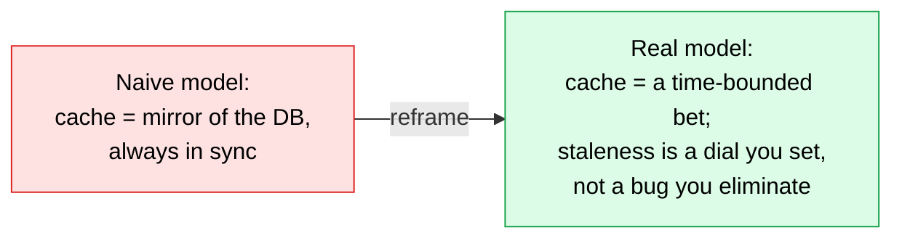
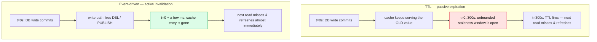
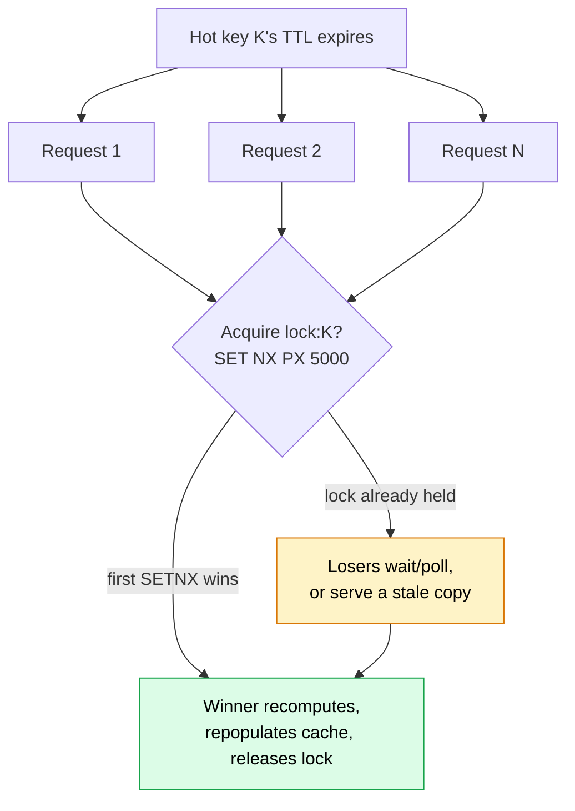
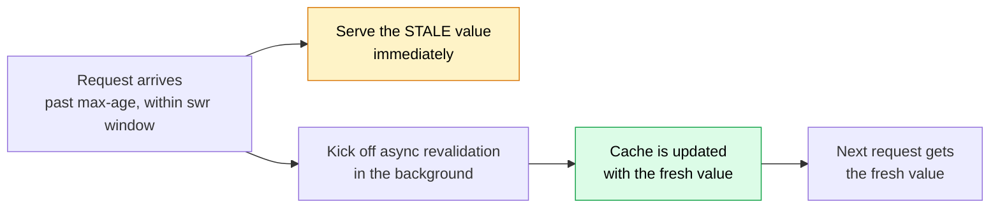
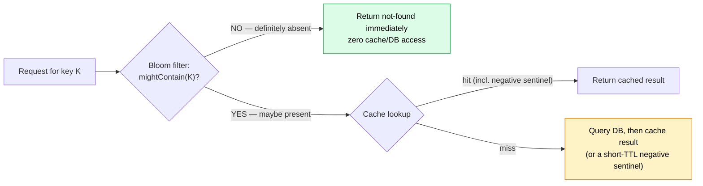
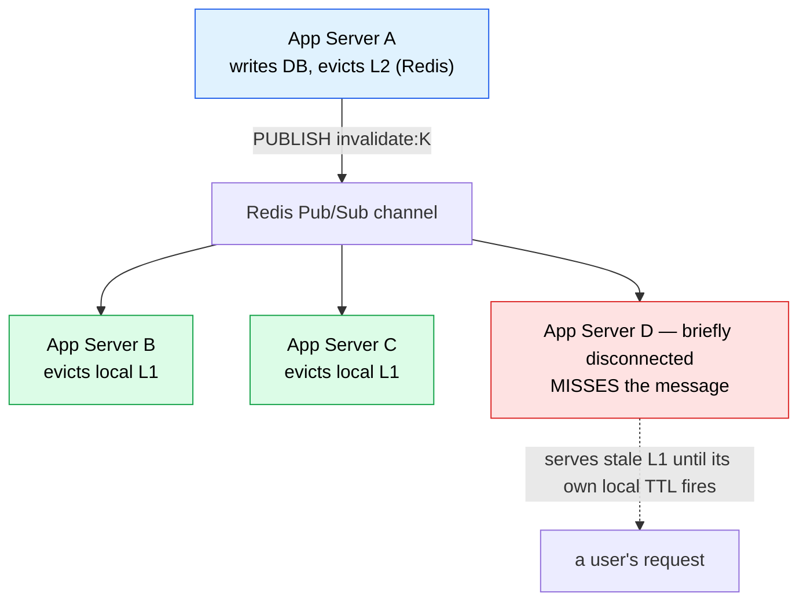
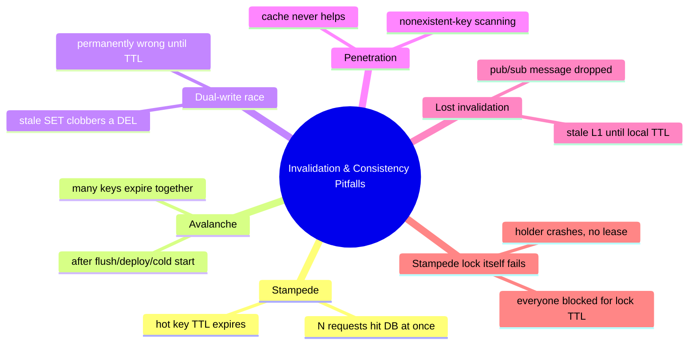

# Cache Invalidation & Consistency

> **One line:** A cache is a promise to lie for a little while — invalidation is the rulebook for how long you're allowed to lie, and consistency is what you do when a thousand people ask the same question the instant the lie is scheduled to end.

---

## Table of Contents
1. [Why You Must Master This](#1-why-you-must-master-this)
2. [The Mental Model](#2-the-mental-model)
3. [TTL (Passive) vs Event-Driven (Active) Invalidation](#3-ttl-passive-vs-event-driven-active-invalidation)
4. [The Cache-DB Dual-Write Race Condition](#4-the-cache-db-dual-write-race-condition)
5. [Cache Stampede / Thundering Herd — Mitigations in Depth](#5-cache-stampede--thundering-herd--mitigations-in-depth)
6. [Stale-While-Revalidate](#6-stale-while-revalidate)
7. [Cache Penetration](#7-cache-penetration)
8. [Distributed Invalidation & Consistency Expectations](#8-distributed-invalidation--consistency-expectations)
9. [Worked Example — Stampede Math for a Flash-Sale Page](#9-worked-example--stampede-math-for-a-flash-sale-page)
10. [Real-Life Use Cases](#10-real-life-use-cases)
11. [Failure Modes](#11-failure-modes)
12. [🏋️ Practice Drills](#-practice-drills)
13. [🎤 Interview Q&A Bank](#-interview-qa-bank)
14. [🎯 Staff+ Nuances](#-staff-nuances)
15. [Cheat Sheet](#15-cheat-sheet)
16. [Connections & Further Reading](#16-connections--further-reading)

---

## 1. Why You Must Master This

- **It's the hardest problem in CS, cited unironically.** Phil Karlton's line — "there are only two hard things in Computer Science: cache invalidation and naming things" — isn't a joke. Get the staleness window wrong and you either serve users incorrect data for an unbounded time, or you synchronize so hard on every write that you throw away the entire latency win caching was supposed to buy.
- **A single hot key can take a database down in seconds, with zero code bugs involved.** This is not an edge case — it is the *default outcome* of TTL-based caching at any real scale: a popular key's TTL expires, and every concurrent reader independently falls through to the database at the same instant. [Caching_Strategies.md](./Caching_Strategies.md) tells you *that* invalidation is the hard part; this file is where you learn exactly how it breaks and how to stop it.
- **The cache-DB race is silent — it doesn't page anyone, it just lies.** Unlike a stampede (loud, visible, paging alerts fire), a dual-write race leaves a wrong value sitting in the cache indefinitely with no error anywhere. "Why does the price still show $40 after three refreshes, but the database says $25?" is a classic on-call ticket that traces straight back to the interleaving in [Section 4](#4-the-cache-db-dual-write-race-condition).
- **It's the guaranteed follow-up question.** Any interviewer who hears "we'd cache that in Redis" will immediately ask "and how do you invalidate it when the underlying row changes — and what happens if a million people request it right when it expires?" This file is the complete answer to both halves.

> **The core problem it solves:** keeping a fast, duplicated copy of data (the cache) truthful *enough*, without paying to keep it perfectly synchronized with the source of truth (the database) on every single write — and without letting the mechanism you use to *fix* staleness (locks, coalescing) become a new outage of its own.

**Prerequisites:** [Caching_Strategies.md](./Caching_Strategies.md) — the write patterns (cache-aside, write-through, write-back) whose *mechanics* this file assumes; [Cache_Eviction_Policies.md](./Cache_Eviction_Policies.md) — TTL as an expiration mechanism, which this file treats as one half of the invalidation story.

---

## 2. The Mental Model

The naive mental model is: *"the cache and the database are the same data, kept in two places, in sync."* That model is wrong, and every bug in this file comes from someone acting as if it were true.

The correct mental model: **the cache is not a mirror, it's a photograph.** A photograph is perfectly accurate for the instant it was taken and increasingly wrong after that. Invalidation is deciding when to throw the photo away and develop a new one. Consistency is how wrong you're willing to let the photo be while the new one develops — and what you do when ten thousand people ask to see the photo at the exact moment it's declared too old to show.



> **Hold onto this:** the database is the only thing that is ever actually authoritative. The cache is a bet that a slightly-old answer is good enough to save a trip to the database — invalidation is how you shorten the bet, and every mitigation in this file exists to stop that bet from being called by too many people at once.

---

## 3. TTL (Passive) vs Event-Driven (Active) Invalidation

**TTL (passive expiration):** every cached entry carries an expiry timestamp set at write time. Nobody has to *do* anything when the underlying data changes — the entry simply becomes eligible for removal once `now > expiry`. **Event-driven (active invalidation):** the write path itself is responsible for telling the cache "this key is wrong now," the instant the underlying data changes, via an explicit `DEL`/evict call or a published invalidation message.

**Why TTL exists:** it makes caching viable *without* touching every code path that might change the data. You don't need to know every writer — you just accept staleness bounded by the TTL as the cost of not having to wire up invalidation everywhere. **Why event-driven exists:** some data can't tolerate a fixed staleness window — a revoked auth token or a flash-sale price change being wrong for even 30 seconds has real business or security cost that a TTL alone can't bound tightly enough.

**HOW TTL actually works (Redis, as the canonical example):** expiry timestamps live in a separate internal dictionary of volatile keys. Expiration is **both** passive and active: *passive* — checked lazily on `GET`/access; if expired, Redis treats it as a miss and deletes it on the spot; *active* — a background cycle (`activeExpireCycle`) samples a batch of keys with a TTL roughly every 100ms and evicts any that have expired, even if nobody ever reads them again. Passive-only would leak memory for dead keys nobody revisits; active-only would waste CPU scanning constantly. Redis runs both because neither alone is sufficient.

**HOW event-driven actually works:** two sub-flavors. **(a) Inline invalidation** — the same request that writes the database also issues the cache `DEL` synchronously, in the same code path. Simple, but every single writer must remember to do it — miss one code path (a batch job, an admin panel, a migration script) and that path silently never invalidates. **(b) CDC-based invalidation** — a change-data-capture consumer (e.g. Debezium reading a MySQL binlog / Postgres WAL) watches the database's write-ahead log and issues invalidations *after the fact*, decoupled from application code entirely. This is more robust — it can't be skipped by a forgetful code path because it doesn't live in application code at all — but it adds propagation lag (typically tens of milliseconds to low single-digit seconds) between commit and invalidation. See [Distributed_Transactions.md](../05_Databases_Storage/Distributed_Transactions.md) for CDC mechanics.



> **Takeaway:** TTL bounds the *worst case* staleness with zero coordination cost; event-driven minimizes the *typical case* staleness at the cost of needing every writer (or a CDC pipeline) to get it right.

| Dimension | TTL (passive) | Event-driven (active) |
|---|---|---|
| Trigger | Time elapses | A write happens |
| Staleness bound | Fixed, predictable (= TTL) | Usually tiny (ms) — but *unbounded* if a writer forgets to invalidate |
| Coordination needed | None | Every write path (or a CDC pipeline) must participate |
| Failure mode | Guaranteed staleness for up to TTL, every time | Silent, permanent staleness if one path is missed — until a TTL backstop (if any) fires |
| Best for | Data that tolerates a known staleness window (catalog pages, feeds) | Data where "usually fresh, occasionally exactly-on-write" matters (prices, inventory, auth) |

**The senior move: use both.** Event-driven invalidation handles the common/critical path; a TTL is *always* present underneath it as a backstop that bounds the blast radius of a missed invalidation. Meta's TAO graph-cache does exactly this — synchronous invalidation in the writing region, asynchronous invalidation propagated to follower regions with p99 well under a second, and a TTL still sitting underneath everything as the absolute worst-case guarantee.

---

## 4. The Cache-DB Dual-Write Race Condition

**What it is:** the cache and the database are two independent stores updated by two operations that are **not** atomic together. Under concurrency, a reader's two steps (read DB → write cache) can interleave with a writer's two steps (write DB → invalidate cache) such that the cache ends up holding a value *older* than what's now in the database — and it stays that way indefinitely, because nothing about the system looks broken.

**Why it can't just be "fixed":** the only way to make cache-and-DB updates truly atomic is a distributed transaction/lock spanning both stores on every access — which reintroduces exactly the coordination cost caching exists to avoid. So this race isn't a bug to eliminate; it's a risk you *manage*, via write ordering and a bounded backstop.

**The actual interleaving** (cache-aside, using the standard "update DB, then delete cache" ordering):

```mermaid
sequenceDiagram
    participant R as Reader R
    participant C as Cache
    participant D as Database
    participant W as Writer W
    R->>C: GET product:12345
    C-->>R: MISS
    R->>D: SELECT price WHERE id=12345
    D-->>R: v1 (old price)
    W->>D: UPDATE price=v2 WHERE id=12345
    D-->>W: commit OK
    W->>C: DEL product:12345
    Note over C: no-op — key is still absent, R hasn't written yet
    R->>C: SET product:12345 = v1
    Note over C: STALE — cache now holds v1 forever; DB has v2
```

> **Takeaway:** the delete didn't fail and the update didn't fail — the cache is wrong purely because of *timing*. R's slow database read (`v1`, taken before W's write) lands in the cache *after* W's delete, silently reintroducing the stale value.

**The reverse ordering is worse, not just different.** If you write the cache *first* and the database second ("cache-then-DB", as in a naive write-through), and the process crashes or the DB write fails between the two steps, the cache now holds `v2` while the database is permanently stuck at `v1` — that's not a transient race window, it's a durability failure that survives forever until someone notices. This is why **delete-on-write, not update-on-write, is the standard safe default**: deleting the cache key on write means the *worst case* after any race is a cache **miss** (safe — just re-fetch from the DB) rather than a cache **hit on the wrong value** (silently wrong, potentially forever).

**Mitigations, in order of how much protection they buy:**
- **Delete, don't overwrite, on write.** Removes the class of bug where the writer itself puts the *wrong new value* into the cache — the worst outcome becomes a slower read, not a wrong one.
- **Delayed double-delete.** Delete the key, then delete it *again* after a short delay (500ms–1s is typical in production use) to catch exactly the straggler reader in the diagram above who was mid-flight during the first delete. This is a well-known pattern from large-scale caching post-mortems (Instagram's and DoorDash's engineering blogs both describe variants of it).
- **Versioned / CAS writes into the cache.** Store `{version, value}` and only accept a `SET` if the version being written is `>=` the version already cached (a Lua script in Redis, or `WATCH`/`MULTI`). A stale write with an old version number simply loses the race instead of clobbering a fresher one.
- **A TTL underneath everything, always.** Even with perfect delete-on-write discipline, keep a TTL as the absolute upper bound on how long any race-induced staleness can persist.

**Real number:** this exact race — and the "delete, don't set" fix — is described in Facebook's "Scaling Memcache at Facebook" (NSDI 2013), alongside a *lease* mechanism that further narrows the window by handing the first miss-er a token that only it is allowed to use to repopulate the cache (a close cousin of the stampede lock in [Section 5](#5-cache-stampede--thundering-herd--mitigations-in-depth)).

---

## 5. Cache Stampede / Thundering Herd — Mitigations in Depth

**What it is:** when a hot key's TTL expires, *every* concurrent request for that key in that instant gets a cache miss simultaneously. Each one independently believes "I'm the one who has to recompute this," so N requests execute N redundant, expensive recomputations (DB queries, joins, API calls) at the exact same moment.

**Why it's dangerous:** a database sized for its normal, cache-shielded QPS was never provisioned for the *unshielded* QPS of a popular key — the stampede is effectively a self-inflicted, momentary N-times traffic spike. Connections queue, latency balloons, client timeouts fire retries (which *add more load* right when the system is already saturated), and one hot key's expiry can cascade into a full outage.

**Mitigation 1 — Request coalescing / single-flight (in-process).** Within one server process, keep a map of `key → in-flight Future`. The first request for `K` creates the future and starts the real fetch; every other concurrent request for `K` on that *same process* finds the in-flight future in the map and awaits its result instead of touching the database itself. (Go's `singleflight` package and a simple `Map<key, Promise>` in Node/Java are literal implementations.) Limitation: this only dedups *within one process* — with 50 app-server instances you still get up to 50 concurrent DB hits, one per instance. It turns an N-request stampede into an (instance-count)-request stampede: much better, not zero.


> **Takeaway:** request coalescing (single-flight) collapses N concurrent cache misses into exactly 1 origin request, so the database never experiences the thundering-herd spike shown in the left panel.

**Mitigation 2 — Distributed lock / mutex on the key.** The first requester *across all instances* acquires a short-lived lock — the classic Redis idiom is `SET lock:K <token> NX PX 5000` (atomically: set only if absent, expire in 5s). The winner recomputes, repopulates the cache with a fresh TTL, then deletes the lock. Losers either poll/backoff for the fresh value to appear, or — if a not-yet-evicted stale copy is still around — serve that stale value immediately while waiting (this merges with [stale-while-revalidate](#6-stale-while-revalidate)). Two details matter: the lock's TTL must exceed the recompute time (or it expires mid-computation and a second worker starts a redundant recompute) but not by much more (or a *crashed* holder blocks everyone for the full lock TTL); and the lock should be a **lease** — store a random token as the value and only release via a compare-and-delete Lua script — so a slow first-holder can't have its lock accidentally released (and re-acquired) by someone else.



**Mitigation 3 — Probabilistic early expiration (the XFetch algorithm).** Instead of a hard wall at expiry, make recomputation *increasingly likely* the closer you get to expiry — so the value almost always gets refreshed by a low-probability early trigger *before* everyone hits a real miss at once. On every read of a soon-to-expire item, compute:

```
xfetch_delay = delta * beta * ln(rand())        // rand() draws uniform(0, 1) fresh each check
recompute_now_if:  now - xfetch_delay >= expiry_time
```
where `delta` = the measured wall-clock time the *last* recompute took, and `beta` = a tuning constant (1.0 is the typical default; raise it to recompute earlier/more aggressively).

*Why this works:* `ln(rand())` is always negative, and its magnitude explodes as `rand()` happens to draw a value near 0 (rare) but stays small when `rand()` draws a value near 1 (common). So on most checks, `xfetch_delay` is a small negative number, `now − xfetch_delay` barely moves, and nothing triggers. Occasionally a small `rand()` draw produces a large delay, which pushes `now − xfetch_delay` far enough forward to cross `expiry_time` *before* it actually arrives. As real time creeps closer to `expiry_time`, the *margin* needed to cross it shrinks, so proportionally more draws succeed in triggering early — the probability of early recompute rises smoothly as expiry approaches, without ever needing a fixed schedule.

*Worked numeric check* — `delta = 0.15s`, `beta = 1`, `expiry_time = 60s`:
- At `now = 59.5s` (0.5s of margin left): `rand = 0.5` → `ln(0.5) = -0.693` → `xfetch_delay = -0.104s` → `now − xfetch_delay = 59.604s` — **does not** trigger (< 60). Even `rand = 0.01` → `ln(0.01) = -4.605` → `delay = -0.691s` → `59.5 + 0.691 = 60.191s` — **triggers**, but only a rare, small-`rand` draw did.
- At `now = 59.9s` (0.1s of margin left): the same `rand = 0.5` draw now gives `59.9 + 0.104 = 60.004s` — **triggers**. A much larger share of ordinary draws now cross the line, because there's far less margin left to overcome.

One of these early, low-probability triggers — fired by some unlucky reader among the many hitting the key in that window — quietly recomputes the value ahead of time, in the background, while everyone else keeps being served the still-valid cached copy. By the time the *actual* expiry arrives, the value has usually already been refreshed once — there was never a single instant where every reader missed at once. This is literally Meta's technique in production; it's formalized in Vattani, Chierichetti & Lowenstein, *"Optimal Probabilistic Cache Stampede Prevention"* (VLDB 2015).

**Mitigation 4 — Background/scheduled refresh.** For a known, bounded set of hot keys, a cron or worker proactively recomputes and re-`SET`s the value on a cadence shorter than the TTL, so real user traffic never actually experiences a miss for that key — the TTL becomes a pure safety net rather than the refresh trigger. See [Cache_Warming_Strategies.md](./Cache_Warming_Strategies.md). Doesn't generalize to the long tail of keys you can't enumerate in advance.

**Mitigation 5 — Jittered TTL (fixes a *different* failure shape: cache avalanche).** A single hot key expiring is a *stampede*. Many *different* keys all expiring at the same moment — e.g. right after a cache flush, a deploy that repopulated everything at once, or a cold cache warm-up — is called a **cache avalanche**, and it needs a different fix: add random noise to each TTL at write time (`ttl = base * (0.9 + rand() * 0.2)`) so keys desynchronize and expire across a spread window instead of in one simultaneous wave.

| Mitigation | Mechanism | Overhead | Fixes cross-instance stampede? | Best for |
|---|---|---|---|---|
| Single-flight | In-process future/promise dedup | Near zero | No — one hit per instance | Reducing load within a process |
| Distributed lock/lease | `SETNX` + TTL on a lock key | One extra Redis round trip for the winner | Yes | Any hot key, general purpose |
| Probabilistic early expiration (XFetch) | Formula above, no coordination | One `ln`+multiply per read | Yes (statistically — spreads recomputes over time) | High-fanout, hard-to-lock read paths (CDN/edge, read replicas) |
| Background refresh | Scheduled job repopulates ahead of TTL | A steady low background load | Yes | A small, known set of very hot keys |
| Jittered TTL | Randomize TTL at write time | Free | N/A — fixes *avalanche*, not single-key stampede | Mass cache warm-ups / post-deploy repopulation |

---

## 6. Stale-While-Revalidate

**What it is:** instead of making a request wait on a cache miss's recompute, serve the (slightly) stale value **immediately**, and kick off the recompute **asynchronously in the background** so the *next* request gets a fresh value. Nobody ever pays the recompute latency synchronously — the cost is one extra window of intentional staleness.

**HOW it works (the actual mechanism):** RFC 5861 defines two `Cache-Control` extensions: `stale-while-revalidate=N` — serve the stale object for up to `N` seconds past `max-age` while triggering a background revalidation fetch — and `stale-if-error=N` — serve stale if that revalidation/origin fetch fails outright (e.g. the origin is down). CDNs and edge proxies (Fastly, Cloudflare, Varnish) implement this directly at the PoP: the edge node holds the object past its nominal freshness, serves it instantly on the next request, fires one background fetch to origin, and only blocks a request if the object is *so* stale it's outside even the SWR window. Cross-link: [HTTP_Caching.md](./HTTP_Caching.md) for the header mechanics and [CDN.md](./CDN.md) for the edge/PoP context.

The same idea works inside an application-level cache, not just HTTP: store the value with a *soft* (logical) expiry separate from a longer *hard* TTL. On read, if soft-expired but not hard-expired, return the cached value immediately **and** enqueue an async refresh (a fire-and-forget task or queue message). This is why SWR is often the preferred default wherever staleness is tolerable — it solves stampede mitigation and zero-added-latency at the same time.



**Trade-off:** you are now *deliberately* guaranteeing wrong data during the revalidation window — perfectly fine for a product listing or a news homepage, unacceptable for an account balance or an inventory count at checkout. **Real number:** Fastly/Cloudflare defaults for `stale-while-revalidate` are commonly tens of seconds to a few minutes; some sites push it to hours specifically so a page keeps serving during an origin outage, trading freshness for availability on purpose.

---

## 7. Cache Penetration

**What it is:** a request for a key that doesn't exist in the database *either*. Cache-aside can't help, because there's nothing to cache on a genuine "not found" — every request for that nonexistent key falls all the way through to the database, every single time.

**Why it's dangerous:** it's a targeted denial-of-service vector, distinct in shape from a stampede. A stampede is *one* legitimately popular key hammered by many requests; penetration is many *different*, nonexistent keys (scanned/incrementing IDs, or IDs known to be deleted), so per-key mitigations like coalescing and locks don't apply — no two requests share a key to coalesce around.

**Mitigation 1 — cache the negative result.** When the database returns "not found" for key `K`, cache a sentinel/tombstone value for `K` with a **short** TTL (seconds to low minutes). Subsequent requests for `K` hit the sentinel in cache and return "not found" without touching the database. The TTL is deliberately short because the item might legitimately get created moments later. Trade-off: an attacker rotating through N *unique* nonexistent keys still causes N database misses — once each, bounded, but not zero.

**Mitigation 2 — a Bloom filter of every valid key.** Maintain a compact probabilistic set (a bit array plus `k` hash functions) built from every real key that currently exists, updated on insert. Before touching cache or database at all, check `mightContain(K)`. If it says **definitely not present**, return "not found" immediately — zero cache or database access, even on the very first request for that exact ID. If it says **maybe present**, proceed normally (it might be a false positive — the tunable false-positive rate is commonly sized to ~0.1–1%; sizing follows `m ≈ −n·ln(p) / (ln 2)²`, so a 1%-FPR filter over 100M keys costs roughly 120MB of memory). This closes the exact gap negative-caching leaves open: it rejects a *never-seen-before* random ID on the very first request, before it can generate even one database hit.



**Trade-off:** Bloom filters are append-friendly but deletion-unfriendly — you can't safely clear a single bit without risking false negatives for other keys that hash to the same bits, so deletions need either a *counting* Bloom filter (extra memory per slot) or a periodic full rebuild. **Real number/system:** this exact "membership pre-check before an expensive lookup" shape is the textbook use case cited for Bloom filters generally (Chrome's Safe Browsing list check, and large-scale key-existence checks at companies like LinkedIn) — cheap, in-memory, and it turns an attacker's entire ID-scanning strategy into a series of instant no-ops.

---

## 8. Distributed Invalidation & Consistency Expectations

Once there is more than one app server — and especially once each server keeps its *own* local (in-process, L1) cache on top of a shared Redis/Memcached (L2) layer for even lower latency — a write on server A must somehow tell servers B, C, and D "your local copy of key K is wrong now." Updating the shared L2 cache does **not** automatically touch anyone's local heap.

**HOW it works — pub/sub invalidation.** Server A, after writing the database and invalidating L2, `PUBLISH`es an invalidation message (`invalidate:K`) on a channel — either a plain Redis Pub/Sub channel, Redis's built-in **client-side caching / tracking** feature (Redis 6+, RESP3: the server itself pushes an invalidation message directly to any client that's read a tracked key, with no manual `PUBLISH` required), or a message-bus topic (Kafka/SNS) for invalidation events at larger fan-out. Every app server subscribes and, on receipt, evicts `K` from its local L1 cache.



**This is fundamentally an eventual-consistency mechanism, and not even a fully reliable one.** There's a real propagation delay — Redis Pub/Sub is typically single-digit milliseconds, a Kafka-backed invalidation topic more like tens of milliseconds to roughly a second depending on batching — during which some servers keep serving the old L1 value. Worse, Redis Pub/Sub is **fire-and-forget**: a subscriber that's mid-restart or briefly disconnected when the message is published simply never receives it, with no replay log and no delivery guarantee. It will keep serving the stale value until its own local TTL eventually expires it.

**This is exactly why a local TTL on the L1 layer is not optional, even with pub/sub invalidation wired up correctly.** Pub/sub is the fast path — it usually gets you millisecond-level freshness — but the local TTL is the correctness *backstop* that bounds the absolute worst case if a message is ever dropped. Never let a notification channel be your *only* consistency guarantee.

**Eventual vs strong consistency, made concrete for caches.** *Strong* consistency for a cache — every reader everywhere sees a write immediately, or the write blocks until every node's invalidation is acknowledged — is achievable (a quorum-ack'd invalidation: don't return success to the writer until N of M nodes confirm eviction) but reintroduces almost exactly the latency and availability cost that caching exists to avoid, so it's rare. It does show up in narrow, correctness-critical slices: a security-sensitive token-revocation cache might accept only a 1–2 second local TTL plus a fallback check against the source of truth on reads that matter, rather than pursuing true synchronous invalidation. Everywhere else, the honest answer is: **caches are eventually consistent by construction**, and the real engineering question is never "how do I make it strong?" but "what's the worst-case staleness bound, and is that bound acceptable for this data?" That worst-case bound is `max(local TTL, invalidation-propagation p99)` — whichever is larger dominates your actual guarantee. See [Consistency_Models.md](../05_Databases_Storage/Consistency_Models.md) for the general eventual/strong spectrum this is a specific instance of.

---

## 9. Worked Example — Stampede Math for a Flash-Sale Page

**The setup:** `product:12345` is a flash-sale item. Cache TTL = 60s. Recomputing the value (a DB join plus price/discount calculation) takes 150ms. The database connection pool has 200 connections. Under this query shape, the database comfortably sustains roughly 1,333 of these queries/sec at 150ms each per connection (200 conns ÷ 0.15s). At the moment the TTL expires, the item goes viral and **50,000 concurrent requests** are in flight for this exact key — not a contrived number; "everyone hits refresh on the sale page at once" is exactly this shape.

**Without any mitigation:** all 50,000 requests miss the cache in the same instant and all 50,000 attempt a database query concurrently. The pool has only 200 connections, so 49,800 requests queue immediately. At a sustained ~1,333 queries/sec, draining a 50,000-deep queue takes **50,000 ÷ 1,333 ≈ 37.5 seconds** — during which p99 latency for this endpoint balloons from 150ms to tens of seconds, client-side timeouts fire, and default retry logic on the client makes it *worse*, injecting more load precisely while the pool is already saturated. Connection-pool exhaustion then starves unrelated queries sharing that pool, turning one hot key's expiry into a database-wide outage.

**With single-flight coalescing + a distributed lock:** exactly one of the 50,000 requests acquires the lock and performs the 150ms recompute. The other 49,999 either await the in-process in-flight future (same server) or poll/back off for roughly 150–200ms (cross-server) and then read the freshly-populated cache value. **Total database load from this event: 1 query.** Total added latency for the unluckiest waiter: ~150–200ms, once — not 37 seconds, and no retry storm.

```mermaid
flowchart TB
    subgraph NO["Without coalescing — 50,000 requests miss at once"]
        N0["TTL expires on product:12345"] --> N1["50,000 concurrent requests MISS"]
        N1 --> N2["50,000 queries queue for 200 DB connections"]
        N2 --> N3["~37.5s to drain; timeouts + retries pile on more load"]
    end
    subgraph YES["With single-flight + lock — the same 50,000 requests"]
        Y0["TTL expires on product:12345"] --> Y1["exactly 1 request wins the lock"]
        Y1 --> Y2["1 query hits the DB (150ms)"]
        Y2 --> Y3["49,999 requests await the in-flight result, ~150-200ms"]
    end
    style N3 fill:#fee2e2,stroke:#dc2626,color:#000
    style Y3 fill:#dcfce7,stroke:#16a34a,color:#000
```



**The number that forces the decision:** 50,000 concurrent misses against a 200-connection pool is asking the database for **250x** its available concurrency, in a single instant, for one key. No amount of "add more read replicas" fixes a spike that's 250x nominal capacity for a single hot key — replicas divide *steady-state* load, they don't collapse a simultaneous burst. The only fix that scales is collapsing N requesters into 1 (or a small constant) request *before* it ever reaches the database. That's the architectural consequence: once `N / pool_size` crosses roughly single digits, stampede mitigation stops being an optimization and becomes the difference between "handled" and "outage."

---

## 10. Real-Life Use Cases

| Situation | How invalidation/consistency applies | The decision it forces |
|---|---|---|
| Flash-sale / viral product page | A single key gets an N-times traffic burst the instant its TTL expires | Single-flight + distributed lock, or XFetch for very high fan-out edges |
| Auth/session revocation | Being wrong for even seconds is a security bug, not just staleness | Event-driven invalidation with a tight (1–2s) TTL backstop — never TTL alone |
| CDN-fronted marketing/news page during a spike or origin outage | Users would rather see something slightly old than an error page | `stale-while-revalidate` / `stale-if-error` at the edge |
| Public API under ID-scanning by a scraper or attacker | Nonexistent keys bypass caching entirely by design | Bloom filter pre-check + short-TTL negative caching |
| Multi-region app servers, each with a local L1 cache | No single write path touches every server's heap | Pub/sub invalidation channel (Redis keyspace notifications / client tracking) + a local TTL backstop |
| Price/inventory update on checkout | A stale price shown after a write is a customer-trust and revenue bug | Delete-on-write (never update-on-write) + delayed double-delete |
| A cache flush or fresh deploy repopulates thousands of keys at once | Many *different* keys expiring simultaneously is an avalanche, not a single-key stampede | Jittered TTL at write time to desynchronize expiry |

> **The habit:** before shipping any cache, write down its worst-case staleness bound in one sentence — `max(TTL, invalidation propagation time)` — and ask whether that number is actually acceptable for *this* data. If you can't say the number, you haven't finished the design.

---

## 11. Failure Modes



- **Cache stampede.** *Symptom:* a single popular endpoint's latency and error rate spike hard, in sync with a TTL boundary. *Root cause:* every concurrent reader independently misses and recomputes at once. *Fix:* single-flight coalescing, a distributed lock/lease, or probabilistic early expiration (Section 5).
- **Cache avalanche.** *Symptom:* the *whole system* degrades right after a deploy, cache flush, or cold restart — not just one key. *Root cause:* many keys were all populated at the same moment and so all expire at the same moment. *Fix:* jittered TTL at write time so expiries spread out.
- **Dual-write race leaving a permanently stale cache.** *Symptom:* the database shows the new value, the cache shows the old one, indefinitely, with no errors logged anywhere. *Root cause:* a slow reader's stale `SET` lands after a writer's `DEL` (Section 4). *Fix:* delete-on-write not update-on-write, delayed double-delete, or versioned/CAS writes.
- **Cache penetration as an unnoticed DoS.** *Symptom:* database load climbs from traffic that "should" be cheap, cache hit rate stays suspiciously low. *Root cause:* requests target keys that don't exist, so the cache never has anything to serve. *Fix:* negative-result caching plus a Bloom filter pre-check (Section 7).
- **A dropped pub/sub invalidation message.** *Symptom:* one specific app server instance keeps returning old data long after every other instance has the fresh value. *Root cause:* that instance was disconnected/restarting at the moment the invalidation was published, and Redis Pub/Sub has no replay or delivery guarantee. *Fix:* a local TTL backstop on every L1 cache — never treat pub/sub as a sufficient consistency guarantee on its own (Section 8).
- **The stampede-prevention lock becomes the outage.** *Symptom:* after adding a "fix" for stampedes, a single crashed worker causes every request for a hot key to hang for the full lock TTL. *Root cause:* the lock was acquired without a lease/token, so a crashed holder's lock can't be safely reclaimed early and nobody else can proceed. *Fix:* use a token-based lease (compare-and-delete on release) and size the lock TTL close to, not far beyond, the actual recompute time.

---

## 🏋️ Practice Drills

> *Cover the solutions and attempt first — active recall is the point.*

**Drill 1 — Why is "delete, don't overwrite" safer?** Explain, using the interleaving in [Section 4](#4-the-cache-db-dual-write-race-condition), why "update DB, then `DEL` the cache key" is a safer default than "update DB, then `SET` the cache key to the new value."

<details><summary>Solution</summary>

If the writer `SET`s the new value directly, a concurrent reader who read the *old* value from the database just before the writer's update can still overwrite the writer's fresh `SET` with its own stale value afterward — the exact race from Section 4, just with the writer's correct value getting clobbered instead of a no-op `DEL`. If the writer instead `DEL`s the key, the worst any straggler reader can do is re-populate the cache with a stale value that will simply be served until the next write or TTL — a *miss followed by a stale read*, not a guaranteed-wrong value overwriting a guaranteed-correct one. Deleting can never make the cache "more wrong" than doing nothing; overwriting can.
</details>

**Drill 2 — Do the math.** A key has TTL = 30s, each recompute takes 80ms, and your DB connection pool has 50 connections. At TTL expiry, 8,000 concurrent requests arrive for this key. (a) Without mitigation, roughly how long does the queue take to drain, and (b) does this situation actually need stampede mitigation, or is it fine as-is?

<details><summary>Solution</summary>

Pool throughput ≈ 50 connections ÷ 0.08s per query ≈ **625 queries/sec**. Draining 8,000 requests at that rate takes **8,000 ÷ 625 = 12.8 seconds** — during which p99 latency spikes roughly 160x above the normal 80ms, which is very likely to trigger client timeouts and retries.

(b) `N / pool_size = 8,000 / 50 = 160` — two orders of magnitude over capacity for one instant. Yes, this needs mitigation (a lock/lease or single-flight is enough here; the recompute is cheap and the concurrency, while large, is one order of magnitude smaller than the flash-sale example in Section 9, so a simple mutex suffices without needing XFetch's statistical smoothing).
</details>

**Drill 3 — Design it.** You have 20 app-server instances, each keeping a local (in-process) LRU cache in front of a shared Redis cluster. A price update happens on instance #7. Design the invalidation path so the other 19 instances don't keep serving the old price for longer than a couple of seconds, even if one instance is mid-restart at the moment of the write.

<details><summary>Solution</summary>

1. Instance #7 writes the new price to the database, then deletes/updates the shared Redis (L2) entry.
2. Instance #7 publishes an invalidation message (`invalidate:price:SKU`) on a Redis Pub/Sub channel (or uses Redis 6+ client-side tracking so Redis pushes the invalidation automatically to any instance that read the key).
3. All 20 instances subscribe to the channel; on receipt, each evicts the key from its *local* L1 cache, so the next local read falls through to the now-fresh L2/Redis value.
4. **The backstop:** every local L1 entry also carries a short TTL (e.g. 2 seconds) independent of the pub/sub mechanism. If the mid-restart instance misses the published message entirely (Pub/Sub has no replay/delivery guarantee), its local entry still self-expires within 2 seconds and re-fetches from Redis on the next request — bounding the worst case to "2 seconds of staleness on the unlucky instance" instead of "however long until someone notices."

This is the general pattern from Section 8: pub/sub for the fast, usually-correct path; a local TTL as the guarantee that actually bounds the failure.
</details>

**Drill 4 — XFetch by hand.** With `delta = 0.2s`, `beta = 2`, `expiry_time = 100s`, would a read at `now = 98s` with `rand() = 0.3` trigger an early recompute?

<details><summary>Solution</summary>

`ln(0.3) ≈ -1.204`. `xfetch_delay = 0.2 * 2 * (-1.204) = -0.4816s`. `now - xfetch_delay = 98 - (-0.4816) = 98.48s`. Compare to `expiry_time = 100`: `98.48 < 100` → **does not trigger**. A much smaller `rand()` (e.g. 0.02, `ln(0.02) ≈ -3.91`, `delay ≈ -1.564s`, `now - delay = 99.56s`, still `< 100`) would still not trigger at this distance from expiry with this `beta`; closer to expiry (e.g. `now = 99.7s`) the same draws would. This is the mechanism doing its job: with `beta = 2` amplifying the effect, more draws succeed than with `beta = 1`, but only draws close enough to expiry cross the line — exactly the "increasing probability as expiry nears" behavior the formula is designed to produce.
</details>

---

## 🎤 Interview Q&A Bank

**Q1. "Why is cache invalidation considered one of the two hardest problems in computer science?"**
> Because there's no way to make it free: keeping the cache perfectly in sync with the source of truth requires coordination on every write, which defeats the point of caching, but *not* coordinating means accepting a staleness window whose size and blast radius you have to reason about explicitly. The hard part isn't implementing a `DEL` call — it's that every mitigation for one failure mode (a lock to stop a stampede, a TTL to bound staleness) can introduce a *new* failure mode (a crashed lock holder, a race between a delete and a stale write) if you don't think through the interleaving.

**Q2. "TTL-based versus event-driven invalidation — how do you choose?"**
> TTL costs you a bounded, predictable staleness window with zero coordination; event-driven costs you correctness *coverage* — every write path has to remember to invalidate, or that path silently never does. In practice you use both: event-driven invalidation (inline or via CDC) for the common path, and a TTL underneath it as a backstop that bounds the damage if an invalidation is ever missed. Pure TTL-only is fine for data that tolerates its staleness window (a product description); pure event-driven-only is dangerous because a single forgotten write path never self-heals.

**Q3. "Walk me through how a cache and a database can end up permanently inconsistent even though every individual operation succeeded."**
> *(signal: tests whether the candidate actually understands interleaving, not just the vocabulary "race condition")* A reader misses the cache and reads the old value from the DB; before it writes that value into the cache, a writer updates the DB to a new value and deletes the (still-empty) cache key; the reader then finishes and writes its stale value into the cache. No operation failed — the cache is just wrong because of timing. The fix is ordering (delete on write, not overwrite), a delayed second delete to catch stragglers, or versioned writes — plus a TTL so the damage is bounded even if it happens.

**Q4. "How do you stop a cache stampede on a hot key?"**
> Prevent every concurrent miss from independently hitting the database: coalesce concurrent requests into a single in-flight fetch (single-flight, in-process), or take that further with a distributed lock/lease so only one instance across the whole fleet recomputes while the rest wait or serve stale data. For very high fan-out where locking overhead matters, probabilistic early expiration (XFetch) recomputes ahead of the hard deadline with rising probability as expiry nears, so there's rarely a single instant where everyone misses at once.

**Q5. "What's probabilistic early expiration, concretely?"**
> On each read of a soon-to-expire item, draw a random number and compute a delay proportional to the last recompute time and a tuning constant, scaled by the negative log of that random draw; if adding that delay to "now" would already exceed the expiry time, recompute early in the background. Because the delay's magnitude grows unboundedly for rare small draws but stays small for common ones, the probability of an early trigger rises smoothly as real time approaches expiry — so the item gets refreshed by some unlucky-but-early reader before the crowd ever hits a hard miss.

**Q6. "What is stale-while-revalidate, and where have you seen it?"**
> Serve the stale cached value immediately on a miss past its freshness window, and refresh it asynchronously in the background so the *next* request gets the fresh copy — nobody waits on the recompute. It's a formal HTTP `Cache-Control` directive (RFC 5861) implemented at CDN edges (Fastly, Cloudflare) to keep pages fast and available even during origin slowness, and the same pattern applies inside an application cache using a soft/hard TTL split.

**Q7. "What's the difference between cache stampede, cache avalanche, and cache penetration?"** *(signal: tests whether the candidate can distinguish failure shapes, not just recite one)*
> Stampede: one hot key expires and many requests for *that same key* hit the DB at once. Avalanche: many *different* keys expire at roughly the same moment — typically after a flush, deploy, or cold start — causing a broad load spike rather than a single-key one; jittered TTLs fix this. Penetration: requests target keys that don't exist in the DB either, so caching never helps at all, no matter how the TTLs are set — that needs negative-result caching and a Bloom filter pre-check instead.

**Q8. "You have multiple app servers each with a local cache in front of shared Redis. How do you keep them from serving stale data to each other?"**
> A write invalidates the shared Redis entry and publishes an invalidation message (Pub/Sub, or Redis 6+ client-side tracking) that every app server subscribes to and uses to evict its own local copy. But that channel is fire-and-forget — a disconnected subscriber misses the message entirely — so every local cache also needs its own short TTL as a backstop. The honest framing is that distributed cache invalidation is *eventually* consistent, bounded by `max(local TTL, invalidation propagation time)`, and pushing for true strong consistency here almost always costs more latency than the cache was ever meant to save.

---

## 🎯 Staff+ Nuances

- **A TTL is not a fallback you "might" need — treat it as mandatory even on a perfectly event-driven system.** Every active-invalidation mechanism (inline `DEL`, CDC pipeline, pub/sub) has a failure mode where a message is dropped, a code path is missed, or a subscriber is briefly offline. The TTL is what converts "this bug is now permanent until someone notices" into "this bug self-heals within N seconds." Senior engineers add the TTL *before* they've seen the failure, not after.
- **Stampede, avalanche, and penetration are three different failure shapes with three different fixes — conflating them is the most common mistake.** A candidate who reaches for "add jitter" to fix a single hot-key stampede, or "add a lock" to fix penetration by nonexistent keys, hasn't actually distinguished the mechanisms. Naming the correct one first is itself the signal.
- **A stampede-prevention lock without a lease is a new single point of failure.** If the lock holder crashes mid-recompute and the lock has no owner-token/compare-and-delete release, everyone else blocks for the full lock TTL — you've replaced "the DB gets hammered for a few seconds" with "every request for this key hangs for the lock's TTL." Always pair a lock with a lease (a random token, released only via a script that checks ownership) and size the TTL close to the real recompute time, not generously above it.
- **CDC-based invalidation trades coupling for lag, and that trade is often worth it.** Inline invalidation (calling `DEL` in the same request as the write) is instantaneous but couples every writer to remembering the cache; a CDC pipeline (Debezium off the binlog/WAL) decouples invalidation from application code entirely — no writer can forget, because invalidation doesn't live in writer code — at the cost of tens-of-ms-to-seconds of propagation lag. For high-blast-radius data (pricing, inventory) many systems run both: inline for the fast path, CDC as a catch-all correctness net for paths that skip the inline call (batch jobs, admin tools, migrations).
- **Negative-cache TTLs should be much shorter than positive-cache TTLs, on purpose.** A "not found" is more likely to become "found" soon (the item gets created moments later) than a "found" value is to become wrong — symmetric TTLs for positive and negative results is a subtle correctness bug that shows up as "I just created this and it still 404s for 10 minutes."
- **Modern Redis (6+) client-side caching/tracking is quietly replacing hand-rolled pub/sub invalidation.** Instead of the application manually `PUBLISH`ing an `invalidate:K` message on every write, Redis itself tracks which clients have read which keys and pushes an invalidation push-message (RESP3) directly to them when a tracked key changes. It's less code and less to get wrong, but it's still fire-and-forget over the same connection semantics — the local-TTL-backstop rule still applies.
- **The worst-case staleness bound is a single number you should be able to state, and it's `max(TTL, invalidation propagation p99)` — not just "TTL."** Teams that only reason about their nominal TTL and forget that a *missed* invalidation falls back to that same TTL are routinely surprised that "fast" event-driven invalidation still has a multi-minute worst case, because nobody shortened the backstop TTL to match the new expectations set by adding active invalidation.
- **Every mitigation in this file is itself a piece of distributed systems that can fail — budget for that.** A lock service, a Bloom filter rebuild job, a CDC pipeline, and a pub/sub channel are all *new* components with their own availability and correctness properties. "We added stampede protection" is not the end of the design conversation; "what happens when the lock service itself is unavailable" is the next question a staff-level review asks.

---

## 15. Cheat Sheet

```
CACHE INVALIDATION & CONSISTENCY — quick reference
════════════════════════════════════════════════════════════════════════════

INVALIDATION MECHANISMS
  TTL (passive)     bounded staleness, zero coordination, ALWAYS keep one as a backstop
  Event-driven       inline DEL on write (fast, coupled) OR CDC off binlog/WAL (decoupled, lagged)
  RULE               use BOTH — event-driven for freshness, TTL for the worst-case guarantee

THE DUAL-WRITE RACE (cache-DB)
  slow reader reads OLD value -> writer UPDATEs DB + DELETEs cache (no-op, key absent)
  -> reader's stale SET lands AFTER the delete -> cache wrong forever until TTL
  FIX: DELETE on write, never overwrite · delayed double-delete (~500ms-1s later)
       versioned/CAS SET · TTL as the absolute backstop

THE THREE FAILURE SHAPES — don't confuse them
  STAMPEDE    1 hot key expires      -> many requests, SAME key, hit DB at once
              FIX: single-flight (in-proc) · distributed lock+lease (cross-instance)
                   probabilistic early expiration (XFetch) · scheduled background refresh
  AVALANCHE   many keys expire together (flush/deploy/cold start)
              FIX: jittered TTL at write time -> spread out expiries
  PENETRATION requests for keys that DON'T EXIST in the DB either
              FIX: cache negative results (short TTL) · Bloom filter pre-check (reject before cache/DB)

XFETCH FORMULA (probabilistic early expiration)
  xfetch_delay = delta * beta * ln(rand())      rand() ~ Uniform(0,1) each check
  recompute_early_if:  now - xfetch_delay >= expiry_time
    delta = last recompute duration · beta = aggressiveness knob (default 1)
    -> probability of early recompute rises smoothly as "now" approaches expiry

STAMPEDE MATH — when do you NEED mitigation?
  drain_time  ≈ N_concurrent_misses / (pool_size / query_time_sec)
  rule of thumb: if N / pool_size > ~10, mitigation is not optional

STALE-WHILE-REVALIDATE
  serve STALE immediately -> fire async refresh in background -> next request gets fresh
  HTTP: Cache-Control: stale-while-revalidate=N (RFC 5861) · stale-if-error=N for origin outages

DISTRIBUTED INVALIDATION (multi-instance L1 + shared L2)
  write -> invalidate L2 -> PUBLISH invalidate:K -> every instance evicts local L1
  Pub/Sub = fire-and-forget, NO delivery guarantee -> local TTL backstop is MANDATORY
  worst-case staleness = max(local TTL, invalidation propagation p99)

CONSISTENCY EXPECTATION
  caches are EVENTUALLY consistent by construction
  "strong" cache consistency = quorum-ack'd invalidation = pays back most of the latency win
  the real question is never "how do I make it strong" — it's "what's the bound, and is it OK"

DO                                          DON'T
  ✓ set a TTL even with event-driven inval   ✗ rely on pub/sub as your only guarantee
  ✓ DELETE cache on write, not overwrite     ✗ overwrite cache with a value that could be stale
  ✓ lease/token your stampede lock           ✗ lock without a way to safely reclaim a crashed holder
  ✓ shorter TTL for negative cache entries   ✗ symmetric TTL for "found" and "not found"
  ✓ jitter TTLs after a mass repopulation    ✗ assume "add a TTL" fixes an avalanche the same way
```

---

## 16. Connections & Further Reading

**Prerequisites (learn first):**
- [Caching_Strategies.md](./Caching_Strategies.md) — the write patterns (cache-aside, write-through, write-back, write-around) whose mechanics this file assumes; that file owns *how* writes happen, this file owns *when they go stale and what you do about it*.
- [Cache_Eviction_Policies.md](./Cache_Eviction_Policies.md) — TTL as an expiration/eviction mechanism, one half of the invalidation story here.

**Builds toward / pairs with:**
- [Hot_Key_Problem_Multi_Tier_Caching.md](./Hot_Key_Problem_Multi_Tier_Caching.md) — a hot key is exactly the trigger condition for the stampede in Section 5; multi-tier (L1/L2) caching is the setup Section 8's distributed invalidation assumes.
- [Cache_Warming_Strategies.md](./Cache_Warming_Strategies.md) — the background-refresh mitigation from Section 5, generalized to pre-warming after deploys/failovers.
- [In_Process_vs_Distributed_Cache.md](./In_Process_vs_Distributed_Cache.md) — the L1/L2 split that makes Section 8's pub/sub invalidation necessary in the first place.
- [Distributed_Caching_Redis_Memcached.md](./Distributed_Caching_Redis_Memcached.md) — the concrete mechanics (keyspace notifications, client-side tracking, `SETNX` locking) referenced throughout this file.
- [HTTP_Caching.md](./HTTP_Caching.md) and [CDN.md](./CDN.md) — where stale-while-revalidate is a standard header, not a custom-built pattern.
- [Consistency_Models.md](../05_Databases_Storage/Consistency_Models.md) — the general eventual/strong spectrum that Section 8's cache-specific version is one instance of.
- [Distributed_Transactions.md](../05_Databases_Storage/Distributed_Transactions.md) — CDC (change data capture) as the decoupled invalidation source in Section 3.

**Gaps this topic exposes (candidates for the section's Gap Analysis):**
- A dedicated Bloom filter / probabilistic data structures file — this file uses Bloom filters for penetration defense but doesn't teach the structure from first principles; it currently has no single home in this repo.
- A distributed-locking deep-dive (Redlock and its criticisms, lease semantics beyond the single-Redis-instance case) — Section 5 uses a single-instance `SETNX` lock, but a truly distributed lock across a Redis cluster has more subtlety than fits here.

**External classics:**
- *Scaling Memcache at Facebook* (Nishtala et al., NSDI 2013) — the "delete, don't set" pattern and lease-based miss handling, from the system that popularized it at scale.
- *Optimal Probabilistic Cache Stampede Prevention* (Vattani, Chierichetti, Lowenstein, VLDB 2015) — the XFetch algorithm and its formal derivation.
- [RFC 5861](https://www.rfc-editor.org/rfc/rfc5861) — `stale-while-revalidate` and `stale-if-error`, the formal HTTP spec.
- [Redis docs: Client-side caching](https://redis.io/docs/latest/develop/reference/client-side-caching/) — RESP3 invalidation push messages, the modern replacement for hand-rolled pub/sub invalidation.

---

## TL;DR
**A cache is never actually "in sync" with its database — it's a time-bounded bet, and invalidation is how you shorten that bet without paying for it on every write.** Use TTL for a bounded, zero-coordination staleness guarantee and event-driven invalidation (inline or via CDC) to minimize typical-case staleness — but **always keep a TTL underneath event-driven invalidation as the backstop**, because every active-invalidation mechanism (a missed code path, a dropped pub/sub message) can silently fail. The cache-DB dual-write race is timing, not a crash: a slow reader's stale value can land in the cache *after* a writer's delete, so **delete on write, never overwrite**, and consider a delayed double-delete or versioned writes to close the gap further. Learn to tell apart the three failure shapes that all look like "the DB is on fire": **stampede** (one hot key, fixed by single-flight/locking/probabilistic early expiration), **avalanche** (many keys expiring together, fixed by jittered TTLs), and **penetration** (nonexistent keys, fixed by negative caching plus a Bloom filter). Stale-while-revalidate turns "wait for a recompute" into "serve stale now, refresh in the background" wherever a little staleness is an acceptable price for zero added latency. And once you have more than one cache node, accept that **distributed cache consistency is eventual by construction** — bounded by `max(local TTL, invalidation propagation time)` — and stop trying to make it strong; that latency was never yours to spend twice.
