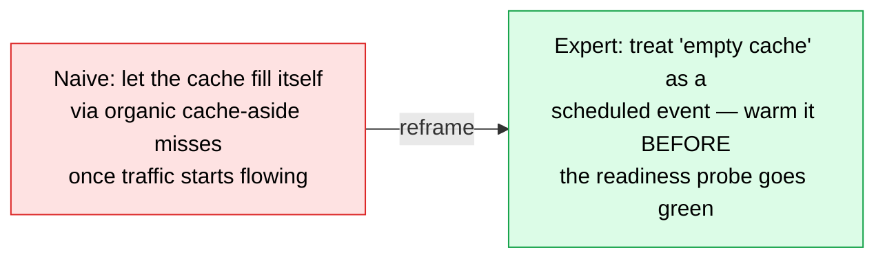
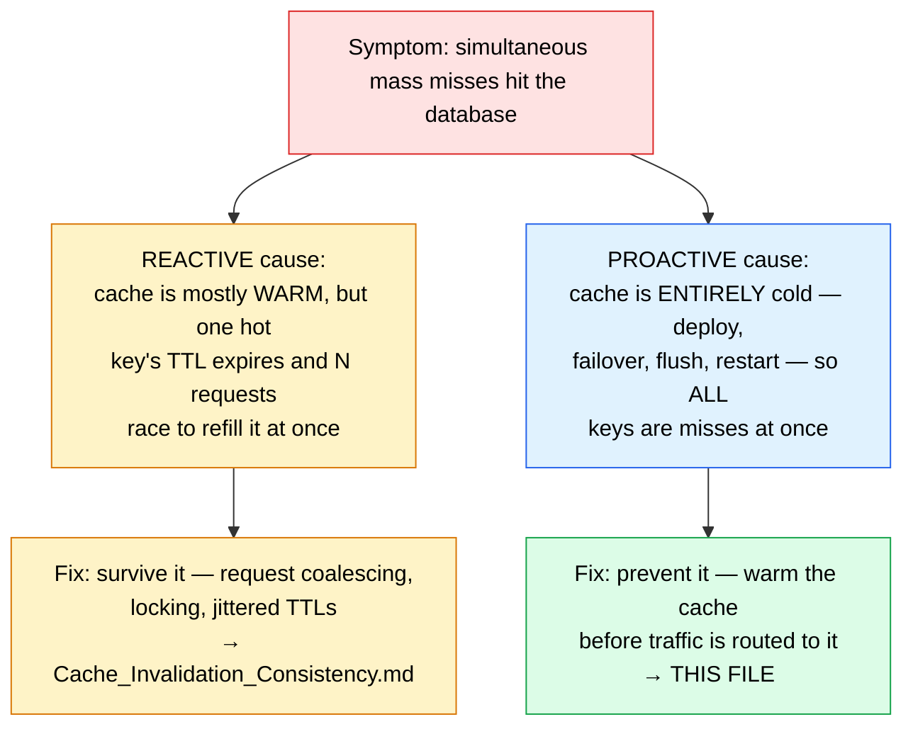
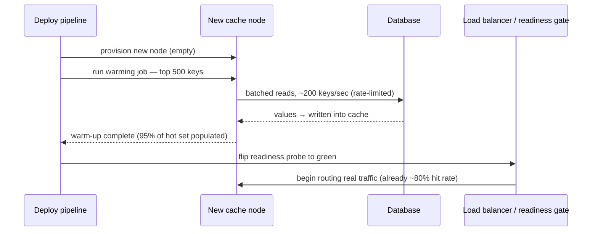
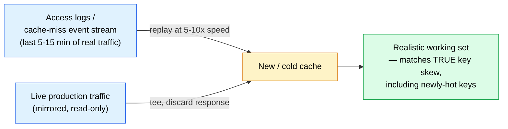
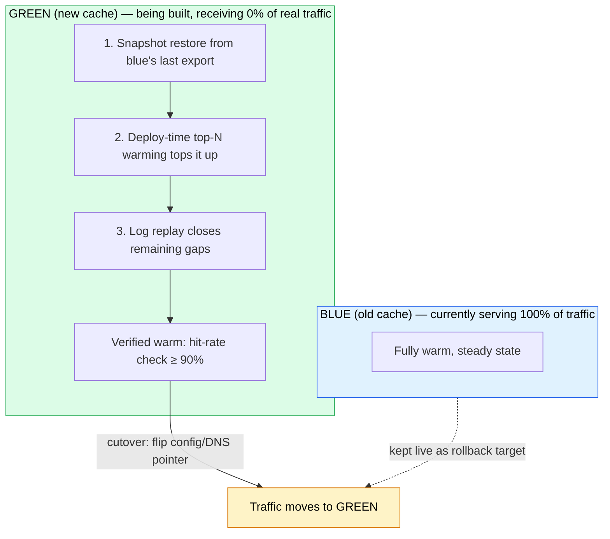
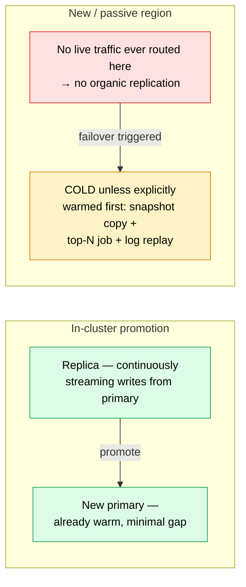
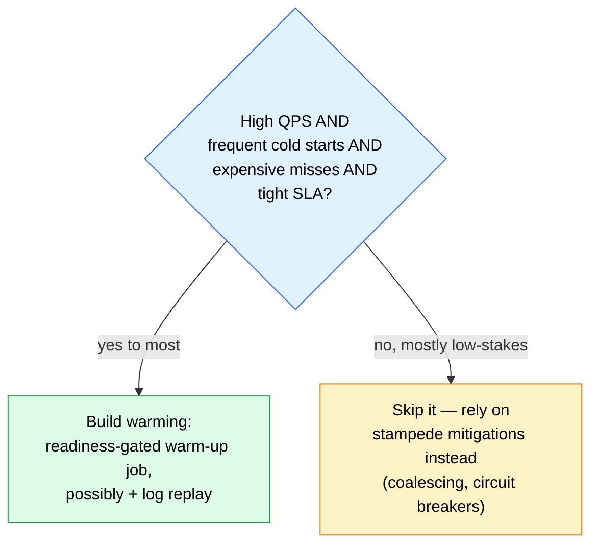
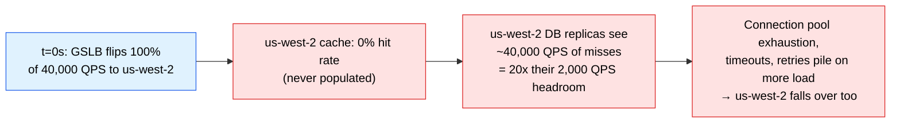
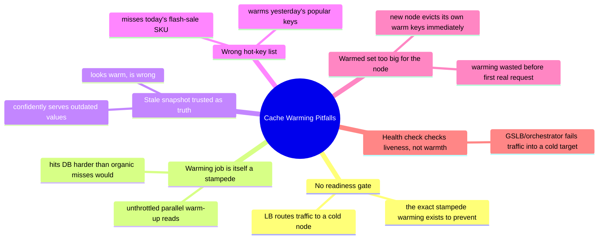

# Cache Warming Strategies

> **One line:** A cache is only as fast as it is *full* — cache warming is the deliberate act of populating a cache with the right data *before* real traffic arrives, so a fresh deploy, a failover, or a restart never forces every single request to become a database-hitting miss at once.

---

## Table of Contents
1. [Why You Must Master This](#1-why-you-must-master-this)
2. [The Mental Model](#2-the-mental-model)
3. [The Empty-Cache Problem — Cold Start vs. Stampede](#3-the-empty-cache-problem--cold-start-vs-stampede)
4. [Deploy-Time Pre-Warming](#4-deploy-time-pre-warming)
5. [Priming From Access Logs — Traffic Replay](#5-priming-from-access-logs--traffic-replay)
6. [Snapshot Restore & Blue-Green Cache Swap](#6-snapshot-restore--blue-green-cache-swap)
7. [Failover & New-Region Warming](#7-failover--new-region-warming)
8. [Cost vs. Complexity — When Warming Is Worth Building](#8-cost-vs-complexity--when-warming-is-worth-building)
9. [Worked Example — Regional Failover, With and Without Warming](#9-worked-example--regional-failover-with-and-without-warming)
10. [Real-Life Use Cases](#10-real-life-use-cases)
11. [Failure Modes](#11-failure-modes)
12. [🏋️ Practice Drills](#-practice-drills)
13. [🎤 Interview Q&A Bank](#-interview-qa-bank)
14. [🎯 Staff+ Nuances](#-staff-nuances)
15. [Cheat Sheet](#15-cheat-sheet)
16. [Connections & Further Reading](#16-connections--further-reading)

---

## 1. Why You Must Master This

Every cache eventually starts at zero — on a fresh deploy, a failover, an eviction flush, or a node restart. The question isn't *whether* you'll face an empty cache, it's whether you let real users discover that fact.

- **It's the difference between a smooth rollout and a self-inflicted outage.** A cold cache in front of a database sized for a 95%+ hit rate means the database instantly sees 20x its normal query volume the moment traffic lands. Deploys and failovers are already risky; an unwarmed cache turns a routine operation into an incident.
- **It's the *proactive* half of the "thundering herd" problem — and interviewers test whether you know both halves.** [Cache_Invalidation_Consistency.md](./Cache_Invalidation_Consistency.md) covers *surviving* a stampede that's already happening (request coalescing, locking, jittered TTLs). This file is about *never letting the stampede start* by making sure the cache isn't empty when traffic hits it. A Staff-level answer names both and explains why you want the second one to rarely be needed.
- **It's a recurring real-incident pattern.** "We deployed a new cache cluster / failed over to a passive region and the database fell over in the first 10 seconds" is one of the most common postmortem shapes in distributed systems — and it is almost always a missing-warm-up story, not a capacity story.
- **It shows up at every layer, not just Redis.** CDN edge nodes before a product launch, a new Kubernetes pod's in-process cache, a promoted database read replica, a freshly spun-up DR region — the "how do I avoid serving the first N requests cold" problem recurs everywhere caching does.

> **The core problem it solves:** *a cache that starts empty makes every request a miss at the exact moment — deploy, failover, restart — when the system is least able to absorb that load.* Warming closes the gap between "the cache exists" and "the cache is useful" before real users pay for it.

**Prerequisites:** [Caching_Strategies.md](./Caching_Strategies.md) (cache-aside, TTLs) and [Cache_Eviction_Policies.md](./Cache_Eviction_Policies.md) (how a cache's working set is bounded) — warming is meaningless without understanding what a cache normally does once it's full.

---

## 2. The Mental Model

Think of a cache as a **restaurant's mise en place** — the chopped vegetables, reduced sauces, and pre-portioned ingredients a kitchen preps *before* the dinner rush. A kitchen that waits until the first order comes in to start chopping onions will be hopelessly behind by the second table. A kitchen that preps the 20 dishes it sells every single night — before the doors open — serves the rush smoothly. Cache warming is prepping the kitchen before dinner service, not during it.

The naive mental model treats a cache as something that "just fills up" through normal use (lazy, cache-aside style) and considers that good enough everywhere. The expert model treats "cache is empty" as a *known, schedulable event* — something that happens at predictable moments (deploy, failover, restart) — and treats warming as a step in the deployment/failover procedure itself, gated by a readiness check, not left to chance.



> **Hold onto this:** warming is not "making the cache faster" — the cache was always going to be fast once full. Warming is about controlling *when* the fill happens, so it happens on your schedule, in the background, against infrastructure that can absorb it — instead of happening all at once, in real time, against a database that can't.

---

## 3. The Empty-Cache Problem — Cold Start vs. Stampede

**What it is.** A cold cache is one with (near) zero useful entries in front of live traffic. It happens in four common ways:

| Trigger | What makes it cold |
|---|---|
| **Fresh deploy** | A new cache cluster, a new app version with a new in-process cache, or a schema/key-format change that invalidates old keys on write. |
| **Failover** | A standby node, replica, or entire region is promoted to serve traffic and never had a warm working set of its own. |
| **Eviction flush** | An operator runs `FLUSHALL`, a Redis instance is resized/restarted, or a capacity change forces a full re-fill. |
| **Node restart in a cluster** | A rolling restart replaces one shard/node at a time; that node's slice of the keyspace is empty until re-populated, even though its *siblings* are warm. |

**Why it's dangerous — the mechanism.** In steady state, a cache absorbs the vast majority of read traffic (a 95-99% hit rate is typical for a well-tuned system), so the database only ever sees the *miss* slice — usually a small, roughly constant fraction of total QPS. The moment the cache is emptied, that ratio inverts: **every** request is a miss, simultaneously, for as long as it takes the cache to organically re-fill through normal traffic. The database — provisioned for the *miss* slice, not the *total* — receives 10-50x its expected load in the time it takes users to notice the page is slow.


> **The one-line takeaway:** warming doesn't eliminate the miss storm — it relocates it from *traffic-arrival time* (uncontrolled, dangerous) to *before traffic arrives* (a background job, paced on your own terms).

**How this connects to (and differs from) cache stampede.** Both problems have the identical *symptom*: a wall of simultaneous misses slamming the origin. They differ in *cause* and therefore in *fix*:



> **The one-line distinction:** [Cache_Invalidation_Consistency.md](./Cache_Invalidation_Consistency.md) is the **reactive** playbook — the cache was warm and one key's expiry created a herd. This file is the **proactive** playbook — the whole cache was never warm to begin with. A mature system needs both: warming to make the cold-start case rare, and stampede mitigation to survive the cases warming didn't cover (an unexpectedly hot key, a warming gap, a bug).

**The real number that makes this concrete:** if a service normally runs at 40,000 QPS with a 98% hit rate, the database sees ~800 QPS of misses — comfortably inside a database provisioned for, say, 2,000 QPS of burst headroom. Empty that cache and route the same 40,000 QPS at it, and the database sees up to 40,000 QPS instantly — **20x** its provisioned burst capacity — long enough to exhaust connection pools and start a retry-driven death spiral. Section 9 works this exact scenario with a full before/after timeline.

---

## 4. Deploy-Time Pre-Warming

**What it is.** A warming job or script runs *before* a new cache instance, node, or process is allowed to receive real traffic. It populates a known set of "hot" keys, then flips a readiness signal so the load balancer or orchestrator only routes traffic once the cache is usefully full.

**Why it exists.** Rolling deploys replace cache-adjacent infrastructure constantly — new pods with fresh in-process caches, new distributed-cache nodes joining a cluster, a config change that rotates the key namespace. Without an explicit gate, a Kubernetes Service or load balancer will happily send production traffic to a brand-new, empty node the instant its process reports "alive," because "alive" and "warm" are different facts.

**How it works, step by step:**

1. **Identify the hot-key set.** Pull the top-N keys by request frequency from existing monitoring/access-log data. Traffic to caches is almost always Pareto-distributed — a small fraction of keys account for most requests (e.g., the top 500 product IDs might cover 80% of catalog reads).
2. **Run a warming job against the *new* instance** before it's registered with the load balancer: for each hot key, read from the source of truth (the database, an upstream service) and write into the new cache with the same TTL/versioning policy the app would normally use.
3. **Rate-limit the warming job itself.** Warming 5,000 keys with unlimited concurrency is itself a mini stampede against the database — batch it (e.g., 200 keys/sec) so warming never exceeds the load the database already tolerates from organic misses.
4. **Gate readiness on warm-enough, not just alive.** Wire the warming job's completion (or a "≥95% of top-1000 keys populated" threshold) into the container's readiness probe. Kubernetes (and most orchestrators) will not route Service traffic to a pod until its readiness probe passes — reuse that mechanism for cache warmth, not just process health.



**The trade-off.** Warming delays the rollout by however long the job takes (seconds to a couple of minutes for a few thousand keys) — that's the cost of buying a smooth ramp instead of an instant cliff. It also adds a piece of infrastructure (the warming job itself) that must be maintained, tested, and kept in sync with the app's actual key format — a warming job that writes stale-format keys is worse than no warming at all (see [Failure Modes](#11-failure-modes)).

**Real number:** if the top 500 keys cover ~80% of traffic and the warming job runs at 200 keys/sec, warm-up takes ~2.5 seconds — cheap insurance against a multi-second, database-driven incident.

---

## 5. Priming From Access Logs — Traffic Replay

**What it is.** Instead of guessing a "top-N key" list, reconstruct the cache's realistic working set by **replaying real production requests** — either a stored access log or a live mirror ("shadow traffic") of real user requests — against the new/cold cache.

**Why it exists.** A hand-picked hot-key list is a snapshot of *yesterday's* popularity and misses two things a real access-log replay captures for free: the true long-tail shape of the distribution (not just the top 500, but the next 5,000 that still matter), and *newly* hot keys that only started trending in the last few minutes (a breaking-news article, a flash-sale SKU). Replaying what users actually asked for reproduces the cache state you'd have reached organically — just compressed into seconds instead of minutes.

**How it works:**
- **Log replay:** take the last N minutes of access logs (from the load balancer, an access-log topic in a message queue, or a cache's own miss-event stream) and replay those *read* requests against the new cache's normal read path — cache-aside logic runs exactly as it would for a real user, just fed synthetic replay traffic, often at accelerated speed (10x) to catch up quickly.
- **Shadow / mirror traffic:** tee a live copy of production requests to the new cache in parallel with the old one serving real users — the new cache warms in real time as if it were serving, but its responses are discarded (never sent to actual users), so mistakes are free.
- Both approaches must be **read-only replays** for stateful writes — you replay the *read* pattern, not the write side, to avoid double-processing side effects like payments or inventory decrements.



**Trade-off vs. deploy-time top-N warming.** Log replay is *more accurate* — it captures real skew and recent shifts a static list can't — but costs more infrastructure: durable access logs or a mirroring pipeline, a replay tool, and care to avoid re-triggering write-side effects. Top-N warming is cheaper to build and good enough when traffic is stable and well-understood; log replay earns its keep when traffic is spiky, seasonal, or the hot set shifts fast (flash sales, breaking news).

**Real systems:** large-scale platforms (Netflix, GitHub, Twitter-era engineering blogs) have documented "shadow traffic" / "dark traffic" mirroring tools originally built for canary testing that double as cache/warming validation — proving a new system behaves correctly *and* incidentally pre-filling its cache before it takes live responsibility.

---

## 6. Snapshot Restore & Blue-Green Cache Swap

**Snapshot restore — what it is.** Rather than re-deriving cache contents key-by-key from the database, dump the *previous* cache generation's keyspace to a persistent snapshot (a Redis RDB file, or a custom `(key, value, ttl)` export) and bulk-load that snapshot into the new instance at startup. Bulk-loading a snapshot is a sequential I/O operation, not thousands of individual round-trips — it's dramatically faster than warming key-by-key.

**How it works under the hood:** Redis natively supports this via **RDB** (a point-in-time binary snapshot) and **AOF** (an append-only log of writes) — a new replica or a restored instance loads the RDB file wholesale, then optionally replays the AOF tail to catch up to the exact last write. The same idea generalizes to any cache technology: export a `(key, value, ttl)` tuple set from the outgoing generation, bulk-import it into the incoming one.

**Blue-green cache swap — what it is.** Keep the **old (blue)** cache fully serving live traffic while the **new (green)** cache is built up completely — via snapshot restore, then topped up with deploy-time warming and/or log replay — and only cut traffic over once green is verified warm. Blue stays live as an instant rollback target for a defined window after the swap.



**The trade-off.** A snapshot is a *starting point*, not a final state — if it's an hour old, some values may be stale and some newly-hot keys won't be in it yet, so it must be treated as "get most of the way there fast" and topped up with live-traffic reads or log replay, not trusted as the complete picture. In exchange, it buys an enormous head start: restoring a multi-gigabyte RDB snapshot over a local network typically takes single-digit to tens of seconds, versus the minutes-to-hours it could take to reach the same fill level through purely organic, lazy cache-aside misses at low-to-moderate query volume.

**Where this shows up:** Redis replication is *itself* a continuous, incremental version of this idea — a replica is kept warm at all times by streaming writes, so promoting it (see [Section 7](#7-failover--new-region-warming)) needs little or no extra warming. Blue-green is the explicit, one-time version of the same mechanism, used for deploys and migrations rather than ongoing replication.

---

## 7. Failover & New-Region Warming

Failover warming splits into two very different cases — one that's usually already solved, and one that almost never is.

**Case 1 — in-cluster failover (usually already warm).** When a Redis replica is promoted to primary, or a new node joins an existing Redis Cluster / Memcached ring, **replication has typically been doing the warming continuously**: a replica streams every write from its primary in real time, so its in-memory dataset is already a live mirror of the primary's — promotion is close to a no-op from a warmth perspective. The gap that remains is narrow: replication lag (a few writes that hadn't propagated before the primary died) and the special case of a *brand-new* node joining the ring, which must complete an initial full sync (loading an RDB snapshot, then catching up via the replication stream) before it can serve its slice — briefly degraded, not cold.

**Case 2 — a new, empty region/DC (usually NOT warm, and this is the trap).** A passive disaster-recovery region that has never served live traffic has **no organic reason to have any data in its cache** unless someone explicitly wired up cross-region replication ahead of time (e.g., Redis Enterprise Active-Active / Global Datastore, or a custom cross-region mirroring pipeline). If nobody built that, the new region is exactly as cold as a fresh deploy — and it needs the *same* toolkit from Sections 4-6: snapshot copy from the active region, deploy-time top-N warming, and/or replaying the active region's recent access logs against the new region's cache before it takes traffic.



**Why this matters for [GSLB.md](./GSLB.md) specifically:** GSLB decides *where* and *when* to route failover traffic based on health checks — but a standard health check only proves "the process is up," not "the cache behind it is warm." If GSLB's health check gates purely on liveness, it will happily fail 100% of traffic over into a stone-cold region the instant the primary region looks unhealthy — recreating the exact empty-cache spike this whole file is about, at the worst possible moment (during an active incident). The fix is to make the health check (or the failover runbook) also check — or actively drive — cache warmth, and to ramp traffic into the new region in stages rather than switching it all at once. Section 9 works this exact interaction with numbers.

**Real number:** promoting an in-sync Redis replica costs ~0 extra warming (its RAM is already populated). Spinning up a previously-passive region and sending it 40,000 QPS cold can turn a single-region outage into a two-region outage within seconds — the entire reason failover *drills* (deliberately testing failover before you need it) are standard practice at mature companies.

---

## 8. Cost vs. Complexity — When Warming Is Worth Building

Warming isn't free: it's a job/script to write and maintain, log-replay or shadow-traffic tooling to operate, and a readiness-gate integration to test. The alternative — do nothing and lean entirely on [Cache_Invalidation_Consistency.md](./Cache_Invalidation_Consistency.md)'s reactive defenses (request coalescing, circuit breakers, generous connection pools, graceful degradation) — is simpler to build but means *tolerating* a real, if short, window of elevated load and latency every time the cache goes cold.

Four axes decide which side wins:

| Axis | Favors building warming | Favors tolerating the stampede |
|---|---|---|
| **QPS at cutover** | Tens of thousands+ QPS — an instant all-miss burst can exceed DB capacity by 10-50x | Low QPS — the DB absorbs an all-miss burst without breaking a sweat |
| **Frequency of cold starts** | Frequent deploys (many/day), auto-scaling nodes joining constantly | Rare events (one failover drill a year) |
| **Cost per miss** | Expensive misses — a complex join, an ML inference, a cross-service fan-out | Cheap misses — a single indexed row lookup |
| **SLA / error budget** | Strict P99 latency SLA that a 30-second spike would blow for the month | Loose or best-effort latency targets |



> **The rule of thumb:** if `(peak QPS) × (1 − warm hit-rate) × (cost per DB query)` for even a 30-second cold window would meaningfully threaten the database or the SLA, warming has already paid for itself before you've written a line of the job. If that number is small, spend the engineering time on stampede mitigation instead — it's cheaper insurance for the common case and still catches the warming gaps you didn't anticipate.

---

## 9. Worked Example — Regional Failover, With and Without Warming

**Setup:** an e-commerce product-catalog service normally runs **40,000 QPS** of reads out of `us-east-1`, with a **98% cache hit rate**. That means the database read replicas there see ~800 QPS of misses — comfortably inside replicas provisioned for **2,000 QPS** of burst headroom. `us-west-2` is a passive DR region: it has its own Redis cluster and its own database read replicas provisioned identically, but because it never serves live traffic, its cache has never been organically filled.

`us-east-1` suffers an outage. GSLB (see [GSLB.md](./GSLB.md)) detects it and fails over.

**Without warming — the miss storm:**



The region meant to *rescue* the outage becomes a second outage within seconds — the database can't absorb a 20x instantaneous overshoot regardless of how well it's provisioned for steady state.

**With warming — the smooth ramp.** Two things are wired into the failover procedure ahead of time:
1. **Continuous background priming:** `us-west-2`'s cache is kept partially warm at all times via periodic snapshot copy / low-rate log replay from `us-east-1`, holding a baseline ~70% hit rate even though it serves no live traffic.
2. **Staged (canary) failover:** GSLB ramps traffic into `us-west-2` in steps — 10% → 50% → 100% over 60 seconds — instead of an instant 100% cutover, while an accelerated warming job replays the last 5 minutes of `us-east-1`'s access logs at 10x speed, populating the top 5,000 keys (≈85% of request volume) within ~15 seconds.

| Time | Traffic sent to us-west-2 | Cache hit rate | Miss QPS at DB | vs. 2,000 QPS headroom |
|---|---|---|---|---|
| t=0s | 10% (4,000 QPS) | 70% (baseline priming) | 4,000 × 0.30 = **1,200 QPS** | 60% of headroom — safe |
| t=15s | 10% (4,000 QPS) | ~90% (accelerated replay done) | 4,000 × 0.10 = **400 QPS** | 20% of headroom — safe |
| t=30s | 50% (20,000 QPS) | ~92% | 20,000 × 0.08 = **1,600 QPS** | 80% of headroom — tight but safe |
| t=60s | 100% (40,000 QPS) | ~95% | 40,000 × 0.05 = **2,000 QPS** | at headroom limit, not over |

**Closing the loop:** the number that forces the architectural decision is the **20x** instantaneous overshoot in the unwarmed case versus the **≤1x** overshoot at every step of the warmed, staged case. That single ratio is the difference between a failover that quietly succeeds and one that takes down a second region. Neither the background priming nor the staged ramp alone would be enough on their own at this QPS — it's the combination (some warmth always present + traffic arriving gradually while accelerated warming finishes the job) that keeps every point on the timeline under the database's burst headroom.

---

## 10. Real-Life Use Cases

| Situation | How cache warming applies | The decision it forces |
|---|---|---|
| **CDN pre-warming a product launch** | Push (not pull) the launch assets to edge PoPs *before* the announcement goes live, instead of waiting for the first user in each region to trigger a pull-model miss. See [CDN.md](./CDN.md). | Push model for known, scheduled traffic spikes; pull model for everything else. |
| **Flash-sale e-commerce catalog** | Pre-warm the sale SKUs' prices/inventory into cache minutes before the sale opens, using a deploy-time-style job against the known SKU list. | Warming a small, known key set beats hoping cache-aside catches up during the first seconds of the sale. |
| **Game server launch day** | Matchmaking/leaderboard caches for a new game are warmed with default/seed data before servers open to players, avoiding a login-storm miss spike. | Warming timed to the launch event, not to first player traffic. |
| **Streaming service regional failover** | A passive region's edge/cache tier is kept partially warm via background replication so a GSLB failover doesn't dump 100% cold traffic onto DB replicas. | Continuous low-cost priming vs. an emergency warming job — pick based on failover frequency. |
| **Database read-replica promotion** | In-memory replica state is already warm from continuous replication — little to no extra warming needed. | Recognize when replication *already* solves warming, and reserve explicit warming for cases it doesn't (new regions, new nodes). |
| **Blue-green deploy of a recommendation cache** | The new (green) cache is snapshot-restored and log-replayed to parity before any user traffic is cut over. | Verify a warmth threshold (e.g., hit-rate ≥ 90%) as a gate, not just "process is running." |

> **The habit:** whenever a rollout, failover runbook, or capacity plan involves a cache that will start empty, ask "is this cold start scheduled or accidental?" — a scheduled cold start can always be warmed first; only an accidental one (an unplanned crash) has to fall back on stampede mitigation.

---

## 11. Failure Modes



- **No readiness gate on warm-up.** *Symptom:* a new node/pod starts serving real traffic seconds after boot, cold. *Root cause:* the load balancer or orchestrator gates on process liveness only, unaware that "alive" and "warm" are different facts. *Fix:* wire the warming job's completion into the readiness probe (Section 4) so traffic only arrives once a warmth threshold is met.
- **The warming job becomes its own stampede.** *Symptom:* the database sees a load spike *caused by warming*, not by users. *Root cause:* the job fires unbounded parallel reads for thousands of keys at once. *Fix:* rate-limit/batch the warming job to a pace the database already tolerates from organic misses.
- **A stale snapshot is trusted as current.** *Symptom:* the "warm" cache confidently serves wrong prices, wrong inventory, or stale content — worse than a miss, because nothing signals the value is bad. *Root cause:* treating a snapshot restore (Section 6) as the final state instead of a starting point. *Fix:* always top up a restored snapshot with live-traffic reads or a recent log replay, and version/TTL snapshot data so it naturally expires if not refreshed.
- **Warming the wrong keys.** *Symptom:* the warm-up "succeeds" but the actual traffic still misses heavily. *Root cause:* the hot-key list is stale — built from last week's popularity, missing today's flash-sale SKU or breaking-news article. *Fix:* derive the hot-key list from recent (not historical) access logs, or use log replay/shadow traffic (Section 5) which captures the *current* distribution by construction.
- **Warmed set doesn't fit the new node's memory.** *Symptom:* the warming job reports success, but the node's hit rate is still low once real traffic starts. *Root cause:* the warmed key set is larger than the node's memory budget under its [eviction policy](./Cache_Eviction_Policies.md), so warmed keys get evicted by each other before users ever read them. *Fix:* size the warm set to the node's actual working-set capacity, and warm the *highest*-value keys first so early eviction (if any) drops the least valuable ones.
- **Health checks that don't know about warmth.** *Symptom:* GSLB or an orchestrator routes traffic into a technically-alive-but-cold target during a failover. *Root cause:* liveness and warmth are conflated. *Fix:* extend health checks (or the failover runbook) to gate on cache warmth explicitly, and prefer a staged/canary traffic ramp (Section 9) as a cheap complement even when warming can't be perfectly guaranteed.

---

## 🏋️ Practice Drills

> *Cover the solutions and attempt first — active recall is the point.*

**Drill 1 — Warming vs. stampede mitigation.** A teammate says "we already handle cache stampedes with request coalescing, so we don't need cache warming." Are they right?

<details><summary>Solution</summary>

Not entirely. Request coalescing (and other reactive defenses in [Cache_Invalidation_Consistency.md](./Cache_Invalidation_Consistency.md)) handles the case where the cache is *mostly warm* and one key's expiry causes a herd — it collapses N simultaneous refill requests for that one key into one database read. It does **nothing** to reduce load when the *entire* cache is empty (a deploy, a failover, a flush) — in that case, coalescing still means every *distinct* key gets exactly one database read, but with thousands or millions of distinct keys all missing at once, "one read per key" is still an enormous, simultaneous load spike. Coalescing shrinks the multiplier *per key*; it does not shrink the *number of keys* stampeding at once. Warming addresses that second problem directly by not letting the cache be empty in the first place. Mature systems need both: warming to make full-cache cold starts rare, and coalescing/locking to survive the individual hot-key expiries that warming can't fully prevent.
</details>

**Drill 2 — Size the warming job.** A catalog service's cache normally holds 50,000 keys. Access logs show the top 2,000 keys account for 75% of read traffic. A new node can warm keys at 150 keys/sec. How long should the warming job budget, and what hit rate should you expect the moment real traffic starts?

<details><summary>Solution</summary>

Warming the top 2,000 keys at 150 keys/sec takes 2,000 / 150 ≈ **13.3 seconds**. Since those 2,000 keys account for 75% of read traffic, the cache should start real traffic at roughly a **75% hit rate immediately** — not 0%. The remaining 25% of traffic (the long tail of 48,000 less-popular keys) will still miss and be filled lazily via normal cache-aside behavior, but the database only sees that 25% slice instead of 100% — a 4x reduction in the miss-storm size for ~13 seconds of warm-up time. If the database can't tolerate even a 25% slice of full QPS, extend the warmed set further down the popularity curve (e.g., top 10,000 keys) at the cost of a longer warm-up window — this is exactly the QPS/cost trade from Section 8.
</details>

**Drill 3 — Design a failover warming plan.** You own a service doing 25,000 QPS in a primary region with a 96% cache hit rate. You're adding a passive DR region that currently has no traffic and no cross-region cache replication. Design the warming approach for a failover, and justify each piece.

<details><summary>Solution</summary>

A layered plan, cheapest-first:

1. **Continuous low-cost priming (background):** periodically (e.g., every 1-5 minutes) copy a snapshot of the primary region's cache — or replicate the top-N hottest keys — into the DR region's cache, so it's never *fully* cold even though it serves no live traffic. This is cheap (small, infrequent transfers) and removes most of the risk with the least engineering.
2. **Accelerated log replay at failover time:** the instant failover triggers, replay the primary region's last 5-10 minutes of access logs at high speed against the DR cache to close the gap between "partially primed" and "actually warm," capturing anything that became hot since the last snapshot.
3. **Staged traffic ramp, not an instant cutover:** have GSLB or the failover runbook ramp traffic into the DR region over 30-60 seconds (e.g., 10% → 50% → 100%) instead of switching all 25,000 QPS at once, buying the replay job time to finish and giving the DR database replicas a gentler load curve.
4. **Gate the ramp on a warmth signal, not just liveness:** don't advance past 10% traffic until the DR cache reports a hit rate above some threshold (e.g., 85%), so a slow-to-warm scenario doesn't silently escalate to 100% traffic anyway.

Justification: relying on any single layer is fragile — background priming alone might miss a newly-hot key; log replay alone (with no priming) means starting from zero every time and racing the clock; an instant cutover with no ramp removes the safety margin that makes the other two layers effective. Together they turn a 25,000 QPS all-at-once cold start into a load curve the DR database can absorb at every point in time.
</details>

---

## 🎤 Interview Q&A Bank

**Q1. "What is cache warming, and why would you need it if you already have cache-aside?"**
> Cache warming is deliberately populating a cache with the right data *before* real traffic arrives, instead of relying on cache-aside's normal lazy-fill-on-miss behavior. You need it because lazy fill is fine when the cache is *mostly* warm and only occasionally misses — but at the moment a cache is *entirely* empty (a deploy, a failover, a flush), lazy fill means every single request becomes a database hit simultaneously, at exactly the moment the system is least prepared for it. Warming turns that instantaneous, uncontrolled fill into a scheduled, rate-limited one that happens before the readiness gate opens.

**Q2. "How is cache warming different from cache stampede mitigation?"** *(signal: tests whether the candidate conflates proactive and reactive fixes)*
> They solve the same symptom — a wall of simultaneous misses hitting the origin — from opposite ends of the timeline. Stampede mitigation (request coalescing, locking, jittered TTLs) is *reactive*: the cache was warm, one key expired, and many requests raced to refill it; the fix collapses that race into one database read. Warming is *proactive*: it prevents the cache from ever being fully empty in front of live traffic in the first place. A complete design has both — warming to make cold starts rare, coalescing to survive the gaps warming doesn't cover.

**Q3. "Walk me through how you'd warm a cache before a deploy."**
> Identify the hot-key set from existing traffic (usually a small top-N covers most requests, thanks to Pareto-distributed access patterns), run a warming job against the *new* instance before it's registered with the load balancer, rate-limit that job so it doesn't itself overload the database, and wire its completion into the readiness probe so the orchestrator only routes real traffic once a warmth threshold — not just process liveness — is satisfied.

**Q4. "A promoted Redis replica — does it need explicit cache warming?"** *(signal: distinguishes in-cluster failover from a genuinely new target)*
> Usually not, because replication has already been continuously streaming every write from the primary, so the replica's in-memory data is close to a live mirror at the moment of promotion — the only gap is replication lag for the last few unpropagated writes. The case that *does* need explicit warming is a brand-new node joining the cluster (it must complete an initial full sync) or, much more importantly, a passive region/DC that never had live traffic and therefore never had organic replication into its cache — that one is exactly as cold as a fresh deploy and needs the same warming toolkit.

**Q5. "How would you warm a cache to match real traffic patterns as closely as possible?"**
> Replay real access logs (or mirror live "shadow" traffic) against the new cache's normal read path instead of hand-picking a hot-key list. This reproduces the true key distribution — including the long tail and any keys that only recently became hot — because it's driven by actual requests rather than a snapshot of yesterday's popularity. The trade-off is more infrastructure (log storage or a traffic-mirroring pipeline) versus a simpler top-N warming job, so it's worth it specifically when traffic is spiky or the hot set shifts quickly.

**Q6. "When would you decide warming isn't worth building?"**
> When the math says a short cold window can't do meaningful damage: low QPS relative to database capacity, infrequent cold starts, cheap per-miss cost, and a loose latency SLA. In that regime, the engineering cost of a warming job and its supporting tooling outweighs the risk, and it's cheaper to lean on reactive stampede mitigations for the rare cold-start event. The decision flips hard once QPS, miss cost, or SLA strictness rise — a 40,000 QPS service can't tolerate the same cold window a 400 QPS one can.

**Q7. "Your team wants to fail over into a DR region during an outage. What's the risk with cache warming specifically, and how do you mitigate it?"**
> The risk is that the DR region's cache has never organically warmed because it never served live traffic — failing 100% of traffic over instantly turns a one-region outage into a two-region outage as the DR database absorbs an all-miss burst it was never provisioned for. Mitigate with continuous low-rate background priming so the DR cache is never fully cold, an accelerated log-replay job triggered at failover time to close the remaining gap fast, and a staged traffic ramp (10% → 50% → 100%) so the database sees a load curve instead of a step function — gated by an actual warmth signal, not just "the process responded."

**Q8. "What's the biggest way a cache-warming implementation can go wrong?"**
> Two ways dominate in practice: the warming job itself becomes an unthrottled stampede against the database (defeating its own purpose), and a stale snapshot or an outdated hot-key list gets trusted as "warm and correct" when it's actually warm-but-wrong — which is worse than a plain miss because nothing signals the data is bad. Both are fixed by treating warming as production code: rate-limit it like any other bulk job, and always validate/refresh warmed data against a recent source rather than trusting a point-in-time export indefinitely.

---

## 🎯 Staff+ Nuances

- **Warming is a prediction, and predictions are sometimes wrong — design for that, don't assume perfection.** A warmed key set is a bet on what will be requested; when the bet is wrong, the fallback should just be a normal cache-aside miss for that one key, not a hard failure. Combine warming with the lazy fallback path so a wrong guess costs one miss, not a permanent gap.
- **Warming and eviction are coupled — size the warm set to the working-set capacity, not to "as much as we can prefetch."** Warming more keys than a node's memory budget under its [eviction policy](./Cache_Eviction_Policies.md) means the warmed keys evict each other before any real request reads them — wasted work that looks successful in a job log but delivers nothing.
- **Continuous cross-region replication is "warming that never stops" — and it turns a failover-time problem into a steady-state consistency problem instead.** Active-active setups (Redis Enterprise Global Datastore, custom bi-directional mirrors) keep every region perpetually warm, eliminating explicit failover warming — at the cost of now needing a genuine multi-region consistency story (conflict resolution, replication lag bounds) rather than a one-time warm-up job. See [Distributed_Caching_Redis_Memcached.md](./Distributed_Caching_Redis_Memcached.md) for the replication mechanics this trade rests on.
- **Warming can race invalidation — order matters.** If a warming job writes a value for a key at the same moment a normal invalidation event fires for that key, a naive implementation can let the warming write "win" and leave a stale value in place (a last-write-wins race). Route warming writes through the *same* write path and versioning/CAS checks the application uses for normal cache updates — never treat the warming job as exempt from the invalidation rules in [Cache_Invalidation_Consistency.md](./Cache_Invalidation_Consistency.md).
- **The hard part isn't the warming job — it's keeping the hot-key list honest.** A hardcoded or rarely-refreshed "top keys" list decays the moment traffic patterns shift (a new flash sale, a viral post, a seasonal SKU). Production-grade warming pipelines re-derive the hot set from *recent* access logs on every run rather than trusting a list someone wrote down once.
- **A staged/canary traffic ramp is a cheap force-multiplier for imperfect warming.** Even a cache that's only 70% warm survives fine if traffic arrives at 10% → 50% → 100% over a minute instead of 100% instantly — the ramp buys the warming job time to finish and buys the database a load curve instead of a step function. Treat the ramp and the warming job as a pair, not alternatives.
- **Warming is throttled by the exact capacity it's trying to protect — don't let the cure become the disease.** A warming job that fires thousands of parallel reads to populate a cold cache fast is itself a self-inflicted stampede against the database if left unbounded. Rate-limit and batch warming jobs to a pace the database already tolerates from organic misses — warming should never be the reason the database falls over.

---

## 15. Cheat Sheet

```
CACHE WARMING — fill the cache BEFORE traffic arrives, not after
═══════════════════════════════════════════════════════════════════════════

WHY COLD CACHES ARE DANGEROUS
  steady state:  hit rate 95-99%  → DB sees only the small MISS slice
  cache emptied: hit rate  ~0%    → DB sees 100% of QPS at once (10-50x spike)
  triggers: fresh deploy · failover · eviction flush (FLUSHALL/restart) ·
            rolling node restart in a cluster

WARMING (proactive)  vs  STAMPEDE MITIGATION (reactive)
  same symptom: a wall of simultaneous misses hits the DB
  warming:   prevent the cache from EVER being fully empty in front of traffic
  mitigation: SURVIVE a herd when one hot key expires while cache is warm
             → see Cache_Invalidation_Consistency.md — need BOTH

STRATEGIES (cheapest/simplest → most accurate/expensive)
  1. Deploy-time top-N warming   — warm known hot keys, gate readiness probe on it
  2. Snapshot restore            — bulk-load previous generation's (k,v,ttl) dump
  3. Blue-green cache swap       — build GREEN fully warm before cutover; BLUE stays as rollback
  4. Log replay / shadow traffic — replay real access logs/mirrored traffic → most realistic

FAILOVER-SPECIFIC
  in-cluster replica promotion  → USUALLY already warm (continuous replication)
  brand-new node joining ring   → brief gap during initial full sync
  new/passive region or DC      → COLD unless explicit cross-region priming set up —
                                   treat exactly like a fresh deploy
  GSLB health checks must gate on WARMTH, not just liveness, or failover
  re-creates the exact miss-storm it was meant to fix

WHEN IS WARMING WORTH BUILDING?
  build it if:  high QPS · frequent cold starts · expensive misses · tight SLA
  skip it if:   low QPS · rare cold starts · cheap misses · loose SLA
  rule of thumb: (peak QPS)×(1-hit rate)×(cost/query) for a 30s cold window
                 threatens the DB/SLA?  → warming already paid for itself

WORKED NUMBERS (40,000 QPS, 98% steady hit rate, 2,000 QPS DB headroom)
  no warming:  100% cutover  → 40,000 QPS miss  → 20x headroom  → cascades
  warmed+ramp: staged 10%→50%→100% + priming/replay → miss QPS stays ≤ headroom
              at every step (1,200 → 400 → 1,600 → 2,000 QPS)

PITFALLS
  ✗ readiness gate checks liveness only → LB routes to a cold node
  ✗ unthrottled warming job             → warming becomes its own stampede
  ✗ stale snapshot trusted as truth     → confidently wrong, not just a miss
  ✗ stale hot-key list                  → misses today's actual hot keys
  ✗ warmed set > node memory            → warmed keys evict each other first
  ✓ rate-limit warming · validate freshness · derive hot keys from RECENT logs ·
    gate health checks on warmth · pair warming with a staged traffic ramp
```

---

## 16. Connections & Further Reading

**Prerequisites (learn first):**
- [Caching_Strategies.md](./Caching_Strategies.md) — cache-aside and TTL basics that warming pre-populates ahead of.
- [Cache_Eviction_Policies.md](./Cache_Eviction_Policies.md) — why a warmed set must fit the working-set capacity or it evicts itself.

**Builds toward / pairs with:**
- [Cache_Invalidation_Consistency.md](./Cache_Invalidation_Consistency.md) — the reactive counterpart: surviving a stampede that's already happening, once warming's coverage runs out.
- [Hot_Key_Problem_Multi_Tier_Caching.md](./Hot_Key_Problem_Multi_Tier_Caching.md) — the hot-key skew that warming's "top-N" target set is built from.
- [Distributed_Caching_Redis_Memcached.md](./Distributed_Caching_Redis_Memcached.md) — the replication (RDB/AOF) mechanics that make in-cluster failover mostly self-warming.
- [In_Process_vs_Distributed_Cache.md](./In_Process_vs_Distributed_Cache.md) — local in-process caches go cold on every process restart, making warming's deploy-time case especially relevant there.
- [CDN.md](./CDN.md) — push-model edge pre-warming for a scheduled launch is the same idea applied at the edge.
- [GSLB.md](./GSLB.md) — where failover routing decisions need to be gated on cache warmth, not just liveness.

**Gaps this topic exposes (candidates for the section's Gap Analysis):**
- Chaos-engineering-style failover drills that deliberately test cold-start behavior before a real incident forces the test.
- Predictive pre-fetching using ML-based popularity forecasting (warming based on *predicted* future hotness, not just recent history) — an extension of Section 5's log replay.

**External classics:**
- [Redis: Persistence (RDB & AOF)](https://redis.io/docs/latest/operate/oss_and_stack/management/persistence/) — the snapshot/replay mechanics underlying Section 6.
- [Redis: Replication](https://redis.io/docs/latest/operate/oss_and_stack/management/replication/) — why a promoted replica is usually already warm (Section 7).
- [Kubernetes: Readiness Probes](https://kubernetes.io/docs/concepts/workloads/pods/pod-lifecycle/#container-probes) — the mechanism deploy-time warming gates on.
- [GitHub Engineering: Scientist (shadow/mirror traffic testing)](https://github.blog/2016-02-25-scientist-in-c/) — a real-world traffic-mirroring pattern that doubles as warming validation.

---

## TL;DR
**A cache is only as fast as it is full — cache warming is populating it with the right data *before* real traffic arrives, so a deploy, failover, flush, or restart never turns every request into a simultaneous database hit.** It is the proactive half of the thundering-herd problem: [Cache_Invalidation_Consistency.md](./Cache_Invalidation_Consistency.md) survives a stampede that's already started against a warm cache; this file prevents the cache from being empty in the first place. Build it with deploy-time top-N warming gated by a readiness probe, snapshot restore for near-instant bulk fills, blue-green cache swaps that verify warmth before cutover, and log replay/shadow traffic when accuracy to real skew matters most — and remember replication already warms most in-cluster failovers, while a genuinely new region needs the exact same toolkit as a fresh deploy. **Rate-limit the warming job itself, never trust a snapshot or a hot-key list as permanently current, and gate every readiness or health check on warmth — not just liveness** — because the database doesn't care whether the traffic hitting it 20x over capacity came from users or from your own well-intentioned warm-up script.
