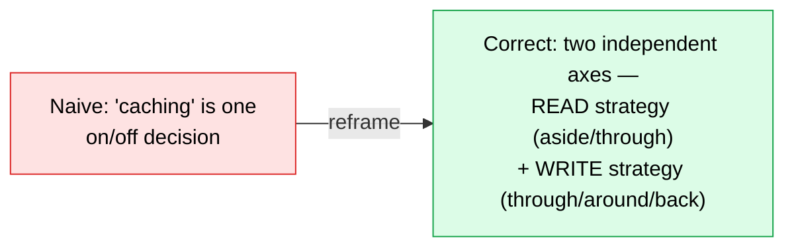
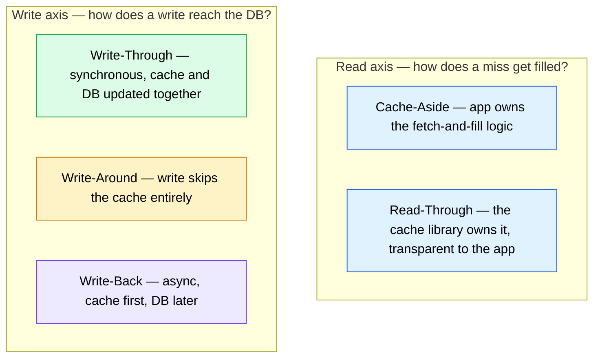
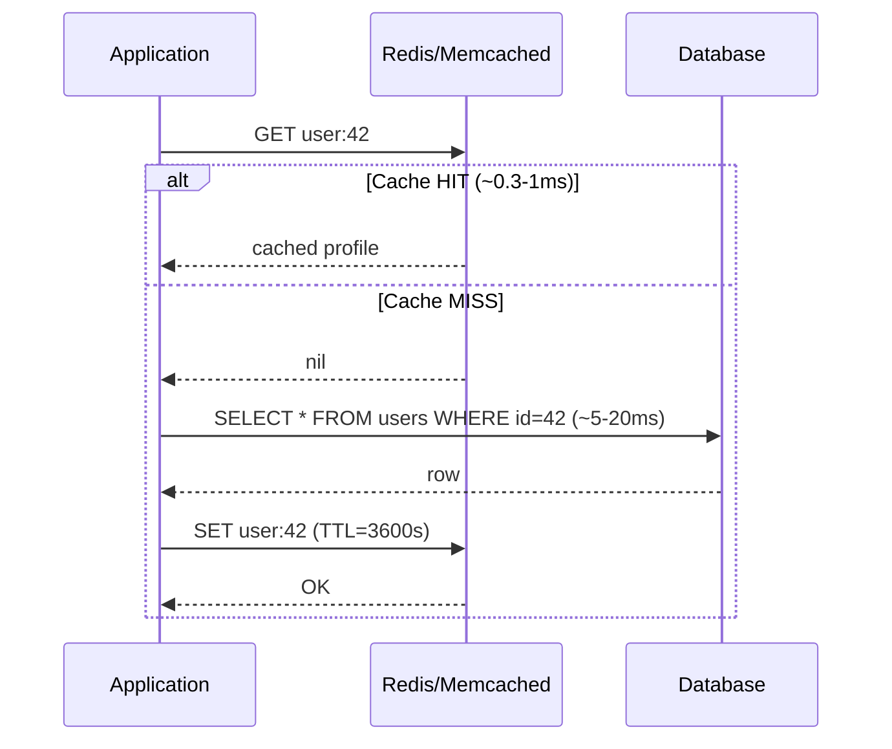
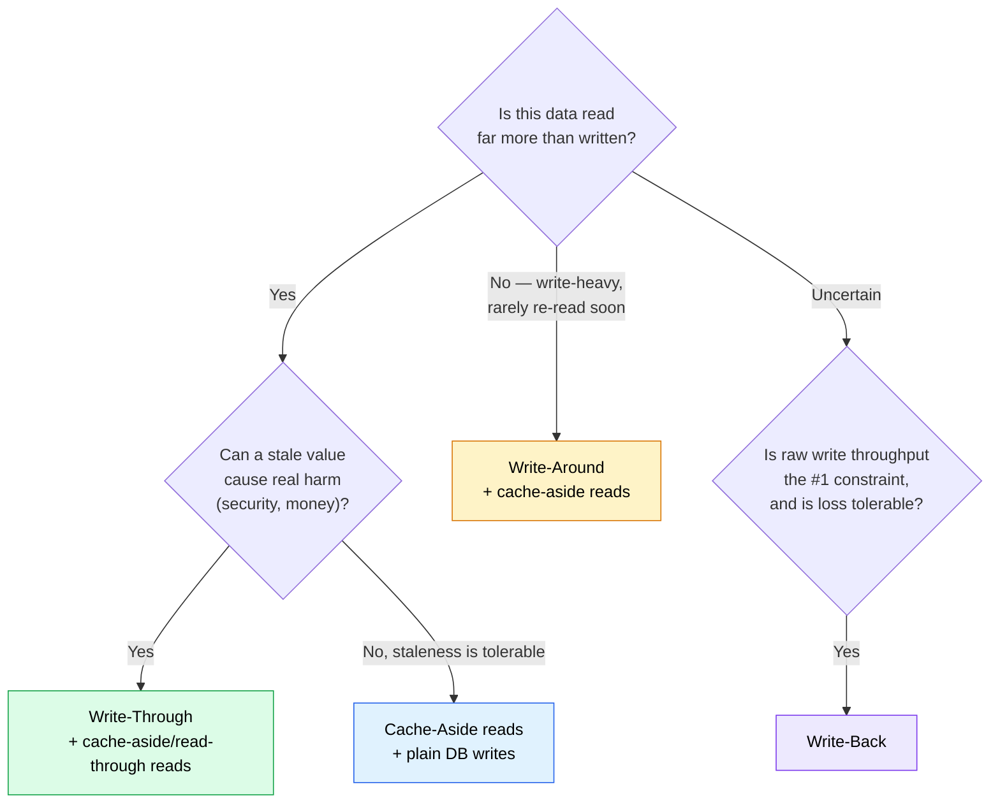
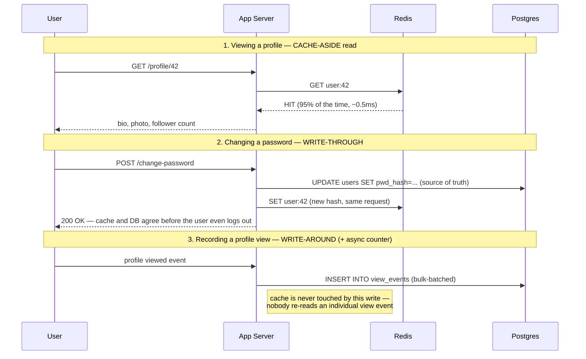
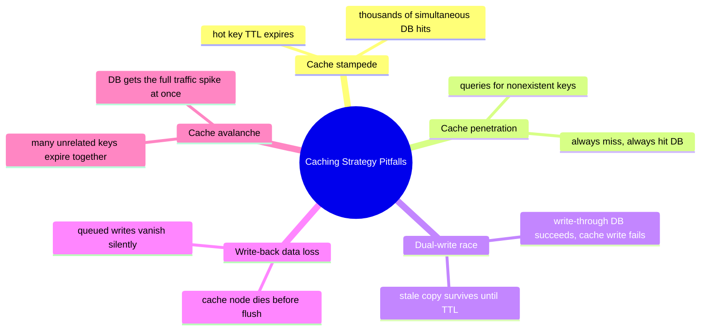

# Caching Strategies

> **One line:** A caching strategy is the contract for *how* a fast, small, volatile copy of data gets populated on reads and kept in sync on writes — cache-aside/read-through decide how misses get filled, and write-through/write-around/write-back decide how much staleness or data-loss risk you accept in exchange for write speed.

---

## Table of Contents
1. [Why You Must Master This](#1-why-you-must-master-this)
2. [The Mental Model](#2-the-mental-model)
3. [The Read Path — Cache-Aside vs Read-Through](#3-the-read-path--cache-aside-vs-read-through)
4. [The Write Path — Write-Through, Write-Around, Write-Back](#4-the-write-path--write-through-write-around-write-back)
5. [Choosing a Strategy & the Invalidation Problem](#5-choosing-a-strategy--the-invalidation-problem)
6. [Worked Example — Instagram Profile, Password, and View-Count Pipeline](#6-worked-example--instagram-profile-password-and-view-count-pipeline)
7. [Real-Life Use Cases](#7-real-life-use-cases)
8. [Failure Modes](#8-failure-modes)
9. [🏋️ Practice Drills](#-practice-drills)
10. [🎤 Interview Q&A Bank](#-interview-qa-bank)
11. [🎯 Staff+ Nuances](#-staff-nuances)
12. [Cheat Sheet](#12-cheat-sheet)
13. [Connections & Further Reading](#13-connections--further-reading)

---

## 1. Why You Must Master This

- **Speed — the single biggest latency win available to you.** Reading from RAM is ~100 nanoseconds; a network round-trip to a well-tuned relational database for an indexed row is 1-10ms; a complex join can be 50-200ms+. A cache hit from Redis over a local network is typically 0.3-1ms end to end. That's a **10-100x** latency reduction, and it's cheaper to obtain than almost any other optimization in the stack — see [Latency_Numbers_Every_Programmer_Should_Know.md](../01_Planning_Foundations/Latency_Numbers_Every_Programmer_Should_Know.md) for the full ladder.
- **Scalability — the cache is the database's shield.** Facebook's "Scaling Memcache at Facebook" paper (NSDI 2013) describes a fleet of memcached servers absorbing the read load for a social graph so large that hitting the database directly for every read was never an option — the cache, not the database, is what actually scales horizontally to serve billions of reads.
- **Cost — RAM is expensive per GB, but cheap per request.** A database read that requires disk I/O, lock contention, and query planning costs real CPU and IOPS; the same data served from Redis costs a memory lookup. At scale, moving 90%+ of reads off the database is frequently the difference between one database instance and a fleet of read replicas.
- **It's the most-asked practical question in system design interviews.** Almost every "design X" interview eventually asks "where's your cache and what happens when you write?" — and a vague "we'd cache it" answer without naming a strategy and its staleness trade-off is an immediate signal of shallow experience.

> **The core problem it solves:** keeping a fast, small, ephemeral copy of data usefully in sync with a slow, large, durable source of truth — without making every read slow (no cache) or every write dangerous (naive dual-write).

**Prerequisites:** [Latency_Numbers_Every_Programmer_Should_Know.md](../01_Planning_Foundations/Latency_Numbers_Every_Programmer_Should_Know.md) — the RAM/SSD/network numbers this entire topic is justified by. Helpful but not required: [Relational_vs_NoSQL.md](../05_Databases_Storage/Relational_vs_NoSQL.md) — Redis/Memcached are the NoSQL stores usually sitting behind these strategies.

---

## 2. The Mental Model

Caching is like **keeping a book on your desk instead of walking to the library** every time you need a fact. If the book you need is on your desk (**cache hit**), you're done in seconds. If it isn't (**cache miss**), you walk to the library (**the database**), find the answer, and — this is the part people skip — **decide whether to bring a copy back to your desk, and when to update it if the library's copy changes.**

The naive view treats "caching" as one binary decision: cache it, or don't. The correct model splits it into **two independent axes** that you choose separately — how a *read* fills the cache, and how a *write* propagates through it. Real systems mix and match: cache-aside reads paired with write-through writes is one of the most common combinations in production.





> **Hold onto this:** every caching strategy is really a **staleness-vs-speed-vs-durability contract**, and the read decision and the write decision are made independently — pick one from each axis deliberately, based on what your data can afford to lose or serve stale.

---

## 3. The Read Path — Cache-Aside vs Read-Through

### Cache-Aside (Lazy Loading)

**What it is:** the application code itself checks the cache first; on a miss, it queries the database, then explicitly writes the result back into the cache before returning it.

**Why it exists:** it's the simplest strategy that gives you the two biggest caching wins — you only ever cache data that's actually been requested (no wasted RAM on cold data), and the cache and database are decoupled enough that if the cache goes down, the application still works (slower, but working) by falling straight through to the database.

**How it works under the hood:**



> **Takeaway:** every miss costs one extra round trip (check cache, then hit DB) — the cost you pay for never caching data nobody asked for.

**The trade-off:** the very first request for any key is *always* a guaranteed miss ("cold start"), and if a key expires while under heavy read load, many requests can miss simultaneously and stampede the database (covered in [§5](#5-choosing-a-strategy--the-invalidation-problem) and fully in [Cache_Invalidation_Consistency.md](./Cache_Invalidation_Consistency.md)). The other choice — read-through — wins when you want that fetch-and-fill logic centralized instead of duplicated across every call site.

```python
import redis

cache = redis.Redis(host="localhost", port=6379)

def get_user_profile(user_id):
    # 1. Try cache first
    profile = cache.get(f"user:{user_id}")
    if profile:
        return profile, "CACHE_HIT"

    # 2. Miss — fall through to the database
    profile = db.query(f"SELECT * FROM Users WHERE id={user_id}")

    # 3. Populate the cache for the next reader
    if profile:
        cache.setex(f"user:{user_id}", 3600, profile)  # TTL = 1 hour

    return profile, "CACHE_MISS"
```

### Read-Through

**What it is:** functionally the same fill-on-miss behavior as cache-aside, but the *cache layer itself* owns the loading logic instead of the application. The app only ever talks to the cache; the cache calls a registered loader function on a miss.

**Why it exists:** cache-aside forces every call site that reads that data to remember to duplicate the "check, miss, fetch, populate" dance. Read-through pushes that logic into one place — the cache client library — so the application code is just `cache.get(key)` and can never forget to populate the cache correctly.

**How it works under the hood:** libraries like Guava's/Caffeine's `LoadingCache` (Java), or a cache-aside wrapper registered once in a service layer, hold a reference to a loader function. `cache.get("user:42")` internally does exactly the miss → DB → populate sequence from the diagram above, but the caller never sees the branching.

**The trade-off:** read-through requires the cache technology (or a wrapper library) to support pluggable loaders — plain Redis/Memcached don't have this built in, so you're either using a client-side library (Caffeine, Ehcache) or a managed layer that supports it (e.g., DAX in front of DynamoDB). Cache-aside wins when you want maximum control over exactly what gets cached, for how long, and with what fallback behavior per call site — that flexibility is exactly what read-through trades away for convenience.

| | Cache-Aside | Read-Through |
|---|---|---|
| **Who owns the fetch logic** | Application code, per call site | The cache client/library, centrally |
| **Cache tech needed** | Any (Redis, Memcached) | One with a loader abstraction (Caffeine, DAX) |
| **Risk of a forgotten fill** | Yes — every call site must remember | No — the library guarantees it |
| **Flexibility per call site** | High | Lower (one loader per key namespace) |

---

## 4. The Write Path — Write-Through, Write-Around, Write-Back

### Write-Through

**What it is:** a write goes to the cache first, and the cache synchronously forwards it to the database *before* acknowledging success to the caller. The cache and the database are always consistent by the time the write returns.

**Why it exists:** some data must never be read stale — a password change, a permission revocation, an inventory decrement right before checkout. Cache-aside alone can't guarantee this, because a stale cached copy can live for the entire TTL window even after the database changes underneath it.

**How it works under the hood:** either the cache client library is configured with a write-back-to-DB hook (so `cache.set()` blocks until the DB write also succeeds), or — more commonly in application code — the app writes to the database and the cache **in the same request path**, treating the cache update as part of the write transaction's completion, not a background afterthought.

**The trade-off:** every write now pays for *two* operations (cache write + DB write) instead of one, so write latency roughly doubles, and if the two writes aren't wrapped in something transactional, a crash between them leaves cache and DB disagreeing. Write-around wins the instant the data being written is rarely re-read soon — paying double latency on every write to protect reads nobody will make yet is pure waste.

### Write-Around

**What it is:** writes go **directly to the database**, completely bypassing the cache. The cache only gets that data later, lazily, the next time someone reads it (via cache-aside).

**Why it exists:** to stop **cache pollution** — filling limited, expensive RAM with data that was just written but is unlikely to be read again soon. Bulk ingestion, audit logs, and analytics events are written constantly but read individually almost never; write-through-ing every one of them would evict genuinely hot data to make room for write-once-read-never rows.

**How it works under the hood:** the write path has no cache interaction at all — it's a plain database write. The *read* path is unaffected and stays cache-aside: the first read after the write is a guaranteed miss (since the cache was never told about it), which then populates the cache normally.

**The trade-off:** the row that was *just* written is briefly "cold" — the very next read for it (if one happens quickly) pays a full database round trip instead of a cache hit, and if a *different* stale copy of that same key was already sitting in the cache from before, write-around does nothing to invalidate it (that's a job for invalidation, not the write strategy). Write-through wins the moment "read your own write instantly and correctly" is a hard requirement.

### Write-Back (Write-Behind)

**What it is:** a write lands in the cache, the caller gets an immediate acknowledgment, and the cache flushes the change to the database **asynchronously**, often batching or coalescing many writes into fewer, larger database operations.

**Why it exists:** to absorb write bursts and cut database load by turning many small writes into fewer, larger ones. This is the same pattern a CPU's L1/L2 cache uses for memory writes, and the same idea underneath a database's own buffer pool, which write-back-flushes dirty pages to disk on checkpoint rather than fsync-ing every single row change.

**How it works under the hood:** the cache marks the entry "dirty," appends the change to an internal write queue, and a background flusher periodically drains the queue to the database — often coalescing multiple updates to the same key into one write, or batching many keys into one bulk statement, before it flushes.

**The trade-off:** if the cache node crashes before a queued write is flushed, that write is **lost** — this is the sharpest durability risk of the four strategies, and it's why write-back is the one pattern you should not use for money, inventory counts, or anything you can't afford to silently drop. It wins decisively when raw write throughput matters more than the last few writes surviving a crash — a view-counter or a like-counter is a textbook fit.

### The Four Strategies, Side by Side

| Strategy | Write latency | Read-your-write | Data-loss risk on crash | Cache pollution risk | Best fit |
|---|---|---|---|---|---|
| **Cache-Aside** *(read)* | n/a | Only after a write triggers a refill | None (cache is disposable) | Low — only caches what's read | Default for most reads |
| **Write-Through** | ~2x (blocks on both) | Always correct | Low (synchronous) | Medium — caches everything written | Passwords, permissions, config |
| **Write-Around** | 1x (DB only) | Miss until next read | None (DB is source of truth) | Lowest — never caches on write | Bulk ingestion, logs, analytics writes |
| **Write-Back** | Fastest (cache only) | Correct from cache, DB lags | **Highest** — queued writes can vanish | Medium | View counts, high-frequency counters, CPU/disk buffers |

> **A real number:** a synchronous write-through to a relational database typically costs 5-20ms (commit + fsync); the same write acknowledged from a write-back cache can return in under 1ms — a 10-20x difference that's *exactly* the throughput write-back is bought for, at the cost of a crash window where unflushed writes disappear.

---

## 5. Choosing a Strategy & the Invalidation Problem



> **Takeaway:** the decision is driven by three questions — *read:write ratio*, *cost of staleness*, and *cost of loss* — not by which strategy sounds fastest.

Picking a fill strategy is only half the job — you also have to decide **when a cached copy stops being valid**. That's cache invalidation, which the industry half-jokingly calls one of the two hard problems in computer science, and it deserves (and gets) its own deep dive in [Cache_Invalidation_Consistency.md](./Cache_Invalidation_Consistency.md). The essentials every engineer needs *here*, before going deeper there:

- **TTL (Time-To-Live) is the blunt default.** Every cached entry expires automatically after N seconds, bounding staleness without any explicit invalidation logic. It's simple and it always eventually self-heals — but for N seconds after a write, cache-aside readers can see old data.
- **Cache stampede (thundering herd):** when a hot key's TTL expires, every concurrent reader misses at once and *all* of them hit the database simultaneously to refill it. A key read at 50,000 req/sec that expires becomes 50,000 near-simultaneous database queries in the same second — often enough to take down a database sized for a few hundred QPS. Quick mitigations: a mutex/lock so only one request refills while others wait or serve the stale value ("stale-while-revalidate"), and jittering TTLs so keys don't all expire in the same instant. Full mechanics in [Cache_Invalidation_Consistency.md](./Cache_Invalidation_Consistency.md).
- **Cache penetration:** requests for keys that *never exist* (a deliberately invalid user ID, or an attacker probing) always miss the cache and always hit the database, because there's nothing to cache — a `null` isn't a normal cache entry. Fix: cache the negative result too (a short-TTL "not found" marker), or use a Bloom filter in front of the cache to reject impossible keys before they reach the database at all. See [Hot_Key_Problem_Multi_Tier_Caching.md](./Hot_Key_Problem_Multi_Tier_Caching.md) for the related problem of a single key getting so hot no single cache node can serve it.
- **Dual-write inconsistency:** write-through's "write to both" is only safe if both writes are effectively atomic. If the DB write succeeds but the cache write fails (or vice versa), the two disagree until the next TTL expiry or explicit fix — this exact race is the subject of [Cache_Invalidation_Consistency.md](./Cache_Invalidation_Consistency.md)'s treatment of event-driven invalidation (e.g., CDC-driven cache busting) as the more robust alternative to hoping dual writes never fail.

---

## 6. Worked Example — Instagram Profile, Password, and View-Count Pipeline

**The prompt:** "Design the caching layer for a profile page that shows a bio, supports password changes, and tracks profile-view counts, at Instagram-like scale (~500M profile views/day)."



**Closing the loop — the number that forces each decision:**
- **Profile reads: cache-aside, ~95% hit ratio.** At 500M reads/day, a 95% hit ratio means the database only ever sees the remaining 5% — **25M reads/day (~289 QPS average)** instead of 500M/day (~5,787 QPS average, with far higher peak-hour bursts). That 20x reduction is the entire reason the database can be a modestly sized instance instead of a fleet of read replicas.
- **Password changes: write-through, not cache-aside.** A user who just changed their password might immediately try to log in from a second device. If the write were cache-aside (write DB only, let the stale cached hash live out its TTL), that second login could authenticate against the *old* password for up to the TTL window — a real security bug, not just a UX annoyance. Write-through's ~2x write latency (a password change happens rarely, so the cost is negligible) buys correctness exactly where it's needed.
- **View events: write-around, deliberately never touching the cache on write.** Each view is a fire-and-forget insert; nobody re-reads *that specific event* — they read an aggregated count later. Write-through-ing every single view event would mean two operations per view at massive volume, filling the cache with data that will never be read back individually. The aggregate view *count* shown on the profile is itself a great write-back candidate (increment in cache, flush the aggregate to the DB periodically) — the write strategy is chosen per data shape, not once for the whole system.

---

## 7. Real-Life Use Cases

| Situation | How the caching strategy applies | The decision it forces |
|-----------|------------------------------------|-------------------------|
| **Product page views on an e-commerce site** | Cache-aside reads; product details change rarely | Short TTL cache-aside is enough — staleness of a few seconds on a description is harmless |
| **Password / permission change** | Write-through | Must be correct on the very next read; pay the double write cost |
| **Ad click / impression logging** | Write-around | Written constantly, individually read almost never — never pollute the cache |
| **"Like" counter on a viral post** | Write-back on the counter, cache-aside on the rest of the post | Absorb bursty increments in memory, batch-flush to DB; losing a few likes on crash is acceptable |
| **Shopping cart inventory decrement at checkout** | Write-through (or skip caching entirely for this field) | Overselling inventory from a stale cached count is a real financial/legal problem |
| **CDN edge caching a static asset** | Same cache-aside idea, applied at the edge instead of Redis | See [HTTP_Caching.md](./HTTP_Caching.md) and [CDN.md](./CDN.md) — this is cache-aside one network hop closer to the user |
| **CPU L1/L2 cache, database buffer pool** | Write-back | The same "ack fast, flush later" contract, one layer down the stack |

> **The habit:** for every field on a data model, ask "how often is this read vs written, and what happens if a reader sees a stale or default value for N seconds?" — the answer names the strategy, it isn't a house-wide default.

---

## 8. Failure Modes



- **Cache stampede.** *Symptom:* a database that was healthy suddenly spikes to 100% CPU/connections for a few seconds, repeatedly, at the same key's TTL boundary. *Root cause:* a hot key expired and every concurrent reader missed and queried the database at once. *Fix:* a refill lock/mutex (one request refills, others wait briefly or get the stale value), jittered TTLs, or probabilistic early expiration — full mechanics in [Cache_Invalidation_Consistency.md](./Cache_Invalidation_Consistency.md).
- **Cache penetration.** *Symptom:* database load that doesn't drop even though "the cache is working" for everything else — a specific pattern of requests always reaches the DB. *Root cause:* requests for keys that don't exist (bad IDs, or an attacker probing) never produce a cacheable result. *Fix:* cache the negative result with a short TTL, or reject impossible keys with a Bloom filter before they reach the cache/DB at all.
- **Stale data from a dual-write race.** *Symptom:* a user's change "didn't stick" intermittently. *Root cause:* write-through updated the database but the parallel cache write failed (network blip, cache eviction mid-write), and nothing re-synced them. *Fix:* make invalidation, not blind dual-write, the mechanism of truth — invalidate-then-refetch or event-driven (CDC) cache busting, covered in [Cache_Invalidation_Consistency.md](./Cache_Invalidation_Consistency.md).
- **Write-back data loss.** *Symptom:* counts or recent writes are quietly lower than expected after a cache node restart or crash. *Root cause:* writes were acknowledged from the cache but queued for async flush, and the node died before flushing. *Fix:* only use write-back where loss is tolerable, or back the write queue with a durable log (e.g., append to a message queue before the in-memory buffer) so a crash can replay rather than lose.
- **Cache avalanche.** *Symptom:* a database traffic spike that isn't localized to one key — many unrelated keys go cold at once. *Root cause:* many entries were cached with the same fixed TTL (e.g., all warmed at deploy time), so they all expire together. *Fix:* jitter TTLs so expirations spread out over time instead of clustering.

---

## 🏋️ Practice Drills

> *Cover the solutions and attempt first — active recall is the point.*

**Drill 1 — Name the strategy.** For each, name the read/write strategy and justify it in one sentence: (a) a CMS article body that's read millions of times per publish and edited rarely; (b) a bank account balance right before a withdrawal is authorized; (c) a high-frequency "typing…" presence indicator that changes many times per second per user.

<details><summary>Solution</summary>

(a) **Cache-aside reads, plain DB writes (or write-around).** Read:write ratio is enormous and staleness of a few seconds after an edit is harmless — this is the textbook cache-aside case.

(b) **Write-through (or no caching on this field at all).** A stale cached balance that authorizes a withdrawal against money that isn't there is a financial-correctness bug, not a UX nit — reads of this specific field must never be stale by even a TTL window.

(c) **Write-back, or arguably no persistence at all beyond the cache.** Extremely high write frequency, essentially disposable state (losing the last "typing" flicker on a crash is imperceptible) — this is exactly the profile write-back and even in-memory-only state is built for.
</details>

**Drill 2 — Do the stampede math.** A cached product page is read at 20,000 requests/second and cached with a flat 60-second TTL with no jitter and no refill lock. The database can sustain 2,000 QPS before saturating. What happens at the TTL boundary, and what's the smallest change that fixes it?

<details><summary>Solution</summary>

At the instant the TTL expires, every one of the ~20,000 requests arriving in that second (or however many are in-flight concurrently) misses the cache simultaneously, because nothing marked the entry as "being refreshed." All of them fall through to the database at once — a burst far above the database's 2,000 QPS ceiling, likely causing timeouts, connection exhaustion, or an outage, all triggered by one key's expiration.

The smallest fix: add a **refill lock** — the first request to miss acquires a short-lived lock (e.g., `SETNX refresh:product:42 EX 5`) and is the only one allowed to query the database and repopulate the cache; every other concurrent miss either blocks briefly for the refill or serves the (slightly) stale value it just evicted instead of hitting the database. Jittering the TTL (e.g., 60s ± 10s at cache time) further prevents many keys from ever aligning to the same expiration instant in the first place.
</details>

**Drill 3 — Design a small thing.** You're building a leaderboard that's updated on every game (millions/day) but read constantly on a dashboard. Writes must never be lost (it's used for prize payouts), but you want writes to be fast. Which strategy, and how do you resolve the tension between "writes must never be lost" and "writes must be fast"?

<details><summary>Solution</summary>

Naive write-back is disqualified immediately — "writes must never be lost" directly contradicts write-back's core risk (a crash before flush loses queued writes), no matter how fast it is.

The resolution: **write-through**, but engineered so the "slow" synchronous DB write is actually cheap. Concretely: the game-result write goes to a durable, fast-appending store first (a write-ahead log or a message queue partition) which acknowledges in low single-digit milliseconds, *then* the cache is updated in the same logical operation. The dashboard read path stays pure cache-aside/read-through against the cache, which is now fed reliably. This gets you write-through's durability guarantee while keeping the "fast path" fast — the trick is that the durable step doesn't have to be a slow relational write; it can be a fast durable log, with the relational aggregate updated asynchronously downstream of *that* log rather than downstream of the cache.
</details>

**Drill 4 — Read-through vs cache-aside, out loud.** A teammate says "read-through and cache-aside are basically the same thing, why does it matter which one we call it?" Give the one concrete scenario where the difference actually changes what you'd build.

<details><summary>Solution</summary>

They produce identical *runtime* behavior (miss → fetch → populate → return) but differ in **where the fetch logic lives**, and that matters the moment you have many call sites reading the same key. With cache-aside, every service/endpoint that reads `user:42` must independently implement the "check, miss, fetch, populate" sequence — miss it in one new endpoint and you've silently introduced a code path that always hits the database, or worse, one that fetches but forgets to populate the cache (permanent miss). With read-through, that logic is registered once against the cache client (a `LoadingCache`, or a DAX-style proxy), so every caller automatically gets correct fill behavior with zero chance of a forgotten branch. The concrete trigger: you're building a shared library or a service with many independent teams reading the same cached entities — that's when centralizing the loader (read-through) earns its complexity over duplicating it (cache-aside).
</details>

---

## 🎤 Interview Q&A Bank

**Q1. "Walk me through cache-aside, write-through, write-around, and write-back."**
> Cache-aside is a *read* strategy: the app checks the cache, and on a miss, fetches from the DB and populates the cache itself — simple, resilient, but the first read is always a miss. The other three are *write* strategies: write-through updates the cache and DB together before acknowledging (never stale, ~2x write latency); write-around writes only to the DB and lets the cache pick it up lazily on the next read (avoids polluting the cache with rarely-re-read writes); write-back acknowledges from the cache immediately and flushes to the DB asynchronously (fastest writes, but a crash before flush loses data). They're independent choices — a system typically picks one read strategy and one write strategy per data type, not one global policy.

**Q2. "When would you use write-around instead of write-through?"**
> When the data being written is read again rarely or not at all soon after the write — bulk ingestion, analytics events, audit logs. Write-through would pay double the write cost and fill the cache with data nobody's about to re-read, evicting genuinely hot keys to make room. Write-around keeps the cache clean and pays for a cache-fill only if and when a read actually happens.

**Q3. "What's the biggest risk with write-back caching, and when do you accept it anyway?"** *(signal: durability awareness)*
> Data loss — if the cache node crashes before a queued write flushes to the database, that write is gone, with no log to replay it from unless you've deliberately added one. You accept it for data where losing the last few updates is tolerable and doesn't matter for correctness — view counters, like counts, presence/typing indicators, telemetry — never for money, inventory, or anything with a compliance or payout requirement.

**Q4. "How do you prevent a cache stampede?"** *(signal: has this actually happened to them)*
> A refill lock so only one request repopulates a hot key on expiration while others wait briefly or serve the stale value ("stale-while-revalidate"), jittered TTLs so many keys don't expire in the same instant (which also prevents the related "cache avalanche"), and for extremely hot keys, never letting them expire fully — refresh proactively before TTL rather than reactively after a miss. Full mechanics live in [Cache_Invalidation_Consistency.md](./Cache_Invalidation_Consistency.md).

**Q5. "What's cache penetration, and how is it different from a stampede?"**
> A stampede is many requests missing on a key that *does* exist, all at once, at expiration. Penetration is requests for keys that *never* exist — a bad ID or an attacker probing — which always miss because there's nothing valid to cache, so every one of those requests reaches the database regardless of cache health. Fix it by caching the negative result (a short-TTL "not found" marker) or filtering impossible keys with a Bloom filter before they even reach the cache.

**Q6. "If the cache goes down entirely, what happens to your system?"** *(signal: resilience thinking, not just happy-path)*
> It depends entirely on the strategy chosen. With cache-aside, the app falls straight through to the database — slower, but still correct and available (assuming the DB can absorb 100% of read traffic, which is the real risk to size for). With write-back, a cache outage can mean losing whatever writes were queued and unflushed — the sharper failure mode. This is exactly why cache-aside is the safe default for reads, and why write-back is reserved for data you can afford to lose.

**Q7. "Cache-aside vs read-through — does it actually matter?"**
> Functionally they behave the same on a hit or a miss. The difference is *where* the fetch-and-populate logic lives: cache-aside puts it in application code at every call site (simple, but easy to duplicate or forget); read-through centralizes it in the cache client/library via a loader function, so every caller gets correct fill behavior automatically. It matters most once you have multiple services or teams reading the same cached entity — centralizing the loader removes an entire class of "forgot to populate the cache" bugs.

**Q8. "How does the choice interact with cache eviction policy?"**
> They're separate but related decisions — the strategy decides *when* an entry is written/refreshed; eviction decides what gets *thrown out* when the cache is full. A write-around strategy that never proactively caches on write relies entirely on eviction (typically LRU) to keep genuinely hot data resident; get eviction wrong (see [Cache_Eviction_Policies.md](./Cache_Eviction_Policies.md)) and even a perfect write strategy won't save you from a cache full of cold data.

---

## 🎯 Staff+ Nuances

- **Real systems mix strategies per data shape, not per service.** A single "user" object might have a bio field (cache-aside reads, write-around writes), a password hash (write-through), and a login-count field (write-back). Junior answers pick one strategy for "the cache"; senior answers pick per-field based on read:write ratio and staleness/loss tolerance, as shown in the [worked example](#6-worked-example--instagram-profile-password-and-view-count-pipeline).
- **Write-through's "atomicity" is usually a lie unless you engineer for it.** "Write to cache and DB together" sounds atomic in a diagram, but in code it's almost always two separate network calls with no shared transaction. The senior move is either accepting eventual reconciliation (invalidate-then-refetch instead of blind dual-write) or building the durable step as a fast append-only log that both the cache and DB consumers read from — see the Drill 3 resolution above and [Cache_Invalidation_Consistency.md](./Cache_Invalidation_Consistency.md).
- **Cache-aside's resilience claim ("if the cache dies, the app still works") has a hidden capacity assumption.** It's only true if the database was sized to survive 100% of read traffic, at least briefly, during a cache outage — which most databases sized for a 95%+ cache-hit world are not. "The cache is a shield, not a requirement" is true architecturally and false operationally unless you've load-tested the cache-down scenario.
- **Write-back at the database layer is not optional — you're already relying on it.** A relational database's buffer pool is a write-back cache over disk pages; durability during that window comes from the write-ahead log (WAL), not from the buffer pool itself. Understanding that your "durable" database write is itself built on a write-back pattern with its own crash-recovery mechanism (WAL replay) reframes write-back caching as "the same trade-off, one layer up, usually without a WAL to fall back on."
- **The read/write strategy choice is local; the invalidation strategy is global.** You can pick cache-aside independently for ten different services, but if two of them cache the *same* underlying row, only a shared, event-driven invalidation mechanism (not each service's local TTL) keeps them coherent with each other. This is precisely the seam this file hands off to [Cache_Invalidation_Consistency.md](./Cache_Invalidation_Consistency.md).
- **A single hot key breaks every strategy the same way — and no write strategy fixes it.** Once one key's traffic exceeds what a single cache node/shard can serve, cache-aside, write-through, and write-back all fail identically at the network/CPU layer of that one node. That's a distribution problem, not a strategy problem — see [Hot_Key_Problem_Multi_Tier_Caching.md](./Hot_Key_Problem_Multi_Tier_Caching.md) for key-splitting and multi-tier (local + remote) mitigations.
- **"Which strategy" and "which cache technology" are different questions that get conflated.** Cache-aside vs write-through is a *pattern*; Redis vs Memcached vs an in-process cache is a *technology and topology* choice with its own trade-offs (persistence, data structures, clustering, network hop cost). See [Distributed_Caching_Redis_Memcached.md](./Distributed_Caching_Redis_Memcached.md) and [In_Process_vs_Distributed_Cache.md](./In_Process_vs_Distributed_Cache.md) — don't let "we're using Redis" stand in for "we've decided our write strategy."
- **A cold cache after deploy or failover is a self-inflicted stampede.** If every key starts empty simultaneously (a fresh cache cluster, a failover to a cold replica), you get avalanche-scale load the moment traffic resumes, entirely predictably. See [Cache_Warming_Strategies.md](./Cache_Warming_Strategies.md) for pre-warming from access logs before cutover, rather than discovering the problem in production.

---

## 12. Cheat Sheet

```
CACHING STRATEGIES — read axis + write axis, chosen independently per data shape
═══════════════════════════════════════════════════════════════════════════════

READ AXIS (how does a miss get filled?)
  CACHE-ASIDE     app checks cache -> miss -> app queries DB -> app populates cache
                  simplest · resilient (cache dies, DB still serves) · first read = miss
  READ-THROUGH    same fill behavior, but the CACHE LIBRARY owns the loader
                  centralizes logic (Caffeine/Guava LoadingCache, DAX) · needs loader support

WRITE AXIS (how does a write reach the DB?)
  WRITE-THROUGH   write cache + DB together, ack after BOTH        ~2x write latency, never stale
  WRITE-AROUND    write DB only, cache fills lazily on next read   avoids pollution, 1st read post-write = miss
  WRITE-BACK      ack from cache, flush DB async (often batched)   fastest writes, DATA LOSS risk on crash

PICK BY THREE QUESTIONS
  read:write ratio?      read-heavy -> cache-aside is enough
  cost of stale read?     high (security/$) -> write-through · low -> write-around/cache-aside
  cost of lost write?     tolerable -> write-back · never -> write-through (or no cache on that field)

REAL NUMBERS
  RAM lookup            ~100ns          cache hit (Redis, same DC)   ~0.3-1ms
  indexed DB query      ~5-20ms         complex join                ~50-200ms+
  write-through commit  ~5-20ms (2x)    write-back ack               <1ms
  95% hit ratio          => DB sees only 5% of traffic (20x reduction)

INVALIDATION ESSENTIALS (full depth -> Cache_Invalidation_Consistency.md)
  TTL                 blunt default; bounds staleness, doesn't eliminate it
  STAMPEDE            hot key expires -> N concurrent misses -> N simultaneous DB hits
                       fix: refill lock / stale-while-revalidate / jittered TTL
  PENETRATION         queries for keys that never exist -> always miss, always hit DB
                       fix: cache the negative result, or a Bloom filter in front
  AVALANCHE           many keys share one fixed TTL -> mass simultaneous expiry
                       fix: jitter TTLs

PITFALLS
  ✗ write-through ≠ atomic unless engineered (two network calls, not one transaction)
  ✗ cache-aside "resilience" assumes DB can survive 100% traffic during an outage
  ✗ write-back for money/inventory — never; for counters/presence — fine
  ✓ real systems mix strategies PER FIELD, not one policy for "the cache"
```

---

## 13. Connections & Further Reading

**Prerequisites (learn first):**
- [Latency_Numbers_Every_Programmer_Should_Know.md](../01_Planning_Foundations/Latency_Numbers_Every_Programmer_Should_Know.md) — the RAM/SSD/network numbers that justify caching at all.

**Builds toward / pairs with:**
- [Cache_Invalidation_Consistency.md](./Cache_Invalidation_Consistency.md) — the full depth on TTL vs event-driven invalidation, stampede mitigation, and dual-write inconsistency this file only introduces.
- [Cache_Eviction_Policies.md](./Cache_Eviction_Policies.md) — once data is in the cache, what gets thrown out when it's full (LRU/LFU/TTL).
- [Distributed_Caching_Redis_Memcached.md](./Distributed_Caching_Redis_Memcached.md) — the technology (Redis vs Memcached) implementing these strategies at scale.
- [Hot_Key_Problem_Multi_Tier_Caching.md](./Hot_Key_Problem_Multi_Tier_Caching.md) — what happens when one key's traffic exceeds any single strategy's ability to help.
- [In_Process_vs_Distributed_Cache.md](./In_Process_vs_Distributed_Cache.md) — local (Caffeine-style) vs shared cache tiers, and where read-through fits best.
- [Cache_Warming_Strategies.md](./Cache_Warming_Strategies.md) — pre-filling a cold cache before it has to survive real traffic.
- [HTTP_Caching.md](./HTTP_Caching.md) and [CDN.md](./CDN.md) — cache-aside applied at the browser/edge instead of Redis.
- [Database_Connection_Pooling.md](./Database_Connection_Pooling.md) — the other big lever for cutting per-request database cost.

**Gaps this topic exposes (candidates for the section's Gap Analysis):**
- A dedicated treatment of negative caching and Bloom filters as a general pattern (currently only summarized here and pointed at from invalidation).

**External classics:**
- *Scaling Memcache at Facebook* (Nishtala et al., NSDI 2013) — the canonical paper on cache-aside at true internet scale.
- [AWS: Database Caching Strategies](https://d1.awsstatic.com/whitepapers/Database/database-caching-strategies-using-redis.pdf) — a practical vendor write-up of these exact four strategies.
- *Designing Data-Intensive Applications* (Kleppmann) — the buffer-pool/write-back framing that connects caching to how databases themselves work.

---

## TL;DR
**A caching strategy is a staleness-vs-speed-vs-durability contract, made of two independent choices: how a read fills the cache (cache-aside — app-owned, resilient, default; or read-through — library-owned, centralized) and how a write reaches the database (write-through — synchronous, never stale, ~2x cost; write-around — DB-only, avoids polluting the cache with rarely-reread writes; write-back — fastest, async, real data-loss risk on crash).** Pick per data field, not once for "the cache" — a password needs write-through, a bulk log needs write-around, a view counter is a fine write-back candidate. Cache-aside reads plus a deliberate write choice gets you most of the 10-100x RAM-vs-database latency win at the cost of managing staleness — and staleness is only half-solved here: **TTL bounds it, but stampede, penetration, and dual-write races are the real hard part, fully covered in [Cache_Invalidation_Consistency.md](./Cache_Invalidation_Consistency.md).**
