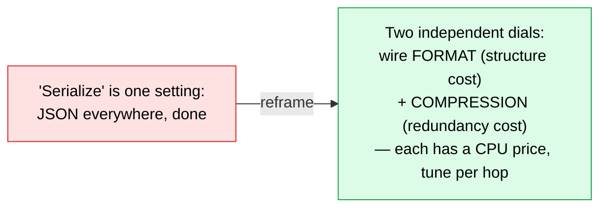
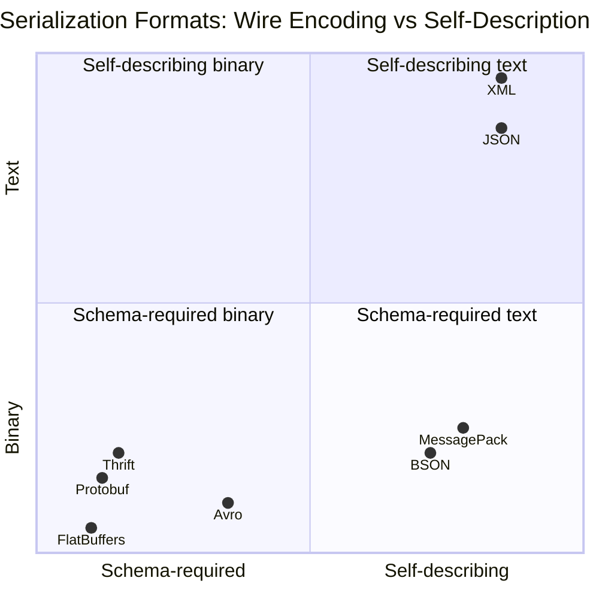
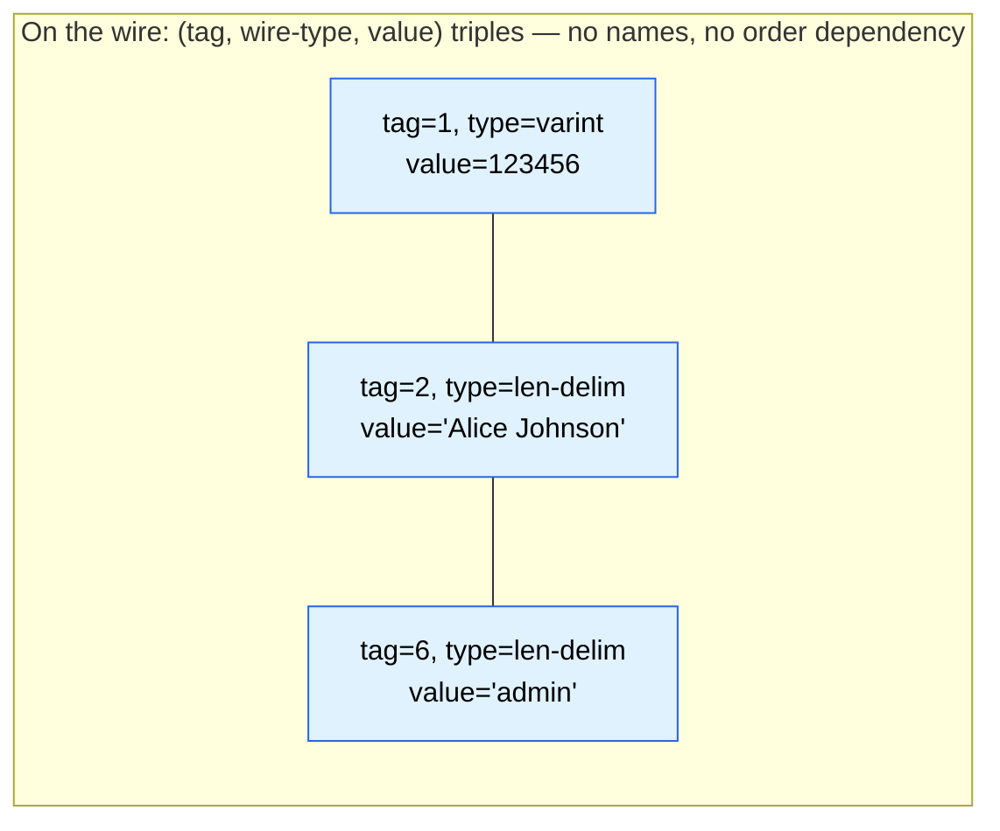
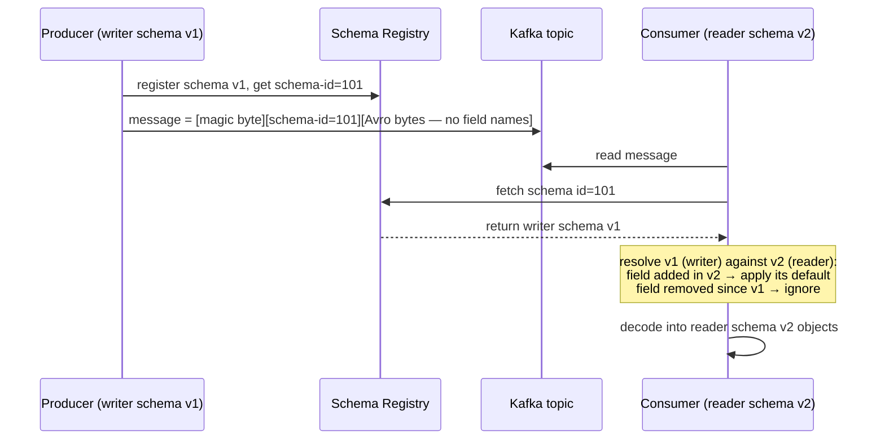
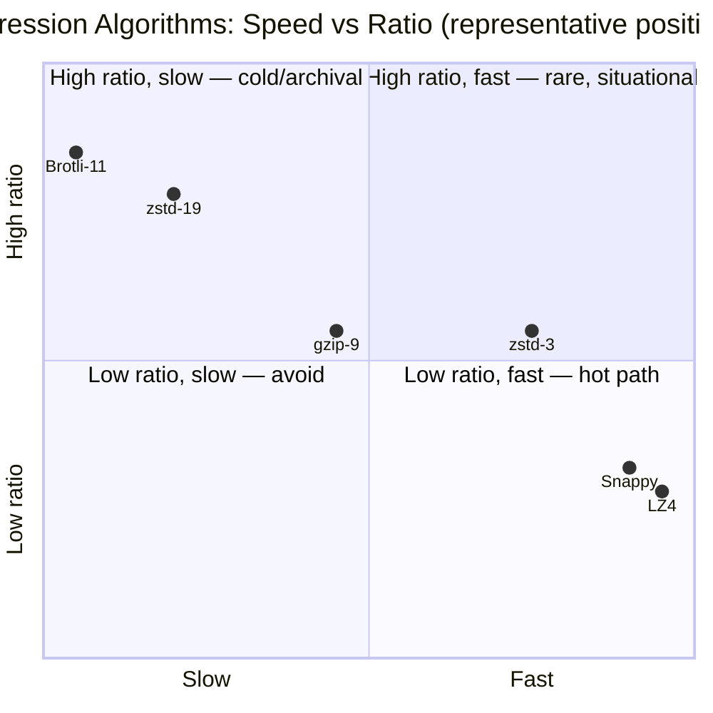
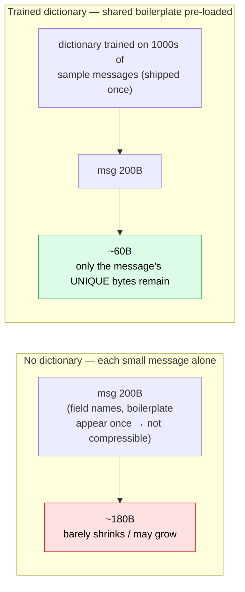
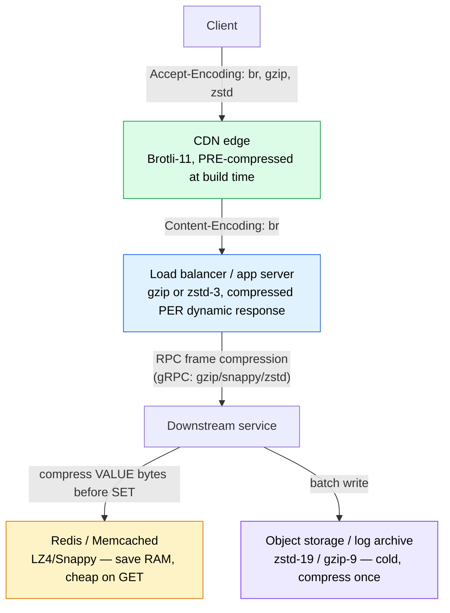
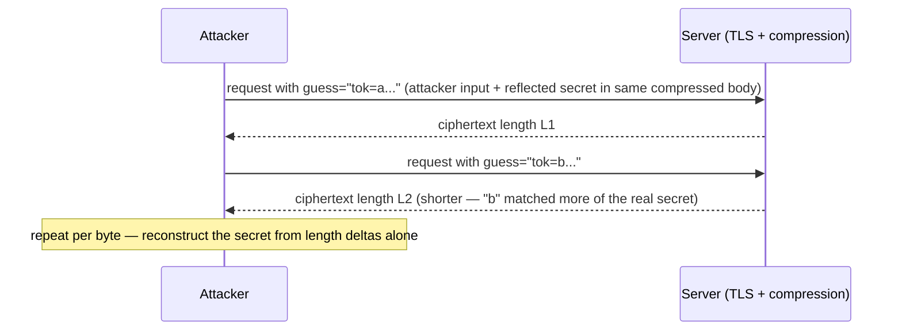
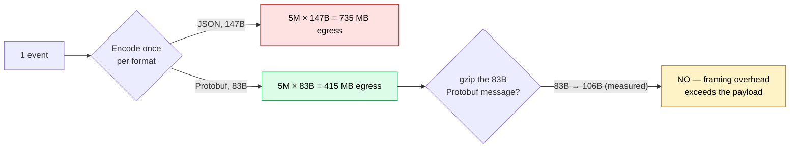
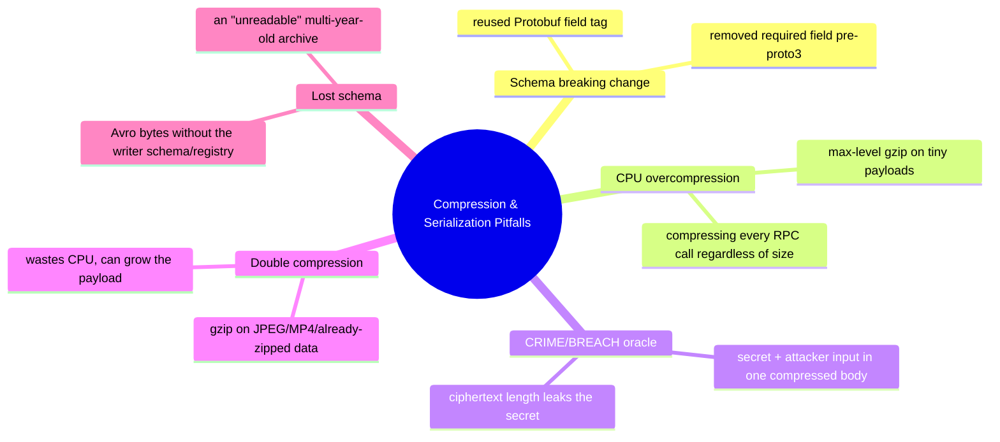

# Data Compression & Serialization

> **One line:** Serialization decides how many bytes you have to send in the first place — pick a compact binary wire format instead of verbose text; compression then squeezes those bytes further, trading CPU cycles for bandwidth and storage — and the skill is knowing when each trade is actually worth it.

---

## Table of Contents
1. [Why You Must Master This](#1-why-you-must-master-this)
2. [The Mental Model](#2-the-mental-model)
3. [Serialization Formats — Text vs Binary Wire Encoding](#3-serialization-formats--text-vs-binary-wire-encoding)
4. [Schema Evolution — Protobuf Tags and Avro Reader/Writer Schemas](#4-schema-evolution--protobuf-tags-and-avro-readerwriter-schemas)
5. [Compression Algorithms — The CPU vs Ratio vs Speed Triangle](#5-compression-algorithms--the-cpu-vs-ratio-vs-speed-triangle)
6. [Where Compression Lives — and the CRIME/BREACH Caution](#6-where-compression-lives--and-the-crimebreach-caution)
7. [Worked Example — Notification Fan-Out and a Redis Cache](#7-worked-example--notification-fan-out-and-a-redis-cache)
8. [Real-Life Use Cases](#8-real-life-use-cases)
9. [Failure Modes](#9-failure-modes)
10. [🏋️ Practice Drills](#-practice-drills)
11. [🎤 Interview Q&A Bank](#-interview-qa-bank)
12. [🎯 Staff+ Nuances](#-staff-nuances)
13. [Cheat Sheet](#13-cheat-sheet)
14. [Connections & Further Reading](#14-connections--further-reading)

---

## 1. Why You Must Master This

Every byte that crosses a network or lands on disk was a choice — a format you picked and a compression setting you set (or forgot to set). Get it wrong at scale and it shows up as a cloud bill, not a bug report.

- **It's the #1 hidden bottleneck in microservices.** Once you've fixed N+1 queries and added a cache, the next bottleneck is almost always "how many bytes are we shipping, and how long does it take to turn them back into objects." Serialization overhead is often invisible in a profiler until you look at it directly.
- **It's real money.** Cloud egress is billed per GB (roughly $0.05–$0.12/GB on the major clouds). A service moving 500 TB/month between regions pays tens of thousands of dollars a year for exactly the bytes you chose to send — verbose JSON vs a compact binary format is a five- or six-figure line item, not a style preference.
- **It's a RAM budget decision, not just a network one.** Every byte you don't compress before writing into Redis or Memcached is a byte of RAM you're paying for at cache-tier prices — often 10-20x the price of disk. [Distributed_Caching_Redis_Memcached.md](./Distributed_Caching_Redis_Memcached.md) inherits this decision directly.
- **It's a distributed-systems correctness problem, not just a performance one.** Schema evolution — can Service A add a field without breaking Service B, deployed independently, maybe out of order — is where "serialization" stops being a performance topic and becomes an API-contract topic. Get this wrong and you get production incidents, not just slow responses.

> **The core problem it solves:** *turning structured, in-memory objects into bytes efficiently, and shrinking those bytes further* — while staying interoperable across languages, tolerant of independent deploys, and cheap enough in CPU that the "optimization" doesn't become the new bottleneck.

**Prerequisites:** [Caching_Strategies.md](./Caching_Strategies.md) (why you're storing serialized values at all) and a basic sense of [Performance_Metrics.md](./Performance_Metrics.md) (latency vs throughput) help frame why "smaller and faster to parse" matters.

---

## 2. The Mental Model

**Serialization is flat-pack furniture; compression is vacuum-sealing the box.** A chair (your in-memory object graph) doesn't travel well assembled — you break it down into pieces (bytes) that ship efficiently, then reassemble ("deserialize") it on the other end. JSON ships the chair *with a printed instruction manual glued to every single piece* (the field names, repeated on every message). A binary format like Protobuf ships a numbered parts bag and keeps the manual on a shelf at both ends (the schema, compiled into code once) — nothing about "leg #3" needs to travel with every box.

The naive view treats "serialize" as a single, interchangeable step and reaches for JSON everywhere because it's the default. The correct view treats format and compression as two independent, composable dials — one shrinks the *structure* overhead (schema vs no schema), the other shrinks the *content* redundancy (repeated bytes) — and each dial has a real CPU cost that must be justified by a real savings.



> **Hold onto this:** format picks how much structure you ship (field names? tags? nothing?); compression squeezes whatever redundancy is left. Never let the "obviously good" default (JSON, or "just gzip everything") replace measuring both dials against the actual payload and hop.

---

## 3. Serialization Formats — Text vs Binary Wire Encoding

**What it is.** Serialization converts an in-memory object graph into a linear byte sequence (and back). Formats split along two independent axes: **text vs binary** (is a human able to read the bytes directly?) and **self-describing vs schema-required** (do the field names/types travel with the data, or does the reader need an external contract to make sense of the bytes?).


> JSON/XML pay for readability with size and parse cost; Protobuf/Thrift/FlatBuffers pay with an external schema to buy the smallest, fastest wire encoding. Avro sits in between — schema-required to *write* efficiently, but the schema id/definition travels with (or beside) the data, so a message is never truly orphaned the way a bare Protobuf byte stream is.

**Why it exists / what breaks without the right choice.** JSON's genius is that every field name travels with every message — anyone, anywhere, with no shared contract, can read it. That's also its tax: in a payload sent a billion times a day, you are retransmitting the string `"user_id"` a billion times. Binary schema-based formats move that contract out of the wire and into a compiled artifact both sides already have, so the wire only carries values.

**How it actually works — a real record, three ways.** Take this record (147 bytes as minified JSON, measured):

```json
{"id":123456,"name":"Alice Johnson","email":"alice.johnson@example.com","active":true,"created_at":"2024-01-15T10:30:00Z","roles":["admin","user"]}
```

| Format | Bytes (this record) | How it got there |
|--------|---------------------|-------------------|
| **XML** | 210 | Open+close tags for every field and every array element — the most verbose common format. |
| **JSON** (minified) | 147 | Field names repeated verbatim every message; measured with `JSON.stringify`. |
| **MessagePack** | 118 | Self-describing binary: a 1-byte map/array/string *type+length* header replaces JSON's punctuation, but field names still travel. |
| **FlatBuffers** | ~110–140 (typically ≥ Protobuf) | Binary + schema, but adds a vtable and 32-bit offsets per object so any field can be read without a decode pass — the size cost buys *zero-copy* reads, not the smallest wire size. |
| **Protobuf** | 83 | Binary + schema: each field is `(tag, wire-type)` + value — no field *names* at all, just small integer tags. |
| **Avro** | 78 | Binary + schema, but not even tags travel — fields are positional per the schema, so it's the least overhead of the mainstream formats. |

The Protobuf and Avro numbers above are computed by hand against the real wire-format spec, not estimated — worth walking through once so "binary is smaller" stops being a slogan:

- **Protobuf**, field `id=123456` (`int32`, tag 1): 1 tag byte (`(1<<3|0)`) + a 3-byte varint for 123456 = 4 bytes. Field `name` (tag 2, string): 1 tag byte + 1 length byte + 13 bytes of UTF-8 = 15 bytes. `email` (tag 3): 1+1+25 = 27 bytes. `active` (tag 4, bool): 1+1 = 2 bytes. `created_at` as an ISO-8601 *string* (tag 5): 1+1+20 = 22 bytes. `roles` (tag 6, repeated string, not packable): "admin" costs 1+1+5=7, "user" costs 1+1+4=6, total 13. Sum: 4+15+27+2+22+13 = **83 bytes**.
- **Avro** drops the tag byte entirely — position in the schema *is* the identity — so every field costs only a length-prefix (zig-zag varint) plus payload: `id` as a zig-zag varint = 3 bytes; `name` = 1+13=14; `email`=1+25=26; `active`=1 byte; `created_at` string =1+20=21; `roles` array = block-count(1) + "admin"(1+5=6) + "user"(1+4=5) + terminator(1) = 13. Sum: 3+14+26+1+21+13 = **78 bytes**.

> **One-line takeaway:** the *same information*, encoded four ways, ranges from 210 to 78 bytes — a 2.7x spread with zero data loss, purely from how much structural metadata rides along with the values.

**The trade-off, and when text wins.** Binary/schema formats win on size and parse speed every time payload volume is high or parsing cost matters (internal RPC, mobile, high-QPS caches). Text/self-describing formats win when you need a human to read a payload in a browser dev-tools tab, a public API where third-party developers can't be forced to install a schema compiler, or a debugging session at 2 a.m. where `curl | jq` beats attaching a binary decoder. **Thrift** (Facebook/Meta) is worth naming alongside Protobuf: same IDL-driven, tag-based binary approach, but it also defines the RPC transport/protocol stack itself (Protobuf is "just" the encoding; gRPC is the transport layered on top separately).

**A real system.** Google's internal RPC (and gRPC everywhere since) runs on Protobuf specifically because Google's own benchmarks showed 3–10x smaller payloads and materially faster parse times than JSON at the scale of billions of internal calls per second — CPU saved on parsing is CPU available for actual work.

---

## 4. Schema Evolution — Protobuf Tags and Avro Reader/Writer Schemas

**What it is.** Schema evolution is the rule set that lets a producer and a consumer run *different versions* of the same schema — one deployed an hour ago, one deployed six months ago — and still understand each other. This matters the moment you have more than one service deployed independently, which is to say: always.

**Why it exists / what breaks without it.** A naive binary format ties the wire bytes to exact field order and exact field count. Add a field, remove one, or reorder — and every existing consumer breaks or silently misreads data. Schema evolution rules exist so "deploy the producer first, consumer catches up later" (the normal rollout order in any real system) doesn't cause an outage.

**How Protobuf does it — field tags are the contract, not field order.**



Because each field carries its own permanent numeric **tag**, the reader doesn't care about order or about fields it doesn't recognize:

- **Adding a field is always safe** — old readers see an unknown tag and skip it (they know its length from the wire-type); new readers see it and use it.
- **Removing a field is safe only if you `reserve` its tag number** — otherwise a future field might reuse tag 7, and an old producer that still sends the *original* field 7's data gets silently misinterpreted as the *new* field 7. This is the single most common real-world Protobuf incident: *never reuse a tag number*.
- **Changing a field's type is safe only within the same wire type** — `int32 → int64` is safe (both are the `varint` wire type); `int32 → string` is not (different wire type, and the bytes mean something completely different to the old reader).
- **proto3's "no required fields" rule exists because of this history.** proto2 had `required`, and it was a mistake at Google's own scale: a required field added by mistake, or one you can never safely remove, becomes a permanent tax on every future schema change. proto3 makes every field effectively optional; distinguishing "not set" from "set to the zero value" needs the `optional` keyword (re-added in proto3.15) or a wrapper type (`google.protobuf.Int32Value`).

**How Avro does it — the schema, not the wire, carries the versioning.** Avro has no tags at all on the wire — it's pure positional/length data, which is *why* it's the most compact format in the table above. The cost of that compactness is that a bare Avro byte string is unreadable without knowing the exact schema it was written with. Avro solves this differently from Protobuf: instead of a stable per-field tag, it defines **schema resolution** rules between the **writer schema** (what produced the bytes) and the **reader schema** (what the consumer expects) — and requires both to be available at read time.


> Avro pushes versioning off the wire and onto a registry lookup — cheap per byte, but it makes the registry a hard runtime dependency: if it's down, nothing can be decoded.

Concretely, Avro's resolution rules: a field present in the writer schema but absent from the reader schema is **ignored**; a field present in the reader but absent from the writer gets the reader schema's **default value**; a field can be renamed across versions via an explicit **alias** list. This is exactly why Avro dominates Kafka pipelines with years of retention — old messages, written by a schema from three years ago, must still decode cleanly today, and the registry (typically Confluent Schema Registry) is what makes that tractable: each message carries only a 4-5 byte schema-id prefix, not the schema itself.

> **The trade in one line:** Protobuf makes *the field* durable (a permanent tag, resolved locally, no registry); Avro makes *the schema* durable (resolved centrally, via a registry, at read time) — pick Protobuf for point-to-point RPC where both sides deploy their own code, Avro for a long-retention event log where messages must outlive any one version of any one service.

---

## 5. Compression Algorithms — The CPU vs Ratio vs Speed Triangle

**What it is.** Compression finds redundancy in bytes (whatever format produced them) and re-encodes them shorter. Every algorithm sits somewhere on a three-way trade: **compression ratio** (how much smaller), **speed** (compress and decompress throughput), and **CPU cost** (the resource you're spending to get the first two). No algorithm wins all three — that's the whole reason five of them are in production use today.


> The fast/low-ratio corner (LZ4, Snappy) is the hot-path corner: pay almost nothing in latency, take whatever ratio you get. The slow/high-ratio corner (Brotli-11, zstd-19) only pays off when you compress once and serve/store the result many times.

| Algorithm | Typical ratio (text/JSON) | Compress speed | Decompress speed | Where it's used |
|-----------|---------------------------|-----------------|-------------------|------------------|
| **LZ4** | ~2.1x | very fast (400-750 MB/s) | extremely fast (2-4 GB/s) | Kafka message compression, in-memory caches, anywhere CPU budget is near zero |
| **Snappy** | ~2.0-2.5x | fast (~250 MB/s) | very fast (~500 MB/s+) | Cassandra, LevelDB/RocksDB, BigTable, Protobuf-over-the-wire at Google — ratio is not the point, latency is |
| **gzip / zlib (deflate)** | ~3-4x (level 6-9) | moderate | fast (~300-500 MB/s) | The web default: `Content-Encoding: gzip`, universal client support, "good enough" balance |
| **Zstandard (zstd)** | ~3-5x at level 3, approaches/exceeds Brotli at level 19-22 | tunable: level 1 ~500+ MB/s down to level 19 ~5-20 MB/s | consistently fast (~1+ GB/s) even at high levels | Modern default for new systems — Facebook/Meta, Linux kernel, RocksDB; a single algorithm that scales from "hot path" to "archival" by dialing the level |
| **Brotli** | best-in-class on web content (~15-25% smaller than gzip) | slow at max quality (~1-2 MB/s at level 11) | fast (~200+ MB/s) | Precompressed static assets (JS/CSS/HTML) served from a CDN — compress once at build time, decompress millions of times |

*(Ratios/throughputs above are representative order-of-magnitude figures drawn from the published Zstandard/lzbench comparison benchmarks on general text corpora — exact numbers vary by corpus, hardware, and library version; the relative ordering is what to internalize.)*

**Measured, not just cited — the same 50-record JSON array (7,081 bytes), compressed for real in this session:**

| Method | Output bytes | Ratio | Notes |
|--------|---------------|-------|-------|
| Raw JSON | 7,081 | 1.0x | baseline |
| gzip level 9 | 535 | 13.2x | Node's `zlib.gzipSync` |
| Brotli level 11 | 331 | 21.4x | ~38% smaller than gzip -9 on this payload |
| Raw deflate (no gzip framing) | 517 | 13.7x | gzip's container adds exactly 18 bytes of header+CRC32 footer over raw deflate |

**Why compression levels matter, and why "max level everywhere" is wrong.** Every algorithm with tunable levels (gzip 1-9, zstd 1-22, Brotli 0-11) trades CPU for ratio along a curve with **steep diminishing returns** — the jump from level 1→6 buys most of the ratio; 6→9 buys a few more percent for a lot more CPU. This is why Brotli-11 (its slowest setting) is the right call for a CSS file compressed once at build time and served a million times, but the *wrong* call for a per-request dynamic API response compressed fresh on every call — there, zstd level 1-3 or gzip level 4-6 gets 90% of the ratio for a fraction of the latency cost.

**The rule that saves the most CPU: don't compress what's already dense.** Compressing 83 bytes of already-compact Protobuf with gzip in this session actually made it **larger** — 83 raw high-entropy bytes became 106 bytes after gzip, a 28% *increase*, because gzip's container framing (~18 bytes of header/CRC) plus Huffman table overhead costs more than a nearly-incompressible payload can save. The same logic applies to JPEG, PNG, MP4, and anything already gzipped/zipped — their bytes are already close to maximum entropy; re-compressing wastes CPU for zero (or negative) gain. Check `Content-Type` / a "already encoded" flag before reflexively wrapping a response in another compression pass.

### Compression Dictionaries — beating the small-message penalty

Everything above assumes a payload big enough for the compressor to *find* its own redundancy. But a huge amount of real traffic is **many small, structurally-similar messages** — a Kafka topic of JSON events, per-request API responses, individual cache values, RPC payloads. Each is only a few hundred bytes, and general-purpose compression is nearly useless on them: the algorithm builds its dictionary *from the message itself*, and a 200-byte message is too short to contain repeated patterns worth exploiting. Worse, the compressor's own framing/table overhead (the ~18 bytes seen above) can *exceed* the savings — the same small-payload penalty that made 83 bytes grow to 106.

**The fix: a trained dictionary.** Both **zstd** (`--train`) and **Brotli** let you *pre-train* a dictionary on a representative sample of your messages, then ship that dictionary to both ends once. The compressor now starts each message with a shared "head start" — the common field names, common substrings, and structural boilerplate that repeat across *every* message but appear only *once* in any single one. Redundancy that was invisible within a lone 200-byte message becomes compressible because it's captured in the shared dictionary instead.



- **The win is large and specific to small payloads.** zstd's own documentation reports dictionary training giving *dramatic* ratio improvements on small files (often several-fold) — precisely the regime where dictionary-less compression fails. On large payloads the effect fades to nothing, because a big message already contains enough internal redundancy to build its own dictionary. So dictionaries are the answer to "my messages are too small to compress," not a general upgrade.
- **The cost is operational, not CPU.** A dictionary is *shared state both ends must agree on*: you train it offline on a corpus, version it, and distribute it to every producer and consumer. If the message distribution drifts (new fields, new event types), a stale dictionary quietly loses effectiveness and must be retrained and re-rolled out — a versioning-and-deployment problem that rhymes with schema evolution (§4). Mismatched dictionary versions between sender and receiver break decoding, so the dictionary id must travel or be negotiated, exactly like a schema id.
- **Brotli ships a built-in one — that's *why* it wins on the web.** Brotli's edge over gzip on web content (§Staff+ Nuances) isn't a better algorithm so much as a **static dictionary of common web strings** (HTML tags, JS/CSS tokens, frequent words) baked into the format. It's the same idea as a trained zstd dictionary, generalized to "the whole web looks similar" — which is also why that advantage evaporates on binary payloads that don't resemble web text.
- **Where it lands in this section.** This is the small-value complement to the in-cache compression point in §6: compressing a large Redis value with LZ4 saves RAM on its own, but a *pool of small, similar* cache values (or Kafka records, or RPC responses) needs a **shared trained dictionary** to compress at all — the per-value redundancy only exists *across* values, so it has to be captured once and shared.

> **Compression dictionaries in one line:** train a shared dictionary on a sample of your small, similar messages and ship it to both ends, so each tiny message compresses against the *fleet's* common boilerplate instead of only its own too-short body — a several-fold win in exactly the small-payload regime where plain compression fails, paid for with the operational cost of versioning and distributing shared state.

---

## 6. Where Compression Lives — and the CRIME/BREACH Caution

**What it is.** Compression isn't one decision — it's a decision made independently at every hop a payload passes through, and the right algorithm/level differs at each one.


> Same algorithm family, wildly different level per hop: pay the slow/high-ratio cost only where you compress once and reuse the result many times (CDN assets, cold storage); use the fast/low-ratio corner wherever compression happens on every single request (dynamic responses, RPC, cache writes).

**HTTP layer.** The server sets `Content-Encoding: gzip` / `br` / `zstd`; the client advertises what it accepts via `Accept-Encoding`. Static assets should be **pre-compressed once at build/deploy time** with Brotli at max quality (its slow compression cost is paid exactly once); dynamic, per-request responses should use a fast level (gzip 4-6 or zstd 1-3) because that CPU cost is paid on *every* request, not amortized. See [HTTP_Caching.md](./HTTP_Caching.md) — `Content-Encoding` and `Cache-Control` are independent headers that combine: a hashed, `immutable`, Brotli-compressed bundle is the "perfect cache" pattern from that file plus the "compress once" pattern from this one.

**RPC layer.** gRPC supports per-call compression (gzip, snappy, zstd via plugins) negotiated between client and server — usually left *off* for small, high-frequency internal calls (framing overhead dominates, exactly like the 83→106 byte example above) and turned *on* only for calls with genuinely large, redundant payloads (bulk exports, batch RPCs).

**At-rest / storage layer.** Columnar formats (Parquet) and LSM-tree databases (Cassandra, RocksDB) apply block-level compression (Snappy or zstd) to on-disk pages — this is a storage-cost and I/O-throughput decision (smaller pages mean fewer disk reads per query), largely decoupled from network compression.

**In-cache layer — compress before you `SET`.** A value stored in Redis or Memcached sits in RAM at cache-tier prices. Compressing large values (JSON blobs, serialized objects) with LZ4 or Snappy before writing trades a **microsecond-scale** CPU cost on every GET (decompression) for a **real RAM reduction** — often 40-60% for JSON-like text — which directly changes how many keys fit in a given cluster size. See [Distributed_Caching_Redis_Memcached.md](./Distributed_Caching_Redis_Memcached.md) for the cluster-sizing math this feeds into, and [In_Process_vs_Distributed_Cache.md](./In_Process_vs_Distributed_Cache.md) for the added cost of (de)serializing across a process boundary that an in-process cache avoids entirely.

**The CRIME/BREACH caution — compression can leak secrets through a size oracle.** Compression removes redundancy, so *when it compresses better, the output is measurably shorter*. If a compressed-then-encrypted stream mixes **attacker-controlled input** with a **secret** (a CSRF token, a session ID reflected into a page), an attacker who can make many requests and observe the encrypted response's *length* can guess the secret byte-by-byte: a guess that happens to match part of the secret compresses better (shares a dictionary match) and produces a slightly shorter ciphertext — a measurable side channel purely from size, without breaking the encryption itself.



- **CRIME (2012)** attacked **TLS-level** compression — fixed by disabling TLS compression entirely; every modern TLS stack ships with it off by default.
- **BREACH (2013)** attacked the *same idea* one layer up, at **HTTP-level** (gzip) compression of dynamic pages that reflect a secret alongside attacker-influenced content.
- **The fix that still matters today:** never compress an HTTP response body that mixes a secret (token, session id) with any attacker-reflected input; disable compression specifically for those responses, add random padding to break the length correlation, or move the secret to a header/cookie that isn't part of the compressed body. This is the one place in this whole topic where "compress it, it's free bandwidth" is actively dangerous rather than merely wasteful.

---

## 7. Worked Example — Notification Fan-Out and a Redis Cache

**The prompt:** "Our push-notification service fans out one event to 5 million mobile devices. Each payload carries a user id, message, deep link, timestamp, and metadata. What format, and do we compress it? Separately, the same service caches each user's last-seen notification in Redis for a dashboard — should those cached values be compressed too?"



**Closing the loop — the wire decision:**
- JSON at 147 bytes/message × 5,000,000 devices = **735 MB** of egress for one fan-out.
- Protobuf at 83 bytes/message (computed in Section 3) × 5,000,000 = **415 MB** — a **44% reduction**, ≈ 320 MB saved, per fan-out event. At a representative $0.09/GB egress rate, that's roughly $0.029 saved *per fan-out* — trivial alone, but this event fires many times a day across a large user base, and it compounds with every other endpoint that makes the same JSON-vs-Protobuf choice.
- Should you *also* gzip the 83-byte Protobuf message? No — measured in Section 5, compressing an already-dense 83-byte binary payload with gzip **grew it to 106 bytes**. The fix here is the format choice (Protobuf over JSON), not stacking compression on top of an already-compact binary message. Compression only earns its CPU cost when there's redundancy left to remove, and a tightly tagged Protobuf message with mostly unique per-user data doesn't have much.

**Closing the loop — the cache decision:** the dashboard's "last-seen notification" cache stores roughly 2 KB of JSON per user (message history + metadata) for, say, 2,000,000 active users:
- Uncompressed: 2 KB × 2,000,000 = **4 GB** of Redis RAM just for this key space.
- LZ4-compressed (typical ~45% reduction on JSON-like text, per the ratios in Section 5): ~1.1 KB × 2,000,000 = **2.2 GB** — roughly **1.8 GB of RAM saved**, at a decompression cost on GET measured in low single-digit microseconds — negligible next to a Redis round-trip that's already 0.5-1 ms. On a memory-optimized cache instance where RAM is priced per GB-month, that 1.8 GB is a recurring monthly savings, not a one-time win, and it's *strictly* the right trade here: the CPU cost (microseconds) is nowhere near the value saved (RAM at cache-tier prices).

**The consequence:** two different decisions, two different reasons — Protobuf over JSON because per-request parse cost and per-message size both matter at 5M fan-out scale, no extra compression on top because the payload is already dense; LZ4 in the cache because RAM is the scarce, expensive resource there and the CPU price to unlock it is essentially free. Same topic, opposite compression verdicts, because the bottleneck at each hop is different.

---

## 8. Real-Life Use Cases

| Situation | How this topic applies | The decision it forces |
|-----------|--------------------------|--------------------------|
| Internal microservice RPC (gRPC) | High call volume, both sides deploy their own code, schema changes independently | Protobuf, tags never reused, `reserve`d on delete |
| Kafka event log, years of retention | Old messages must decode against schemas from years ago | Avro + a schema registry (Confluent), writer/reader resolution |
| Public REST API for third-party developers | Consumers can't be forced to install a schema compiler; debuggability matters | JSON, plain and readable, gzip at the HTTP layer |
| CDN-served JS/CSS/HTML bundles | Compressed once at build time, decompressed millions of times by browsers | Brotli level 11 (or 10-11), `Content-Encoding: br`, paired with [HTTP_Caching.md](./HTTP_Caching.md)'s `immutable` hashed-filename pattern |
| Redis-cached session/user objects | RAM is the expensive, scarce resource; decompression is cheap relative to a cache round-trip | LZ4/Snappy on values above a size threshold (compressing tiny values wastes more than it saves) |
| S3/object-storage log archival | Cold data, written once, read rarely; storage cost dominates | zstd at a high level (19+) or gzip -9 — slow compression is fine, it happens once |
| High-frequency multiplayer game state sync | Decode happens many times a second on constrained client hardware; parse latency matters more than wire size | FlatBuffers or Cap'n Proto — zero-copy reads, accept a slightly larger payload |
| Columnar analytics storage (Parquet, Cassandra SSTables) | Block-level compression cuts disk I/O per scan, independent of network | Snappy (fast scans) or zstd (better ratio for cold partitions) |
| An HTTP response that reflects a request-controlled value next to a session token | Compression + encryption together create a length side channel | Disable compression on that specific response, or separate the secret from the compressed body — see Section 6 |

> **The habit:** ask "how many times will this exact byte sequence be produced, and how many times will it be consumed?" — compress hardest (slow, high-ratio) when produce-once/consume-often; compress lightest (or not at all) when produce-and-consume happen once, per request, under latency pressure.

---

## 9. Failure Modes



- **Reused field tag (Protobuf).** *Symptom:* a service upgrade causes another service to silently misinterpret data — no crash, just wrong values. *Root cause:* a deleted field's tag number was reassigned to a new field; an old producer still emitting the deleted field's bytes gets decoded as the new field's type. *Fix:* always `reserve` tag numbers (and names) on delete; never let a linter-free schema change reuse a number.
- **Overcompression on the hot path.** *Symptom:* CPU usage spikes and P99 latency gets *worse* after "enabling compression everywhere." *Root cause:* max-level gzip/Brotli run synchronously on every small, high-frequency request/response, where framing overhead and CPU time exceed any bandwidth saved (as measured directly in Section 5). *Fix:* set a minimum payload-size threshold before compressing (a common default is ~1 KB), and use a fast level (gzip 4-6, zstd 1-3) for anything compressed per-request rather than per-build.
- **CRIME/BREACH-style compression oracle.** *Symptom:* a security audit or CTF-style test extracts a session token or CSRF value purely by measuring response sizes. *Root cause:* a secret and attacker-controlled input were compressed together inside an encrypted response. *Fix:* never mix the two in one compressible body; disable compression for token-bearing responses or move the secret out of the compressed payload entirely (Section 6).
- **Double-compressing already-dense data.** *Symptom:* "we added gzip to the image upload pipeline and file sizes didn't shrink — some even grew." *Root cause:* JPEG/PNG/MP4/already-gzipped payloads are near maximum entropy; there's no redundancy left for a general-purpose compressor to find, so you pay CPU for framing overhead alone. *Fix:* check `Content-Type` (or an "already encoded" flag) and skip compression for known-compressed media types.
- **Orphaned Avro bytes.** *Symptom:* a multi-year-old Kafka topic or archived event log can no longer be decoded after a schema-registry migration or retention policy change. *Root cause:* Avro's compactness depends entirely on the writer schema being retrievable at read time; if the registry entry (or embedded schema) is gone, the bytes are permanently opaque. *Fix:* treat the schema registry itself as a durability-critical system — back it up, version it, and never let old schema ids be garbage-collected while any data written with them still exists.

---

## 🏋️ Practice Drills

> *Cover the solutions and attempt first — active recall is the point.*

**Drill 1 — Pick the format.** For each, choose JSON, Protobuf, or Avro, and justify in one sentence: (a) a public webhook payload sent to third-party customers; (b) an internal gRPC call between two services owned by your team, both redeployed weekly; (c) a clickstream event written to Kafka with a 3-year retention policy, consumed by teams that didn't exist when the event was first defined.

<details><summary>Solution</summary>

(a) **JSON.** Third-party consumers can't be forced to install a schema compiler; readability and universal tooling support matter more than wire size for a webhook's typically modest call volume.

(b) **Protobuf.** High-frequency internal RPC between services under your own control — you want the smallest/fastest wire format and don't need centralized schema storage since both sides deploy their own compiled schema.

(c) **Avro.** Long retention across schema changes and unknown future consumers is exactly Avro's reader/writer schema-resolution design, paired with a schema registry so any future team can decode events written years earlier.
</details>

**Drill 2 — Do the arithmetic.** A service sends 200 million JSON messages/day, average 300 bytes each. Switching to Protobuf cuts the average to 140 bytes. At $0.08/GB egress, what's the daily and annual saving? Should you also gzip the Protobuf messages?

<details><summary>Solution</summary>

JSON daily volume: 200,000,000 × 300 bytes = 60,000,000,000 bytes = 60 GB/day.
Protobuf daily volume: 200,000,000 × 140 bytes = 28,000,000,000 bytes = 28 GB/day.
Saved: 32 GB/day.
Daily cost saving: 32 × $0.08 = **$2.56/day**.
Annual: $2.56 × 365 ≈ **$935/year** — modest for one endpoint, but this is one message type on one service; a platform with dozens of such endpoints turns this into a real budget line, and the *parse-time* CPU savings (not counted here) are usually larger than the bandwidth savings.

On gzip: 140 bytes of tagged binary data has limited redundancy left (mostly unique per-message values, small structural overhead) — as demonstrated in Section 5, compressing an already-dense ~80-100 byte binary message typically *grows* it once gzip's ~18-byte framing is added. Don't stack gzip on an already-compact binary message this small; the format change already captured the win.
</details>

**Drill 3 — Design a schema-evolution policy.** Your team owns a Protobuf schema consumed by 12 other services, each deployed on its own schedule. Write the three rules you'd enforce in CI to prevent a breaking change from ever reaching production.

<details><summary>Solution</summary>

1. **Never delete a field without `reserve`-ing its tag number and name.** A CI check that diffs the `.proto` file against the previous version and fails the build if a tag number disappears without a corresponding `reserved` entry.
2. **Never change a field's wire type incompatibly.** Enforce via a schema-compatibility checker (e.g., Buf's breaking-change detector, or protobuf's own `protoc` compatibility tooling) that flags any type change outside the same wire-type family (e.g., `int32`→`int64` allowed, `int32`→`string` blocked).
3. **New fields must be optional (or have a safe default) and additive-only in a single release.** No release may simultaneously add a field and require all 12 consumers to read it — new fields are ignorable by old consumers by construction, so the CI rule is really "don't retroactively make a new field behave as if it were required" (no client-side assumption that it's always present until every consumer has redeployed).

The underlying principle each rule protects: **consumers redeploy independently and out of order — every schema change must be safe for a consumer that hasn't updated yet.**
</details>

---

## 🎤 Interview Q&A Bank

**Q1. Why is Protobuf smaller and faster than JSON?**
> Smaller because Protobuf never sends field *names* — each field is a small integer tag plus its value, versus JSON repeating the full field name string in every single message. Faster because decoding is reading fixed-shape `(tag, wire-type, value)` triples with simple bit operations, versus JSON's string tokenizing/parsing and dynamic type inference. Measured on a real sample record, this was 147 bytes (JSON) vs 83 bytes (Protobuf) — a 44% reduction with zero information loss.

**Q2. How does Protobuf handle schema evolution?** *(signal: understands tags aren't order-dependent, and the reuse hazard)*
> Every field has a permanent numeric tag that travels on the wire instead of a name. Unknown tags are skipped by old readers, so adding fields is always safe. Removing a field is safe only if you `reserve` its tag so it's never reused — reusing a tag lets an old producer's leftover bytes for the deleted field get misread as the new field. Type changes are safe only within the same wire type (varint-to-varint, e.g. int32→int64), not across (int32→string).

**Q3. Avro vs Protobuf — when do you pick which?**
> Protobuf when both sides are RPC peers deploying their own compiled schema — no registry needed, tags make evolution local and simple. Avro when you have a long-lived, high-retention event log (Kafka) where messages must be decodable years after they were written, potentially by consumers that didn't exist yet — Avro's reader/writer schema resolution plus a schema registry is built exactly for that. Avro also encodes slightly smaller since it has zero per-field tag overhead — it's positional, not tagged.

**Q4. gzip vs Brotli vs zstd — when do you pick which?**
> gzip is the safe universal default for HTTP (every client supports it) with a solid ratio at moderate CPU cost. Brotli beats gzip's ratio by 15-25% on text/web content but compresses slowly at max quality — worth it only when you compress once (build time) and serve the result many times, like static CDN assets. zstd is the modern general-purpose choice: a single algorithm that scales from very fast/lower-ratio (level 1-3, for per-request compression) to Brotli-competitive ratio at high levels (19-22, for archival), with consistently fast decompression at every level — that range is why new systems default to it.

**Q5. Where should compression happen — HTTP, application, or storage layer?** *(signal: recognizes it's a per-hop decision, not one setting)*
> All three, independently, tuned to how often the same bytes get reused. Static assets: compress once at build time with the slowest/highest-ratio setting (Brotli-11), because the cost is amortized over millions of downloads. Dynamic per-request responses and RPC payloads: use a fast, low-CPU setting, because that cost is paid on every single call. Storage/archival: use a high compression level because it's written once and the CPU cost is a one-time expense against a long-lived storage-cost saving.

**Q6. What is the CRIME/BREACH class of vulnerability, and how do you avoid it?**
> Compression makes output length depend on redundancy; if an attacker can inject guesses into a compressed-then-encrypted response that also contains a secret, a guess that partially matches the secret compresses slightly better, producing a measurably shorter ciphertext — a length side channel that reconstructs the secret byte by byte without breaking the encryption. CRIME hit TLS-level compression (now disabled by default everywhere); BREACH hit HTTP-level (gzip) compression of dynamic pages reflecting a secret. The fix: never compress a response body that mixes attacker-controlled input with a secret — disable compression for those responses or keep the secret out of the compressed body.

**Q7. Why shouldn't you always use the maximum compression level?**
> Ratio gains have steep diminishing returns against CPU cost — most of the size reduction happens at low-to-mid levels, and the last few percent at max level (gzip -9, Brotli 11, zstd 22) costs disproportionately more CPU time. Worse, on small or already-dense payloads, compression's own framing overhead (gzip's ~18-byte header+CRC) can make output *larger* than the input — measured directly: an 83-byte binary message became 106 bytes after gzip -9. Match the level to whether you compress once (max it out) or on every request (keep it fast).

**Q8. FlatBuffers vs Protobuf — what's the actual trade-off?** *(signal: knows FlatBuffers isn't "just a faster Protobuf")*
> FlatBuffers is usually *larger* on the wire than Protobuf for small messages, not smaller — it adds a per-object vtable and 32-bit offset table so any field can be read directly via pointer arithmetic with zero parsing step. Protobuf still requires a decode pass (walking tag/value pairs into an in-memory object) before any field is usable. The trade is wire size vs decode latency: FlatBuffers wins when you read many times per second on constrained hardware (games) and can't afford even a fast parse; Protobuf wins when wire size matters more and a microsecond-scale decode is a non-issue (typical backend RPC).

**Q9. Should you compress values before storing them in Redis?** *(signal: connects to cache RAM economics)*
> Yes, for values above a size threshold (compressing tiny values wastes more CPU/framing than it saves) — RAM in a cache cluster is priced far above disk, so a 40-60% size reduction on JSON-like values (typical for LZ4/Snappy) directly reduces cluster cost or increases effective capacity at the same size. The decompression cost on every GET is microsecond-scale, negligible next to a sub-millisecond cache round-trip, which is exactly why it's close to a free win in that specific hop — a very different verdict from compressing an already-compact binary RPC message.

---

## 🎯 Staff+ Nuances

- **Varint encoding is the specific mechanism behind "Protobuf is small," and it has a dark side.** Protobuf/Avro pack integers into 7-bits-per-byte varints with a continuation bit, so small numbers (most real-world ids, counts, enum values) cost 1-2 bytes instead of a fixed 4 or 8. The dark side: a field that's *usually* small but occasionally huge (a monotonically growing counter, a timestamp in nanoseconds instead of a coarser unit) can cost *more* bytes than a fixed-width encoding for the large values — schema design (choosing units, choosing `sint32`/zig-zag for signed values that are often negative) is a real, non-obvious lever.
- **The schema registry is a distributed-systems dependency you just created.** Avro's compactness comes from moving the schema off the wire and into a registry lookup — which means the registry is now a hard runtime dependency for *every* consumer. If it's a single point of failure or has weaker availability guarantees than the Kafka cluster itself, you've traded a bandwidth win for an availability risk. Staff-level design includes registry HA, caching resolved schemas client-side, and a story for "registry is down" that doesn't stop every consumer cold.
- **Compression dictionaries turn "small messages don't compress well" into a solved problem.** General-purpose compressors need enough redundancy *within a single payload* to find matches; a 200-byte JSON message often has almost none. zstd (and Brotli) support **trained dictionaries** — a shared reference built from a corpus of *similar* past messages — so even a tiny message can reference common structure in the dictionary instead of carrying it inline. This is the difference between "compression doesn't help our small messages" and 3-5x ratios on exactly those same messages, and it's underused because it requires an explicit dictionary-training step most teams skip.
- **Brotli's advantage over gzip on web content isn't accidental — it ships with a built-in static dictionary of common web strings** (HTML tag names, common JS/CSS tokens, frequent English words). That's *why* it specifically outperforms gzip on web assets by 15-25% rather than by some generic algorithmic edge — the same advantage disappears on payloads that don't resemble web text (e.g., it's a much smaller win on already-tight binary Protobuf).
- **Hardware compression offload is changing the CPU side of the trade-off.** Cloud providers increasingly offer hardware-accelerated (de)compression — AWS Nitro-based instances, Intel QuickAssist (QAT) — that runs gzip/zstd/Brotli off the general CPU entirely. Where available, this shifts the calculus: compression that used to be "too CPU-expensive for the hot path" can become close to free, so the right answer to "should we compress this per-request payload" depends on the instance type, not just the algorithm.
- **Double-compression at the edge is a common, invisible waste.** A CDN or reverse proxy that re-compresses an already-Brotli-compressed origin response (because its own default policy is "always gzip") burns CPU for a payload that's already near its entropy floor — and can silently *increase* size, exactly like the 83→106 byte gzip-on-Protobuf case in Section 5. Audit the actual `Content-Encoding` header at each hop, not just at the origin.
- **"Binary is always faster to parse" undersells FlatBuffers/Cap'n Proto's actual contribution.** Protobuf's decode is fast, but it's still a decode — allocating objects, copying strings. FlatBuffers and Cap'n Proto go further: reading a field is pointer arithmetic into the *original byte buffer*, with no allocation and no copy at all. That distinction — "fast parse" vs "no parse" — is the real reason latency-critical systems (game engines, AR/VR, some HFT paths) reach past Protobuf even though it costs a larger wire payload.

---

## 13. Cheat Sheet

```
DATA COMPRESSION & SERIALIZATION — the two independent dials
════════════════════════════════════════════════════════════

SAME RECORD, MEASURED / HAND-COMPUTED (147B baseline JSON)
  XML            210B   most verbose — open+close tags everywhere
  JSON            147B   self-describing text — the baseline
  MessagePack     118B   self-describing binary — type/len header, names still travel
  FlatBuffers  ~110-140B  binary+schema, BIGGER than Protobuf — buys zero-copy reads
  Protobuf         83B   binary+schema, TAGS not names — 3-10x smaller than JSON typ.
  Avro             78B   binary+schema, NO tags (positional) — smallest mainstream format

SCHEMA EVOLUTION
  Protobuf: tag number IS the contract. Add field = safe. Delete = reserve() the tag,
            NEVER reuse it. Type change safe only within same wire-type (int32<->int64 ok).
  Avro:     writer schema + reader schema resolved AT READ TIME via a schema registry.
            Field in writer not reader -> ignored. Field in reader not writer -> default.
            Registry down = nothing decodes. Treat the registry as durability-critical.

COMPRESSION ALGORITHMS — pick by WHERE it runs, not by best ratio
  LZ4 / Snappy   fastest, weakest ratio (~2x)   → hot path: Kafka, caches, per-request
  gzip           balanced (~3-4x), universal    → HTTP default, dynamic responses
  zstd           tunable 1..22, fast at EVERY level → modern default, hot path to archival
  Brotli         best ratio on web text (~15-25% < gzip), SLOW at max quality → compress
                 once (CDN static assets), serve/decompress millions of times

MEASURED IN THIS DOC (real numbers, not vibes)
  7,081B JSON  → gzip-9: 535B (13.2x)  → Brotli-11: 331B (21.4x, ~38% < gzip)
  83B Protobuf → gzip-9: 106B  (GREW 28% — framing overhead > redundancy in tiny/dense data)

RULES OF THUMB
  ✓ compress ONCE / reuse MANY  → max level (Brotli-11, zstd-19+)
  ✓ compress EVERY request      → fast level (gzip 4-6, zstd 1-3), or skip below ~1KB
  ✗ never re-compress JPEG/MP4/already-gzipped data — near max entropy, no redundancy left
  ✗ never mix a SECRET + attacker-controlled input in one compressed+encrypted body
    → CRIME (TLS-level, now disabled by default) / BREACH (HTTP-level gzip) — length
      of the ciphertext leaks the secret byte-by-byte. Disable compression on those responses.

WHERE COMPRESSION LIVES (tune per hop)
  HTTP     Content-Encoding: br/gzip/zstd · static=slow/max · dynamic=fast/low
  RPC      gRPC per-call gzip/snappy/zstd · usually OFF for small/high-freq calls
  AT-REST  Parquet/Cassandra/RocksDB block compression (Snappy/zstd) · storage $ + I/O
  IN-CACHE compress VALUE bytes before SET (LZ4/Snappy) · saves RAM, µs-cost on GET

PUBLIC API           → JSON (readability, zero-install tooling)
INTERNAL RPC          → Protobuf (tags, no registry, both sides own their code)
LONG-RETENTION EVENTS → Avro + schema registry (must outlive any one service version)
LATENCY-CRITICAL READ → FlatBuffers/Cap'n Proto (zero-copy, bigger wire size, OK trade)
```

---

## 14. Connections & Further Reading

**Prerequisites (learn first):**
- [Caching_Strategies.md](./Caching_Strategies.md) — why you're storing serialized bytes at all, and what "the value" in a cache actually is.
- [Performance_Metrics.md](./Performance_Metrics.md) — the latency/throughput vocabulary this topic's trade-offs are measured against.

**Builds toward / pairs with:**
- [HTTP_Caching.md](./HTTP_Caching.md) — `Content-Encoding` compression and `Cache-Control` caching are independent, composable headers; the "perfect cache" pattern (hashed filename + `immutable`) pairs directly with "compress once at build time" from Section 6.
- [Distributed_Caching_Redis_Memcached.md](./Distributed_Caching_Redis_Memcached.md) — the RAM-savings math from Section 7's Redis example feeds directly into cluster sizing for a real Redis/Memcached deployment.
- [In_Process_vs_Distributed_Cache.md](./In_Process_vs_Distributed_Cache.md) — an in-process cache skips (de)serialization entirely; this file's whole topic *is* the cost a distributed cache pays that an in-process cache doesn't.
- [14_Performance_Optimization_Scalability/Binary_Protocols_Protobuf_Avro.md](../14_Performance_Optimization_Scalability/Binary_Protocols_Protobuf_Avro.md) — the sibling file on this exact material from the general performance-optimization angle (RPC/microservices throughput). **This file's angle:** serialization and compression specifically as *per-request cost reduction inside the caching/performance layer* — wire bytes as a caching-adjacent resource (RAM in Redis, bandwidth at the CDN edge), not a general RPC-design treatment. Read that file for the deeper gRPC/microservices-contract angle; read this one for the CPU-vs-bytes trade at each caching hop.
- [Database_Connection_Pooling.md](./Database_Connection_Pooling.md) and [Prefetching_Lazy_Loading.md](./Prefetching_Lazy_Loading.md) — the other two levers (in [06 · Caching & Performance](./README.md)'s "efficiency" cluster) for cutting the cost of a request that isn't a cache hit.

**Gaps this topic exposes (candidates for the section's Gap Analysis):**
- **Schema registry architecture and HA** (Confluent Schema Registry as its own distributed system) is only touched here; a full treatment belongs with [09_Message_Queues_Event_Streaming](../09_Message_Queues_Event_Streaming/).

**External classics:**
- [Google Protocol Buffers Documentation](https://developers.google.com/protocol-buffers) — the canonical spec, including the wire-format encoding rules used to hand-compute Section 3's byte counts.
- [Apache Avro Documentation](https://avro.apache.org/docs/current/) — schema resolution rules in full detail.
- [Zstandard](https://facebook.github.io/zstd/) — the project README's own lzbench comparison table is the primary source for the compression benchmark ordering in Section 5.
- Martin Kleppmann, *Designing Data-Intensive Applications*, Chapter 4 ("Encoding and Evolution") — the deepest single treatment of schema evolution across formats.

---

## TL;DR
**Serialization decides how many bytes exist; compression decides how much smaller those bytes get — treat them as two independent dials, and tune each per hop instead of reaching for one default everywhere.** Binary schema-based formats (Protobuf, Avro, Thrift) beat text formats (JSON, XML) on size and parse speed by removing field names (Protobuf: tags) or all per-field overhead (Avro: pure position) — measured here at 147 bytes (JSON) down to 78-83 bytes (Avro/Protobuf) for an identical record. Schema evolution is what makes binary formats survive independent deploys: Protobuf durability lives in a never-reused field tag; Avro's lives in a reader/writer schema resolved through a registry. For compression, **match the algorithm to how often the bytes get reused** — LZ4/Snappy on the hot path where compression runs on every request, gzip as the balanced web default, zstd as the one algorithm that scales from hot-path to archival by dialing its level, Brotli only where you compress once (build time) and decompress millions of times (CDN). **Never compress what's already dense** (media files, or — as measured directly here — an 83-byte Protobuf message that *grew* to 106 bytes under gzip), and **never let compression touch a body that mixes a secret with attacker-controlled input** — that's the CRIME/BREACH length-oracle, not a performance footnote.
