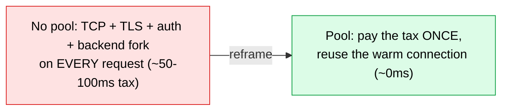
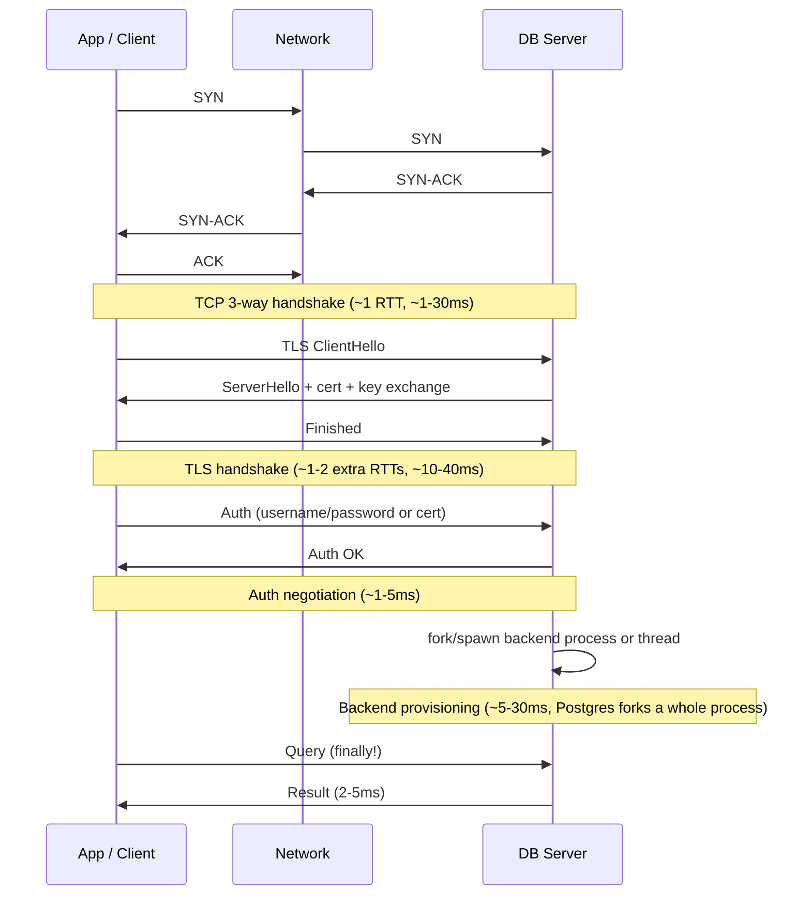
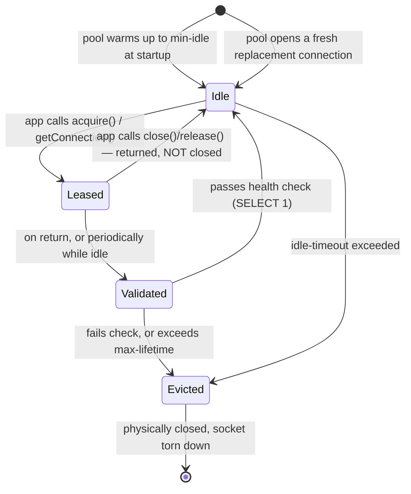
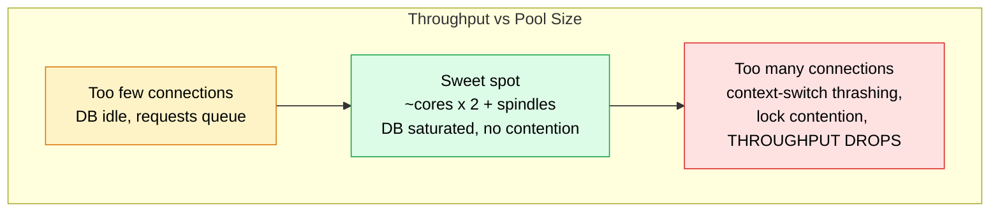
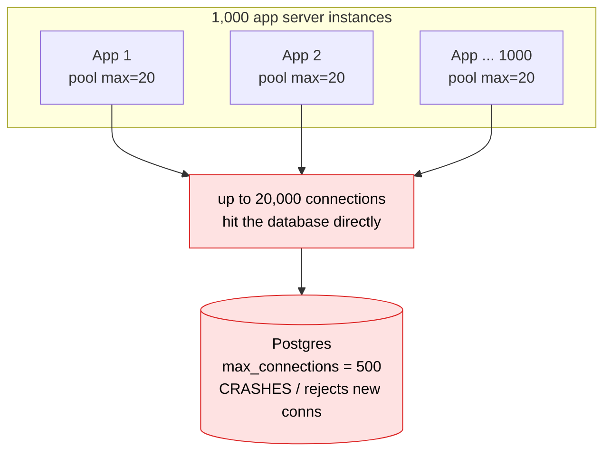
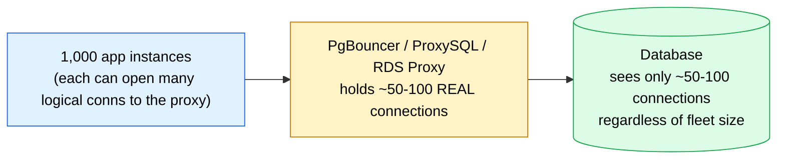
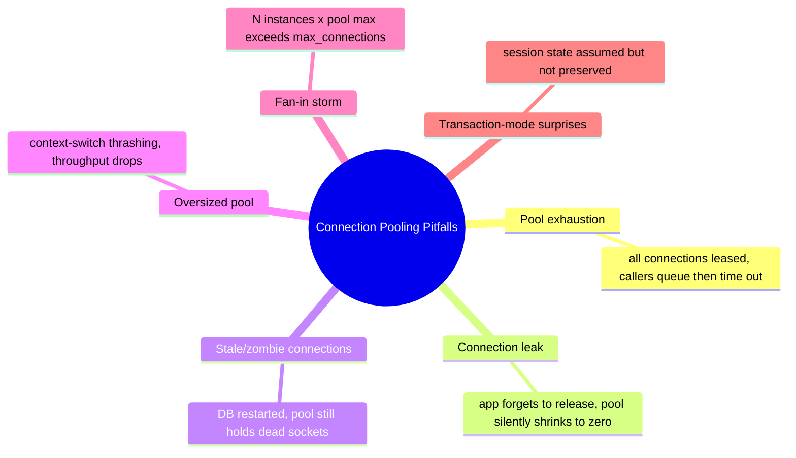

# Database Connection Pooling

> **One line:** Opening a database connection is a slow, expensive negotiation (TCP handshake + TLS handshake + auth + a new backend process) — a pool keeps a set of these connections open and warm so requests reuse them instead of paying that cost every single time.

---

## Table of Contents
1. [Why You Must Master This](#1-why-you-must-master-this)
2. [The Mental Model](#2-the-mental-model)
3. [Why a Connection Is Expensive](#3-why-a-connection-is-expensive)
4. [The Pool Lifecycle](#4-the-pool-lifecycle)
5. [Sizing the Pool](#5-sizing-the-pool)
6. [The Fan-In Problem and External Poolers](#6-the-fan-in-problem-and-external-poolers)
7. [Serverless and Connection Pooling](#7-serverless-and-connection-pooling)
8. [Worked Example — Sizing a Pool for a Real Service](#8-worked-example--sizing-a-pool-for-a-real-service)
9. [Real-Life Use Cases](#9-real-life-use-cases)
10. [Failure Modes](#10-failure-modes)
11. [🏋️ Practice Drills](#-practice-drills)
12. [🎤 Interview Q&A Bank](#-interview-qa-bank)
13. [🎯 Staff+ Nuances](#-staff-nuances)
14. [Cheat Sheet](#12-cheat-sheet)
15. [Connections & Further Reading](#13-connections--further-reading)

---

## 1. Why You Must Master This

- **It's the single highest-leverage fix for "our API is slow."** If a query takes 5ms but establishing the connection to run it takes 50-100ms, you're spending 90%+ of your latency budget on a handshake, not on work. Pooling turns that 50-100ms into ~0ms.
- **It's the difference between scaling and crashing under load.** Postgres has a hard `max_connections` ceiling (often 100-500). A fleet of app servers that each opens connections per-request — or even one-per-thread — will exhaust that ceiling the moment traffic spikes, and the database rejects *everyone*, including requests that would have succeeded.
- **It's a top-3 recurring "our database is falling over" interview and real-incident pattern.** "PgBouncer: too many clients already", "HikariCP pool timeout after 30000ms", "FATAL: remaining connection slots are reserved" — these are the literal error strings engineers paste into incident channels. Knowing the mechanism (not just "add a pooler") is what separates a Staff-level answer from a copy-pasted fix.
- **It generalizes.** The exact same "expensive-to-establish, cheap-to-reuse" trade governs HTTP keep-alive, gRPC channel reuse, and Kafka producer connections — master it once here.

> **The core problem it solves:** *creating a new database connection is orders of magnitude more expensive than running most queries, and the database can only sustain a small, fixed number of connections at once — so a pool amortizes the connection cost across many requests and caps concurrent connections at a number the database can actually survive.*

**Prerequisites:** basic TCP/TLS handshake mechanics and [Performance_Metrics.md](./Performance_Metrics.md) (P50 vs P99 latency) help frame why a 50-100ms fixed cost matters so much.

---

## 2. The Mental Model

Think of a database connection like **a hired, trained clerk at a specialized counter** — not a phone call you dial and hang up.

- **Without pooling:** every customer (request) walks in, and you *hire a brand-new clerk from scratch* — background check (TCP handshake), sign a confidentiality agreement (TLS handshake), verify their ID and give them a badge (auth), then have the building fork off a dedicated back-office worker for them (the DB backend process/thread). The customer asks one question that takes 2 seconds to answer. Then you *fire the clerk and demolish their desk*. Repeat for the next customer.
- **With pooling:** you hire a fixed staff of clerks once, in the morning. A customer walks up to whichever clerk is free, asks their question, and steps away — the clerk stays at their desk, ready for the next customer. Hiring cost is paid once; every subsequent interaction is just the 2-second question.



> **Hold onto this:** a connection is not a lightweight socket you open and drop — it is a *stateful, provisioned resource* on both ends (client TCP/TLS state, server backend process/thread + memory). Pooling exists because *reuse* is nearly free and *creation* never is.

---

## 3. Why a Connection Is Expensive

A "connection" is not one step — it is a stack of four sequential, blocking costs, each of which must complete before the next starts:



> One diagram, one takeaway: **the query itself is often the cheapest part of the round trip** — everything before it is fixed overhead you pay again for every new connection.

Breaking down that ~50-100ms tax:

1. **TCP three-way handshake** — SYN / SYN-ACK / ACK. This is at minimum one full network round-trip (1-30ms depending on distance/region), and it cannot be shortcut; it's how TCP establishes sequence numbers and confirms both sides are alive.
2. **TLS handshake** — if the connection is encrypted (it should be, for anything not on a fully trusted private network), add a certificate exchange and key negotiation: 1-2 additional round trips (TLS 1.3 got this down to one; TLS 1.2 needs two). This alone commonly costs 10-40ms, more over long distances.
3. **Authentication** — the database verifies credentials (password, SCRAM, mTLS cert, IAM token). Cheap in isolation (a few ms) but it's another sequential step, and cloud-managed databases (RDS IAM auth, Cloud SQL IAM) can add noticeably more here.
4. **Backend process/thread provisioning** — this is the part people forget. PostgreSQL forks an entire **OS process** per connection (not a thread) — allocating its own memory (work_mem, temp buffers), which costs real CPU and RAM on the server, not just the client. MySQL spawns a thread, which is cheaper but still not free. This step alone can be 5-30ms, and it happens on the *database's* CPU budget, competing directly with query execution.

Add them up: **a cross-AZ TLS-encrypted Postgres connection routinely costs 50-100ms and measurable DB-side CPU** — and that's *before* a single row is read. A pool pays this stack of costs once per connection, then amortizes it across thousands of queries.

| Step | Typical cost | Who pays it | Skippable if reused? |
|------|--------------|-------------|----------------------|
| TCP handshake | 1-30ms (1 RTT) | Client + network | Yes |
| TLS handshake | 10-40ms (1-2 RTT) | Client + network + DB CPU | Yes |
| Auth | 1-10ms | DB CPU (credential check) | Yes |
| Backend fork/thread | 5-30ms + RAM | DB CPU + DB memory | Yes |
| **The actual query** | 1-50ms+ | DB CPU + disk/index | **No — this is the real work** |


> **The one takeaway:** without a pool, every request pays the full TCP + TLS + auth handshake tax (~50-100ms) and the connection is destroyed right after — with a pool, that handshake is paid once and the same warm connection is leased and returned across thousands of requests for near-zero setup cost.

---

## 4. The Pool Lifecycle

A pool is a finite set of pre-established connections managed through a strict state machine. Every connection-pooling library (HikariCP, SQLAlchemy, PgBouncer, Go's `database/sql`) implements some version of this cycle:



Walking each state:

- **Acquire (checkout).** The app asks the pool for a connection. If an idle one exists, it's handed over immediately (~microseconds). If not, and the pool is below `max`, the pool opens a brand-new connection (paying the full 50-100ms cost). If the pool is *at* `max`, the caller **blocks** in a wait queue until either a connection frees up or `connectionTimeout` expires.
- **Lease (in use).** The connection is marked busy and handed to exactly one caller. No other thread can use it concurrently — this is why connections, unlike HTTP keep-alive sockets, are *not* multiplexed across callers by the pool (though PgBouncer's transaction mode gets close, see §6).
- **Return (release).** The app calls `close()` / `.release()` on its handle. Critically, this does **not** close the underlying socket — it resets session state (rolls back any open transaction, resets search_path/session variables) and returns the connection to the idle set. This distinction — *closing the handle vs. closing the connection* — is the single most important mental correction for engineers new to pooling.
- **Validate.** Before handing out an idle connection (or periodically in the background), the pool runs a cheap liveness check — typically `SELECT 1` or a protocol-level ping. This catches connections killed by a DB restart, a load balancer idle-timeout, or a network blip *before* the app tries to run real work on a dead socket.
- **Evict.** A connection is torn down (actually closed) when: it fails validation, it exceeds `max-lifetime` (forcibly retired even if healthy — this matters because DNS changes, failovers, and load-balancer rebalancing need connections to periodically cycle), or it has sat idle longer than `idle-timeout` and the pool is above `min-idle`.

**The key pool parameters, and why each exists:**

| Parameter | What it controls | Too low | Too high |
|-----------|-------------------|---------|----------|
| `minimum-idle` / `min` | Connections kept warm even with no traffic | Cold-start latency spike on the next burst | Wastes idle DB resources during quiet periods |
| `maximum-pool-size` / `max` | Hard ceiling on concurrent connections | Requests queue/timeout under load even though the DB has headroom | DB context-switch thrashing, possible `max_connections` exhaustion (see §5) |
| `connection-timeout` | How long a caller waits in the queue for a free connection before erroring | App gives up too fast, false failures under brief spikes | App hangs long after the user would rather see a fast error |
| `idle-timeout` | How long an idle connection stays open above `min-idle` before being closed | Constant churn opening/closing connections | Holds DB-side resources (memory, process slots) for connections doing nothing |
| `max-lifetime` | Forced retirement age, even if healthy | Excess churn | Connections outlive a DNS failover / DB restart and silently point at a dead node |
| `validation-query` / test-on-borrow | Catches dead connections before use | Requests fail on the first query against a stale connection | Extra round-trip latency on every acquire |

---

## 5. Sizing the Pool

The naive intuition — "more connections = more throughput" — is **wrong past a fairly small number**, and this is the most commonly missed nuance in interviews.

**Why bigger pools get *slower*:** a database server has a fixed number of CPU cores. Once you have roughly one active query per core, adding more concurrent connections doesn't add parallelism — it adds **contention**: more context-switching between backend processes, more lock contention on shared data structures (buffer pool, lock manager), more cache-line thrashing, and (for Postgres specifically) more OS-level scheduling overhead across processes. Throughput plateaus and then *degrades* as pool size grows past the sweet spot — a classic operations-research queueing effect, not a database bug.



> One takeaway: **the goal of pool sizing is not "as many as the DB allows" — it's "as few as keep every core busy without fighting."**

**The formula** — popularized by HikariCP's wiki and grounded in PostgreSQL's own connection-pooling guidance:

```
connections = ((core_count * 2) + effective_spindle_count)
```

- `core_count` — CPU cores available to the *database server* (not the app server).
- `effective_spindle_count` — the number of physical disks the working set can be read from in parallel. For pure-SSD/NVMe storage, treat this as roughly 1 (or use 0 for pure in-memory workloads); it's a legacy term from spinning disks where more spindles meant more parallel I/O to hide behind while other queries used the CPU.
- The `* 2` accounts for the fact that queries occasionally block on I/O (disk read, network) even on fast storage, so a connection count slightly above the core count keeps cores busy while some connections wait on I/O.

This formula deliberately produces **small** numbers. A well-provisioned Postgres server with 8 cores and SSD storage wants roughly `(8*2)+1 = 17` connections **per pool**, not 200. HikariCP's own documentation famously notes that a pool of ~10 connections, correctly sized, outperforms a "big" pool of 100 on identical hardware — because the 100-connection pool spends more time context-switching than querying.

**Why this surprises people:** application intuition says "more concurrency = more throughput," which is true for *stateless, CPU-light* work. A database connection is the opposite: heavyweight (dedicated process + memory) and the shared resource (cores, lock manager, buffer pool) doesn't grow just because you opened more sockets. The pool's job is to *protect* the database from your app's concurrency, not amplify it.

**Corollary — total connections across all app instances is the real ceiling to watch**, not any single pool's `max`. This leads directly into §6.

---

## 6. The Fan-In Problem and External Poolers

**The problem:** the sizing formula in §5 gives you the *right* number of connections **the database can sustain in total** — e.g., 20. But that number applies to the whole fleet, not to each app server's private pool. If you run 1,000 app server instances (autoscaled Kubernetes pods, Lambda-backed API, whatever) and each one runs an in-process pool sized to `max=20` "to be safe," you don't get 20 connections — you get up to **20,000**, all fighting to reach a database that can only sustain ~20-100 well.



> One takeaway: **in-process pooling solves per-instance connection reuse; it does nothing to cap fleet-wide fan-in — that needs a shared layer in front of the database.**

**The fix: an external connection pooler / proxy.** Instead of every app instance connecting straight to Postgres, every app instance connects to a lightweight proxy, and the proxy — and only the proxy — holds a small, correctly-sized pool of *real* connections to the database.



The most common tools:

| Tool | DB | How it works |
|------|-----|---------------|
| **PgBouncer** | PostgreSQL | Lightweight single-purpose proxy; the de facto standard because Postgres's per-connection process model makes it uniquely bad at handling thousands of direct connections. |
| **ProxySQL** | MySQL | Proxy + query router/cache; also does read/write splitting and query rewriting. |
| **RDS Proxy** | AWS RDS/Aurora (Postgres & MySQL) | Fully-managed equivalent; also smooths over failover (holds client connections open while swapping the backend during a failover, so apps don't all reconnect at once). |
| **Application-level pool (HikariCP, SQLAlchemy, node-postgres pool)** | Any | Still needed *even with* an external pooler — it handles the app-to-proxy leg and avoids the proxy itself getting hammered with raw TCP/TLS setups from every request. |

**PgBouncer's three pooling modes — the detail interviewers probe:**

| Mode | Connection held by client for | Session state (search_path, prepared statements) | Use when |
|------|-------------------------------|----------------------------------------------------|----------|
| **Session pooling** | The entire client session (until disconnect) | Fully preserved | Safest, but barely reduces real connections — closest to no pooling at the DB level. |
| **Transaction pooling** | Only for the duration of one transaction, then returned to the pool | **Not** preserved across transactions | The default recommendation — this is what makes fan-in reduction actually work (many idle clients share few real connections). |
| **Statement pooling** | Only for a single statement | Not preserved; no multi-statement transactions | Rare; only for stateless single-query workloads (breaks transactions entirely). |

> **The trap:** transaction pooling is what gives you the 1000:1 fan-in reduction, but it silently breaks anything that depends on session state surviving across statements — session-level `SET` variables, prepared statements tied to a session, advisory locks held "for later," and multi-statement transactions issued across separate round trips from the app. This is the single most common PgBouncer production surprise: code that worked fine against a direct connection breaks mysteriously under transaction-mode pooling.

---

## 7. Serverless and Connection Pooling

Serverless compute (AWS Lambda, Cloud Functions, Vercel/Edge functions) breaks the pooling model at its foundation: **a pool's entire value proposition is a long-lived process that keeps connections warm across many requests** — but a serverless function instance is ephemeral, can scale to hundreds of concurrent instances in seconds, and may be frozen/thawed or torn down entirely between invocations.

The failure mode: 500 concurrent Lambda invocations, each with its own tiny in-process pool (even `min=1, max=1`), each opening a fresh connection on cold start — instantly reproduces the fan-in storm from §6, except now it's *automatic and elastic*, driven purely by how many concurrent invocations the platform decided to spin up.

**The fixes, in order of how commonly they're used:**

1. **A managed external proxy in front of the database** — RDS Proxy (AWS) is purpose-built for this: Lambdas connect to the proxy (which itself pools and multiplexes down to a small set of real DB connections), and the proxy also survives individual Lambda instance churn.
2. **HTTP-based/data-API database access** — some managed databases (Aurora Data API, PlanetScale, Neon, Supabase's pooled endpoint) expose the database over a stateless HTTP API specifically so serverless functions never hold a raw TCP connection at all — each call is a single request/response, no pool needed on the client side.
3. **Pool reuse across warm invocations** — initialize the pool/connection *outside* the handler function body (at module load time) so that when the platform reuses a warm container for a subsequent invocation, the connection survives. This helps but doesn't bound the *total* fleet-wide connection count — you still need #1 or #2 at scale.
4. **Cap concurrency at the function level** — set a reserved/max concurrency limit on the function so the platform physically cannot scale past what the database (or its proxy) can sustain.

> The underlying lesson generalizes past serverless: **pooling assumes a stable population of long-lived clients.** Any environment that violates that assumption (serverless, aggressive autoscaling, short-lived batch jobs) needs the pooling logic moved to a layer that *is* long-lived — an external proxy — rather than trusting per-instance pools.

---

## 8. Worked Example — Sizing a Pool for a Real Service

**The prompt:** "We run a checkout service on 40 Kubernetes pods behind an autoscaler, backed by a single PostgreSQL primary with 16 cores and NVMe storage (`max_connections = 300`). Size the pooling layer."

**Step 1 — size the database-facing pool with the formula.**
```
connections = (core_count * 2) + effective_spindle_count
            = (16 * 2) + 1        (NVMe ≈ 1 effective spindle)
            = 33
```
Round up for headroom for maintenance/monitoring connections → **~40 real connections to Postgres is the target ceiling**, comfortably under the 300 hard limit (leaving room for `pg_dump`, replicas, admin sessions, and a safety margin).

**Step 2 — check whether per-pod pools alone can hit that ceiling.**
40 pods, if each ran its own pool with `max=20` "to be safe" as in §6, could open up to 800 direct connections — **20x over** both our 40-connection target *and* the DB's hard 300 limit. Direct pooling per pod cannot deliver 40 total without every pod coordinating, which they can't.

**Step 3 — insert PgBouncer in transaction-pooling mode between the fleet and Postgres**, configured with `default_pool_size=40` (matching Step 1's math) and `max_client_conn=2000` (accepting many more *logical* client connections than real backend connections, because transaction pooling multiplexes them).

```mermaid
sequenceDiagram
    participant Pod as K8s Pod (1 of 40)
    participant PGB as PgBouncer (default_pool_size=40)
    participant PG as Postgres (16 cores, max_connections=300)

    Pod->>PGB: BEGIN; UPDATE inventory ...; COMMIT (one transaction)
    PGB->>PG: borrow 1 of its 40 real connections
    PG-->>PGB: result
    PGB-->>Pod: result
    Note over PGB,PG: connection returned to PgBouncer's pool<br/>the instant the transaction ends — reused by the NEXT pod immediately
```

**Step 4 — size each pod's local (app-level) pool** to something modest — `min=2, max=5` per pod is enough, since it only needs to cover the app-to-PgBouncer hop's own connection reuse, not the DB-facing fan-in (PgBouncer now owns that problem). 40 pods × 5 = 200 logical connections to PgBouncer, comfortably inside `max_client_conn=2000`, and PgBouncer multiplexes all of it down to the ~40 real Postgres connections computed in Step 1.

**Closing the loop:** the number that matters — **16 cores → 33-40 real connections** — is a property of the *database's hardware*, not the fleet size. Fleet size (40 pods, could be 4,000) only changes how many *logical* client connections need multiplexing, which is exactly the job an external pooler in transaction mode exists to do. Get the core-count math right first; solve fan-in second; size per-pod pools last (and small).

---

## 9. Real-Life Use Cases

| Situation | How connection pooling applies | The decision it forces |
|-----------|--------------------------------|--------------------------|
| **Monolithic web app, single DB, moderate traffic** | In-process pool (HikariCP, SQLAlchemy) sized via the core-count formula is sufficient. | No external proxy needed yet — add one when instance count grows. |
| **Microservices fleet, autoscaled, all hitting one Postgres primary** | External pooler (PgBouncer) in transaction mode caps fan-in regardless of fleet size. | Move pooling responsibility from "many small pools" to "one shared pool." |
| **AWS Lambda / serverless functions calling RDS** | RDS Proxy or a Data-API style stateless DB access; per-invocation pools don't help at scale. | Choose a proxy or HTTP-based DB access over trying to "pool inside the function." |
| **"Too many connections" outage at 2am** | Diagnose: fleet size × per-instance `max` vs. `max_connections`; check for leaked/idle-in-transaction connections. | Add/resize PgBouncer, fix the leak, or lower per-instance `max` — usually all three. |
| **Database failover / planned maintenance** | `max-lifetime` forces periodic connection cycling so stale connections pointed at the old primary get retired; RDS Proxy specifically smooths this by holding client-facing connections open during the swap. | Set `max-lifetime` below the DB's own connection-recycling window; consider a failover-aware proxy. |
| **Batch job / one-off migration script** | A pool is unnecessary overhead — open one connection, do the work, close it. | Skip pooling deliberately; don't cargo-cult it everywhere. |

> **The habit:** before tuning any pool parameter, first ask "is this pool's `max` bounded by what a *single instance* should use, or did I just pick a big number?" — then ask "what's the fleet-wide total, and does the database's own math (§5) actually support that many?"

---

## 10. Failure Modes



- **Pool exhaustion.** *Symptom:* requests hang, then fail with a pool-checkout-timeout error (HikariCP's "Connection is not available, request timed out after 30000ms" is the canonical message). *Root cause:* every connection is leased and none free up fast enough — either genuine load exceeds capacity, or queries are slower than expected (a missing index turns a 5ms query into 500ms, which multiplies straight into pool occupancy). *Fix:* find and fix the slow query first (bigger pool is a band-aid, not a cure); only then consider raising `max` — and re-check the core-count math before doing so.
- **Connection leak.** *Symptom:* the pool's available count trends toward zero over hours/days even though traffic is steady; eventually every request fails. *Root cause:* code path that acquires a connection but never returns it — a missing `finally`/`close()`, an exception thrown between acquire and release, or a connection captured in a long-lived object by accident. *Fix:* always acquire/release via a scoped construct (`with` block, try-finally, RAII) that guarantees release on every exit path; set a `leak-detection-threshold` (HikariCP has one) that logs a stack trace for connections held suspiciously long.
- **Stale/zombie connections after a DB restart or failover.** *Symptom:* a burst of failures immediately after a database maintenance event, restart, or failover, even though the new primary is healthy. *Root cause:* the pool's idle connections still point at sockets that are now dead (or, worse, silently point at an old read-replica-turned-orphan) — TCP doesn't proactively tell the client the far end vanished. *Fix:* validate-on-borrow (cheap `SELECT 1` before handing out an idle connection), a bounded `max-lifetime` so connections cycle periodically even if healthy, and (for managed failover) a proxy like RDS Proxy that's failover-aware.
- **Oversized pool causing throughput to drop, not rise.** *Symptom:* someone doubles `max-pool-size` to "fix" slowness and P99 gets *worse*. *Root cause:* connection count now exceeds what the DB's cores can service without contention — see §5's throughput curve. *Fix:* apply the `(cores*2)+spindles` formula, measure actual DB-side CPU/context-switch metrics, and resist the "just add more" instinct.
- **Fan-in storm from fleet scale-out.** *Symptom:* `max_connections` exhaustion that correlates exactly with an autoscaling event (more pods = more direct connections), not with query volume. *Root cause:* every instance runs its own pool sized as if it were the only client. *Fix:* insert an external pooler (PgBouncer/ProxySQL/RDS Proxy) so the database-facing connection count is decoupled from fleet size.
- **Transaction-pooling-mode surprises.** *Symptom:* code that worked against a direct connection throws errors like "prepared statement does not exist" or session variables silently reset mid-request after switching to PgBouncer. *Root cause:* transaction pooling returns the connection to the pool between transactions, so nothing tied to session state survives. *Fix:* avoid session-level state (SET, advisory locks held across transactions, session-scoped prepared statements) in code paths behind a transaction-mode pooler, or fall back to session pooling for those specific paths.

---

## 🏋️ Practice Drills

> *Cover the solutions and attempt first — active recall is the point.*

**Drill 1 — Do the sizing math.** A MySQL server has 8 cores and all-SSD storage. Using the HikariCP/PostgreSQL formula, what pool size should a *single* application instance's pool be capped at if it's the only client? What changes if there are 20 application instances behind a load balancer?

<details><summary>Solution</summary>

Single client: `(8 * 2) + 1 = 17` — the database itself can only usefully service ~17 concurrent connections before context-switching eats the gains, regardless of how many clients exist.

With 20 instances: the **17 stays the same** — it's a property of the database's cores, not the number of app instances. What changes is that no single instance should run a pool anywhere near 17; if each of 20 instances runs `max=17`, the fleet could present up to 340 connections. The right move is either (a) divide the budget across instances (17/20 ≈ round up to 1-2 per instance, which is awkwardly small and wastes headroom), or — the real answer — (b) put an external pooler (PgBouncer/ProxySQL) in front so the *database* only ever sees ~17-20 real connections while each app instance keeps a small local pool (e.g., `max=5`) for its own request concurrency to the proxy.
</details>

**Drill 2 — Diagnose the incident.** Your team gets paged: Postgres is throwing "FATAL: sorry, too many clients already." `max_connections=200`. You have 50 app pods, each with HikariCP `maximum-pool-size=20`, and traffic hasn't changed in weeks. What happened, and what's the fix?

<details><summary>Solution</summary>

50 pods × 20 max = up to 1,000 potential connections against a 200-connection ceiling — this was always a latent time bomb; it likely tripped now because of a deploy that bumped pod count, an autoscaling event, or enough pods simultaneously hitting their pool ceiling under a normal traffic bump (not necessarily an overall traffic increase — just enough concurrent load to push many pods to their individual `max` at once).

Immediate fix: lower each pod's `maximum-pool-size` to something the fleet can collectively support under 200 (e.g., 200/50 = 4 per pod, with margin for admin connections) — this stops the bleeding but wastes capacity when pod count is low.

Real fix: insert PgBouncer (or RDS Proxy) between the fleet and Postgres in transaction-pooling mode, sized via `(cores*2)+spindles` against the actual DB hardware; let each pod keep a modest local pool (e.g., `max=10`) pointed at PgBouncer instead of the database directly. Now fleet size can scale without the database-facing connection count changing at all.
</details>

**Drill 3 — Design a small thing.** You're deploying a new service to AWS Lambda that reads from an existing Aurora PostgreSQL database also used by a traditional EC2-based service. The EC2 service already uses a HikariCP pool sized correctly for the DB's cores. How do you add Lambda access without breaking the existing sizing?

<details><summary>Solution</summary>

Do **not** put a HikariCP-style long-lived pool inside the Lambda function — Lambda instances are ephemeral and can scale to hundreds of concurrent invocations, each of which would try to open (and likely never gracefully close) its own connection, blowing past the budget the EC2 service's pool was sized against.

Instead: put **RDS Proxy** in front of Aurora. Point the Lambda function at the RDS Proxy endpoint (not directly at Aurora); RDS Proxy holds a small, bounded pool of real connections to Aurora and multiplexes many concurrent Lambda invocations onto them, the same way PgBouncer would. The existing EC2 service can either keep talking directly to Aurora (if its own pool's max, plus RDS Proxy's pool, still fits under `max_connections`) or also be pointed at the proxy for a single, consistent connection budget. Either way, the total connection math from §5 needs to be redone across *both* consumers now that a second client exists — the formula's answer belongs to the database's cores, and every consumer of that database has to share it.
</details>

---

## 🎤 Interview Q&A Bank

**Q1. "Why is connection pooling necessary — what exactly is expensive about opening a connection?"**
> A connection isn't a lightweight socket — it's a stack of sequential costs: a TCP three-way handshake (1 RTT), a TLS handshake (1-2 more RTTs), authentication, and on the database side, provisioning a dedicated backend process (Postgres) or thread (MySQL) with its own memory. Together that's routinely 50-100ms and real DB-side CPU/RAM — often far more than the query itself costs. A pool pays that cost once per connection and reuses it across thousands of queries.

**Q2. "How do you size a connection pool?"** *(signal: tests whether the candidate knows "bigger isn't better")*
> Use `connections = (core_count * 2) + effective_spindle_count`, sized against the *database server's* cores, not the app fleet. Past that point, more connections don't add parallelism — they add context-switching and lock contention, and throughput actually drops. The number is deliberately small (often 10-40), which surprises people expecting "more connections = more throughput."

**Q3. "1,000 app servers all need to talk to one database. How do you prevent connection exhaustion?"** *(signal: fan-in awareness — the most-asked follow-up)*
> Per-instance pools don't solve this — 1,000 instances × even a modest `max` blows past any reasonable `max_connections`. Insert an external pooler (PgBouncer for Postgres, ProxySQL for MySQL, or RDS Proxy on AWS) between the fleet and the database. The proxy holds a small, correctly-sized pool of real database connections and multiplexes thousands of logical client connections onto it — typically in *transaction pooling* mode, which returns the real connection to the pool the instant a transaction ends.

**Q4. "What's the difference between PgBouncer's session, transaction, and statement pooling modes?"**
> Session mode holds a real connection for the client's entire session — safest, but barely reduces the real connection count. Transaction mode holds it only for one transaction, then returns it to the pool — this is what actually achieves the fan-in reduction, but it breaks anything relying on session state surviving across transactions (SET variables, session-scoped prepared statements, advisory locks held across calls). Statement mode holds it for a single statement only, breaking multi-statement transactions entirely. Transaction mode is the standard production choice; you pay for it by removing session-state assumptions from your code.

**Q5. "Why is pooling hard in AWS Lambda / serverless?"**
> Pooling's value depends on a long-lived process reusing warm connections across many requests — but a Lambda instance is ephemeral, can scale to hundreds of concurrent instances in seconds, and may be frozen or torn down at any time. Naive per-invocation pools reproduce the fan-in storm automatically and elastically. The fix is the same shape as the fleet problem: move pooling to a layer that *is* long-lived — RDS Proxy, or a stateless HTTP data-API — rather than trying to keep a pool alive inside something ephemeral.

**Q6. "What's a connection leak, and how do you catch it?"**
> Code acquires a connection from the pool but never returns it — a missing `finally`, an exception between acquire and release, or a connection accidentally captured by a long-lived object. Symptom: the pool's available connections trend toward zero over time even at steady traffic, eventually failing every request. Fix structurally (always acquire/release via a scoped block that guarantees release on every exit path) and detect it operationally (HikariCP's `leak-detection-threshold` logs a stack trace for connections held longer than expected).

**Q7. "The database just failed over to a new primary. What happens to the pool, and how do you make it recover cleanly?"**
> Idle connections in the pool still point at sockets that may now be dead or, worse, silently connected to what's now a replica — TCP doesn't proactively notify a live client that the far end changed. A validate-on-borrow check (cheap `SELECT 1`) catches this before handing a stale connection to a request, and a bounded `max-lifetime` forces periodic connection cycling even for healthy-looking connections so the pool doesn't accumulate connections from before the failover. A failover-aware proxy like RDS Proxy goes further, holding client-facing connections open while it swaps the backend transparently.

**Q8. "When would you NOT use a connection pool?"**
> Short-lived, single-purpose scripts — a one-off migration or batch job that opens one connection, does its work, and exits — gain nothing from pooling and add unneeded complexity. More subtly, don't reach for "bigger pool" as a fix for slow queries; if pool exhaustion is caused by queries taking 10x longer than expected (often a missing index), fixing the query is the real fix — a bigger pool just delays the same wall with more resource cost.

---

## 🎯 Staff+ Nuances

- **Pool sizing math belongs to the database, and every consumer of that database shares one budget.** The `(cores*2)+spindles` number describes what the database's hardware can sustain in total — it does not multiply by the number of app instances, microservices, or even different applications hitting the same database. Staff-level design docs size the *database-facing* pool once and treat every client (including future ones) as consumers of that shared ceiling, usually via one external pooler.
- **"Optimize the pool" is frequently the wrong fix for a pool-exhaustion incident.** A pool that's constantly maxed out is a symptom, not a root cause — the real question is whether queries are taking longer than they should (missing index, lock contention, a slow downstream call inside a transaction holding a connection open). Raising `max-pool-size` without investigating query latency just moves the bottleneck to the database's cores, where it degrades (per §5) instead of queuing cleanly.
- **Idle-in-transaction is the leak that doesn't look like a leak.** A connection sitting idle *inside an open transaction* (app started a transaction, made an external API call, forgot to commit/rollback promptly) holds locks and a backend process the whole time — it shows up in `pg_stat_activity` as `idle in transaction` and is a top real-world cause of Postgres connection exhaustion that isn't a classic "forgot to close()" leak. Set `idle_in_transaction_session_timeout` on Postgres as a backstop.
- **Transaction-mode pooling is a leaky abstraction, and pretending otherwise causes production incidents.** ORMs and frameworks often assume session semantics (prepared statement caching, `SET` session variables, advisory locks) that transaction-mode PgBouncer silently doesn't preserve. The mature answer isn't "avoid PgBouncer" — it's knowing precisely which session-dependent features your ORM uses and either disabling them or routing that specific traffic through session-mode pooling.
- **RDS Proxy and similar managed proxies also solve a problem pooling libraries don't: failover continuity.** A raw client pool has no way to know "the primary just changed" except by having connections fail; a failover-aware proxy can hold the client-facing connection open while swapping the backend, turning what would be a fleet-wide reconnect storm into an invisible internal swap. This is as much a reliability feature as a scaling one.
- **The same expensive-to-establish/cheap-to-reuse pattern recurs across the stack — recognizing it as one idea is the senior frame.** HTTP keep-alive/connection reuse, gRPC channel pooling, Kafka producer connection reuse, and even [CDN](./CDN.md) origin-shield connection reuse are the identical trade at different layers. If you can explain *why* a DB connection is stateful and expensive, you can explain all of them the same way.
- **Read/write splitting multiplies the pooling decision, not just the pool count.** A read-heavy service pointed at a primary plus N read replicas typically needs *separate* pools per endpoint (writes to the primary's pool, reads distributed across replica pools) — sizing each independently against that specific node's cores, since a replica may be provisioned differently than the primary.
- **This file is the canonical owner of "pooling as warm-connection-reuse" in this repo** — [14_Performance_Optimization_Scalability](../14_Performance_Optimization_Scalability/) references this topic but should defer here rather than duplicate it, to keep one source of truth for the mechanism, sizing formula, and pooler landscape.

---

## 12. Cheat Sheet

```
DATABASE CONNECTION POOLING — reuse warm connections instead of paying the handshake tax
═══════════════════════════════════════════════════════════════════════════════════════

WHY A CONNECTION IS EXPENSIVE (add it up: ~50-100ms + DB-side CPU/RAM)
  TCP handshake        1-30ms   (1 RTT)
  TLS handshake         10-40ms  (1-2 RTT)
  Auth                   1-10ms
  Backend fork/thread    5-30ms  + DB memory (Postgres forks a WHOLE PROCESS per conn)
  -------------------------------------------------------------------
  The actual query is often the CHEAPEST part of the round trip.

POOL LIFECYCLE
  Idle -> acquire() -> Leased -> release() -> Validated -> Idle
                                            -> fails check / max-lifetime -> Evicted (closed)
  release() returns the connection to the pool — it does NOT close the socket.

KEY PARAMETERS
  min-idle            connections kept warm even with no traffic
  max-pool-size        hard ceiling on concurrent connections (SIZE THIS CAREFULLY — see formula)
  connection-timeout   how long a caller waits in queue before erroring
  idle-timeout         when to close idle connections above min
  max-lifetime         forced retirement age (survives failovers/DNS changes)
  validation-query     liveness check before handing out an idle connection ("SELECT 1")

SIZING FORMULA (HikariCP / PostgreSQL) — sized to the DATABASE'S HARDWARE, not fleet size
  connections = (core_count * 2) + effective_spindle_count
  8 cores + SSD  -> (8*2)+1  = 17     16 cores + NVMe -> (16*2)+1 = 33
  BIGGER POOLS GET SLOWER past this point: context-switching + lock contention beat throughput down.

THE FAN-IN PROBLEM
  N app instances x per-instance pool max CAN exceed max_connections even if each instance
  looks "reasonably" sized. 1,000 instances x 20 = 20,000 possible connections -> DB dies.
  FIX: external pooler in front of the DB — only IT holds real connections.

EXTERNAL POOLERS
  PgBouncer   (Postgres)         ProxySQL (MySQL)          RDS Proxy (AWS, failover-aware)
  Modes:  session (safe, ~no reduction) | transaction (default — breaks session state,
          this is what gives the fan-in win) | statement (rare, breaks transactions)

SERVERLESS (Lambda etc.)
  Ephemeral instances + elastic scale-out = automatic fan-in storm.
  FIX: external proxy (RDS Proxy) or stateless HTTP data-API, not a per-invocation pool.
  Init the pool/connection OUTSIDE the handler to reuse across warm invocations (helps, doesn't bound total).

FAILURE MODES  (symptom -> cause -> fix)
  Pool exhaustion timeout      -> queries too slow / genuine overload -> fix query first, then resize
  Connection leak (slow drain) -> missing close()/finally             -> scoped acquire/release + leak-detection-threshold
  Zombie connections           -> DB restart/failover, socket dead    -> validate-on-borrow + max-lifetime + failover-aware proxy
  Idle-in-transaction          -> forgot commit/rollback, holds lock  -> idle_in_transaction_session_timeout
  Oversized pool, slower       -> exceeded core-count sweet spot      -> apply the formula, don't just "add more"
  Fan-in storm                 -> per-instance pools, no shared proxy -> PgBouncer/ProxySQL/RDS Proxy in front
  Transaction-mode surprises   -> code assumes session state persists-> avoid SET/advisory-locks/session prepared stmts, or use session mode
```

---

## 13. Connections & Further Reading

**Prerequisites (learn first):**
- [Performance_Metrics.md](./Performance_Metrics.md) — P50/P99 latency framing for why a fixed 50-100ms tax dominates a fast query's budget.

**Builds toward / pairs with:**
- [Caching_Strategies.md](./Caching_Strategies.md) — the same "reuse beats recreate" idea, applied to data instead of connections.
- [CDN.md](./CDN.md) — origin-shield connection reuse is this exact pattern at the edge tier.
- [Data_Compression_Serialization.md](./Data_Compression_Serialization.md) — another "cut the cost of the request that still has to travel" lever in this section.
- [05 · Databases & Storage](../05_Databases_Storage/) — replication and read/write splitting change how many pools you need and where.
- [14 · Performance Optimization & Scalability](../14_Performance_Optimization_Scalability/) — this file (06) is the canonical owner of connection pooling as warm-connection-reuse; 14 should cross-link here rather than duplicate the mechanism and sizing formula.

**Gaps this topic exposes (candidates for the section's Gap Analysis):**
- HTTP keep-alive / gRPC channel pooling as the same pattern one layer up the stack — currently only mentioned in passing here.
- Read/write-split pooling (separate pools per primary/replica, sized independently) deserves at least a worked example if a future file goes deeper on replication-aware architectures.

**External classics:**
- [HikariCP wiki: "About Pool Sizing"](https://github.com/brettwooldridge/HikariCP/wiki/About-Pool-Sizing) — the source of the `(cores*2)+spindles` formula and the "bigger pool, lower throughput" data.
- [PgBouncer documentation](https://www.pgbouncer.org/) — pooling modes and configuration reference.
- [AWS: Managing DB Connections with RDS Proxy](https://aws.amazon.com/rds/proxy/) — serverless and failover-aware pooling.
- *PostgreSQL documentation: "Managing Kernel Resources"* — the per-connection backend process model that makes Postgres uniquely pool-dependent.

---

## TL;DR
**A database connection is a stateful, expensive-to-establish resource — TCP handshake + TLS handshake + auth + a dedicated backend process, routinely 50-100ms and real DB-side CPU/memory — so a pool pays that cost once and reuses it across thousands of requests instead of paying it per request.** Size the pool against the database's own hardware with `(cores*2)+spindles`, not against how many app instances exist — bigger pools get *slower* past that point from context-switching and lock contention, never faster. The moment a fleet has more than a handful of instances, per-instance pools stop being enough: total fan-in (instances × each pool's max) can dwarf the database's `max_connections`, so an external pooler (PgBouncer/ProxySQL/RDS Proxy, almost always in transaction-pooling mode) has to sit between the fleet and the database as the single layer that actually caps real connections. Serverless breaks the model even further — ephemeral, elastically-scaling instances need that same external-proxy fix, not a pool inside the function. **Always fix the slow query or the leak before reaching for a bigger pool — the pool regulates load, it doesn't create capacity.**
