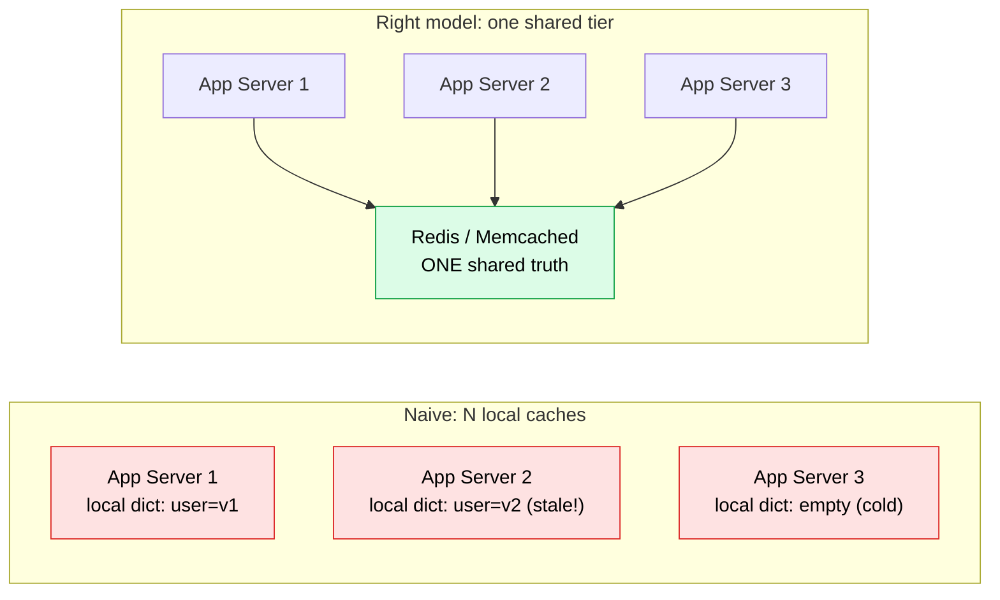
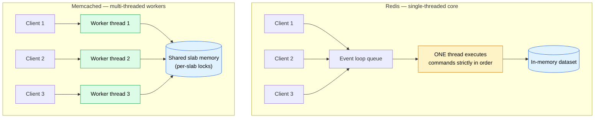
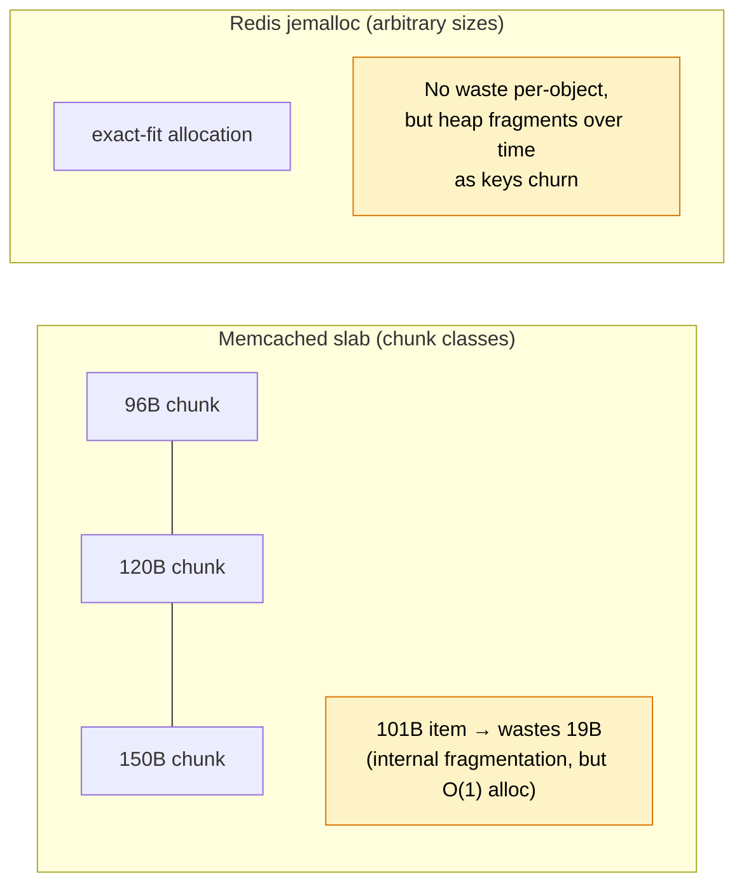
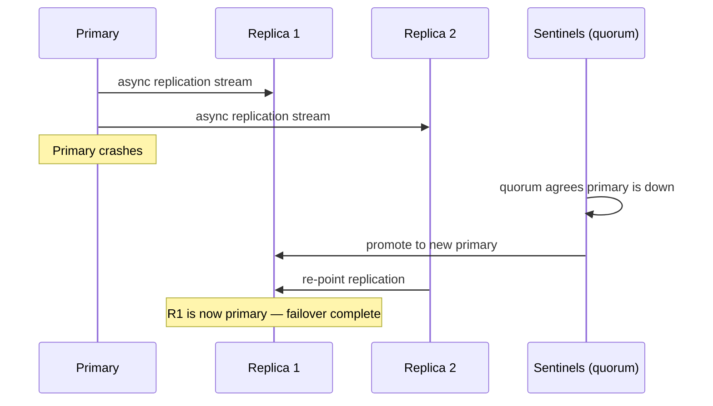
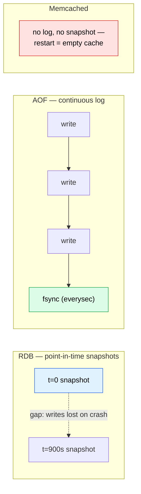
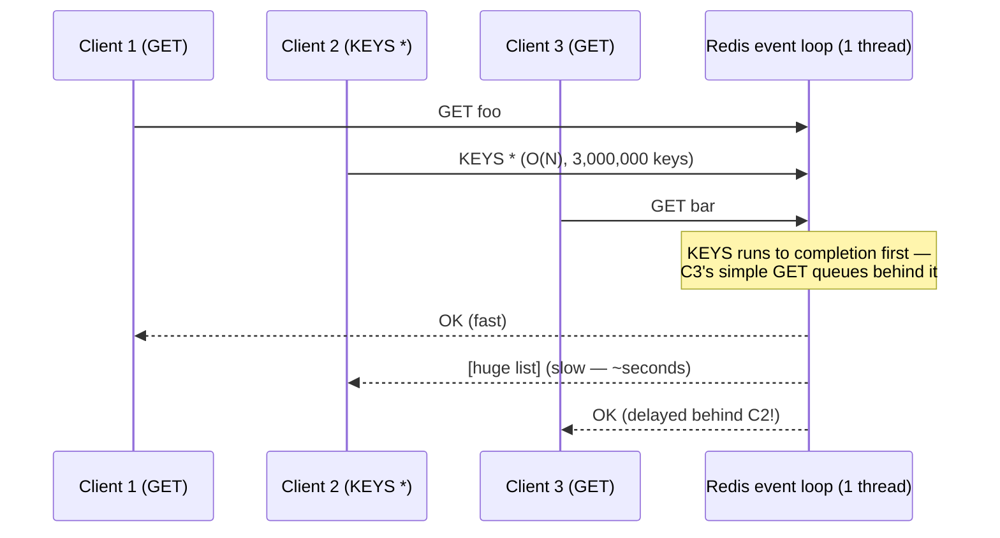
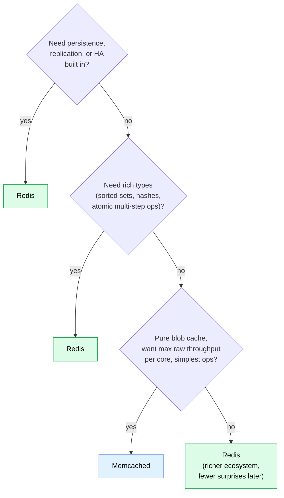
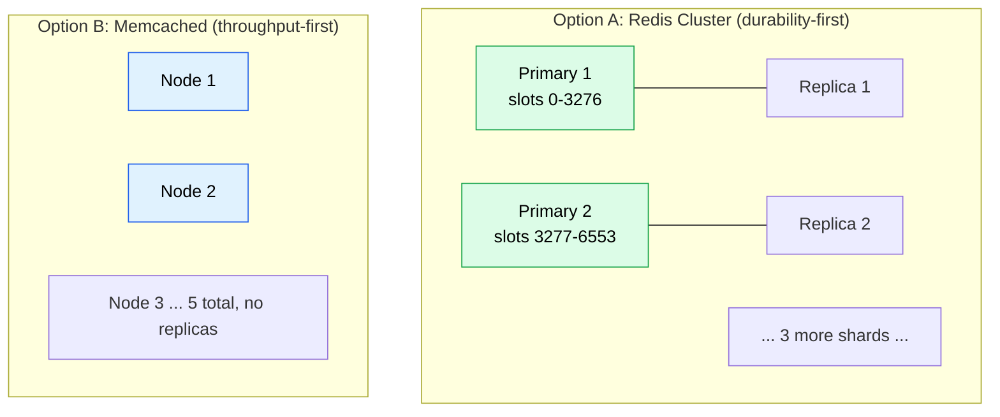

# Distributed Caching — Redis vs Memcached

> **One line:** Once you have more than one application server, an in-process cache is a lie you tell yourself — each instance sees a different, inconsistent slice of "cached" data — so you move the cache into its own shared, network-attached tier (Redis or Memcached), and the choice between those two is really a choice between "a data-structure server that happens to cache" and "the fastest possible key→blob memory."

---

## Table of Contents
1. [Why You Must Master This](#1-why-you-must-master-this)
2. [The Mental Model](#2-the-mental-model)
3. [Why Distributed At All — Shared State vs Local Cache](#3-why-distributed-at-all--shared-state-vs-local-cache)
4. [Redis vs Memcached — Architecture Head-to-Head](#4-redis-vs-memcached--architecture-head-to-head)
5. [Scaling Out — Sharding & Redis Cluster](#5-scaling-out--sharding--redis-cluster)
6. [Replication & High Availability](#6-replication--high-availability)
7. [Persistence — RDB, AOF, and Pure In-Memory](#7-persistence--rdb-aof-and-pure-in-memory)
8. [Single-Threaded Consequences — Blocking, Pipelining, Lua](#8-single-threaded-consequences--blocking-pipelining-lua)
9. [Decision Guide — When Each Wins](#9-decision-guide--when-each-wins)
10. [Worked Example — Sizing & Sharding a Session Cache Tier](#10-worked-example--sizing--sharding-a-session-cache-tier)
11. [Real-Life Use Cases](#11-real-life-use-cases)
12. [Failure Modes](#12-failure-modes)
13. [🏋️ Practice Drills](#-practice-drills)
14. [🎤 Interview Q&A Bank](#-interview-qa-bank)
15. [🎯 Staff+ Nuances](#-staff-nuances)
16. [Cheat Sheet](#16-cheat-sheet)
17. [Connections & Further Reading](#17-connections--further-reading)

---

## 1. Why You Must Master This

- **It's the single most-named component in system-design interviews.** "Add a cache" almost always means "add Redis" — and the interviewer's very next question is "why Redis and not Memcached?" Answering with only "Redis has more features" is a weak-hire signal; you need the architecture underneath.
- **The wrong choice is an outage, not a slowdown.** Pick Memcached because it's "simpler" and then need a distributed lock or a leaderboard, and you've bolted a second system on. Pick Redis and run `KEYS *` on a 50M-key production instance, and you've frozen every client for seconds — a single-threaded design has sharp edges a multi-threaded one doesn't.
- **It's where "cache" stops being a local variable and becomes a distributed system.** The moment a cache is shared across servers, you inherit every distributed-systems problem: partitioning, replication lag, split-brain during failover, and "what happens when a node dies." This file is where [[Caching Strategies]] meets real infrastructure.
- **The economics are enormous at scale.** Facebook's memcached fleet and Twitter's Redis/Twemcache deployments serve trillions of requests/day specifically so their MySQL/HBase tiers don't have to; sizing a cache tier wrong means either paying for RAM you don't need or falling back to the database and multiplying your DB fleet cost 10-100x.

> **The core problem it solves:** a single process's RAM cache only helps *that* process — the moment you run N application servers, you need one shared, fast, network-reachable memory tier that all of them see the same version of, sized and architected on purpose rather than by default.

**Prerequisites:** [Caching_Strategies.md](./Caching_Strategies.md) (cache-aside/write-through — the *pattern* this file's *infrastructure* implements) and [Cache_Eviction_Policies.md](./Cache_Eviction_Policies.md) (LRU/LFU — what happens when either engine runs out of RAM).

---

## 2. The Mental Model

The naive mental model is "the cache lives near my code, so put a `dict`/`HashMap` in the process." That works beautifully for one server. The moment you scale horizontally, that mental model breaks silently — no error, just inconsistent answers depending on which server happened to handle the request.



> **Hold onto this:** a distributed cache isn't "a bigger local cache" — it's a *separate network service* that trades the zero-latency of in-process memory (~100ns) for shared, consistent, capacity-beyond-one-box memory (~0.5-1ms over the network). Every design decision from here — sharding, replication, persistence — exists because that shared service is now a distributed system in its own right, with its own failure modes. (The other half of this trade — combining a local L1 with this shared L2 — is its own topic: *In-Process vs Distributed Cache*, a sibling file to this one.)

---

## 3. Why Distributed At All — Shared State vs Local Cache

**What it is:** a cache process (or cluster) that lives outside any single application server, reachable over the network by every server in the fleet, holding one shared copy of cached state.

**Why it exists / what breaks without it:**
- **Consistency across instances.** With N local caches, server 2 can serve a price that server 1 already invalidated 3 seconds ago — user sees different answers on refresh depending on load-balancer routing. A shared cache gives one version of the truth (still eventually-consistent with the DB, but *consistent across your fleet*).
- **Capacity beyond one box.** A local cache is capped by one server's RAM, and that RAM is *duplicated* N times (once per instance) for no benefit — 20 app servers each caching the same 4 GB hot dataset is 80 GB of RAM spent to hold 4 GB of unique data. A shared tier holds it once.
- **Cache warmth survives deploys.** Restart an app server and its local cache is gone — the deploy causes a stampede back to the DB. A shared cache tier is a separate lifecycle; app servers roll without ever cooling the cache.

**How it works under the hood:** the app server becomes a *client* of a remote key-value store over TCP (Redis: RESP protocol on port 6379; Memcached: a simple text/binary protocol on port 11211). Every `GET`/`SET` is now a network round trip (serialize → send → server does O(1) hash lookup → serialize → return), not a pointer dereference.

**The trade-off:** you've traded ~100ns (in-process map lookup) for ~0.5-1ms (network round trip within the same datacenter) — roughly **5,000-10,000x slower per lookup** — in exchange for consistency and shared capacity. That's why the two tiers coexist: a small, short-TTL local cache (L1) in front of the shared distributed cache (L2) recovers some of that latency for the hottest keys, at the cost of staleness windows across instances. When the working set genuinely fits in one process and staleness-across-instances is a non-issue (e.g., a single-instance service, or truly per-request-scoped memoization), skip the network hop entirely — the local cache wins.

**Real number:** a well-tuned Redis GET over a loopback/local-network link typically completes in **0.1-0.5 ms**; the same lookup against an in-process `HashMap` is **~50-100 ns** — the distributed hop costs roughly 1,000-5,000x more per call, which is exactly why systems batch calls (pipelining, `MGET`) rather than looping one key at a time.

---

## 4. Redis vs Memcached — Architecture Head-to-Head

**What they are:** both are in-memory key-value servers used as caches, but they were built for different jobs — Memcached was purpose-built to be *the fastest possible cache* for opaque blobs; Redis was built as an in-memory *data structure server* that happens to be an excellent cache too.

### 4.1 Concurrency model — single-threaded event loop vs multi-threaded workers


> One thread guarantees Redis command atomicity for free; Memcached spends multiple cores on raw throughput because it never needs that guarantee.

- **Why Redis is single-threaded (by design, not limitation):** every command already runs in-memory at O(1)/O(log N), so a single core can execute hundreds of thousands of simple commands/sec without contention — and single-threading buys **atomicity for free**: `INCR`, `HSET`, even a whole Lua script, can never be interleaved with another client's command, so there's no lock, no race condition, no mutex overhead. (Redis 6+ added *I/O threading* — multiple threads read/parse the network socket — but command *execution* against the dataset is still one thread. Redis 7 also moved some maintenance work, like active expiry and UNLINK's memory reclamation, to background threads.)
- **Why Memcached is multi-threaded:** Memcached has no rich atomic multi-step operations to protect — a `GET`/`SET` on an opaque blob is a simple, short critical section — so it spreads work across N worker threads (`-t` flag, default 4) with per-item/per-slab locking, and throughput scales close to linearly with cores for raw GET/SET traffic. This is *the* single biggest real-world reason large blob-caching fleets (Facebook's memcached tier) prefer it: more cores on one box = more raw ops/sec with no application-level coordination needed.
- **Trade-off:** Redis's single core becomes a *hard ceiling* — one Redis primary tops out around **~100K-200K ops/sec** for typical small commands (higher for pure pipelined throughput, lower for expensive commands), and that ceiling doesn't move no matter how many cores the box has; you scale Redis *out* (more shards), not *up* (more cores). Memcached scales *up* first (more threads/cores on one box) before you need to scale out at all.

### 4.2 Data structures — rich primitives vs opaque blobs

| Redis | Memcached |
|---|---|
| String (also used for counters — `INCR`/`DECR`) | Byte blob only — you serialize everything yourself |
| Hash (field→value map — perfect for "one object, many fields") | — |
| List (`LPUSH`/`RPOP` — lightweight queue) | — |
| Set / Sorted Set (`ZADD` — leaderboards, ranking, dedup) | — |
| Bitmap (per-bit flags — feature flags, daily-active-user tracking) | — |
| HyperLogLog (`PFADD` — approximate distinct count in ~12 KB for billions of items) | — |
| Streams (`XADD` — lightweight append-only log / pub-sub with history) | — |
| Pub/Sub, Geo commands, atomic `SETNX`/`GETSET` for locks | — |

**Why it matters:** in Memcached, "cache the leaderboard" means read the whole blob, deserialize in your app, update one score, reserialize, write the whole blob back — racy under concurrent writers. In Redis, `ZINCRBY leaderboard 10 user123` is one atomic server-side operation on a sorted set — no read-modify-write race, no deserialization cost, and the server itself keeps it sorted. This is the crux of "Redis is a data-structure server, not just a cache": half of what people call "using Redis for caching" is really using Redis's data structures to do work a blob store can't.

**Real number / trade-off:** Memcached's opaque-blob simplicity is also its memory efficiency story (see 4.3) — for a pure "serialize an object, cache the bytes, deserialize on read" workload with no server-side manipulation, the blob model has less per-key overhead than Redis's richer object headers. If you only ever do `GET`/`SET` on whole objects, Memcached's simplicity isn't a limitation, it's a lower-overhead fit.

### 4.3 Memory model — slab allocator vs jemalloc

- **Memcached: slab allocator.** At startup, Memcached pre-allocates memory into **slabs** — large chunks subdivided into fixed-size **chunks** that grow by a growth factor (default 1.25×): e.g., 96B, 120B, 150B, 188B chunk classes. An item is stored in the smallest chunk class that fits it. This makes allocation and eviction **O(1)** — no malloc/free churn, no fragmentation from arbitrary-sized allocations — but it wastes space to **internal fragmentation**: a 101-byte item lands in a 120-byte chunk, wasting 19 bytes, and chunks freed in one size class can't be reused by a different size class without a slab rebalance.
- **Redis: general-purpose allocator (jemalloc by default on Linux).** Objects are allocated as needed with no fixed slab classes, which is more memory-efficient for arbitrarily-sized, heterogeneous values — but is exposed to classic heap **fragmentation**: as keys are added/expired/resized over time, the allocator's free lists get fragmented, and `used_memory` can be measurably less than `used_memory_rss` (what the OS actually reserves). Redis exposes `MEMORY DOCTOR` and `INFO memory` (`mem_fragmentation_ratio`) to see this, and `activedefrag yes` runs a background defragmentation pass.


> Memcached pays fragmentation cost up front and per-object; Redis pays it later and system-wide — pick your poison based on whether your keyspace churns a lot.

**Max value sizes (real numbers):** Memcached's default item size limit is **1 MB** (`-I`/`item_size_max`, raisable but discouraged since it breaks slab efficiency); Memcached's max key length is **250 bytes**. Redis strings can hold up to **512 MB**, and Redis has no hard key-length cap beyond that same 512 MB — but caching multi-megabyte blobs in either system is almost always a design smell (compress it, chunk it, or put it in object storage and cache a pointer — see [Data_Compression_Serialization.md](./Data_Compression_Serialization.md)).

**Eviction:** Memcached supports exactly one eviction algorithm — **LRU, per slab class** (each chunk-size class evicts its own least-recently-used item independently) — with a background "LRU crawler" that proactively reaps expired items. Redis supports a whole *menu* of eviction policies configurable via `maxmemory-policy`: `noeviction` (the dangerous **default** — writes start erroring with OOM once `maxmemory` is hit), `allkeys-lru`, `volatile-lru`, `allkeys-lfu`, `volatile-lfu`, `allkeys-random`, `volatile-random`, `volatile-ttl`. See [Cache_Eviction_Policies.md](./Cache_Eviction_Policies.md) for the full mechanics of LRU vs LFU — the point here is that Redis lets you choose per-deployment, and Memcached doesn't need to because it only ever holds cache data (never anything you'd want to keep "forever").

### 4.4 Head-to-head comparison table

| Dimension | Redis | Memcached |
|---|---|---|
| **Concurrency** | Single-threaded core (+ I/O threads) | Multi-threaded workers |
| **Data model** | Strings, hashes, lists, sets, sorted sets, bitmaps, HyperLogLog, streams | Opaque byte blobs only |
| **Atomic multi-step ops** | Yes — `INCR`, `ZADD`, Lua scripts, `MULTI`/`EXEC` | No — read-modify-write is the caller's problem |
| **Memory allocator** | jemalloc (general-purpose; fragments over time) | Slab allocator (fixed chunk classes; internal fragmentation) |
| **Max value size** | 512 MB (strings) | 1 MB default (`item_size_max`) |
| **Max key size** | 512 MB (impractical; keep small) | 250 bytes |
| **Eviction policies** | LRU, LFU, random, TTL-aware — configurable | LRU only, per slab class |
| **Persistence** | RDB snapshots, AOF log, or both (hybrid) | None — pure in-memory |
| **Replication** | Primary-replica, Sentinel, Cluster | None native |
| **Native clustering** | Redis Cluster (16384 hash slots, gossip) | None — client-side sharding only |
| **Pub/Sub, streams** | Yes | No |
| **CPU scaling** | Scale *out* (shard); one core per shard | Scale *up* (more threads/cores) then out |
| **Typical fit** | Rich caching, session stores, leaderboards, rate limiters, queues, anything needing durability/HA | Pure look-aside blob cache, maximum raw GET/SET throughput, simplest possible ops |

---

## 5. Scaling Out — Sharding & Redis Cluster

**What it is:** once the working set or the request rate exceeds one node, you split the keyspace across multiple nodes ("shards") so each node owns a slice of the data.

**Why it exists:** a single Redis primary is capped by one core's command throughput and one box's RAM; a single Memcached node is capped by its RAM and NIC bandwidth. Sharding turns "make one bigger box" into "add more boxes," which is cheaper and has no ceiling.

**How it works — three different mechanisms:**

1. **Client-side consistent hashing (works for both, and is Memcached's *only* option).** Since Memcached nodes have zero knowledge of each other, the *client library* hashes each key onto a ring of nodes — commonly via **Ketama** consistent hashing — and sends the request directly to the node that owns that key. See [Consistent_Hashing.md](../07_Load_Balancing_Scalability/Consistent_Hashing.md) for the ring mechanics and virtual nodes; the payoff that matters here is that adding/removing a node only remaps **~1/N** of keys instead of nearly everything a naive `hash(key) % N` would remap. Large Memcached fleets typically add a proxy layer (Facebook's **mcrouter**, Twitter's **twemproxy**) in front of this client logic so every app doesn't reimplement sharding/connection-pooling itself.

2. **Redis Cluster — server-side sharding via hash slots.** Redis Cluster partitions the entire keyspace into **16,384 fixed hash slots**. Every key maps to a slot via `CRC16(key) mod 16384`, and each slot is owned by exactly one primary node (a node can own thousands of slots). Clients cache the slot→node map and go directly to the right node most of the time.

3. **Redis Cluster gossip & redirection.** Nodes exchange cluster state (which node owns which slots, which nodes are alive) via a binary **gossip protocol** over a dedicated "cluster bus" port (client port + 10000). If a client asks the *wrong* node for a key, that node replies `-MOVED <slot> <ip:port>` (a permanent redirect — the client updates its slot map) or, during a live resharding, `-ASK <slot> <ip:port>` (a *temporary* redirect used only while that one slot is mid-migration between two nodes).

```mermaid
flowchart TB
    subgraph MC["Memcached: dumb nodes, smart client"]
        CL["Client library<br/>(Ketama consistent hash)"]
        M1["Node A"]
        M2["Node B"]
        M3["Node C"]
        CL -->|hash(key) → A| M1
        CL -->|hash(key) → B| M2
        CL -->|hash(key) → C| M3
    end
    subgraph RC["Redis Cluster: 16384 slots, gossip"]
        C2["Client"]
        R1["Node 1<br/>slots 0-5460"]
        R2["Node 2<br/>slots 5461-10922"]
        R3["Node 3<br/>slots 10923-16383"]
        C2 -->|"CRC16(key) mod 16384 = 7000"| R2
        R1 <-.gossip.-> R2 <-.gossip.-> R3
    end
    style CL fill:#ede9fe,stroke:#7c3aed,color:#000
    style R2 fill:#dcfce7,stroke:#16a34a,color:#000
```
> Memcached pushes all sharding intelligence into the client/proxy; Redis Cluster bakes it into the server fleet itself.

**Trade-off:** Redis Cluster's built-in sharding means the *server* handles rebalancing, redirection, and failover coordination — but multi-key operations (`MGET` across keys in different slots, transactions) only work if all keys land in the *same* slot, forcing the **hash tag** trick (`{user123}:profile`, `{user123}:sessions` — the `{...}` part is what gets hashed, so both land on the same node). Memcached's dumb-node model has zero such restriction (any client-side operation is just N independent requests) but pushes all of the sharding logic, connection pooling, and rebalancing pain onto your client/proxy layer.

**Real number:** 16,384 was chosen deliberately — small enough that the full slot bitmap (16384 bits = **2 KB**) is cheap to gossip between nodes on every heartbeat, yet fine-grained enough to rebalance sensibly across a cluster of up to ~1,000 nodes (the practical ceiling Redis Cluster is designed for, driven by gossip message overhead at larger scale, not the slot count).

---

## 6. Replication & High Availability

**What it is:** keeping a live, warm copy (or several) of a shard's data on other nodes so a single node failure doesn't mean data loss or downtime.

**Why it exists:** a cache node with no replica is a single point of failure — Memcached's story here is deliberately "there is none," because Memcached was designed for pure, disposable look-aside caching where losing a node just means a cold-cache burst back to the database, not data loss (the database was always the source of truth). Redis, used for session stores, rate limiters, or as a lightweight primary datastore, often *can't* tolerate that, so it built HA in.

**How it works:**
- **Redis primary-replica replication.** A replica connects to a primary and requests a sync; the primary either does a **partial resync** (`PSYNC`, replaying from its replication backlog buffer if the gap is small enough) or a **full resync** (send an RDB snapshot, then stream subsequent writes). Replication is **asynchronous** by default — the primary acknowledges a write to the client before confirming the replica received it, so a primary crash can lose the last few writes that hadn't replicated yet (`WAIT` can force synchronous acknowledgment from N replicas at a latency cost).
- **Redis Sentinel.** A separate fleet of lightweight Sentinel processes monitors primaries and replicas via periodic pings. When a quorum of Sentinels agrees a primary is down, they run a leader-election among themselves, pick the best replica (most up-to-date offset), promote it to primary, and reconfigure the other replicas and notify clients — all *without* Redis Cluster's sharding (Sentinel is for a single primary-replica set that needs automatic failover, not for partitioning a large keyspace).
- **Redis Cluster failover.** Each shard is a primary + N replicas; if a primary stops responding, the *other primaries* in the cluster (via gossip) agree it's down, and one of its replicas auto-promotes — no separate Sentinel fleet needed, because Cluster mode has failover logic built into the same gossip protocol used for slot ownership.
- **Memcached: none of the above, natively.** No replication, no failover, no cluster coordination. If redundancy is required, it's built at the client (dual-write to two independent nodes) or accepted as a non-requirement (cache-aside naturally "heals" — a miss just re-fetches from the DB).


> Sentinel automates what would otherwise be a 3 AM manual failover; Memcached has no equivalent — losing a node just means a cold spot in the ring.

**Trade-off & real number:** async replication means Redis failover can lose a small window of writes (typically well under a second in a healthy network) — acceptable for a cache, risky if you're leaning on Redis as a primary store. Memcached's answer to "what if a node dies" is simply "some keys go cold, the DB absorbs the miss traffic" — which is *fine* when misses are cheap, and an outage-multiplier when they aren't (see the thundering-herd failure mode below, and [Hot_Key_Problem_Multi_Tier_Caching](./) — a sibling file — for the cascading version of this).

---

## 7. Persistence — RDB, AOF, and Pure In-Memory

**What it is:** whether the cache can reconstruct its dataset after a restart/crash, and how.

**Why it exists:** "it's just a cache" is only true until it isn't — a Redis instance backing a distributed rate limiter, a session store, or a job queue holds data you don't want to lose to a routine restart. Persistence is what turns "in-memory store" into "in-memory store that also survives reboots," at a performance cost.

**How it works — Redis's two mechanisms (and their hybrid):**
- **RDB (snapshotting).** Redis `fork()`s a child process; thanks to copy-on-write, the child can safely dump the *entire dataset* to a compact binary file on disk while the parent keeps serving traffic (pages that get modified during the dump are copied, not shared). Triggered by `save 900 1`-style rules (dump if ≥1 key changed in 900s — multiple such rules typically layered) or `BGSAVE`. Fast to restart from (just load one binary file), but any writes since the last snapshot are lost on a crash.
- **AOF (append-only file).** Every write command is appended to a log, replayed in order on restart to rebuild state exactly. `appendfsync` controls the durability/throughput trade directly: `always` (fsync every write — safest, but throughput drops to roughly what your disk's fsync latency allows, often a few thousand ops/sec), `everysec` (**the default** — fsync once per second from a background thread, so a crash loses at most ~1 second of writes), `no` (let the OS decide when to flush — fastest, least safe). The log is compacted periodically via `BGREWRITEAOF` (fork + rewrite to the minimal command set that reproduces current state, same copy-on-write trick as RDB).
- **Hybrid persistence (Redis 4.0+, default on).** The AOF file starts with an RDB-formatted preamble (fast binary load of the base dataset) followed by AOF-formatted commands for everything since — combining RDB's fast restart with AOF's fine-grained recent-write durability.
- **Memcached: none of the above.** Purely in-memory — a restart, crash, or OOM-kill loses 100% of cached data, by design. This is a *feature*, not an oversight: it keeps Memcached simple and fast, and is the correct trade whenever the source of truth lives elsewhere and cache-aside can rebuild from it on demand.


> RDB loses "since the last snapshot"; AOF loses "since the last fsync" (≤1s by default); Memcached loses "everything, always" — and that's often an acceptable price for raw speed and zero operational complexity.

**Trade-off:** persistence costs write throughput (fsync latency, fork-based snapshot CPU/IO spikes on large datasets — a `BGSAVE` fork on a 50 GB dataset can itself cause a latency blip) and disk space. Skip it entirely (`save ""`, no AOF) and Redis behaves like Memcached-plus-data-structures for pure caching workloads — a legitimate and common configuration when the DB is always the source of truth and a cold restart is tolerable.

**Real number:** `appendfsync everysec` is the default specifically because `always` can cap Redis write throughput at roughly the disk's raw fsync rate (often just a few thousand ops/sec on spinning/network disks, higher on NVMe) — a 100-1000x drop from Redis's normal in-memory write speed — which is why almost nobody runs `always` in production despite it being the "safest" setting on paper.

---

## 8. Single-Threaded Consequences — Blocking, Pipelining, Lua

**What it is:** the direct operational fallout of Redis's single command-execution thread (section 4.1) — the same property that gives you free atomicity also means *any* slow command blocks *every* other client.

**Why it exists / what breaks without understanding it:** most Redis commands are O(1) or O(log N) and complete in microseconds, so the single thread normally looks "concurrent enough." But a command whose cost scales with data size — `KEYS *` (full keyspace scan), `SMEMBERS` on a 5-million-member set, `LRANGE key 0 -1` on a huge list, `SORT`, or even a plain `DEL` on a hash with millions of fields — runs to completion *before the event loop can serve anyone else*. A `KEYS *` that takes 3 seconds on a large keyspace means every other client — including simple `GET`s — waits up to 3 seconds. This is one of the most common real-world Redis incidents: a script or a forgotten debug command runs `KEYS` in production and the whole cache appears to hang.

**How to avoid/fix it:**
- **Use `SCAN` instead of `KEYS`.** `SCAN` walks the keyspace incrementally with a cursor, returning a small batch per call — each call is fast, so the event loop stays responsive between calls, at the cost of needing multiple round trips and only a "reasonably current" (not point-in-time-consistent) view.
- **Use `UNLINK` instead of `DEL` for big keys.** Since Redis 4.0, `UNLINK` unlinks the key immediately (so it's gone from lookups) but frees the underlying memory **asynchronously on a background thread**, so deleting a 10-million-field hash doesn't block the main thread the way a synchronous `DEL` would. `lazyfree-lazy-expire`/`lazyfree-lazy-eviction` apply the same trick to TTL expiry and eviction.
- **Shard large collections.** If one key regularly needs an O(N) operation, that's a sign the collection itself should be split across multiple keys/shards rather than grown indefinitely.
- **Watch the slow log.** `slowlog-log-slower-than` (microseconds) plus `SLOWLOG GET` surfaces exactly which commands are creating these stalls in production, before they page someone.


> One misbehaving O(N) command starves every other client — the single thread has no scheduler to interrupt it.

**Pipelining — the throughput lever that isn't parallelism.** A client can send a *batch* of commands without waiting for each individual reply, then read all the responses back together. This collapses **N network round trips into ~1**, which matters enormously on higher-latency links (e.g., cross-AZ: 5 round trips at 1ms RTT = 5ms; pipelined, it's ~1ms + processing). It does **not** add server-side concurrency — the single thread still executes the batched commands strictly one at a time; pipelining only removes the network wait *between* them.

**Lua scripting — atomicity as a design tool, not just a footgun-avoider.** `EVAL`/`EVALSHA` runs a whole script as one atomic unit — no other client's command can interleave partway through. This is what makes check-and-set patterns (decrement inventory only if `count > 0`), distributed-lock release-with-ownership-check, and multi-key rate limiters *correct* without a client-side retry loop or `MULTI`/`WATCH`/`EXEC` optimistic-lock dance. The same single-thread trade applies: a slow or accidentally-infinite Lua script blocks everything exactly like an O(N) command does, which is why production Redis exposes `lua-time-limit` and `SCRIPT KILL` as an escape hatch.

**Memcached's contrast:** because it has no rich collections and no scripting, it structurally can't have this failure mode — there's no `KEYS`-equivalent, no Lua, and a `GET`/`SET` on a size-capped blob is bounded work by construction. This is the flip side of "less powerful": less power, fewer footguns.

---

## 9. Decision Guide — When Each Wins


> When in doubt, Redis's feature surface makes it the safer default — reach for Memcached deliberately, when its narrower scope is exactly what you want.

**Memcached wins when:**
- The workload is a **pure look-aside cache** for opaque blobs (rendered HTML fragments, serialized DB rows, session bytes) with no server-side manipulation.
- You want to **max out raw GET/SET throughput per box** across many CPU cores with zero application-level coordination (Facebook's original use case at massive scale).
- **Simplicity is the point** — no cluster to configure, no persistence to tune, no failover to reason about; a dead node is just a cold spot the client's hash ring routes around.
- Uniform, moderately-sized objects where the slab allocator's fixed-size chunks are a good fit and its predictable O(1) alloc/evict beats jemalloc's more flexible but fragmentation-prone allocation.

**Redis wins when:**
- You need **data structures that do real work server-side** — leaderboards (`ZADD`/`ZRANGE`), counters (`INCR`), deduplication (`SADD`/HyperLogLog), rate limiters (Lua + `INCR`+TTL), lightweight queues (`LPUSH`/`BRPOP`), or a session hash you can partially update (`HSET` one field) without a full read-modify-write.
- You need **built-in HA** (Sentinel/Cluster failover) instead of engineering redundancy yourself, or **persistence** because the data matters beyond "just a cache" (session store, distributed lock state, feature flags).
- You need **pub/sub** or **atomic multi-step operations** (Lua scripts, `MULTI`/`WATCH`/`EXEC`) that a blob store structurally can't provide.
- The broader ecosystem and feature surface (Streams, Geo, modules like RedisJSON/RedisSearch) matter because the "cache" is quietly becoming a small piece of application infrastructure — which, in most modern systems, it eventually does.

---

## 10. Worked Example — Sizing & Sharding a Session Cache Tier

**The prompt:** "We're moving session storage for 50 million monthly active users off sticky-session app-server memory into a shared cache tier. Average session object is 2 KB. Size and shard it — Redis or Memcached?"

**Step 1 — total data size.**
50,000,000 sessions × 2 KB = **100 GB** of raw session data. Redis's per-key overhead for a small hash/string (object header, hash-table entry, TTL metadata) adds roughly 5-10% for objects this size → budget **~110 GB**.

**Step 2 — usable RAM per node.**
Pick nodes with 32 GB of RAM. Reserve headroom for replication buffers, fragmentation (jemalloc, see section 4.3), and OS/other processes — a common rule of thumb is to run at **~80% of `maxmemory`** → **~25.6 GB usable per node**.

**Step 3 — shard count.**
110 GB ÷ 25.6 GB/node ≈ **4.3 → 5 primary shards** to comfortably fit the dataset with headroom.

**Step 4 — decide durability requirements (this is the Redis-vs-Memcached fork in the road).**
Sessions matter — losing them logs every affected user out. Two valid answers:
- **Redis Cluster, 5 primaries + 5 replicas (10 nodes total), AOF `everysec`.** Each primary owns ~16384/5 ≈ 3,277 hash slots; each has one replica for automatic failover via Cluster's built-in failover (section 6). A crash loses at most ~1 second of new sessions (AOF) and Cluster auto-promotes a replica so most sessions survive the node failure entirely.
- **Memcached, 5 nodes, client-side consistent hashing, no replicas.** Cheaper (half the node count — no replicas), but a node failure means that shard's sessions are simply gone — those users get logged out. Acceptable *only* if "log out ~1/5 of active users during a rare node failure" is a tolerable degradation (many consumer apps decide it is, given how rare hardware failure is relative to session lifetime).



**Closing the loop:** the *number* (110 GB ÷ 25.6 GB/node ≈ 5 shards) fixes the shard count identically for both engines — but the **durability requirement** (can a node failure silently log users out?) is what decides whether you pay for 5 extra replica nodes and AOF overhead (Redis) or accept that failure mode for half the hardware cost (Memcached). This is the real decision, and it's rarely about raw ops/sec — session-cache traffic (a few KB read/write per request) is nowhere near either engine's throughput ceiling at this scale.

---

## 11. Real-Life Use Cases

| Situation | How this topic applies | The decision it forces |
|-----------|------------------------|------------------------|
| **Session store for a logged-in web app** | Needs durability across node loss, partial field updates (hash) | Redis (HA + hash type) over Memcached |
| **Cache rendered HTML fragments / API responses** | Opaque blobs, pure look-aside, huge fleet, cost-sensitive | Memcached — simpler, cheaper per GB cached |
| **Real-time leaderboard (gaming, ranking)** | Needs atomic score updates + sorted retrieval | Redis sorted sets — no read-modify-write race |
| **Distributed rate limiter / API throttling** | Needs atomic increment-with-expiry, sub-ms latency | Redis (`INCR` + TTL, or a Lua script) |
| **Rebuilding after a cluster restart** | Is losing everything on restart acceptable? | Yes → Memcached fine; no → Redis + AOF/RDB |
| **Multi-datacenter cache with node churn** | Need automatic failover without app-level logic | Redis Sentinel/Cluster over manual client redundancy |
| **CDN-adjacent edge object cache at massive fan-out** | Millions of small, uniform, disposable blobs, many cores per box | Memcached's slab allocator + thread-per-core model |

> **The habit:** before naming "Redis" by reflex, ask *does this data need to survive a node failure, and does it need a server-side operation beyond get/set?* If both answers are no, Memcached is the leaner, cheaper, equally-correct choice — and saying so in an interview signals you understand the trade-off rather than just knowing the trendier name.

---

## 12. Failure Modes

```mermaid
mindmap
  root((Distributed Cache Pitfalls))
    Blocking O(N) command
      KEYS * on production
      big synchronous DEL
    Thundering herd on node loss
      Memcached node dies, no replica
      DB gets slammed by the cold slice
    noeviction OOM
      maxmemory-policy default
      writes start erroring
    Split-brain during failover
      stale primary still accepting writes
    Hash-tag misuse
      cross-slot multi-key op fails in Cluster
    Persistence blind spot
      assumed durable, was pure in-memory
```

- **A blocking O(N) command freezes the whole instance.** *Symptom:* every client — even trivial `GET`s — sees a multi-second latency spike. *Root cause:* someone ran `KEYS *`, a huge `SMEMBERS`, or a synchronous `DEL` on a giant key on Redis's single command thread. *Fix:* ban `KEYS` in production tooling (use `SCAN`), switch big deletes to `UNLINK`, alert on the slow log (section 8).
- **Losing a Memcached node triggers a thundering herd on the database.** *Symptom:* DB CPU/connections spike right after a cache node restart or failure. *Root cause:* Memcached has no replication — losing a node instantly cold-starts its entire slice of the keyspace, and every request for those keys now falls through to the DB simultaneously. *Fix:* request coalescing / locking on cache miss (see *Cache_Invalidation_Consistency*, a sibling file), a smaller blast radius via more/smaller shards, or accept a controlled warm-up ramp.
- **`maxmemory-policy noeviction` silently turns a cache into an outage.** *Symptom:* writes start failing with `OOM command not allowed` once Redis hits `maxmemory`. *Root cause:* `noeviction` is Redis's **default** — it assumes you want errors, not silent data loss, but teams often don't realize they never set an eviction policy at all. *Fix:* explicitly choose `allkeys-lru` (or the policy that matches your key TTL usage — see [Cache_Eviction_Policies.md](./Cache_Eviction_Policies.md)) for anything that's genuinely just a cache.
- **Split-brain during a botched failover.** *Symptom:* two nodes both believe they're primary for a shard, writes go to both, and they diverge. *Root cause:* a network partition fools Sentinel/Cluster quorum, or a failed-over-from primary comes back online before it's told to demote. *Fix:* configure proper quorum sizes (majority, not just "more than one"), `min-replicas-to-write` so a primary refuses writes without enough connected replicas, and treat any failover as an event to actively verify, not assume.
- **Cross-slot multi-key operations fail unexpectedly in Redis Cluster.** *Symptom:* `MGET`/transactions that worked in single-node Redis throw a `CROSSSLOT` error after migrating to Cluster. *Root cause:* the keys involved hash to different slots, likely on different nodes — Cluster refuses multi-key ops that would need to span nodes. *Fix:* use hash tags (`{userId}:profile`, `{userId}:cart`) to force related keys onto the same slot deliberately.
- **Assuming Redis is durable when it was never configured to be.** *Symptom:* a routine restart or a memory-pressure OOM-kill wipes data everyone assumed was safe. *Root cause:* RDB/AOF were never enabled (`save ""`, no `appendonly`), so Redis was running as a faster, richer Memcached the whole time. *Fix:* decide durability requirements explicitly per deployment and verify persistence config matches the stated requirement — don't assume "it's Redis" implies "it's durable."

---

## 🏋️ Practice Drills

> *Cover the solutions and attempt first — active recall is the point.*

**Drill 1 — Pick the engine.** For each, choose Redis or Memcached and justify in one sentence: (a) a global counter of page views per article, incremented millions of times/day; (b) a cache of rendered product-page HTML fragments, 10M objects, simple get/set only; (c) a distributed lock used to prevent two workers from processing the same job; (d) a session store that must survive a single node failure without logging users out.

<details><summary>Solution</summary>

(a) **Redis** — `INCR` is a single atomic server-side operation; doing "read, add 1, write" against Memcached blobs is a race condition under concurrent writers.

(b) **Memcached** — pure opaque-blob get/set at huge scale with no server-side manipulation is exactly Memcached's sweet spot; no need to pay for Redis's extra features.

(c) **Redis** — locks need an atomic "set if not exists, with a TTL, and only the owner can delete it" pattern, implemented via `SETNX`+TTL or a small Lua script; Memcached has no atomic primitive rich enough to do this safely.

(d) **Redis**, with Sentinel or Cluster + replicas — Memcached has no native replication, so a node failure loses that slice of sessions outright.
</details>

**Drill 2 — Size a shard count.** You need to cache 400 GB of product-catalog data. Each node has 64 GB RAM, and you want to run at 75% utilization to leave headroom for fragmentation. How many primary shards do you need? If you also want one replica per primary for HA, how many total nodes?

<details><summary>Solution</summary>

Usable RAM/node = 64 GB × 0.75 = 48 GB.
Shards needed = 400 GB ÷ 48 GB/node ≈ 8.33 → **9 primary shards** (round up — never round down on capacity).
With one replica per primary: 9 × 2 = **18 total nodes**.
The arithmetic is the easy part; the real decision is *whether* you need that replica per primary at all — if this catalog cache is purely a look-aside cache in front of a database that's always the source of truth, you might justify skipping replicas entirely and accepting a cold-cache blip on node failure, cutting the fleet in half to 9 nodes.
</details>

**Drill 3 — Diagnose the incident.** Production Redis suddenly has every client — including trivial `GET user:123`, timing out for ~4 seconds, then recovering on its own. No node crashed, no network blip in the monitoring dashboards. What's the likely cause and how do you confirm it?

<details><summary>Solution</summary>

**Likely cause:** a single expensive, O(N)-or-worse command ran on the single command-execution thread and blocked the event loop for its full duration — most commonly `KEYS *`, a `SORT`/`SMEMBERS`/`LRANGE` on a huge collection, a synchronous `DEL` on a massive key, or a slow/unbounded Lua script. Because Redis processes commands strictly in order on one thread, *every* other client — even a trivial `GET` — queues up behind it until it finishes, which matches "everyone timed out simultaneously, then it just recovered."

**How to confirm:** check `SLOWLOG GET` immediately (it will show the offending command and its exact duration); check `INFO commandstats` for an unusual spike in a command you don't normally see in high volume; correlate the timestamp with any deploy, cron job, or manual debugging session that might have run `KEYS`/a bulk delete.

**Fix going forward:** ban `KEYS` from any code path or ops runbook (use `SCAN`), switch bulk deletes to `UNLINK`, and set `slowlog-log-slower-than` low enough to catch this class of incident before it becomes a page.
</details>

**Drill 4 — Design a small thing.** Design a client-side sharding scheme for a Memcached fleet of 6 nodes that lets you add a 7th node later without a full-cache stampede. What technique do you use, and roughly what fraction of keys move when the 7th node is added?

<details><summary>Solution</summary>

Use **consistent hashing** (a Ketama-style ring, as covered in [Consistent_Hashing.md](../07_Load_Balancing_Scalability/Consistent_Hashing.md)) rather than `hash(key) % 6`. Both nodes and keys are hashed onto a ring; each key is owned by the first node found walking clockwise from the key's position. Use **virtual nodes** (each physical node hashed to ~100-200 points on the ring) so the load is evenly spread rather than lumpy.

Adding a 7th node only affects the arc of the ring between the new node and its counter-clockwise neighbor — roughly **1/7 (~14%)** of keys need to move to the new node, and the rest of the ring is completely undisturbed. Compare that to naive modulo hashing, where adding a node (`% 6` → `% 7`) would remap **~85%** of keys and cause a near-total cache miss stampede to the database.
</details>

---

## 🎤 Interview Q&A Bank

**Q1. "Redis vs Memcached — how do you choose?"**
> Start from the workload, not the brand name. If you need rich server-side data structures (sorted sets, hashes, atomic increments), built-in persistence, or built-in HA/replication, Redis wins — it's a data-structure server that's also a great cache. If it's a pure look-aside blob cache where you want maximum raw throughput per core with the simplest possible operational model, Memcached's multi-threaded design and slab allocator are a better, cheaper fit. Redis is the safer default when unsure; Memcached is the deliberate choice when its narrower feature set is exactly what you want.

**Q2. "Why is Redis single-threaded — isn't that a bottleneck?"** *(signal: understands the design trade, not just the label)*
> Redis commands are almost all O(1)/O(log N) in-memory operations, so a single core comfortably handles very high throughput without contention. The real payoff of single-threading is atomicity for free — no locks, no interleaving, so `INCR`, a whole Lua script, or a transaction can never race with another client's command. The cost shows up on the rare command whose cost scales with data size (`KEYS`, a huge `SORT`) — that blocks every other client for its full duration, because there's no second thread to keep serving while it runs.

**Q3. "How does Memcached scale across cores if it's just a cache?"**
> Memcached spawns multiple worker threads (default 4, tunable) that each run their own event loop and share the underlying slab-allocated memory with per-item/per-slab locking. Since Memcached has no rich atomic multi-step operations to protect — a GET/SET on an opaque blob is a short, simple critical section — multiple threads can execute concurrently with minimal contention, so throughput scales close to linearly with cores. That's the direct trade against Redis's single-threaded-but-atomic model.

**Q4. "How does Redis Cluster shard data, and what happens when a node is added?"**
> The keyspace is split into 16,384 fixed hash slots; `CRC16(key) mod 16384` decides a key's slot, and each slot is owned by one primary node. Nodes gossip slot ownership and liveness over a dedicated cluster-bus port. When you add a node, the cluster admin tool migrates a subset of slots (and their keys) to it — only those specific keys move, not the whole dataset — and during that migration, a node returns `-ASK` redirects for keys mid-move, or `-MOVED` permanently once ownership is settled.

**Q5. "Memcached has no replication — how do you handle a node dying in production?"**
> You generally don't replicate Memcached itself — you either accept that losing a node cold-starts that slice of the keyspace and let cache-aside naturally refill it from the database (fine when misses are cheap and node failure is rare), or you engineer redundancy at the client layer (e.g., dual-write hot keys to two nodes). The real mitigation for the resulting thundering herd is request coalescing/locking on the fetch path, not replication inside Memcached — that's structurally not a feature it has.

**Q6. "What's the difference between RDB and AOF, and which would you pick?"**
> RDB is a periodic point-in-time binary snapshot (fast to restore from, but can lose everything since the last snapshot on a crash); AOF is a continuous log of every write (finer-grained durability — with `appendfsync everysec`, you lose at most ~1 second of writes, at some throughput cost from fsyncing). Redis 4+ defaults to a hybrid: an RDB preamble for fast loading plus an AOF tail for recent writes. In practice: use the hybrid default unless you have a specific reason not to; disable both entirely if the dataset is genuinely disposable and you want Memcached-like restart behavior without giving up Redis's data structures.

**Q7. "Your app does `hash(key) % N` to pick a cache server. What's wrong with that at scale?"**
> Adding or removing a single node changes `N`, which changes the modulo result for almost every key — a near-total remap that stampedes the database as the entire cache effectively goes cold at once. Consistent hashing (a hash ring, ideally with virtual nodes) fixes this: only keys between the changed node and its neighbor move, roughly 1/N of the keyspace, leaving the rest of the ring untouched. This is exactly the mechanism Memcached client libraries and Redis Cluster's resharding both rely on.

**Q8. "When would you deliberately choose Memcached over Redis even though Redis can do everything Memcached does?"** *(signal: avoids "Redis is just strictly better" — a common weak answer)*
> When the workload is genuinely just get/set on blobs at very large scale and you want to spend money on raw throughput-per-core rather than features you won't use — Memcached's multi-threaded model gets more ops/sec out of the same box for that specific shape of traffic, and its lack of persistence/replication/rich types means there's less to operate, tune, and get wrong. Redis "can do everything Memcached does" but carries the single-thread ceiling and a larger operational surface — for a huge, simple, disposable cache, that extra surface is pure cost with no payoff.

---

## 🎯 Staff+ Nuances

- **"Redis is slower than Memcached" is usually a myth, but the single-thread ceiling is real.** Per-command latency is comparable for simple GET/SET (both sub-millisecond, in-memory, O(1)). The actual difference shows up in *aggregate throughput on one box*: Memcached's multi-threaded design uses more cores for raw GET/SET volume, while a single Redis primary is capped by one core no matter how many the box has — you scale Redis *out* (shards), Memcached *up-then-out*. Conflating "per-op latency" with "aggregate throughput ceiling" is the classic mistake here.
- **Persistence is not backup, and replication is not persistence.** RDB/AOF protect against a *process* restart/crash losing data; they don't protect against a bad deploy writing garbage into every replica seconds later (replication just propagates the mistake). Real durability strategy is layered: persistence for crash recovery, replication for node-failure availability, and a genuinely separate backup/snapshot-to-object-storage process for "someone/something corrupted the data" — three different failure classes, three different mechanisms.
- **The hash-tag trick in Redis Cluster is a leaky abstraction worth knowing cold.** Forcing related keys onto the same slot (`{userId}:profile`, `{userId}:cart`) enables multi-key ops and transactions, but it also means every one of that user's keys lives on the *same* node — if that user becomes a hot key (a celebrity account, a viral post), you've concentrated their entire footprint onto one shard instead of spreading it. This is the direct on-ramp into the hot-key problem (see *Hot_Key_Problem_Multi_Tier_Caching*, a sibling file) — a design choice that fixes one problem (cross-slot errors) while creating another (hot-shard skew) if you're not deliberate about which keys get tagged together.
- **`noeviction` being the default is a footgun that has caused real outages.** Teams deploy Redis, never touch `maxmemory-policy`, and are shocked when writes start failing with OOM errors under load instead of gracefully evicting old data — because Redis correctly assumes you might be using it as more than "just a cache" and refuses to silently drop data unless you explicitly say it's disposable. Auditing `maxmemory-policy` on every Redis deployment is a five-minute check that prevents a very unpleasant incident.
- **Redis's feature breadth is also an attack surface for scope creep.** Because Redis *can* be a queue (`LPUSH`/`BRPOP`), a pub/sub bus, a rate limiter, and a session store all in the same instance as your cache, teams often let it quietly become a single point of failure for four unrelated subsystems. A staff-level review asks "if this Redis instance goes down, what *else* breaks besides the cache?" — and often the answer is "more than we intended," which argues for splitting concerns across separate Redis deployments (or at least separate logical databases/keyspaces) even though one instance *could* technically hold everything.
- **Memcached's simplicity is a deliberate ceiling, not an oversight to "fix" by migrating to Redis.** The instinct to always "just use Redis, it does more" ignores that Memcached's narrower feature set is *why* Facebook-scale deployments could push it to extreme throughput with a thin, well-understood operational model. Recommending a wholesale Redis migration purely for feature parity you don't need is over-engineering — the senior move is matching the tool to the actual requirement, not the more impressive-sounding one.
- **Both engines are still just the L2 of a real caching hierarchy.** Neither Redis nor Memcached eliminates the value of a small, short-TTL in-process (L1) cache in front of them for the hottest keys — the network round trip to either (0.1-1ms) still dwarfs an in-process lookup (~100ns) by three to four orders of magnitude. Treating "we added Redis" as the finished caching story, rather than one tier of a multi-level design, is a common gap in otherwise-solid architectures (see *In_Process_vs_Distributed_Cache*, a sibling file, for that L1/L2 interaction and its coherence problems).

---

## 16. Cheat Sheet

```
DISTRIBUTED CACHING — REDIS vs MEMCACHED
═══════════════════════════════════════════════════════════════════════════
WHY DISTRIBUTED AT ALL
  N local caches = N inconsistent truths + duplicated RAM. One shared tier =
  one truth, capacity held once. Cost: ~100ns (local) → ~0.1-1ms (network),
  ~1,000-10,000x per lookup — batch calls (pipelining/MGET) to amortize it.

CONCURRENCY
  Redis:      single-threaded command execution (+I/O threads) → free atomicity,
              but ONE slow O(N) command blocks EVERY client. Scale OUT (shard).
  Memcached:  multi-threaded workers (default 4), per-slab locks → scales UP
              (more cores) before out. No atomic multi-step ops needed/possible.

DATA MODEL
  Redis:      string/hash/list/set/zset/bitmap/HLL/streams — server-side ops
  Memcached:  opaque blobs only — client serializes/deserializes everything

MEMORY
  Redis:      jemalloc, arbitrary sizes → fragments over time (activedefrag)
              max value 512MB (string)
  Memcached:  slab allocator, fixed chunk classes (1.25x growth) → O(1)
              alloc/evict, internal fragmentation. max value 1MB, max key 250B

EVICTION       (→ see Cache_Eviction_Policies.md)
  Redis:      noeviction(DEFAULT!), allkeys/volatile × lru/lfu/random, volatile-ttl
  Memcached:  LRU only, per slab class

SHARDING       (→ see Consistent_Hashing.md)
  Both:       client-side consistent hashing (Ketama) — adding/removing 1 node
              remaps only ~1/N keys, not ~(N-1)/N like naive hash%N
  Redis Cluster: 16384 hash slots, CRC16(key) mod 16384, gossip bus (+10000 port),
              -MOVED (permanent redirect) / -ASK (mid-migration redirect)
  Memcached:  NO native cluster — mcrouter/twemproxy/client lib do it all

REPLICATION & HA
  Redis:      primary-replica (async, PSYNC partial resync) · Sentinel (quorum
              failover for a single set) · Cluster (built-in failover per shard)
  Memcached:  NONE native — dead node = cold slice, DB absorbs the miss burst

PERSISTENCE
  Redis:      RDB (fork+snapshot, loses since-last-snapshot) · AOF (log, fsync
              always/everysec[DEFAULT]/no) · hybrid = RDB preamble + AOF tail
  Memcached:  NONE — pure in-memory, restart = 100% data loss (often fine!)

SINGLE-THREAD GOTCHAS (Redis)
  ✗ KEYS *, huge SMEMBERS/LRANGE/SORT, sync DEL on big key → blocks everyone
  ✓ SCAN (cursor, incremental) · UNLINK (async free) · lazyfree-lazy-*
  Pipelining = batch N round trips into ~1 (saves network wait, NOT parallel)
  Lua/EVAL   = atomic multi-step ops, but a slow script blocks like any O(N) cmd

DECISION GUIDE
  Redis wins:      rich types, atomic ops, persistence, built-in HA, pub/sub
  Memcached wins:  pure blob cache, max ops/sec per core, dead simple ops

SIZING FORMULA
  shards = ceil( total_data_size / (node_RAM * utilization_target) )
  + 1 replica/shard if a node failure must not lose/cold-start that data

REAL NUMBERS TO QUOTE
  16384 hash slots (Redis Cluster) · 250B max key / 1MB max value (Memcached)
  512MB max string (Redis) · everysec AOF ≈ ≤1s data loss on crash
  ~1/N keys remap on node add (consistent hash) vs ~(N-1)/N (naive mod)
```

---

## 17. Connections & Further Reading

**Prerequisites (learn first):**
- [Caching_Strategies.md](./Caching_Strategies.md) — cache-aside/write-through/write-back, the access *pattern* this file's infrastructure implements.
- [Cache_Eviction_Policies.md](./Cache_Eviction_Policies.md) — LRU/LFU mechanics referenced throughout section 4.

**Builds toward / pairs with:**
- [Consistent_Hashing.md](../07_Load_Balancing_Scalability/Consistent_Hashing.md) — the ring/virtual-node mechanics behind both client-side sharding and Redis Cluster's rebalancing.
- [Data_Compression_Serialization.md](./Data_Compression_Serialization.md) — how to shrink large cached blobs before they hit Memcached's 1MB item cap or bloat a Redis instance.
- [Database_Connection_Pooling.md](./Database_Connection_Pooling.md) — the same "reuse a warm connection" idea, applied to cache clients talking to Redis/Memcached over persistent connections.
- [07 · Load Balancing & Scalability](../07_Load_Balancing_Scalability/) — horizontal scaling patterns this cache tier's sharding mirrors.

**Gaps this topic exposes (candidates for the section's Gap Analysis):**
- *Cache_Invalidation_Consistency* — TTL vs event-driven invalidation and thundering-herd/stampede mitigation, referenced in section 12's failure modes but not covered in depth here.
- *Hot_Key_Problem_Multi_Tier_Caching* — what happens when the hash-tag trick (section 9's Staff+ nuance) or plain skewed access concentrates traffic onto one shard.
- *Cache_Warming_Strategies* — how to refill a cold Redis/Memcached tier after a deploy, failover, or the eviction scenarios in section 6/12 without a stampede.
- *In_Process_vs_Distributed_Cache* — the L1 (local) + L2 (this file's distributed tier) pattern gestured at in section 2 and the Staff+ nuances.

**External classics:**
- [Redis documentation — Cluster specification](https://redis.io/docs/reference/cluster-spec/) — the authoritative source on hash slots, gossip, and MOVED/ASK redirection.
- [Memcached wiki](https://github.com/memcached/memcached/wiki) — slab allocator internals and the multi-threaded architecture.
- *Designing Data-Intensive Applications* (Martin Kleppmann) — Chapter 5-6 cover replication and partitioning in the general distributed-systems terms this file specializes to caching.
- Facebook Engineering, "Scaling Memcache at Facebook" (NSDI 2013) — the paper behind mcrouter and the real numbers on running Memcached at trillions-of-requests scale.

---

## TL;DR
**A distributed cache exists because a per-instance local cache gives every app server a different, inconsistent answer — Redis and Memcached both solve that by moving the cache into one shared, network-reachable tier, but they solve it very differently.** Memcached is a purpose-built, multi-threaded blob store: simple, disposable, scales across cores, and natively has no replication, persistence, or clustering — a dead node just goes cold. Redis is a single-threaded (for command execution) in-memory data-structure server: rich types and atomic multi-step operations come for free from that single thread, and it layers on replication (primary-replica, Sentinel, Cluster) and persistence (RDB snapshots, AOF logs, or a hybrid) for when the cache needs to behave like real infrastructure rather than a disposable speedup. **Choose based on the workload's actual requirements — durability, rich operations, and HA point to Redis; pure get/set at maximum raw throughput points to Memcached — size the shard count from data-size ÷ usable-RAM-per-node, shard with consistent hashing (or Redis Cluster's 16,384 hash slots) so a node change remaps ~1/N keys instead of nearly everything, and never run `KEYS` or an unbounded Lua script against production Redis.**
