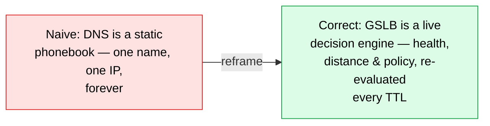
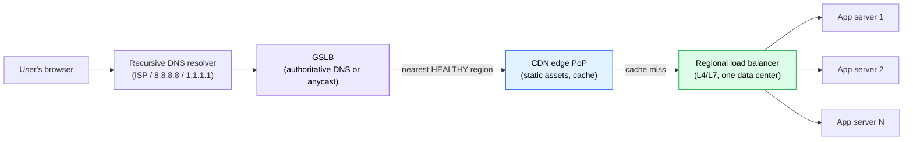
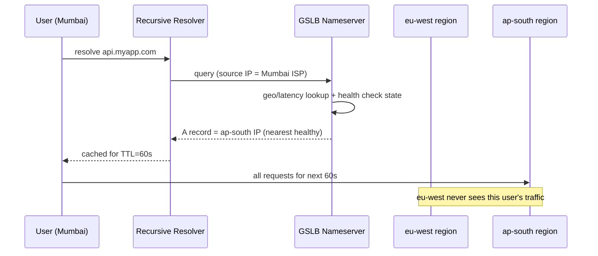
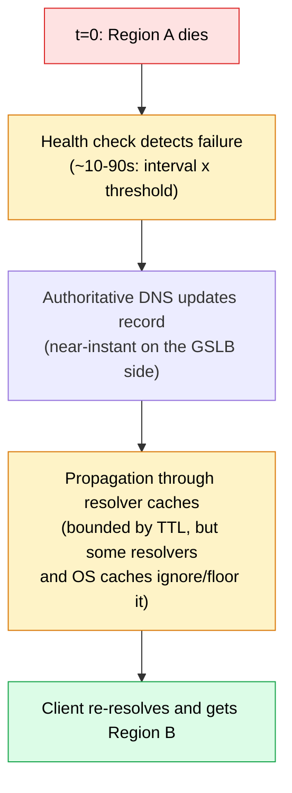
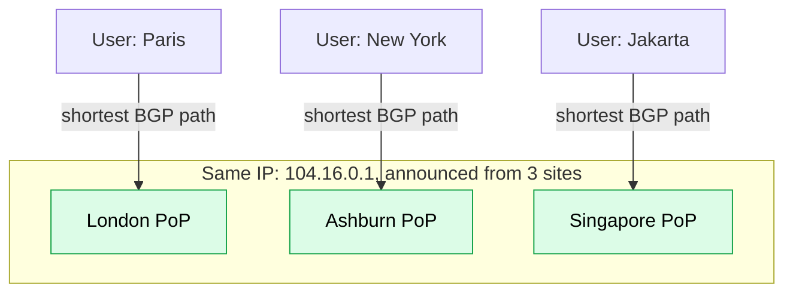
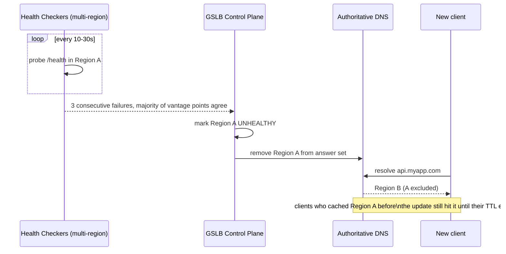
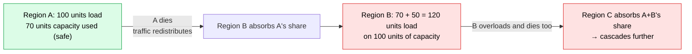
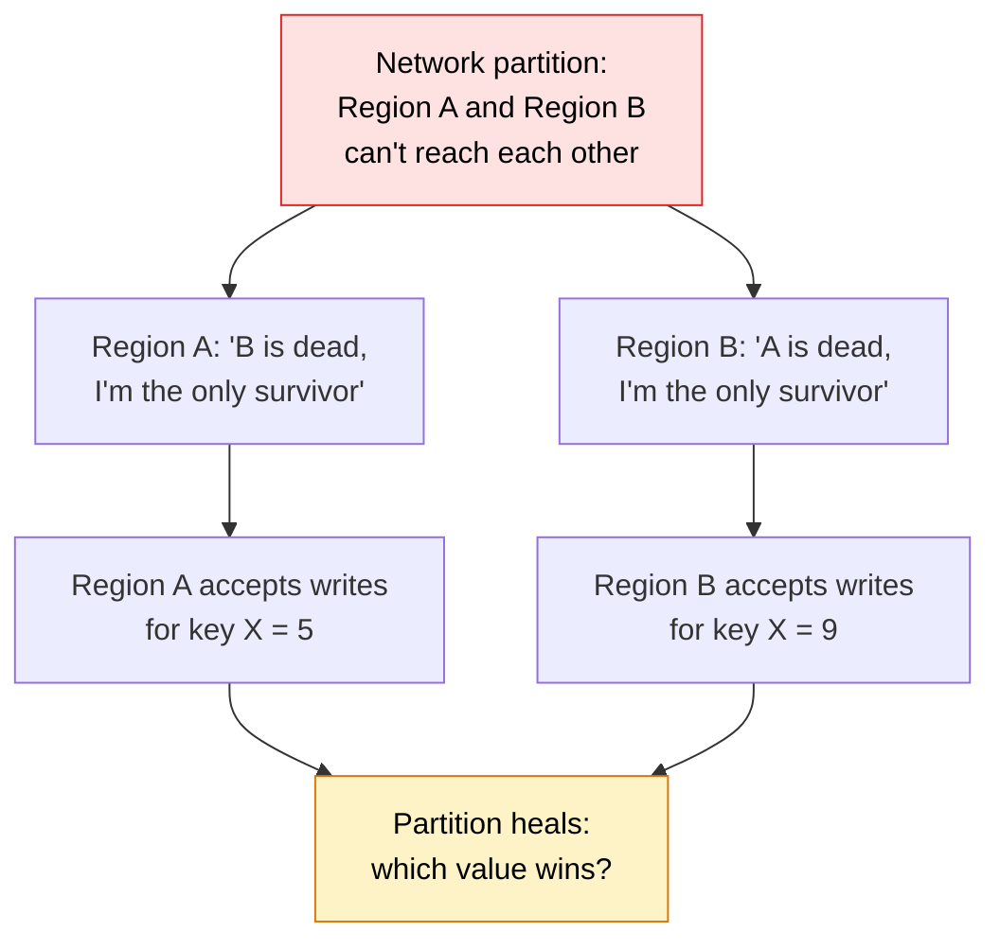
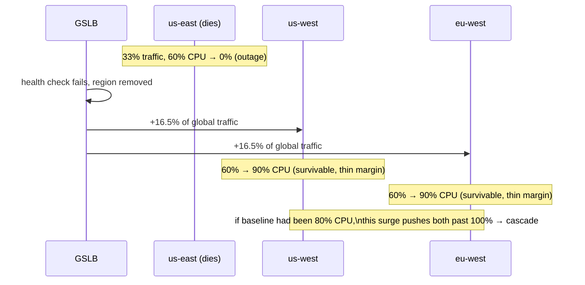
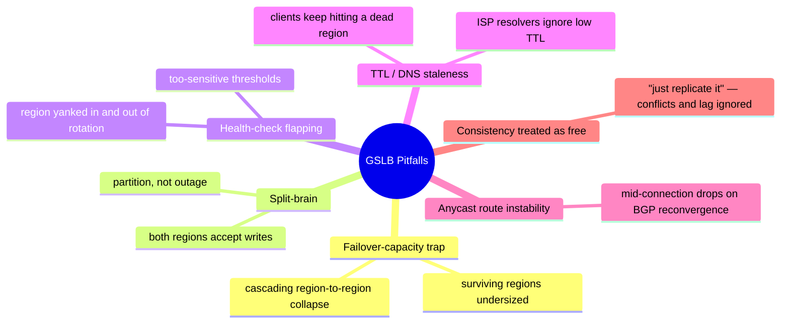

# Global Server Load Balancing (GSLB)

> **One line:** GSLB is a travel agent for the internet — before a request ever reaches a load balancer, GSLB decides *which city* (region/data center) it should go to at all, routing around distance and around dead regions.

---

## Table of Contents
1. [Why You Must Master This](#1-why-you-must-master-this)
2. [The Mental Model](#2-the-mental-model)
3. [Where GSLB Sits — the Last Hop of the Edge Chain](#3-where-gslb-sits--the-last-hop-of-the-edge-chain)
4. [DNS-Based GSLB — GeoDNS, Latency, Weighted Routing](#4-dns-based-gslb--geodns-latency-weighted-routing)
5. [TTL Trade-offs and DNS Caching Staleness](#5-ttl-trade-offs-and-dns-caching-staleness)
6. [Anycast Routing](#6-anycast-routing)
7. [Health Checks and Automatic Regional Failover](#7-health-checks-and-automatic-regional-failover)
8. [Active-Active vs Active-Passive — and the Failover-Capacity Trap](#8-active-active-vs-active-passive--and-the-failover-capacity-trap)
9. [Split-Brain and Multi-Region Correctness](#9-split-brain-and-multi-region-correctness)
10. [Real Providers](#10-real-providers)
11. [Worked Example — Sizing a 3-Region Failover](#11-worked-example--sizing-a-3-region-failover)
12. [Real-Life Use Cases](#12-real-life-use-cases)
13. [Failure Modes](#13-failure-modes)
14. [🏋️ Practice Drills](#-practice-drills)
15. [🎤 Interview Q&A Bank](#-interview-qa-bank)
16. [🎯 Staff+ Nuances](#-staff-nuances)
17. [Cheat Sheet](#17-cheat-sheet)
18. [Connections & Further Reading](#18-connections--further-reading)

---

## 1. Why You Must Master This

- **It's the difference between "our server crashed" and "our region burned down."** A local [load balancer](../07_Load_Balancing_Scalability/) survives one dead box by routing to another box in the same building. GSLB survives the building itself disappearing — a natural disaster, a cloud provider's regional outage, a fiber cut, a power-grid failure — by routing to a different city or continent entirely. Without it, a single-region outage is a total company outage.
- **It's the physics fix nothing else can give you.** No amount of caching or code optimization beats the speed of light. A user in Mumbai talking to a server in Virginia pays ~200ms of pure round-trip distance tax before a single byte of application logic runs. GSLB routes that user to a nearby region instead — this is the *only* layer in the stack that fixes distance.
- **It's where the "it depends" answer in interviews gets tested for real.** "How do you survive a regional AWS outage?" is a standard staff-level system-design question, and a shallow "just add more servers" answer fails immediately — the interviewer is testing whether you know that failover capacity, DNS TTL, and cross-region data consistency are all separate, hard problems.
- **Getting it wrong turns a partial outage into a total one.** The single most common GSLB mistake — under-provisioning the surviving regions for the failover surge — is exactly how a one-region blip becomes a cascading, multi-region collapse (Section 8). This has taken down real production systems more than once.

> **The core problem it solves:** *getting a request to the nearest **healthy** data center, and getting every other request there too within seconds if that data center stops being healthy.* Standard load balancing distributes work across servers in one location; GSLB distributes work — and, more importantly, distributes *availability* — across locations.

**Prerequisites:** [CDN.md](./CDN.md) (GSLB is the next hop after the edge cache decides it needs the origin), and the load-balancing fundamentals in [07 · Load Balancing & Scalability](../07_Load_Balancing_Scalability/) — GSLB is literally the same load-balancing problem, one layer up, with DNS/anycast instead of a local proxy as the mechanism.

---

## 2. The Mental Model

Standard load balancing and GSLB solve the same problem — "which server should handle this?" — but at different altitudes:

- **A local load balancer is a security guard at one building's entrance.** It knows every floor and every desk inside *that* building and sends you to the least-busy one. It has no idea other buildings exist.
- **GSLB is the travel agent you talk to *before* you even book a flight.** It asks where you are, checks which cities have offices open for business today, and tells you *which city* to fly to — before any local guard ever sees you. If the New York office burns down, the travel agent simply stops booking flights there and sends everyone to London instead.

The naive mental model most engineers start with is "DNS points to a server." The correct model is "DNS (or anycast) points to a *decision engine* that re-evaluates, continuously, which region deserves your traffic right now."



> **Hold onto this:** GSLB doesn't move traffic — it changes the *answer to a question* ("which IP is closest/healthy?") that gets asked continuously. Everything else in this file — TTLs, health checks, failover capacity — is about how fast that answer can change and how much damage a wrong or stale answer can do.

---

## 3. Where GSLB Sits — the Last Hop of the Edge Chain

GSLB is not a substitute for a CDN or a local load balancer — it's the layer that decides *which regional cluster of CDN/LB/servers* gets to answer at all. Picture the full request path for a global product:



> **Read this top to bottom, and note the altitude drop:** GSLB picks the *region* (thousands of km granularity), the CDN picks the *nearest edge cache* (tens-of-km granularity, and only for cacheable content — see [CDN.md](./CDN.md)), and the local load balancer picks the *server* (in-rack granularity, see [07 · Load Balancing & Scalability](../07_Load_Balancing_Scalability/)). Confusing these three in an interview — "just add a load balancer" for a multi-region outage — is the single most common shallow answer.

The key distinguishing fact: a local load balancer sees every request (it's in the data path). GSLB, in its most common form, is **not** in the data path at all — it answers a DNS query *once per TTL window*, and then gets out of the way while millions of requests flow directly to the region it named. That's both its superpower (near-zero overhead once resolved) and its Achilles' heel (Sections 4-5: it can't take back an answer it already gave out).

---

## 4. DNS-Based GSLB — GeoDNS, Latency, Weighted Routing

**What it is:** the overwhelmingly common GSLB mechanism. The authoritative DNS server for `api.myapp.com` doesn't return a fixed IP — it runs a policy engine that inspects the resolver's location and system health, then returns a *different* IP depending on who's asking and what's healthy right now.

**How it actually works, step by step:**
1. A user's OS asks its configured recursive resolver (their ISP, or a public one like 8.8.8.8/1.1.1.1) to resolve `api.myapp.com`.
2. The recursive resolver, lacking a cached answer, walks the DNS hierarchy down to your **authoritative GSLB nameserver**.
3. The GSLB nameserver looks at the *resolver's* source IP (not the end user's — this is a real limitation, see Staff+ Nuances), runs it through a routing policy, and returns one of several regional IPs.
4. The recursive resolver caches that answer for the record's **TTL** and hands it back to the user's OS, which also caches it.
5. Every subsequent request during that TTL window goes straight to the named region — GSLB is out of the loop until the TTL expires and the question gets asked again.

**Routing policies** (the actual decision logic, mix-and-matched in real configs):

| Policy | Decision rule | Real use |
|---|---|---|
| **Geographic (GeoDNS)** | Map resolver IP → country/continent via a geo-IP database, return the region assigned to that geography | Data-residency compliance (EU users must hit EU servers); coarse latency win |
| **Latency-based** | Return the region with the lowest *measured* round-trip time from that resolver's network, using continuously-updated latency tables | AWS Route 53 latency routing; better than geography because geography ≠ network topology (a user in Alaska may route faster to Seattle than Anchorage-nearby infra) |
| **Weighted** | Send X% of traffic to region A, Y% to region B, regardless of location | Canary releases, blue/green migrations, gradually shifting load onto a newly-built region |
| **Failover (primary/secondary)** | 100% to region A while healthy; switch to B only when A's health check fails | Active-passive DR (Section 8) |
| **Anycast** *(not DNS — see Section 6)* | Network layer routes to the topologically nearest instance sharing one IP | Cloudflare, Google, most large CDNs |



> **Takeaway:** DNS-based GSLB routes at the *granularity of a DNS query*, not per-request — one lookup steers potentially millions of requests until the TTL expires. That's efficient, but it's also why TTL is the single most important dial in the whole system (next section).

---

## 5. TTL Trade-offs and DNS Caching Staleness

This is the part every real GSLB incident report mentions, so it deserves its own section.

- **What TTL controls:** how long a resolver — and the user's OS/browser — is *allowed* to keep using an answer before asking again. A 300-second TTL means: if a region dies right now, every client that resolved in the last 5 minutes keeps hammering the dead region for up to 5 more minutes, no matter how fast your health check reacts.
- **The trade-off:**
  - **Low TTL (e.g., 30-60s)** → fast failover (clients re-ask often, so a bad region drops out of rotation quickly) but higher load on your DNS infrastructure and higher latency variance (more DNS round trips overall, and DNS providers may bill per query — Route 53 health-checked failover records typically use 60s or less specifically for this reason).
  - **High TTL (e.g., 24h, the old-web default)** → cheap and fast for repeat visitors (near-zero DNS overhead) but a dead region can keep receiving traffic for hours from anyone who resolved before the outage.
- **Why it's worse than the TTL number suggests — caching you don't control:**
  1. **The OS/browser cache.** Even after the resolver's TTL expires, some OS stub resolvers and browsers apply their own minimum cache floor or simply don't re-check promptly.
  2. **ISP resolvers that ignore TTL.** Some large ISP resolvers historically enforced a *minimum* TTL floor (e.g., "never less than 300s") to cut their own query volume, silently overriding your low-TTL intent — a documented, real-world "TTL violation" that GSLB operators cannot fix from their side.
  3. **Sticky client behavior.** Long-lived connections (WebSockets, gRPC streams, mobile app background sessions) that resolved once and hold the connection open don't re-resolve DNS at all until they reconnect — TTL is irrelevant to an already-open socket.
- **The consequence for design:** total failover time is not "health-check detection time" — it's **detection time + DNS propagation to authoritative + TTL expiry across every downstream cache you don't control + any already-open connections that won't drop on their own.** For a service with strict RTO (recovery time objective), this is why many teams pair DNS GSLB with **anycast** (Section 6) or an **L7 global proxy** that can redirect already-open connections, rather than relying on DNS alone.



> **Takeaway:** the fast part of failover (detecting the outage) is rarely the bottleneck — the *cached answers you already handed out* are. Set TTL as low as your DNS query budget allows for anything with a real RTO, and never assume "TTL=60s" means every client is back to normal in 60 seconds.

---

## 6. Anycast Routing

**What it is:** a network-layer trick where the *exact same IP address* is announced via BGP from multiple physical locations simultaneously. The internet's core routers, using standard shortest-path routing, naturally deliver each packet to whichever announcing location is topologically nearest to the sender — no DNS decision, no application-layer logic, just routing.

**How it actually works:**
1. Your provider (Cloudflare, Google, a large CDN) announces, say, `104.16.0.1/24` from data centers in London, Ashburn, and Singapore, all at once, via BGP.
2. Internet backbone routers see multiple paths to that IP block and pick the one with the best BGP metrics (usually fewest hops / shortest AS path), which correlates strongly — not perfectly — with physical proximity.
3. A user in Paris sends a packet to `104.16.0.1`; backbone routing delivers it to London. A user in Jakarta sending to the *identical* IP gets delivered to Singapore. Neither user's DNS resolution changed at all — the same IP was returned everywhere.
4. If the London location goes dark, it simply **withdraws its BGP route announcement**. Routers worldwide recompute paths and start sending Parisian traffic to the next-nearest location (say, Ashburn) — automatically, at the routing layer.

**Anycast vs DNS-based GSLB — the real comparison:**

| Dimension | DNS-based GSLB | Anycast |
|---|---|---|
| **Failover speed** | Bounded by health-check time + TTL + resolver caching (Section 5) — seconds to minutes | Bounded by BGP convergence — often sub-second to a few seconds, no TTL/client-cache problem at all |
| **Granularity** | Per DNS query (millions of requests per lookup) | Per packet, continuously re-evaluated by routers |
| **In-flight connections** | Unaffected mid-connection (only new lookups reroute) | **Can break active TCP connections** — if BGP routes shift mid-session, packets can start arriving at a *different* physical node with no session state, killing the connection |
| **Control** | Full application-layer control (geography, weights, custom policy) | Coarse — you get "nearest by BGP metric," not "nearest by measured latency" or "compliant with data residency" |
| **Setup cost** | Cheap — any DNS provider with GSLB features | Expensive — you need your own IP block and BGP peering, or a provider (Cloudflare, AWS Global Accelerator) that does it for you |
| **Real users** | Route 53 latency/geo/failover routing, Azure Traffic Manager | Cloudflare (every domain on Cloudflare is anycast by default), Google Cloud (all Google IPs), AWS Global Accelerator, most Tier-1 CDNs |



> **Takeaway:** anycast fails over at the *speed of internet routing*, not the speed of DNS — which is why it's the mechanism behind the internet's biggest DDoS-resilient services (Cloudflare, Google's 8.8.8.8). The price is losing fine-grained application control and risking mid-connection disruption on route changes. Most large-scale systems layer them: anycast to get packets to the nearest *edge*, DNS-based GSLB or an L7 global proxy for finer regional/compliance decisions behind it.

---

## 7. Health Checks and Automatic Regional Failover

GSLB is only as good as its opinion of "healthy." The mechanics echo — but operate one altitude above — the [Health Checks & Failover](../07_Load_Balancing_Scalability/Health_Checks_Failover.md) a local load balancer runs on individual servers:

- **What's checked:** not "is the server up" but "is the *region* up" — synthetic HTTP checks against a `/health` endpoint that itself verifies the region's database, cache, and message queue are reachable, run from **multiple geographically distributed vantage points** (Route 53 health checkers run from ~15 global locations, for example) so a single network blip near one checker doesn't falsely condemn a healthy region.
- **Thresholds that matter:**
  - **Interval** — how often each vantage point checks (commonly every 10-30s).
  - **Failure threshold** — consecutive failures before marking unhealthy (commonly 3), trading false-positive risk (too low → flapping) against detection speed (too high → slow failover).
  - **Consensus** — most providers require a *majority* of vantage points to agree a region is down before acting, specifically to avoid one checker's local network issue triggering a global failover for a region that's actually fine.
- **What happens on failure:** the GSLB policy engine removes the unhealthy region's IP from the answer set (DNS) or the routing table (anycast/L7 proxy). Existing DNS answers already cached downstream are unaffected until they expire (Section 5) — health checks fix the *source of truth*, not the copies already handed out.



> **Takeaway:** the failover *decision* is usually fast (tens of seconds); the failover *completion* across every client is bounded by Section 5's TTL/caching chain — design your RTO around the slower number, not the faster one.

---

## 8. Active-Active vs Active-Passive — and the Failover-Capacity Trap

Both patterns exist at global scale exactly as they do at the single-cluster level in [High Availability: Active-Active vs Active-Passive](../07_Load_Balancing_Scalability/High_Availability_Active_Active_vs_Active_Passive.md) — GSLB is simply the mechanism that implements the choice across regions instead of across servers in one rack.

- **Active-passive (hot standby):** one region takes 100% of traffic; one or more standby regions sit idle, continuously replicating data, ready to take over. Simpler consistency (single writer), but you're paying for idle standby capacity and the standby needs to be *warm* (replicated, deployed, tested) or failover just moves the outage.
- **Active-active:** every region takes live traffic simultaneously, split by GSLB policy (geographic/latency/weighted). Full utilization of every region's capacity, and failover is just "stop sending this slice here" — but now every region must be able to accept writes (or you've quietly built active-passive for writes and active-active for reads only), which is a genuine [multi-master consistency](../05_Databases_Storage/Replication.md) problem (Section 9).

### The failover-capacity trap (read this twice — it is the most commonly missed part of GSLB design)

GSLB will happily and correctly redirect 100% of a dead region's traffic to the survivors **the instant it detects the failure** — but redirecting the traffic doesn't create the capacity to serve it. If the survivors were sized only for their own normal load, the sudden surge itself can push them past their limit.



- **Why it cascades:** a region running at, say, 70% utilization looks perfectly healthy right up until the moment it inherits another region's traffic. If two regions were each running at 70% and one dies, the survivor doesn't need "a bit more" — it may need to instantly jump to **~140% of its own baseline** (if the two regions were carrying equal load and now one carries both). Anything short of ~50% spare headroom on every surviving region means the failover *itself* becomes the outage — and if it does, GSLB will just as correctly redirect the failing survivor's traffic to the *next* region, propagating the collapse.
- **The fix is capacity planning, not GSLB configuration:** every active region must be provisioned to absorb its fair share of *any single other region's* traffic (N-active systems: size for 1/(N-1) extra load per remaining region at minimum; more conservatively, size so the busiest remaining region can absorb the largest peer's failure alone). This is the same headroom discipline as [Auto-scaling](../07_Load_Balancing_Scalability/Auto_scaling_Horizontal_vs_Vertical.md), but the trigger is a whole region disappearing, not a gradual traffic ramp — so *reactive* auto-scaling (spin up more capacity after load rises) is usually too slow; the headroom needs to already exist or scale predictively ahead of the failover, not after it.

> **Takeaway:** GSLB routing is instant; capacity is not. A region that "took over" a dead peer's traffic and then died itself isn't a GSLB bug — it's a capacity-planning failure that GSLB faithfully executed. Always ask "what happens to the survivors' utilization number" before trusting a failover diagram.


> **One-line takeaway:** Failover concentrates 100% of the dead region's traffic onto the surviving region(s) instantly — if the survivor wasn't provisioned with headroom for that surge, the "healthy" region cascades into failure too.

---

## 9. Split-Brain and Multi-Region Correctness

Moving traffic across regions is the easy 20%; keeping the *data* correct across regions is the hard 80%, and GSLB does not solve it — it just decides where requests land while the harder problem happens underneath.

- **Split-brain:** occurs when a network partition — not an actual regional failure — makes two regions *each* believe they are the sole survivor and should accept writes independently. Health checks from multiple vantage points reduce this risk (a true partition rarely isolates every external vantage point identically) but don't eliminate it; a partitioned region can still be fully up and serving its local users while unable to reach its replication peer. The result: two regions independently accept conflicting writes to the "same" record, and by the time the partition heals, the data has diverged in ways that can't always be automatically reconciled.
- **Why multi-region correctness is a [CAP theorem](../05_Databases_Storage/CAP_Theorem.md) problem, not a GSLB feature:** routing a write to the "nearest region" is trivial; making sure that write is visible, non-conflicting, and durable relative to writes landing in *other* regions at the *same time* is the actual hard problem. Every active-active multi-region system is making an explicit or implicit choice on the CAP/[PACELC](../05_Databases_Storage/PACELC_Theorem.md) spectrum:
  - **Strong consistency across regions** (synchronous cross-region replication/consensus) — correct, but adds real cross-continent round-trip latency to every write (100-200ms+ for transcontinental round trips) and reduces availability during a partition (the system must refuse writes rather than risk divergence).
  - **Eventual consistency** (asynchronous replication) — fast local writes everywhere, but a genuine window where regions disagree, and a conflict-resolution strategy (last-write-wins, CRDTs, application-level merge) is mandatory, not optional, the moment you allow concurrent writes to the same key in two regions. See [Consistency_Models.md](../05_Databases_Storage/Consistency_Models.md) and [Replication.md](../05_Databases_Storage/Replication.md) for the mechanisms.
  - **Single-writer / active-passive for data** even when active-active for reads — the pragmatic middle ground most real systems land on: reads are served from the nearest region (fast, safe), writes are funneled to one region or partitioned by owner (e.g., "this user's writes always go to their home region"), sidestepping true multi-master conflict resolution at the cost of higher write latency for users far from the write region.
- **The interview-ready framing:** "GSLB decides where a request goes; it does not decide what happens when two regions both think they should answer it. That's a replication and consistency design, and it's the part people forget to budget for when they say 'let's go multi-region.'"



> **Takeaway:** "multi-region" is not a checkbox you get from GSLB — it's a data-consistency architecture decision that GSLB's routing layer sits on top of. Never present a GSLB failover diagram in an interview without being ready to answer "and what happens to the data."

---

## 10. Real Providers

| Provider | GSLB mechanism | Notable feature |
|---|---|---|
| **AWS Route 53** | DNS-based: latency, geolocation, weighted, and failover routing policies, backed by health checks from ~15 global vantage points | Deep integration with [Auto Scaling groups](../07_Load_Balancing_Scalability/Auto_scaling_Horizontal_vs_Vertical.md) and ALB health; the default choice for AWS-centric multi-region designs |
| **Cloudflare Load Balancing** | Anycast by default for all traffic (every Cloudflare-proxied domain), plus DNS-based steering (geo, latency, weighted, random) on top for origin selection | Anycast means DDoS absorption and sub-second failover are baked in, not bolted on |
| **Akamai Global Traffic Management (GTM)** | DNS-based, one of the original commercial GSLB products; geographic, load-feedback, and performance-based routing | Mature, carrier-grade; strong in enterprise/media (large video and e-commerce deployments) |
| **Azure Traffic Manager** | DNS-based: priority (failover), weighted, performance (latency), geographic, and multi-value routing methods | Pairs with Azure Front Door (an anycast/edge layer) for the same two-tier pattern as AWS/Cloudflare |
| **AWS Global Accelerator / Google Cloud's network** | Anycast at the network layer, in front of regional load balancers | Used when TCP-level failover speed matters more than DNS-layer routing intelligence |

> **The pattern across every major provider:** DNS-based GSLB for policy-rich, compliance-aware routing; anycast for raw speed and DDoS resilience; and increasingly, both stacked — anycast gets the packet to the nearest edge network, DNS-based GSLB or an L7 global proxy makes the finer regional call behind it.

---

## 11. Worked Example — Sizing a 3-Region Failover

**The prompt:** "We run active-active across `us-east`, `us-west`, and `eu-west`, each currently at 60% CPU utilization under normal load, split roughly evenly by GSLB latency routing. `us-east` suffers a total regional outage. What happens, and how should we have provisioned?"

**The arithmetic:**
- Assume each region normally serves ~33% of global traffic, and "60% CPU utilization" scales roughly linearly with traffic share for this workload.
- `us-east` dies. GSLB health checks (Section 7) detect it in under a minute and remove it from the DNS/anycast answer set. Its ~33% of traffic must now go *somewhere* — GSLB will typically split it toward the next-nearest healthy regions, so `us-west` and `eu-west` each absorb roughly half of the orphaned share: +16.5 percentage points of *traffic share* each.
- In utilization terms: each surviving region was handling 33% of traffic at 60% CPU. Absorbing an extra 16.5% of *total* traffic is a 50% increase in *that region's own* load (16.5 / 33 = 0.5). 60% CPU × 1.5 = **90% CPU** — survivable, but with almost no headroom left for normal variance, let alone a second failure.
- **Now suppose they'd been running at 80% utilization instead** (a common cost-driven choice — "why pay for idle capacity?"). The same +50% surge pushes them to **120% CPU** — i.e., overloaded, latency spikes, health checks on the *survivors* start failing too, and GSLB dutifully starts routing their traffic away as well. This is Section 8's cascade, with real numbers attached.



**The consequence — the actual design rule this produces:** for an N-region active-active system where any single region can fail, every region's *normal* utilization ceiling should be set so that `utilization × (N-1)/(N-2)` stays safely under 100% (here, 60% × 3/1... more simply: with 3 regions, losing one means the remaining 2 absorb what 3 were sharing, a 1.5× multiplier — so cap steady-state utilization at roughly 100%/1.5 ≈ 65-70% to survive one region's total loss with headroom to spare). The number to defend in an interview isn't "we have 3 regions" — it's "we keep every region under X% specifically so a peer's total failure doesn't cascade," with the arithmetic to back up X.

---

## 12. Real-Life Use Cases

| Situation | How GSLB applies | The decision it forces |
|-----------|------------------|-------------------------|
| **Global SaaS product, users on every continent** | Latency-based DNS routing (Route 53/Azure Traffic Manager) sends each user to their nearest healthy region | Accept eventual consistency for cross-region data, or funnel writes to one region per user |
| **Regulatory data residency (GDPR, data localization laws)** | Geographic/GeoDNS routing pins EU users to EU-only infrastructure regardless of latency | Sometimes route a user to a *slower* region because compliance outranks speed |
| **Disaster recovery for a single-region app** | Active-passive failover routing; standby region stays warm via replication | Budget for a fully-replicated, idle standby — the "insurance policy" cost |
| **Large-scale DDoS exposure (gaming, media, fintech)** | Anycast (Cloudflare/Akamai/AWS Global Accelerator) absorbs attack traffic across hundreds of PoPs instead of one origin | Trade fine-grained routing control for network-layer resilience |
| **Canary / blue-green migration to a new region** | Weighted DNS routing shifts traffic 1% → 10% → 50% → 100% | Roll back by flipping a weight, not redeploying, if the new region misbehaves |
| **Black Friday / Prime Day traffic surge** | Health-check-driven load feedback spreads new traffic to whichever region has the most headroom | Provision every region's headroom *before* the event — GSLB reacts, it doesn't create capacity |

> **The habit:** before drawing a GSLB diagram, ask "what's the RTO, what's the data-consistency model, and what's the survivor headroom?" — the routing arrows are the easy part.

---

## 13. Failure Modes



- **The failover-capacity trap.** *Symptom:* one region fails, and within minutes the "survivors" are also unhealthy. *Root cause:* surviving regions were sized for normal load, not for absorbing a peer's traffic (Section 8, Section 11's arithmetic). *Fix:* provision headroom so any single region's total traffic can be absorbed by the remaining regions without exceeding a safe utilization ceiling; validate this with actual regional failure drills (chaos engineering), not spreadsheets alone.
- **Split-brain.** *Symptom:* data diverges between two regions after a network event; reconciling it after the fact requires manual conflict resolution. *Root cause:* a partition, not a true outage, made both regions believe they were the sole survivor and accept independent writes. *Fix:* require quorum/majority agreement (from multiple independent health-check vantage points, or a consensus protocol) before treating a region as dead enough to promote a new writer; prefer designs where only one region can accept writes for a given key at a time.
- **Health-check flapping.** *Symptom:* a region is repeatedly marked healthy, then unhealthy, then healthy again within minutes, causing repeated traffic churn. *Root cause:* thresholds too sensitive (low failure count, short interval) reacting to transient blips rather than real degradation. *Fix:* require multiple consecutive failures from a majority of distributed vantage points before flipping state; add hysteresis (require a longer streak of *successes* before re-admitting a region than the streak of failures that removed it).
- **TTL / DNS staleness.** *Symptom:* a meaningful fraction of users keep hitting a region minutes (or longer) after it was marked unhealthy and removed from DNS. *Root cause:* resolver, OS, or browser caches held the old answer past the nominal TTL (some ISP resolvers enforce a TTL floor); long-lived connections don't re-resolve at all. *Fix:* set TTL as low as your query budget allows for anything with a real RTO; for the tightest requirements, layer anycast or an L7 global proxy underneath DNS so failover doesn't depend solely on caches you don't control.
- **Anycast route instability.** *Symptom:* long-lived connections (video streams, WebSockets) drop unexpectedly even though no region actually failed. *Root cause:* BGP route reconvergence (a peering change, a route flap upstream) shifted which PoP receives a given source's packets mid-session, and the new PoP has no session state. *Fix:* accept this as an inherent anycast trade-off; use application-layer reconnection logic, or avoid anycast for extremely long-lived stateful connections in favor of DNS-based routing with sticky, longer-lived answers.
- **Treating multi-region consistency as free.** *Symptom:* "we went multi-region" ships, and weeks later support tickets show users seeing stale or contradictory data across regions. *Root cause:* GSLB routing was implemented without deciding a replication/consistency model (Section 9) — the team solved "where does the request go" and quietly skipped "what happens to the data." *Fix:* pick and document a consistency model (strong cross-region consensus, eventual with conflict resolution, or single-writer-per-key) *before* enabling active-active writes, not after the first data-divergence incident.

---

## 🏋️ Practice Drills

> *Cover the solutions and attempt first — active recall is the point.*

**Drill 1 — Failover time budget.** Your DNS TTL is 300s, your health check needs 3 consecutive failures at a 30s interval to mark a region unhealthy, and 5% of your traffic comes through an ISP resolver known to floor TTLs at 600s. What's your realistic worst-case failover time for that 5% of users, and what would you change?

<details><summary>Solution</summary>

Detection time: 3 failures × 30s interval ≈ 90s (plus the time for the *next* scheduled check after the failure starts, so realistically up to ~120s). DNS record update after detection is near-instant on the GSLB side.

For the 95% of users on TTL-respecting resolvers: worst case ≈ 120s (detection) + up to 300s (TTL) ≈ up to 7 minutes for the unluckiest client who just refreshed their cache right before the outage.

For the 5% behind the TTL-flooring resolver: worst case ≈ 120s (detection) + up to 600s (floored TTL) ≈ up to 12 minutes, regardless of what your DNS record says.

What to change: you can't fix the ISP's floor from your side, so for that risk you'd either (a) lower the "official" TTL further so even a floored resolver's absolute cache time drops, (b) put an anycast or L7 global-proxy layer in front so failover doesn't depend on DNS caching at all, or (c) accept the risk if it's a small enough user segment and the RTO tolerance allows it — but you must *state* the number rather than assume "TTL=300s" is the real answer for everyone.
</details>

**Drill 2 — Size the survivors.** You run active-active across 4 equally-sized regions, each normally at 55% CPU utilization. One region suffers a total outage and GSLB redistributes its traffic evenly across the other 3. What's each survivor's new utilization, and is it safe?

<details><summary>Solution</summary>

4 regions share load equally: each carries 25% of total traffic at 55% CPU. One dies; its 25% share splits evenly across the remaining 3, so each survivor gains +8.33 percentage points of *total* traffic — an increase of 8.33/25 = 33% relative to its own prior load.

New utilization: 55% × 1.33 ≈ **73% CPU**. That's safe — comfortable headroom remains even after absorbing a full region's failure, which is the point of running 4 (vs. 3 or 2) regions at a moderate baseline: more regions means each survivor absorbs a *smaller* relative share of the failed region's load.
</details>

**Drill 3 — Design a small thing: multi-region write strategy.** You're building a global to-do-list app, active-active across 3 regions for reads. Users occasionally edit the same list from two different regions within seconds (e.g., a shared family list). Propose a write strategy and justify the consistency trade-off.

<details><summary>Solution</summary>

Option chosen: **partition writes by list owner ("home region")** — every list has one designated home region (e.g., wherever it was created), and all writes for that list are forwarded to the home region regardless of which region the request landed in; reads are served locally from a replica everywhere.

Why: this sidesteps true multi-master conflict resolution (Section 9) — there's only ever one writer for a given list, so no split-brain divergence is possible for that list's data, at the cost of extra write latency for users far from the list's home region (acceptable for a to-do app, where writes are infrequent and not latency-critical the way reads are). The alternative — true multi-master with CRDTs or last-write-wins — would remove the extra write latency but require building (and testing) real conflict resolution, which is a much larger investment better justified by higher write concurrency than a to-do list actually has.
</details>

**Drill 4 — Recall: DNS vs anycast.** Name two things anycast does better than DNS-based GSLB, and two things DNS-based GSLB does better than anycast.

<details><summary>Solution</summary>

Anycast wins on: **(1) failover speed** — bounded by BGP convergence (often sub-second to a few seconds) rather than TTL/cache propagation; **(2) DDoS resilience** — attack traffic is naturally spread across every announcing PoP by the network itself, rather than concentrated on one region's DNS-resolved IP.

DNS-based GSLB wins on: **(1) routing granularity and policy control** — geographic/compliance routing, weighted canary rollout, and explicit failover priority are straightforward; anycast only gives you "nearest by BGP metric." **(2) connection stability** — DNS resolution doesn't change mid-connection, so a long-lived session is never disrupted by a routing change the way an anycast BGP reconvergence can disrupt one.
</details>

---

## 🎤 Interview Q&A Bank

**Q1. What is GSLB and how is it different from a regular load balancer?**
> A regular (local) load balancer distributes requests across servers within one data center/cluster; GSLB distributes traffic across entire *regions/data centers*, typically via DNS responses or anycast routing rather than sitting in the request path. It's the mechanism that lets you survive a whole region going down, not just one server.

**Q2. Walk me through what happens, end to end, when a region fails.** *(signal: whether the candidate understands failover is a multi-stage pipeline, not an instant flip)*
> Health checks from multiple geographic vantage points detect consecutive failures (tens of seconds, with a majority-agreement rule to avoid false positives from one checker's local issue). The GSLB control plane then updates the authoritative DNS answer set or withdraws an anycast BGP route. From there, propagation depends on the mechanism: anycast reconverges at internet-routing speed (seconds); DNS-based failover is bounded by TTL and by resolver/OS caches that may not respect that TTL exactly. Meanwhile, the surviving regions must absorb the dead region's traffic — which only works if they were provisioned with enough headroom; otherwise the failover itself cascades.

**Q3. What's the failover-capacity trap, and how do you avoid it?**
> If surviving regions are only sized for their own normal load, the sudden influx of a dead region's traffic can push them past capacity too, causing them to fail and cascade the outage further. The fix is provisioning: every region's steady-state utilization ceiling should be set low enough that absorbing one peer's total failure (traffic divided among the remaining N-1 regions) doesn't push it past a safe threshold — and this needs to be validated with real failure drills, not just assumed.

**Q4. DNS-based GSLB vs anycast — when would you choose each?**
> DNS-based GSLB (Route 53, Azure Traffic Manager) gives fine-grained policy control — geographic/compliance routing, weighted rollouts, explicit priority — at the cost of failover speed being bounded by TTL and client-side caching you don't fully control. Anycast (Cloudflare, Google, AWS Global Accelerator) fails over at BGP-convergence speed and naturally spreads DDoS load, but gives up granular routing control and can disrupt long-lived connections when routes shift mid-session. Most large systems layer both: anycast to reach the nearest edge network, DNS/L7 policy behind it for the finer decision.

**Q5. Why is "TTL=60 seconds" not the same as "failover completes in 60 seconds"?**
> TTL only bounds how long a *compliant* resolver holds a cached answer. Real failover time also includes health-check detection time before the DNS record even changes, and — critically — some resolvers and OS/browser caches don't strictly respect low TTLs (some ISP resolvers enforce a floor), and any already-open long-lived connection (WebSocket, streaming session) won't re-resolve at all until it reconnects. The honest failover time is detection + propagation + "however long the slowest cache in the chain decides to hold on."

**Q6. What is split-brain in a GSLB context, and how do you prevent it?**
> It's when a network partition — not an actual regional outage — causes two regions to each believe they're the sole survivor and independently accept writes, leading to diverged data once the partition heals. Prevention: require a majority/quorum of independent health-check vantage points to agree a region is unreachable before treating it as dead (a partition rarely looks identical from every external vantage point), and prefer architectures where a given piece of data only has one legitimate writer at a time even in an active-active read topology.

**Q7. "We want multi-region active-active for our database." What do you push back on?**
> That GSLB and routing are the easy part — the hard part is that active-active writes across regions is a [CAP theorem](../05_Databases_Storage/CAP_Theorem.md) trade-off, not a load-balancing feature. You need to decide, explicitly: synchronous cross-region consensus (correct but adds real cross-continent write latency and reduces availability during partitions), asynchronous replication with a conflict-resolution strategy (fast, but a real window of divergence), or single-writer-per-key with active-active *reads* only (the common pragmatic middle ground). Whichever you pick has to be decided and documented before flipping on multi-region writes, not discovered from an incident.

**Q8. How would you explain GSLB to a non-technical stakeholder asking "how do we survive AWS us-east-1 going down"?**
> GSLB is the system that watches every region's health and, the moment one looks unhealthy, stops sending new users there and sends them to a healthy region instead — like a travel agent redirecting flights away from a city whose airport just closed. The caveat to add immediately: this only works cleanly if (a) the other regions have spare capacity to absorb the extra passengers, and (b) the data those passengers need is actually available and correct in the new city too — which is a separate, harder investment than the routing itself.

---

## 🎯 Staff+ Nuances

- **GSLB sees the resolver, not the user — and that gap is a real source of misrouting.** DNS-based GSLB decisions are made against the *recursive resolver's* source IP, not the end user's. Most of the time this is fine (users mostly use geographically-local resolvers), but public DNS services (8.8.8.8, 1.1.1.1) can be topologically distant from the actual user, occasionally routing someone in Brazil to a US resolver's nearest region rather than a South American one. The [EDNS Client Subnet (ECS)](https://datatracker.ietf.org/doc/html/rfc7871) extension partially fixes this by letting resolvers forward a truncated client subnet to the authoritative server — worth naming if asked why GeoDNS sometimes routes "wrong."
- **"Sizing for the surge" is an N-choose-(N-1) problem, and the math gets favorable with more regions, not less.** With 2 regions, losing one means the survivor takes 100% more load (a 2x multiplier) — brutal. With 3 regions, a survivor absorbs roughly 50% more. With 5 regions sharing failures evenly, it's closer to 25% more. This is a real argument for *more, smaller* active regions over *fewer, larger* ones when failover headroom is the dominant cost driver — the opposite of the naive "consolidate for efficiency" instinct.
- **Reactive auto-scaling is usually too slow to save you from a regional failover surge.** [Auto-scaling](../07_Load_Balancing_Scalability/Auto_scaling_Horizontal_vs_Vertical.md) that spins up new capacity *after* CPU/latency crosses a threshold reacts in minutes; a GSLB failover redirects traffic in seconds. The headroom that absorbs the first few minutes of a regional failure has to already exist — pre-provisioned, not reactively scaled — or the survivors fail before new capacity ever comes online.
- **Anycast + stateful long-lived connections is a genuinely unsolved trade-off, not an oversight.** BGP route reconvergence has no concept of "please don't move this specific in-flight TCP connection." Large anycast operators mitigate this with very stable, over-provisioned routing policies and by keeping session state recoverable at the application layer (reconnect-and-resume), but there's no version of anycast that guarantees session continuity through a route change the way DNS-based routing does for already-open connections.
- **Multi-region correctness is where most "we're multi-region now" projects quietly under-deliver.** Teams routinely solve the routing problem (GSLB config) thoroughly and treat data replication as an afterthought ("we'll just turn on cross-region replication"). The honest staff-level answer names the specific consistency model chosen — and its latency/availability cost — rather than gesturing at "eventual consistency" as if it were a free upgrade. See [Consistency_Models.md](../05_Databases_Storage/Consistency_Models.md) and [PACELC_Theorem.md](../05_Databases_Storage/PACELC_Theorem.md) for the actual menu of choices.
- **Health-check consensus design is a smaller-scale version of distributed consensus, and it's worth naming that connection.** Requiring a majority of independently-located health checkers to agree before declaring a region dead is functionally a mini quorum system — the same principle behind [Distributed_Transactions.md](../05_Databases_Storage/Distributed_Transactions.md) and leader election in consensus protocols, just applied to "is this region alive" instead of "did this write commit."
- **Real incidents worth knowing by name:** the 2016 Dyn DNS DDoS attack took down authoritative DNS for a large swath of major sites (Twitter, Netflix, Reddit) simultaneously — a reminder that GSLB built entirely on a single DNS provider has a single point of failure at the DNS layer itself, which is why large operators run multiple authoritative DNS providers in parallel. It's a strong answer to "what could still go wrong even with perfect regional GSLB?"

---

## 17. Cheat Sheet

```
GSLB — THE LAST HOP OF THE EDGE CHAIN (region-level routing, above CDN, above local LB)
═══════════════════════════════════════════════════════════════════════════════════════

MECHANISMS
  DNS-based (Route 53, Azure Traffic Manager, Akamai GTM)
    policies: geographic · latency-based · weighted · failover (priority)
    granularity: per DNS query — one lookup steers traffic until TTL expires
    failover speed = health-check detection + DNS propagation + TTL + caches you don't control
  Anycast (Cloudflare default, Google, AWS Global Accelerator)
    same IP announced via BGP from many sites; routers deliver to the nearest by BGP metric
    failover speed = BGP convergence (sub-second to seconds) — NOT bounded by TTL
    risk: mid-connection drops if routes shift under a live long-lived session

TTL TRADE-OFF
  low TTL  → fast failover, more DNS query volume/cost
  high TTL → cheap, slow failover; some ISP resolvers FLOOR TTL regardless of your setting
  real failover time = detection + propagation + slowest cache in the chain, NOT just "TTL seconds"

HEALTH CHECKS
  active HTTP checks (not just TCP) from MULTIPLE geo-distributed vantage points
  require majority/quorum agreement before declaring a region dead → avoids false failover
  hysteresis: harder to re-admit (more successes needed) than to remove (fewer failures needed)

ACTIVE-ACTIVE vs ACTIVE-PASSIVE (global)
  active-passive: simple consistency (1 writer), wastes standby capacity, needs a WARM standby
  active-active:  full utilization, instant failover, but writes = a real multi-master problem

THE FAILOVER-CAPACITY TRAP (memorize the multiplier)
  N regions, 1 dies, survivors split its load evenly → each absorbs 1/(N-1) MORE of its own load
    N=2 → +100% load on the 1 survivor
    N=3 → +50% load on each of 2 survivors
    N=5 → +25% load on each of 4 survivors
  → cap steady-state utilization so utilization × [N/(N-1)] stays safely < 100%
  → reactive auto-scaling is too slow; headroom must be PRE-PROVISIONED

SPLIT-BRAIN
  partition (not real outage) → both regions think they're sole survivor → both accept writes → diverge
  fix: quorum/majority health-check agreement; single-writer-per-key even in active-active reads

MULTI-REGION CORRECTNESS = A CAP/PACELC PROBLEM, NEVER FREE
  strong cross-region consistency → correct, adds 100-200ms+ cross-continent write latency, less available during partition
  eventual consistency → fast everywhere, real divergence window, conflict resolution MANDATORY
  single-writer-per-key → pragmatic default: active-active reads, funneled writes, no true multi-master needed

REAL PROVIDERS
  Route 53 (AWS) · Cloudflare LB (anycast-by-default) · Akamai GTM · Azure Traffic Manager · AWS Global Accelerator

DO                                          DON'T
  size survivors for a PEER's full failure    assume TTL=X means failover completes in X seconds
  require quorum before declaring dead        trust a single health checker's opinion
  pick & document the consistency model       call replication "just turn it on"
  drill real regional failovers                assume the diagram's arrows are the whole design
```

---

## 18. Connections & Further Reading

**Prerequisites (learn first):**
- [CDN.md](./CDN.md) — the edge caching layer GSLB sits behind; GSLB decides which region's CDN/origin cluster gets to answer at all.
- [07 · Load Balancing & Scalability](../07_Load_Balancing_Scalability/) — GSLB is the same load-balancing problem one altitude up; read [Health_Checks_Failover.md](../07_Load_Balancing_Scalability/Health_Checks_Failover.md) and [High_Availability_Active_Active_vs_Active_Passive.md](../07_Load_Balancing_Scalability/High_Availability_Active_Active_vs_Active_Passive.md) first — this file assumes those mechanics and scales them to region granularity.

**Builds toward / pairs with:**
- [07 · Load Balancing & Scalability](../07_Load_Balancing_Scalability/) — specifically [Auto_scaling_Horizontal_vs_Vertical.md](../07_Load_Balancing_Scalability/Auto_scaling_Horizontal_vs_Vertical.md) (the headroom the failover-capacity trap depends on) and [Consistent_Hashing.md](../07_Load_Balancing_Scalability/Consistent_Hashing.md) (routing stability under membership change, the same concern one layer down).
- [05 · Databases & Storage](../05_Databases_Storage/) — [CAP_Theorem.md](../05_Databases_Storage/CAP_Theorem.md), [PACELC_Theorem.md](../05_Databases_Storage/PACELC_Theorem.md), [Consistency_Models.md](../05_Databases_Storage/Consistency_Models.md), and [Replication.md](../05_Databases_Storage/Replication.md) — the multi-region correctness problem GSLB routing sits on top of.
- [HTTP_Caching.md](./HTTP_Caching.md) — the client/browser-side caching layer whose staleness trade-offs echo the DNS TTL problem in this file.

**Gaps this topic exposes (candidates for the section's Gap Analysis):**
- A dedicated treatment of chaos-engineering-style regional failure drills (how to actually validate the failover-capacity headroom in Section 8, not just calculate it) would strengthen this file and the Load Balancing section's resilience story.
- Conflict-resolution mechanisms for active-active writes (CRDTs, vector clocks, last-write-wins) are referenced here but live properly in [05 · Databases & Storage](../05_Databases_Storage/) — worth a dedicated file if not already covered in depth there.

**External classics:**
- [AWS Route 53 Developer Guide — Routing Policies](https://docs.aws.amazon.com/Route53/latest/DeveloperGuide/routing-policy.html) — the concrete reference for latency/geo/weighted/failover routing.
- [Cloudflare: What is Anycast?](https://www.cloudflare.com/learning/cdn/glossary/anycast-network/) — clear explanation of BGP-based anycast routing.
- RFC 7871 — *Client Subnet in DNS Queries (EDNS Client Subnet)* — the fix for GSLB's "sees the resolver, not the user" gap.
- Kyle Kingsbury's Jepsen analyses — real-world case studies of what actually happens to distributed data under partition, the practical companion to Section 9.

---

## TL;DR
**GSLB is the last hop of the edge chain — the layer that decides which *region*, not which server, a request should reach, using DNS (GeoDNS/latency/weighted/failover routing) or anycast (BGP-level, same IP announced from everywhere) as its two core mechanisms.** DNS-based GSLB gives fine routing control but its failover speed is hostage to TTL and to resolver/OS caches that don't always respect it; anycast fails over at internet-routing speed but risks disrupting long-lived connections and gives up granular policy control. The single most commonly missed piece of the design is the **failover-capacity trap**: redirecting a dead region's traffic is instant, but absorbing it requires pre-provisioned headroom — undersized survivors cascade into the next region's outage, and reactive auto-scaling is too slow to save you. Multi-region correctness is a separate, harder problem GSLB does not solve: split-brain during a network partition and the CAP/consistency trade-offs of active-active writes have to be explicitly designed, not assumed. **Always pair a GSLB failover diagram with three numbers: the real end-to-end failover time (not just the TTL), the survivor headroom margin, and the consistency model the data behind it relies on.**
