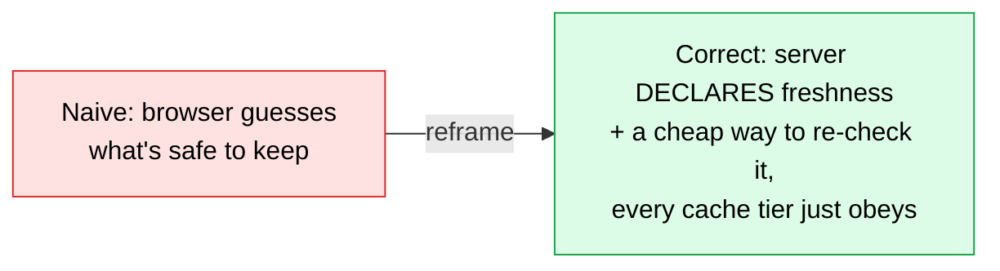
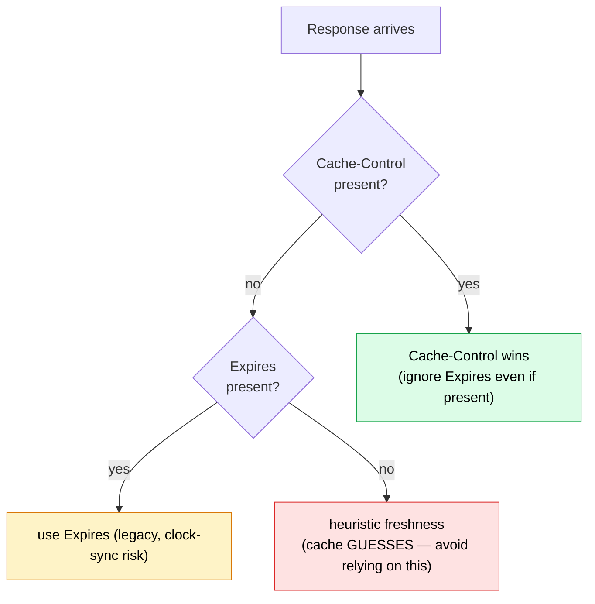
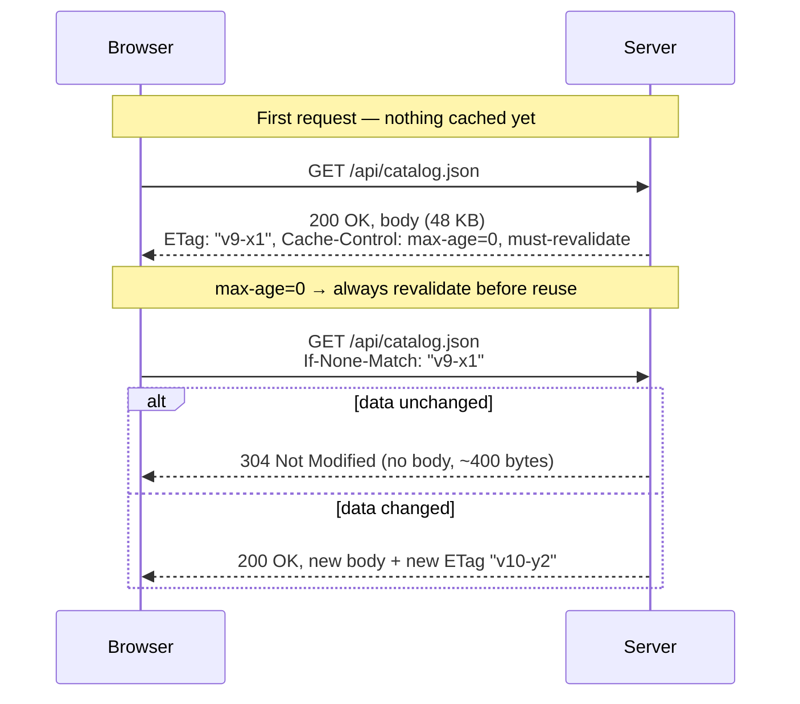
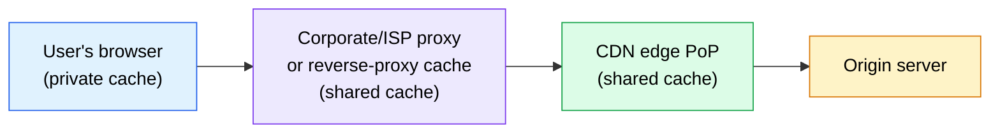
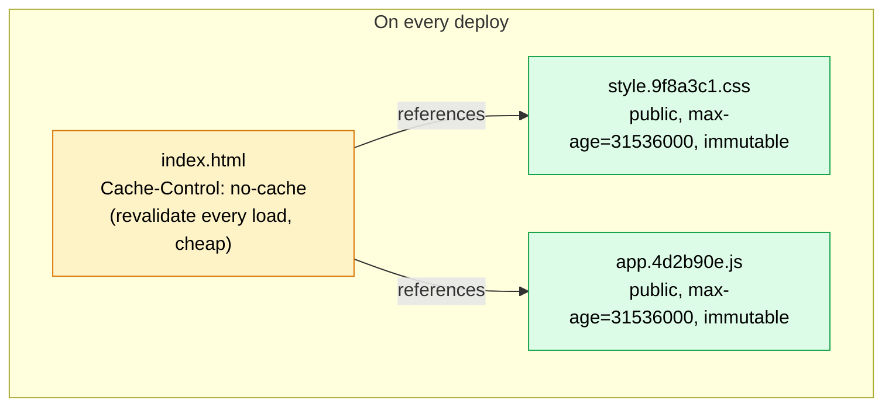
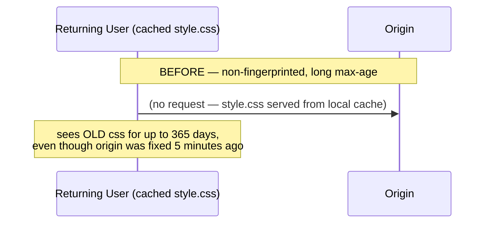
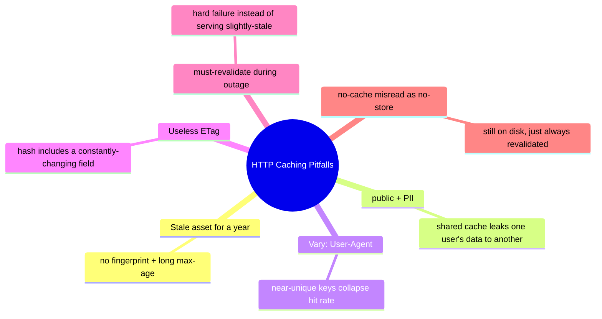

# HTTP Caching (Cache-Control, ETags, Conditional Requests)

> **One line:** A handful of response headers let a browser, a corporate proxy, or a CDN edge node store a copy of a response and serve it again without ever bothering your server — the fastest, cheapest request your system will ever handle is the one that never arrives.

---

## Table of Contents
1. [Why You Must Master This](#1-why-you-must-master-this)
2. [The Mental Model](#2-the-mental-model)
3. [Cache-Control — The Directives That Run Everything](#3-cache-control--the-directives-that-run-everything)
4. [Validators — ETag, Last-Modified & the 304 Revalidation Flow](#4-validators--etag-last-modified--the-304-revalidation-flow)
5. [Cache Tiers — Browser, Shared Proxy & CDN](#5-cache-tiers--browser-shared-proxy--cdn)
6. [The Perfect Cache Pattern — Fingerprinting, Immutable & the Vary Pitfall](#6-the-perfect-cache-pattern--fingerprinting-immutable--the-vary-pitfall)
7. [Worked Example — Shipping a CSS Change Without a Stale-Content Incident](#7-worked-example--shipping-a-css-change-without-a-stale-content-incident)
8. [Real-Life Use Cases](#8-real-life-use-cases)
9. [Failure Modes](#9-failure-modes)
10. [🏋️ Practice Drills](#-practice-drills)
11. [🎤 Interview Q&A Bank](#-interview-qa-bank)
12. [🎯 Staff+ Nuances](#-staff-nuances)
13. [Cheat Sheet](#13-cheat-sheet)
14. [Connections & Further Reading](#14-connections--further-reading)

---

## 1. Why You Must Master This

- **It's the cheapest scaling technique that exists.** A request served from the browser's local disk costs your infrastructure exactly $0 and 0ms of server time. No load balancer, no app server, no database — the request never leaves the laptop. Get HTTP caching right on your static assets and you can absorb a 100x traffic spike with zero extra capacity.
- **It's a standing security hazard, not just a performance knob.** Marking a response `public` when it contains PII, a session token, or a bank balance means a shared proxy or a CDN edge node can legally store it and hand it to the *next* person who asks — a "worked as designed" caching bug is also a data-leak incident.
- **Getting it wrong ships bugs to production for a year.** `Cache-Control: max-age=31536000` on a file whose URL never changes means a bug fix you deployed five minutes ago is invisible to a returning user until their cache naturally expires — which, at a year, is never, in practice.
- **It's asked in nearly every system-design interview that touches "make it fast."** "How do you guarantee users get the new JS immediately after a deploy?" is one of the most common follow-ups to "how would you speed this up," and the correct, complete answer requires knowing `Cache-Control`, `ETag`, `Vary`, and the fingerprinted-filename pattern together — not just one of them.

> **The core problem it solves:** *avoid re-fetching (or re-generating) a response the client already has and that hasn't changed* — and do it correctly enough that "already has" never means "has something stale, wrong, or belonging to someone else."

**Prerequisites:** [Caching_Strategies.md](./Caching_Strategies.md) — the general cache-aside mental model this file specializes to the HTTP layer.

---

## 2. The Mental Model

Think of it as **a grocery list vs. a photo of the list**:

- **No cache:** every time you want to know what's on the list, you drive to the store and read it in person. Correct, but you pay a full round trip every single time.
- **`Expires` / `max-age` (time-based freshness):** you take a photo of the list and agree "this is good for 1 hour." For that hour you just check your photo — zero trips to the store, even if the list changed five minutes after you left.
- **Validation (`ETag` / `Last-Modified`):** once your photo is "stale," instead of blindly re-reading the whole list, you call the store and ask "the last time I looked, the version stamp was `A123` — did it change?" If the answer is "no," you now know your (still slightly-old) photo is byte-for-byte accurate — for the cost of a phone call, not a drive.

The naive mental model is "the browser decides what to keep." The correct one is "the *server* declares, per response, exactly how long it's trustworthy and how to cheaply re-check it — every tier in between just obeys the header."



> **Hold onto this:** every caching header answers one of exactly two questions — *"how long can you trust this without asking me?"* (freshness: `Cache-Control`/`Expires`) and *"once you're not sure, how cheaply can you check?"* (validation: `ETag`/`Last-Modified`). Everything else in this file is detail on those two questions.

---

## 3. Cache-Control — The Directives That Run Everything

`Cache-Control` is a response header (and sometimes a request header) carrying a comma-separated list of directives. It replaced the older `Expires` header (see below) and is checked first by every modern cache — **when both are present, `Cache-Control` wins.**

| Directive | Applies to | Meaning | Real-world note |
|---|---|---|---|
| `max-age=<sec>` | any cache | fresh for `<sec>` seconds from response time | practical ceiling ≈ `31536000` (1 year) — browsers and most CDNs treat larger values as "1 year anyway" |
| `s-maxage=<sec>` | **shared** caches only (proxy/CDN) | overrides `max-age` for shared caches; browsers ignore it | lets a CDN hold a response for an hour (`s-maxage=3600`) while browsers only trust it for 60s (`max-age=60`) — cheap origin offload without long-lived browser staleness |
| `no-cache` | any | **may store**, but **must revalidate with the origin before every use** | the most misleading name in HTTP — it does *not* mean "don't cache" |
| `no-store` | any | must not persist any part of the request or response, anywhere | bank balances, one-time codes, auth tokens |
| `private` | any | only a single user's non-shared cache (the browser) may store it | shared proxies/CDNs must not store it — the default for anything personalized |
| `public` | any | shared caches may store it even if it would otherwise be non-cacheable (e.g. it had an `Authorization` header) | use only for content that is identical for every visitor |
| `must-revalidate` | any | once stale, the cache must not serve the stale copy even if the origin is unreachable — fail loudly instead of serving wrong data | pricing, inventory counts |
| `immutable` | mainly browsers | the resource will never change during its `max-age` — skip revalidation even on a manual reload | Chrome, Firefox, Safari all honor it; exists specifically for fingerprinted assets |
| `stale-while-revalidate=<sec>` | mainly shared/CDN, some browsers | serve the stale copy **immediately**, refresh it in the background for up to `<sec>` seconds | RFC 5861; turns "wait for the network" into "instant response, refreshed for next time" |
| `stale-if-error=<sec>` | mainly shared/CDN | if the origin errors or times out, serve the stale copy for up to `<sec>` seconds instead of failing | resilience during an origin blip or deploy |

**The legacy `Expires` header.** Predates `Cache-Control` (HTTP/1.0): an absolute date, `Expires: Wed, 21 Jan 2026 07:28:00 GMT`. It has two structural weaknesses `max-age` fixed: it needs clock sync between client and server, and it can't express shared-vs-private or validation behavior at all. Keep it only for HTTP/1.0-era clients that don't understand `Cache-Control` — send both, `Cache-Control` will win everywhere that matters.

**The `Age` header.** A shared cache/CDN that serves a stored response adds `Age: <sec>` — how long *it* has held the copy. A client can compute remaining freshness as `max-age - Age`, which is how you can see, from a single response, whether you're talking to the origin or to a CDN edge that's been holding this response for a while.


> **Takeaway:** always send an explicit `Cache-Control`. Anything that falls through to heuristic freshness is behaving on borrowed, implementation-specific logic you don't control.

---

## 4. Validators — ETag, Last-Modified & the 304 Revalidation Flow

Freshness (§3) tells a cache *how long* to trust a copy without asking. **Validators** tell it *how to cheaply ask* once that time is up — without re-downloading the whole body.

- **`ETag` (Entity Tag) — an opaque version identifier for the exact response body.**
  - **Strong ETag:** `ETag: "33a64df551425fcc55e4d42a148795d9f25f89d"` — guarantees byte-for-byte identity. Two responses with the same strong ETag are byte-identical. Required if the client will ever issue a `Range` request (partial content, e.g. video seeking) — a strong validator is the only way to safely assemble byte ranges fetched at different times.
  - **Weak ETag:** `ETag: W/"v2-abc"` — the `W/` prefix means *semantically* equivalent, not necessarily byte-identical (e.g. same rendered HTML but different whitespace, or the gzip vs. brotli encoding of the same content). Cheaper to compute, can't be used for `Range`/`If-Range`.
  - The client echoes it back: `If-None-Match: "33a64df5..."`. If it still matches server-side, the server returns **`304 Not Modified`** with no body — just updated headers.
- **`Last-Modified` / `If-Modified-Since` — a timestamp validator.** The server sends `Last-Modified: Tue, 15 Jul 2025 09:00:00 GMT`; the client re-asks with `If-Modified-Since: <that date>`. Weaker than an ETag because HTTP dates have **1-second granularity** — two different saves within the same second look "unmodified." Where both are present, a server should prefer the `ETag` comparison (per RFC 9111).
- **The 304 flow saves bandwidth, not latency.** A `304` response is small (roughly 300-800 bytes of headers, no body) versus re-downloading a 200 KB bundle — a >99% bandwidth win. But it still costs a full request/response round trip: on a cross-continental link (~70-150ms RTT) that's 70-150ms the user waits, every single time, even though nothing changed. This is *exactly* why the fingerprinted-filename + `immutable` pattern in §6 is strictly better for assets that rarely change: it skips the round trip entirely instead of making it cheap.


> **Takeaway:** a `304` is a cheap phone call, not a free lunch — it still costs one round trip. Reserve conditional revalidation for content that changes sometimes; use long `max-age` + `immutable` for content that (by construction) never does.

---

## 5. Cache Tiers — Browser, Shared Proxy & CDN

`public` vs. `private` doesn't just describe intent — it determines **which physical machines are legally allowed to hold a copy.**



| Tier | Scope | Who controls it | `private` may store? | `public` may store? |
|---|---|---|---|---|
| **Browser cache** | one user, one device | the user | ✅ yes | ✅ yes |
| **Shared/proxy cache** | many users behind one proxy (corporate network, ISP, `nginx`/Varnish in front of an app) | network operator / your infra team | ❌ no | ✅ yes |
| **CDN edge cache** | potentially millions of users routed to the same PoP — a specialized, geo-distributed shared cache (see [CDN.md](./CDN.md)) | the CDN provider, configured by you | ❌ no | ✅ yes |

**Why PII must never be `public`.** By default, a response to a request carrying an `Authorization` header is *not* stored by shared caches at all — that's the safe default. `Cache-Control: public` deliberately overrides that safety check, telling every shared cache "store this even though it looks personal." Mark a profile page, a bank statement, or an API response containing another user's data as `public`, and the *next* request that hits the same proxy or CDN PoP can be served *that first user's private data* — no bug in your app code required, just a header. This class of incident is why the rule is absolute: **anything that varies by user is `private`, full stop.**

**`Set-Cookie` complicates this further.** Many CDNs (Cloudflare, Fastly, CloudFront) refuse to cache — or automatically strip — a response carrying `Set-Cookie`, specifically to avoid handing one user's session cookie to the next visitor who gets served the cached copy. Behavior differs per provider; **never assume**, verify your CDN's documented behavior for `Set-Cookie` + caching before relying on it.

> A concrete failure shape: a personalized "Welcome back, Alice" page gets accidentally marked `public` with a permissive `max-age`. A shared corporate proxy caches it. The next employee on that network — Bob — loads the same URL and the proxy serves him Alice's cached, personalized page, greeting, and possibly her account data rendered into the HTML. No database was breached; a response header was wrong.

---

## 6. The Perfect Cache Pattern — Fingerprinting, Immutable & the Vary Pitfall

**The pattern.** Give every static asset a filename that encodes a hash of its content — `styles.9f8a3c1.css` instead of `styles.css` — and serve it with:

```
Cache-Control: public, max-age=31536000, immutable
```

Because the filename *is* a content hash, the URL can never point to two different pieces of content: if the CSS changes, the hash changes, and it's now a *different* URL (`styles.4d2b90e.css`). There is nothing to invalidate — the old URL simply falls out of use, and browsers/CDNs can cache it **forever** with zero risk of ever serving stale content, because "stale" is structurally impossible. `immutable` tells the browser to skip even the courtesy of a conditional-GET check on a manual reload — for something this URL-pinned, that check is pure waste.

**The entrypoint must NOT follow this pattern.** Your `index.html` (or any document that *references* the hashed asset URLs) needs the *opposite* policy — short-lived or always-revalidated — because it's the only place the new hashed filenames get discovered:

```
Cache-Control: no-cache
```

This is deliberately cheap to revalidate (HTML documents are small) and guarantees every visit picks up the latest asset references within one round trip, even while every asset those references point to is cached for a year.


> **Takeaway:** cache the leaves forever, revalidate the root every time — the root is what makes the leaves' URLs discoverable.

**Cache busting alternative: query strings.** `styles.css?v=2` is the older, weaker technique. It's config-dependent whether a given proxy/CDN even includes the query string in its cache key — some strip it, silently defeating the busting entirely; others include it, which works but leaves every old version's cache entry sitting around instead of naturally expiring. Filename hashing is superior because the version is part of the *path*, which every cache tier, without exception, treats as part of the identity of the resource.

**The `Vary` header pitfall.** `Vary: <header>` tells a shared cache "store a *separate* copy per distinct value of this request header" — necessary when the same URL legitimately returns different bytes depending on the request.

- **`Vary: Accept-Encoding`** — essential and safe. A response compressed with `gzip` vs `br` vs uncompressed is different bytes; without this, a cache could serve a `gzip`-encoded body to a client that never said it accepts `gzip`. Cardinality is tiny (effectively 2-3 real values), so the cache-fragmentation cost is negligible.
- **`Vary: User-Agent`** — a classic anti-pattern. Real-world User-Agent strings are *near-unique* per browser version/OS/device combination — tens of thousands of distinct values in production traffic. A CDN with `Vary: User-Agent` effectively creates a separate cache slot per visitor, crashing hit rate from, say, 95% to under 5% and dumping the resulting flood of misses straight onto your origin.
- **`Vary: Cookie`** — almost always wrong for anything cached at a shared/CDN tier. Either it fragments the cache per-session (defeating the point of a shared `public` cache), or — worse — if a downstream cache tier doesn't honor `Vary` correctly, a personalized response gets stored once and served to every subsequent visitor regardless of their cookie. This is the same PII leak shape as §5, caused by a header interaction instead of a `public`/`private` mistake.

---

## 7. Worked Example — Shipping a CSS Change Without a Stale-Content Incident

**The naive setup (before):** `index.html` links `/style.css`, served with `Cache-Control: public, max-age=31536000`. You ship a CSS fix. Users who already cached `/style.css` keep the **old** file for up to 365 days — the exact "logo of the past" incident, at scale.



**The fix (after):** the build emits a content-hashed filename and updates `index.html` to reference it.

```mermaid
sequenceDiagram
    participant U as Returning User
    participant O as Origin

    Note over U,O: AFTER — fingerprinted filename + immutable
    U->>O: GET /index.html<br/>(Cache-Control: no-cache → always revalidate)
    O-->>U: 200/304, references style.9f8a3c1.css (NEW hash)
    U->>O: GET /style.9f8a3c1.css (never seen this URL before → cache MISS)
    O-->>U: 200 OK, Cache-Control: public, max-age=31536000, immutable
    Note over U: cached for the year; deploy #2 gets a NEW hash,<br/>this URL is simply never requested again
```

**Closing the loop with numbers.** `index.html` is ~2 KB and revalidated on every navigation — at a ~40ms typical RTT, that's a negligible, constant cost per visit. `style.css` is ~40 KB and is now fetched **exactly once per version**, then served from the browser's local disk (0ms, $0) for up to a year. Across 100,000 daily users, the naive version means the buggy CSS is visible to some fraction of that population for **up to 365 days**; the fingerprinted version means every user who navigates *at all* after the deploy gets the fix on their very next page load — the propagation delay drops from "up to a year" to "one HTML round trip."

---

## 8. Real-Life Use Cases

| Situation | How HTTP caching applies | The decision it forces |
|---|---|---|
| **Webpack/Vite/npm production build output** | Content-hashed filenames + `public, max-age=31536000, immutable` | The "perfect cache" pattern (§6) — never invalidate, just mint a new URL |
| **`GET /api/users/123` (profile data)** | `private, max-age=0, must-revalidate` + `ETag` for cheap polling | Personal data never leaves the browser cache tier; conditional GET still saves bandwidth on repeated polls |
| **Bank balance / one-time auth code** | `Cache-Control: no-store` | Must not persist anywhere, not even the browser disk cache |
| **News homepage under traffic spike** | `public, max-age=30, stale-while-revalidate=120` at the CDN | CDN serves a 30-120s-old page instantly during a spike instead of stampeding the origin |
| **Marketing landing page** | `max-age=60` (browser) + `s-maxage=3600` (CDN via shared-cache-only override) | CDN absorbs almost all traffic for an hour; browsers still re-check hourly for content teams' edits |
| **Personalized, logged-in dashboard** | `private, no-cache` + `ETag` | Never shared, but still avoids re-shipping an unchanged payload |
| **Origin having a bad 5 minutes (5xx spike)** | `stale-if-error=600` at the CDN | Users see a slightly-stale-but-working page instead of an error page during the incident |

> **The habit:** for every response, answer two questions out loud before shipping it — *"who is allowed to store this?"* (`private`/`public`) and *"for how long, and how do they cheaply re-check?"* (`max-age` + a validator). If you can't answer both, you don't have a caching policy, you have a guess.

---

## 9. Failure Modes



- **The "logo of the past."** *Symptom:* users see an old asset for weeks after a fix shipped. *Cause:* a long `max-age` on a URL whose filename never changes. *Fix:* fingerprinted filenames + `immutable`, with a short/`no-cache` policy on the HTML document that references them (§6, §7).
- **`public` on PII.** *Symptom:* one user sees another user's personalized data. *Cause:* a personalized or authenticated response marked `public`, letting a shared proxy/CDN store and replay it. *Fix:* `private` for anything that varies per user; audit any `public` response for `Authorization`/`Set-Cookie`/per-user content before it ships (§5).
- **`Vary: User-Agent` (or `Vary: Cookie`) cache collapse.** *Symptom:* a CDN is in front of the origin, yet the origin is still getting slammed. *Cause:* the `Vary` header keys the cache on a near-unique or per-session value, so almost every request is a fresh cache slot. *Fix:* drop the offending `Vary` value; if per-device behavior is truly needed, key on a small, explicit set of values (e.g. a `device-type` header you control) instead of the raw request header (§6).
- **An ETag that never actually helps.** *Symptom:* every request still gets a `200` with a full body; the `304` machinery never fires despite the underlying content being unchanged. *Cause:* the ETag is derived from something that changes on every response even when the meaningful content hasn't — a `now()` timestamp, an auto-updating `updated_at` column touched by unrelated writes. *Fix:* hash only the fields that represent the actual response content, or version explicitly.
- **`must-revalidate` during an origin blip.** *Symptom:* a brief origin outage turns into a hard error page for every user instead of a barely-noticeable, slightly-stale response. *Cause:* `must-revalidate` explicitly forbids serving the stale copy when revalidation fails — by design, for data where "wrong" is worse than "unavailable." *Fix:* for content where slightly-stale beats an error, use `stale-if-error=<sec>` instead.
- **Confusing `no-cache` with `no-store`.** *Symptom:* an engineer is surprised to find "non-cached" content still sitting on disk in the browser's cache storage. *Cause:* `no-cache` is one of HTTP's most misleading names — it means "cache it, but always revalidate first," not "don't cache." *Fix:* use `no-store` when the requirement is genuinely "never persist this anywhere" (§3).

---

## 🏋️ Practice Drills

> *Cover the solutions and attempt first — active recall is the point.*

**Drill 1 — Pick the header.** For each response, write the `Cache-Control` value you'd use and say why: (a) a fingerprinted `app.4d2b90e.js` bundle; (b) `index.html` that references it; (c) a logged-in user's `/api/cart`; (d) a one-time SMS login code endpoint; (e) a marketing homepage that a CDN should hold for an hour but browsers should re-check every minute.

<details><summary>Solution</summary>

(a) `public, max-age=31536000, immutable` — the URL is content-addressed, so it can never go stale; cache forever, skip even reload-triggered revalidation.

(b) `no-cache` — must be cheaply revalidated on every load so users discover new asset hashes promptly; small file, so the round trip is cheap.

(c) `private, no-cache` (add an `ETag` if you want conditional-GET bandwidth savings on repeated polls) — personal data must never sit in a shared cache, and it should be re-checked rather than trusted for any duration.

(d) `no-store` — must not persist anywhere, not even the browser's disk cache; a code that's still "cached" after being used or expired is a security bug.

(e) `max-age=60, s-maxage=3600` — `s-maxage` overrides `max-age` for the CDN only, so the shared cache holds it an hour (origin offload) while browsers still re-check every minute (fast content-team edits visible quickly).
</details>

**Drill 2 — Do the math.** A cross-continental RTT is 120ms. A `304 Not Modified` exchange is ~500 bytes total. The full asset is 250 KB. At 10,000 requests/day for this asset, compare total bytes transferred and total latency paid for (i) always full `200` responses, (ii) always-revalidated `304`s, and (iii) `immutable` + 1-year `max-age` with zero network calls after the first fetch per user.

<details><summary>Solution</summary>

(i) **Always 200:** 10,000 × 250 KB = **2.5 GB/day** transferred; latency ≈ 120ms × 10,000 requests (every request pays the full RTT plus transfer time) — the worst case on both axes.

(ii) **Always 304 (conditional revalidation):** 10,000 × 500 bytes ≈ **5 MB/day** transferred — a >99.9% bandwidth reduction versus (i). But latency is *unchanged* on the RTT axis: every one of the 10,000 requests still pays the 120ms round trip, because a `304` is still a network round trip, just a cheap one.

(iii) **`immutable` + long `max-age`:** after each user's first fetch, subsequent requests within the cache lifetime make **zero** network calls — 0 bytes transferred, 0ms latency, for every one of those requests. This is the only option that wins on both bandwidth *and* latency, which is exactly why it's reserved for content that structurally cannot change (fingerprinted URLs).

**The lesson:** validators (ETag/304) are a huge bandwidth win but not a latency win; only skipping the network entirely (long `max-age`/`immutable`) wins on latency too.
</details>

**Drill 3 — Design a small thing.** You're adding image thumbnails to a photo-sharing API. Thumbnails are generated once and never change; the *list* of a user's photos changes constantly as they upload/delete. Design the caching policy for both endpoints, including who's allowed to cache what.

<details><summary>Solution</summary>

**Thumbnail bytes (`GET /thumbnails/{contentHash}.jpg`):** URL keyed by a hash of the image content (fingerprinted, like §6). `Cache-Control: public, max-age=31536000, immutable`. Thumbnails contain no PII beyond "this content hash maps to this image," and since the hash *is* the content, it's safe for a CDN/shared cache to hold forever — a deleted photo just means the hash is no longer referenced, not that the cached bytes are wrong.

**Photo list (`GET /users/{id}/photos`):** per-user, constantly changing, and arguably sensitive (reveals what a user has uploaded). `Cache-Control: private, no-cache` with an `ETag` computed from something like a per-user "photos version" counter incremented on upload/delete. This keeps it out of shared caches entirely (private data), while the `ETag` still lets an unchanged list return a cheap `304` when the user simply reloads the page without having uploaded anything new.

**The key design move:** separate the *immutable, content-addressed* bytes (cache forever, safe to share) from the *mutable, per-user* metadata referencing them (private, always revalidated) — the same split as the HTML/asset split in §6, applied to an API instead of a web page.
</details>

---

## 🎤 Interview Q&A Bank

**Q1. "`Cache-Control` vs the old `Expires` header — why did we move on?"**
> `Expires` is an absolute date and needs client/server clock sync to work correctly; it also can't express shared-vs-private caching or validation behavior at all. `Cache-Control` uses a relative `max-age` (no clock-sync dependency) and a rich directive set (`private`/`public`, `s-maxage`, `no-store`, `immutable`, etc.). When both are present, `Cache-Control` wins — `Expires` is kept only as a fallback for very old clients.

**Q2. "What's the actual difference between `no-cache` and `no-store`?"** *(signal: tests whether the candidate has been burned by the name before)*
> `no-cache` means "you may store this, but you must revalidate with the origin before every use" — it's a validation directive, not a "don't cache" directive, despite the name. `no-store` means "do not persist any part of this request or response anywhere" — the genuine "never cache" directive. Use `no-store` for bank balances and auth tokens; use `no-cache` for content you want validated on every use but are fine storing (e.g. a frequently-polled API where bandwidth, not request count, is the cost you're optimizing).

**Q3. "Strong vs weak ETag — when does the difference actually matter?"**
> A strong ETag guarantees byte-for-byte identity; a weak one (prefixed `W/`) only guarantees semantic equivalence — useful when, say, gzip and brotli encodings of the same content would otherwise get different hashes for content a client doesn't care is byte-identical. The difference matters concretely for `Range` requests: assembling a file from byte ranges fetched at different times is only safe with a strong validator, because a weak one doesn't promise the underlying bytes haven't shifted.

**Q4. "Walk me through the 304 flow, and does it actually save latency?"**
> Server first responds `200` with an `ETag`/`Last-Modified`. On the next request, the client sends `If-None-Match`/`If-Modified-Since`; if unchanged, the server returns `304 Not Modified` with no body. It saves bandwidth dramatically (headers only, maybe a few hundred bytes vs. the full payload) but it does **not** save latency — it's still a full round trip. That's precisely why long-`max-age` + `immutable` on fingerprinted assets is preferred over "always revalidate": it skips the round trip entirely instead of making it cheap.

**Q5. "How do you guarantee users get new JS/CSS immediately after a deploy, without breaking long-term caching for the assets that haven't changed?"** *(signal: the single most common HTTP-caching interview question — tests whether the candidate knows the full pattern, not just half of it)*
> Fingerprint every asset filename with a content hash (`app.4d2b90e.js`) and serve it `public, max-age=31536000, immutable` — since the hash changes whenever the content does, the URL is permanently safe to cache forever, and unchanged assets keep their old, already-cached URL. The HTML document that references those hashed URLs gets the opposite policy — `no-cache` — so it's cheaply revalidated on every load and always points at the latest hashes. New content propagates on the next page load; unchanged content is never re-fetched.

**Q6. "Why is `Cache-Control: public` dangerous, and when is it correct?"**
> It tells shared caches (corporate proxies, CDN edge nodes) they may store the response, overriding the safe default that skips caching anything that looked personalized (e.g. had an `Authorization` header). If the response actually contains per-user data, `public` turns a header choice into a data leak — one user's cached response can be served to the next person hitting the same proxy/PoP. It's correct only when the response is byte-identical for every possible requester — static assets, public marketing pages, public API responses with no user context.

**Q7. "What is `stale-while-revalidate` and why do CDNs care about it so much?"**
> It lets a cache serve the stale copy **immediately** while it fetches a fresh one in the background, instead of making the requester wait for revalidation. It converts "the user waits for a network round trip" into "the user gets an instant (slightly stale) response, and the *next* request benefits from the refreshed copy." CDNs use it heavily to smooth traffic spikes and avoid a "thundering herd" of simultaneous revalidation requests hitting the origin the instant a popular object expires.

**Q8. "Why is `Vary: User-Agent` considered an anti-pattern?"**
> `Vary` tells a shared cache to store a separate copy per distinct value of the named request header. Real User-Agent strings are near-unique across browser/OS/device combinations — tens of thousands of distinct values in production traffic — so `Vary: User-Agent` effectively gives almost every request its own cache slot, collapsing hit rate toward zero and dumping the resulting misses onto the origin, even with a CDN nominally "in front" of it. Contrast with `Vary: Accept-Encoding`, which is safe because it has only a handful of realistic values.

---

## 🎯 Staff+ Nuances

- **Heuristic freshness is a trap, not a fallback.** If neither `Cache-Control` nor `Expires` is present, caches don't treat the response as uncacheable — many apply a *heuristic* (commonly ~10% of the time since `Last-Modified`) and cache it anyway, silently and inconsistently across browsers/CDNs. The senior takeaway: "I didn't set caching headers" does not mean "this isn't cached" — it means "this is cached by rules you don't control and can't audit." Always send an explicit `Cache-Control`.
- **`no-cache` has a request-side meaning too.** A client can *send* `Cache-Control: no-cache` on a request to force revalidation regardless of what the cached copy's freshness says — this is what a browser's dev-tools "disable cache" / hard-reload does under the hood. It's a different axis from the response directive of the same name; don't conflate "server says how long this is fresh" with "client says skip trusting the cache this one time."
- **A service worker is a separate caching layer that can override everything in this file.** The Cache Storage API (behind a service worker) lets an app manage its own cache with full manual control — but that control is a double-edged sword: a stale service worker can pin an app shell forever, a very real production incident class (PWA "stuck on old version," requiring an explicit update/skip-waiting flow) that HTTP `Cache-Control` headers alone cannot fix, because the service worker sits *in front of* the HTTP cache in the request path.
- **`Set-Cookie` and shared caching is provider-specific — verify, don't assume.** Cloudflare, Fastly, and CloudFront each have their own default behavior for a cacheable response that also carries `Set-Cookie` (strip it, refuse to cache, or cache verbatim depending on configuration). Assuming "the CDN will do the safe thing" without checking the specific product's documented behavior is exactly how a session cookie ends up replayed to the wrong user.
- **Byte-range requests (`Range`/`If-Range`) are where weak-vs-strong ETags stop being academic.** Video/audio streaming and resumable downloads rely on assembling a file from ranges fetched at different times; a weak validator can't guarantee those ranges came from the same underlying byte sequence, so servers and caches must use (and check for) a strong ETag before honoring partial-content semantics — get this wrong and you can serve a corrupted, Frankenstein'd file assembled from two different versions.
- **HTTP caching answers "how long is this fresh," not "how do I purge it right now."** Once content is `public` and cached across a fleet of CDN edge nodes, forcing an update before its `max-age` expires is a distributed invalidation problem, not a header problem — see [Cache_Invalidation_Consistency.md](./Cache_Invalidation_Consistency.md) for stampede-safe purge and TTL-vs-event-driven invalidation strategies. The fingerprinted-URL pattern (§6) is popular precisely because it sidesteps this problem for static assets — there's never anything to purge.
- **The CDN edge is a specialized, geo-distributed instance of the shared-cache tier described in §5** — same `public`/`private` and `Cache-Control` rules, just replicated across hundreds of PoPs with an origin-shield layer to survive a thundering-herd cache miss. See [CDN.md](./CDN.md) for the pull/push model, PoP placement, and cross-PoP invalidation lag that HTTP headers alone don't solve.
- **`immutable` is a browser-side optimization, not a promise the network enforces.** Nothing stops a misbehaving intermediate cache or a misconfigured origin from serving different bytes at the same fingerprinted URL — `immutable` only tells a *compliant* browser to skip its own revalidation check. The actual immutability guarantee comes from your build pipeline never reusing a content hash for different content, not from the header itself.

---

## 13. Cheat Sheet

```
HTTP CACHING — two questions every response must answer
═══════════════════════════════════════════════════════════════════════════
  1) WHO may store this?         private (browser only) vs public (browser + shared/CDN)
  2) HOW LONG, how re-checked?   Cache-Control max-age/s-maxage  +  ETag / Last-Modified

CACHE-CONTROL DIRECTIVES
  max-age=<s>                 fresh for <s>s, any cache             cap ~31536000 (1yr)
  s-maxage=<s>                overrides max-age, SHARED caches only  browser ignores it
  no-cache                    MAY store, MUST revalidate every use   misleading name!
  no-store                    MUST NOT store anywhere                bank balances, tokens
  private                     browser cache only                     default for per-user data
  public                      shared caches (proxy/CDN) may store    NEVER + PII/Authorization
  must-revalidate             stale copy unusable if origin down     fail loud > serve wrong data
  immutable                   skip revalidation even on reload       pair with fingerprinted URL
  stale-while-revalidate=<s>  serve stale NOW, refresh in bg         smooths spikes, no stampede
  stale-if-error=<s>          serve stale on 5xx/timeout             resilience during outage

VALIDATORS (cheap re-check instead of full re-fetch)
  ETag (strong "hash")        byte-exact; only safe validator for Range/If-Range
  ETag (weak W/"hash")        semantically equal, not byte-exact; no Range support
  Last-Modified                1-second granularity; weaker than ETag
  304 Not Modified             saves BANDWIDTH (~99%+), NOT latency (still 1 RTT)

THE PERFECT CACHE PATTERN
  style.<contenthash>.css  +  Cache-Control: public, max-age=31536000, immutable
  index.html               +  Cache-Control: no-cache   (always revalidate — it's what
                                                           discovers the new hashed URLs)
  → cache the leaves forever, revalidate the root every time

VARY PITFALLS
  Vary: Accept-Encoding   SAFE   (~3 real values: gzip/br/identity)
  Vary: User-Agent        DANGER (10,000+ real values → hit rate collapses toward 0%)
  Vary: Cookie             DANGER (per-session fragmentation, or worse: a leak if ignored downstream)

CACHE TIERS (who's allowed to hold a `public` copy)
  browser (private OK)  →  shared/proxy cache  →  CDN edge PoP  →  origin
  PII / Authorization / Set-Cookie responses:  private, or verify your CDN's Set-Cookie behavior

DO                                          DON'T
  fingerprint static asset filenames         mark personalized/PII responses public
  no-cache (not no-store) on the HTML root   use Vary: User-Agent or Vary: Cookie at a CDN
  stale-while-revalidate for spike traffic    build an ETag from a constantly-changing field
  strong ETag if you ever serve Range         assume no-cache means "don't cache"
```

---

## 14. Connections & Further Reading

**Prerequisites (learn first):**
- [Caching_Strategies.md](./Caching_Strategies.md) — the general cache-aside/write-through mental model this file specializes to HTTP semantics.

**Builds toward / pairs with:**
- [CDN.md](./CDN.md) — the edge tier: CDN PoPs are a geo-distributed, specialized instance of the shared-cache tier in §5, governed by these same headers plus push/pull and origin-shield behavior.
- [Cache_Invalidation_Consistency.md](./Cache_Invalidation_Consistency.md) — what to do when content *must* change before its `max-age` expires: TTL vs event-driven purge, stampede-safe invalidation across a fleet of cache nodes.
- [Cache_Eviction_Policies.md](./Cache_Eviction_Policies.md) — once something is in a cache, what decides when it's evicted under memory pressure (a different problem from HTTP freshness expiry).
- [Performance_Metrics.md](./Performance_Metrics.md) — cache hit ratio and TTFB are the metrics that prove any of this actually worked.

**Gaps this topic exposes (candidates for the section's Gap Analysis):**
- Service Worker / Cache Storage API as its own client-side caching layer that sits in front of HTTP caching and can override it — currently only mentioned here as a Staff+ nuance.
- Per-CDN-provider default behavior for `Set-Cookie` + cacheability (Cloudflare vs Fastly vs CloudFront) — worth a comparison table if the CDN file goes deeper on configuration specifics.

**External classics:**
- [RFC 9111 — HTTP Caching](https://www.rfc-editor.org/rfc/rfc9111) — the current spec (obsoletes RFC 7234); the authoritative source for every directive in §3.
- [RFC 5861 — HTTP Cache-Control Extensions for Stale Content](https://www.rfc-editor.org/rfc/rfc5861) — defines `stale-while-revalidate` and `stale-if-error`.
- [MDN: HTTP Caching](https://developer.mozilla.org/en-US/docs/Web/HTTP/Caching) — the best day-to-day reference for directive syntax and browser support.
- [web.dev: Prevent unnecessary network requests with the HTTP Cache](https://web.dev/http-cache/) — practical guidance behind the fingerprinted-asset pattern in §6.

---

## TL;DR
**HTTP caching is answered by two questions on every response: *who may store this* (`private` browser-only vs `public` shared/CDN — and PII must never be `public`) and *for how long, checked how* (`Cache-Control: max-age`/`s-maxage` for freshness, `ETag`/`Last-Modified` for cheap revalidation via `304`, which saves bandwidth but *not* latency — it's still a round trip). The gold-standard pattern is to **fingerprint static asset filenames with a content hash and serve them `public, max-age=31536000, immutable`** — forever-cacheable because the URL itself can never point to stale content — while serving the HTML that references them with `no-cache` so new hashes are discovered on every visit. Watch `Vary`: `Accept-Encoding` is safe, `Vary: User-Agent`/`Cookie` at a shared cache collapses your hit rate or leaks private data. **Cache the leaves forever, revalidate the root every time, and never mark anything personalized `public`.**
