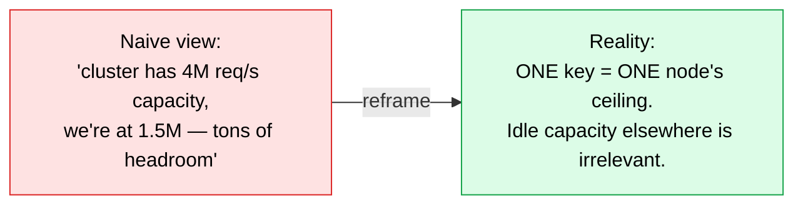
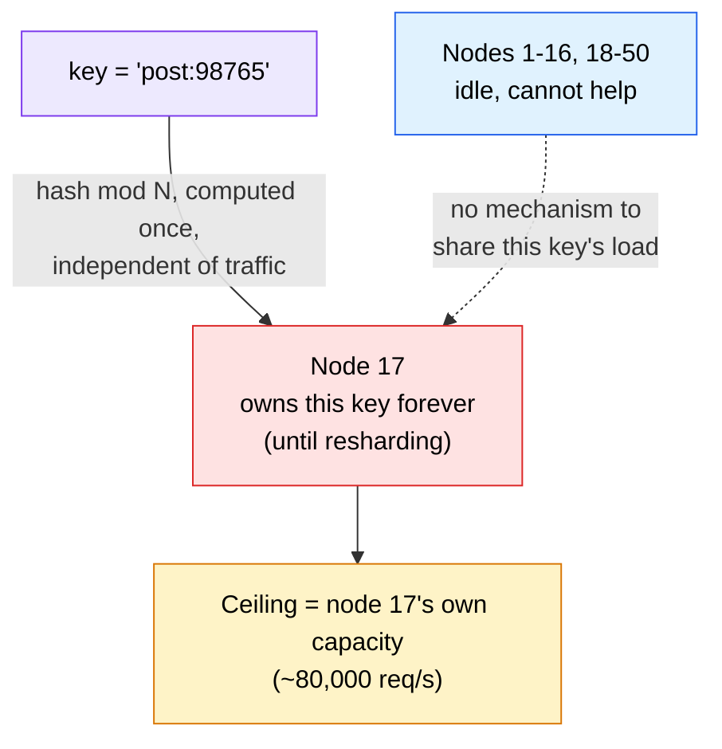
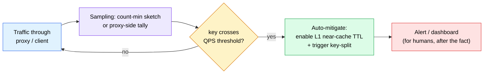
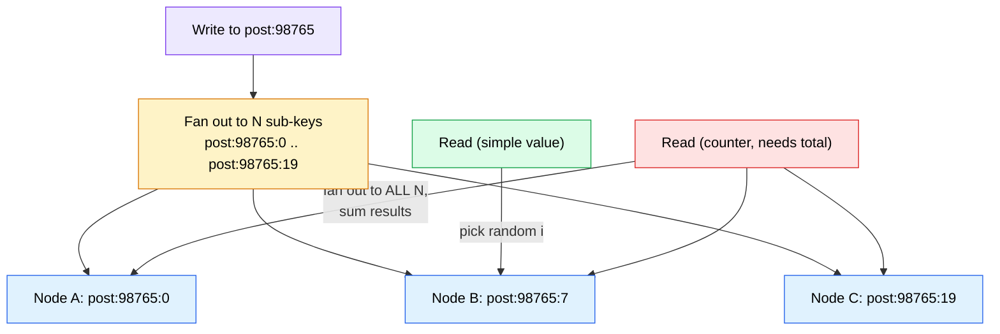
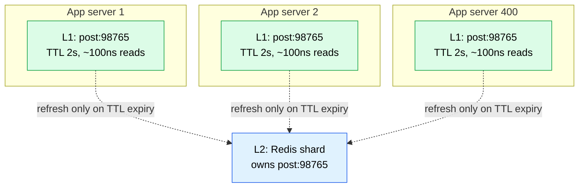
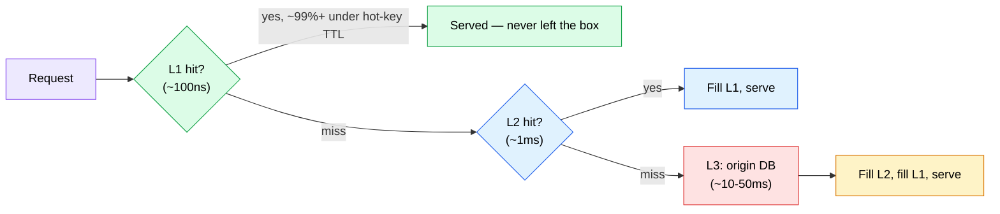
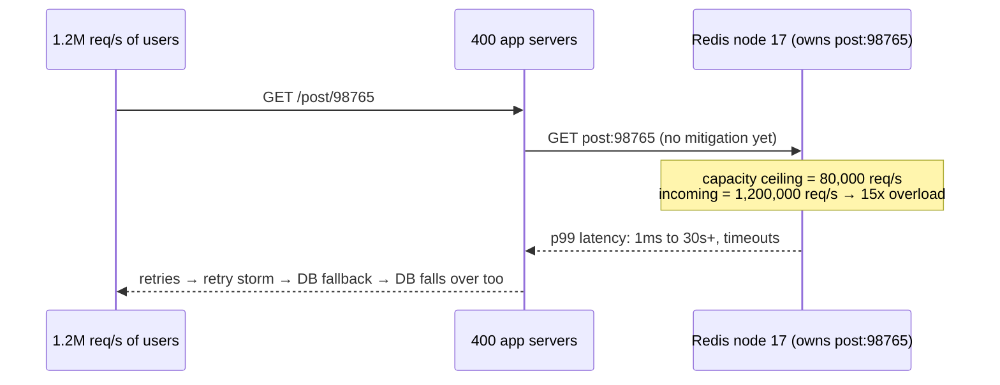
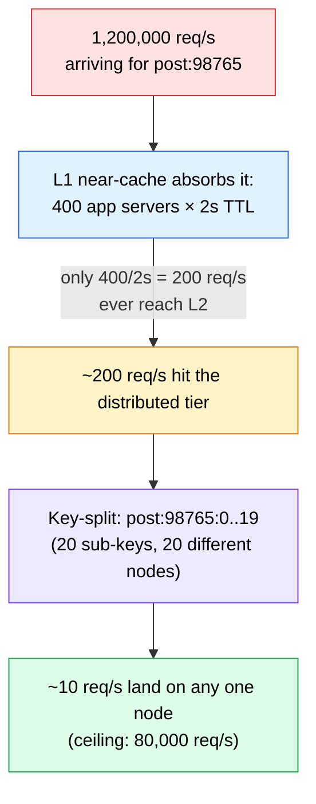
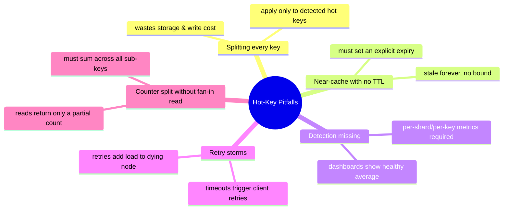

# The Hot-Key Problem & Multi-Tier Caching

> **One line:** A cache cluster's *aggregate* capacity is a lie the moment one key goes viral — every key hashes to exactly one node, so a single celebrity tweet or Black-Friday product can pin one shard at 100% while the other ninety-nine sit idle, and the fix is to make that one key never have to travel to a single node at all.

---

## Table of Contents
1. [Why You Must Master This](#1-why-you-must-master-this)
2. [The Mental Model](#2-the-mental-model)
3. [Anatomy of the Hot-Key Problem](#3-anatomy-of-the-hot-key-problem)
4. [Detection — Finding the Hot Shard Before It Falls Over](#4-detection--finding-the-hot-shard-before-it-falls-over)
5. [Mitigation 1 — Key Splitting](#5-mitigation-1--key-splitting)
6. [Mitigation 2 — Local Near-Cache Replication (L1 In-Process)](#6-mitigation-2--local-near-cache-replication-l1-in-process)
7. [Mitigation 3 — Client-Side TTL Caching & Dedicated Read Replicas](#7-mitigation-3--client-side-ttl-caching--dedicated-read-replicas)
8. [Multi-Tier Caching Architecture — L1 + L2 as the Solution](#8-multi-tier-caching-architecture--l1--l2-as-the-solution)
9. [Worked Example — A Viral Post Overwhelms a Redis Shard](#9-worked-example--a-viral-post-overwhelms-a-redis-shard)
10. [Real-Life Use Cases](#10-real-life-use-cases)
11. [Failure Modes](#11-failure-modes)
12. [🏋️ Practice Drills](#-practice-drills)
13. [🎤 Interview Q&A Bank](#-interview-qa-bank)
14. [🎯 Staff+ Nuances](#-staff-nuances)
15. [Cheat Sheet](#12-cheat-sheet)
16. [Connections & Further Reading](#13-connections--further-reading)

---

## 1. Why You Must Master This

- **Capacity planning lies to you at the aggregate level.** "Our Redis cluster does 4M ops/sec and we're at 1.5M — we have headroom" is a dangerous sentence. A single key never gets more capacity than the *one node* that owns it, no matter how idle the rest of the cluster is. Teams that only watch cluster-wide dashboards get blindsided by an outage that their own metrics said couldn't happen.
- **It's the standard follow-up to "just cache it in Redis."** Any interviewer who hears "we cache the product page in Redis" will immediately ask "what happens when that product is the one on the Black Friday homepage banner?" If your answer is "the cache handles it," you haven't actually thought about sharding.
- **It causes real outages, not hypothetical ones.** Facebook's "Scaling Memcache at Facebook" paper documents exactly this class of failure and built dedicated infrastructure (regional pools, "gutter pools," lease mechanisms) to survive it. Twitter, Instagram, and every large e-commerce platform have public postmortems describing one viral object taking down a cache tier and cascading into the database.
- **The fix changes your architecture, not just your config.** Surviving a hot key means adding an entirely new caching tier (in-process, near the app) and a new data-modeling trick (splitting one logical key into many physical ones) — this is a design decision, not a knob you turn.

> **The core problem it solves:** *a cache cluster's throughput is bounded per-key by the single node that owns it, not by the cluster's total capacity — so uneven access, not uneven data, is what breaks a "properly sharded" cache.*

**Prerequisites:** [Caching_Strategies.md](./Caching_Strategies.md) (cache-aside, the baseline pattern this problem attacks) and [Consistent_Hashing.md](../07_Load_Balancing_Scalability/Consistent_Hashing.md) (how a key is deterministically assigned to exactly one node — the mechanism that makes hot keys possible in the first place).

---

## 2. The Mental Model

Picture a cluster of 50 Redis nodes as 50 identical toll booths on a highway, each able to process 80,000 cars/second. Traffic is normally spread evenly — 800 cars/second per booth, nobody breaks a sweat. Now imagine every driver in the country suddenly needs to pass through **booth #17 specifically** because that's the only booth with the one lane leading to a viral attraction. Booth #17 doesn't get help from the other 49 idle booths just because they're idle — the road layout (the hash function) sends every one of those cars to booth #17 and nowhere else.

That is the hot-key problem: **capacity is a property of the node, not the cluster, and a hash function assigns a key to a node once, permanently, regardless of load.**



> **Hold onto this:** if you can't answer "what happens to the *one node* that owns my hottest key when it gets 1,000x traffic," you haven't finished designing the cache — you've only designed the average case.

---

## 3. Anatomy of the Hot-Key Problem

**What it is.** A hot key (also called a *celebrity key*) is a single cache key whose access rate is orders of magnitude above the average key in the same cluster — a viral tweet's ID, a flash-sale product's SKU, a trending hashtag's counter, a config flag every service reads on every request. Because a distributed cache assigns each key to exactly one node (directly via `hash(key) % N`, or via a [consistent-hash ring](../07_Load_Balancing_Scalability/Consistent_Hashing.md)), that node's per-node throughput ceiling becomes the *de facto* ceiling for that key — full stop, regardless of how many other nodes exist.

**Why it exists.** Sharding schemes are built for *data-size* skew (spread N keys evenly across M nodes) and implicitly assume *access* is also roughly uniform across keys. Real-world access follows a power law (Zipfian distribution) — a tiny fraction of keys receive a huge fraction of the reads. Sharding solves the first problem perfectly and does nothing for the second, because the assignment is static: it's computed once from the key's bytes, not from its live traffic.

**How it actually breaks things, step by step:**
1. A key is created (a new post, a new product) and hashes to node 17 of 50, same as any other key.
2. Its content goes viral. Read QPS for *that key alone* climbs from ~1 req/s to 1M+ req/s in minutes.
3. Node 17's per-node ceiling (say, 80,000 simple `GET`s/sec — realistic for a single-threaded Redis instance under a network-bound workload) is blown through by 15x.
4. Node 17's CPU (Redis's command loop is single-threaded per core) pegs at 100%, its NIC saturates, and its command latency — for *every* key it hosts, not just the hot one — spikes from ~1ms to seconds. This is the "noisy neighbor" tax: unrelated cold keys co-located on the same shard suffer collateral damage.
5. The other 49 nodes are untouched — still at a few hundred to low-thousand req/s, CPU in the single digits.
6. Clients time out, retry, and the retry storm adds *more* load to the same already-drowning node. Some requests fall through to the origin database, which was sized for cache-miss-rate traffic (a few hundred req/s), not the full firehose — and it falls over too.

| Shard | What it owns | Normal QPS | During the viral spike |
|-------|--------------|-----------|-------------------------|
| Node 17 (owns the hot key) | 1 hot key + ~3M ordinary keys | ~800 req/s | **1,200,000 req/s** |
| Node 1–16, 18–50 (49 nodes) | ~3M ordinary keys each | ~800 req/s | ~900 req/s (essentially unchanged) |
| **Cluster average (misleading)** | — | 800 req/s | 24,780 req/s *(looks fine on an aggregate dashboard)* |

> **The takeaway:** the cluster-average row is the dashboard everyone watches, and it hides the outage completely. The per-shard row is the one that matters, and it's usually not on the default dashboard at all.



---

## 4. Detection — Finding the Hot Shard Before It Falls Over

**What you're looking for:** a signature where *per-shard* metrics diverge sharply from the *cluster average* — because the average always looks fine (see the table above), you must instrument at the shard and key level, not just the cluster level.

- **Per-shard CPU / network utilization.** One node pegged near 100% while the fleet average sits in the single digits is the single strongest signal. Alert on the *ratio* `max(shard CPU) / mean(shard CPU)`, not on absolute CPU — a ratio catches skew at any overall load level, whereas an absolute threshold only catches it once the whole cluster is already busy.
- **Per-key access counting.** You need a "top-K heaviest keys right now" view, not just aggregate ops/sec:
  - `redis-cli --hotkeys` samples the keyspace using the built-in LFU access-frequency counter (requires `maxmemory-policy` set to an LFU variant) — cheap enough to run against production.
  - Running `MONITOR` in production is a classic mistake: it logs *every* command and can itself double the load on an already-struggling node. Never use it as a detection tool at scale.
  - Proxy-layer sampling (Twemproxy/mcrouter-style) samples a percentage of commands passing through and tallies counts in the proxy, off the cache node's own CPU budget.
  - For true firehose-scale streams, exact per-key counting is too expensive; heavy-hitter streaming algorithms — **Count-Min Sketch**, **HeavyKeeper**, **Space-Saving** — estimate the top-K keys with O(1)-ish memory and no per-key counter, and are what production hot-key detectors (Twitter's internal hot-key detection service is a public example of this pattern) actually run continuously.
- **Latency percentile divergence per shard.** If p99 latency on node 17 is 2 seconds while every other shard reports 1ms, that is the hot-key signature even before you've identified *which* key it is.
- **Automated response, not just an alert.** The mature version of this pipeline doesn't page a human — it feeds the detected hot key straight into an automatic mitigation (flip on client-side caching for that key, or trigger key-splitting) within seconds, because a human paging response is far too slow for a spike that doubles every 10 seconds.



> **The takeaway:** by the time a human is looking at a graph, the mitigation should already have fired — detection exists to feed an automated response, not a pager.

---

## 5. Mitigation 1 — Key Splitting

**What it is.** Take one logical hot key and store it as **N physical sub-keys** — `post:98765:0`, `post:98765:1`, … `post:98765:19` — each of which hashes to a *different* node. A write populates all N (or a background replicator fans it out); a read picks **one sub-key at random** (uniform random suffix) and reads from whichever node that lands on.

**Why it works.** The hash function is what pinned the whole key's load onto one node in the first place; splitting the key changes the *input* to that hash function into N different inputs, which — with a good hash — land on N different nodes. 1.2M req/s split across 20 sub-keys is 60K req/s per sub-key-node, which is back under a single node's ~80K ceiling.

**How the read/write path actually works:**
- **Simple value reads** (e.g., a cached post body): client picks a random `i` in `[0, N)`, reads `key:i`. Any sub-key has an identical copy of the value, so any one will do — this is read fan-out to *one* random replica, not all N.
- **Aggregation reads** (e.g., a like/view counter): you cannot just read one sub-key, because each sub-key only holds a *partial* count. The client must **fan out reads to all N sub-keys in parallel and sum (merge) the results** — this is the classic "sharded counter" pattern (the same idea Firestore/Spanner recommend for hot counter documents). Writes increment exactly one randomly-chosen sub-key, so writes stay cheap (O(1) per write) while reads pay an O(N) fan-out.
- **Cache invalidation on write** must touch all N sub-keys (or accept that only the sub-key actually written is fresh and rely on a short TTL for the rest) — this is real complexity you're taking on, not a free lunch.




> **The one takeaway:** key-splitting turns one overloaded shard into N evenly-loaded shards for a single celebrity key — the cost is a fan-out read across all N sub-keys plus a client-side merge on every request.

**The trade-off.** Key splitting multiplies storage and (for counters) write-fan-out cost by N — applying it to *every* key would be wasteful and pointless, since most keys are never hot. It only pays off when applied **dynamically**, triggered by the detection pipeline in §4, and only to the small set of keys that are actually hot right now. This is why hot-key mitigation is usually built as an on-demand system (detect → split → later un-split once traffic subsides), not a static schema decision.

**Real number:** Google Cloud Firestore's own guidance on distributed counters recommends scaling shard count to roughly match sustained writes/second, because a single document/key in that datastore is documented to reliably sustain only ~1 write/sec under contention — key splitting there isn't an optimization, it's the only way the write succeeds at all.

---

## 6. Mitigation 2 — Local Near-Cache Replication (L1 In-Process)

**What it is.** Instead of spreading the *hot key's* load across more distributed-cache nodes, remove the network hop entirely for that read: every application server keeps its **own full copy** of the hot value in local process memory (an in-process cache like Caffeine on the JVM, or a plain bounded dict/LRU map elsewhere), refreshed on a short TTL. This is the **near-cache** pattern.

**Why it works.** A read that never leaves the box can't overload a remote node — there is no remote node in that request's path at all. If you have 400 app servers each independently caching the hot key locally, the *total* number of requests that ever reach the distributed cache is bounded by `(number of app servers) / (TTL in seconds)`, completely decoupled from how many end-users are hitting those app servers.

**How it works, mechanically:**
1. On first read (or on a background refresh timer), the app server fetches the value from L2 (Redis/Memcached) once and stores it in a local hash map with an expiry timestamp.
2. Every subsequent read for that key, from any request thread on that instance, is served from the local map — access time in the tens to low-hundreds of nanoseconds, no serialization, no network.
3. When the local TTL expires, the *next* read (only) triggers one more fetch from L2 and refreshes the local copy.
4. Because every app server does this independently, you now have N copies of the same value sitting in N processes' memory — this is deliberate duplication, not a bug.



**The trade-off.** You are trading **staleness and memory duplication for isolation**. Every app server can be up to one TTL window behind the true value (bounded staleness, not eventual — you can name the exact worst case). Memory cost is `N × size(value)` across the fleet instead of one copy — fine for a small hot object, unacceptable if you tried to do this for your entire dataset (which is exactly why this is a *targeted* mitigation for hot keys, not a general caching strategy — see [In_Process_vs_Distributed_Cache.md](./In_Process_vs_Distributed_Cache.md) for the general L1-vs-L2 trade independent of hotness).

**Real number / real system:** Facebook's Memcache paper describes "leases" and regional pools partly to survive exactly this pattern at scale; the practical rule of thumb used across large deployments is that a 1–5 second local TTL on a handful of genuinely hot keys removes 99%+ of the request volume that would otherwise hit the distributed tier, because the refresh rate is bounded by *instance count / TTL*, not by end-user request rate.

---

## 7. Mitigation 3 — Client-Side TTL Caching & Dedicated Read Replicas

Two more levers, often combined with §5 and §6 rather than used alone:

- **Client-side caching with a short TTL** is the near-cache idea generalized to *any* client (not just your own app servers — think an API gateway, a mobile client, or a third-party SDK). Even a TTL as short as 100–500ms is transformative under extreme load: at 1M req/s, a 100ms TTL cache still cuts the calls that reach the backend to roughly 10/sec per caching client, because — same as §6 — the refresh rate is bounded by `1 / TTL`, completely independent of how many requests arrive in between. The shorter the TTL, the fresher the data and the closer the refresh rate creeps back up; the trade is explicit and tunable.
- **Dedicated read replicas for hot data.** Rather than (or in addition to) splitting the key, point read traffic for known-hot keys at a pool of read replicas carved out specifically for that purpose — Facebook calls this a "regional pool" / "gutter pool" pattern; the mainstream cloud equivalent is provisioning extra ElastiCache/Redis replicas and fanning hot-key reads round-robin across them, isolating that traffic from the primary and from ordinary-key traffic so a hot key's overload doesn't degrade unrelated reads on the same primary.

Both levers share a property worth naming explicitly: they buy time and headroom **without changing the key's identity or data model** (unlike key-splitting), which makes them cheaper to bolt on reactively when a key goes hot with no warning.

---

## 8. Multi-Tier Caching Architecture — L1 + L2 as the Solution

**Division of labor (read this before the deeper files):** this section frames multi-tier caching specifically as *the* structural fix for the hot-key problem — an L1 layer that absorbs traffic before it ever reaches L2. The general question of *when* an in-process cache is worth having at all (independent of any key being hot) is covered in depth in [In_Process_vs_Distributed_Cache.md](./In_Process_vs_Distributed_Cache.md). The L2 tier's own internals — Redis vs Memcached, clustering, persistence — live in [Distributed_Caching_Redis_Memcached.md](./Distributed_Caching_Redis_Memcached.md). How tiers (or cache and DB) stay coherent in the *general* case — invalidation protocols, dual-write races, stampede mitigation — is the dedicated subject of [Cache_Invalidation_Consistency.md](./Cache_Invalidation_Consistency.md). This file's job is narrower: show why stacking L1 on L2 is specifically what neutralizes a hot key.

**The architecture:**

| Tier | Where it lives | Typical access time | Size | Shared? |
|------|-----------------|---------------------|------|---------|
| **L1 — in-process** | Inside each app process (Caffeine, Guava, a bounded dict) | ~20–200 ns | MBs, bounded by heap | No — one copy per instance |
| **L2 — distributed** | Redis/Memcached cluster, separate hosts | ~0.5–2 ms (network round trip, same AZ) | GBs–TBs | Yes — one shared copy per key |
| **L3 — origin** | Database / source of truth | 1–50+ ms | Effectively unbounded | Yes |



**Why L1 specifically neutralizes hot keys where L2 alone cannot:** L2 is shared — that's exactly the property that made it vulnerable, because "shared" means "one physical owner per key." L1 is *unshared by design* — every instance gets its own copy, so there is structurally no single node for a spike to concentrate on. The hot-key problem is a **sharing** problem, and L1's whole value proposition is *not sharing*.

**Keeping tiers coherent (or deliberately not) — three real strategies:**
1. **TTL-only (the default, and usually sufficient).** L1 entries simply expire after a short, explicit window (1–30s depending on tolerance). No coordination, no messaging — just a documented, bounded staleness window every engineer can reason about. This is what §6's near-cache uses.
2. **Invalidation pub/sub.** L2 publishes a message (e.g., via Redis keyspace notifications or a dedicated pub/sub channel) on every write; every app server subscribes and evicts the key from its L1 immediately on receipt. This tightens the staleness window dramatically but adds real failure modes: a missed message (dropped connection, network partition) leaves that one instance stale with *no* automatic recovery until its TTL backstop fires — which is why pub/sub invalidation is layered *on top of* a TTL, never used as the only mechanism. Full depth on this trade lives in [Cache_Invalidation_Consistency.md](./Cache_Invalidation_Consistency.md).
3. **Version stamps.** Store a monotonically increasing version alongside the value. L1 can cheaply re-check just the version (a tiny read) before trusting its cached full value, refreshing the full payload only when the version has actually moved — cutting both staleness *and* the bandwidth cost of a full re-fetch on every check.

> **The takeaway:** L1 buys you isolation from a hot key's blast radius at the cost of an explicit, boundable staleness window — choose TTL-only unless a specific key's correctness requirements force you to add pub/sub or versioning on top.

---

## 9. Worked Example — A Viral Post Overwhelms a Redis Shard

**The setup:** a social app runs a 50-node Redis Cluster; each node realistically sustains ~80,000 simple `GET`s/sec (single-threaded command loop, network-bound). Aggregate cluster capacity: 50 × 80,000 = **4,000,000 req/s**. Posts are cached under key `post:<id>`, and 400 stateless app servers sit in front, load-balanced evenly.

**The spike:** a celebrity's post goes viral. Within two minutes, global read traffic for `post:98765` alone climbs to **1,200,000 req/s**. Because `post:98765` hashes to one slot, owned by exactly one node (call it node 17), all 1.2M req/s converge on that single node.



**Without mitigation:** node 17 is 15x over its ceiling. CPU pegs at 100%, the NIC saturates, p99 latency for *every* key on node 17 (not just the hot one) explodes from ~1ms toward tens of seconds. Timeouts trigger client retries, which add load to the same drowning node. Some requests fall through to the origin database — sized for a cache-miss rate of a few hundred req/s — which now receives a meaningful fraction of 1.2M req/s and falls over as well. **One row in a database just took down the whole read path.**

**Applying the mitigations from §5–§8 together:**



**Closing the loop with the arithmetic:**
- Each of the 400 app servers is fielding roughly 1,200,000 / 400 = 3,000 req/s of *end-user* traffic for this key — but with a local L1 cache and a 2-second TTL, it only needs to hit L2 **once every 2 seconds**, regardless of how many of those 3,000 req/s arrive in that window.
- 400 instances × (1 refresh / 2 sec) = **200 req/s** total reaching the distributed cache — down from 1.2M, a >5,900x reduction, purely from the near-cache.
- Detection (§4) had already flagged `post:98765` as hot and triggered key-splitting into 20 sub-keys. Each L2 refresh picks one sub-key at random: 200 / 20 = **10 req/s per node**.
- 10 req/s against an 80,000 req/s ceiling is 8,000x headroom — the node that was 15x overloaded a minute ago is now essentially idle for this key, and every other key on that shard stops experiencing collateral latency too.

**The consequence:** the fix was never "add more Redis nodes" — an infinitely large cluster still routes one key to exactly one node. The fix was to make sure that node almost never gets asked, by intercepting the read one layer earlier (L1) and, for the residual traffic that does get through, spreading it across many nodes instead of one (key-splitting).

---

## 10. Real-Life Use Cases

| Situation | How the hot-key problem applies | The decision it forces |
|-----------|----------------------------------|--------------------------|
| **Celebrity social post / viral tweet** | One post ID gets millions of reads/sec, hashes to one shard | L1 near-cache + key-splitting for the value; sharded counters for like/view counts |
| **Flash-sale / Black Friday product page** | One SKU dominates traffic for a short, predictable window | Pre-provision a dedicated read-replica pool for the known "hero" SKUs ahead of the sale |
| **A config flag or feature flag read on every request** | Every service instance polls the same key constantly | Near-cache with short TTL is almost mandatory — this is the textbook near-cache use case |
| **DynamoDB "hot partition"** | A partition key with skewed access exceeds its per-partition throughput allocation even though table-level capacity is unused | DynamoDB's *adaptive capacity* auto-rebalances; application-level fix is the same key-splitting idea via a random/calculated suffix on the partition key |
| **A trending hashtag counter** | Millions of increments/sec on one counter document/key | Sharded counter pattern: fan out writes to N sub-keys, fan-in reads to sum them |
| **Load-testing reveals one Redis node at 100% CPU while the rest idle** | The load test unintentionally hammers a small set of fixture IDs | Diversify test data — but also confirms your detection pipeline (§4) actually catches this in production |

> **The habit:** whenever you say "we'll cache that in Redis," ask yourself out loud — "what's the single hottest possible value of this key, and which one node does it land on?" If you don't know the answer, you haven't finished the design.

---

## 11. Failure Modes



- **Splitting keys preemptively.** *Symptom:* storage and write-amplification balloon with no measurable benefit. *Root cause:* key-splitting applied to every key "just in case" instead of only to keys the detection pipeline actually flagged as hot. *Fix:* make splitting a dynamic, triggered response (§4 → §5), not a static schema default.
- **Near-cache with no TTL (or an unbounded one).** *Symptom:* app servers keep serving a stale value indefinitely after an update, with no way to reason about *how* stale. *Root cause:* treating the in-process cache like a permanent copy instead of a bounded-staleness window. *Fix:* always set an explicit, short TTL; if correctness demands tighter bounds, layer invalidation pub/sub or version checks on top (§8) — never remove the TTL backstop.
- **No per-shard / per-key detection.** *Symptom:* an outage happens that the cluster-average dashboard insists shouldn't be possible. *Root cause:* monitoring only the aggregate, which mathematically cannot show a single-node skew (see the table in §3). *Fix:* alert on `max(shard metric) / mean(shard metric)` ratios and run a heavy-hitter key detector continuously, not just when something's already on fire.
- **Retry storms amplifying the outage.** *Symptom:* the overloaded node's load *increases* even after clients start timing out. *Root cause:* naive client retry logic hammers the same already-drowning node with no backoff or circuit breaker. *Fix:* exponential backoff with jitter, circuit breakers that stop calling a node once its error rate crosses a threshold, and request coalescing so concurrent callers for the same key share one in-flight fetch instead of each issuing their own.
- **Sharded counters read without fan-in.** *Symptom:* a "like count" reads back a small fraction of the true total. *Root cause:* the read path was updated to pick one random sub-key (correct for a simple value) but never updated to sum *all* sub-keys (required for an aggregate). *Fix:* remember the read pattern differs by value type — random-pick for simple values, full fan-out-and-merge for counters/aggregates (§5).

---

## 🏋️ Practice Drills

> *Cover the solutions and attempt first — active recall is the point.*

**Drill 1 — Do the capacity math.** A Redis Cluster has 40 nodes, each capable of 100,000 simple `GET`s/sec. A single key suddenly receives 900,000 req/s. (a) What's the cluster's total capacity? (b) Is the cluster "over capacity" by the aggregate number? (c) What actually happens to the one node that owns this key?

<details><summary>Solution</summary>

(a) 40 × 100,000 = **4,000,000 req/s** total cluster capacity.

(b) By the aggregate number, no — 900,000 req/s is only 22.5% of 4M, "tons of headroom." This is exactly the misleading view from §2/§3.

(c) The one node that owns this key receives all 900,000 req/s but can only handle 100,000 — a **9x overload** on that single node. Its CPU pegs, its co-located cold keys suffer latency collateral damage, and the other 39 nodes remain essentially idle. The cluster-aggregate number was irrelevant to the actual outage.
</details>

**Drill 2 — Pick the read pattern.** You've key-split a hot key into 10 sub-keys. For each of these reads, say whether the client should (i) pick one random sub-key, or (ii) fan out to all 10 and merge: (a) fetching a cached product description; (b) fetching a total "views" count; (c) fetching a cached list of the 5 most recent comments (each sub-key holds an independent, identical full copy).

<details><summary>Solution</summary>

(a) **Random pick.** The product description is the same value replicated identically across all 10 sub-keys — any one is correct and sufficient.

(b) **Fan out and merge (sum).** A views count is an aggregate; each sub-key holds only a partial count from the writes randomly routed to it. Reading one sub-key returns roughly 1/10th of the true total.

(c) **Random pick** — same reasoning as (a): if each sub-key was written with an identical full copy of the same list (not a partial shard of it), any one sub-key is a complete, correct answer. The distinguishing question is always: "does this sub-key hold the *whole* answer, or only a *slice* of it?"
</details>

**Drill 3 — Design a near-cache.** Your app has 200 instances. A config flag is read on every request (millions/sec fleet-wide) from a shared Redis key. Design the near-cache: what TTL would you pick, and what's the worst-case staleness a deploy of a flag change could see? What's the total refresh load on Redis?

<details><summary>Solution</summary>

**TTL choice:** for a config flag (not correctness-critical to the millisecond), a TTL of 1–5 seconds is typical — short enough that a bad flag can be rolled back quickly, long enough to eliminate almost all Redis load. Say we pick **2 seconds**.

**Worst-case staleness:** an instance could be serving a value it fetched just before the flag changed, and won't refresh until its local TTL expires — so worst case is just under the TTL window, **just under 2 seconds**, fleet-wide (assuming no invalidation pub/sub layered on top; with pub/sub added, this shrinks to network-propagation time, but the 2s TTL remains the backstop for any instance that misses the pub/sub message).

**Total refresh load on Redis:** 200 instances × (1 refresh / 2 sec) = **100 req/s** to Redis, regardless of whether the fleet is serving 10,000 req/s or 10,000,000 req/s of end-user traffic — because the near-cache decouples Redis load from end-user request rate entirely, tying it only to instance count and TTL.
</details>

**Drill 4 — Diagnose from symptoms.** Your on-call dashboard shows: cluster-wide Redis CPU at 12% (looks healthy), but p99 latency for the `/products/{id}` endpoint just spiked from 5ms to 4 seconds, and only for a subset of product IDs. What's your hypothesis, and what three things do you check first?

<details><summary>Solution</summary>

**Hypothesis:** a hot key (or small set of hot keys) is overloading one specific shard while the cluster-wide average stays low — exactly the pattern from §3, where the aggregate metric hides a per-node skew.

**Three checks:**
1. **Per-shard CPU/network**, not cluster-wide — look for one node far above the rest (the "12% average, one node at 95%" signature).
2. **Top-K key access counts** (`redis-cli --hotkeys` or your heavy-hitter detector) — identify which specific key(s) are driving the spike, and confirm they map to the affected product IDs.
3. **Which shard those product IDs hash to** — confirm the affected product IDs all land on the same node you found in check 1, closing the causal chain from symptom to root cause.

Then apply mitigation: near-cache the hot product(s) at the app tier and/or key-split them, per §5–§6.
</details>

---

## 🎤 Interview Q&A Bank

**Q1. "We cache popular data in Redis. What happens if one item becomes way more popular than everything else?"**
> A hot key: because every key hashes to exactly one node, that one item's traffic all lands on one shard, whose per-node capacity ceiling becomes the effective ceiling for that item — no matter how much idle capacity sits on the other nodes. The fix is layering an in-process near-cache in front of Redis (so most reads never leave the app server) and, for the residual traffic, splitting the one logical key into several physical sub-keys spread across different nodes.

**Q2. "How would you detect a hot key before it causes an outage?"** *(signal: monitoring depth, not just "watch CPU")*
> Cluster-average metrics hide it by construction — you need per-shard CPU/network (alert on the max/mean ratio, not an absolute threshold) and a per-key heavy-hitter detector, since exact per-key counting is too expensive at scale. Streaming algorithms like Count-Min Sketch or HeavyKeeper estimate the top-K hottest keys cheaply, and the strong version of this feeds an automatic mitigation (near-cache activation, key-splitting) within seconds, rather than waiting for a human to see an alert.

**Q3. "What's key splitting, and what's the catch?"**
> You replicate one hot key's value across N sub-keys with different suffixes, so reads spread across N different shards instead of one. For simple values, a read picks one sub-key at random; for aggregates like counters, you must fan out to *all* N and sum, because each sub-key only holds a partial value. The catch: it multiplies storage and (for counters) write cost by N, so it should be applied dynamically to detected hot keys, not to every key up front.

**Q4. "What's a near-cache, and why does it help specifically with hot keys?"**
> Each app server keeps its own in-process copy of the value (e.g., via Caffeine), refreshed on a short TTL, so reads never traverse the network to the shared distributed cache at all. It helps with hot keys specifically because the hot-key problem is fundamentally a *sharing* problem — one shared node absorbing everyone's traffic — and a near-cache is by definition unshared: the refresh rate to the distributed tier is bounded by `instance count / TTL`, completely decoupled from end-user request volume.

**Q5. "How do L1 and L2 caches stay consistent with each other?"**
> Three real options, usually layered: TTL-only (each L1 entry expires on a short window — simple, and always present as a backstop); invalidation pub/sub (L2 broadcasts a message on write, L1s evict immediately — tighter, but a missed message means an instance stays stale until its TTL fallback); and version stamps (a cheap version-only check tells L1 whether its cached payload is still current before trusting it). None eliminate staleness entirely — they just choose how tightly it's bounded and at what operational cost.

**Q6. "Would you just add more cache nodes to fix a hot key?"** *(signal: tests whether the candidate understands the core mechanism)*
> No — that's the classic wrong answer. Adding nodes increases *aggregate* capacity, but a single key still hashes to exactly one node regardless of cluster size, so the hot key's ceiling doesn't move. The fix has to change either where the request is served (near-cache, so it never reaches the distributed tier) or how many physical nodes the *one* logical key maps to (key-splitting) — cluster size is orthogonal to both.

**Q7. "How is a DynamoDB hot partition related to this?"**
> Same underlying mechanism, different vocabulary: a partition key with skewed access can exceed its allocated per-partition throughput even while the table's total provisioned capacity is barely used, exactly like one Redis shard saturating while the cluster average looks fine. DynamoDB's adaptive capacity auto-rebalances hot partitions; the manual application-level fix is the same key-splitting idea — append a random or calculated suffix to the partition key to spread writes/reads across more physical partitions.

**Q8. "What's the difference between what this file covers and general cache invalidation?"**
> This file is about *load* skew — one key getting disproportionate traffic and overwhelming the one node that owns it, solved by near-caching and key-splitting. General cache invalidation/consistency is about *correctness* — keeping a cache from serving data that's diverged from the source of truth, via TTLs, event-driven invalidation, or stampede protection when a popular key expires all at once. They interact (a near-cache adds its own coherence question) but they're different failure classes with different fixes — see [Cache_Invalidation_Consistency.md](./Cache_Invalidation_Consistency.md) for the latter in depth.

---

## 🎯 Staff+ Nuances

- **The hot-key problem is a special case of a general "static assignment vs. dynamic load" mismatch.** Consistent hashing, DynamoDB partitioning, Kafka partition assignment — every system that statically maps a key to an owner is vulnerable to this the moment access is skewed. Recognizing "this is the same shape as [consistent hashing's hot-spot problem](../07_Load_Balancing_Scalability/Consistent_Hashing.md)" in an interview signals you see the pattern, not just the Redis-specific instance of it.
- **Detection is the part real systems get wrong most often, not mitigation.** Key-splitting and near-caching are both well-understood once you know a key is hot — the actual operational failure in most postmortems is that nobody had per-shard/per-key visibility until the outage was already underway. Investing in cheap, always-on heavy-hitter detection (Count-Min Sketch-class algorithms) is higher leverage than pre-building elaborate mitigation infrastructure nobody triggers in time.
- **Don't key-split by default — it's a targeted, reversible response.** A common junior mistake is designing every counter/hot-path key as pre-split "just in case." This pays a permanent storage/complexity tax for a problem that may never materialize for that key. The mature pattern detects hotness live and switches strategy dynamically (and switches *back* once traffic subsides) — treat it as an autoscaling response, not a schema decision.
- **Near-cache staleness is a product decision disguised as an engineering one.** The "right" TTL for a near-cache depends entirely on what the business can tolerate being wrong for — a feature flag can tolerate 2 seconds of staleness fleet-wide; an account balance cannot. Staff-level judgment is knowing which hot keys are safe to near-cache at all, versus which ones need read-your-own-writes guarantees that a naive near-cache would silently violate.
- **Retry amplification turns a localized hot-key problem into a cluster-wide outage.** The step that converts "one shard is overloaded" into "the whole database is down" is almost always client retry behavior without backoff/circuit-breaking, plus a fallback path (cache miss → DB) that wasn't sized for the failure case. Reviewing retry and fallback logic is often more valuable than reviewing the caching logic itself.
- **Sharded counters trade write cost for read cost, and that trade can flip.** Splitting a counter into N shards makes writes cheap (O(1)) and reads expensive (O(N) fan-out). If a "hot" counter is actually read far more often than written, blind key-splitting can make things *worse* — the fix in that case is closer to a near-cache on the aggregated total (recomputed periodically) than to splitting.
- **Multi-tier caching is a latency ladder, and every hop you skip is a business decision, not just a performance one.** L1 (nanoseconds, unshared, stale-bounded) → L2 (low-millisecond, shared, coordinated) → origin (tens of milliseconds, authoritative). Being explicit about which tier answers which class of query — and defending why a particular read is allowed to be served from a possibly-stale L1 — is the difference between "we added a cache" and "we designed a caching architecture."

---

## 12. Cheat Sheet

```
HOT-KEY PROBLEM & MULTI-TIER CACHING
═══════════════════════════════════════════════════════════════════════════

THE CORE FACT
  one key → one node, ALWAYS (via hash % N or a consistent-hash ring)
  cluster capacity is IRRELEVANT to a single key's ceiling
  cluster-average metrics HIDE per-shard skew — never trust them alone

DETECTION
  per-shard CPU/network: alert on max/mean RATIO, not absolute value
  per-key: redis-cli --hotkeys (LFU sample) · NEVER MONITOR in prod at scale
  streaming heavy-hitters: Count-Min Sketch / HeavyKeeper — O(1) memory
  goal: feed an AUTOMATED mitigation, not just a human alert

MITIGATIONS (usually combined)
  1. KEY SPLITTING     one key → N sub-keys (random suffix), N different nodes
                        simple value: read ONE random sub-key
                        counter/aggregate: read ALL N, SUM (fan-in)
                        cost: Nx storage/write — apply DYNAMICALLY, not by default
  2. L1 NEAR-CACHE      in-process copy on EVERY app server, short TTL
                        refresh rate = instances / TTL  — decoupled from user QPS
                        cost: staleness bounded by TTL, Nx memory duplication
  3. CLIENT TTL CACHE   same idea, any client; even 100-500ms TTL cuts load 1000x+
  4. DEDICATED REPLICAS  read-replica pool just for known-hot keys ("gutter pool")

MULTI-TIER ARCHITECTURE
  L1 in-process   ~20-200 ns   MB    UNSHARED (per instance)  — isolation
  L2 distributed  ~0.5-2 ms    GB-TB SHARED (one owner/key)   — where hotness bites
  L3 origin DB     ~1-50+ ms   ~∞    SHARED                   — last resort

  COHERENCE: TTL-only (default) < invalidation pub/sub (tighter, needs TTL backstop)
             < version stamps (cheap freshness check before trusting full payload)

WORKED NUMBERS (viral post, 50-node cluster, 80K req/s/node cap)
  1,200,000 req/s in  →  L1 (400 srv × 2s TTL) → 200 req/s reach L2
                       →  key-split ×20         → 10 req/s per node
  15x overload  →  8,000x headroom.  Fix = intercept early + spread late, not "add nodes."

PITFALLS
  ✗ splitting every key "just in case" → wasted storage/write cost
  ✗ near-cache with NO TTL → unbounded staleness
  ✗ only cluster-average dashboards → outage the metrics said was impossible
  ✗ naive retries with no backoff → amplify the overload into a full outage
  ✗ counter split, read as if simple value → returns a partial count
  ✓ adding more cache NODES does NOT fix a hot key — one key still owns one node
```

---

## 13. Connections & Further Reading

**Prerequisites (learn first):**
- [Caching_Strategies.md](./Caching_Strategies.md) — the baseline cache-aside pattern this problem attacks.
- [Consistent_Hashing.md](../07_Load_Balancing_Scalability/Consistent_Hashing.md) — the exact mechanism (hash ring) that deterministically pins a key to one node, and its own hot-spot discussion from the sharding side.

**Builds toward / pairs with:**
- [Distributed_Caching_Redis_Memcached.md](./Distributed_Caching_Redis_Memcached.md) — the L2 tier's own architecture: clustering, replication, persistence — what's actually running on the node a hot key overwhelms.
- [In_Process_vs_Distributed_Cache.md](./In_Process_vs_Distributed_Cache.md) — the deeper, general L1-vs-L2 trade-off (latency, memory, coherence) independent of any key being hot; this file only covers the near-cache pattern as a hot-key fix.
- [Cache_Invalidation_Consistency.md](./Cache_Invalidation_Consistency.md) — general tier/cache-DB coherence: TTL vs event-driven invalidation, stampede/thundering-herd mitigation, stale-while-revalidate.
- [Cache_Warming_Strategies.md](./Cache_Warming_Strategies.md) — pre-loading known-hot keys ahead of a predictable spike (a flash sale) instead of reacting after detection.
- [Cache_Eviction_Policies.md](./Cache_Eviction_Policies.md) — LFU's access-frequency counters are the same primitive `redis-cli --hotkeys` reads to find hot keys.

**Gaps this topic exposes (candidates for the section's Gap Analysis):**
- A dedicated treatment of **sharded/distributed counters** as a data-modeling pattern (beyond the hot-key trigger) could deserve its own note if it keeps recurring across topics (rate limiting, analytics).

**External classics:**
- *Scaling Memcache at Facebook* (Nishtala et al., NSDI 2013) — regional pools, gutter pools, and lease mechanisms built specifically to survive hot keys at Facebook's scale.
- [AWS: Choosing the right DynamoDB partition key](https://aws.amazon.com/blogs/database/choosing-the-right-dynamodb-partition-key/) — the hot-partition problem and key-splitting via random/calculated suffixes, from the NoSQL side.
- [Twitter Engineering: Manhattan and hot key mitigation](https://blog.x.com/engineering/en_us) — production heavy-hitter detection and automated mitigation at social-media scale.
- *Count-Min Sketch* (Cormode & Muthukrishnan, 2005) — the streaming algorithm underlying most production heavy-hitter/hot-key detectors.

---

## TL;DR
**A distributed cache's total capacity is a red herring the moment one key goes viral: hashing pins every key to exactly one node forever, so that node's own ceiling — not the cluster's — is what actually breaks, while every other node sits idle and the aggregate dashboard looks perfectly healthy.** Detect skew at the per-shard and per-key level (never trust the cluster average), then fix it with two complementary levers: an **L1 in-process near-cache on every app server** so the vast majority of reads never leave the box at all (refresh rate bounded by `instances / TTL`, not by user QPS), and **key-splitting** the residual traffic across N sub-keys on N different nodes for what does reach the distributed tier (random-pick reads for simple values, fan-out-and-sum reads for counters). Multi-tier caching — L1 unshared and nanosecond-fast, L2 shared and millisecond-fast, origin last-resort — is the *architecture* that makes both levers work together, with staleness bounded explicitly by TTL (and tightened with pub/sub invalidation or version stamps only when correctness demands it). **Never try to fix a hot key by adding more cache nodes — the cluster can be infinite and the one node that owns that one key still owns it alone.**
