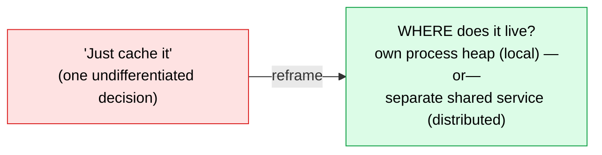
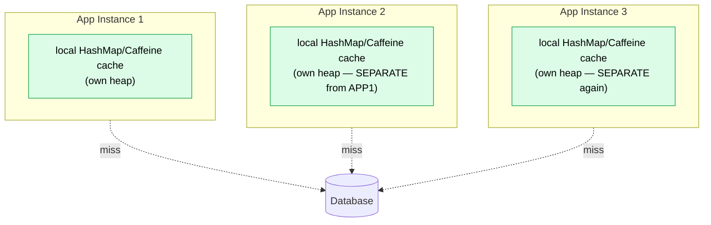
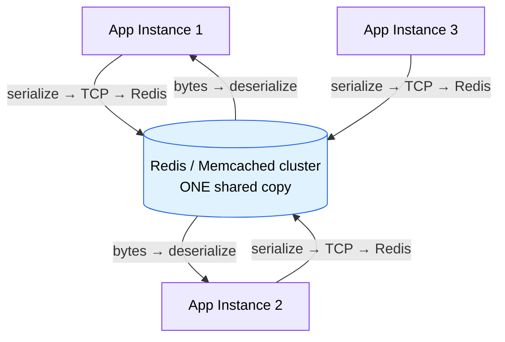
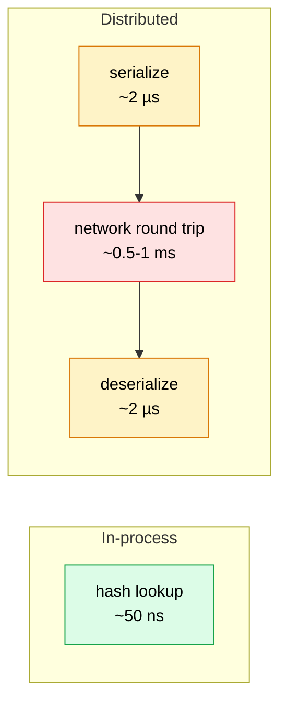
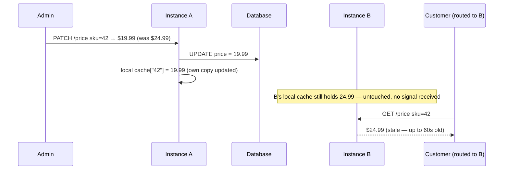
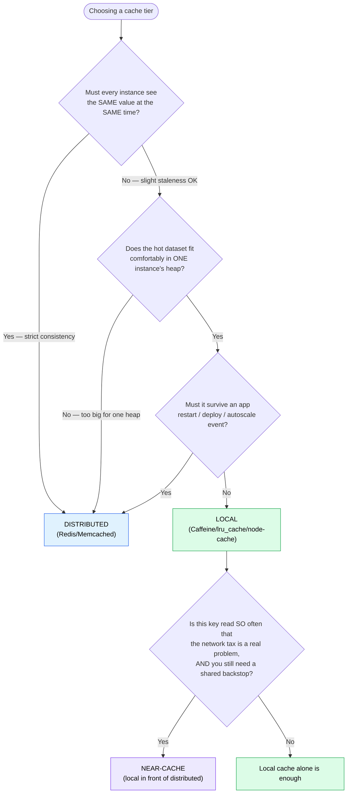
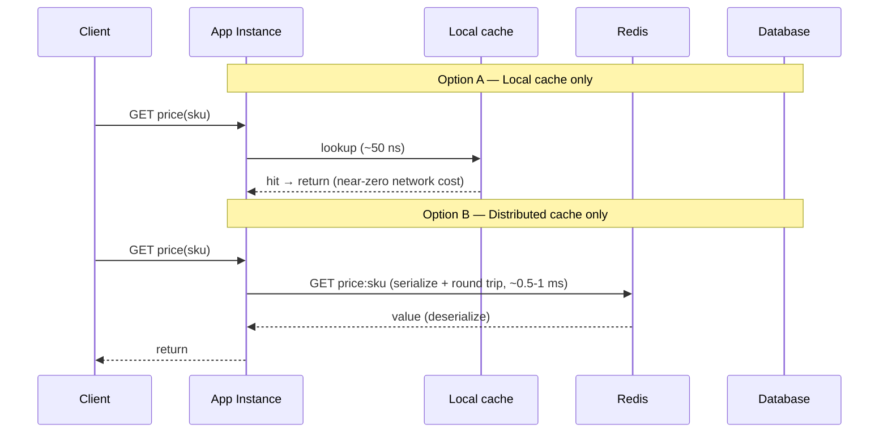
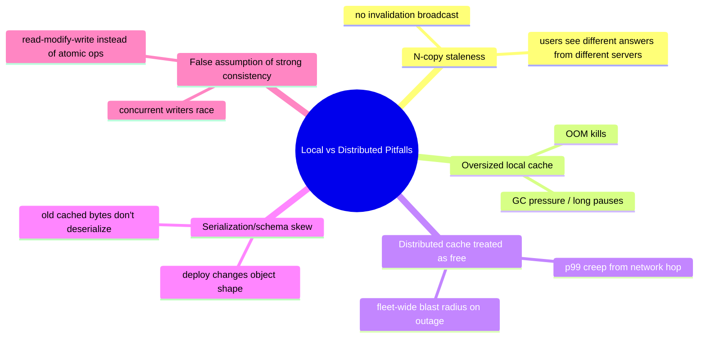

# In-Process vs Distributed Caching

> **One line:** A cache can live inside your app's own memory (nanoseconds, but one copy per server) or in a separate shared service like Redis (one consistent copy for the whole fleet, but a network hop on every access) — and picking the wrong one is either a silent consistency bug or a self-inflicted latency tax.

---

## Table of Contents
1. [Why You Must Master This](#1-why-you-must-master-this)
2. [The Mental Model](#2-the-mental-model)
3. [In-Process (Local) Caching — Mechanics & Libraries](#3-in-process-local-caching--mechanics--libraries)
4. [Distributed (Shared) Caching — Mechanics & Operational Cost](#4-distributed-shared-caching--mechanics--operational-cost)
5. [The Trade in Real Numbers — Reference vs Serialize + Network + Deserialize](#5-the-trade-in-real-numbers--reference-vs-serialize--network--deserialize)
6. [The Consistency Problem — N Instances, N Caches, No Natural Invalidation Path](#6-the-consistency-problem--n-instances-n-caches-no-natural-invalidation-path)
7. [The Near-Cache Synthesis & Decision Framework](#7-the-near-cache-synthesis--decision-framework)
8. [Worked Example — Product Price Lookups at 10,000 req/s](#8-worked-example--product-price-lookups-at-10000-reqs)
9. [Real-Life Use Cases](#9-real-life-use-cases)
10. [Failure Modes](#10-failure-modes)
11. [🏋️ Practice Drills](#-practice-drills)
12. [🎤 Interview Q&A Bank](#-interview-qa-bank)
13. [🎯 Staff+ Nuances](#-staff-nuances)
14. [Cheat Sheet](#14-cheat-sheet)
15. [Connections & Further Reading](#15-connections--further-reading)

---

## 1. Why You Must Master This

- **It's the first fork in every caching design.** Before you argue LRU vs LFU or cache-aside vs write-through, you must answer a more basic question: *where does the cache physically live?* Get this wrong and every downstream decision inherits the mistake.
- **It's a silent-bug generator, not just a performance knob.** A local cache on 20 app servers means 20 independent, possibly-divergent copies of the truth. Nobody notices in code review; someone notices in production when Support gets "the price on the site doesn't match what I was charged" tickets.
- **It's a real cost and capacity decision.** A local cache is "free" (it's spare heap you already paid for) but is capped by one box's RAM and multiplied by every instance you run. A distributed cache is an explicit line item — a Redis cluster you provision, monitor, and pay for — but its capacity scales independently of your app fleet.
- **It's one of the most common staff-level system-design follow-ups.** "You said you'd cache it — in the app, or in Redis?" is the question that separates a candidate who named a pattern from one who understands what runs where. This file, together with [[Distributed_Caching_Redis_Memcached.md]] and [[Hot_Key_Problem_Multi_Tier_Caching.md]], is the complete answer.

> **The core problem it solves:** *deciding where cached data physically lives* — inside each app process's own memory (fast, private, per-instance) or in a separate shared service every instance talks to over the network (consistent, centralized, but never free). Every other caching decision sits on top of this one.

**Prerequisites:** [Caching_Strategies.md](./Caching_Strategies.md) (cache-aside/write-through vocabulary) and [Cache_Eviction_Policies.md](./Cache_Eviction_Policies.md) (LRU/LFU — both cache types still need an eviction policy).

---

## 2. The Mental Model

The naive view treats "add a cache" as one decision. The correct view is that **"add a cache" is actually two separate decisions bolted together**: *what policy* (LRU? TTL? write-through?) and *where does it physically live*. This file is entirely about the second question, and it changes everything about the first.

- **In-process cache = a notepad in your own pocket.** You wrote something on it; it's instantly there when you reach for it. But it's *your* notepad — the person sitting next to you (another app instance) has their own notepad with their own notes, and if you scribble out an update, their copy doesn't magically update.
- **Distributed cache = a whiteboard in the shared hallway.** Everyone walks over and reads the same board, so everyone sees the same answer — but "walking over" takes time every single time, and if the hallway is blocked (the cache cluster is down or slow), *everyone* is stuck at once.



> **Hold onto this:** local cache = nanoseconds but N independent copies; distributed cache = one shared copy but a network hop, every time. Every trade-off in this file is a consequence of that one sentence.

---

## 3. In-Process (Local) Caching — Mechanics & Libraries

**What it is.** A data structure — usually a `HashMap`-like structure with an eviction policy layered on — that lives inside the application process's own memory space. No separate process, no network socket, no client library talking to another host. When your code calls `cache.get(key)`, it's a plain in-memory lookup, exactly like reading any other object your program already holds a reference to.

**Real libraries you'll actually reach for:**

| Language | Library | Notes |
|---|---|---|
| Java/JVM | **Caffeine** | Modern default; uses a Window TinyLFU eviction policy (better hit rate than plain LRU under skewed access), async loading, size/weight/time-based eviction. |
| Java/JVM | **Guava Cache** | Older, simpler, LRU-based; still common in legacy code. |
| Java/JVM | **Ehcache** | Heavier-weight, supports off-heap and disk tiers within "local" caching. |
| Python | `functools.lru_cache` | Pure in-memory LRU memoization decorator — no TTL, no size-in-bytes control, just entry count. |
| Python | **cachetools** (`TTLCache`, `LRUCache`) | Adds TTL and more eviction strategies than the stdlib decorator. |
| Node.js | **node-cache**, **lru-cache** | In-process `Map`-backed caches with TTL support. |

**Why it exists.** Because a huge share of "cache this" needs never require cross-instance sharing — feature flags, config, small reference tables, per-request memoization — and paying a network round trip for data that's re-derivable in nanoseconds is pure waste.

**How it works, under the hood.** The cache is just an object living on the process heap. A `get` is a hash lookup and a pointer dereference — the same cost as reading any other field in your program. No serialization happens because the *same in-memory object* (or a reference to it, in managed languages) is handed back — there's no byte-encoding/decoding step because nothing ever leaves the process. Eviction (Caffeine's TinyLFU, an LRU list, a simple ring buffer) runs as ordinary code on the same CPU core that's serving the request, competing with the app's own workload for that CPU and (in GC'd languages) for garbage-collector attention.

**The trade-off.** Capacity is bounded by *one box's* RAM — you cannot cache more than fits in the heap you've allocated to this single process, and a big cache is more heap for the GC to scan (longer pause times in Java; more resident memory tracked by V8 in Node). And critically: **every instance has its own, independent copy.** Ten app servers running the same code each build and hold their own local cache — there is no shared state between them at all, by construction.

**A real number.** A well-tuned Caffeine cache on the JVM serves a `get` in roughly the same ballpark as any hash-map lookup — tens of nanoseconds. That's the whole appeal, and it's also exactly what section 5 quantifies against the alternative.



> Three instances, three independent caches — nothing keeps them in sync with each other; only the shared database is common ground.

```python
# Python: cachetools TTLCache — local, in-process, time-bounded
from cachetools import TTLCache

price_cache = TTLCache(maxsize=50_000, ttl=60)  # 50k SKUs, 60s staleness window

def get_price(sku_id):
    if sku_id in price_cache:
        return price_cache[sku_id]
    price = db.query("SELECT price FROM products WHERE id = %s", sku_id)
    price_cache[sku_id] = price
    return price
```

---

## 4. Distributed (Shared) Caching — Mechanics & Operational Cost

**What it is.** A cache that runs as its *own* service — a Redis or Memcached deployment on separate hosts/containers from your app — that every app instance talks to over the network as a client. There is exactly **one** logical copy of a given key's value (or one copy per shard, in a clustered deployment), and every app instance reads and writes that same copy.

**Why it exists.** Because some data genuinely needs one source of truth across the whole fleet (session tokens, rate-limit counters), some datasets are too large for any one app server's heap, and some caches need to outlive an individual app process (surviving deploys, crashes, and autoscaling events) — none of which a local cache can do by construction.

**How it works, under the hood.** Every operation is a remote procedure call, not a memory read:
1. The app has an in-memory object it wants to cache. It **serializes** it — encodes it into bytes (JSON, MessagePack, Protobuf; see [Data_Compression_Serialization.md](./Data_Compression_Serialization.md)).
2. Those bytes travel over a TCP connection (ideally a pooled, already-established one — see [Database_Connection_Pooling.md](./Database_Connection_Pooling.md)) to a Redis/Memcached node.
3. The server does its own in-memory hash-table lookup (this part *is* as fast as a local cache — Redis is itself just an in-memory hash map with a network listener wrapped around it) and returns the bytes.
4. The app **deserializes** the bytes back into a usable object.

**The trade-off.** You gain a single, shared, independently-scalable store that survives your app's own restarts — but you pay steps 1, 2, and 4 above on *every single access*, and you've added a new service to your architecture: something to provision, size, monitor, secure, and fail over. See [Distributed_Caching_Redis_Memcached.md](./Distributed_Caching_Redis_Memcached.md) for the deep dive on Redis/Memcached internals, clustering, and persistence — this file only covers the "local vs shared" decision itself.

**A real number.** Redis executes a simple `GET` server-side in roughly 10-100 microseconds (it's single-threaded, in-memory, and the command itself is cheap) — but the *round trip* the app actually experiences, dominated by the network hop, typically lands around **0.3-1ms within the same datacenter/AZ**, and **1-5ms** if the client and cache cluster are in different availability zones. That gap between "server-side cost" and "what the caller actually waits for" is the whole story of section 5.



> One shared copy means instance 2 sees instance 1's write immediately (modulo TTL) — but every instance pays the same network+serialization tax to get there.

```python
# Python: redis-py — distributed, shared, network round trip on every call
import redis, json

r = redis.Redis(host="cache.internal", port=6379)

def get_price(sku_id):
    cached = r.get(f"price:{sku_id}")          # network round trip + deserialize
    if cached:
        return json.loads(cached)
    price = db.query("SELECT price FROM products WHERE id = %s", sku_id)
    r.setex(f"price:{sku_id}", 60, json.dumps(price))   # serialize + network round trip
    return price
```

---

## 5. The Trade in Real Numbers — Reference vs Serialize + Network + Deserialize

This is the number every "local vs distributed" argument ultimately reduces to. An in-process cache hands back a **reference to an object already sitting in your address space**; a distributed cache hands back **bytes that traveled over a wire and must be decoded**.

| Operation | Approx. latency | Why |
|---|---|---|
| Local `HashMap`/Caffeine `get()` | **20-100 ns** | Hash lookup + pointer dereference; same cost as any in-memory field access. |
| Redis command execution (server-side only) | **10-100 µs** | In-memory hash lookup on the Redis box — fast, but not "free" like a local read, and it's not what the caller waits on. |
| Serialize a small object (JSON) | **~1-10 µs** | CPU work to walk the object graph and encode text. |
| Serialize a small object (Protobuf/MessagePack) | **~0.2-2 µs** | Binary schema, no text parsing — see [Data_Compression_Serialization.md](./Data_Compression_Serialization.md). |
| Network round trip, same rack/AZ (Redis/Memcached) | **0.3-1 ms** | Physical wire time + kernel network stack, even on a warm, pooled connection. |
| Network round trip, cross-AZ | **1-5 ms** | Extra hops inside the datacenter/region. |
| Network round trip, cross-region | **30-150 ms** | Speed-of-light floor over long distance — never do this for a cache. |



> The network hop dominates the distributed path by roughly **3 orders of magnitude** over serialization cost — the round trip, not the encoding, is what you're really paying for.

**The takeaway, stated as a ratio:** a local cache hit (~50ns) is on the order of **10,000-20,000x faster** than a distributed cache hit (~0.5-1ms) for the *identical* piece of data. That ratio is *why* the near-cache pattern (section 7) exists at all — it's too large a gap to ignore for genuinely hot keys, but too large a consistency risk to use everywhere blindly (section 6).


> The animation speeds are illustrative, not to scale — the real ~10,000-20,000x gap is exactly why a near-cache (local cache in front of the distributed one) exists for hot keys.

---

## 6. The Consistency Problem — N Instances, N Caches, No Natural Invalidation Path

This is the problem that is *unique* to local caching and does not exist (in the same form) for a distributed cache, because a distributed cache has exactly one copy to keep fresh. A local cache has **N** copies — one per app instance — and there is no built-in mechanism for instance A to tell instances B..N "the value you're holding is now wrong."

**Walk through it concretely.** Five app instances (A-E) sit behind a load balancer, each running the `TTLCache` from section 3 with a 60-second TTL, caching a product's price.



> Instance A's write only updates instance A's memory. Instances B-E keep serving the old price until their own TTL happens to expire — a customer's experience now depends on *which server the load balancer happened to route them to*.

That last line is what makes this worse than ordinary staleness: it's not just "the data might be a minute old," it's "two requests hitting the *same* system at the *same* moment can get *different* answers," which is a much harder bug to explain to a customer (or in a post-incident review) than plain staleness.

**The fixes, in increasing order of sophistication:**

1. **Short TTL.** Bound the worst-case staleness window by expiring entries quickly (seconds, not minutes). Simple, no new infrastructure — but it's in direct tension with the reason you cached at all: a shorter TTL means more cache misses, which means more load pushed back onto the database, eroding the benefit.
2. **Pub/Sub invalidation broadcast.** On every write, publish an "evict key X" message on a channel (Redis Pub/Sub, a Kafka topic, or an internal event bus); every instance subscribes and evicts the key from its *local* cache the moment the message arrives. This closes the staleness window to roughly the message-delivery latency (usually tens of milliseconds) instead of the full TTL — at the cost of a new moving part, and the fact that most pub/sub transports don't guarantee delivery to a instance that's briefly disconnected, so it's normally paired with a TTL as a safety net, not used alone.
3. **Versioned/ETag values.** Store a small version marker (an integer or `updated_at` timestamp) alongside the cached value, and keep a cheap, centralized "current version" lookup (a single small key in Redis, or a lightweight endpoint) that every instance checks before trusting its local copy. This is far cheaper than distributed-caching the *whole* payload on every read — you're paying a network round trip only for a tiny freshness check, not the full object — and it's the same idea behind HTTP [ETags](./HTTP_Caching.md) and Redis 6+ client-side caching's invalidation tracking, reapplied at the application layer.
4. **Accept eventual consistency, explicitly.** For a large class of reads (view counters, "trending now" lists, a homepage banner), a minute of staleness is genuinely fine. The senior move isn't eliminating staleness everywhere — it's *naming the acceptable staleness window out loud* so it's a deliberate decision, not an accidental bug someone discovers in production.

---

## 7. The Near-Cache Synthesis & Decision Framework

**The near-cache pattern, briefly.** Put a small local cache *in front of* the distributed cache: every read checks the local cache first (nanoseconds); on a local miss, check the distributed cache (sub-millisecond); only on a *distributed* miss does anyone touch the database. Writes go to the distributed cache (the durable, shared source of truth) and are propagated to local caches either passively (short local TTL) or actively (the pub/sub broadcast from section 6). This gets you the nanosecond speed of local caching for the 90%+ of reads that hit a hot key, while keeping one authoritative shared copy that bounds how wrong any instance can be and for how long.

> This file covers the near-cache pattern only as the *answer* to the local-vs-distributed trade-off. The full mechanics — coherence protocols, tiered eviction, and how this specifically solves celebrity/hot-key skew — live in [Hot_Key_Problem_Multi_Tier_Caching.md](./Hot_Key_Problem_Multi_Tier_Caching.md). Read that file for the deep dive; this section only establishes *why* the synthesis exists.



| Signal | Points to |
|---|---|
| Read-heavy, small dataset, slight staleness tolerable | **Local** — feature flags, config, static reference tables. |
| Must be identical across every instance at all times (sessions, rate-limit counters, distributed locks) | **Distributed** — one shared copy is the whole point. |
| Dataset too large for any one instance's RAM | **Distributed** — capacity must scale independently of the app fleet. |
| Must survive an app crash, deploy, or autoscaling event | **Distributed** — a local cache dies with its process. |
| Extremely hot key(s) at high read volume, but a shared source of truth is still required | **Near-cache** — local speed for the hot path, distributed tier as backstop and cross-instance sync point. |

---

## 8. Worked Example — Product Price Lookups at 10,000 req/s

**The setup:** 20 app instances behind a load balancer, together serving **10,000 price-lookup requests/second** (500 req/s per instance) against a 50,000-SKU catalog where each price record is roughly 1KB. Compare four architectures.



- **No cache.** All 10,000 req/s hit the database directly. At 2-5ms per point lookup, the DB must sustain 10,000 QPS of reads continuously — realistically this needs read replicas or a beefy instance dedicated just to this traffic, and every other query competes with it. This is the baseline every caching option is trying to avoid.
- **Local cache only (60s TTL).** Each instance loads its slice of the 50MB catalog (50,000 × 1KB) into heap once — trivial for any modern JVM/Node/Python process. After warm-up, all 10,000 req/s are served at ~50-100ns each: effectively zero added latency and zero network traffic. **The cost:** during a price change, up to 20 independent caches can disagree for up to 60 seconds (the exact scenario from section 6) — acceptable for a "current price is approximately X" display, risky if this same cache backs the checkout price shown to the customer.
- **Distributed cache only (Redis).** Every one of the 10,000 req/s pays a network round trip (~0.8ms typical intra-AZ) plus serialization (~a few µs). Redis itself handles 10,000 ops/sec trivially — a single node comfortably clears 100,000+ ops/sec — so *throughput* was never the bottleneck. The real cost is the **latency tax on the critical path**: 10,000 req/s × 0.8ms ≈ **8 seconds of cumulative added wait time every second**, spread across the fleet — and Redis is now a single dependency whose p99 spike or brief outage stalls price lookups for every one of the 20 instances at once (a blast-radius risk a local cache never has).
- **Near-cache (local in front of Redis, 5s local TTL, pub/sub invalidation on write).** ~99% of the 10,000 req/s are absorbed by the local tier at ~100ns; only the trickle of per-instance refreshes (20 instances refreshing roughly every 5s ≈ 4 requests/second *total* to Redis) crosses the network. A price change now propagates to all 20 instances within roughly the pub/sub delivery latency (tens of milliseconds), not the full 60-second local TTL, while Redis remains the shared, restart-surviving source of truth.

**The number that forces the decision:** the gap between "~0ms added" (local) and "~8 cumulative seconds/second added" (pure distributed) at this request volume is what pushes a real price-lookup service toward the near-cache design rather than either extreme — the raw speed of local caching is too valuable to give up at 10,000 req/s, but the consistency guarantee of a shared tier is too important to drop for anything customers pay real money against.

---

## 9. Real-Life Use Cases

| Situation | Local, Distributed, or Near-cache — and why | The decision it forces |
|---|---|---|
| Feature flags / small config, rarely changes | **Local** — tiny dataset, read on every request, staleness of seconds is harmless. | Bake a short-TTL local cache directly into the flag-evaluation SDK. |
| Session store behind a load balancer | **Distributed** — any instance must be able to serve any user's session. | Sessions live in Redis/Memcached, never in app heap. |
| Fleet-wide rate-limit counters | **Distributed** — the quota must be enforced against one shared count, not 20 independent ones. | Atomic `INCR` against a single Redis key (or cluster), not per-instance counting. |
| Product price/stock on a high-traffic catalog page | **Near-cache** — read-dominant and extremely hot, but must reflect changes within seconds during a sale. | Local cache for speed, Redis as source of truth + pub/sub invalidation for correctness. |
| Per-request resolved permissions, used 5x within one request handler | **Local, request-scoped** — the cache's whole lifetime is the request; no TTL even needed. | A plain map created per request, discarded at request end — not a long-lived cache at all. |
| Recommendation model output per user, computed by a separate service | **Distributed** — large dataset, computed elsewhere, must be shared and survive restarts. | Written once by the batch job, read by many stateless app instances from Redis. |
| Static reference data (currency codes, country list) shipped with a deploy | **Local** — effectively immutable within a deploy's lifetime. | Load once at process startup; no TTL, no network calls, ever. |

> **The habit:** before reaching for Redis by default (or a `HashMap` by default), ask *"if I updated this on one instance right now, would it be a bug or a non-event for another instance to still show the old value for the next minute?"* — that single question routes almost every case in the table above.

---

## 10. Failure Modes



- **"Split-brain" staleness across instances.** *Symptom:* two users hitting the same feature at the same moment get different answers, and it correlates with which server the load balancer picked. *Root cause:* a local cache with TTL as the *only* invalidation mechanism — no broadcast path exists between instances by construction (section 6). *Fix:* add pub/sub invalidation or a version-check, or move the data to the distributed tier if strict consistency is actually required.
- **Local cache grows until it hurts the app it's supposed to speed up.** *Symptom:* latency spikes and GC pause times climb in step with cache size; eventually an OOM kill. *Root cause:* an unbounded (or too generously bounded) local cache competing with the app's own working memory for heap and GC attention. *Fix:* bound by entry count or weighted size (Caffeine's `maximumWeight`), monitor heap usage explicitly, and move large or slow-changing datasets to the distributed tier instead of growing the local one indefinitely.
- **Treating the distributed cache as a free, infallible read.** *Symptom:* p99 latency creeps upward as read volume grows, and a single flaky cache node degrades every app instance simultaneously. *Root cause:* every access is a real network call with a real failure mode, and the whole fleet shares fate with one dependency. *Fix:* a near-cache for hot keys to absorb most reads locally, plus timeouts/circuit breakers with a DB (or stale-value) fallback so a cache blip doesn't become a full outage.
- **Serialization/schema mismatch after a deploy.** *Symptom:* deserialization errors or garbled objects immediately after rolling out a new version. *Root cause:* the distributed cache's entries *survive* the deploy (normally a feature), but an old cached blob's byte layout doesn't match the new app's deserializer. *Fix:* version cache keys or payload schemas (`user:v2:123`), and fail soft (fetch from DB) on a deserialize error rather than crashing the request.
- **Assuming "distributed" means "consistent."** *Symptom:* two near-simultaneous writes from different instances clobber each other unexpectedly — a "last write wins" surprise. *Root cause:* a shared cache gives you one copy, not transactional isolation between concurrent writers; a naive read-modify-write from the app still races. *Fix:* use the cache's atomic primitives (`INCR`, `SETNX`, Lua scripts/transactions) instead of read-then-write from application code.

---

## 🏋️ Practice Drills

> *Cover the solutions and attempt first — active recall is the point.*

**Drill 1 — Route the cache.** For each, pick local, distributed, or near-cache, and say why in one sentence: (a) a per-request cache of "does this user have admin rights" checked 8 times during one request; (b) a shopping cart that must be visible no matter which of 30 stateless app servers a user's next request lands on; (c) a country-code-to-name lookup table that never changes between deploys; (d) a "flash sale inventory count" read 50,000 times/second but that must reflect a sellout within ~2 seconds.

<details><summary>Solution</summary>

(a) **Local, request-scoped** — the data's entire useful lifetime is one request; a plain map created at request start needs no TTL, no invalidation, and no network call at all.

(b) **Distributed** — the cart must be the same object regardless of which server handles the next request; a local cache would mean the user's cart depends on load-balancer routing, which is a correctness bug, not a caching optimization.

(c) **Local** — tiny, effectively immutable within a deploy's lifetime; load once at startup and never touch the network for it again.

(d) **Near-cache** — the read volume is far too high to pay a network round trip on every access, but a 60-second local-only TTL would let dozens of instances keep selling sold-out inventory; pair a short local TTL with pub/sub invalidation (or a very short TTL like 1-2s) backed by Redis as the authoritative count.
</details>

**Drill 2 — Do the latency math.** An app has 15 instances, each handling 800 req/s of a lookup that's currently uncached (3ms DB round trip each). Compute the total added-latency cost per second of (i) adding a Redis-only cache at 0.7ms/round trip, and (ii) adding a near-cache design where 98% of reads hit a local tier at 80ns and 2% still reach Redis at 0.7ms. What does the comparison tell you?

<details><summary>Solution</summary>

Total requests/sec = 15 × 800 = **12,000 req/s**.

**(i) Redis-only:** 12,000 × 0.7ms = 8,400ms = **8.4 cumulative seconds of added latency per second**, down from the uncached baseline of 12,000 × 3ms = 36 cumulative seconds/second — a real win over hitting the DB directly, but still a substantial, ever-present network tax on every single request.

**(ii) Near-cache:** 98% local (11,760 req/s × 80ns ≈ 0.94ms total, effectively negligible) + 2% to Redis (240 req/s × 0.7ms = 168ms cumulative/second). Total ≈ **~0.17 cumulative seconds/second** — roughly **50x less added latency** than the Redis-only design, for the same request volume.

**The lesson:** a distributed-only cache is already a huge improvement over no cache, but at meaningfully high request volumes the *network tax itself* becomes worth eliminating for the hot path — which is exactly the argument for layering a local cache in front of it rather than treating "we added Redis" as the finish line.
</details>

**Drill 3 — Design the invalidation.** Marketing wants a coupon code's validity to flip from "valid" to "invalid" within 5 seconds of being disabled in the admin panel, across a fleet of 30 app instances. A naive local cache with a 5-minute TTL is currently in place (chosen for its near-zero read latency, since coupon checks happen on every checkout). Design a fix that keeps most of the local cache's speed.

<details><summary>Solution</summary>

Keep the local cache (checkout-path reads must stay in the tens-of-nanoseconds range — this is exactly the read-heavy, latency-sensitive case local caching is for) but add an active invalidation path instead of relying on the 5-minute TTL alone:

1. **Shorten the local TTL** to something like 5-10 seconds as a safety net — bounds the *worst case* even if the active path below fails.
2. **Publish an invalidation event on disable.** When an admin disables a coupon, the admin service publishes `{event: "coupon_invalidated", code: "SAVE20"}` on a pub/sub channel (Redis Pub/Sub or an internal event bus).
3. **Every app instance subscribes** and evicts that specific key from its local cache the moment the message arrives — typically tens of milliseconds, comfortably inside the 5-second requirement.
4. **Redis (or the DB) remains the source of truth** for the "is this coupon currently valid" check on a local cache miss, so an instance that missed the pub/sub message (e.g., was mid-restart) still self-corrects on its next miss within the 5-10s safety-net TTL.

This is the near-cache pattern applied directly: local speed for the 99.99% of checkout reads that are cache hits, a shared/broadcast mechanism bounding staleness for the rare "just changed" case, and a short TTL as a fallback for the rarer case where the broadcast itself is missed.
</details>

---

## 🎤 Interview Q&A Bank

**Q1. "When would you use a local in-process cache instead of Redis?"**
> When the dataset is small enough to fit comfortably in one instance's heap, reads vastly outnumber writes, and the workload can tolerate a bounded window of staleness — feature flags, small config tables, static reference data. The win is nanosecond access with zero network cost and zero new infrastructure; the price is that every instance holds its own independent copy, so it's wrong whenever different servers must agree on the same value at the same moment.

**Q2. "What's the fundamental risk of a local cache that a distributed cache doesn't have?"** *(signal: tests whether the candidate has internalized section 6, not just memorized "staleness")*
> With N app instances each holding their own local cache, a write on instance A has no natural path to reach instances B..N — there's no shared memory between separate processes. That means two simultaneous requests to the *same* logical system, at the *same* moment, can get *different* answers depending purely on load-balancer routing — a stronger failure than ordinary staleness, since it's inconsistency at a single point in time, not just "slightly old data." The fixes are a short TTL, a pub/sub invalidation broadcast, versioned/ETag freshness checks, or explicitly accepting eventual consistency.

**Q3. "Why is a distributed cache access so much slower than a local one, exactly?"**
> A local `get` is a hash lookup on data already in your address space — tens of nanoseconds, no encoding step, because the same object is handed back. A distributed cache access requires serializing your object to bytes, sending those bytes over the network to a separate host, and deserializing the response — and the network round trip alone (0.3-1ms even within the same datacenter) dwarfs the serialization cost by roughly three orders of magnitude. The gap is on the order of 10,000-20,000x for the identical piece of data.

**Q4. "Does moving to a distributed cache solve the consistency problem?"** *(signal: catches candidates who conflate "shared" with "consistent")*
> It solves the *specific* N-independent-copies problem, because there's now exactly one copy every instance reads. But "distributed" is not "transactionally consistent" — concurrent writers can still race (a naive read-modify-write from two instances can clobber each other), so you still need the cache's atomic primitives (`INCR`, `SETNX`, Lua scripts) rather than assuming a single shared copy makes read-then-write safe.

**Q5. "What is a near-cache, and when do you reach for it?"**
> A small local cache placed in front of a distributed cache: reads check local first (nanoseconds), fall back to the distributed tier on a local miss (sub-millisecond), and only miss to the database if both miss. It's the synthesis for keys that are hot enough that the network tax of a pure distributed design is a real cost, but that still need one shared, restart-surviving source of truth for correctness — see [Hot_Key_Problem_Multi_Tier_Caching.md](./Hot_Key_Problem_Multi_Tier_Caching.md) for the full mechanics.

**Q6. "Your service is scaling from 5 to 50 instances. Does that change your local-vs-distributed calculus?"** *(signal: tests whether staleness/cost reasoning scales with fleet size)*
> Yes, in both directions. A local cache's total staleness *risk* grows — 50 independently-diverging copies is a bigger problem than 5 — pushing toward stronger invalidation or a distributed/near-cache design. But the *aggregate memory cost* of a local cache also grows linearly (50 copies of the same hot dataset instead of 5), which is itself an argument for one shared copy once the dataset is large; conversely, a pure distributed design's aggregate network load grows linearly with instance count too, which is the argument *for* adding a local tier as the fleet gets bigger, not against it.

**Q7. "A cached object's schema changed in your last deploy and now the app is throwing deserialization errors right after rollout. What happened and how do you prevent it?"**
> This is specific to the distributed tier: cached bytes outlive the process that wrote them, so entries written by the old version are still sitting in Redis when the new version starts reading them, and the byte layout no longer matches the new deserializer. Prevent it by versioning cache keys or payload schemas (e.g., `user:v2:123`) so old and new versions never collide, and fail soft — fall back to the database on a deserialize error — rather than letting it crash the request.

**Q8. "How much RAM does a local cache actually cost you at the fleet level, compared to a shared one?"**
> Multiplicatively more. If a hot dataset is 200MB and you run 40 instances with a full local copy each, that's 8GB of aggregate RAM spent on the *same* data, versus one 200MB copy in a shared Redis cluster. It's a real, quotable cost trade-off — local caching looks "free" per instance but isn't free at the fleet level, which matters when the dataset is large enough that the multiplication is real money.

---

## 🎯 Staff+ Nuances

- **"Distributed" is a location claim, not a consistency guarantee.** A shared Redis instance gives you *one copy*, not ACID transactions between concurrent writers. Senior engineers still reach for atomic server-side operations (`INCR`, `SETNX`, Lua scripts, `WATCH`/`MULTI`) rather than assuming a shared cache makes naive read-modify-write safe — races exist at the *distributed* tier too, just a different kind than the N-copy problem local caching has.
- **Off-heap and embedded stores blur the "local vs distributed" line from the other side.** Ehcache's off-heap tier, Chronicle Map, and RocksDB-backed local stores hold far more data than a plain in-heap `HashMap` (avoiding GC pressure on huge caches) while still living inside — or directly attached to — the app process, with no network hop. They're a genuine middle option between "small heap-bound cache" and "network-attached Redis," worth naming when a dataset is local-cache-shaped in every way except size.
- **A local cache is *maximally* cold on every deploy and autoscale event — a distributed one isn't.** A rolling deploy of 40 instances means 40 simultaneous cold starts hammering the database until each local cache refills; a shared distributed cache is untouched by the deploy and stays warm. This is precisely the scenario [Cache_Warming_Strategies.md](./Cache_Warming_Strategies.md) exists to solve, and it's an argument for the distributed (or near-cache) tier that has nothing to do with cross-instance consistency at all.
- **The network cost of a distributed cache is a fleet-wide blast-radius problem, not just a per-request latency line item.** Every instance shares fate with the same cache cluster: a GC pause or failover blip on the Redis side is felt by 100% of app instances simultaneously, whereas one instance's local cache misbehaving is contained to that instance. Sizing timeouts, circuit breakers, and fallback-to-DB behavior for the cache dependency is as important as sizing the cache itself.
- **Redis 6+ client-side caching (tracking/invalidation) is the near-cache pattern being absorbed into the cache client itself.** Rather than an app team hand-rolling pub/sub invalidation, the Redis client can subscribe to server-side invalidation notifications for keys it has locally cached, evicting them automatically. Naming this in an interview signals you know the pattern has moved from "something teams build" to "something infrastructure increasingly provides."
- **Local-cache memory cost multiplies with fleet size in a way that should be modeled explicitly, not assumed away.** A cache that looks cheap ("it's just spare heap") at 5 instances can become a genuine capacity-planning line item at 200 instances — see Interview Q8's arithmetic. Staff-level design docs should state the aggregate, fleet-wide memory cost of a local caching decision, not just the per-instance one.
- **The right answer is almost never "pick one forever" — it's per-key, and it should be revisited as read/write ratios and fleet size change.** A dataset that was local-cache-appropriate at 5 instances and 100 req/s can become near-cache-appropriate at 100 instances and 50,000 req/s without any change to the *data* itself — only the shape of the traffic changed. Treat this as a decision to revisit at scale checkpoints, not a one-time architecture call.

---

## 14. Cheat Sheet

```
IN-PROCESS vs DISTRIBUTED CACHING
═══════════════════════════════════════════════════════════════════════════

                    LOCAL (in-process)          DISTRIBUTED (shared)
  lives in          app's own heap              separate service (Redis/Memcached)
  access             ~20-100 ns (hash lookup)    ~0.3-1ms same-AZ round trip (+µs serialize)
  copies             N instances = N copies      ONE logical copy (per shard)
  capacity           bounded by ONE box's RAM    scales independently of app fleet
  survives restart?  NO — dies with the process  YES — external, untouched by deploys
  new infra to run?  no                          YES — provision/monitor/fail over
  consistency        NONE between instances       one shared value (still not txn-safe
                     (no natural invalidation)     vs concurrent writers — use atomics)
  libraries          Caffeine, Guava, Ehcache,    Redis, Memcached (+ client lib)
                     functools.lru_cache/
                     cachetools, node-cache

THE NUMBER THAT MATTERS
  local hit  ~50 ns   }
  dist. hit  ~0.5-1ms } ratio ≈ 10,000-20,000x — why near-cache exists for hot keys

THE CONSISTENCY PROBLEM (local-only)
  instance A writes → only A's memory updates → B..N serve stale until:
    1. short TTL              (simple, but more DB load)
    2. pub/sub invalidation    (fast, needs a broadcast channel, pair with TTL)
    3. versioned/ETag check    (cheap freshness check, not full payload)
    4. accept eventual consistency (fine for low-stakes reads — say so explicitly)

NEAR-CACHE = local (front) + distributed (backstop/source of truth)
  full depth → Hot_Key_Problem_Multi_Tier_Caching.md

DECISION FRAMEWORK
  small + read-heavy + staleness OK              → LOCAL
  must be identical across instances always      → DISTRIBUTED
  too big for one heap / must survive restarts   → DISTRIBUTED
  very hot key + still need a shared backstop    → NEAR-CACHE

PITFALLS
  ✗ local cache, no invalidation path → split-brain staleness across servers
  ✗ unbounded local cache            → GC pressure / OOM
  ✗ distributed cache treated as free → p99 creep + fleet-wide blast radius
  ✗ "distributed" ≠ "consistent"      → still need atomic ops vs concurrent writers
  ✗ stale bytes after a deploy        → version cache keys/schemas, fail soft
  ✓ model AGGREGATE local-cache RAM cost (per-instance size × fleet size), not just per-box
```

---

## 15. Connections & Further Reading

**Prerequisites (learn first):**
- [Caching_Strategies.md](./Caching_Strategies.md) — cache-aside/write-through vocabulary this file assumes.
- [Cache_Eviction_Policies.md](./Cache_Eviction_Policies.md) — both local and distributed caches still need an eviction policy once they're full.

**Builds toward / pairs with:**
- [Hot_Key_Problem_Multi_Tier_Caching.md](./Hot_Key_Problem_Multi_Tier_Caching.md) — the near-cache pattern's full mechanics and coherence protocol, motivated by celebrity/hot-key skew.
- [Distributed_Caching_Redis_Memcached.md](./Distributed_Caching_Redis_Memcached.md) — the deep dive on what actually runs inside the "distributed" box: Redis vs Memcached, clustering, replication, persistence.
- [Cache_Invalidation_Consistency.md](./Cache_Invalidation_Consistency.md) — TTL vs event-driven invalidation and stampede mitigation, the general version of section 6's problem.
- [Cache_Warming_Strategies.md](./Cache_Warming_Strategies.md) — how to avoid the cold-start problem this file names for local caches after every deploy.
- [Data_Compression_Serialization.md](./Data_Compression_Serialization.md) — the serialize/deserialize cost quantified in section 5.
- [Database_Connection_Pooling.md](./Database_Connection_Pooling.md) — the pooled-connection assumption behind the "0.3-1ms" round-trip figures.
- [Latency_Numbers_Every_Programmer_Should_Know.md](../01_Planning_Foundations/Latency_Numbers_Every_Programmer_Should_Know.md) — the raw memory/network/disk latency figures this file's numbers are built on.
- [Off_Heap_Embedded_Caches.md](./Off_Heap_Embedded_Caches.md) — the third option between "in-heap local" and "network-attached distributed": Ehcache off-heap, Chronicle Map, and RocksDB-backed embedded stores that hold huge datasets locally while dodging the GC pause this file's Staff+ Nuances flag.

**External classics:**
- [Caffeine wiki](https://github.com/ben-manes/caffeine/wiki) — the Window TinyLFU design and benchmarks behind the modern JVM local-cache default.
- [Redis: Client-side caching](https://redis.io/docs/manual/client-side-caching/) — Redis 6+'s built-in tracking/invalidation, the near-cache pattern absorbed into the protocol.
- *Designing Data-Intensive Applications* (Kleppmann) — the broader caching/consistency framing this file's section 6 draws on.

---

## TL;DR
**A cache's physical location — inside your app's own process, or in a separate shared service — matters more than which eviction policy or write strategy you pick, because it decides whether you have one source of truth or N independently-drifting ones.** A local cache (Caffeine, `functools.lru_cache`, node-cache) gives nanosecond access with zero network cost, but every instance holds its own private copy with no natural way to learn about another instance's writes — the fix is a short TTL, a pub/sub invalidation broadcast, versioned freshness checks, or explicitly accepted staleness. A distributed cache (Redis/Memcached) gives one shared, restart-surviving copy that scales independently of your app fleet, but every access pays a real network round trip (roughly 10,000-20,000x slower than a local hit) plus serialization cost, and it's a new operational dependency the whole fleet shares fate with. **Choose local for small, read-heavy, staleness-tolerant data; distributed when instances must agree or the dataset must outlive a process; and reach for a near-cache — local in front of distributed — when a key is hot enough to need both.**
