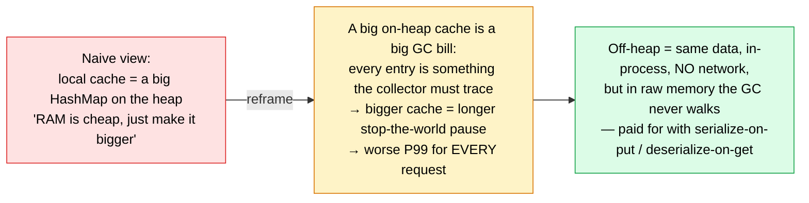
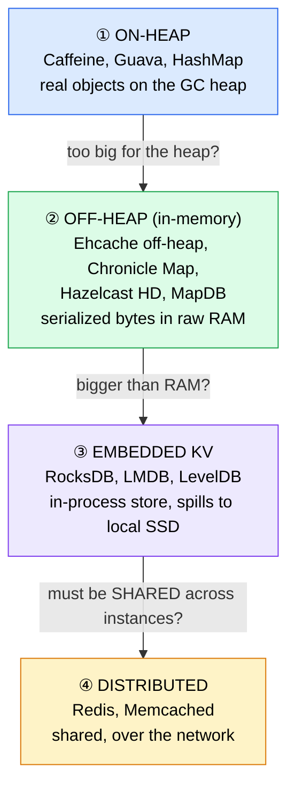
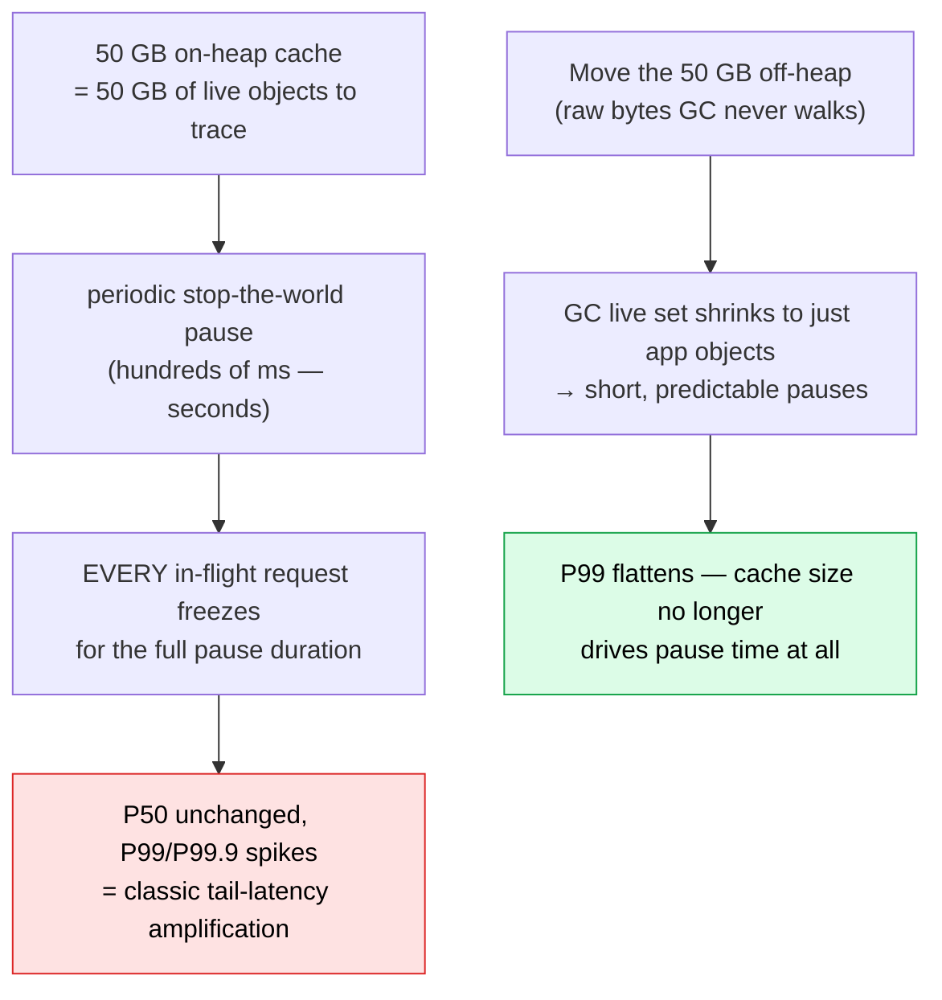
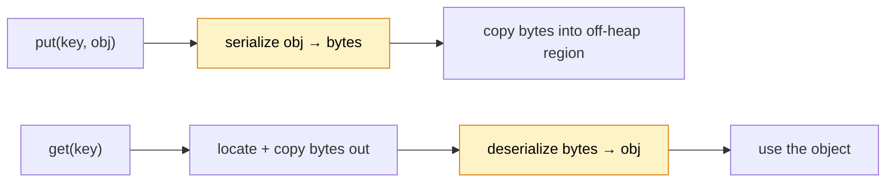
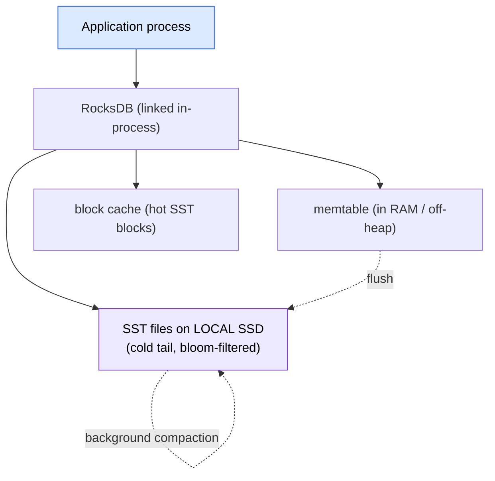
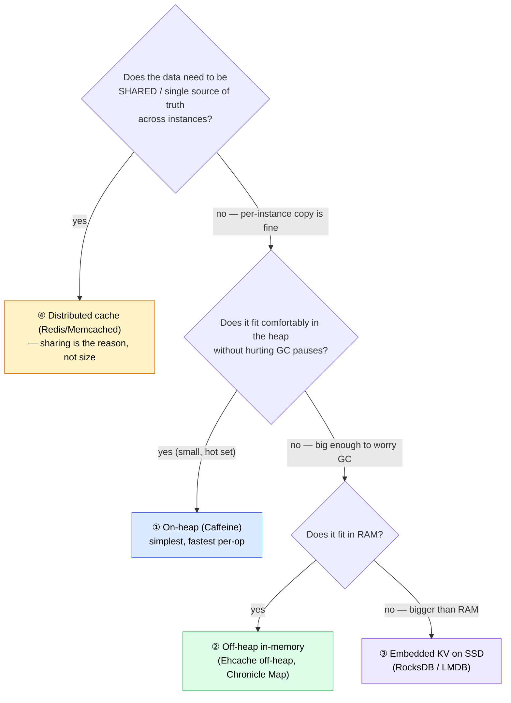
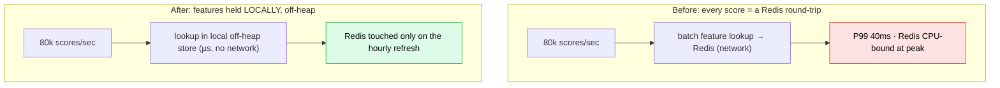
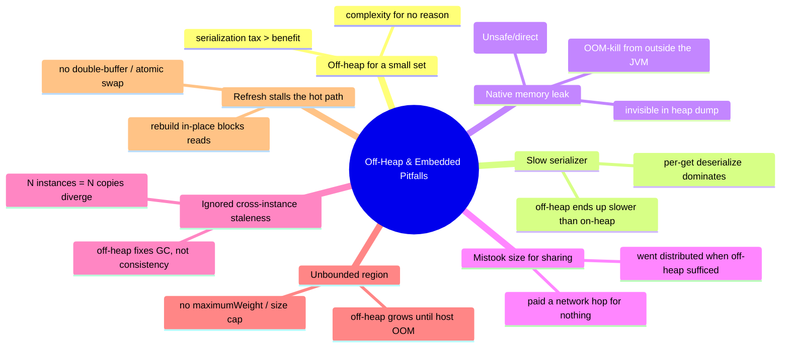

# Off-Heap & Embedded Caches

> **One line:** When a local cache is the right shape in every way *except* that it's too big for the JVM heap, the answer isn't "give up and go to Redis" — it's to keep the data **in-process but off the garbage-collected heap** (off-heap, via raw memory the GC never scans) or in an **embedded key-value store** (RocksDB/LMDB spilling to local SSD): a third tier that buys you huge, local, network-free storage at the price of serializing every value and hand-managing memory.

---

## Table of Contents
1. [Why You Must Master This](#1-why-you-must-master-this)
2. [The Mental Model](#2-the-mental-model)
3. [The Three Tiers of Local Memory](#3-the-three-tiers-of-local-memory)
4. [Why the GC Pause *Is* Tail Latency](#4-why-the-gc-pause-is-tail-latency)
5. [How Off-Heap Storage Actually Works](#5-how-off-heap-storage-actually-works)
6. [Embedded KV Stores — Off-Heap Taken to Disk](#6-embedded-kv-stores--off-heap-taken-to-disk)
7. [When to Reach for Off-Heap — the Decision](#7-when-to-reach-for-off-heap--the-decision)
8. [Worked Example — A 60 GB Local Feature Store](#8-worked-example--a-60-gb-local-feature-store)
9. [Real-Life Use Cases](#9-real-life-use-cases)
10. [Failure Modes](#10-failure-modes)
11. [🏋️ Practice Drills](#-practice-drills)
12. [🎤 Interview Q&A Bank](#-interview-qa-bank)
13. [🎯 Staff+ Nuances](#-staff-nuances)
14. [Cheat Sheet](#14-cheat-sheet)
15. [Connections & Further Reading](#15-connections--further-reading)

---

## 1. Why You Must Master This

The in-process-vs-distributed choice ([In_Process_vs_Distributed_Cache.md](./In_Process_vs_Distributed_Cache.md)) is usually taught as a binary: a small, blazing-fast local cache on the heap, or a large, shared cache across the network. That framing hides a third option that solves a very common real problem — **the dataset is local-cache-shaped in every way except that it's too big for the heap** — and reaching for Redis in that case pays a network round-trip you didn't actually need to pay.

- **The garbage collector is the hidden author of your P99.** A large on-heap cache doesn't just cost RAM — it costs *pause time*. Every object in a 50 GB heap is something the GC must eventually trace, and a stop-the-world collection over that much live data is measured in *hundreds of milliseconds to seconds*. That pause hits **every request in flight**, so "we made the cache bigger" quietly becomes "our P99 got worse" — the exact tail-latency problem the rest of this section fights (see [Performance_Metrics.md](./Performance_Metrics.md)). Off-heap storage is the standard answer, and "how do you cache 100 GB locally without wrecking GC?" is a real senior-level question.
- **It's the difference between one network hop and none.** For a hot dataset read millions of times per second — an ad-targeting model, a feature store, a routing table — a Redis lookup at ~0.5–1 ms is *enormously* slower than a local read at nanoseconds-to-microseconds. If that data fits on the box but not in the heap, off-heap keeps it local. The whole point of a local cache (no network) survives; only the GC constraint is removed.
- **Every serious JVM cache and database already does this, and naming the mechanism signals depth.** Ehcache's off-heap tier, Hazelcast's High-Density Memory Store, Chronicle Map, Cassandra's off-heap memtables and bloom filters, Kafka's reliance on the page cache, and Netty's pooled direct `ByteBuf`s are all the same idea: keep bytes in memory the GC never walks. Knowing *why* they do it — and what it costs — separates "I've used a cache" from "I understand the memory model underneath it."
- **It forces you to confront serialization as a first-class cost.** The moment data leaves the heap it stops being a live object graph and becomes *bytes* — so you pay a serialize on every `put` and a deserialize on every `get`. That connects directly to [Data_Compression_Serialization.md](./Data_Compression_Serialization.md): off-heap is where "how expensive is your serializer" stops being an abstract concern and becomes the thing standing between you and a cache hit.

> **The core problem it solves:** *holding a large dataset in-process — with no network hop — without letting its size turn every garbage collection into a multi-hundred-millisecond stall that spikes the latency of every concurrent request.*

**Prerequisites:** [In_Process_vs_Distributed_Cache.md](./In_Process_vs_Distributed_Cache.md) (the local-vs-distributed axis this file adds a third point to) and [Performance_Metrics.md](./Performance_Metrics.md) (why a GC pause shows up as P99, not P50).

---

## 2. The Mental Model

The Java heap is a **managed warehouse with a live-in inspector**. The inspector (the garbage collector) is wonderful — you never free anything by hand, you never leak — but periodically the inspector walks the *entire* warehouse to find what's still in use, and while walking, **everyone stops working**. The bigger the warehouse, the longer everyone waits. A cache is just filling that warehouse with boxes you deliberately intend to keep for a long time — which is precisely the *worst* thing for an inspector who has to check every box on every round.

Off-heap storage is renting a **second, sealed warehouse next door that the inspector is contractually forbidden to enter.** You can store enormous amounts there and the inspector never slows down because of it. The catch: the inspector also won't help you organize it. You must pack every item into a flat crate yourself (serialize), unpack it to use it (deserialize), and remember to throw crates away when you're done (manual free) — because the automatic help stops at the property line.



> **Hold onto this:** on-heap gives you live objects and automatic memory management but taxes you with GC pauses that scale with cache size; off-heap removes the GC tax on the cache entirely, but hands you back the two things the GC was doing for you — turning objects into bytes, and freeing them. You are trading *pause time* for *serialization CPU plus manual bookkeeping*.


> On-heap is fastest but capped by GC; Redis is unlimited but a network hop away; off-heap is the middle seat — local and GC-free, at the cost of serializing every value. Embedded KV stores push the same idea one step further, spilling beyond RAM onto local SSD.

---

## 3. The Three Tiers of Local Memory

Before off-heap makes sense you have to see the full ladder. "Local vs distributed" is really *three* local options plus the network one:



| Tier | Where it lives | Access latency | Capacity ceiling | GC impact | Data form | Best for |
|---|---|---|---|---|---|---|
| **① On-heap** | JVM heap | nanoseconds | tens of GB (before GC pauses hurt) | **counts fully** — every entry is traced | live objects (no serde) | small, hot working set |
| **② Off-heap** | native RAM (`DirectByteBuffer`/`Unsafe`/`mmap`) | microseconds (serde cost) | hundreds of GB (all of RAM) | **invisible** to GC | serialized bytes | large dataset that fits in RAM, read locally |
| **③ Embedded KV** | local SSD, memory-mapped | microseconds–low ms | terabytes (bigger than RAM) | **invisible** to GC | serialized bytes on an LSM/B-tree | dataset bigger than RAM, still local, no server |
| **④ Distributed** | another machine, over the network | sub-ms–ms | ~unlimited (cluster) | n/a (separate process) | serialized bytes | data that must be **shared** across instances |

- **Tiers ② and ③ are the subject of this file.** They occupy the gap the other files skip: the same "no network hop, per-instance copy" properties as on-heap local caching, but with the size ceiling lifted from "heap-bound" to "RAM-bound" (off-heap) or "disk-bound" (embedded KV).
- **The axis that flips at tier ④ is *sharing*, not size.** You go distributed when the data must be a single shared truth across instances (or is simply too big for even one box's disk) — not merely because it's large. If it's large but per-instance-replicable and read-heavy, off-heap or embedded keeps it local and dodges the network entirely.
- **Many production caches are *tiered across these rows*.** Ehcache classically layers on-heap → off-heap → disk in one cache: the hottest entries stay as live objects on-heap, the overflow lives off-heap as bytes, the coldest spill to disk. A get promotes an entry up the tiers; eviction pushes it down. This is the same L1/L2 idea as [Hot_Key_Problem_Multi_Tier_Caching.md](./Hot_Key_Problem_Multi_Tier_Caching.md), applied *inside a single process* across memory regions instead of across machines.

> **The one takeaway:** local caching isn't one option, it's three stacked by capacity — on-heap (nanoseconds, heap-bound, GC-taxed) → off-heap (microseconds, RAM-bound, GC-free) → embedded KV (bigger than RAM, on local SSD, GC-free); you only cross to distributed when the data must be *shared*, not merely when it's big.

---

## 4. Why the GC Pause *Is* Tail Latency

This is the entire reason off-heap exists, so it's worth making concrete.

**What a garbage collector actually does.** A tracing GC periodically determines which objects are still reachable by walking the object graph from the roots. Anything it must examine is proportional to the amount of *live* data on the heap. A cache is, by design, a large pile of long-lived, reachable objects — so a big cache maximizes exactly the quantity that drives GC work.

**Why it hurts every request, not just one.** Some GC phases are **stop-the-world (STW)**: all application threads are frozen while the collector runs. During an STW pause, *no request makes progress* — the ones mid-flight all stall by the full pause duration. So a 500 ms pause doesn't slow one request by 500 ms; it adds up to 500 ms to the latency of *every request that was in flight when it fired*. That is precisely the shape of a P99 problem: P50 is fine (most requests never overlap a pause), but the unlucky few that do get hammered.



- **This is why "just make the heap bigger" backfires.** A bigger heap can *delay* collections, but when one finally runs it has more to trace and pauses *longer*. Beyond a point, growing the cache trades a frequent-small-pause problem for an infrequent-catastrophic-pause one.
- **Modern collectors soften this, they don't erase it.** G1, Shenandoah, and ZGC are designed to keep pauses low even on large heaps (ZGC targets sub-millisecond pauses into the terabyte range by doing most work concurrently). They genuinely change the calculus — but they trade pause time for **CPU overhead and memory headroom** (concurrent collection burns cores and needs slack space), and they still have to *manage* every cached object. Off-heap sidesteps the management entirely: bytes the collector never considers cost it nothing regardless of collector.
- **The connection to the rest of this section is direct.** A GC pause is one of the canonical "an unlucky replica is having a bad moment" causes behind tail-latency amplification in [Performance_Metrics.md](./Performance_Metrics.md), and it's exactly the kind of stall that [Request_Coalescing_Hedged_Requests.md](./Request_Coalescing_Hedged_Requests.md) hedges *around* at the request level. Off-heap attacks the same problem at the source: don't generate the pause in the first place.

> **The one takeaway:** a large on-heap cache is a latency liability, not just a memory one — its live objects lengthen stop-the-world GC pauses, and every such pause freezes *all* in-flight requests, so growing the cache silently inflates P99; moving the data off-heap removes it from the GC's live set entirely, decoupling cache size from pause time.

---

## 5. How Off-Heap Storage Actually Works

Off-heap means allocating memory **outside** the region the JVM's garbage collector manages, then storing your cache entries there as raw bytes. Three mechanisms show up in practice:

- **`DirectByteBuffer` (`ByteBuffer.allocateDirect`).** The standard, safe-ish API: allocates native memory, gives you a buffer to read/write bytes. Freed when the buffer object is GC'd (via a `Cleaner`) — so you don't fully escape the GC for the *bookkeeping*, only for the *bytes*. Netty pools these as `ByteBuf`s to avoid churn.
- **`sun.misc.Unsafe` / the newer Foreign Function & Memory API (Project Panama, `java.lang.foreign`).** Direct `malloc`/`free`-style access to native memory. Maximum control, maximum footgun — you free it yourself, and a mistake is a JVM crash (segfault), not a tidy `NullPointerException`. The modern, supported successor is the FFM API (`MemorySegment`/`Arena`), which gives the same power with bounds-checking and deterministic freeing.
- **Memory-mapped files (`mmap`).** Map a file into the process address space; the OS page cache backs it. This is the bridge to tier ③ — the "memory" can be larger than RAM because the OS pages it to/from disk transparently. Chronicle Map and LMDB are built on this.

**The unavoidable cost: serialization on every access.** Native memory holds bytes, not Java objects. So:



- Every `put` **serializes**; every `get` **deserializes** (and typically copies bytes across the on-heap/off-heap boundary). This is pure CPU you don't pay for an on-heap `HashMap`, where a `get` hands back a pointer to the live object.
- **This is why serializer choice dominates off-heap performance.** A slow reflective serializer (Java's built-in `Serializable`) can make off-heap *slower overall* than a smaller on-heap cache. A compact, fast codec (Protobuf, FlatBuffers, Kryo, or a hand-rolled fixed-layout encoding) is what makes off-heap pay off — see [Data_Compression_Serialization.md](./Data_Compression_Serialization.md). FlatBuffers/Cap'n Proto are especially apt here because they allow **reading fields without fully deserializing**, cutting the get-side cost.
- **You also inherit manual memory management.** With `Unsafe`/FFM you must free what you allocate; leak it and you get a *native* memory leak that never shows up in a heap dump and can OOM-kill the process from outside the JVM's view. Bounded caches with explicit eviction (and libraries that manage the region for you) are how this is kept safe.

**What off-heap is *not*.** It is not "faster than on-heap" — an on-heap `get` is a pointer dereference; an off-heap `get` is a copy + deserialize and is *slower per operation*. Off-heap wins on **scale and predictability**, not raw single-op speed: it lets you hold vastly more data locally and keeps GC pauses flat. You accept microseconds-per-op to avoid both the network *and* the GC cliff.

> **The one takeaway:** off-heap stores cache entries as serialized bytes in native memory (via `DirectByteBuffer`, `Unsafe`/the FFM API, or `mmap`) that the GC never traces — so it trades a per-access serialize/deserialize CPU cost, plus manual (or library-managed) freeing, for the ability to hold hundreds of GB locally with flat pause times; the serializer you pick is the single biggest lever on whether that trade is worth it.

---

## 6. Embedded KV Stores — Off-Heap Taken to Disk

Off-heap lifts the ceiling from "heap size" to "RAM size." Embedded key-value stores lift it again to "local disk size," while keeping everything the off-heap tier gave you: **in-process, no server, no network hop.**

- **What "embedded" means.** The store is a *library linked into your process*, not a separate daemon you connect to. There is no listening socket, no wire protocol, no second process to operate — you call a function, it reads local memory or local disk. **RocksDB** (Meta's LSM-tree store, itself descended from LevelDB), **LMDB** (a memory-mapped B+tree), and **LevelDB** are the canonical examples.
- **How it holds more than RAM.** RocksDB is an LSM-tree: recent writes buffer in an in-memory memtable (often off-heap), flush to sorted files (SSTs) on local SSD, and compact in the background. Reads consult the memtable, then a block cache, then disk — accelerated by per-file **bloom filters** (see [Probabilistic_Data_Structures.md](./Probabilistic_Data_Structures.md)) that let a lookup skip files that can't contain the key. LMDB memory-maps a B+tree file and lets the OS page cache decide what's resident. Either way, the working set lives in RAM and the cold tail lives on SSD, transparently.
- **Why not just run Redis locally?** Redis-on-localhost still crosses a process boundary: a socket, a serialization round-trip, a context switch. An embedded store is a *function call into your own address space* — meaningfully lower latency and one fewer thing to deploy, monitor, and keep alive. The trade is that the data is *only* on that box: no sharing, and it's your job to rebuild or replicate it if the box dies.



- **Where this shows up.** Kafka Streams' state stores are RocksDB by default (each stream task keeps its local state embedded, no external DB). Flink's RocksDB state backend does the same for huge keyed state that won't fit in heap. Many ML feature stores and ad-serving systems embed RocksDB/LMDB to keep model features local at read time. `etcd` and many blockchains use an embedded store (bbolt/LMDB-style) for their local state.
- **The line back to distributed.** An embedded store is still *per-instance* and *unshared*. The moment you need one authoritative copy across the fleet, or the dataset exceeds a single box's disk, you're back to the distributed tier ([Distributed_Caching_Redis_Memcached.md](./Distributed_Caching_Redis_Memcached.md)) — often with an embedded store as the *local L1* in front of it (the same near-cache pattern, just with a bigger, disk-backed L1).

> **The one takeaway:** an embedded KV store (RocksDB, LMDB) is off-heap taken one step further — an in-process, no-network store that spills beyond RAM onto local SSD via an LSM-tree or memory-mapped B+tree, giving you a terabyte-scale *local* cache; you cross to a distributed cache only when the data must be shared across instances or outgrows one box's disk.

---

## 7. When to Reach for Off-Heap — the Decision

Off-heap and embedded stores are a *middle* option, and the failure mode is reaching for them when a simpler tier would do. Walk the ladder in order:



**The three conditions that together justify off-heap** (you need all three, or a simpler tier wins):
1. **Locality matters** — the data is read often enough that a per-access network hop to Redis would be a real latency or load cost. (If reads are rare, just go distributed and skip the complexity.)
2. **It's per-instance-replicable** — each instance can hold its own copy; you don't need one shared, always-consistent truth. (If you do, that's the distributed tier's job.)
3. **It's too big for the heap** — large enough that keeping it on-heap would drive GC pauses into your P99 budget. (If it's small, on-heap Caffeine is simpler and faster per op.)

- **Reads-heavy, writes-light is the sweet spot.** Because you pay serialization on every access, off-heap shines when data is loaded/updated occasionally and read enormously (models, reference/lookup tables, feature vectors, routing tables) — the deserialize cost is dwarfed by the network hop you avoided.
- **Don't reach off-heap to "save heap" if the set is small.** The serialization tax and operational complexity aren't worth it for a few hundred MB — that's exactly the case on-heap Caffeine was built for.
- **Watch consistency honestly.** Off-heap/embedded caches are per-instance, so they have the *same* cross-instance staleness problem as any local cache (see [In_Process_vs_Distributed_Cache.md](./In_Process_vs_Distributed_Cache.md) §on split-brain staleness): N instances = N copies that can diverge. They solve the *size/GC* problem, not the *consistency* problem — if you need both large-and-local *and* consistent, you're looking at a near-cache (embedded L1 + distributed L2) with an invalidation path.

> **The one takeaway:** reach for off-heap only when all three hold — the data is read-hot enough to want locality, replicable per-instance (no shared-truth requirement), and too big for the heap to hold without GC pain; if the set is small use on-heap, if it must be shared use distributed, and remember off-heap fixes size/GC but *not* cross-instance consistency.

---

## 8. Worked Example — A 60 GB Local Feature Store

**The prompt:** "Your ad-ranking service scores every impression by looking up ~200 features per user from a 60 GB feature table, read ~80,000 times/second per instance. Today those features live in Redis and each scoring call makes a batch lookup. P50 is fine but P99 is 40 ms and Redis is your bottleneck at peak. The 60 GB table is refreshed once an hour by a batch job. Fix the latency without buying a bigger Redis."



**Step 1 — recognize the shape.** The feature table is read-hot (80k/s), refreshed *once an hour* (writes-light), and each instance can hold its own copy (ranking is stateless per impression — no shared-truth requirement). That's all three off-heap conditions from §7. The only reason it's in Redis is size: 60 GB won't sit on the heap.

**Step 2 — reject the two easy answers.**
- *Bigger Redis* treats the symptom (Redis is saturated) but keeps the network hop on *every* score — the 40 ms P99 is partly that hop plus Redis's own tail (including *its* occasional stalls). More Redis is more money for a latency floor you can't cross while the data is remote.
- *On-heap cache* is impossible: a 60 GB on-heap cache would drive multi-second GC pauses that would blow the P99 far past 40 ms (§4). This is the on-heap ceiling in action.

**Step 3 — go off-heap, local.** Hold the 60 GB feature table **off-heap on each instance** (Ehcache off-heap tier, Chronicle Map, or an embedded RocksDB if it grows past RAM). Now:
- Each score is a **local** off-heap lookup — microseconds, no network, no Redis. P99 collapses toward the local-read latency because the network hop and Redis's tail are gone from the hot path.
- **The GC is untouched** — 60 GB of serialized bytes in native memory contributes nothing to pause time, so the fix doesn't reintroduce the tail from the other direction.
- Redis (or the source DB) is now touched **only once an hour** by the refresh, not 80,000 times a second — its load drops by ~4-5 orders of magnitude and it stops being the bottleneck.

**Step 4 — handle the refresh and the honest trade-offs.**
- **Hourly reload without a stall:** build the new off-heap map in the background and atomically swap the reference when ready (or double-buffer two regions), so live scoring never blocks on the reload. This is [Cache_Warming_Strategies.md](./Cache_Warming_Strategies.md) applied locally — warm the new copy, then flip.
- **Serializer matters (§5):** features are fixed-width numeric vectors — a compact fixed-layout encoding (or FlatBuffers, to read a feature without full deserialization) keeps the per-get cost in the low microseconds. A reflective serializer here could eat the win.
- **Staleness is bounded and acceptable:** each instance's copy is up to an hour old and instances refresh independently, so two instances can briefly disagree — fine for ad ranking, where slightly stale features are far cheaper than 40 ms of latency. If it *weren't* acceptable, you'd add an invalidation/refresh signal, not abandon off-heap.
- **Memory budget:** 60 GB off-heap per instance is a real capacity line — size the boxes for it and cap the region explicitly so a leak can't OOM-kill the process from outside the heap.

**The result:** the network hop is deleted from the hot path, Redis stops being the bottleneck, GC stays flat, and P99 drops toward local-memory latency — by moving the data from "shared and remote" to "per-instance, local, and off-heap," which is exactly the right call because the data was read-hot, replicable, writes-light, and too big for the heap.

> This is the whole file in one problem: the data was local-cache-shaped in every way except size, so the answer wasn't a bigger remote cache — it was to keep it local and get it off the heap.

---

## 9. Real-Life Use Cases

| Situation | Tier | The decision it forces |
|---|---|---|
| 60 GB feature/model table, read-hot, refreshed hourly, per-instance-replicable | Off-heap in-memory | Keep it local (no network hop) and off the GC's live set; swap atomically on refresh |
| Ehcache/Hazelcast cache that outgrew the heap but must stay in-process | Off-heap tier | Layer on-heap (hot) → off-heap (overflow) in one cache; hottest entries stay live objects |
| Kafka Streams / Flink keyed state larger than heap | Embedded KV (RocksDB) | Local, disk-backed state store per task — no external DB, survives restart via changelog |
| Cassandra memtables, bloom filters, key cache | Off-heap | Keep large internal structures off the heap so compaction/GC don't fight for pause budget |
| Dataset bigger than RAM but must stay local and serverless | Embedded KV (RocksDB/LMDB) | Spill to local SSD via LSM/B+tree; accept µs–ms reads to avoid a server and a network |
| Small, hot working set read millions of times | On-heap (Caffeine) | Don't go off-heap — the serialization tax isn't worth it; live objects are fastest per op |
| Data that must be one shared truth across instances | Distributed (Redis) | Sharing, not size, sends you to the network — possibly with an embedded L1 near-cache |
| Netty/gRPC network buffers, zero-copy I/O | Off-heap (pooled direct `ByteBuf`) | Avoid heap churn and an extra copy on the I/O path; pool buffers to avoid alloc/free cost |

> **The habit:** when a dataset is read-hot and local-shaped but "too big for the heap," don't reflexively reach for Redis — ask whether it needs *sharing* or just *space*. If it just needs space and fits in RAM, off-heap; if it's bigger than RAM but still local, an embedded KV store; only *sharing* justifies the network hop.

---

## 10. Failure Modes



- **Off-heap for a set that fits comfortably on-heap.** *Symptom:* you added off-heap "to save memory" and per-request latency got *worse*. *Root cause:* the serialize-on-put/deserialize-on-get tax exceeds the pause-time you saved, because the set was never big enough to be a GC problem. *Fix:* keep small hot sets on-heap (Caffeine); off-heap is for data big enough that GC pauses were actually hurting.
- **A slow serializer eats the win.** *Symptom:* off-heap `get` shows up hot in the profiler; throughput is below the old Redis path. *Root cause:* a reflective/verbose serializer (`java.io.Serializable`) makes every get expensive. *Fix:* switch to a compact, fast codec (Protobuf, FlatBuffers, Kryo, fixed-layout) — see [Data_Compression_Serialization.md](./Data_Compression_Serialization.md); prefer formats that let you read a field without full deserialization.
- **Native memory leak.** *Symptom:* RSS climbs steadily, the process gets OOM-killed by the OS, but heap dumps look fine. *Root cause:* off-heap allocations (via `Unsafe`/direct buffers) weren't freed — the leak is *outside* the GC's view, so heap tools don't see it. *Fix:* use bounded, library-managed off-heap caches; with the FFM API use `Arena` for deterministic freeing; monitor RSS/native memory, not just heap.
- **Mistaking size for a sharing requirement.** *Symptom:* you moved a big, read-hot, per-instance dataset to Redis and now pay a network hop on every read. *Root cause:* "it's big" was treated as "it must be distributed." *Fix:* if the data doesn't need to be a shared single truth, keep it local off-heap/embedded; sharing — not size — is what justifies the network.
- **Assuming off-heap fixes consistency.** *Symptom:* instances serve divergent values after an update, same as with a plain local cache. *Root cause:* off-heap/embedded is still per-instance — it removes the GC/size limit, not the N-copies-diverge problem. *Fix:* if you need large-local *and* consistent, add an invalidation/refresh path (near-cache with a distributed L2), or accept and bound the staleness deliberately.
- **Unbounded off-heap region.** *Symptom:* the host OOMs even though the JVM heap is small. *Root cause:* the off-heap cache had no size cap and grew until it exhausted native memory. *Fix:* bound it explicitly (byte-size or entry cap with eviction), and reserve OS headroom — native memory has no GC backstop to reclaim it under pressure.
- **A refresh that stalls the hot path.** *Symptom:* every hourly reload causes a latency spike. *Root cause:* the store is rebuilt in place, blocking reads during the reload. *Fix:* double-buffer — build the new region in the background and atomically swap the reference when ready (local cache warming), so live reads never wait.

---

## 🏋️ Practice Drills

> *Cover the solutions and attempt first — active recall is the point.*

**Drill 1 — Which tier, and why?** For each, name the tier (on-heap / off-heap / embedded KV / distributed) and justify: (a) a 500 MB permissions lookup table, read constantly, refreshed on config change; (b) a 200 GB per-user feature table, read 50k/s per instance, refreshed nightly, per-instance-replicable; (c) a 4 TB keyed state for a stream-processing task that must survive restart; (d) the authoritative shopping-cart contents shared by a fleet of 80 stateless web servers.

<details><summary>Solution</summary>

- **(a) On-heap (Caffeine).** 500 MB is small enough that it won't drive meaningful GC pauses; the serialization tax of off-heap would be pure overhead. Live objects, fastest per-op.
- **(b) Off-heap in-memory (Ehcache off-heap / Chronicle Map).** Read-hot + per-instance-replicable + writes-light, but 200 GB is far too big for the heap (multi-second pauses). It fits in RAM, so off-heap keeps it local (no network hop) and invisible to GC. Swap atomically on the nightly refresh.
- **(c) Embedded KV (RocksDB).** Bigger than RAM (4 TB) but must stay local and per-task with no external server — an LSM store on local SSD, exactly what Kafka Streams/Flink use; restart-safety comes from the changelog/checkpoint, not the local store alone.
- **(d) Distributed (Redis).** The cart is a *shared single truth* across 80 stateless servers — sharing, not size, is the requirement, so it must be on the network tier. (You could add a short-TTL local near-cache, but the source of truth is distributed.)
</details>

**Drill 2 — The GC trap.** A teammate says "our cache hit rate is great but P99 is spiky; let's make the on-heap cache 3× bigger so we miss less." Why might this make P99 *worse*, and what would you propose instead?

<details><summary>Solution</summary>

Tripling the on-heap cache triples the live data the garbage collector must trace. When a stop-the-world collection runs, it now pauses *longer*, and that pause freezes every in-flight request — so the very metric they're trying to fix (P99) can get worse even as the hit rate improves. The spiky P99 is likely the GC pauses themselves. Instead: (1) confirm with GC logs that pauses correlate with the P99 spikes; (2) if the working set is genuinely large, move the cache **off-heap** so its size stops driving pause time; (3) alternatively, if staying on-heap, consider a low-pause collector (ZGC/Shenandoah) accepting its CPU cost — but off-heap is the cleaner fix for a big, long-lived cache.
</details>

**Drill 3 — Redis on localhost.** Someone argues "an embedded RocksDB is pointless — just run Redis on the same box and connect to `localhost`, same thing." Rebut it precisely.

<details><summary>Solution</summary>

Redis-on-localhost still crosses a **process boundary**: a socket syscall, a serialization round-trip over the wire protocol, and a context switch to the Redis process and back — even with no physical network, that's microseconds and CPU per call, plus a second process to deploy, monitor, secure, and keep alive. An embedded store (RocksDB/LMDB) is a **function call into your own address space** — no socket, no second process, lower and more predictable latency. The tradeoffs are real but different: the embedded store's data is *only* on that box and unshared, so if you need sharing across instances, localhost-Redis (or real distributed Redis) is the right tool; if you don't, embedded is strictly less overhead. "Same thing" conflates *co-located* with *in-process* — they aren't the same.
</details>

---

## 🎤 Interview Q&A Bank

**Q1. What is an off-heap cache and why would you use one?**
> An off-heap cache stores its entries as serialized bytes in native memory allocated *outside* the JVM's garbage-collected heap (via `DirectByteBuffer`, `Unsafe`/the Foreign Function & Memory API, or memory-mapped files). You use it when a dataset is local-cache-shaped — read-hot, per-instance-replicable, and you'd rather not pay a network hop to Redis — but too big to keep on the heap without driving GC pauses into your P99. Off-heap removes the data from the GC's live set entirely, so cache size stops affecting pause time; the price is a serialize on every put and a deserialize on every get, plus manual (or library-managed) memory freeing.

**Q2. Why does a large on-heap cache hurt tail latency specifically?**
> Because the garbage collector's work is proportional to the live data it must trace, and a cache is a big pile of long-lived reachable objects. Some GC phases are stop-the-world: while they run, every application thread — and thus every in-flight request — is frozen. So a big cache means longer pauses, and each pause adds its full duration to *every* request that overlapped it. That's a P99/P99.9 problem, not a P50 one: most requests never hit a pause, but the unlucky ones that do get hammered. Moving the cache off-heap shrinks the GC's live set back to just the application's own objects, decoupling cache size from pause time.

**Q3. What does off-heap cost you that on-heap doesn't?**
> Three things. **Serialization CPU:** native memory holds bytes, not objects, so every put serializes and every get deserializes (and copies across the boundary) — an on-heap get is just a pointer dereference, which is much cheaper per op. **Manual memory management:** with `Unsafe`/direct buffers you must free what you allocate; a leak is a *native* leak invisible to heap dumps that can OOM-kill the process. **Complexity:** you need a bounded region, an eviction policy, and a good serializer. Off-heap isn't faster per operation — it's slower per op but wins on scale (hold hundreds of GB locally) and predictability (flat GC pauses).

**Q4. Off-heap vs. an embedded KV store like RocksDB — what's the difference?**
> Both are in-process with no network hop. Off-heap in-memory (Ehcache off-heap, Chronicle Map) holds serialized bytes in native RAM — ceiling is the machine's RAM. An embedded KV store (RocksDB, LMDB) is a library that persists to *local disk* via an LSM-tree or memory-mapped B+tree, so its ceiling is local SSD size (terabytes) — the working set stays in RAM and the cold tail lives on disk, transparently. Use off-heap when the data fits in RAM; use an embedded store when it's bigger than RAM but must stay local and serverless. RocksDB is what Kafka Streams and Flink use for large local state.

**Q5. When should you go distributed (Redis) instead of off-heap?**
> When the reason is *sharing*, not size. If the data must be one authoritative, consistent copy across instances — or it's simply too big for even one box's disk — that's the distributed tier's job. Size alone doesn't justify the network hop: a big but per-instance-replicable, read-hot dataset is better kept local off-heap or embedded, which deletes the network round-trip from the hot path. A common hybrid is an embedded/off-heap local L1 in front of a distributed L2 (a near-cache), which gets you large-and-local for reads while Redis remains the shared source of truth.

**Q6. Do off-heap and embedded caches solve the cross-instance consistency problem?**
> No — and that's a common trap. They're still *per-instance* caches: N instances hold N independent copies that can diverge after an update, exactly like a plain on-heap local cache. What they fix is the *size and GC* constraint, letting a local cache hold far more data without pausing. If you need large-and-local *and* consistent, you add an invalidation or refresh path (near-cache with a distributed L2, or Redis client-side caching with server invalidation), or you deliberately bound and accept the staleness. Off-heap changes *where the bytes live*, not *how many copies exist*.

**Q7. What real systems use this, and for what?**
> Ehcache and Hazelcast offer off-heap tiers so caches can outgrow the heap; Chronicle Map is a purpose-built off-heap map. Cassandra keeps bloom filters, key caches, and (optionally) memtables off-heap so they don't inflate GC pauses. Kafka Streams and Flink use embedded RocksDB for keyed state larger than the heap. Netty pools direct `ByteBuf`s off-heap for zero-copy network I/O. Kafka itself leans on the OS page cache (a form of off-heap/mmap) rather than caching in the JVM heap. The common thread: keep large or high-churn byte data out of the GC's live set.

---

## 🎯 Staff+ Nuances

- **Off-heap is a *pause-time* optimization masquerading as a *memory* one.** The naive pitch is "store more without using heap." The real value is decoupling cache size from GC pause duration — you could often fit the data on-heap, but you *shouldn't*, because doing so makes every stop-the-world pause longer and drags your tail latency with it. Framing off-heap as "I'm protecting P99 from the collector," not "I'm saving RAM," is the senior read and it's what tells you *when* to use it (big, long-lived, pause-sensitive) versus when not to (small, hot, latency-per-op-sensitive).
- **The rise of low-pause collectors (ZGC, Shenandoah) genuinely narrows the case for off-heap — but doesn't close it.** ZGC keeps pauses sub-millisecond into the terabyte range by doing almost all work concurrently, which removes the classic "big heap = long pause" driver. But concurrent collection isn't free: it burns CPU cores and needs memory headroom (allocation can outrun the collector — "allocation stall"), and the collector still *manages* every cached object. Off-heap bytes cost the collector *nothing* regardless of collector. So the modern decision is more nuanced: for many workloads ZGC + on-heap is now simpler and good enough; off-heap remains the answer for the very largest, highest-churn byte stores where you want the collector to not even know the data exists.
- **The serializer is the whole ballgame, and it's why "read without deserializing" formats matter here more than anywhere.** Off-heap turns every access into a serde operation, so a format that lets you read a single field directly out of the byte buffer *without* materializing the whole object (FlatBuffers, Cap'n Proto, or a hand-rolled fixed-layout struct) can be an order of magnitude cheaper on the get path than "deserialize the entire value." This is the one place in the caching stack where zero-copy/lazy deserialization stops being a micro-optimization and becomes the difference between off-heap being a win or a regression.
- **Off-heap re-introduces a bug class the JVM was designed to eliminate: use-after-free and native leaks.** The moment you manage memory manually (`Unsafe`, direct buffers held past their lifetime), you can leak memory the GC can't reclaim and can't even *see* — RSS climbs, heap dumps look clean, and the OS OOM-killer ends the process. This is why the industry converged on *library-managed* off-heap (Ehcache, Netty's pool, the FFM API's `Arena`) rather than hand-rolled `Unsafe`: the discipline that makes off-heap safe is exactly the discipline C programmers spend careers on, and re-acquiring it inside a managed runtime is a real cost, not a footnote.
- **The page cache is the off-heap tier you're already using and rarely credit.** Kafka's throughput famously comes from *not* caching in the JVM — it writes to and reads from the OS page cache (off-heap by definition, mmap-backed) and lets the kernel manage what's resident. Memory-mapped embedded stores (LMDB) do the same. Recognizing that "let the OS page cache do it" is a legitimate off-heap strategy — often beating an application-level cache because there's no double-caching and no serde into the heap — is a systems-level insight that connects this file to how databases and log systems actually hit their numbers.
- **This tier makes the L1/L2 near-cache pattern *bigger*, not just faster.** The near-cache in [Hot_Key_Problem_Multi_Tier_Caching.md](./Hot_Key_Problem_Multi_Tier_Caching.md) and [In_Process_vs_Distributed_Cache.md](./In_Process_vs_Distributed_Cache.md) is usually pictured as a small on-heap L1 in front of Redis. Swap that L1 for an off-heap or embedded store and the local tier can now absorb a *huge* fraction of reads — you're no longer limited to "the few hottest keys fit in heap." That shifts the economics of the whole cache: more traffic served locally, Redis sized for the cold tail and writes, at the cost of a bigger per-instance memory/disk footprint and the same per-instance staleness to manage.
- **"In-process" and "co-located" are different claims, and the gap between them is real latency.** Running Redis on `localhost` is co-located but still cross-process (socket + wire protocol + context switch); an embedded store is genuinely in-process (a function call). The difference is microseconds per call and one fewer thing to operate — usually irrelevant, but decisive on a path taken tens of thousands of times per second. Being precise about this distinction is a marker of someone who's actually profiled the difference rather than assuming "same machine = same speed."

---

## 14. Cheat Sheet

```
OFF-HEAP & EMBEDDED CACHES — big + local, without the GC tax
════════════════════════════════════════════════════════════

THE LADDER (by capacity; cross to distributed only for SHARING)
  ① ON-HEAP     Caffeine/HashMap · live objects · ns · GC TRACES it · ~tens of GB
  ② OFF-HEAP    Ehcache off-heap/Chronicle Map · bytes in native RAM · µs · GC-INVISIBLE · ~RAM
  ③ EMBEDDED KV RocksDB/LMDB · LSM/B+tree on local SSD · µs–ms · GC-INVISIBLE · ~TB (>RAM)
  ④ DISTRIBUTED Redis/Memcached · shared, over network · sub-ms–ms · ~unlimited
  the axis that sends you to ④ is SHARING, not size

WHY OFF-HEAP EXISTS — GC pause IS tail latency
  big on-heap cache = big live set = long STOP-THE-WORLD pause
  every pause freezes EVERY in-flight request → P50 fine, P99 spikes
  off-heap bytes aren't traced → cache size stops driving pause time

HOW IT WORKS
  native memory via DirectByteBuffer · Unsafe/FFM (MemorySegment/Arena) · mmap
  ⚠ every put SERIALIZES, every get DESERIALIZES (+ copy) → serializer choice dominates
  ⚠ manual free (Unsafe) → native leak invisible in heap dump → OS OOM-kill
  NOT faster per-op than on-heap — wins on SCALE + flat pauses, not raw speed

REACH OFF-HEAP ONLY WHEN ALL THREE HOLD
  1. read-hot enough to want locality (avoid the network hop)
  2. per-instance-replicable (no shared-truth requirement)
  3. too big for the heap (on-heap would hurt GC/P99)
  sweet spot: READS-heavy, WRITES-light (models, feature/lookup/routing tables)

WHAT IT DOES NOT FIX
  cross-instance consistency — still per-instance, N copies can diverge
  (need large+local+consistent? → near-cache: off-heap/embedded L1 + Redis L2)

WHERE IT LIVES IN THE WILD
  Ehcache/Hazelcast off-heap tiers · Cassandra bloom filters/memtables ·
  Kafka Streams & Flink state (RocksDB) · Netty pooled direct ByteBuf ·
  Kafka's use of the OS page cache · LMDB/etcd embedded stores
```

---

## 15. Connections & Further Reading

**Prerequisites (learn first):**
- [In_Process_vs_Distributed_Cache.md](./In_Process_vs_Distributed_Cache.md) — the local-vs-distributed axis this file adds a third point to; its GC-pressure and split-brain-staleness discussions are exactly what off-heap does and doesn't fix.
- [Performance_Metrics.md](./Performance_Metrics.md) — why a GC pause shows up as P99/tail latency, not P50, and the tail-amplification framing that makes pauses matter.

**Builds toward / pairs with:**
- [Data_Compression_Serialization.md](./Data_Compression_Serialization.md) — off-heap makes serialization a per-access cost, so the serializer you pick (and whether it supports read-without-deserialize) decides whether off-heap pays off.
- [Distributed_Caching_Redis_Memcached.md](./Distributed_Caching_Redis_Memcached.md) — the tier you cross to when data must be *shared*, not merely large; often paired with an off-heap/embedded local L1.
- [Hot_Key_Problem_Multi_Tier_Caching.md](./Hot_Key_Problem_Multi_Tier_Caching.md) — the L1/L2 near-cache pattern; swapping an off-heap/embedded store in for the L1 lets the local tier absorb far more than "the few hottest keys."
- [Cache_Eviction_Policies.md](./Cache_Eviction_Policies.md) and [Adaptive_Eviction_Policies.md](./Adaptive_Eviction_Policies.md) — a bounded off-heap region still needs an eviction policy; the same policies apply across memory regions in a tiered cache.
- [Cache_Warming_Strategies.md](./Cache_Warming_Strategies.md) — refreshing a large off-heap store without stalling reads is local cache warming (build the new copy, then atomically swap).
- [Probabilistic_Data_Structures.md](./Probabilistic_Data_Structures.md) — RocksDB's per-SST bloom filters (and Cassandra's off-heap bloom filters) are why an embedded-store read can skip files that can't hold the key.
- [Request_Coalescing_Hedged_Requests.md](./Request_Coalescing_Hedged_Requests.md) — hedging routes *around* a GC-paused replica at the request level; off-heap attacks the same pause at its source.

**Gaps this topic exposes:**
- **JVM garbage collector internals** (G1 vs ZGC vs Shenandoah, concurrent vs STW phases, allocation stalls) is a deep topic in its own right that this file only touches; it could earn a note in a JVM/runtime or performance-tuning folder.
- **LSM-tree vs B-tree storage engines** (compaction, write/read/space amplification) underlies embedded KV stores and belongs more fully with [05 · Databases & Storage](../05_Databases_Storage/).

**External classics:**
- [Ehcache — Storage Tiers documentation](https://www.ehcache.org/documentation/) — the canonical on-heap → off-heap → disk tiering model.
- [RocksDB Wiki](https://github.com/facebook/rocksdb/wiki) — the reference embedded LSM store; the "RocksDB Overview" and "Memory Usage" pages cover the memtable/block-cache/SST model.
- [Chronicle Map](https://github.com/OpenHFT/Chronicle-Map) — a purpose-built off-heap, optionally persisted key-value map for the JVM.
- [OpenJDK ZGC](https://wiki.openjdk.org/display/zgc/Main) — the low-pause collector that reshapes (but doesn't eliminate) the case for off-heap.
- [JEP 454: Foreign Function & Memory API](https://openjdk.org/jeps/454) — the modern, supported successor to `Unsafe` for off-heap memory (`MemorySegment`/`Arena`).

---

## TL;DR
**Off-heap and embedded caches are the missing third tier between a small on-heap local cache and a network-attached distributed one: keep a large dataset in-process — with no network hop — but out of the garbage-collected heap.** A big on-heap cache isn't just a memory cost, it's a *pause* cost: every entry is something the GC must trace, so a large cache lengthens stop-the-world pauses, and each pause freezes every in-flight request — spiking P99 while P50 looks fine. Off-heap stores entries as serialized bytes in native memory (`DirectByteBuffer`, the FFM API, or `mmap`) the collector never walks, so cache size stops driving pause time; embedded KV stores (RocksDB, LMDB) push this onto local SSD for datasets bigger than RAM. The price is real — a serialize on every put and deserialize on every get (so the serializer choice dominates), plus manual/library-managed freeing and a native-leak risk the GC can't catch. **Reach for off-heap only when the data is read-hot enough to want locality, replicable per-instance, and too big for the heap — small sets belong on-heap, and data that must be *shared* belongs on the distributed tier. Off-heap fixes size and GC pauses; it does *not* fix cross-instance consistency — N instances still hold N copies that can diverge.**
