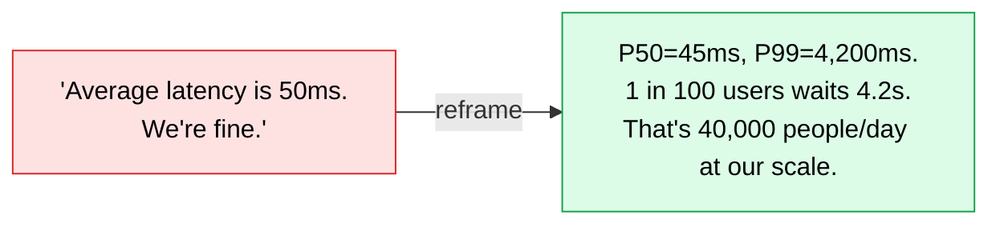
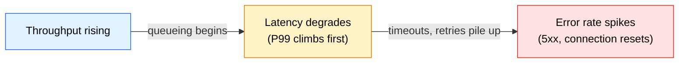
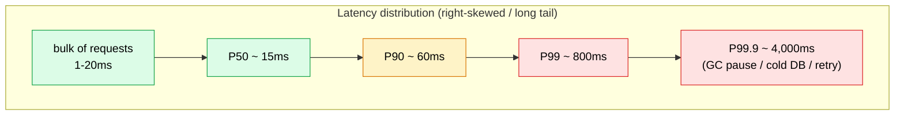
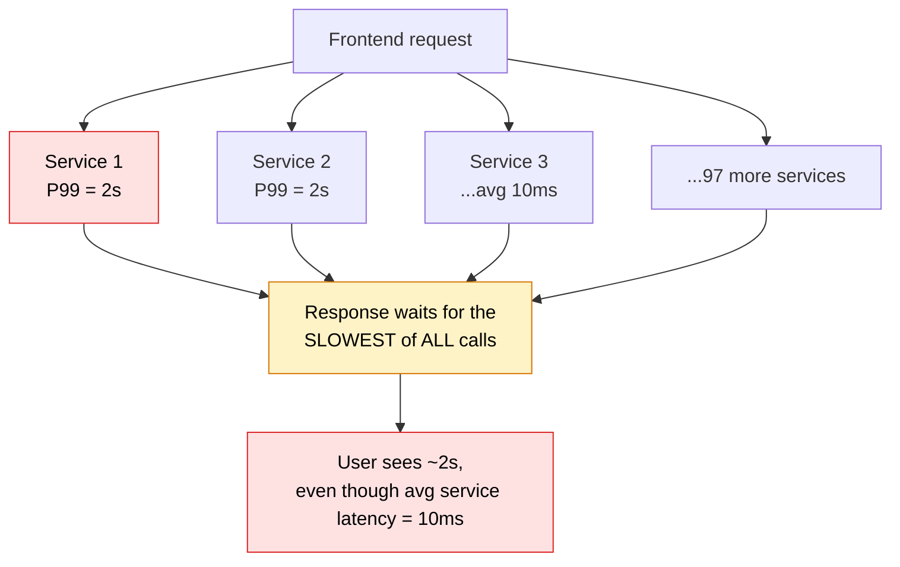
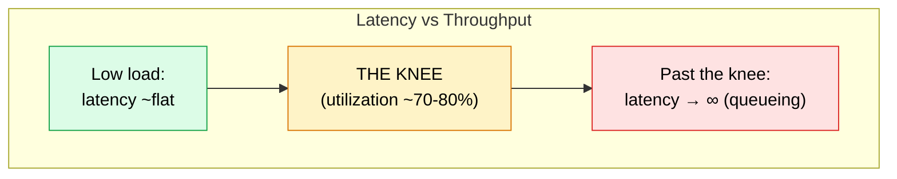
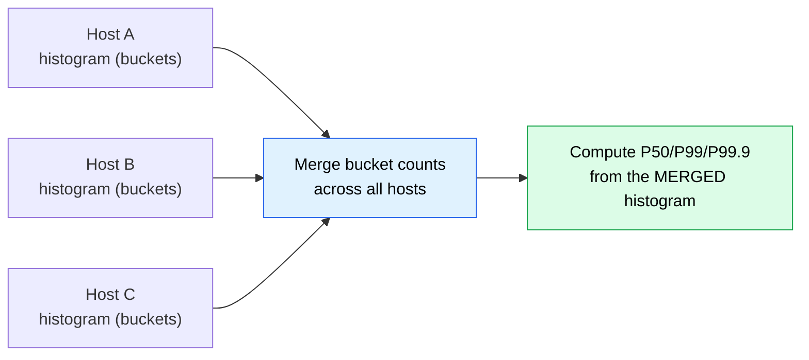
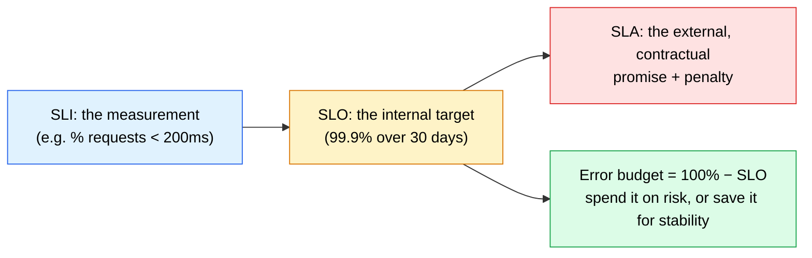
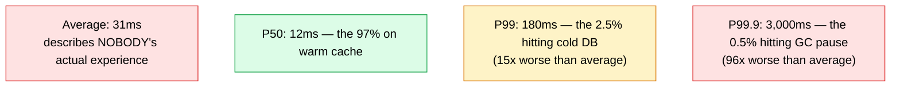
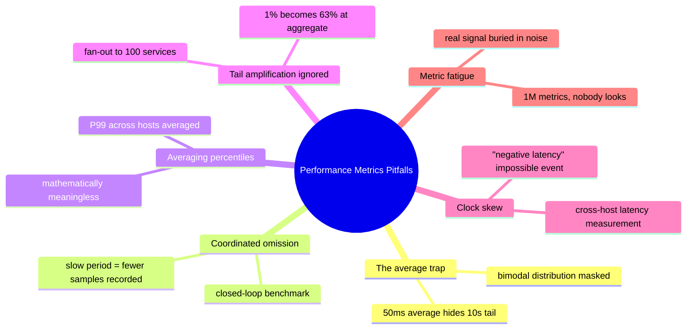

# Performance Metrics — Latency, Throughput, Error Rate & Percentiles

> **One line:** A system's health is not one number — it's latency (how long one request takes), throughput (how many requests per second), and error rate (how often it fails), and the trap that sinks most engineers is describing latency with an *average* when only a percentile tells the truth about what your unluckiest users actually feel.

---

## Table of Contents
1. [Why You Must Master This](#1-why-you-must-master-this)
2. [The Mental Model](#2-the-mental-model)
3. [Latency, Throughput, Error Rate — the Three Axes](#3-latency-throughput-error-rate--the-three-axes)
4. [Why the Average Lies — Percentiles Done Right](#4-why-the-average-lies--percentiles-done-right)
5. [Tail Latency Amplification — Fan-Out Kills You](#5-tail-latency-amplification--fan-out-kills-you)
6. [Latency vs Load — the Knee and Little's Law](#6-latency-vs-load--the-knee-and-littles-law)
7. [Golden Signals, RED, and USE](#7-golden-signals-red-and-use)
8. [Aggregating Percentiles Correctly — Histograms, HDR, Coordinated Omission](#8-aggregating-percentiles-correctly--histograms-hdr-coordinated-omission)
9. [SLI / SLO / SLA and Error Budgets](#9-sli--slo--sla-and-error-budgets)
10. [Worked Example — Average vs P99 on a Real Distribution](#10-worked-example--average-vs-p99-on-a-real-distribution)
11. [Real-Life Use Cases](#11-real-life-use-cases)
12. [Failure Modes](#12-failure-modes)
13. [🏋️ Practice Drills](#-practice-drills)
14. [🎤 Interview Q&A Bank](#-interview-qa-bank)
15. [🎯 Staff+ Nuances](#-staff-nuances)
16. [Cheat Sheet](#16-cheat-sheet)
17. [Connections & Further Reading](#17-connections--further-reading)

---

## 1. Why You Must Master This

- **It's a direct line to revenue.** Amazon found every **100ms** of added latency cost them **1% in sales**. Google found a **0.5s** delay in search results dropped traffic by **20%**. These aren't folklore — they're the reason "make it fast" is a business requirement, not an engineering vanity project.
- **"The site is slow" is not a debuggable statement — a metric is.** Without latency/throughput/error-rate broken out per service, per endpoint, per percentile, you cannot answer "slow for whom, how often, and where in the stack." Metrics turn a vague complaint into an evidence trail that points at one query, one service, one deploy.
- **The wrong summary statistic hides the outage that's already happening.** A system reporting "average latency 50ms, all green" can simultaneously be unusable for 1 in 10 users. Averages are how real incidents stay invisible on a dashboard for weeks.
- **It's the language every SRE/Staff interview is conducted in.** "How do you know when to scale?" "Why not use the average?" "What's your P99?" — these questions are a proxy for "have you actually operated a production system under load," and the honest answer requires understanding percentiles, tail amplification, and saturation, not just definitions.

> **The core problem it solves:** distinguishing "the system is fine" from "the system is fine *on average, while actively failing a meaningful slice of real users*" — and giving you the vocabulary (percentiles, golden signals, SLOs) to act on the difference before it becomes an incident.

**Prerequisites:** [Latency_Numbers_Every_Programmer_Should_Know.md](../01_Planning_Foundations/Latency_Numbers_Every_Programmer_Should_Know.md) — the raw hardware/network numbers these metrics measure against.

---

## 2. The Mental Model

Performance metrics are a **car's dashboard**, not a single idiot light:

- **Latency = the speedometer.** How long did *this one* trip from A to B take?
- **Throughput = the RPM / odometer rate.** How much distance (work) is the engine covering per second?
- **Error rate = the check-engine light.** How often does the car fail to do what you asked?

The naive view treats "performance" as one number — usually the average. The expert view treats it as a **distribution** you must describe with percentiles, because the average is a single point that erases the shape of the tail where your worst-off users live.



> **Hold onto this:** the average describes the *typical* request; the percentile describes the *experience* — and at scale, "rare" events (P99, P999) happen to thousands of real people every single day. If you remember one thing, remember that **P99 is not an edge case, it's a headcount**.

---

## 3. Latency, Throughput, Error Rate — the Three Axes

These three numbers are largely independent — a system can be fast-but-flaky, slow-but-reliable, or high-throughput-but-degrading — and a health check needs all three simultaneously.

| Axis | What it is | Unit | What breaks without it |
|---|---|---|---|
| **Latency** | Time for one request to complete, start to finish | ms (P50/P90/P99/P99.9) | You optimize the wrong thing — a system can have huge throughput and still feel broken to every individual user. |
| **Throughput** | Volume of work completed per unit time | RPS / QPS / TPS | You don't know your capacity ceiling — you can't answer "how many more users can we take before it falls over?" |
| **Error rate** | Fraction of requests that fail | % (or errors/sec) | A system can be blazing fast and still be useless — a 50ms 500 error is *worse* than a correct 500ms response. |

**Why they interact, not stack:** as throughput rises toward a system's capacity, latency degrades first (queueing), then error rate spikes (timeouts, rejected connections, OOM). This ordering — **throughput up → latency degrades → errors spike** — is the standard anatomy of an overload incident, and it's why dashboards plot all three together, not as separate tabs.



> One axis alone never tells the whole story — a service can hit its all-time-high throughput on the same graph where P99 triples, and that's not success, that's the leading edge of an outage.

A subtlety worth internalizing early: **measure latency for successful and failed requests separately.** A request that fails fast (a 1ms connection-refused error) will drag your "average latency" *down* while the system is actively broken — celebrating a latency win that is actually a failure spike is a classic dashboard trap.

---

## 4. Why the Average Lies — Percentiles Done Right

**What "average" actually computes:** sum of all latencies divided by count. That's mathematically correct and *practically misleading*, because it assumes a roughly symmetric, single-peaked (unimodal) distribution — and production latency almost never looks like that.

**Two concrete reasons the average lies:**

1. **Bimodal distributions.** Say 95% of requests hit a warm in-memory cache (1ms) and 5% miss and hit a cold database query (500ms). The average is `0.95×1 + 0.05×500 = 25.95ms` — a number that describes *neither* group of users. Nobody actually experiences "26ms." They experience either "instant" or "half a second," and the average is a phantom that exists only in the arithmetic.
2. **A single slow outlier (GC pause, disk stall) skews the mean but is invisible in it at scale.** If 1 request in 10,000 hits a 5-second GC pause and the rest take 10ms, the average across 10,000 requests is `((9999×10) + 5000) / 10000 ≈ 10.5ms` — a barely perceptible bump. The average *absorbs* the outlier into invisibility. But that one request was 500x slower than everyone else's, and if you're doing 10,000 RPS, that GC pause is happening once a second, to someone, forever.

**Percentiles describe the shape instead of erasing it.** A percentile PXX means "XX% of requests were faster than this value."

| Percentile | Meaning | Who it represents |
|---|---|---|
| **P50 (median)** | Half of requests are faster, half slower | The typical request |
| **P90** | 9 in 10 requests are faster than this | The person waiting slightly longer, still normal |
| **P99** | 99 in 100 requests are faster than this | Your **unluckiest 1%** — at 1M req/day, that's **10,000 people** |
| **P99.9** | 999 in 1000 are faster | The tail that reveals GC pauses, cold caches, retries |



> The mass of the distribution is on the left (fast); the tail stretches far to the right (rare but severe). The average gets dragged toward the tail just enough to misrepresent *both* ends — too high to describe the typical request, too low to describe the bad one.

**Rule of thumb:** report P50 (typical), P90 (majority), and P99 (SLO target) together — never just one number, and never "average" as your headline metric. Reserve P99.9 for infrastructure/platform teams debugging the deep tail (GC, kernel scheduling, disk).

---

## 5. Tail Latency Amplification — Fan-Out Kills You

**The mechanism:** a modern request is rarely one hop. A single page load might fan out to dozens or hundreds of backend calls (search, ads, recommendations, user profile, inventory...) and then wait for **all** of them before responding. The response time of the *whole* request is bounded by the **slowest** of its dependencies — not the average of them.

**The math that makes this brutal:** if each of N independent backend calls has a 1% chance of being "slow" (hitting its own P99), the probability that *at least one* of them is slow in a given request is:

```
P(at least one slow call) = 1 − (1 − 0.01)^N
```

| N (fan-out) | P(at least one call hits its P99) |
|---|---|
| 1 | 1% |
| 10 | ~9.6% |
| 50 | ~39.5% |
| 100 | ~63.4% |
| 200 | ~86.6% |

At N=100, a "1-in-100 rare event" for any single service becomes a **near-coin-flip (63%) for the aggregate request.** This is why Staff+ engineers care disproportionately about P99 at the *leaf* services in a fan-out architecture — a tail latency that looks negligible in isolation becomes the dominant, *typical* experience once you compose enough calls.



> One in a hundred calls being slow is a rounding error for a single service and a near-certainty for a page that makes a hundred of them — this is why "our average is 10ms" is meaningless in a fan-out architecture, and why the P99 of your *dependencies* deserves more attention than the P50 of your own service.

**Mitigations** (each with a real cost): [hedged requests](./Profiling_Benchmarking.md) (fire a duplicate request after a short delay and take whichever returns first — costs extra load), tight per-hop timeouts with fallbacks (return a degraded response instead of waiting), reducing fan-out width (batch or precompute instead of calling N services), and isolating slow dependencies behind a circuit breaker so one flaky leaf doesn't drag every request into its tail.


> One slow leaf out of six sets the gateway's entire response time — at real fan-out widths (dozens to hundreds of calls), that "one slow one" stops being the exception and becomes the expected outcome.

---

## 6. Latency vs Load — the Knee and Little's Law

Latency is not a fixed property of a system — it's a function of **load**. Every system has a "knee": below it, latency is flat and low; past it, latency explodes non-linearly. This is the **hockey-stick curve**, and it's the single most important shape to recognize on a load-test graph.



**Why the knee exists — queueing theory in one line:** as a resource's utilization approaches 100%, the queue of waiting requests doesn't grow linearly — it grows toward infinity, because there's no longer any slack to absorb variance in arrival times. A CPU at 60% utilization absorbs a burst easily; the same CPU at 95% has no headroom, and a small burst turns into a growing backlog that never drains. This is why **capacity planning targets 60-70% utilization**, not 100% — the last 20-30% of "unused" capacity is actually the shock absorber that keeps P99 sane.

**Little's Law — the formula that ties it together:**

```
L = λ × W

L = average number of requests IN the system (concurrency / "in flight")
λ = arrival rate (throughput, e.g. requests/sec)
W = average time each request spends in the system (latency)
```

This holds for *any* stable queueing system, independent of the arrival distribution. Its practical use: if you know two of the three, you can derive the third — and it explains *why* latency and throughput are coupled, not independent dials.

**Worked use of Little's Law:** a service handles λ = 2,000 req/s with an average latency W = 50ms (0.05s). The average number of requests in flight at any instant is:

```
L = 2,000 × 0.05 = 100 requests in flight
```

If your connection pool, thread pool, or worker count is sized for only 50 concurrent requests, you have a structural bottleneck *before* you even look at CPU graphs — Little's Law told you the answer from throughput and latency alone. Conversely, if W suddenly climbs (say, a downstream DB slows to 200ms) while λ stays constant, L quadruples — you need 4x the concurrent capacity (threads, connections) just to keep up, which is exactly the mechanism behind a cascading pool-exhaustion outage.

---

## 7. Golden Signals, RED, and USE

Three overlapping frameworks answer "what should I actually put on a dashboard?" — pick per layer, don't debate which is "more correct."

**The Four Golden Signals** (Google SRE book) — the request-centric view, best at the service/API boundary:

| Signal | Question it answers |
|---|---|
| **Latency** | How long do requests take? (split success vs error latency!) |
| **Traffic** | How much demand is hitting the system? (RPS, bandwidth) |
| **Errors** | What fraction of requests fail? (explicit 5xx, implicit wrong-content, or policy-based like "over 10s = failed") |
| **Saturation** | How full is the system's most constrained resource? (CPU, memory, connection pool, queue depth) |

**RED method** (for request-driven services, popularized by Weaveworks/Grafana) — a tighter version of the same idea:

```
Rate     — requests per second
Errors   — failed requests per second
Duration — distribution of latency (percentiles!)
```

**USE method** (Brendan Gregg, for infrastructure/resources — CPU, disk, network, not services):

```
Utilization — % time the resource was busy
Saturation  — how much extra work is queued, waiting for the resource
Errors      — count of error events for that resource
```

**How to choose:** RED for "is this service healthy from the caller's point of view"; USE for "is this specific box/resource about to fall over"; Golden Signals as the umbrella umbrella term covering both angles at once. In practice you run all three — RED dashboards per service, USE dashboards per host/resource, and Golden Signals as the four-word mental checklist you run through during an incident.

The deep-dive on dashboards, alerting thresholds, and instrumentation pipelines (Prometheus/Grafana, OpenTelemetry) lives in [12_Monitoring_Logging_Observability/Golden_Signals_Latency_Traffic_Errors.md](../12_Monitoring_Logging_Observability/Golden_Signals_Latency_Traffic_Errors.md) — this file focuses on the *metric math itself* (what a percentile means, how load couples to latency); that one focuses on the *pipeline* that collects and displays it.

---

## 8. Aggregating Percentiles Correctly — Histograms, HDR, Coordinated Omission

**The mistake everyone makes once:** you cannot average percentiles across hosts. If host A reports P99 = 100ms and host B reports P99 = 200ms, the fleet-wide P99 is **not** 150ms. Percentiles are not linear — they describe a position in a *distribution*, and averaging two positions from two different distributions produces a number that describes neither.

**Why it breaks — concretely:** suppose host A serves 1,000 req/s with P99=100ms, and host B serves 100,000 req/s with P99=200ms. The fleet's true P99 is dominated by host B's volume — nowhere near the naive average of 150ms. Worse, a request could be in host A's "worst 1%" and host B's "middle 50%" simultaneously — percentiles from different populations aren't even directly comparable, let alone averageable.

**The correct approach: aggregate histograms, not percentiles.**



- Each host records latency into a **histogram** — fixed or log-linear buckets (e.g., "0-1ms: 500 count, 1-5ms: 4000 count, 5-20ms: 300 count..."). Bucket *counts* are additive across hosts — you can sum them safely.
- Prometheus's `histogram_quantile()`, and dedicated structures like **HdrHistogram** (High Dynamic Range Histogram), are built exactly for this: they store enough resolution across a huge value range (microseconds to minutes) with bounded memory, and support mathematically correct quantile computation on the *merged* bucket data — not on pre-computed percentiles.
- The practical rule: **ship raw histogram buckets to your metrics backend, compute the percentile at query/aggregation time** — never precompute a percentile per-host and then average, min, or max those percentiles together.

**Coordinated omission — the sneakier bug:** if your benchmark tool sends a request, *waits for the response*, and only then sends the next one (a "closed" request loop), then during a slow period the tool simply sends *fewer* requests — it never records the "requests that should have been sent but were delayed." This silently deletes exactly the slow-period samples that should dominate your tail, making your measured P99 look **better** than reality during the very degradation you're trying to catch.

- **Fix:** use an **open-loop** load generator that issues requests on a fixed schedule (e.g., "every 10ms regardless of whether the previous response arrived") and records the *intended* send time, not just the observed response time. Tools like `wrk2` and HdrHistogram-based benchmarking were built specifically to correct for this; naive `ab`/`wrk`/hand-rolled `for` loops with request-then-wait patterns are all susceptible.
- **Why it matters in interviews:** this is the single most common "gotcha" that separates someone who has *read about* percentiles from someone who has *debugged a load test* — if your benchmark harness waits for each response before sending the next request, your P99 number is a lie by construction, independent of the system under test.

---

## 9. SLI / SLO / SLA and Error Budgets

Three letters, three different audiences, layered directly on top of the percentiles above:

- **SLI (Indicator)** — the raw *measurement*. Example: "percentage of requests completing in under 200ms" or "percentage of requests returning 2xx/3xx." This is exactly a percentile/error-rate metric from the sections above, named for the purpose of a promise.
- **SLO (Objective)** — the internal *target* for that indicator. Example: "P99 latency < 300ms, 99.9% of the time, measured over a rolling 30 days." This is what engineering holds itself to.
- **SLA (Agreement)** — the external, often *contractual* promise, usually looser than the SLO (you want margin), with a financial or reputational penalty attached. Example: "if uptime drops below 99.9% this quarter, customers get a service credit."
- **Error budget** — the *inverse* of the SLO, spent deliberately. A 99.9% SLO over 30 days means **43.2 minutes** of allowed "bad" time that month. Every risky deploy, every experiment, every retry storm spends from that budget; once it's gone, the team's default shifts from "ship features" to "stabilize," ideally by policy rather than by argument.



This is deliberately brief — the full treatment (burn-rate alerting, multi-window multi-burn-rate policies, choosing SLO targets) lives in [12_Monitoring_Logging_Observability/SLO_SLI_Error_Budgets.md](../12_Monitoring_Logging_Observability/SLO_SLI_Error_Budgets.md). The point to carry from here: **your SLO should be defined in percentiles, not averages** ("P99 < 300ms," never "average < 300ms") — otherwise you can be in full SLO compliance while a meaningful chunk of users has a broken experience, which defeats the entire purpose of having an SLO.

---

## 10. Worked Example — Average vs P99 on a Real Distribution

**The setup:** an API endpoint is measured over 10,000 requests. 9,700 requests (97%) are served from a warm cache at ~12ms. 250 requests (2.5%) miss the cache and hit the database at ~180ms. 50 requests (0.5%) hit a rare code path that triggers a full GC pause at ~3,000ms.

**Step 1 — compute the true average:**

```
Total time = (9,700 × 12ms) + (250 × 180ms) + (50 × 3,000ms)
           = 116,400 + 45,000 + 150,000
           = 311,400ms

Average = 311,400 / 10,000 = 31.14ms
```

**Step 2 — compute the percentiles by ranking all 10,000 latencies:**

- Positions 1–9,700 (sorted ascending) are the ~12ms group → this covers up through the 97th percentile.
- Positions 9,701–9,950 are the ~180ms group → covers the 97th through 99.5th percentile.
- Positions 9,951–10,000 are the ~3,000ms group → the top 0.5%.

| Metric | Value | What it tells you |
|---|---|---|
| **Average** | 31.14ms | "Looks fine" — buried deep inside the fast group's range |
| **P50** | ~12ms | Correctly shows the typical request is fast |
| **P90** | ~12ms | Still fast — 90% of traffic never leaves the cache path |
| **P97** | ~12ms (boundary) | The cache-hit ceiling |
| **P99** | ~180ms | **15x worse than the average** — this is the DB-miss group |
| **P99.9** | ~3,000ms | **96x worse than the average** — the GC-pause group, now visible |

**The divergence, made concrete:** the average (31ms) sits in a dead zone that describes *none* of the three actual populations of users — it's not what the 97% feel (12ms), not what the 2.5% feel (180ms), and wildly understates what the 0.5% feel (3,000ms). If your dashboard only shows the average, you would see "31ms, all healthy" while 300 real users per 10,000 requests — at 1M requests/day, **30,000 people daily** — wait between 180ms and 3 full seconds.



**The architectural consequence:** this single computation is the difference between "ship it" and "fix the cache-miss path and add a GC-tuning ticket before launch." Once you see that P99 is 15x the average and P99.9 is 96x the average, the engineering priority is obvious — and it was completely invisible in the one number most dashboards show by default.

---

## 11. Real-Life Use Cases

| Situation | How performance metrics apply | The decision it forces |
|---|---|---|
| **E-commerce checkout latency review** | P99 checkout latency is 4s vs P50 of 300ms | Investigate the tail (payment gateway timeout?) before a launch, not the average |
| **Capacity planning for Black Friday** | Little's Law: L = λ×W; current λ×W already at 70% of pool size | Provision more concurrency headroom before the traffic spike, not during it |
| **Choosing an SLO for a new API** | Define SLI as "% requests < 200ms," not "average < 200ms" | The SLO is meaningful under real skewed traffic, not gameable by a fast majority hiding a slow tail |
| **Debugging "the app feels slow" with green dashboards** | Dashboards show average latency only | Add P99/P99.9 panels — the incident was already happening, just hidden |
| **Sizing a fan-out search architecture** | 80 backend calls, each with P99 = 500ms | Recognize ~68% of requests will hit at least one P99 leaf — invest in hedging/timeouts, not just per-service optimization |
| **Load-testing before a major release** | Benchmark tool uses closed-loop request-then-wait | Switch to an open-loop generator (wrk2/HdrHistogram) or the P99 result is fabricated |
| **Merging metrics from 500 pods into one dashboard** | Per-pod P99s can't be averaged | Aggregate histograms (Prometheus histogram_quantile) into one fleet-wide percentile |

> **The habit:** whenever you see a single latency number on a dashboard, ask "average, or percentile — and which one?" before drawing any conclusion. It's a five-second question that catches the majority of "the metrics say we're fine" incidents before they escalate.

---

## 12. Failure Modes



- **The average trap.** Symptom: dashboard shows "50ms average, all green" while support tickets pile up about a slow site. Root cause: a bimodal or long-tailed distribution collapsed into one number that represents neither population. Fix: replace the headline metric with P50/P90/P99 side by side; never ship a dashboard with only an average.
- **Coordinated omission in load testing.** Symptom: a benchmark reports a suspiciously good P99 that doesn't match production reality under the same load. Root cause: a closed-loop tool (request → wait for response → send next) silently sends fewer requests exactly when the system is slow, deleting the samples that should dominate the tail. Fix: use an open-loop generator (wrk2, HdrHistogram-based tools) that issues requests on a fixed schedule regardless of response time.
- **Averaging percentiles across hosts/instances.** Symptom: fleet-wide "P99" number that doesn't match any individual host and moves in ways nobody can explain. Root cause: percentiles are non-linear positions in a distribution — you cannot average, min, or max them meaningfully. Fix: aggregate raw histogram bucket counts across hosts first, then compute the percentile once, on the merged histogram.
- **Ignoring tail amplification in fan-out systems.** Symptom: a service with a "fine" P99 latency is blamed for a slow page, when the real culprit is that the page calls 100 services and the probability of hitting *someone's* P99 is now ~63%. Root cause: composing many dependencies compounds tail probability, not average probability. Fix: track P99 of every leaf dependency, invest in hedged requests/timeouts/circuit breakers, and reduce fan-out width where possible.
- **Clock skew across hosts.** Symptom: a measured "latency" between two machines is negative — a physically impossible result. Root cause: unsynchronized system clocks used to timestamp send/receive events on different hosts. Fix: measure latency using a monotonic clock on a single observing host (round-trip from the caller) rather than diffing timestamps from two different clocks; use NTP/PTP to bound skew where cross-host timestamps are unavoidable.
- **Metric fatigue / cardinality explosion.** Symptom: a six-figure monthly observability bill and an on-call engineer who still can't find the metric that matters during an incident. Root cause: tagging metrics with high-cardinality labels (user ID, request ID) multiplies stored series explosively, and nobody curates which metrics are load-bearing. Fix: keep cardinality bounded (aggregate by endpoint/status, not by user), and periodically prune dashboards/alerts nobody has looked at in 90 days.

---

## 🏋️ Practice Drills

> *Cover the solutions and attempt first — active recall is the point.*

**Drill 1 — Spot the lie.** A service reports "average latency: 45ms" for the last hour, and the on-call dashboard is green. Support has three tickets about the checkout page "hanging." What's your next move, and why doesn't the green dashboard rule this out?

<details><summary>Solution</summary>

The green average dashboard does **not** rule this out — it's exactly the scenario averages are bad at catching. Next move: pull up P90/P99/P99.9 for the checkout endpoint specifically (not the whole service — a slow endpoint can be buried inside a fast aggregate). If P99 is, say, 6 seconds while the average is 45ms, that confirms a small but real population of users is hitting a slow path (cold cache, a specific downstream dependency, a lock contention edge case) that's invisible in the aggregate average because it's a small fraction of total traffic. The three tickets are real signal from real people in that tail — the dashboard just wasn't built to show them.
</details>

**Drill 2 — Little's Law capacity check.** Your service currently handles 5,000 req/s at an average latency of 40ms. Your thread pool has 150 worker threads. A new downstream dependency you're about to add has an average latency of 200ms. Will your thread pool be big enough? Show the arithmetic.

<details><summary>Solution</summary>

Current: L = λ × W = 5,000 × 0.04 = **200 requests in flight** on average — already *larger* than your 150-thread pool, meaning you're likely already queueing (or the real average latency including queueing is higher than 40ms, which is worth checking).

After adding the dependency (assume it adds to the request's total latency, e.g., new W ≈ 40ms + 200ms = 240ms, and λ stays 5,000 req/s):

```
L = 5,000 × 0.24 = 1,200 requests in flight
```

You'd need roughly **1,200 concurrent worker slots**, 8x your current pool of 150. Without resizing the pool (or adding async/non-blocking I/O so threads aren't held for the full 200ms), you will exhaust the pool almost immediately, and requests will queue and then time out — a classic thread-pool-exhaustion cascade triggered by adding one slow dependency. This is the exact mechanism Little's Law predicts before you ever load-test it.
</details>

**Drill 3 — Fan-out probability.** A checkout page fans out to 30 independent backend calls, each with a 2% chance of hitting that service's own P98 (i.e., being "slow"). What's the probability the checkout page's *overall* response is dragged down by at least one slow call?

<details><summary>Solution</summary>

```
P(at least one slow call) = 1 − (1 − 0.02)^30
                           = 1 − (0.98)^30
                           = 1 − 0.545
                           ≈ 0.455  → ~45.5%
```

Despite each individual service being slow only 2% of the time (its own P98), the checkout page as a whole is dragged into its tail latency on **nearly half of all requests**. This is tail latency amplification: a "rare" 2% event per service becomes a near-coin-flip at the aggregate. The fix isn't to chase each service's P98 to zero — it's to reduce fan-out width, add hedged requests or aggressive per-hop timeouts with fallbacks, and treat the P99/P98 of every dependency as a first-class metric, not a footnote.
</details>

**Drill 4 — Design a percentile-correct dashboard.** You run 200 stateless API pods behind a load balancer. Design how you'd compute and display a single, mathematically correct fleet-wide P99 latency, and name the one implementation mistake that would silently corrupt it.

<details><summary>Solution</summary>

**Design:** each pod records request latencies into a local histogram (fixed or log-linear buckets — e.g., Prometheus client library's `Histogram` type, or an HdrHistogram). Pods expose/ship raw bucket *counts* (not pre-computed percentiles) to the metrics backend (Prometheus, or a push-based aggregator). At query time, merge the bucket counts across all 200 pods' time-aligned scrapes into one combined histogram, then compute P99 once on that merged histogram (e.g., Prometheus's `histogram_quantile(0.99, sum(rate(request_duration_bucket[5m])) by (le))`).

**The silent-corruption mistake:** computing P99 independently on each pod and then averaging (or taking the max/min of) those 200 per-pod P99 values. This produces a number that looks plausible but is not the true fleet-wide P99 — percentiles from different sub-populations don't combine linearly, especially when traffic isn't perfectly load-balanced across pods (some pods will run hotter and have worse tails, and averaging masks exactly those pods).
</details>

---

## 🎤 Interview Q&A Bank

**Q1. "Why is average latency a bad metric?"**
> Because it assumes a roughly symmetric distribution, and production latency is almost always right-skewed or bimodal — a mix of fast cache hits and slow cache misses, or a rare GC pause. The average gets pulled toward the tail just enough to describe *neither* the typical request nor the bad one. A 50ms average can coexist with a 4-second P99 that's actively breaking the experience for 1% of users — which at scale is thousands of real people per day.

**Q2. "What's the difference between P50, P90, and P99, and which should drive an SLO?"** *(signal: understands percentiles aren't interchangeable)*
> P50 is the typical/median request; P90 covers the large majority; P99 is your unluckiest 1% — the users most likely to churn or complain. SLOs should generally be defined on P99 (or occasionally P99.9 for infra-level guarantees), because a P50-based SLO can be fully "met" while a meaningful slice of real traffic has a broken experience. The right choice depends on how much a slow tail costs you — for a payments API, even P99.9 might matter.

**Q3. "Explain tail latency amplification in a fan-out system."** *(signal: has actually operated a service-oriented architecture)*
> If a request fans out to N independent backend calls and each has a small probability p of being slow (hitting its own tail), the probability that the *aggregate* request is slow is roughly `1 − (1−p)^N` — which grows fast. At N=100 and p=1%, that's already a ~63% chance the overall request hits someone's tail. This is why a service's own P99 looking fine in isolation says almost nothing about how it behaves as one of a hundred dependencies — the fix is hedged requests, tight per-hop timeouts with fallback, and reducing fan-out width, not just optimizing each service's average.

**Q4. "How does latency relate to load, and what is Little's Law?"** *(signal: queueing theory intuition)*
> Latency is flat at low load and then rises sharply past a "knee" — usually around 60-80% utilization — because queueing delay grows non-linearly as a resource runs out of slack to absorb variance. Little's Law, L = λW, ties concurrency (L), arrival rate (λ), and latency (W) together for any stable system: if latency doubles at constant throughput, the number of in-flight requests doubles too, which is exactly the mechanism behind thread-pool or connection-pool exhaustion cascades.

**Q5. "Can you average percentiles from multiple servers to get a fleet-wide percentile?"** *(signal: knows the classic aggregation trap)*
> No — percentiles are non-linear positions in a distribution, not additive quantities. Averaging, min-ing, or max-ing per-host P99s produces a number that doesn't correspond to the true fleet-wide P99, especially when load isn't perfectly even across hosts. The correct approach is to aggregate raw histogram bucket counts across hosts (they *are* additive) and compute the percentile once on the merged histogram — which is exactly what Prometheus's `histogram_quantile` or an HdrHistogram merge does.

**Q6. "What is coordinated omission, and why does it matter for benchmarking?"** *(signal: has actually debugged a load-testing tool, not just read the theory)*
> It's a measurement bug in closed-loop load generators: if the tool waits for each response before sending the next request, then during a slow period it automatically sends fewer requests — and never records the "requests that should have been sent but were delayed." This silently deletes exactly the samples that should dominate your tail, making a benchmark's P99 look far better than what production would actually experience. The fix is an open-loop generator (like wrk2) that issues requests on a fixed schedule regardless of response time.

**Q7. "What are the Four Golden Signals, and how do RED/USE relate to them?"** *(signal: knows the frameworks aren't competing, they're layered)*
> Latency, traffic, errors, and saturation — Google SRE's minimal checklist for "is this service healthy." RED (rate, errors, duration) is the same idea tightened for request-driven services; USE (utilization, saturation, errors) is aimed at infrastructure resources like CPU or disk rather than services. In practice: RED dashboards per service, USE dashboards per resource, Golden Signals as the four-word mental model you run through during an incident.

**Q8. "What's the difference between SLI, SLO, and SLA, and what's an error budget?"** *(signal: connects metrics to organizational process)*
> SLI is the raw measured indicator (e.g., % of requests under 200ms); SLO is the internal target for that indicator (99.9% over 30 days); SLA is the external, often contractual promise with a penalty, usually set looser than the SLO for safety margin. The error budget is the inverse of the SLO — the amount of "allowed failure" (e.g., 43 minutes/month at 99.9%) that gets spent on risky deploys and experiments; once it's exhausted, the team's priority shifts from shipping features to stability, ideally as policy rather than as an argument.

---

## 🎯 Staff+ Nuances

- **The metric you should distrust most is the one with no distribution attached.** Any latency number reported as a single scalar without a percentile or histogram context is an invitation to be misled. Staff engineers instinctively ask "P-what?" before accepting any latency claim in a design review, a vendor's benchmark, or a postmortem.
- **Coordinated omission is the interview question that separates theory from scars.** Almost everyone can define P99. Very few have personally discovered that their own load-testing tool was lying to them because of a closed request loop. Bringing this up unprompted is a strong signal you've actually run load tests in anger, not just read about percentiles.
- **Tail latency amplification means the P99 of a dependency matters more than the average of your own service.** In a deeply fan-out architecture, optimizing your own median latency by 20% is often less impactful than shaving your slowest dependency's P99 in half — because that dependency's tail is what's actually setting the aggregate experience for a large fraction of requests. This reframes "where do I spend optimization effort" away from the obvious hot path and toward the dependency graph's worst leaf.
- **Utilization targets are a lie if your traffic is bursty, not steady.** The "keep utilization under 70%" rule of thumb assumes roughly Poisson-like, smooth arrivals. Real traffic has diurnal patterns, flash-crowd spikes, and retries-on-failure feedback loops that amplify bursts — a system running comfortably at 50% average utilization can still spike into the queueing knee for seconds at a time, invisible on a 1-minute-resolution graph. This is why "average CPU is fine" is a weaker signal than "P99 of queue depth over 10-second windows."
- **Retries under load are latency's evil twin — they turn overload into more overload.** When latency degrades past the knee, naive retry logic (client retries on timeout) *adds* load precisely when the system has none to spare, accelerating collapse. The senior fix — exponential backoff with jitter, retry budgets, and load shedding — belongs conceptually right next to Little's Law: retries change λ (effective arrival rate) in a feedback loop with W (latency), and an un-budgeted retry storm is a self-inflicted DDoS.
- **An SLO defined on an average is not an SLO — it's decoration.** Because averages can be fully compliant while masking a broken tail, any SLO worth enforcing must be percentile-based (or, better, defined as "% of requests meeting a latency threshold," which is itself a percentile in disguise). If you inherit an SLO written as "average latency < 200ms," treat that as a gap to fix, not a target to hit.
- **Cardinality is the operational cost nobody budgets for until the bill arrives.** Every unique combination of metric labels (endpoint × status × region × pod × ...) is a new time series stored, indexed, and queried. High-cardinality labels (raw user IDs, request IDs) turn a well-intentioned "let's tag everything" decision into a five- or six-figure observability bill and a UI too slow to use during an actual incident — the fix is aggregating away high-cardinality dimensions before they hit the metrics backend, reserving that granularity for traces/logs instead.

---

## 16. Cheat Sheet

```
PERFORMANCE METRICS — LATENCY · THROUGHPUT · ERROR RATE
═══════════════════════════════════════════════════════════════════════════
THREE AXES (independent, watch together)
  Latency     time for ONE request           ms, always as percentiles
  Throughput  volume of work / time           RPS / QPS / TPS
  Error rate  % of requests that fail         explicit (5xx) / implicit / policy-based
  Anatomy of overload: throughput UP → latency degrades (queueing) → errors spike

NEVER TRUST THE AVERAGE
  bimodal (cache hit 1ms + cache miss 500ms) → average = phantom number, nobody feels it
  1-in-10,000 GC pause → invisible in the average, brutal in P99.9
  ALWAYS report P50 + P90 + P99 together, never one number

PERCENTILES
  P50  = typical request           P99   = unluckiest 1% (= 10,000 people per 1M reqs)
  P90  = majority covered          P99.9 = deep tail: GC, cold cache, retries
  measure success and failure latency SEPARATELY (fast errors fake a latency win)

TAIL LATENCY AMPLIFICATION (fan-out)
  P(≥1 slow call) = 1 − (1−p)^N        p=1%, N=100  → 63.4% chance of hitting SOMEONE's P99
  fix: hedged requests · tight per-hop timeouts + fallback · reduce fan-out width · circuit breakers

LATENCY vs LOAD — THE KNEE
  low load: latency flat  →  KNEE (~60-80% utilization)  →  past it: latency → ∞ (queueing)
  capacity plan for 60-70% utilization; the "unused" 30% is your shock absorber

LITTLE'S LAW
  L = λ × W     L = concurrency in flight, λ = arrival rate, W = latency
  e.g. λ=2,000/s, W=50ms → L=100 in-flight → pool sized <100 = structural bottleneck

GOLDEN SIGNALS / RED / USE
  Golden Signals (services): Latency, Traffic, Errors, Saturation
  RED (request-driven):      Rate, Errors, Duration
  USE (infra resources):     Utilization, Saturation, Errors
  → deep dive: 12_Monitoring_Logging_Observability/Golden_Signals_Latency_Traffic_Errors.md

AGGREGATING PERCENTILES — DO NOT AVERAGE THEM
  ✗ avg(P99_host1, P99_host2, ... P99_hostN)  → mathematically meaningless
  ✓ merge histogram BUCKET COUNTS across hosts → compute percentile ONCE on the merged histogram
  Prometheus histogram_quantile() / HdrHistogram — built for exactly this

COORDINATED OMISSION
  closed-loop benchmark (wait for response, then send next) → slow period = fewer samples recorded
  → measured P99 looks BETTER than reality, exactly when it matters most
  fix: open-loop generator (wrk2, HdrHistogram-based) on a fixed send schedule

SLI / SLO / SLA / ERROR BUDGET
  SLI = the measurement (% reqs < 200ms)   SLO = internal target (99.9% / 30d)
  SLA = external contract + penalty        Error budget = 100% − SLO → 99.9% = 43.2 min/month
  SLO must be percentile-based — an "average" SLO is decoration, not a promise
  → deep dive: 12_Monitoring_Logging_Observability/SLO_SLI_Error_Budgets.md

WORKED NUMBER TO REMEMBER
  97% @ 12ms + 2.5% @ 180ms + 0.5% @ 3,000ms → average = 31ms, P99 = 180ms (15x), P99.9 = 3,000ms (96x)
```

---

## 17. Connections & Further Reading

**Prerequisites (learn first):**
- [Latency_Numbers_Every_Programmer_Should_Know.md](../01_Planning_Foundations/Latency_Numbers_Every_Programmer_Should_Know.md) — the raw hardware/network latencies these metrics are measured against.

**Builds toward / pairs with:**
- [Profiling_Benchmarking.md](./Profiling_Benchmarking.md) — the *active* tooling (flame graphs, load generators) that produces the latency/throughput numbers this file teaches you to interpret correctly.
- [Caching_Strategies.md](./Caching_Strategies.md) and [Cache_Eviction_Policies.md](./Cache_Eviction_Policies.md) — the bimodal cache-hit/cache-miss distribution in the worked example is the direct output of these strategies.
- [Database_Connection_Pooling.md](./Database_Connection_Pooling.md) — Little's Law is exactly the math behind sizing a connection/thread pool correctly.
- [12_Monitoring_Logging_Observability/Golden_Signals_Latency_Traffic_Errors.md](../12_Monitoring_Logging_Observability/Golden_Signals_Latency_Traffic_Errors.md) — the dashboard/instrumentation pipeline (Prometheus, OpenTelemetry) that collects and displays these metrics in production.
- [12_Monitoring_Logging_Observability/SLO_SLI_Error_Budgets.md](../12_Monitoring_Logging_Observability/SLO_SLI_Error_Budgets.md) — the full treatment of error budgets, burn-rate alerting, and choosing SLO targets.
- [12_Monitoring_Logging_Observability/Distributed_Tracing_OpenTelemetry.md](../12_Monitoring_Logging_Observability/Distributed_Tracing_OpenTelemetry.md) — how you actually find *which* leaf service caused a specific slow trace in a fan-out architecture.
- [07_Load_Balancing_Scalability](../07_Load_Balancing_Scalability/) — the knee/saturation behavior described here is exactly what load balancing and autoscaling policies react to.

**Gaps this topic exposes (candidates for the section's Gap Analysis):**
- A dedicated treatment of hedged requests / request coalescing as a tail-latency mitigation technique — currently only mentioned in passing here and in [Cache_Invalidation_Consistency.md](./Cache_Invalidation_Consistency.md)'s stampede discussion; could deserve its own cross-linked callout.

**External classics:**
- *The Tail at Scale* (Dean & Barroso, Google, 2013) — the canonical paper on tail latency amplification in large fan-out systems.
- [Gil Tene: "How NOT to Measure Latency"](https://www.youtube.com/watch?v=lJ8ydIuPFeU) — the definitive talk on coordinated omission and HdrHistogram.
- *Site Reliability Engineering* (Google, free online) — the Four Golden Signals chapter and the SLO/error-budget framework in full.
- [High Scalability: "Why Averages Suck and Percentiles are Great"](http://highscalability.com/blog/2016/1/11/why-averages-are-dangerous-and-what-to-use-instead.html) — an accessible companion to the average-vs-percentile argument here.

---

## TL;DR
**Never describe a system's performance with a single number, and never let that number be an average.** Latency, throughput, and error rate are three independent axes that must be watched together (overload always shows up as throughput-up → latency-degrades → errors-spike, in that order); latency itself must be reported as percentiles (P50/P90/P99/P99.9), because real distributions are bimodal or long-tailed and the average erases exactly the tail where your unluckiest users — and at scale, thousands of real people per day — actually live. In fan-out architectures, that tail compounds: a dependency's 1% "rare" slow event becomes a near-certainty across a hundred calls (tail latency amplification), which is why a leaf service's P99 matters more than your own average. Latency is coupled to load through Little's Law (L = λW) and the queueing knee, which is why capacity planning targets ~70% utilization, not 100%. Percentiles must be aggregated via merged histograms, never averaged across hosts, and load tests must use open-loop generators or coordinated omission will quietly fabricate a better P99 than production will ever deliver. **Define SLOs in percentiles, always ask "which percentile?" before trusting any latency claim, and treat P99 as a headcount, not an edge case.**
