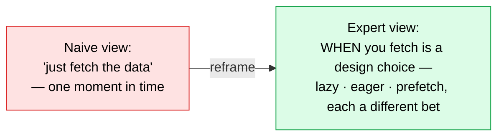
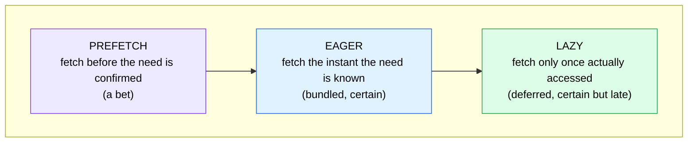
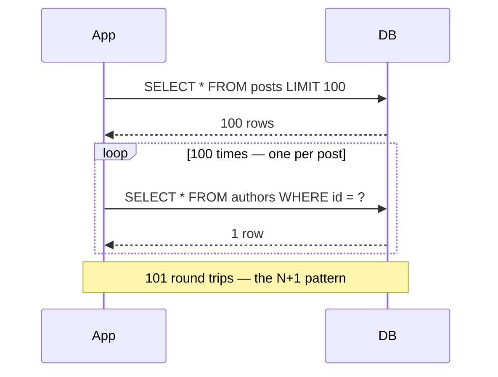
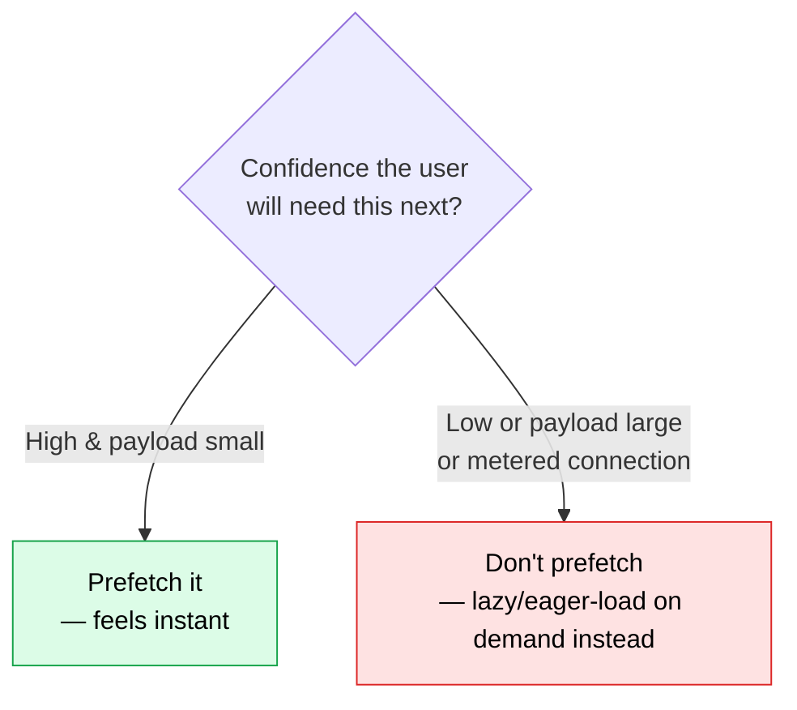
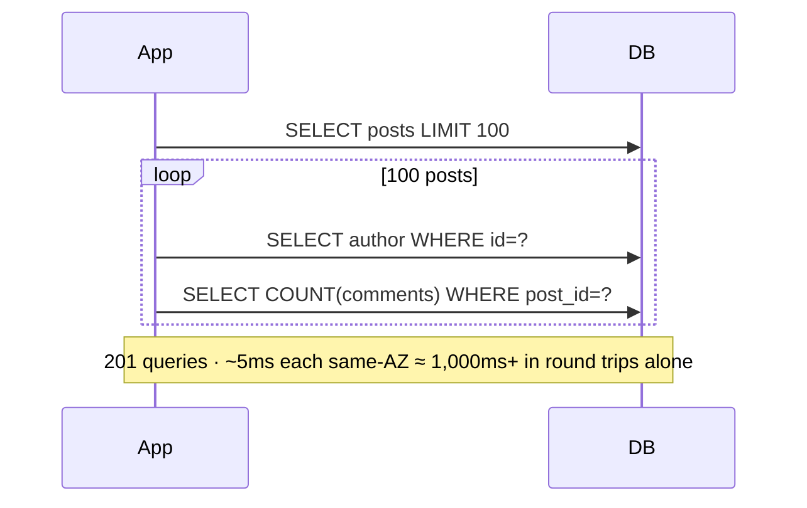
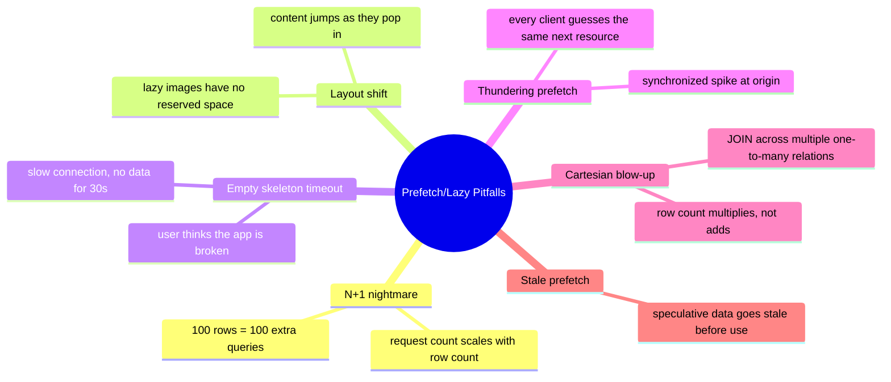

# Prefetching & Lazy Loading

> **One line:** Every piece of data you might need has to be fetched at some point — lazy loading defers that fetch until it's actually asked for, eager loading fetches it up front bundled with what you already need, and prefetching bets on the future by fetching it *before* it's asked for; picking the wrong one is either a blank screen, an N+1 query storm, or wasted bandwidth.

---

## Table of Contents
1. [Why You Must Master This](#1-why-you-must-master-this)
2. [The Mental Model](#2-the-mental-model)
3. [The Loading Spectrum — Lazy, Eager, Prefetch](#3-the-loading-spectrum--lazy-eager-prefetch)
4. [The N+1 Query Problem and Its Fixes](#4-the-n1-query-problem-and-its-fixes)
5. [Frontend Patterns — Images, Code-Splitting, Resource Hints](#5-frontend-patterns--images-code-splitting-resource-hints)
6. [Backend & Data Prefetching — Read-Ahead, Speculation, Cache Warming](#6-backend--data-prefetching--read-ahead-speculation-cache-warming)
7. [The Risk of Over-Prefetching](#7-the-risk-of-over-prefetching)
8. [Worked Example — Dashboard N+1 to Batched](#8-worked-example--dashboard-n1-to-batched)
9. [Real-Life Use Cases](#9-real-life-use-cases)
10. [Failure Modes](#10-failure-modes)
11. [🏋️ Practice Drills](#-practice-drills)
12. [🎤 Interview Q&A Bank](#-interview-qa-bank)
13. [🎯 Staff+ Nuances](#-staff-nuances)
14. [Cheat Sheet](#14-cheat-sheet)
15. [Connections & Further Reading](#15-connections--further-reading)

---

## 1. Why You Must Master This

Almost every slow page or slow API you'll ever debug traces back to *fetching data at the wrong time* — too early (wasted work), too late in a chain (a waterfall), or one row at a time when a batch would do.

- **It is the #1 cause of "mysteriously slow" APIs.** The N+1 query problem — one query for a list, then one more query *per row* for related data — is the single most common performance bug in ORM-backed applications. A dashboard that should take 20ms can take 2 seconds because nobody noticed 200 queries firing where 2 would do.
- **Users don't feel "total time," they feel "time until I can act."** Amazon measured that every 100ms of added latency cost roughly 1% in sales; Google found a 500ms delay in search results dropped traffic by 20%. Lazy loading and skeleton screens are how you make an app *feel* instant even while the real work is still happening in the background.
- **It's real money, not just UX.** Fetching data nobody looks at burns database IOPS, egress bandwidth, and (on mobile) the user's data plan. Prefetching the wrong thing is the same waste in the other direction — you paid for a guess that didn't pay off.
- **It is a standard system-design and frontend interview topic.** "Why is this API slow?" (→ spot the N+1), "how would you make a 10,000-image gallery load fast?" (→ lazy load + `IntersectionObserver`), and "how does GraphQL avoid N+1 across resolvers?" (→ DataLoader) are all directly this topic.

> **The core problem it solves:** deciding *when* to pay the cost of fetching data — never (if unused), right now bundled with what you already need (eager), or speculatively ahead of time (prefetch) — so the user experiences speed without the system doing wasted or serialized work.

**Prerequisites:** [Caching_Strategies.md](./Caching_Strategies.md) — prefetching is "caching before the request arrives"; [Performance_Metrics.md](./Performance_Metrics.md) — the latency numbers (P99, RPS) this topic exists to move.

---

## 2. The Mental Model

Think of a restaurant:
- **Lazy loading = ordering off the menu.** The kitchen doesn't cook the soup until you ask for it. Nothing is wasted, but there's a wait *after* you ask.
- **Eager loading = the fixed-price tasting menu.** Everything you'll eat tonight is prepped together, up front, before the meal starts — no waiting between courses, but you paid for all of it even if you skip a course.
- **Prefetching = the water glass the waiter tops up before you notice it's empty.** The kitchen (browser, server) predicts your next need and does the work *before* you ask — feels magical when the guess is right, wasteful when it's wrong.

The naive mental model treats "fetch the data" as a single event that happens once, at the moment of the request. The expert model treats it as a **dial with three positions on a timeline** — before the need is known, at the moment it's known, or after — and every one of lazy/eager/prefetch is a deliberate choice of where on that dial a given piece of data sits.



> **Hold onto this:** lazy loading pays the cost *only if* the data is used (and pays it late); eager loading pays the cost *always*, but pays it once, up front, in a batch; prefetching pays the cost *speculatively*, betting the odds are good enough that paying early beats making the user wait.

---

## 3. The Loading Spectrum — Lazy, Eager, Prefetch

| Dimension | Lazy Loading | Eager Loading | Prefetching |
|---|---|---|---|
| **When fetched** | On first access, triggered by need | Immediately, bundled with the initial request | Before it's needed, based on a prediction |
| **Certainty of use** | 100% — it was actually asked for | 100% — assumed always needed with the parent | Uncertain — a probability, not a guarantee |
| **Main risk** | Waterfalls: N sequential fetches, one per access (→ [N+1](#4-the-n1-query-problem-and-its-fixes)) | Over-fetching: pulling data down paths that never use it | Wasted work: bandwidth/compute spent on a guess that doesn't pay off |
| **Best for** | Rarely-accessed relations, below-the-fold content, optional tabs the user may never open | Data you already know will *always* be needed together (a post + its author for a feed) | High-confidence next actions: hover-over-link, next page of a paginated list, next video in a queue |
| **Mechanism** | A trigger fires the fetch: a proxy object's getter, `IntersectionObserver` entering the viewport, a route being navigated to | A single batched fetch: SQL `JOIN`, ORM `include`/`populate`, GraphQL query with nested fields resolved together | A background, low-priority fetch: browser idle time, `<link rel="prefetch">`, hover-intent timers, access-pattern heuristics |
| **Real system** | ORMs default relations to lazy (SQLAlchemy `lazy="select"`, Hibernate's default `FetchType.LAZY`) | ORM eager directives (Django `select_related`, Rails `includes`) | Next.js `<Link>` prefetches route JSON on viewport; Chrome prerenders top Omnibox suggestions |

**Lazy loading** exists because fetching everything a record *could* reference is wasteful — a `User` object rarely needs its full order history loaded just to print a username. The fetch is deferred until code actually touches the relation. The cost: if that deferred fetch happens inside a loop over many records, you get one fetch *per record* — a waterfall, and at the database layer specifically, the N+1 problem (next section).

**Eager loading** exists because round trips are expensive relative to the work of fetching more data in the same trip. If you already know a `Post` list page always needs each post's author name, fetching both in one `JOIN` costs one round trip instead of N+1. The cost: eager loading a relation nobody ends up using on a given page wastes both database time and payload size — you paid the "always" price for a "sometimes" need.

**Prefetching** exists because the fastest response is the one that started before the request. It sits strictly *before* the eager/lazy distinction on the timeline — eager and lazy both react to a request that has already arrived; prefetching acts on a request that hasn't happened yet, betting that it soon will. The cost is a probability multiplied by a price: if you prefetch 10 things and the user only uses 6, you spent 40% of that work for nothing (see [§7](#7-the-risk-of-over-prefetching)).



> **Read this left to right as "how early do you commit to the fetch."** Prefetch commits earliest (and least certainly); lazy commits latest (and most certainly).

---

## 4. The N+1 Query Problem and Its Fixes

**What it is:** you fetch a list of N parent rows with one query, then — because each parent's related data is *lazily* loaded — you issue one additional query *per parent* to fetch that related data. Total: **1 + N** queries where 1 or a handful would have sufficed.

**Concrete example.** A blog page renders 100 posts, and for each post prints the author's name:

```python
posts = session.query(Post).limit(100).all()   # query #1
for post in posts:
    print(post.author.name)                      # triggers 1 lazy query PER post
# total: 1 + 100 = 101 queries
```

**Why it breaks things:** the cost isn't the query itself — it's the round trip. At 2ms per query in the same availability zone, 101 sequential queries costs roughly 200ms just in round-trip overhead, on top of the actual work. Cross-region (or through a connection pool under contention) that per-query cost can be 20-50ms, turning the same 101 queries into **2-5 seconds** — for a page that should render in well under 100ms.




> N+1 turns "fetch N related rows" into N+1 sequential network round trips; batching (JOIN, `IN`-clause, or a DataLoader) collapses that into a small constant number of round trips regardless of N.

**The fixes, in increasing order of sophistication:**

| Fix | How | Query count | Trade-off |
|---|---|---|---|
| **JOIN** | One SQL query joins `posts` and `authors` in a single round trip | 1 | Result set has a duplicated author row per post; multiple one-to-many joins in one query can multiply rows (cartesian blow-up) |
| **Eager loading (ORM)** | Declare the relation as eager for this query — SQLAlchemy `joinedload`/`selectinload`, Django `select_related`, Rails `includes`, Hibernate `JOIN FETCH` | 1-2 | ORM issues the batched query automatically; still fetches the relation even on the rare page that doesn't use it |
| **Batch load (`IN` clause)** | Fetch all posts, collect the distinct `author_id`s, issue one `SELECT * FROM authors WHERE id IN (...)` | 2 (constant, regardless of N) | Requires an extra in-memory join step in application code; simple and predictable |
| **DataLoader pattern** | Per-request cache + batching layer: individual `load(id)` calls made anywhere in the request (e.g. across independent GraphQL resolvers) are coalesced within one tick of the event loop into a single batched query, and repeated `load(id)` calls are deduplicated/memoized | 1 per distinct entity type, no matter how many resolvers ask for it | Needs request-scoped lifetime (never share the cache across requests — that leaks data between users); adds a small amount of indirection |

The **DataLoader pattern** (popularized by Facebook's `dataloader` library, standard in GraphQL servers) matters specifically because GraphQL resolvers are independent functions — a `Post.author` resolver has no idea 99 *other* `Post.author` resolvers are about to run in the same request. DataLoader intercepts every `load(id)` call, holds them in a queue for one microtask tick, then fires a single batched `authorLoader.loadMany(ids)` — turning what would otherwise be N independent N+1 problems (one per resolver, per request) into one batched fetch per entity type per request.

> **The one-line diagnosis:** if a list page's request count scales linearly with the number of rows on the page, you have an N+1 — fix it by making the *related* fetch batch-shaped instead of row-shaped.

---

## 5. Frontend Patterns — Images, Code-Splitting, Resource Hints

**Image and iframe lazy loading.** The browser can defer downloading offscreen media natively:

```html

```

`loading="lazy"` tells the browser to skip the download until the element is close to the viewport — no JavaScript required, supported in all major browsers since ~2020. For finer control (custom thresholds, lazy-loading non-`` content, older browser support, or firing analytics on visibility) use the **IntersectionObserver API**: it fires a callback when an element crosses a viewport threshold, without the historical performance cost of polling `scroll` events on every frame.

```js
const observer = new IntersectionObserver((entries) => {
  entries.forEach(entry => {
    if (entry.isIntersecting) {
      entry.target.src = entry.target.dataset.src;  // swap in the real image
      observer.unobserve(entry.target);
    }
  });
}, { rootMargin: "200px" });  // start loading 200px before it's visible — avoids a visible pop-in
```

**Code-splitting / route-based lazy loading.** JavaScript bundles are split so a route's code downloads only when that route is visited, via dynamic `import()`:

```jsx
const SettingsPage = React.lazy(() => import("./SettingsPage"));
// only fetched when the user actually navigates to /settings
```

A single-page app's initial bundle commonly shrinks from several MB to a few hundred KB this way — every route the user never visits in a session never gets downloaded at all.

**Resource hints (`<link rel="…">`)** — the browser's version of prefetching, ranked by how much work they do ahead of time:

| Hint | What it does ahead of time | Typical saving | Use for |
|---|---|---|---|
| `dns-prefetch` | Resolves DNS for a domain early | ~20-120ms (one DNS lookup) | Third-party domains you'll definitely hit (analytics, fonts CDN) |
| `preconnect` | DNS + TCP handshake + TLS handshake early | 100-500ms for cross-origin critical resources | A cross-origin resource you know is on the critical path (font, image CDN) |
| `preload` | Downloads a *current-page* resource early, at high priority, before the browser would otherwise discover it | Removes a render-blocking discovery delay | Hero image, critical font, above-the-fold CSS |
| `prefetch` | Downloads a resource for a *likely future* navigation, at low priority, cached for later | Makes the next click feel instant | The "next page" in a paginated flow, a link the user is hovering |

```html
<link rel="preconnect" href="https://fonts.gstatic.com">
<link rel="preload" href="/hero.webp" as="image">
<link rel="prefetch" href="/next-page.html">
```

**Infinite scroll & pagination.** Infinite scroll is lazy loading applied to *lists*: an `IntersectionObserver` on a sentinel element near the bottom of the list triggers the fetch of the next page. Done naively, the DOM grows without bound as the user scrolls — the fix is **virtualization/windowing** (e.g. `react-window`, `react-virtualized`), which lazily *renders* only the rows near the viewport and recycles DOM nodes, so memory stays flat regardless of how many pages have been fetched.

**Skeleton screens for perceived performance.** A skeleton screen shows grey placeholder shapes matching the eventual layout while lazily-loaded content is in flight, instead of a blank page or a spinner. Usability research consistently finds skeleton screens are *perceived* as faster than spinners for an identical actual load time — a spinner communicates "something is happening, duration unknown," while a skeleton communicates "the structure is already here, content is imminent," which reads as progress. This is pure perceived-performance engineering: the real load time didn't change, only how long it *feels*.

---

## 6. Backend & Data Prefetching — Read-Ahead, Speculation, Cache Warming

**Read-ahead.** Both operating-system page caches and databases exploit sequential access patterns: when a process reads block N, the OS/DB speculatively reads blocks N+1, N+2, … into memory, betting the access pattern continues sequentially (a full table scan, streaming a large file). It's a strong bet for sequential scans and a bad one for random access — which is why databases expose knobs to tune or disable it (e.g. PostgreSQL's `effective_io_concurrency`) and adapt when the pattern turns out to be random.

**Speculative execution.** The same principle one layer up: start doing likely-needed work before it's confirmed needed. HTTP/2 server push (now mostly deprecated in browsers in favor of `preload`) let a server push a resource it predicted the client would request next, without waiting for the request. The general pattern recurs anywhere a system can start step N+1 before step N has fully confirmed it's required — CPUs do it with branch prediction; the tradeoff is always the same: throw away the speculative work cheaply if the guess was wrong.

**Cache warming.** Prefetching applied at the infrastructure level: proactively populating a cache with the data expected to be hot *before* real traffic arrives, rather than waiting for organic cache misses to fill it. This matters most right after a deploy, a cache flush, or a failover, when a cold cache would otherwise force every request to hit the database at once (a self-inflicted thundering herd). See [Cache_Warming_Strategies.md](./Cache_Warming_Strategies.md) for pre-warming from access logs, priming before a known traffic spike (a flash sale), and warm-up-before-traffic-shift patterns during failover.

**API / client-behavior prefetching.** Beyond static resource hints, some systems predict the next *API call* a user will make from behavioral data — e.g. prefetching the next page of search results while the user is still reading the first, or a mobile app prefetching a likely-next screen's data based on aggregated navigation analytics (the same idea behind tools like Guess.js, which prefetch based on real click-through data rather than a fixed rule).

---

## 7. The Risk of Over-Prefetching

Prefetching is a bet, and every bet can lose. The failure modes are distinct from lazy/eager's failure modes because the cost is paid *whether or not* the guess is right:

- **Wasted bandwidth and cost.** Every prefetch that's never used is pure waste — egress bandwidth on the server side, and on mobile, the user's own metered data plan. A video app that prefetches the next 5 videos in a feed but the user only watches 1 has wasted 80% of that transfer. Respect the `Save-Data` request header and `navigator.connection.saveData` / `effectiveType` on the client to disable or reduce prefetching for users on slow or metered connections.
- **Thundering prefetch.** If many clients independently prefetch the *same* predicted resource at the same moment (e.g. every viewer's app prefetches "next episode" right as the current one ends), the origin sees a synchronized spike shaped exactly like a thundering herd — except self-inflicted by your own speculative logic instead of triggered by a cache expiry. Mitigate with CDN caching of the prefetched asset, randomized jitter on prefetch timing, and rate-limiting prefetch requests separately from user-initiated ones.
- **Contention with the current page.** A prefetch is background work competing for the same CPU, memory, and network link as the page the user is actively waiting on. Browsers schedule `prefetch`/`preload` at low priority for this reason (see `fetchpriority`), but on a constrained connection, prefetch traffic can still measurably slow down the thing actually on screen.
- **Stale prefetched data.** Data fetched speculatively and cached client-side can go stale before it's ever used, especially with a long gap between prefetch and use — showing outdated content is worse than showing nothing until you actually needed it.

**The rule of thumb:** treat every prefetch decision as an expected-value calculation, even informally — `P(the user will use this) × benefit_of_being_ready` versus `P(they won't) × cost_of_the_wasted_fetch`. Prefetch aggressively only when the prediction is cheap to be wrong about (small payload) and highly likely to be right (>50-70% confidence); be conservative when the payload is large or the connection is metered.



> **The habit:** before wiring up a prefetch, ask "what does it cost if I'm wrong?" — if the answer is "a few KB," prefetch generously; if it's "a video file on someone's mobile data," don't.

---

## 8. Worked Example — Dashboard N+1 to Batched

**The prompt:** "Our internal dashboard lists 100 blog posts with each post's author name and comment count. It takes 1.2 seconds to load. Fix it."

**Naive implementation (N+1, twice over):**

```python
posts = db.query("SELECT * FROM posts LIMIT 100")        # 1 query
for post in posts:
    post.author = db.query(                                # +100 queries
        "SELECT * FROM authors WHERE id = %s", post.author_id)
    post.comment_count = db.query(                         # +100 queries
        "SELECT COUNT(*) FROM comments WHERE post_id = %s", post.id)
# total: 1 + 100 + 100 = 201 queries
```



**Batched fix — 3 queries total, independent of N:**

```python
posts = db.query("SELECT * FROM posts LIMIT 100")           # 1 query

author_ids = {p.author_id for p in posts}
authors = db.query(                                          # 1 query
    "SELECT * FROM authors WHERE id IN %s", tuple(author_ids))
authors_by_id = {a.id: a for a in authors}

counts = db.query(                                            # 1 query
    "SELECT post_id, COUNT(*) c FROM comments "
    "WHERE post_id IN %s GROUP BY post_id", tuple(p.id for p in posts))
counts_by_post = {row.post_id: row.c for row in counts}

for post in posts:
    post.author = authors_by_id[post.author_id]
    post.comment_count = counts_by_post.get(post.id, 0)
# total: 3 queries, regardless of whether there are 100 or 10,000 posts
```

**Closing the loop:**

| | Naive | Batched |
|---|---|---|
| Query count | 201 | 3 |
| Round trips at 5ms each (same AZ) | ~1,005ms | ~15ms |
| Round trips at 25ms each (cross-region) | ~5,025ms | ~75ms |
| Scales with post count? | Yes — linearly, gets worse | No — constant, 3 queries at any N |

Going from 201 queries to 3 is a **~67x reduction in round trips**, and — critically — the batched version's query count is **flat** as the dashboard grows from 100 posts to 10,000; the naive version's latency would keep climbing linearly and eventually time out. The architectural consequence: any list-plus-related-data page should be reviewed for "does request count grow with row count?" — if yes, that's the N+1 signature, and the fix is always some form of batching (`IN` clause, `JOIN`, ORM eager load, or DataLoader for a resolver-based API).

---

## 9. Real-Life Use Cases

| Situation | Which pattern applies | The decision it forces |
|---|---|---|
| Product page with 40 thumbnail images below the fold | Lazy load (`loading="lazy"`) | Only download images the user actually scrolls to; saves bandwidth on a bounce |
| Blog list rendering each post's author and comment count | Eager/batch load (fix the N+1) | Collapse N+1 queries into a JOIN or `IN`-clause batch |
| GraphQL API where 5 independent resolvers each need a `User` by id | DataLoader | Coalesce and dedupe per-request `load(id)` calls into one batched query |
| E-commerce hovering over "Next Page →" | Prefetch the next page's data on hover-intent | Trade a little wasted work on hover-and-leave for an instant next click |
| SPA with 20 routes, only 3 used per session on average | Route-based code-splitting (lazy) | Ship a small initial bundle; download route code only when visited |
| Post-deploy cache flush right before a product launch | Cache warming (prefetch at infra level) | Pre-populate the cache so launch traffic doesn't hit a cold DB all at once |
| Video app auto-queuing the next 10 videos on a metered mobile connection | Respect `saveData` — reduce or disable prefetch | Don't burn the user's data plan on speculative downloads they may never watch |
| Checkout button / error message visibility | Never lazy-load | Critical, always-visible UI must never wait on a trigger to appear |

> **The habit:** for every piece of data or asset, ask "is this needed now, needed later, or maybe-needed-soon?" — the three answers map directly to eager, lazy, and prefetch.

---

## 10. Failure Modes



- **The N+1 nightmare.** *Symptom:* a list page's request count (and latency) scales linearly with the number of rows shown. *Root cause:* a lazily-loaded relation is being triggered inside a loop, one fetch per row. *Fix:* batch it — a JOIN, an ORM eager-load directive, an `IN`-clause batch fetch, or a DataLoader for resolver-based APIs (§4).
- **Layout shift from lazy images.** *Symptom:* page content visibly jumps around as images pop in during scroll. *Root cause:* the `` has no reserved space (no `width`/`height` or `aspect-ratio`) before the real image loads. *Fix:* always set explicit dimensions or `aspect-ratio` on lazy-loaded media so the layout is stable before the pixel data arrives.
- **Empty skeleton screens on a slow connection.** *Symptom:* a user on a slow network stares at grey placeholder boxes for 30+ seconds with no feedback. *Root cause:* the skeleton communicates "content is imminent," but nothing bounds how long "imminent" can take. *Fix:* add a timeout with a fallback message/retry, and consider whether the data should have been eager-loaded (server-rendered) instead of lazily fetched client-side for slow connections.
- **Thundering prefetch.** *Symptom:* a synchronized spike in origin traffic that looks like a thundering herd but has no expiring cache entry to blame. *Root cause:* many independent clients' prefetch heuristics all predict the same next resource at roughly the same time. *Fix:* CDN-cache the prefetched resource, add randomized jitter to prefetch timing, and rate-limit prefetch traffic separately from user-triggered traffic.
- **Cartesian blow-up from over-eager JOINs.** *Symptom:* an eager-load JOIN across *multiple* one-to-many relations returns far more rows than expected, and is slower than the N+1 it was meant to fix. *Root cause:* joining `posts` to both `comments` (one-to-many) and `tags` (one-to-many) in a single query multiplies row counts together instead of adding them. *Fix:* split into separate batched queries per relation (as in [§8](#8-worked-example--dashboard-n1-to-batched)) rather than one giant multi-way JOIN.
- **Stale prefetched data.** *Symptom:* a prefetched screen shows outdated content by the time the user actually navigates to it. *Root cause:* too much time elapsed between the speculative fetch and actual use, and nothing revalidated it. *Fix:* treat prefetched data like any other cache entry — give it a TTL or a stale-while-revalidate check before displaying it.

---

## 🏋️ Practice Drills

> *Cover the solutions and attempt first — active recall is the point.*

**Drill 1 — Spot the N+1.** Given this code, how many total database queries does it run for a page listing 50 orders, where each order needs its customer's name?

```python
orders = db.query("SELECT * FROM orders LIMIT 50")
for order in orders:
    customer = db.query("SELECT * FROM customers WHERE id = %s", order.customer_id)
```

<details><summary>Solution</summary>

**51 queries**: 1 for the orders list, plus 1 per order for its customer (50 orders → 50 queries) — the classic 1 + N shape. Fix: collect the distinct `customer_id`s from the 50 orders and issue a single `SELECT * FROM customers WHERE id IN (...)`, dropping the total to 2 queries regardless of how many orders are on the page.
</details>

**Drill 2 — Do the latency math.** A cross-region service call costs 30ms round trip. A page currently makes 1 + 200 sequential calls (an N+1 pattern with 200 items). After batching, it makes 2 calls. What's the latency saved, and what does that tell you about whether to fix it locally vs. cross-region?

<details><summary>Solution</summary>

Naive: 201 × 30ms = **6,030ms**. Batched: 2 × 30ms = **60ms**. Saved: ~5,970ms (~99% reduction).

The lesson: N+1's cost scales with *both* N and the per-call latency — the same 200-item N+1 costs ~400ms same-AZ (200 × 2ms) but over 6 seconds cross-region. This is why N+1 bugs that are barely noticeable in a local dev environment (fast loopback DB) become production incidents once real network latency (or a connection pool under contention) is in the path — always test N+1-sensitive code against realistic latency, not localhost.
</details>

**Drill 3 — Choose the pattern.** For each, say whether it should be lazy-loaded, eager-loaded, or prefetched, and why: (a) a user's profile "activity history" tab that most users never open; (b) a product page's price and title, needed the instant the page renders; (c) the next slide in a slideshow the user is actively swiping through; (d) a 50MB "related videos" payload on a metered mobile connection.

<details><summary>Solution</summary>

(a) **Lazy load** — most users never open this tab, so fetching it unconditionally (eager) wastes work on the common case; defer until the tab is clicked.

(b) **Eager load** — the price and title are needed for the very first render with 100% certainty; deferring them would show a blank/skeleton state for data you already knew you needed.

(c) **Prefetch** — swiping is a strong, near-certain signal of the next need; prefetching the next slide while the current one is showing makes the swipe feel instant, and the cost of a wrong guess (rarely happens — swiping is sequential) is low.

(d) **Don't prefetch** — check `navigator.connection.saveData`/`effectiveType` first; on a metered connection, a large speculative payload the user may not use is exactly the over-prefetching risk from §7. Lazy-load it on demand instead.
</details>

**Drill 4 — Design the resource hints.** A page's critical hero image is served from your own domain; a webfont and an analytics script are loaded from two different third-party domains; the "next article" link is very likely to be clicked. Which `<link rel="…">` goes with each?

<details><summary>Solution</summary>

- **Hero image (own domain, critical, on this page):** `<link rel="preload" href="/hero.webp" as="image">` — high priority, needed now, avoid the browser discovering it late in the render pipeline.
- **Webfont domain (critical, cross-origin):** `<link rel="preconnect" href="https://fonts.example.com">` — do the DNS+TCP+TLS handshake ahead of the actual font request so the font itself arrives faster.
- **Analytics script domain (needed, but not critical/blocking):** `<link rel="dns-prefetch" href="https://analytics.example.com">` — cheap, resolves DNS early without committing to a full connection for a non-critical resource.
- **"Next article" link (likely future navigation, not this page):** `<link rel="prefetch" href="/next-article">` — low-priority background fetch for a future page, not the current one.
</details>

---

## 🎤 Interview Q&A Bank

**Q1. "What is the N+1 query problem, and how do you fix it?"**
> Fetching a list of N rows with one query, then lazily fetching each row's related data with one query *per row* — 1 + N queries total where a batch would do. It's usually invisible in local dev (fast loopback DB) and devastating in production once real network latency is in the path. Fix by making the related fetch batch-shaped: a SQL JOIN, an ORM eager-load directive (`select_related`, `joinedload`, `includes`), a manual `IN`-clause batch, or a DataLoader for request-scoped batching/deduplication in resolver-based APIs like GraphQL.

**Q2. "Lazy loading vs eager loading — when does each win?"**
> Lazy defers the fetch until something actually needs it — right when the data is rarely accessed or optional (a profile tab most users skip), because you avoid paying for work nobody uses. Eager fetches it up front, bundled with what you already know you need — right when the data is *always* needed together (a post and its author on a feed), because it avoids the round-trip cost of a separate later fetch. The failure mode of lazy is a waterfall/N+1; the failure mode of eager is over-fetching data that ends up unused.

**Q3. "What is prefetching, and how is it different from eager loading?"** *(signal: tests whether the candidate sees the timeline distinction)*
> Eager loading reacts to a request that has already arrived — you know the need exists, you just fetch more of it up front in one trip. Prefetching acts *before* the request exists at all — it's a prediction. That uncertainty is the whole difference: eager loading is never "wrong," it just might be more than needed; prefetching can be flatly wrong, wasting bandwidth and compute on a guess that didn't materialize.

**Q4. "How does GraphQL avoid N+1 across independent resolvers?"** *(signal: DataLoader depth)*
> Each resolver is written independently and has no idea other resolvers in the same request are about to ask for similar data. A DataLoader intercepts every `load(id)` call, batches everything requested within one event-loop tick into a single batched query per entity type, and memoizes/deduplicates repeated `load(id)` calls within that request — turning what would be N independent N+1 problems into one batched fetch per type, per request. It must be scoped per-request, never shared globally, or you leak one user's cached data into another's request.

**Q5. "How would you make a page with 1,000 high-resolution images load fast?"**
> Lazy-load with native `loading="lazy"` (or `IntersectionObserver` for finer control/rootMargin tuning) so only images near the viewport download; serve responsive `srcset` sizes and a modern format (WebP/AVIF) to cut payload; reserve `width`/`height` or `aspect-ratio` to avoid layout shift as images pop in; and if it's a scrollable grid, virtualize the DOM (windowing) so 1,000 offscreen `` nodes aren't all sitting in the DOM at once.

**Q6. "What's the risk of over-prefetching, and how do you guard against it?"**
> Prefetching pays a cost whether or not the guess is right — wasted bandwidth (especially costly on metered mobile connections), a thundering-herd-style spike if many clients prefetch the same predicted resource simultaneously, and contention with the current page's own critical requests. Guard with an informal expected-value check (confidence of use × benefit vs. cost if wrong), respect `Save-Data`/`navigator.connection`, jitter and rate-limit prefetch traffic, and CDN-cache the prefetched resource so a synchronized guess doesn't all land on the origin.

**Q7. "Skeleton screens vs. spinners — does it actually matter?"**
> Both communicate "wait," but usability research shows skeleton screens are *perceived* as faster for an identical real load time — a skeleton previews the eventual layout, signaling concrete progress, while a spinner only signals "something, duration unknown." It's a pure perceived-performance lever: it doesn't change the actual latency number, only how long the wait feels, which is why it pairs naturally with lazy loading (the layout is known immediately; only the data inside it is lazy).

**Q8. "When should you NOT lazy-load something?"**
> Never lazy-load anything the user needs to act on immediately or that's small enough that the trigger/observer overhead exceeds the asset's own cost — a checkout button, an error message, a 2KB icon. Lazy loading trades a later, deferred cost for avoiding upfront work; if the thing is guaranteed to be needed and cheap, that trade has no upside and only adds a "wait for the trigger" delay.

---

## 🎯 Staff+ Nuances

- **Frontend waterfalls are the browser's version of N+1.** A sequence of dependent network requests — fetch the page, then discover you need a script, then discover *that* script needs an API call — is structurally identical to the backend N+1 pattern: serialized round trips where a batched or restructured response would collapse them. The fix is the same shape too: flatten the dependency graph (a GraphQL query or a BFF/aggregation endpoint that returns everything the page needs in one response) instead of letting the client discover its own dependencies one round trip at a time.
- **Prefetch heuristics are precision/recall trade-offs, not free wins.** An aggressive prefetcher (prefetch everything remotely plausible) has high recall — it rarely misses a real need — but low precision — most prefetches go unused, wasting bandwidth. A conservative prefetcher has the opposite problem: fewer wasted fetches, but more genuinely-needed data arrives cold. Tools like Guess.js make this explicit by training the prediction on real analytics data (actual click-through rates between pages) instead of a fixed rule like "always prefetch every visible link."
- **Read-ahead is adaptive, and that adaptivity is the real sophistication.** Naive read-ahead (assume sequential access, keep prefetching the next block) actively hurts random-access workloads by evicting useful cache pages to make room for blocks that never get read. Production databases and OS page caches detect the access pattern and throttle or disable read-ahead when it stops paying off (e.g. PostgreSQL's `effective_io_concurrency`, adaptive read-ahead in modern kernels) — the interesting engineering isn't "prefetch ahead," it's "notice when prefetching ahead is wrong and stop."
- **Cache warming is prefetching promoted to an infrastructure-level SLA.** Once you decide *some* data must be hot before traffic arrives — after a deploy, a failover, or ahead of a known traffic spike — you've turned a per-request heuristic into a deployment-pipeline step with its own correctness requirements (warm the right keys, in the right order, before the traffic-shift completes). See [Cache_Warming_Strategies.md](./Cache_Warming_Strategies.md) for the mechanics; the nuance worth naming in an interview is that skipping this step turns your own deploy into a self-inflicted thundering herd against the database.
- **DataLoader-style per-request memoization is a scoping trap if done carelessly.** The batching/dedup cache inside a DataLoader must live and die with a single request — memoizing `load(userId)` results *across* requests (e.g. a naive module-level singleton) silently leaks one user's data into another's response. This is the kind of bug that passes every test written against a single request and fails catastrophically under concurrent traffic.
- **`fetchpriority` and browser scheduling arbitrate the eager/prefetch tension for you, but only if you use it.** Modern browsers expose `fetchpriority="high"|"low"` precisely because a `preload`/`prefetch` and the current page's critical resources are competing for the same connection budget; marking speculative fetches low-priority (the browser default for `prefetch`) is what keeps them from starving the page actually on screen — leaving it at default priority on a slow connection is a common, easy-to-miss regression.
- **Treat every prefetch as a wager you can (and should) price.** Staff-level judgment here isn't "prefetch more" or "prefetch less," it's being able to state, even informally, the expected value: probability of use times the benefit of being ready, against the probability of a miss times the cost of the wasted fetch. That framing is what separates "we prefetch the next page because it feels fast" from a defensible architectural decision.

---

## 14. Cheat Sheet

```
PREFETCHING & LAZY LOADING — WHEN do you pay the cost of fetching data?
════════════════════════════════════════════════════════════════════════

THE SPECTRUM
  PREFETCH   fetch before need is confirmed   — a bet, may waste work
  EAGER      fetch the instant need is known  — bundled, always paid
  LAZY       fetch only when actually accessed — deferred, paid once, late

N+1 QUERY PROBLEM  (the #1 ORM performance bug)
  1 query for N rows + 1 query PER ROW for related data = 1+N round trips
  fix, ranked simplest→most powerful:
    JOIN              1 query, but row duplication / cartesian risk on multi-join
    ORM eager-load     joinedload / select_related / includes / JOIN FETCH
    batch IN-clause     collect IDs, 1 extra query, constant regardless of N
    DataLoader          per-request batch + dedupe, kills N+1 across resolvers (GraphQL)
  DIAGNOSIS: request count scales linearly with row count → you have an N+1

FRONTEND
  loading="lazy"        native image/iframe lazy load, no JS needed
  IntersectionObserver   custom trigger, rootMargin to preload just before visible
  code-splitting          dynamic import() — route JS downloads only when visited
  <link rel="dns-prefetch">  DNS only          ~20-120ms saved
  <link rel="preconnect">    DNS+TCP+TLS       100-500ms saved, for critical cross-origin
  <link rel="preload">       THIS page's critical resource, high priority, now
  <link rel="prefetch">      FUTURE page's resource, low priority, speculative
  skeleton screens          perceived-speed trick — layout first, content fills in
  infinite scroll           lazy fetch + VIRTUALIZE the DOM or memory grows unbounded

BACKEND / DATA
  read-ahead        OS/DB prefetch next sequential blocks — great for scans, bad for random access
  cache warming     pre-populate cache before traffic (deploy/failover/launch) → see Cache_Warming_Strategies.md
  speculative exec  do likely-needed work before confirmed (HTTP/2 push, branch prediction)

OVER-PREFETCHING RISK
  EV check: P(used) × benefit  vs.  P(unused) × cost — prefetch only when EV is positive
  ✗ ignoring Save-Data / metered connections → burns user's data plan
  ✗ thundering prefetch → many clients guess the same resource → self-inflicted spike
  ✗ high-priority prefetch → starves the current page's own critical fetches

NEVER LAZY-LOAD: checkout button, error messages, tiny (<a few KB) assets — trigger overhead > asset cost
ALWAYS EAGER-LOAD: data with 100% certainty of use on first render (price, title, above-the-fold)
```

---

## 15. Connections & Further Reading

**Prerequisites (learn first):**
- [Caching_Strategies.md](./Caching_Strategies.md) — cache-aside is "lazy load into a cache"; prefetching is the same idea run before the request instead of after a miss.
- [Performance_Metrics.md](./Performance_Metrics.md) — the P50/P99 latency this topic exists to reduce; N+1 is a classic cause of a bad P99.

**Builds toward / pairs with:**
- [Cache_Warming_Strategies.md](./Cache_Warming_Strategies.md) — prefetching promoted to an infrastructure/deployment concern; pre-populating a cache before traffic arrives.
- [Cache_Invalidation_Consistency.md](./Cache_Invalidation_Consistency.md) — thundering herd and stampede mitigation, the failure mode that over-prefetching can accidentally recreate.
- [CDN.md](./CDN.md) — prefetched and preloaded resources are exactly what a CDN edge is built to serve cheaply and close to the user.
- [Data_Compression_Serialization.md](./Data_Compression_Serialization.md) — the other lever for cutting the bandwidth cost of every fetch, eager or prefetched.
- [Profiling_Benchmarking.md](./Profiling_Benchmarking.md) — how you actually spot an N+1 or a wasted prefetch in a real system (query counts, waterfall charts).

**Gaps this topic exposes (candidates for the section's Gap Analysis):**
- A dedicated treatment of GraphQL-specific performance patterns (DataLoader, query complexity limits, persisted queries) beyond the N+1 mention here.
- Predictive/ML-driven prefetching (Guess.js-style navigation prediction) as its own pattern, distinct from static resource hints.

**External classics:**
- [MDN: Lazy loading](https://developer.mozilla.org/en-US/docs/Web/Performance/Lazy_loading) — native `loading="lazy"` and IntersectionObserver reference.
- [web.dev: Preload, prefetch, and other resource hints](https://web.dev/articles/preload-critical-assets) — the practical differences between the `<link rel>` hints.
- [GraphQL DataLoader](https://github.com/graphql/dataloader) — the canonical implementation of request-scoped batching and deduplication.
- [SQLAlchemy: Relationship Loading Techniques](https://docs.sqlalchemy.org/en/20/orm/queryguide/relationships.html) — lazy vs eager loading strategies in a real ORM.

---

## TL;DR
**Every fetch happens at some point on a timeline, and lazy/eager/prefetch is simply a choice of when: lazy defers until something actually asks (certain, but risks a waterfall — the N+1 query problem is exactly this triggered inside a loop), eager bundles the fetch with a request you already know is coming (certain, but risks over-fetching unused data), and prefetching bets on a request that hasn't happened yet (uncertain, and wrong guesses waste real bandwidth and money).** Diagnose N+1 by watching whether request count scales with row count, and fix it by making the fetch batch-shaped — a JOIN, an ORM eager-load, an `IN`-clause batch, or a DataLoader for resolver-based APIs. On the frontend, `loading="lazy"`/`IntersectionObserver` and code-splitting defer what might not be needed, while `preload`/`preconnect`/`prefetch` and skeleton screens make the things that will be needed feel instant. **Before wiring up any prefetch, price the bet — probability of use times the benefit, against the cost if you're wrong — because unlike lazy or eager loading, a bad prefetch pays its cost even when nobody asked for it.**
