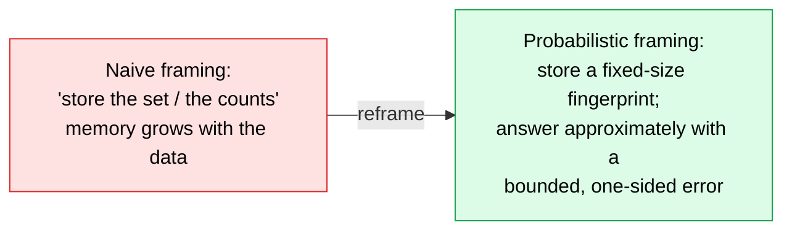
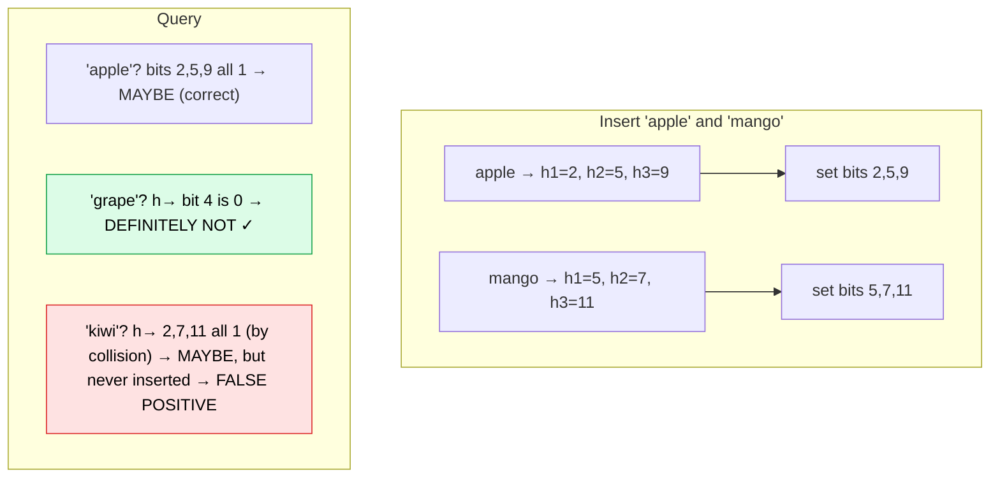
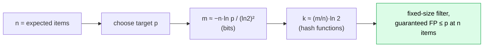
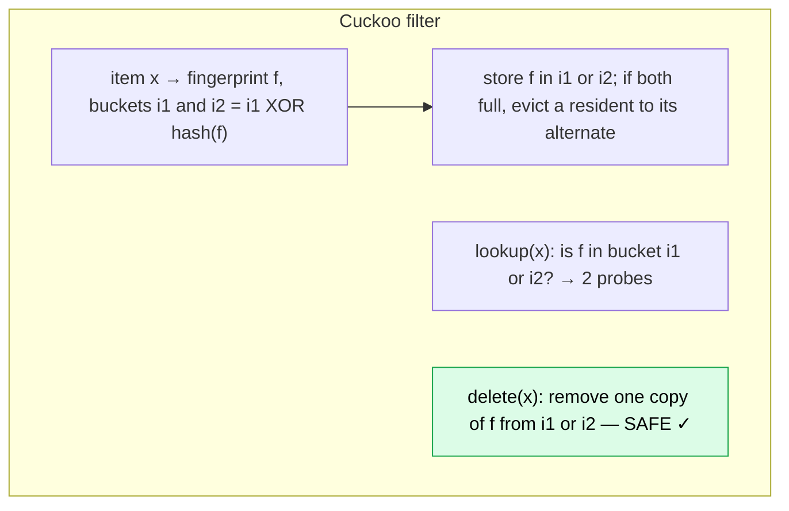
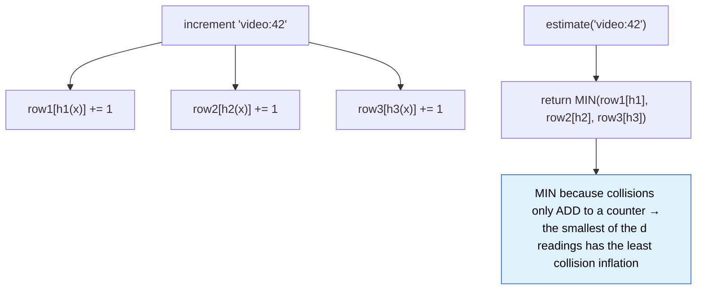
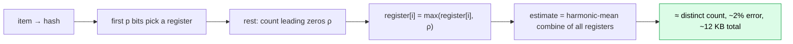
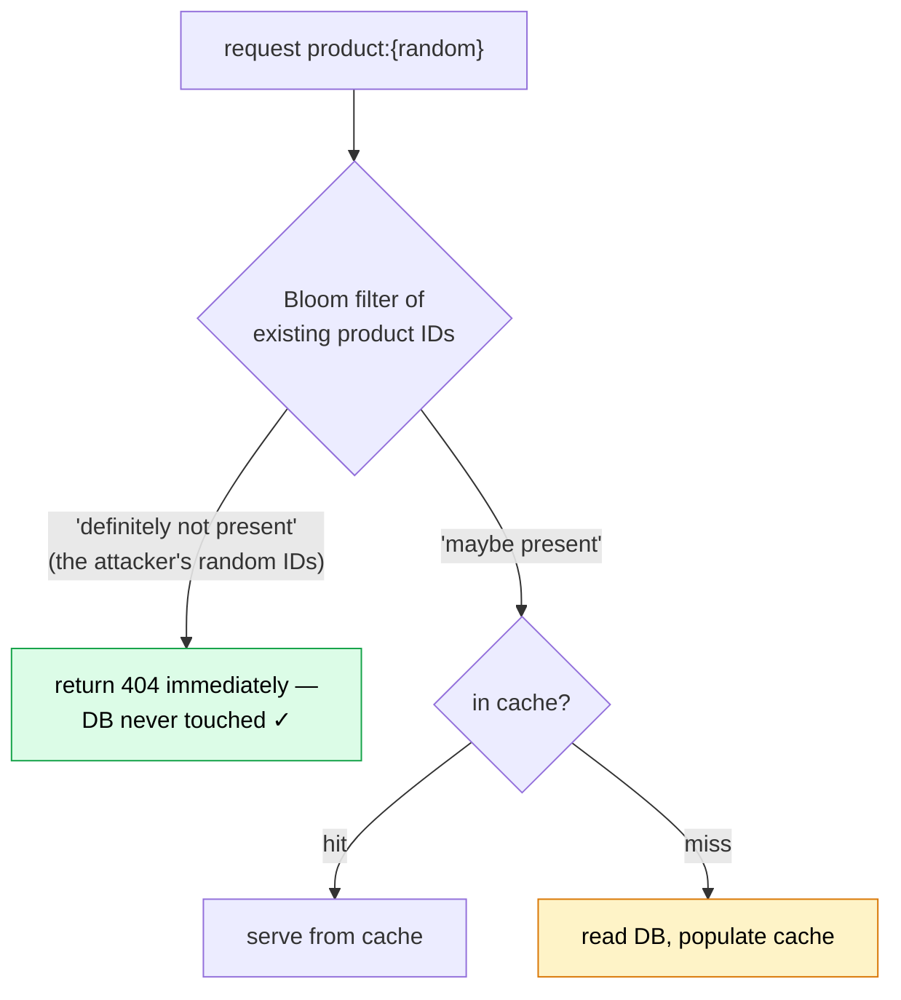
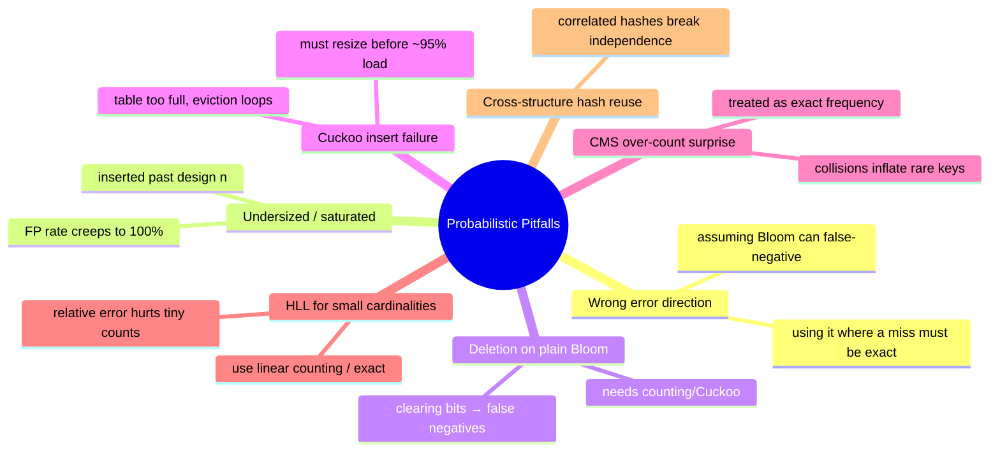

# Probabilistic Data Structures

> **One line:** When an exact set, counter, or distinct-count would cost more memory than you can spend, a probabilistic data structure trades a small, *bounded, one-sided* error for a tiny fixed footprint — Bloom and Cuckoo filters answer "is this in the set?", Count-Min Sketch answers "how often has this appeared?", and HyperLogLog answers "how many distinct things have I seen?", each in kilobytes where the exact answer would need gigabytes.

---

## Table of Contents
1. [Why You Must Master This](#1-why-you-must-master-this)
2. [The Mental Model](#2-the-mental-model)
3. [Bloom Filters — Membership From First Principles](#3-bloom-filters--membership-from-first-principles)
4. [Sizing a Bloom Filter — The Formula](#4-sizing-a-bloom-filter--the-formula)
5. [Deletion — Counting Bloom & Cuckoo Filters](#5-deletion--counting-bloom--cuckoo-filters)
6. [Count-Min Sketch — Frequency in Fixed Memory](#6-count-min-sketch--frequency-in-fixed-memory)
7. [HyperLogLog — Cardinality in Kilobytes](#7-hyperloglog--cardinality-in-kilobytes)
8. [Where These Show Up in Caching](#8-where-these-show-up-in-caching)
9. [Worked Example — Defending a Cache Against Penetration](#9-worked-example--defending-a-cache-against-penetration)
10. [Real-Life Use Cases](#10-real-life-use-cases)
11. [Failure Modes](#11-failure-modes)
12. [🏋️ Practice Drills](#-practice-drills)
13. [🎤 Interview Q&A Bank](#-interview-qa-bank)
14. [🎯 Staff+ Nuances](#-staff-nuances)
15. [Cheat Sheet](#15-cheat-sheet)
16. [Connections & Further Reading](#16-connections--further-reading)

---

## 1. Why You Must Master This

Three files in this section — [Cache_Invalidation_Consistency.md](./Cache_Invalidation_Consistency.md), [Caching_Strategies.md](./Caching_Strategies.md), and [Cache_Eviction_Policies.md](./Cache_Eviction_Policies.md) — reach for a probabilistic structure as a *black box*: a Bloom filter to stop cache penetration, a Count-Min Sketch to power W-TinyLFU admission and hot-key detection. This file is the first-principles explanation those files defer to. (A sibling treatment framed around storage engines lives at [05 · Bloom_Filters_Probabilistic_Data_Structures.md](../05_Databases_Storage/Bloom_Filters_Probabilistic_Data_Structures.md) — same structures, different lens; this one is the caching/systems home.)

- **They are the answer when "just keep an exact set" doesn't fit in RAM.** A billion-URL blocklist as a real hash set is tens of gigabytes; the equivalent Bloom filter with a 1% error rate is ~1.2 GB, and you can shrink it further by accepting more error. The whole discipline of high-scale systems is finding places where an *approximate* answer is good enough to unlock an order-of-magnitude memory saving.
- **The error is one-sided and you must know which side.** This is the single most-tested idea: a Bloom filter never says "not present" about something that *is* present (no false negatives), but it may say "present" about something that isn't (false positives). Getting the direction backwards in an interview is an instant credibility hit; getting it right lets you reason about whether the structure is *safe* for your use case.
- **They are load-bearing inside systems you already name.** LSM-tree storage engines put a Bloom filter in front of every SSTable so a read for a missing key skips the disk seek; Redis ships HyperLogLog (`PFADD`/`PFCOUNT`) and Count-Min Sketch (via RedisBloom); Caffeine's W-TinyLFU admission filter *is* a Count-Min Sketch; CDNs and databases use them for dedup and cardinality. "How does Redis count unique visitors in 12 KB?" is a real question.
- **They teach the core scaling instinct: approximate to scale.** The same reflex that makes you reach for a sample instead of a full scan, or a sketch instead of an exact count, is what separates a design that fits in memory from one that doesn't. These structures are the canonical, interview-ready examples of that instinct.

> **The core problem it solves:** *answering membership, frequency, or distinct-count queries over a huge or unbounded stream in fixed, tiny memory, by accepting a small and precisely-bounded probability of error in one known direction.*

**Prerequisites:** basic hashing (uniform hash functions), and ideally [Cache_Invalidation_Consistency.md](./Cache_Invalidation_Consistency.md) (cache penetration, the motivating cache use case) and [Cache_Eviction_Policies.md](./Cache_Eviction_Policies.md) §7 (W-TinyLFU, which consumes the Count-Min Sketch taught here).

---

## 2. The Mental Model

An exact data structure *stores the members*. A probabilistic one *stores only a fingerprint of the members* — enough to answer the question most of the time, but not enough to reconstruct what's inside. You give up the ability to enumerate, and in exchange the memory stops growing with the data.

Think of a nightclub bouncer with a small card of checkboxes instead of the full guest list. When someone arrives, the bouncer ticks a few boxes based on the person's name. To check if you're on the list, they see whether *your* boxes are already ticked. If any of your boxes is blank, you're **definitely not** on the list (no false negatives). If all your boxes happen to be ticked, you're **probably** on the list — but those boxes might have been ticked by other guests who happen to share them (a false positive). The card never grows, no matter how many guests arrive; only the *error rate* creeps up as more boxes fill in.



> **Hold onto this:** every structure in this file replaces "the exact data" with "a fixed-size sketch of the data," and every one has a one-sided error you can name — Bloom/Cuckoo can only *falsely include*, Count-Min can only *over-count*, HyperLogLog is unbiased with a bounded standard error. The skill is knowing *which* direction the error goes so you can decide whether it's safe for your use.



> The banner is the whole idea: exact costs O(n) memory, probabilistic costs O(1) plus a tunable error. Membership → Bloom/Cuckoo, frequency → Count-Min, cardinality → HyperLogLog.

---

## 3. Bloom Filters — Membership From First Principles

A **Bloom filter** answers one question — *"have I definitely never seen X?"* — using a bit array and a handful of hash functions, and nothing else.

**The mechanics:**
- Allocate a bit array of `m` bits, all zero. Pick `k` independent hash functions, each mapping any item to one of the `m` positions.
- **Insert(x):** hash `x` with all `k` functions, set those `k` bits to 1. (Bits already set stay set — there's no counter, just a 1.)
- **Query(x):** hash `x` with all `k` functions and look at those `k` bits. If **any** bit is 0, `x` was *definitely never inserted* — a true negative, guaranteed. If **all** `k` bits are 1, `x` is *probably* present.



**The asymmetry, stated precisely — this is the whole point:**
- **No false negatives.** If `x` was inserted, its `k` bits were set and can never be unset (a plain Bloom filter has no deletion), so a query for `x` always finds all bits set. "Definitely not present" is *always* trustworthy.
- **Possible false positives.** A query for an item that was *never* inserted can still find all `k` of its bits set — because other insertions happened to set exactly those bits. The false-positive rate rises as the array fills.

**Why the asymmetry is what makes it useful:** you place a Bloom filter *in front of* an expensive lookup as a cheap negative check. A "definitely not present" answer lets you skip the expensive operation with total confidence; a "maybe present" answer costs you a wasted expensive lookup that then returns nothing — a performance cost, never a correctness bug. That's exactly how an LSM engine skips disk reads for missing keys, and how a cache stops penetration ([§8](#8-where-these-show-up-in-caching)).

> **The one takeaway:** a Bloom filter turns "I might have to do an expensive lookup for something that isn't there" into "I can cheaply prove it isn't there most of the time" — and the *only* way it's ever wrong is by occasionally saying "maybe" when the answer is no, which wastes work but never corrupts an answer.

---

## 4. Sizing a Bloom Filter — The Formula

The Bloom filter's parameters are not guesses — there's a clean closed-form relationship between the number of items `n`, the bit-array size `m`, the number of hash functions `k`, and the false-positive probability `p`. Interviewers love this because it's derivable and memorable.

**The two formulas worth knowing cold:**

```
m = − (n · ln p) / (ln 2)²        ← bits needed for n items at target FP rate p
k = (m / n) · ln 2                 ← optimal number of hash functions
```

**What they tell you, intuitively:**
- **Memory is ~linear in the item count and grows only logarithmically as you demand a lower error rate.** Each 10× reduction in `p` costs a fixed *additive* ~4.8 bits per item. Concretely: **~9.6 bits per item → p ≈ 1%**, ~14.4 bits/item → 0.1%, ~19.2 bits/item → 0.01%. So 1 billion items at 1% error ≈ 9.6 Gbit ≈ 1.2 GB — versus tens of GB for an exact hash set.
- **There's an optimal `k`.** Too few hash functions and the bits don't discriminate enough; too many and you fill the array too fast. The optimum, `k = (m/n)·ln 2`, is what minimizes `p` for a given `m` and `n` — roughly 0.7 bits' worth of hashing per bit of array. For a 1% target that's about 7 hash functions.



**The critical operational caveat:** the guarantee `p` holds *only up to* the design capacity `n`. Keep inserting past `n` and the array saturates — more and more bits become 1 — and the false-positive rate climbs toward 100%, at which point every query answers "maybe" and the filter is useless. You must size for peak cardinality, and if the true cardinality is unbounded or unknown, you need a **scalable Bloom filter** (a chain of filters, each larger than the last, adding a new layer when the current one fills) or a periodic rebuild.

> **The one takeaway:** ~10 bits per element buys a 1% false-positive rate, and every additional ~4.8 bits/element cuts that rate 10×; the guarantee holds only until you exceed the item count you sized for, after which the filter silently degrades — so size for the maximum, or make it scalable.

---

## 5. Deletion — Counting Bloom & Cuckoo Filters

A plain Bloom filter **cannot delete**: to remove `x` you'd clear its `k` bits, but any of those bits might be shared with another still-present item, so clearing them would create a *false negative* — and false negatives are the one error a Bloom filter is supposed to make impossible. Two structures fix this.

**Counting Bloom filter — the classic fix.** Replace each single bit with a small counter (typically 4 bits). Insert *increments* the `k` counters; delete *decrements* them; query checks whether all `k` counters are non-zero. Now deletion is safe (a shared slot's counter stays positive as long as another item needs it). The cost is **4× the memory** of a plain Bloom filter, and counters can overflow under heavy sharing (mitigated by saturating them).

**Cuckoo filter — the modern preferred choice.** Instead of a bit array, store a short **fingerprint** (a few bits of each item's hash) in a table of buckets, using *cuckoo hashing*: each item can live in one of two candidate buckets, and inserting into a full bucket "kicks out" an existing fingerprint to *its* alternate bucket, cascading until everything fits.



- **Supports deletion** (remove one matching fingerprint) — its headline advantage over plain Bloom.
- **Often *more* space-efficient than a Bloom filter for false-positive rates below ~3%**, and lookups touch only **two buckets** (better cache locality than `k` scattered bit probes).
- **The catch:** insertions can *fail* if the table gets too full (the eviction chain loops), so Cuckoo filters have a practical load-factor limit (~95%) beyond which you must resize. It also stores fingerprints, so a truly tiny fingerprint raises the FP rate.

| | Plain Bloom | Counting Bloom | Cuckoo filter |
|---|---|---|---|
| **Delete?** | ❌ no | ✅ yes | ✅ yes |
| **Memory** | baseline | ~4× baseline | ~baseline or better (low p) |
| **Lookup cost** | `k` bit probes | `k` counter probes | 2 bucket probes |
| **Failure mode** | FP rate rises when full | counter overflow | insert *fails* when full |

> **The one takeaway:** if you never delete, plain Bloom is simplest and smallest; if you must delete, the counting Bloom filter is the classic answer (4× memory) and the Cuckoo filter is the modern one (deletion, better locality, often less memory — at the price of possible insert failure when nearly full).

---

## 6. Count-Min Sketch — Frequency in Fixed Memory

A Bloom filter answers *presence*. A **Count-Min Sketch (CMS)** answers *how many times* — it estimates the frequency of any item in a stream using fixed memory, no matter how many distinct items flow through.

**The mechanics:**
- A 2-D array of counters: `d` rows × `w` columns, with one independent hash function per row (mapping any item to a column in that row).
- **Add(x, c):** for each of the `d` rows, hash `x` to a column and add `c` to that counter.
- **Estimate(x):** hash `x` in each row, read the `d` counters it maps to, and return the **minimum** of them.



**Why `min`, and why the error is one-sided:** hash collisions cause *other* items to add to a counter, so every counter for `x` is `true_count(x) + (collisions)` — it can only be **too high, never too low**. Taking the minimum across the `d` rows picks the reading least polluted by collisions. So a CMS **over-estimates, never under-estimates** — the mirror image of the Bloom filter's "maybe present, never falsely absent."

**Sizing:** with `w = ⌈e/ε⌉` columns and `d = ⌈ln(1/δ)⌉` rows, the estimate is within `ε · N` of the truth (where `N` is the total count) with probability `1 − δ`. In plain terms: more columns → tighter error, more rows → higher confidence. A few kilobytes tracks frequencies across a stream of billions of events.

**What it's for — heavy hitters:** CMS shines at finding the *most frequent* items ("who are the top talkers?") without storing per-item counters for the millions of *infrequent* ones. This is exactly why it powers **W-TinyLFU** cache admission ([Cache_Eviction_Policies.md](./Cache_Eviction_Policies.md) §7): the sketch estimates how often a candidate key has been requested recently, and the cache admits the newcomer only if its estimated frequency beats the victim's — all in a few bytes per cache, not a counter per key. It's also the engine behind **hot-key detection** ([Hot_Key_Problem_Multi_Tier_Caching.md](./Hot_Key_Problem_Multi_Tier_Caching.md)): feed request keys into a CMS and the heavy hitters pop out as the keys needing replication or local caching.

> **The one takeaway:** Count-Min Sketch is "a Bloom filter with counters instead of bits," it *over-counts but never under-counts*, and its killer app is finding heavy hitters (hot keys, admission candidates) in fixed memory — which is precisely why it lives inside modern cache admission policies and hot-key detectors.

---

## 7. HyperLogLog — Cardinality in Kilobytes

The last question is *"how many **distinct** items have I seen?"* — cardinality. Exactly counting distinct items requires remembering every one you've seen (a set), which is O(n). **HyperLogLog (HLL)** estimates it in a fixed ~12 KB, for cardinalities into the billions, with about **2% standard error**.

**The core intuition (no heavy math):** hash each item to a uniformly random bit string. In a random stream of hashes, seeing a hash that *starts with many leading zeros* is rare — a hash starting with `k` zeros appears roughly once every `2^k` distinct items. So the **maximum number of leading zeros** you've observed is a (noisy) estimate of `log₂(distinct count)`. HLL makes this robust by splitting items into many "registers" (buckets) via the first few hash bits, tracking the max-leading-zeros in each, and combining them with a **harmonic mean** to damp the variance. More registers → lower error (error ≈ `1.04 / √(registers)`).



**The two properties that make it a systems favorite:**
- **Fixed, tiny memory regardless of cardinality.** Redis's HLL is capped at **12 KB** and counts up to ~2^64 distinct items at ~0.81% error. Counting unique daily visitors across billions of events costs 12 KB, not gigabytes.
- **Mergeable (the distributed superpower).** The union of two HLLs is just the element-wise **max** of their registers. So you can compute distinct counts *per shard / per server / per hour* independently and merge them losslessly into a global distinct count — no re-scanning raw data. This is why HLL is everywhere in distributed analytics (Redis `PFADD`/`PFMERGE`/`PFCOUNT`, Presto/BigQuery `APPROX_COUNT_DISTINCT`, Druid).

> **The one takeaway:** HyperLogLog answers "how many unique?" in a fixed ~12 KB with ~2% error by tracking the rarest hash pattern it has seen, and because two HLLs merge by taking the max of their registers, you get *distributed* distinct-counting for free — count per shard, merge, done.

---

## 8. Where These Show Up in Caching

These structures aren't abstract — they're load-bearing inside the exact caching problems the rest of this section covers:

| Structure | Caching use | What it replaces / why |
|---|---|---|
| **Bloom filter** | **Cache-penetration defense** — check a Bloom of *known-existing* keys before hitting the DB; a "definitely not present" answer short-circuits queries for keys that don't exist, so an attacker spamming random missing keys can't stampede the DB. | Replaces an exact "does this key exist?" set that would itself be huge. |
| **Bloom filter** | **LSM SSTable skip** — every SSTable carries a Bloom of its keys so a read for a missing key skips the disk seek (see [05 · B-Tree vs LSM](../05_Databases_Storage/B_Tree_vs_LSM_Storage_Engines.md)). | Replaces a wasted disk read per missing key. |
| **Count-Min Sketch** | **W-TinyLFU admission** — estimate a candidate key's recent request frequency; admit only if it beats the eviction victim ([Cache_Eviction_Policies.md](./Cache_Eviction_Policies.md) §7). | Replaces an exact per-key frequency counter for millions of keys. |
| **Count-Min Sketch** | **Hot-key detection** — stream request keys through a CMS; heavy hitters are the keys to replicate or pin in an L1 local cache ([Hot_Key_Problem_Multi_Tier_Caching.md](./Hot_Key_Problem_Multi_Tier_Caching.md)). | Replaces per-key request counters across the whole keyspace. |
| **HyperLogLog** | **Unique-visitor / distinct-count metrics** — count uniques per key, per page, per shard, merge for the global figure, in 12 KB each. | Replaces a `COUNT(DISTINCT ...)` or a giant set per metric. |
| **Cuckoo / counting Bloom** | **Deletable membership** — a penetration filter whose "existing keys" set changes as rows are created and deleted. | Replaces a plain Bloom that can't reflect deletions. |

> **The habit:** whenever a caching design needs a *set*, a *per-key counter*, or a *distinct count* over a huge keyspace and the exact version won't fit in memory, ask which of these four fits — membership (Bloom/Cuckoo), frequency (Count-Min), or cardinality (HyperLogLog) — and whether its one-sided error is safe here.

---

## 9. Worked Example — Defending a Cache Against Penetration

**The prompt:** "Your product API is cache-aside: on a miss, read the DB, populate the cache. An attacker floods you with requests for random product IDs that don't exist. Every one misses the cache *and* misses the DB (returns nothing), so nothing ever gets cached — the DB takes the full flood. This is *cache penetration*. Design a defense that doesn't itself blow up your memory."



**The design:**
- Build a Bloom filter of *all valid product IDs* (populate it from the DB at startup, and add each new product ID on creation). Put it in front of the cache-aside path.
- On each request, query the Bloom first. **"Definitely not present" → return 404 without touching the cache or DB.** The attacker's random non-existent IDs almost all hit this path, so the flood dies at the Bloom filter.
- **"Maybe present" → proceed** to the normal cache→DB path. Real product IDs always take this path (no false negatives); a small fraction of random IDs slip through as false positives, but those just do one normal (harmless) cache/DB lookup.

**Closing the loop — the numbers that drive the decision:**
- **Memory:** say 10M products. An exact `HashSet<Long>` of IDs is ~80–240 MB (object overhead); the Bloom filter at `p = 1%` needs `m ≈ −10M·ln(0.01)/(ln2)² ≈ 96 Mbit ≈ 12 MB` — a **~10–20× saving**, and it drops further if you accept `p = 5%`. That 12 MB sits comfortably in every app instance.
- **Effectiveness:** with `p = 1%`, 99% of the attacker's non-existent IDs are rejected at the Bloom with zero DB load; only ~1% leak through as false positives and do a single (empty) DB lookup that you can *also* cache as a negative result. The DB flood is cut by ~99% for a fixed 12 MB.
- **Why the one-sided error is *safe* here:** the error is a false *positive* — occasionally letting a non-existent ID through to the (harmless) normal path. There are **no false negatives**, so the filter never wrongly 404s a product that actually exists. If the error went the other way, this design would be a correctness bug; because it goes *this* way, it's only a tiny, bounded performance leak.
- **Deletion consideration:** if products are deleted often, a plain Bloom can't forget them (the deleted ID keeps testing "maybe present," doing a harmless lookup). If that leak matters, swap in a **Cuckoo filter** so deletions are reflected — the [§5](#5-deletion--counting-bloom--cuckoo-filters) trade-off, applied.

This is the canonical caching application: the Bloom filter converts "every bogus request costs a DB hit" into "every bogus request is rejected in-memory," and it does so in megabytes because we accepted a 1% *false-positive* rate that is, by construction, harmless to correctness.

---

## 10. Real-Life Use Cases

| Situation | Structure | The decision it forces |
|---|---|---|
| Reject requests for keys that don't exist (cache penetration) | Bloom / Cuckoo filter | Accept a tiny false-positive leak in exchange for MB-scale memory; use Cuckoo if the key set shrinks |
| Skip disk reads for missing keys in an LSM store | Bloom filter (per SSTable) | Trade a small RAM footprint per table for avoiding a disk seek on every absent-key read |
| Admit only worthwhile keys into a cache (W-TinyLFU) | Count-Min Sketch | Estimate frequency in bytes instead of a counter per key; over-count is acceptable for admission |
| Find the hot keys melting one shard | Count-Min Sketch | Detect heavy hitters without per-key counters across the whole keyspace |
| Count unique visitors / distinct IPs / distinct search terms | HyperLogLog | Accept ~2% error for 12 KB instead of a set; merge per-shard HLLs for the global figure |
| "Have I shown this user this article before?" at scale | Bloom filter (per user) | Accept occasionally *not* re-showing something (a false positive) as harmless |
| De-dup URLs in a web crawler's frontier | Bloom / scalable Bloom | Accept occasionally skipping a new URL (false positive) to fit a billion-URL frontier in RAM |
| Distinct-count over a stream in a data warehouse | HyperLogLog (`APPROX_COUNT_DISTINCT`) | Exact `COUNT(DISTINCT)` over billions of rows is too slow/big; 2% error is fine for dashboards |

> **The habit:** name the question first — *membership, frequency, or cardinality* — then the structure follows (Bloom/Cuckoo, Count-Min, HyperLogLog), and only then check that the direction of its error is tolerable for what you're building.

---

## 11. Failure Modes



- **Assuming the wrong error direction.** *Symptom:* a correctness bug where something present is treated as absent. *Root cause:* believing a Bloom filter can produce false negatives (it can't) or a CMS can under-count (it can't). *Fix:* internalize the direction — Bloom "maybe present / definitely absent," CMS "≥ true count" — and only use the structure where *that* direction is harmless.
- **Undersizing / saturation.** *Symptom:* Bloom false-positive rate far exceeds the design `p`; "everything says maybe." *Root cause:* inserted many more than the `n` you sized for, so the bit array is nearly all 1s. *Fix:* size for peak cardinality, monitor fill ratio, use a scalable Bloom filter or periodic rebuild when cardinality is unbounded.
- **Deleting from a plain Bloom filter.** *Symptom:* items that were never removed start testing "definitely not present" — a false negative. *Root cause:* clearing an item's bits also cleared bits shared with still-present items. *Fix:* never delete from a plain Bloom; use a counting Bloom (4× memory) or a Cuckoo filter (native deletion).
- **Cuckoo insert failure under high load.** *Symptom:* inserts start throwing / rejecting near a full table. *Root cause:* the eviction (kick-out) chain can't find a free slot past ~95% load factor. *Fix:* keep load factor below the limit and resize proactively; don't run a Cuckoo filter to the brim.
- **Treating a Count-Min estimate as exact.** *Symptom:* rare keys report inflated counts; low-frequency decisions are wrong. *Root cause:* collisions from heavy hitters add to the counters of rare items — CMS is accurate for *heavy* hitters, noisy for the long tail. *Fix:* use CMS only for heavy-hitter / top-K questions, size `w`/`d` for the accuracy you need, and don't trust it for rare-item exact counts.
- **HyperLogLog on small cardinalities.** *Symptom:* distinct counts of tens/hundreds are noticeably off. *Root cause:* HLL's relative error is designed for large cardinalities; at small counts the estimate is comparatively rough. *Fix:* HLL implementations (including Redis) switch to a *sparse / linear-counting* representation for small cardinalities automatically — but if you're rolling your own, handle the small-N regime or just keep an exact set until it grows.
- **Reusing correlated hash functions.** *Symptom:* real error far exceeds the theoretical bound. *Root cause:* the `k` (or `d`) hash functions aren't independent (e.g., derived trivially from one another), breaking the math. *Fix:* use proper independent hashes (or the standard double-hashing / enhanced-double-hashing construction that's proven to preserve the guarantee).

---

## 🏋️ Practice Drills

> *Cover the solutions and attempt first — active recall is the point.*

**Drill 1 — State the error direction for each.** For a Bloom filter, a Count-Min Sketch, and a HyperLogLog, say exactly which way each can be wrong, and give one caching use where that direction is safe.

<details><summary>Solution</summary>

- **Bloom filter:** can return a **false positive** ("maybe present" for something never inserted) but *never* a false negative. Safe use: cache-penetration defense — a false positive just lets a bogus key do one harmless DB lookup; there are no false negatives so a real key is never wrongly rejected.
- **Count-Min Sketch:** can **over-count** (estimate ≥ true count) but never under-count. Safe use: W-TinyLFU admission / hot-key detection — over-estimating a key's frequency at worst admits/flags a slightly-less-hot key, which is harmless; it never *hides* a genuinely hot key.
- **HyperLogLog:** an unbiased estimate with a bounded **standard error** (~2%), so it can be a little high *or* low. Safe use: unique-visitor dashboards — 2% error on a "3.4M uniques today" figure is invisible to the decision it informs.
</details>

**Drill 2 — Size a Bloom filter.** You need a Bloom filter for 50 million keys at a 1% false-positive rate. Roughly how much memory, and about how many hash functions?

<details><summary>Solution</summary>

Use `m = −n·ln p / (ln 2)²`. With `n = 50M`, `p = 0.01`: `ln(0.01) ≈ −4.605`, `(ln2)² ≈ 0.4805`. So `m ≈ 50M × 4.605 / 0.4805 ≈ 479M bits ≈ 60 MB`. (Equivalently, the ~9.6-bits-per-item rule of thumb for 1%: `50M × 9.6 ≈ 480 Mbit ≈ 60 MB`.)

Hash functions: `k = (m/n)·ln 2 ≈ 9.6 × 0.693 ≈ 7`. So **~60 MB and ~7 hash functions** — versus a multi-hundred-MB exact set. If 60 MB is still too much, accepting `p = 5%` drops it to ~37 MB (~6.2 bits/item).
</details>

**Drill 3 — Pick the structure.** For each, name the structure and justify: (a) "how many distinct users clicked this ad, mergeable across 20 shards?" (b) "which cache keys are the top 10 hottest right now?" (c) "has this email address already unsubscribed?" (deletions happen when they resubscribe).

<details><summary>Solution</summary>

- **(a) HyperLogLog.** The question is *cardinality* (distinct users) and it must merge across shards — HLL's registers combine by element-wise max, giving a lossless global distinct count from per-shard sketches in 12 KB each.
- **(b) Count-Min Sketch.** The question is *frequency / heavy hitters* — stream keys into a CMS and read off the top estimated frequencies. It finds the hottest keys without a counter per key, and its over-count error can't hide a genuinely hot key.
- **(c) Cuckoo filter** (or counting Bloom). The question is *membership*, but resubscribing means **deletion**, which a plain Bloom can't do without risking false negatives. A Cuckoo filter supports deletion with good space efficiency; a counting Bloom is the classic alternative at 4× memory.
</details>

**Drill 4 — Why `min`, why no false negatives?** Explain in one or two sentences each: (a) why Count-Min Sketch takes the *minimum* across its rows, and (b) why a Bloom filter structurally cannot produce a false negative.

<details><summary>Solution</summary>

**(a)** Hash collisions only ever *add* other items' counts into a counter, so every one of an item's `d` counters reads `true_count + collisions ≥ true_count`. The minimum of those readings is the one with the least collision inflation, so it's the closest to (and never below) the truth — hence CMS over-counts, never under-counts.

**(b)** Inserting an item sets all `k` of its bits to 1, and a plain Bloom filter never clears bits (no deletion). So when you later query that same item, all `k` of its bits are still 1 and the query returns "maybe present." There's no mechanism that could turn one of those bits back to 0, so "definitely not present" can never be returned for something that was inserted.
</details>

---

## 🎤 Interview Q&A Bank

**Q1. What is a Bloom filter and what's its defining property?**
> A Bloom filter is a bit array plus `k` hash functions that answers set-membership approximately in fixed memory. Its defining property is a *one-sided* error: it never produces false negatives (if it says "definitely not present," that's guaranteed correct) but it can produce false positives (it may say "maybe present" for something never inserted, because other items set the same bits). You use it as a cheap negative check in front of an expensive lookup — "definitely not" lets you skip the expensive operation with total confidence, and "maybe" costs at most a wasted lookup, never a wrong answer.

**Q2. How do you size a Bloom filter?**
> Given `n` expected items and a target false-positive rate `p`, the bit-array size is `m = −n·ln p / (ln 2)²` and the optimal number of hash functions is `k = (m/n)·ln 2`. The rules of thumb: about **9.6 bits per item gives 1%**, and every extra ~4.8 bits/item cuts the rate 10×. The crucial caveat is that the guarantee holds only up to the `n` you sized for — insert past that and the array saturates and the false-positive rate climbs toward 100%, so you size for peak cardinality or use a scalable Bloom filter.

**Q3. Why can't a Bloom filter delete, and what do you use instead?**
> Deleting would mean clearing an item's `k` bits, but those bits may be shared with other still-present items, so clearing them would create a false negative — the one error a Bloom filter must never make. To support deletion you use a **counting Bloom filter** (each slot is a small counter you increment/decrement instead of a bit — safe deletion at ~4× the memory) or a **Cuckoo filter** (stores fingerprints in buckets via cuckoo hashing — native deletion, only two bucket probes per lookup, often *less* memory than Bloom below ~3% FP, but inserts can fail near full load).

**Q4. What's a Count-Min Sketch and why does it take the minimum?**
> It's a 2-D array of counters with one hash function per row that estimates the frequency of any item in a stream using fixed memory. To count an item you increment its hashed counter in every row; to estimate, you take the *minimum* of its counters across rows. You take the minimum because collisions can only *add* other items' counts to a counter, so every counter is an over-estimate — the smallest reading is the least-inflated and closest to the truth. The result: CMS over-counts but never under-counts, which makes it ideal for finding heavy hitters (hot keys, W-TinyLFU admission) where an over-estimate is harmless.

**Q5. How does HyperLogLog count distinct items in 12 KB?**
> It hashes each item to a random bit string and tracks the maximum number of leading zeros seen — a hash starting with `k` zeros shows up about once per `2^k` distinct items, so the max leading-zero count estimates `log₂(cardinality)`. To reduce variance it splits items across many registers and combines them with a harmonic mean. Redis's HLL fits in 12 KB with ~0.8% error for cardinalities up to ~2^64. Its systems superpower is *mergeability*: the union of two HLLs is the element-wise max of their registers, so you count distinct per shard and merge into a global count without re-scanning anything.

**Q6. How would you use these to defend a cache against penetration?** *(signal: connects the structure to a real caching failure)*
> Cache penetration is when requests for keys that don't exist miss both the cache and the DB, so nothing gets cached and the DB takes the full flood — an attacker sending random IDs weaponizes this. Put a Bloom filter of all *valid* keys in front of the cache-aside path: "definitely not present" returns a 404 without touching the DB, killing the flood in memory; "maybe present" proceeds normally. The one-sided error is exactly right here — no false negatives means a real key is never wrongly rejected, and the ~1% false positives just do a harmless empty lookup you can cache as a negative. For 10M keys that's ~12 MB versus hundreds of MB for an exact set.

**Q7. Where do probabilistic structures show up inside systems you already know?**
> LSM-tree engines (RocksDB, Cassandra, LevelDB) put a Bloom filter in front of each SSTable so a read for a missing key skips a disk seek. Caffeine's and Ristretto's **W-TinyLFU** admission policy is a Count-Min Sketch estimating recent frequency. Redis ships HyperLogLog (`PFADD`/`PFCOUNT`) and, via RedisBloom, Bloom/Cuckoo filters and Count-Min/Top-K. Data warehouses implement `APPROX_COUNT_DISTINCT` with HLL. CDNs and crawlers use Bloom filters for dedup. They're not exotic — they're the standard tool whenever an exact set/counter/distinct-count won't fit in memory.

**Q8. What's the single biggest mistake people make with these?**
> Getting the error *direction* wrong and using the structure where that direction isn't safe. A Bloom filter's error is a false positive, never a false negative — so it's safe for "skip the expensive lookup if definitely absent" but catastrophic if you use it where a missed present-item causes data loss. A Count-Min Sketch over-counts, so it's safe for heavy-hitter decisions but wrong for exact rare-item counts. The discipline is: name the one-sided error, then confirm that being wrong *in that direction* only costs performance, never correctness.

---

## 🎯 Staff+ Nuances

- **The unifying principle is "replace the data with a sketch of the data, and pay in a one-sided error."** All four structures are the same bet in different clothes: fixed memory, bounded error, error in a known direction. Framing them this way — rather than as four unrelated tricks — is the senior signal, and it's what lets you *invent* the right approximation when none of the named four exactly fits.
- **The false-positive rate is a *tunable dial wired to memory*, and it belongs in capacity planning.** A Bloom filter's `p` trades directly against bytes (`~4.8 bits/item per 10× of `p``). At billions of items this is a real line item — the difference between `p = 1%` and `p = 0.01%` is doubling the filter. The mature move is to pick `p` from the actual cost of a false positive (a wasted lookup) versus the cost of the RAM, not to default to "1% because it's the example."
- **Cuckoo has largely displaced counting Bloom in modern designs — know why.** Deletion, better cache locality (two contiguous bucket probes vs. `k` scattered bit reads), and often lower memory below ~3% FP make it the default "deletable membership filter" today. Its one weakness — insert failure near full load — is an operational constraint (resize before ~95%), not a correctness issue. Naming this trade-off is more current than reaching for the counting Bloom.
- **Count-Min accuracy is *relative to the total stream mass*, which is why it's a heavy-hitter tool, not a general frequency oracle.** The error bound `ε·N` scales with `N` (total count), so a rare key's true count of 5 can be swamped by collision noise from heavy hitters. This is the mathematical reason W-TinyLFU uses it for *admission comparison* (heavy hitters, where it's accurate) and periodically *halves* the counters (to keep `N` bounded and track recency) rather than trusting raw long-tail counts.
- **HLL's mergeability is the property that makes it a distributed-systems primitive, not just a memory trick.** Because union = element-wise max, distinct-counting becomes *embarrassingly parallel and commutative/idempotent*: recompute a shard, re-merge, and you can't double-count. That's what lets warehouses and Redis compute "distinct users this month" as a merge of daily/hourly/per-shard sketches — the same reason CRDTs care about merge semantics. Exact `COUNT(DISTINCT)` has no such decomposition.
- **These structures interact directly with the section's other failure modes.** Bloom-in-front-of-cache is the [penetration](./Cache_Invalidation_Consistency.md) fix; CMS *is* the hot-key detector ([Hot_Key_Problem_Multi_Tier_Caching.md](./Hot_Key_Problem_Multi_Tier_Caching.md)) and the admission brain of [W-TinyLFU](./Cache_Eviction_Policies.md); HLL feeds the [metrics](./Performance_Metrics.md) layer. A Staff+ answer doesn't teach them in isolation — it names *which caching problem each one closes*.
- **"Approximate to scale" is a general reflex these structures crystallize.** The same instinct — accept a small, characterized error to unlock an order-of-magnitude resource saving — recurs in sampling-based profiling ([Profiling_Benchmarking.md](./Profiling_Benchmarking.md)), approximate quantiles for P99 (t-digest/HdrHistogram), and reservoir sampling. Recognizing probabilistic structures as one instance of that reflex, rather than a niche topic, is what lets you apply it broadly.

---

## 15. Cheat Sheet

```
PROBABILISTIC DATA STRUCTURES — bounded error, fixed memory
══════════════════════════════════════════════════════════════════════

THE UNIFYING BET
  replace the DATA with a fixed-size SKETCH of the data
  → O(1) memory instead of O(n), + a KNOWN, ONE-SIDED error

MEMBERSHIP: "is X in the set?"
  BLOOM FILTER  — bit array of m bits + k hash functions
    insert: set k bits    query: all k bits 1? → MAYBE : DEFINITELY-NOT
    ✓ NO false negatives   ✗ possible false positives
    ✗ cannot delete
    sizing:  m = −n·ln(p)/(ln2)²     k = (m/n)·ln2
             ~9.6 bits/item → p≈1% ; +4.8 bits/item → 10× lower p
    ⚠ guarantee holds only up to design n — saturates past it
  CUCKOO FILTER — fingerprints in buckets, cuckoo hashing
    ✓ supports DELETE   ✓ 2 probes/lookup   ✓ often < Bloom (p<3%)
    ✗ insert can FAIL near ~95% load → resize
  COUNTING BLOOM — bits → 4-bit counters; delete = decrement; ~4× memory

FREQUENCY: "how many times has X appeared?"
  COUNT-MIN SKETCH — d rows × w cols, 1 hash/row
    add: += in each row    estimate: MIN across rows
    ✓ OVER-counts, never under   → accurate for HEAVY HITTERS
    sizing: w=⌈e/ε⌉ cols, d=⌈ln(1/δ)⌉ rows → error ≤ ε·N w.p. 1−δ
    powers: W-TinyLFU admission, hot-key detection

CARDINALITY: "how many DISTINCT items?"
  HYPERLOGLOG — track max leading-zeros of item hashes, per register
    ✓ ~12 KB for up to ~2^64 distinct, ~0.8–2% std error
    ✓ MERGEABLE: union = element-wise MAX → per-shard, then merge
    Redis PFADD/PFCOUNT/PFMERGE ; warehouse APPROX_COUNT_DISTINCT

CACHING APPLICATIONS
  Bloom  → cache-PENETRATION defense (reject non-existent keys pre-DB)
  Bloom  → LSM SSTable skip (avoid disk seek for missing keys)
  CMS    → W-TinyLFU admission + hot-key detection
  HLL    → unique visitors / distinct counts per key, mergeable
  Cuckoo → deletable membership (key set that shrinks)

THE #1 RULE
  name the ONE-SIDED error direction, then confirm being wrong THAT way
  costs only performance, never correctness:
    Bloom/Cuckoo  = false POSITIVE (maybe-present)   never false-negative
    Count-Min     = OVER-count (≥ true)              never under-count
    HyperLogLog   = ± bounded std error (~2%)        unbiased
```

---

## 16. Connections & Further Reading

**Prerequisites (learn first):**
- [Cache_Invalidation_Consistency.md](./Cache_Invalidation_Consistency.md) — cache penetration, the motivating problem the Bloom filter here defends against.
- [Cache_Eviction_Policies.md](./Cache_Eviction_Policies.md) §7 — W-TinyLFU, the admission policy that consumes the Count-Min Sketch taught here.

**Builds toward / pairs with:**
- [Hot_Key_Problem_Multi_Tier_Caching.md](./Hot_Key_Problem_Multi_Tier_Caching.md) — Count-Min Sketch as the hot-key detector; sharded counters as the mirror-image write pattern.
- [Caching_Strategies.md](./Caching_Strategies.md) — the cache-aside path a penetration filter sits in front of.
- [Performance_Metrics.md](./Performance_Metrics.md) — HyperLogLog feeds distinct-count metrics; approximate quantiles are the same "approximate to scale" idea for P99.
- [05 · Bloom_Filters_Probabilistic_Data_Structures.md](../05_Databases_Storage/Bloom_Filters_Probabilistic_Data_Structures.md) — the sibling treatment framed around LSM storage engines and analytics; cross-reference, don't duplicate.
- [05 · B_Tree_vs_LSM_Storage_Engines.md](../05_Databases_Storage/B_Tree_vs_LSM_Storage_Engines.md) — where per-SSTable Bloom filters make LSM reads survivable.

**Gaps this topic exposes:**
- Top-K / heavy-hitter algorithms (Space-Saving, Misra-Gries) and t-digest/HdrHistogram approximate quantiles are close cousins that could earn their own note if the repo wants streaming-analytics depth.

**External classics:**
- Bloom, *"Space/Time Trade-offs in Hash Coding with Allowable Errors"* (1970) — the original paper.
- Fan, Andersen, Kaminsky, Mitzenmacher, *"Cuckoo Filter: Practically Better Than Bloom"* (2014) — the modern alternative.
- Cormode & Muthukrishnan, *"An Improved Data Stream Summary: The Count-Min Sketch"* (2005).
- Flajolet et al., *"HyperLogLog: the analysis of a near-optimal cardinality estimation algorithm"* (2007), and Google's *"HyperLogLog in Practice"* (2013).
- [RedisBloom documentation](https://redis.io/docs/data-types/probabilistic/) — production Bloom, Cuckoo, Count-Min, Top-K, and HLL in one place.

---

## TL;DR
**When an exact set, counter, or distinct-count won't fit in memory, a probabilistic data structure trades a small, bounded, *one-sided* error for a tiny fixed footprint.** Bloom filters answer membership with no false negatives but possible false positives (size them with `m = −n·ln p/(ln2)²`, ~9.6 bits/item for 1%); they can't delete, so use a counting Bloom (4× memory) or a Cuckoo filter (native deletion, better locality) when the set shrinks. Count-Min Sketch estimates frequency by taking the *minimum* across hashed rows — it over-counts but never under-counts, which is why it powers W-TinyLFU admission and hot-key detection. HyperLogLog counts distinct items in ~12 KB at ~2% error and *merges* across shards by taking the max of registers, making distributed distinct-counting trivial. In caching they're load-bearing: Bloom for penetration defense and LSM read-skipping, Count-Min for admission and hot-key detection, HLL for unique-visitor metrics. **The one rule that prevents every serious mistake: name the direction the error goes, then confirm that being wrong *that* way only costs performance, never correctness.**
