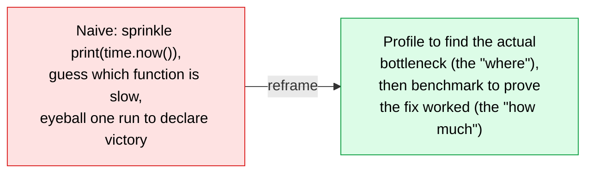
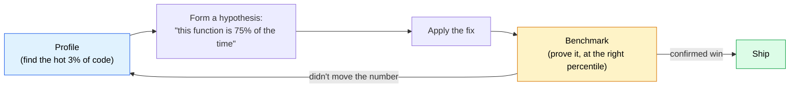
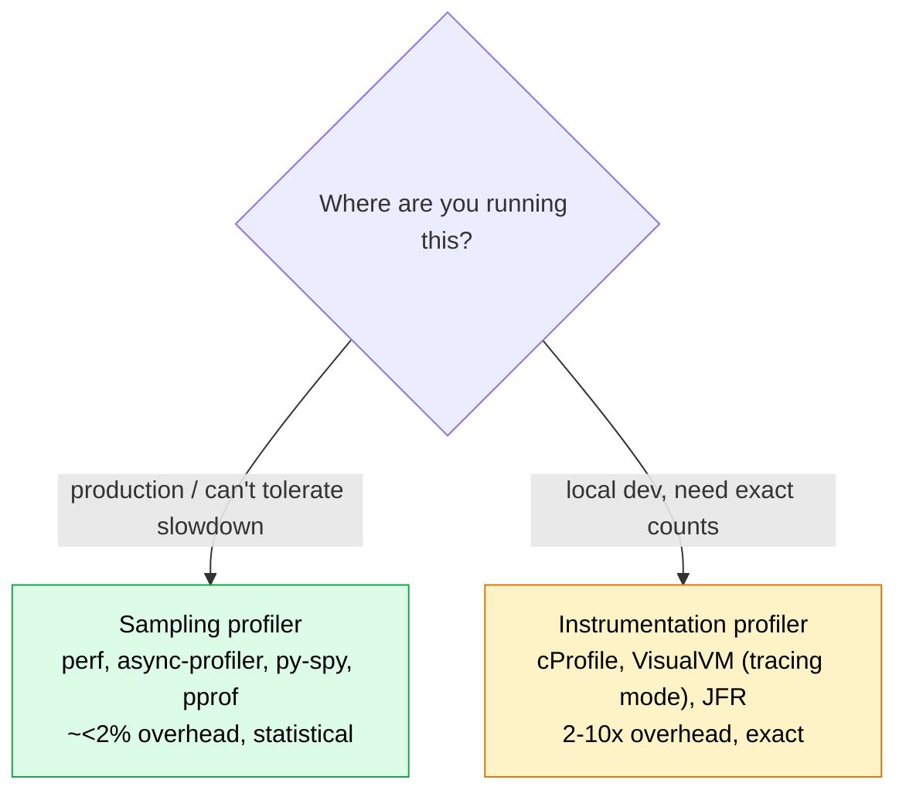
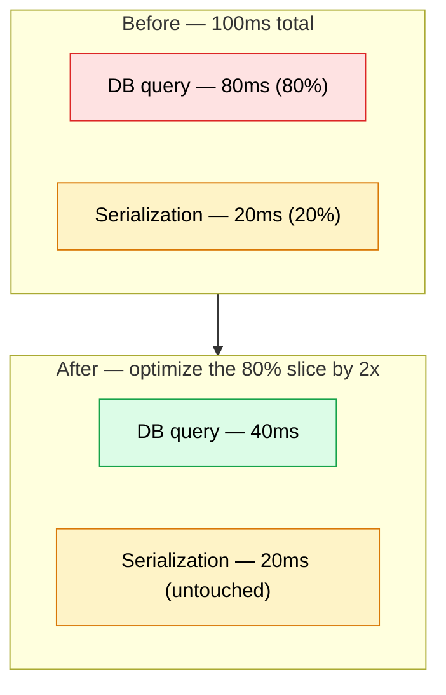
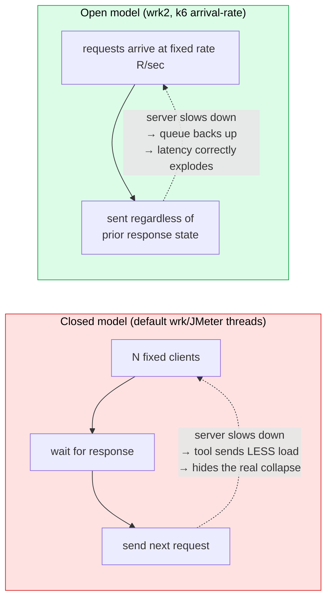
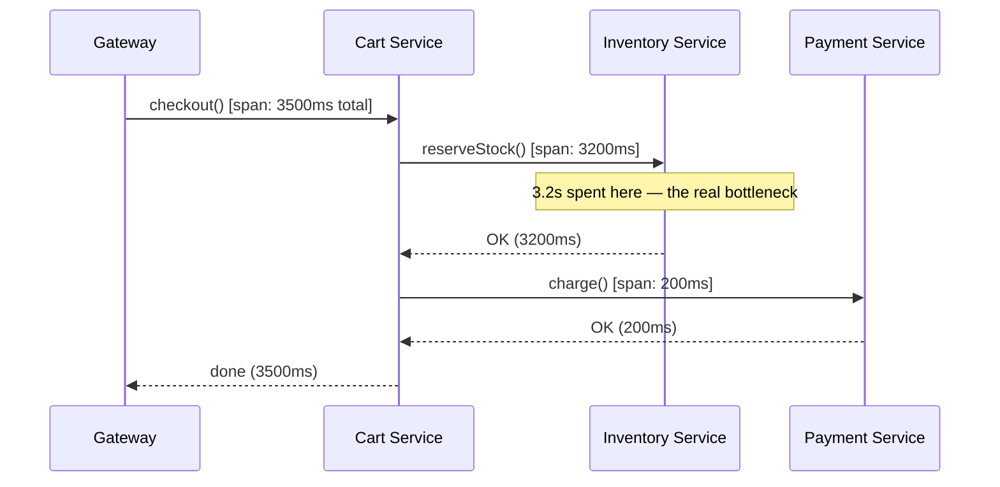
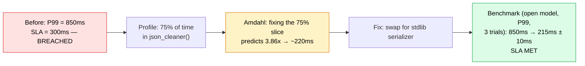
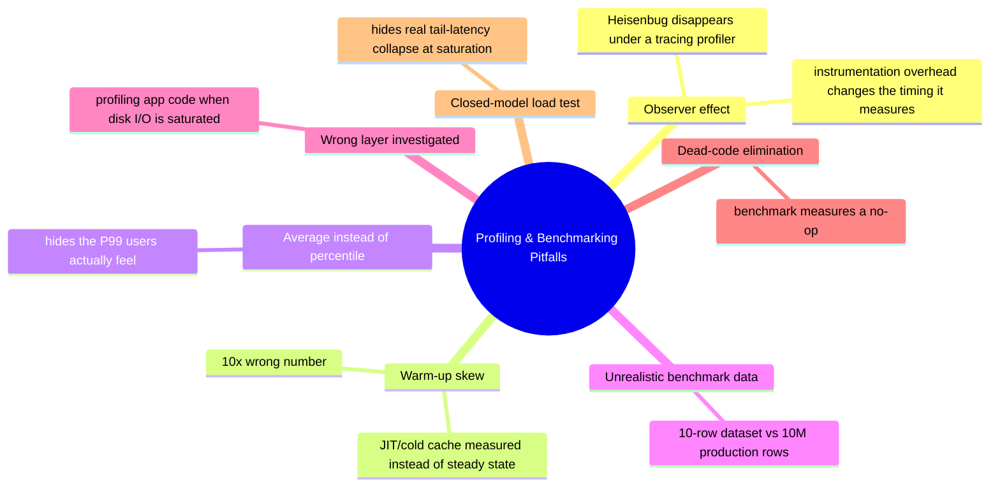

# Profiling & Benchmarking

> **One line:** Profiling tells you *where* the time (or memory, or lock contention) is actually going so you can find the real bottleneck; benchmarking tells you *whether your fix worked* — one is diagnosis, the other is proof, and skipping either leaves you either guessing or shipping an unverified guess.

---

## Table of Contents
1. [Why You Must Master This](#1-why-you-must-master-this)
2. [The Mental Model](#2-the-mental-model)
3. [Profiling vs Benchmarking — Two Different Questions](#3-profiling-vs-benchmarking--two-different-questions)
4. [Profiler Types — Sampling vs Instrumentation](#4-profiler-types--sampling-vs-instrumentation)
5. [Reading a Flame Graph](#5-reading-a-flame-graph)
6. [Amdahl's Law — Optimize the Biggest Slice](#6-amdahls-law--optimize-the-biggest-slice)
7. [The USE Method — Systematic Bottleneck Hunting](#7-the-use-method--systematic-bottleneck-hunting)
8. [Benchmarking Methodology — Proving the Fix Worked](#8-benchmarking-methodology--proving-the-fix-worked)
9. [Load Testing Tools & Open vs Closed Models](#9-load-testing-tools--open-vs-closed-models)
10. [Profiling & Tracing in Production](#10-profiling--tracing-in-production)
11. [Worked Example — The Slow Checkout API](#11-worked-example--the-slow-checkout-api)
12. [Real-Life Use Cases](#12-real-life-use-cases)
13. [Failure Modes](#13-failure-modes)
14. [🏋️ Practice Drills](#-practice-drills)
15. [🎤 Interview Q&A Bank](#-interview-qa-bank)
16. [🎯 Staff+ Nuances](#-staff-nuances)
17. [Cheat Sheet](#17-cheat-sheet)
18. [Connections & Further Reading](#18-connections--further-reading)

---

## 1. Why You Must Master This

- **Optimization without profiling is a guessing tax.** Engineers who "know" the bottleneck are wrong more often than they think — the classic surprise is a `json.dumps()` call or a regex compiled inside a loop, not the "obviously expensive" part everyone assumed. A profiler *proves* it instead of guessing; without one you can spend a sprint optimizing a function that's 1% of total execution time while the real 80% sits untouched.
- **Benchmarking is the only thing separating "I think it's faster" from "it's faster."** Ship a change with no before/after numbers and you've added complexity for an unverified win — or worse, a regression nobody caught because "it felt fine locally."
- **At scale, this is a direct line to cost.** Google and Amazon treat a 1% CPU efficiency win across their fleets as worth millions of dollars a year; that number only exists because continuous profiling tells you exactly which 1% to cut.
- **It catches regressions before production does.** A benchmark suite in CI turns "this PR made checkout 2x slower" from an incident into a failed check.

> **The core problem it solves:** turning "the site feels slow" into a specific, falsifiable claim — *this function is 73% of wall-clock time* — and then turning "I fixed it" into a specific, falsifiable claim — *P99 dropped from 850ms to 220ms across three independent trials* — instead of trusting intuition on either end.

**Prerequisites:** [Performance_Metrics.md](./Performance_Metrics.md) — you cannot benchmark correctly without already knowing why percentiles beat averages; this file assumes that lesson and builds the tooling on top of it.

---

## 2. The Mental Model

- **Profiling = a heart monitor and X-ray on a runner, mid-treadmill.** It shows which muscle (function, query, lock) is straining right now and which ones are idle. It's diagnostic, continuous, and produces a *shape* — a call tree, a flame graph — not a single number.
- **Benchmarking = the Olympic 100m dash.** A controlled, repeatable test under fixed conditions that reduces performance to a small set of comparable numbers ("9.58s", "P99 = 220ms"). It's verification, not diagnosis.

The naive approach — sprinkling `print(time.now())` or gut-feeling which function is slow — collapses both roles into a guess that is neither diagnostic (no call tree, no allocation data) nor a valid proof (no percentiles, no repeated trials, no control for noise).



> **Hold onto this:** profiling answers *where*, benchmarking answers *how much — and is it real*. Every performance investigation is profile → fix → benchmark → (profile again to confirm the shift moved). Skip the first step and you optimize randomly; skip the last and you never know if you actually helped.

---

## 3. Profiling vs Benchmarking — Two Different Questions

| | Profiling | Benchmarking |
|---|-----------|---------------|
| **Question answered** | *Where* is time/memory/locks being spent? | *How fast/much* is this, and did a change help? |
| **Output** | A call tree, flame graph, allocation graph — a shape | A number (or distribution): latency, throughput, memory, ops/sec |
| **When you run it** | When something is slow and you don't know why | Before and after a change, or continuously in CI |
| **Granularity** | Function/line/allocation-site level | End-to-end or a specific code path, as a whole |
| **Overhead tolerance** | Must be safe enough to run where the slowness actually manifests (often production) | Run in an isolated, controlled, repeatable environment |
| **Example tools** | perf, async-profiler, py-spy, pprof, cProfile, VisualVM | JMH, wrk/k6/Locust, timeit, criterion.rs, hyperfine |

They are sequential, not competing: **profile to form a hypothesis about the bottleneck → apply the fix → benchmark to confirm the fix actually reduced the number that mattered.** Skipping profiling means benchmarking the wrong fix; skipping benchmarking means shipping an unverified one.



**A real number that closes the loop:** a team notices an API takes 200ms. Profiling shows 180ms (90%) is spent inside a hand-written `json_cleaner` function. They swap it for the standard library's serializer. Benchmarking — not a single run, several trials at the right percentile — shows the new path takes 2ms. That's the whole discipline in one example: profile found the *where*, benchmark proved the *how much*.

---

## 4. Profiler Types — Sampling vs Instrumentation

Every profiler picks a point on the same trade-off: **how much truth do you want, versus how much are you willing to disturb the thing you're measuring** (the observer effect — profiling changes timing, and an aggressive enough profiler can make a bug disappear or a new one appear).

- **Sampling profilers** periodically interrupt the program (typically 99–1000 times/second — deliberately *not* a round number like 100Hz, to avoid aliasing with periodic OS timer ticks or GC cycles that also fire at round frequencies) and record the current call stack. Over thousands of samples, the *proportion* of samples containing a function approximates the proportion of time it consumed. Overhead is low — often under 1–2% — because you're not touching the code at all, just occasionally reading the stack. The cost: statistical, not exact — very short-lived functions can be under-sampled or missed entirely, and low sample counts produce noisy graphs.
- **Instrumentation (tracing) profilers** inject code at every function entry/exit (via source rewriting, bytecode injection, or compiler hooks) to record exact call counts and cumulative time per call. This is *exact*, not statistical — you get precise `ncalls`, `tottime`, `cumtime` per function. The cost is overhead that can be 2–10x or worse, especially for small, frequently-called functions, and the overhead itself skews relative timings (a function that does a lot of small calls looks artificially worse than one that does a little work in one big call).



**By target, not just by mechanism:**

| Profiler type | What it tracks | Finds | Example tools |
|---|---|---|---|
| **CPU profiler** | Which function is executing when sampled/traced | Hot loops, expensive serialization, algorithmic complexity bugs | perf, async-profiler, py-spy, pprof (CPU mode) |
| **Memory / allocation profiler** | Allocation call sites, object sizes, heap composition | Memory leaks, excessive garbage → GC pressure, unexpectedly large objects | pprof (heap mode), VisualVM heap dumps, tracemalloc, `--prof` heap snapshots |
| **Lock / contention profiler** | Time threads spend blocked waiting for a mutex/lock | Concurrency bottlenecks invisible to CPU profiling — a thread using 0% CPU while blocked is still the bottleneck | pprof (mutex/block profile), JFR lock profiling, `perf lock` |
| **Allocation-rate profiler** | Bytes/objects allocated per second, not just totals | GC-thrashing code that allocates too much even without leaking | async-profiler (alloc mode), Java Flight Recorder |

**By language, the tools you actually reach for:** Python — cProfile (instrumentation), py-spy and Scalene (sampling, no code changes, prod-safe); Go — `pprof` (built into the runtime, sampling, CPU/heap/mutex/block profiles all free); Java — async-profiler and JFR (Java Flight Recorder, low-overhead sampling using AsyncGetCallTrace, avoids the "safepoint bias" that plagues older JVM profilers), VisualVM (heavier, instrumentation-capable); Node.js — `--prof` + `node --prof-process`, clinic.js, 0x; C/C++/Linux — `perf` (hardware performance counters, near-zero overhead), Valgrind/callgrind (instrumentation, 10-50x slowdown, dev-only).

> **The rule:** sampling is the default for anything near production because it's cheap and safe; reach for instrumentation only in a dev/staging environment where exact call counts matter more than realistic timing.

---

## 5. Reading a Flame Graph

A flame graph is the standard way profiler output gets visualized (invented by Brendan Gregg). Misreading the axes is the single most common mistake:

- **X-axis is NOT time.** It's the population of stack samples, sorted alphabetically (or by some deterministic order) — width is proportional to the *fraction of total samples/time* a function consumed, not *when* it ran.
- **Y-axis is stack depth.** The bottom frame is the program entry point (or thread root); each frame going up is a function called by the one below it. The **top-most frame in each stack is the leaf — the function actually executing at the moment of the sample.**
- **Wide, flat plateaus at the top are the target.** A wide top-level box means many samples caught that exact leaf function running — that's where the CPU time is *actually* being spent, as opposed to merely being on the call path.
- **Color is usually cosmetic** (hashed by function name or module, for visual separation) — it does not mean "hot" in a thermal sense, except in one specific variant below.
- **Differential (diff) flame graphs** compare two profiles (before/after a change, or today vs yesterday): frames are colored red if they grew and blue if they shrank between the two profiles. This is the fast way to spot a regression in CI — "what got wider" is "what got slower."

```
Flame graph — width = % of total samples, height = call stack depth
┌──────────────────────────────────────────────────────────────────┐
│                 handle_request()  (100% — root)                  │
├───────────────────────────┬────────────────────┬─────────────────┤
│      parse_input() 15%    │  db_query() 18%    │ json_cleaner()   │
│                            │                    │      67%         │  <- leaf, wide & flat = HOT
└───────────────────────────┴────────────────────┴──────────────────┘
        ^ narrow = cheap           ^ moderate         ^ optimize THIS first
```

An **icicle graph** is the same data inverted — root at the top, growing downward — used by some tools (Chrome DevTools, Speedscope) for the same reason, just a different visual convention. Either way, the read is identical: find the widest leaf-level box, and that function is your Amdahl's-Law target (Section 6).

---

## 6. Amdahl's Law — Optimize the Biggest Slice

Amdahl's Law was originally about parallel speedup, but the same arithmetic is the single most useful discipline for deciding *what to optimize*: it tells you the **maximum possible speedup** of the whole system if you improve one part by some factor.

$$\text{Speedup}(s) = \frac{1}{(1-P) + \dfrac{P}{s}}$$

Where **P** is the fraction of total time spent in the part you're about to optimize, and **s** is how much faster that part gets. The rest of the time, **(1 − P)**, is untouched and puts a hard ceiling on your best-case result — even with **s → ∞** (making that part instantaneous), the best you can ever do is:

$$\text{Speedup}_{max} = \frac{1}{1-P}$$

**Worked example — a 100ms request:** profiling shows 80ms (P = 0.80) in a DB query and 20ms (P = 0.20) in JSON serialization.

| Optimization | P | s | Speedup formula | Speedup | New total |
|---|---|---|---|---|---|
| Make serialization **instant** (s → ∞) | 0.20 | ∞ | 1 / (0.80 + 0) | **1.25x** | 80ms |
| Make the DB query **2x faster** | 0.80 | 2 | 1 / (0.20 + 0.40) | **1.67x** | 60ms |
| Make the DB query **4x faster** | 0.80 | 4 | 1 / (0.20 + 0.20) | **2.5x** | 40ms |

A modest 2x improvement on the biggest slice (1.67x overall) beats making the smallest slice *infinitely* fast (1.25x overall). This is the entire justification for profiling before optimizing: **find P first** — the fraction of time each part actually consumes — because optimizing the wrong part is capped low no matter how hard you try, and optimizing the right part pays off even with an unglamorous improvement.


> New total = 60ms → a 1.67x speedup from touching only the biggest slice, at a merely 2x local improvement.

The same formula, read with **N processors instead of a speedup factor**, is Amdahl's original point about parallelism: $S(N) = \frac{1}{(1-P) + P/N}$ — as N → ∞, speedup asymptotes at 1/(1−P). A workload that's 90% parallelizable can *never* exceed a 10x speedup no matter how many cores you throw at it; the serial 10% is the ceiling. (Gustafson's Law is the counterpoint worth knowing: if you scale the *problem size* along with the resources instead of holding it fixed, the achievable speedup looks far less pessimistic — the two laws disagree because they hold different things constant.)

---

## 7. The USE Method — Systematic Bottleneck Hunting

Before profiling *inside* an application, a faster first move (Brendan Gregg's **USE Method**) is to check whether the bottleneck is even in application code at all. For every resource — CPU, memory, disk I/O, network — ask three questions:

- **Utilization** — what % of the time is this resource busy servicing work?
- **Saturation** — how much extra work is queued that the resource can't service yet (the leading indicator that something is about to get worse)?
- **Errors** — is the resource throwing errors (retransmits, disk errors, OOM kills)?

| Resource | Utilization check | Saturation check | Common tool |
|---|---|---|---|
| CPU | % busy per core | Run-queue length &gt; core count | `mpstat`, `top`, `vmstat` (the `r` column) |
| Memory | % used, page cache size | Swap activity, OOM-killer log entries | `free`, `vmstat` (`si`/`so`) |
| Disk I/O | % time device is busy | Queue depth / average wait time | `iostat -x` |
| Network | Throughput vs link capacity | Retransmits, buffer overruns | `sar -n DEV`, `ss -s` |

A CPU profiler is useless if the real bottleneck is disk I/O saturation — you'll get a "flat," unremarkable flame graph because the process is mostly *blocked*, not *computing*. USE tells you which resource to point the profiler at (cross-link: [CPU_vs_Memory_vs_IO_Bound.md](../14_Performance_Optimization_Scalability/CPU_vs_Memory_vs_IO_Bound.md) covers classifying a workload by its bound resource in depth); the profiler then tells you *which line of code* is driving that resource once you know which one to look at.

---

## 8. Benchmarking Methodology — Proving the Fix Worked

A benchmark that isn't methodologically sound is worse than no benchmark — it produces a confident, wrong number. Five disciplines, all of which the original "premature optimization" naive approach skips:

- **Warm up before measuring.** JIT-compiled runtimes (JVM, V8/Node) run cold code through an interpreter or a quick baseline compiler first; the optimizing compiler only kicks in after a threshold of invocations (the JVM's C2 tier typically needs on the order of 10,000 invocations of a method; V8's TurboFan similarly needs the function to run "hot" for a while). Benchmark a function on its first few calls and you measure the *interpreter*, not the steady-state code — routinely 10x slower than reality. Discard warm-up iterations; measure only after throughput stabilizes. CPU/OS caches need the same treatment — a cold cache line costs ~100ns (DRAM) vs ~1ns (L1) to fetch, so the very first iteration of any data-structure benchmark is not representative either.
- **Measure the right percentile, never the mean.** A mean of 50ms can hide a P99 of 2 seconds. Report P50/P90/P99/P99.9 (see [Performance_Metrics.md](./Performance_Metrics.md) for why); a benchmark that only prints an average is answering a question nobody who's actually been paged at 3am is asking.
- **Isolate the variable.** Run on a quiet, dedicated machine (or at minimum, note if it's a noisy-neighbor cloud VM); disable CPU frequency scaling/turbo boost (it introduces run-to-run variance of its own); pin to specific cores; change exactly one thing between runs. If you can't explain every difference between "before" and "after" except the code change, the benchmark isn't valid.
- **Demand statistical significance.** One run is an anecdote. Run multiple independent trials, look at the spread (standard deviation, coefficient of variation), and use a confidence interval or a proper statistical test (a nonparametric test like Mann-Whitney U, which tools like `hyperfine` use, avoids assuming a normal distribution that latency data rarely has) before declaring "faster."
- **Avoid the micro-benchmark traps.** Two are classic:
  - **Dead-code elimination.** If the benchmark computes a result nobody reads, an optimizing compiler/JIT may notice the result is unused and delete the computation entirely — you end up benchmarking a no-op that looks blazingly fast. Proper harnesses (JMH's `Blackhole`, `criterion.rs`, pytest-benchmark) force consumption of the result specifically to prevent this.
  - **Unrealistic data.** Benchmarking a function against a 10-row dataset when production sends 10 million rows tells you nothing about cache behavior, algorithmic complexity, or GC pressure at real scale — match the shape and volume of production data, not just the code path.

---

## 9. Load Testing Tools & Open vs Closed Models

Micro-benchmarks prove a function is fast; **load testing** proves the whole system holds up under many concurrent users — the system-level analog of benchmarking, driven by an external tool hitting real endpoints. (The full taxonomy of load/stress/soak/spike *test types* is owned by [14_Performance_Optimization_Scalability/Performance_Testing_Benchmarking.md](../14_Performance_Optimization_Scalability/Performance_Testing_Benchmarking.md) — this section's angle is narrower: which *tool* to reach for, and the methodology trap — open vs closed request generation — that silently invalidates results in any of them.)

| Tool | Language/model | Strength | Watch out for |
|---|---|---|---|
| **wrk** | C, scriptable via Lua | Extremely high throughput from a single machine; great for finding a raw ceiling | Closed-loop by default (see below) — use **wrk2** for open-loop, coordination-omission-corrected results |
| **k6** | JavaScript scripting | Modern scripting model, CI/CD-native, supports an explicit open-model "arrival-rate" executor | Cloud-run costs money at scale; scripting still requires discipline to model realistic user think-time |
| **JMeter** | Java, GUI + XML | Huge protocol coverage (HTTP, JDBC, SOAP, FTP, message queues) | The load-generator itself is resource-heavy — you can bottleneck your *test tool* before you bottleneck the system under test |
| **Locust** | Python, code-first | Load scenarios as real code; easy to model complex, branching user journeys; horizontally distributes across worker processes | Python's GIL limits per-process throughput — must distribute workers to hit high RPS |

**Open vs closed request-generation models — the trap that invalidates results in any of the tools above:**

- **Closed model:** a fixed number of virtual clients; each one waits for the previous response before sending its next request. Throughput is *self-limiting* — if the server slows down, the closed-model tool automatically sends fewer requests, which makes the server look like it's coping fine even as real users' requests would be piling into a queue. This is **coordination omission** (a term coined by Gil Tene): the tool's measured latency looks deceptively okay right up to the point of collapse, because slow responses are quietly absorbed by the client waiting, not counted as growing queue delay.
- **Open model:** new requests arrive at a fixed rate, *independent of whether previous responses have returned yet* — exactly how real, uncoordinated internet users behave. Under overload, an open-model test correctly shows latency exploding as the queue backs up, because it keeps firing requests at the target rate regardless of the server falling behind.



> **The rule:** if you're validating an SLA against real, independent user traffic, use an open-model test (wrk2, k6's arrival-rate executor, or Locust's constant-pacing) — a closed-model result at saturation is not just slightly off, it's actively misleading about tail latency.

---

## 10. Profiling & Tracing in Production

**Sampling profilers are the ones you're allowed to run against live traffic** because their overhead is low and bounded: `perf` (Linux, uses hardware performance counters, sub-1% overhead), **async-profiler** (JVM, uses `AsyncGetCallTrace` + `perf_events` to avoid the "safepoint bias" that skews older JVM profilers toward safepoint-adjacent code), **pprof** (Go, built into the standard library — flip on CPU/heap/mutex profiling with an HTTP endpoint), **py-spy** (Python, samples the process from *outside* — zero code changes, safe to attach to a running prod process). "Continuous profiling" platforms (Pyroscope, Datadog Continuous Profiler, Google Cloud Profiler) run these sampling profilers always-on across an entire fleet at low, budgeted overhead, storing profiles so you can diff "today vs. before the last deploy" the same way you'd diff two flame graphs manually — this is the direction the industry has moved, from one-off firefighting profiling to continuous fleet-wide profiling as a standing capability. (Full depth on running this at organizational scale lives in [12_Monitoring_Logging_Observability/Profiling_Distributed_Profiling.md](../12_Monitoring_Logging_Observability/Profiling_Distributed_Profiling.md) — this file's angle is the mechanics of a single profiling session; that one's angle is always-on profiling across a fleet.)

**Instrumentation profilers stay local.** Their overhead (2-10x) is fine on your laptop against a synthetic request, but would itself become the incident if run against real production traffic.

**Distributed tracing is profiling's answer to "which *service*, not which *function*."** In a microservice architecture, a single flame graph inside one process can't show you that the real 3.5-second delay for a checkout request is actually a 3.2-second call sitting inside the Inventory service, three hops away. Tracing solves this with:

- **Trace ID** — assigned once, at the edge, and propagated on every downstream call (via a header like `traceparent`) — the "tracking number" for one end-to-end request.
- **Spans** — one per unit of work (a service call, a DB query); each has a start/end time and a parent span, so the whole request reconstructs into a tree.
- **Context propagation** — every service reads the incoming trace/span ID and passes it forward, so spans from independent processes stitch back into one trace.
- **Collector + backend** — an OpenTelemetry Collector batches spans from every service and ships them to a backend (Jaeger, Zipkin, Tempo) that renders the whole trace as a waterfall — visually, a flame graph stretched across service boundaries instead of function calls.


> The span waterfall shows the Inventory hop, not the Gateway, owns 91% of total latency — exactly the "widest box" read from a flame graph, just spread across processes instead of stack frames. Full mechanics — OTel SDKs, auto-instrumentation, the Collector pipeline — live in [12_Monitoring_Logging_Observability/Distributed_Tracing_OpenTelemetry.md](../12_Monitoring_Logging_Observability/Distributed_Tracing_OpenTelemetry.md); this file's job is just connecting "profiling one process" to "profiling a request across many."

**The discipline underneath all of this:** *measure before you optimize.* Donald Knuth's "premature optimization is the root of all evil" is routinely misquoted as "never think about performance" — his actual point (the famous 97%/3% framing) is narrower and sharper: don't spend engineering effort optimizing code you haven't measured, because intuition about hot paths is unreliable and the effort is almost always better spent elsewhere until a profiler says otherwise.

---

## 11. Worked Example — The Slow Checkout API

**The prompt:** "Checkout API P99 latency is 850ms; the SLA is 300ms. Find the bottleneck and prove your fix works."

**Step 1 — USE method first, not a profiler.** A quick infra check shows CPU utilization at 30% (not CPU-saturated), disk and network unremarkable. The bottleneck is inside the application, not the infrastructure — time to profile the process.

**Step 2 — profile in production with a sampling profiler (async-profiler, &lt;2% overhead).** The resulting flame graph shows a single wide leaf-level box:

| Function | % of samples | Time (of 850ms) |
|---|---|---|
| `json_cleaner()` (custom serializer) | 75% | 640ms |
| DB query | 18% | 150ms |
| everything else | 7% | 60ms |

**Step 3 — apply Amdahl's Law to decide the target** (Section 6): P = 0.75 for `json_cleaner`. Swapping it for the standard library's serializer is measured locally at 80x faster (640ms → 8ms). Predicted speedup:

$$\text{Speedup} = \frac{1}{(1 - 0.75) + \dfrac{0.75}{80}} = \frac{1}{0.25 + 0.009} = 3.86x$$

Predicted new total: 850ms / 3.86 ≈ **220ms** — under the 300ms SLA. Note that even a modest, realistic improvement on the 18% DB slice (say, 2x) would only buy 1/(0.82+0.09) ≈ 1.1x — Amdahl's Law says fix the serializer first, not the query.

**Step 4 — ship the fix, then benchmark to prove it, correctly.** Load test with an **open-model** tool (k6 arrival-rate executor) at production-representative request rate — not a closed-loop tool, which would hide any residual tail-latency problem. Warm up for 30 seconds (discard), then measure P99 over a 5-minute steady-state window, repeated across 3 independent trials to check for run-to-run variance.



**Closing the loop:** the number (75% of time in one function) drove the decision (fix the serializer, not the DB query), and the benchmark — at the right percentile, under an open load model, across multiple trials — is what turns "should be faster" into "measured 215ms ± 10ms, SLA met."

---

## 12. Real-Life Use Cases

| Situation | How profiling/benchmarking applies | The decision it forces |
|---|---|---|
| P99 latency spikes right after a deploy | Diff flame graph (today vs. pre-deploy baseline) highlights which function got wider | Roll back the deploy, or ship a targeted fix to the widened frame |
| "Our new cache made things faster" — is it true? | Benchmark with realistic load, right percentile, multiple trials, open model | Ship the cache, or revert it — a claim isn't a fact until benchmarked |
| Pod restarts every 48 hours under load | Heap/allocation profiler + a memory-growth-over-time chart | Find and fix the retention bug (an ever-growing collection, an uncleared cache, a listener never removed) |
| Multi-service request is slow, unclear which service | Distributed trace span waterfall pinpoints the offending hop before profiling inside it | Profile *inside* the guilty service only — don't guess across five services |
| Choosing a load-testing tool for CI | wrk/wrk2 for a raw throughput ceiling; k6 or Locust for realistic, scripted, open-model user journeys | Pick the tool that matches whether you need a ceiling number or a realistic SLA validation |
| A micro-benchmark shows a refactor is "10x faster" | Check for dead-code elimination and JIT warm-up skew before trusting it | Re-run with a proper harness (Blackhole/consumption of the result) before believing the number |

> **The habit:** never trust a performance claim — your own or a teammate's — that doesn't cite a profiler's flame graph (for *where*) and a benchmark's percentile-over-multiple-trials (for *how much*). Anything less is an opinion.

---

## 13. Failure Modes



- **The observer effect / Heisenbug.** *Symptom:* a bug (often a race condition or lock contention issue) disappears when you attach a profiler, or a new slowdown appears that isn't there in normal operation. *Root cause:* instrumentation-level profiling overhead is high enough to change scheduling and timing, especially around locks and threads. *Fix:* use a low-overhead sampling profiler for anything timing-sensitive; treat instrumentation-profiler results as a shape (where roughly is the time going), not exact absolute numbers, when concurrency is involved.
- **Warm-up skew.** *Symptom:* a benchmark reports numbers 5-10x worse than what users actually experience. *Root cause:* measuring before the JIT reaches its optimizing tier, or before OS/CPU caches are warm. *Fix:* run and discard warm-up iterations; only measure steady state.
- **The "average" trap.** *Symptom:* dashboards say "50ms average, we're fine," while 10% of real users wait 10 seconds. *Root cause:* averages are pulled toward the bulk of fast requests and hide a long tail. *Fix:* always report P90/P99/P99.9 (see [Performance_Metrics.md](./Performance_Metrics.md)).
- **Unrealistic benchmark data.** *Symptom:* a benchmark passes locally, then the same code is 100x slower in production. *Root cause:* tested with a toy dataset (10 rows) instead of production shape and volume (10 million rows) — different cache behavior, different algorithmic complexity exposure, different GC pressure. *Fix:* benchmark against production-representative data size and shape.
- **Profiling the wrong layer.** *Symptom:* a CPU flame graph looks flat and unremarkable, yet the system is clearly slow. *Root cause:* the bottleneck isn't CPU at all — it's disk or network I/O saturation, and the process is mostly blocked, not computing. *Fix:* run the USE method across CPU/memory/disk/network *before* reaching for a CPU profiler, so you point the tool at the resource that's actually saturated.
- **Dead-code elimination in micro-benchmarks.** *Symptom:* a change appears to make code run in near-zero time. *Root cause:* the optimizing compiler/JIT noticed the benchmark's result is never used and deleted the computation. *Fix:* use a benchmarking harness that forces consumption of the result (JMH's Blackhole, criterion.rs, pytest-benchmark).
- **Closed-model load testing at saturation.** *Symptom:* a load test shows "the server handled it fine" right up until a real production incident during the exact same traffic level. *Root cause:* a closed-loop tool self-throttles as the server slows, hiding true queueing delay (coordination omission). *Fix:* use an open-model tool (wrk2, k6 arrival-rate) when validating against real, uncoordinated user traffic.

---

## 🏋️ Practice Drills

> *Cover the solutions and attempt first — active recall is the point.*

**Drill 1 — Sampling or instrumentation?** You need to profile a payment service that is currently handling live production traffic, to find why P99 briefly spiked yesterday. Which profiler type do you reach for, and why is the other one disqualified here?

<details><summary>Solution</summary>

**Sampling.** A sampling profiler (async-profiler, `perf`, pprof, py-spy) periodically snapshots the call stack with well under 2% overhead — safe to run against live traffic without materially changing its behavior. An instrumentation/tracing profiler injects code at every function entry/exit; its 2-10x overhead would itself distort the very timing you're trying to measure (the observer effect), and on a live payment service that overhead could cause a real, self-inflicted incident. Instrumentation profilers belong in a dev/staging environment, replaying a similar request pattern, where exact call counts matter more than realistic timing.
</details>

**Drill 2 — Apply Amdahl's Law.** A request takes 500ms total: 350ms in a template-rendering step, 100ms in a DB call, 50ms in everything else. You can either (a) make rendering 3x faster, or (b) make the DB call instant (infinitely fast). Which gives a better result, and what's the new total time for each?

<details><summary>Solution</summary>

P(rendering) = 350/500 = 0.70. P(DB) = 100/500 = 0.20.

**(a) Rendering 3x faster:** Speedup = 1 / ((1 − 0.70) + 0.70/3) = 1 / (0.30 + 0.233) = 1 / 0.533 ≈ **1.87x**. New total = 500/1.87 ≈ **267ms**.

**(b) DB call instant (s → ∞):** Speedup = 1 / (1 − 0.20) = 1 / 0.80 = **1.25x**. New total = 500/1.25 = **400ms**.

**(a) wins**, despite being a merely 3x local improvement versus an infinite one — because it targets the bigger slice (70% vs 20%). This is the core lesson: profile first to find P, then optimize the biggest P even with a modest s, rather than chasing an impressive-sounding s on a small slice.
</details>

**Drill 3 — Design the proof.** Your team just added a Redis cache in front of a slow endpoint and claims "it's way faster now." Design the benchmark that would actually prove or disprove that claim, including which pitfalls from Section 8/9 you'd guard against.

<details><summary>Solution</summary>

A defensible proof needs:
1. **Warm-up:** run the load test for ~30-60s before recording anything — both to let the cache actually populate (a cold cache benchmark would unfairly show cache misses) and to let the JIT/runtime reach steady state.
2. **Right percentile:** report P50, P99, and P99.9 before and after — not just the mean; a cache often helps the median a lot while doing little for the P99 (cache-miss requests still hit the slow path).
3. **Realistic data & load pattern:** use production-representative request keys, including the actual hot-key/skew distribution, not a uniform-random synthetic one — cache hit rate is extremely sensitive to key distribution.
4. **Open-model load generation** (k6 arrival-rate or wrk2) at a rate matching real traffic, so any queueing behavior under load is captured honestly rather than hidden by client self-throttling.
5. **Multiple independent trials** (at least 3-5 runs) and report variance, not a single number — a single fast run could be noise (an underloaded neighbor VM, a lucky GC pause pattern).
6. **Isolate the variable:** same hardware/environment for before and after, ideally toggling only the cache (e.g., a feature flag) rather than comparing across separate deploys that also changed other things.

Only after all of that does "P99 dropped from Xms to Yms, consistently across 5 trials" become a claim you can defend in an incident review or a design doc.
</details>

**Drill 4 — Read the flame graph.** A CPU flame graph for a slow request shows a single very wide box at the very top of the stack labeled `regex.compile()`, called from inside a loop three frames below it labeled `for_each_record()`. What's the diagnosis, and what's the likely one-line fix?

<details><summary>Solution</summary>

**Diagnosis:** the top-level (leaf) box being wide means the CPU is spending most of its sampled time actually *inside* `regex.compile()`, and it's being called repeatedly from within a loop (`for_each_record()`) rather than once. Compiling a regular expression is comparatively expensive; doing it once per record instead of once total turns a cheap operation into the dominant cost.

**Fix:** hoist the `regex.compile()` call outside the loop — compile it once before iterating, and reuse the compiled pattern object inside `for_each_record()`. This is a textbook flame-graph read: a wide leaf box inside a loop almost always means "this is being redone when it should be cached/hoisted."
</details>

---

## 🎤 Interview Q&A Bank

**Q1. "What's the difference between profiling and benchmarking?"**
> Profiling answers *where* time or memory is going — it produces a call tree or flame graph that locates the bottleneck. Benchmarking answers *how much* — it produces a repeatable number (usually a percentile) that proves whether a change actually helped. They're sequential: profile to find the target, fix it, then benchmark to verify the fix moved the number that mattered — skipping either leaves you guessing on one end or shipping unverified guesses on the other.

**Q2. "Sampling vs instrumentation profilers — what's the trade-off?"** *(signal: overhead-vs-accuracy trade-off, and knowing which is production-safe)*
> Sampling profilers periodically snapshot the call stack (e.g., ~99 times/second) and build a statistical picture with well under 2% overhead — safe for production, but can miss very short-lived calls. Instrumentation profilers inject entry/exit hooks into every function for exact call counts and cumulative time, but overhead of 2-10x makes them unsafe on live traffic and can itself distort timing, especially around locks. Rule of thumb: sampling in production, instrumentation in dev when you need exact counts.

**Q3. "How do you read a flame graph?"**
> The x-axis is the proportion of total samples/time a function consumed — sorted alphabetically, not chronologically. The y-axis is call-stack depth, with the entry point at the bottom and the actively-executing leaf function at the top of each stack. A wide, flat box at the top of the graph is a function that's genuinely hot — that's your optimization target. Color is usually cosmetic, except in differential flame graphs, where red/blue shows what grew or shrank between two profiles — the fast way to spot a regression.

**Q4. "Explain Amdahl's Law and how you'd use it to prioritize an optimization."**
> Amdahl's Law says the maximum possible speedup from optimizing one part of a system is capped by the fraction of total time that part represents: Speedup = 1/((1−P) + P/s), and even with s→∞ the ceiling is 1/(1−P). Practically: profile first to find P for each candidate optimization, then prioritize the biggest P even if its achievable s is modest — a 2x improvement on an 80%-of-time bottleneck beats an infinite improvement on a 20%-of-time one.

**Q5. "What's the USE method?"**
> Brendan Gregg's systematic checklist for infrastructure bottleneck hunting: for every resource (CPU, memory, disk, network), check Utilization (% busy), Saturation (queued work waiting), and Errors. It's the fast first pass before profiling application code — if disk I/O is saturated, a CPU flame graph will look flat and mislead you; USE tells you which resource, and profiling then tells you which line of code.

**Q6. "How would you find a memory leak in a production service?"** *(signal: knows allocation profiling, not just "restart the pod")*
> Attach a memory/allocation profiler (heap profiling mode of pprof/JFR, or a heap dump comparison in VisualVM) and look for objects whose count or retained size grows monotonically across GC cycles rather than being reclaimed — a classic symptom is a memory-growth chart that climbs and never comes back down. Common root causes are an ever-growing cache with no eviction, an event listener that's added but never removed, or a collection appended to but never trimmed. Fix the retention path, then confirm with the same growth chart flattening out under sustained load.

**Q7. "Why shouldn't you trust a micro-benchmark that shows a 100x speedup?"** *(signal: knows JIT/compiler traps)*
> Two common traps produce fake wins: dead-code elimination, where the JIT/compiler notices the benchmark's result is never used and deletes the computation entirely, making a no-op look instant; and warm-up skew, where the "before" case is measured cold (interpreted, uncompiled) and the "after" case gets lucky and measured warm. Guard against both with a proper benchmarking harness that forces result consumption (JMH's Blackhole, criterion.rs) and by explicitly discarding warm-up iterations before measuring either side.

**Q8. "How does distributed tracing relate to profiling?"**
> It's the same idea — find where time is going in a stack — stretched across service boundaries instead of function calls. A trace ID is assigned once and propagated on every downstream call; each hop records a span with start/end times; a collector stitches the spans from independent services back into one waterfall. Reading the waterfall is exactly like reading a flame graph: the widest span is the bottleneck, except here "widest" might mean "three services away," which is precisely the case a single-process profiler can't see.

**Q9. "Open vs closed load-testing models — why does it matter?"** *(signal: knows coordination omission)*
> A closed-model tool runs a fixed number of clients that each wait for a response before sending the next request — under overload it self-throttles, silently hiding the real queueing delay that independent, uncoordinated real users would experience (coordination omission). An open-model tool fires requests at a fixed rate regardless of response state, correctly exposing latency blowing up as queues back up. For validating an SLA against real traffic, an open-model tool (wrk2, k6 arrival-rate) is the only one that won't lie to you at saturation.

---

## 🎯 Staff+ Nuances

- **Profiling itself changes the system — plan for it.** Lock/contention profiling is the worst offender: instrumenting every mutex acquisition can change scheduling enough to make a race condition disappear (a true Heisenbug) or invent a new contention pattern that doesn't exist in normal operation. When a bug is timing-sensitive, prefer the lowest-overhead sampling tool available and corroborate with a second, independent signal (metrics, logs) rather than trusting the profiler's shape alone.
- **Amdahl's Law generalizes past parallelism, but know its counterpoint.** Amdahl holds the *problem size* fixed and asks how much faster you can go; Gustafson's Law holds the *time budget* fixed and asks how much *bigger* a problem you can solve — they disagree because they hold different things constant, and conflating them leads to overly pessimistic "we can never scale past 10x" conclusions when the real answer is "we can process a much bigger workload in the same time." Know which framing the business question is actually asking.
- **Coordination omission is a systemic blind spot, not a tooling footnote.** Gil Tene's "How NOT to Measure Latency" talk documents how nearly every naive load-testing setup (closed-loop by construction) understates tail latency by an order of magnitude at exactly the load levels that matter — this is why HdrHistogram-based reporting and open-model generators exist, and why a benchmark that "looks fine at 90% capacity" is often lying about what happens at 100%.
- **Continuous, always-on profiling is now the default at scale, not a firefighting tool.** Fleet-wide sampling profilers (Pyroscope, Datadog Continuous Profiler, Google's internal tools) run permanently at low, budgeted overhead across every production process, so "why did P99 regress after yesterday's deploy" becomes a diff between two stored flame graphs instead of a fire drill to attach a profiler after the fact.
- **"Premature optimization is the root of all evil" is misquoted more than any other line in this field.** Knuth's actual point (the 97%/3% framing) is that engineers should not spend effort optimizing *unmeasured* code, because intuition about hot paths is unreliable — it is not license to ignore performance until it's an emergency. The correct discipline is "measure, then optimize the measured bottleneck," not "never think about performance."
- **Silent confounders wreck benchmark validity more often than bad code does.** Cloud VM noisy neighbors, cgroup/container CPU throttling (a container capped at "2 vCPUs" can still get throttled mid-burst in ways `top` doesn't obviously show), thermal throttling on laptops, and background OS processes all introduce variance that looks like "the code got slower" when nothing in the code changed. A senior engineer treats an unexplained benchmark swing as an environment question first, not a code question.
- **A flame graph that's uniformly "shallow and wide" is itself a finding.** It usually means the workload is I/O- or lock-bound rather than CPU-bound — the USE method (Section 7) should have caught this before you even opened the profiler. Jumping straight to a CPU flame graph without checking USE first is a common junior-to-mid-level habit that wastes an investigation cycle.

---

## 17. Cheat Sheet

```
PROFILING vs BENCHMARKING
  Profiling    → WHERE is the time going?      (call tree / flame graph)
  Benchmarking → HOW MUCH, and did it help?     (a number, at the right percentile)
  Order: profile → fix → benchmark → (profile again to confirm the shift)

PROFILER TYPES
  Sampling        low overhead (<2%)   statistical   PROD-SAFE   perf, async-profiler, py-spy, pprof
  Instrumentation high overhead (2-10x) exact         DEV ONLY    cProfile, VisualVM, JFR (tracing mode)
  CPU profiler        → hot functions/loops
  Memory/alloc profiler → leaks, GC pressure, retained heap
  Lock/contention profiler → blocked threads (0% CPU ≠ not the bottleneck)

FLAME GRAPH
  x-axis = % of samples (NOT time-ordered) · y-axis = call stack depth (bottom=root, top=leaf)
  WIDE FLAT TOP BOX = the hot leaf = your optimization target
  diff flame graph: red=grew, blue=shrank between two profiles → fast regression hunt

AMDAHL'S LAW            Speedup(s) = 1 / ((1-P) + P/s)     max speedup (s→∞) = 1/(1-P)
  → optimize the BIGGEST P even with a modest s; a small P caps out even at s=∞
  Gustafson's Law: counterpoint — fixed TIME budget, bigger problem, less pessimistic

USE METHOD (check BEFORE profiling app code)
  for CPU / Memory / Disk / Network: Utilization % · Saturation (queue) · Errors
  flat/boring CPU flame graph → probably I/O or lock bound, not CPU bound

BENCHMARKING METHODOLOGY
  ✓ warm up (JIT tiers, CPU cache) and discard early iterations
  ✓ report P50/P99/P99.9 — never the mean
  ✓ isolate the variable — quiet machine, one change at a time, disable turbo boost
  ✓ multiple trials + variance/CI — n=1 is an anecdote
  ✗ dead-code elimination — force result consumption (Blackhole/criterion.rs)
  ✗ unrealistic data volume — match production shape & size

LOAD TESTING
  wrk/wrk2 (C, raw throughput ceiling) · k6 (JS, CI-native, arrival-rate) ·
  JMeter (Java, huge protocol coverage, heavy) · Locust (Python, code-first, distributed)
  CLOSED model: N clients wait for response → self-throttles → HIDES tail latency at saturation
  OPEN model:   fixed arrival rate, independent of response → EXPOSES real queueing/latency
  → use OPEN model (wrk2, k6 arrival-rate) to validate against real user traffic

PRODUCTION
  sample in prod (perf, async-profiler, py-spy, pprof) · trace/instrument only in dev/staging
  continuous profiling (Pyroscope/Datadog/Cloud Profiler) = always-on fleet-wide sampling
  distributed tracing (spans + trace ID + collector) = a flame graph stretched across services

DISCIPLINE
  "Premature optimization" = don't optimize UNMEASURED code, not "never think about perf"
  MEASURE BEFORE YOU OPTIMIZE. PROVE AFTER YOU FIX.
```

---

## 18. Connections & Further Reading

**Prerequisites (learn first):**
- [Performance_Metrics.md](./Performance_Metrics.md) — percentiles over averages; this file's benchmarking discipline assumes that lesson.

**Builds toward / pairs with:**
- [12_Monitoring_Logging_Observability/Distributed_Tracing_OpenTelemetry.md](../12_Monitoring_Logging_Observability/Distributed_Tracing_OpenTelemetry.md) — full OTel mechanics (spans, collectors, context propagation) for the microservice case introduced in Section 10.
- [12_Monitoring_Logging_Observability/Profiling_Distributed_Profiling.md](../12_Monitoring_Logging_Observability/Profiling_Distributed_Profiling.md) — running continuous, always-on profiling across a whole fleet, rather than one investigation session.
- [14_Performance_Optimization_Scalability/Performance_Testing_Benchmarking.md](../14_Performance_Optimization_Scalability/Performance_Testing_Benchmarking.md) — the load/stress/soak/spike test-type taxonomy this file's Section 9 (tool + methodology) feeds into.
- [14_Performance_Optimization_Scalability/CPU_vs_Memory_vs_IO_Bound.md](../14_Performance_Optimization_Scalability/CPU_vs_Memory_vs_IO_Bound.md) — classifying a workload's bound resource, the deeper follow-up to the USE method in Section 7.
- [Caching_Strategies.md](./Caching_Strategies.md) and the rest of this section — profiling/benchmarking is how you'd *prove* any caching, pooling, or compression change in this folder actually helped.

**Gaps this topic exposes (candidates for the section's Gap Analysis):**
- eBPF-based always-on profiling (bpftrace, Parca) as the emerging low-overhead alternative to sampling profilers — not yet covered anywhere in this repo.

**External classics:**
- [Brendan Gregg: Flame Graphs](https://www.brendangregg.com/flamegraphs.html) — the canonical reference; every Staff engineer should read this once.
- [Brendan Gregg: The USE Method](https://www.brendangregg.com/usemethod.html) — the systematic infrastructure-bottleneck checklist in Section 7.
- Gil Tene, *"How NOT to Measure Latency"* (talk) — the definitive explanation of coordination omission and open vs closed load models.
- *The Art of Computer Programming* (Donald Knuth) — origin of the (widely misquoted) "premature optimization" line.
- [Go Blog: Profiling Go Programs](https://go.dev/blog/pprof) and [Python docs: The Profilers](https://docs.python.org/3/library/profile.html) — language-specific starting points.

---

## TL;DR
**Profiling finds the bottleneck (the "where"); benchmarking proves the fix worked (the "how much") — and neither substitutes for the other.** Use sampling profilers (low overhead, statistical) anywhere near production, instrumentation profilers (exact, but 2-10x slower) only in dev; check the USE method (Utilization/Saturation/Errors) across CPU/memory/disk/network *before* profiling app code, since a flat CPU flame graph often just means the bottleneck is elsewhere. When deciding what to optimize, apply Amdahl's Law — the ceiling on any fix is 1/(1-P), so a modest improvement on the biggest time-slice always beats a huge improvement on a small one. When benchmarking, warm up past JIT/cache cold-start, report P99 (never the mean), isolate every variable, demand multiple trials, and guard against dead-code elimination; when load-testing, prefer an **open-model** tool (wrk2, k6 arrival-rate) over a closed one, which silently hides tail-latency collapse at saturation via coordination omission. Above all: **measure before you optimize, and prove it after you fix it** — a performance claim without a flame graph and a percentile-over-multiple-trials benchmark behind it is just an opinion.
