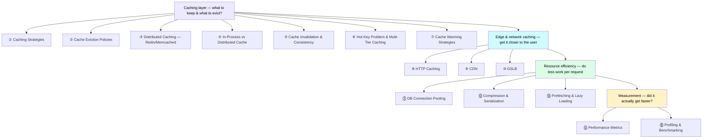
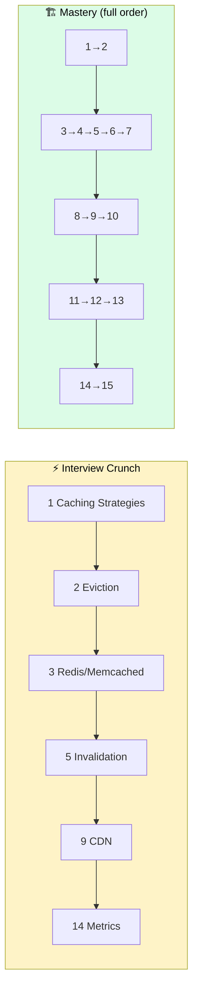

# 06 · Caching & Performance ⚡

> **The read-scaling layer that sits in front of the database.** Every cache — a browser's local store, a CDN edge node, a Redis cluster — is a bet that recently-used data will be used again soon. This section is that bet made explicit: which caching strategy and eviction policy to run, how to push content all the way to the edge, how to cut the cost of the requests that still have to travel, and how to prove any of it actually worked. Every decision here trades staleness or CPU for speed; get the trade wrong and you've either served garbage fast or served the truth too slowly.

---

## 🎯 What You'll Be Able To Do

- **Pick a caching strategy from the access pattern** — cache-aside, write-through, write-around, write-back — and defend the staleness/durability/speed trade-off it makes.
- **Choose an eviction policy deliberately** — LRU, LFU, FIFO, TTL — and know which one survives a one-time scan without getting polluted.
- **Choose and scale a distributed cache** — Redis vs Memcached, local vs distributed vs near-cache, and survive a cache stampede, a hot key, or a cold cache after deploy without the DB catching fire.
- **Push content to the edge** — HTTP cache headers, ETags, and CDN PoPs — so most requests never reach your origin server at all.
- **Route users globally and survive a regional outage** — GSLB, health checks, and failover without triggering a cascading collapse.
- **Cut the cost of every request that isn't a cache hit** — connection pooling, binary serialization, compression, and prefetch/lazy-load.
- **Prove it got faster** — read P50/P99 latency correctly, profile the real bottleneck, and benchmark before claiming a win.

---

## 🗺️ How the 15 Topics Interlock



> **The spine:** *pick a caching strategy and an eviction policy → scale that cache out (distributed vs local, tiered, invalidated correctly, protected against hot keys, warmed before traffic hits it) → push the same idea outward to the edge (browser → CDN → GSLB) → shrink the cost of every request that still has to travel → measure whether any of it actually worked.* Eviction (②) is what makes strategy (①) survive finite RAM; Redis/Memcached (③) and the local-vs-distributed choice (④) are how a single-node cache becomes a fleet-wide one; invalidation (⑤), the hot-key problem (⑥), and warming (⑦) are the three ways that fleet-wide cache actually breaks in production. HTTP caching (⑧) and CDNs (⑨) are cache-aside applied at the edge instead of in Redis; GSLB (⑩) is the last hop of that same idea — routing around a slow or dead region. Pooling (⑪), compression (⑫), and prefetching (⑬) all cut the cost of the requests that don't get a cache hit; metrics (⑭) and profiling (⑮) are how you find out whether any of it moved the needle.

---

## 📚 The Complete File Index

| # | Topic | One-line | Key takeaway |
|---|-------|----------|--------------|
| 1 | [Caching Strategies](./Caching_Strategies.md) | The book on your desk | Cache-aside is the default; write-through buys integrity, write-back buys speed at the risk of loss; invalidation is the hard part |
| 2 | [Cache Eviction Policies](./Cache_Eviction_Policies.md) | Managing a small bookshelf | LRU fits most temporal-locality access patterns by default; LFU protects long-term popular items but suffers cold-start |
| 3 | [Distributed Caching — Redis vs Memcached](./Distributed_Caching_Redis_Memcached.md) | One shared fridge vs. everyone's own | Redis's rich data structures, persistence, and clustering win when you need more than a blob store; Memcached's simplicity and multi-threading win on raw throughput |
| 4 | [In-Process vs Distributed Cache](./In_Process_vs_Distributed_Cache.md) | The book on your desk vs. the shared library | Local cache is nanoseconds and free of network hops but goes stale across instances; a near-cache (local in front of distributed) gets both |
| 5 | [Cache Invalidation & Consistency](./Cache_Invalidation_Consistency.md) | The hardest problem in CS, made concrete | Cache stampede kills the DB when a hot key expires — coalesce requests, jitter TTLs, or serve stale-while-revalidate instead of all-miss-at-once |
| 6 | [Hot Key Problem & Multi-Tier Caching](./Hot_Key_Problem_Multi_Tier_Caching.md) | When one book everyone wants breaks one shelf | A single celebrity key can pin one shard at 100% while the rest of the cluster idles — split the key or replicate it to every app server's local cache |
| 7 | [Cache Warming Strategies](./Cache_Warming_Strategies.md) | Preheating the oven before the food arrives | A cold cache after deploy/failover turns every request into a simultaneous miss; pre-warm from logs or a snapshot before traffic switches over |
| 8 | [HTTP Caching](./HTTP_Caching.md) | A grocery list vs. its photo | Hash the filename + `max-age=1yr, immutable` for the perfect cache; ETags validate the rest; never mark private data `public` |
| 9 | [CDN](./CDN.md) | Corner store vs. the warehouse | Pull model + edge PoPs beat the speed of light; invalidation across hundreds of nodes is the recurring pain, never cache PII there |
| 10 | [GSLB](./GSLB.md) | A travel agent for the internet | DNS/anycast routes to the nearest healthy region; size failover for the surge or it cascades region to region |
| 11 | [Database Connection Pooling](./Database_Connection_Pooling.md) | The DMV with dedicated clerks | Reuse warm TCP/TLS connections instead of paying a 50-100ms handshake per request; pool size regulates load on the DB |
| 12 | [Data Compression & Serialization](./Data_Compression_Serialization.md) | Flat-pack furniture, then vacuum-sealed | Binary schemas (Protobuf/Avro) beat JSON for service-to-service traffic; compression trades CPU for bandwidth — measure the level |
| 13 | [Prefetching & Lazy Loading](./Prefetching_Lazy_Loading.md) | Order from the menu, refill early | Lazy-load what might never be needed, eager-load/prefetch what will be — the fix for the N+1 nightmare |
| 14 | [Performance Metrics](./Performance_Metrics.md) | The car's dashboard | Never trust the average — P99 is the unluckiest user's experience, and it's what makes a page feel broken |
| 15 | [Profiling & Benchmarking](./Profiling_Benchmarking.md) | Heart monitor, then the Olympic dash | Profile to find the real bottleneck, benchmark to prove the fix worked; sample in production, trace only locally |

---

## 🧭 Suggested Study Paths



| Goal | Path | Why |
|------|------|-----|
| **⚡ Interview in 48h** | 1 → 2 → 3 → 5 → 9 → 14 | Cache pattern + eviction + Redis/Memcached + invalidation/stampede + CDN + P99 latency — the most-asked 80% |
| **🏗️ Deep mastery** | 1→2 → 3→4→5→6→7 → 8→9→10 → 11→12→13 → 14→15 | Cache layer → scale it out (distributed, tiered, invalidated, warmed) → push it to the edge → cut per-request cost → measure, in dependency order |
| **🌍 Global-scale focus** | 8 → 9 → 10 | Browser cache → CDN edge → GSLB failover: the full path content takes to reach a user anywhere |
| **🔥 "The cache is on fire" diagnosis** | 5 → 6 → 7 → 3 | Stampede or dogpile? (invalidation) → one shard melting? (hot key) → cold after a deploy? (warming) → is Redis or Memcached even the right shape for this data? |
| **📉 "Why is it slow?" diagnosis** | 14 → 15 → 1 → 2 | Measure first (find the P99 outlier), profile the bottleneck, then fix it with the right cache/eviction pattern |

> **Study each file by** attempting the 🏋️ **Practice Drills before the solutions**, rehearsing the 🎤 **Interview Q&A out loud**, and reading 🎯 **Staff+ Nuances** for senior-level depth.

---

## 🔑 The Decision Card (whole-section cheat sheet)

```
CACHE       cache-aside (DEFAULT, lazy) · write-through (integrity, slower writes) · write-back (fast, risk of loss) ·
            write-around (skip pollution) · cache invalidation is the hardest problem in CS
EVICT       LRU (DEFAULT, temporal locality) · LFU (long-term popularity, but cold-start hurts new items) ·
            FIFO/random (cheap, dumb) · TTL = expiration, not eviction · segment hot/cold to survive a one-time scan
REDIS/MEMCACHED  Redis = rich types + persistence + Cluster/Sentinel HA, single-threaded event loop ·
            Memcached = pure blob store, multi-threaded, no native replication — simpler, faster for raw GET/SET at scale
LOCAL vs DISTRIBUTED  local (in-process) = nanoseconds, free, but N instances = N stale copies ·
            distributed (Redis/Memcached) = one shared truth, but pays a network round trip every access · near-cache = both
INVALIDATION  TTL (simple, bounded staleness) vs event-driven (fresh, more moving parts) ·
            cache stampede: coalesce requests / jitter TTL / stale-while-revalidate — never let 10k requests all miss at once
HOT KEY     one celebrity key can pin ONE shard at 100% while the cluster idles · fix: split the key across N sub-keys,
            or replicate it into every app server's local cache — multi-tier (L1 local + L2 distributed) is the general pattern
WARMING     a cold cache after deploy/failover = every request misses simultaneously · pre-warm from access logs,
            a snapshot, or a blue-green swap BEFORE traffic switches over — proactive twin of stampede mitigation
HTTP        Cache-Control max-age + immutable on hashed filenames = the perfect cache · ETag/If-None-Match = 304 validation ·
            public (CDN/proxy may cache) vs private (browser only) — never serve PII as public
CDN         pull model + edge PoPs = workaround for the speed of light · push for big launches ·
            invalidation lags across hundreds of nodes · origin shield to survive a thundering-herd cache miss
GSLB        DNS/anycast routes to the nearest HEALTHY region · size failover for 2x load or it cascades region to region ·
            multi-region correctness is a replication/consistency problem, never free
EFFICIENCY  pool connections — reuse beats a handshake per request · binary serialization (Protobuf/Avro) > JSON service-to-service ·
            compression trades CPU for bandwidth, measure the level · prefetch/eager-load kills N+1, lazy-load defers the unneeded
MEASURE     NEVER trust the average — P99/P999 is the unlucky user's real experience · Golden Signals: latency, traffic, errors, saturation ·
            profile (sampling in prod, tracing locally) to find the bottleneck, benchmark to prove the fix actually helped
RECURRING   every cache is a bet that recently-used data gets reused again; every layer here trades STALENESS or CPU for SPEED
```

---

## 🎨 Conventions & Authoring

- Every file follows the root [TEMPLATE.md](../TEMPLATE.md). Animated SVGs live in [/assets](../assets/).
- Each file ends with the three mastery sections: 🏋️ Practice Drills, 🎤 Interview Q&A Bank, 🎯 Staff+ Nuances.

---

## ➡️ Where This Connects

- ⬅️ [01 · Planning & Foundations](../01_Planning_Foundations/) — latency numbers (the "RAM vs disk vs network" figures every caching decision is built on).
- ⬅️ [05 · Databases & Storage](../05_Databases_Storage/) — the layer being cached; every cache is a bet against re-hitting this tier.
- ➡️ [07 · Load Balancing & Scalability](../07_Load_Balancing_Scalability/) — routing and horizontal scale for the requests that still get through.
- ➡️ [14 · Performance Optimization & Scalability](../14_Performance_Optimization_Scalability/) — the broader optimization playbook this section's metrics and profiling feed into.

---
*Part of the [System Design & Architecture Master Repository](../README.md). This is the layer that decides whether "fast" or "correct-but-slow" is the default experience users get.*
