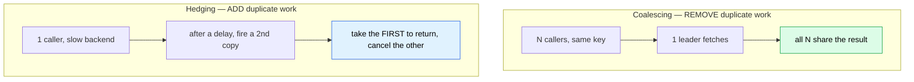
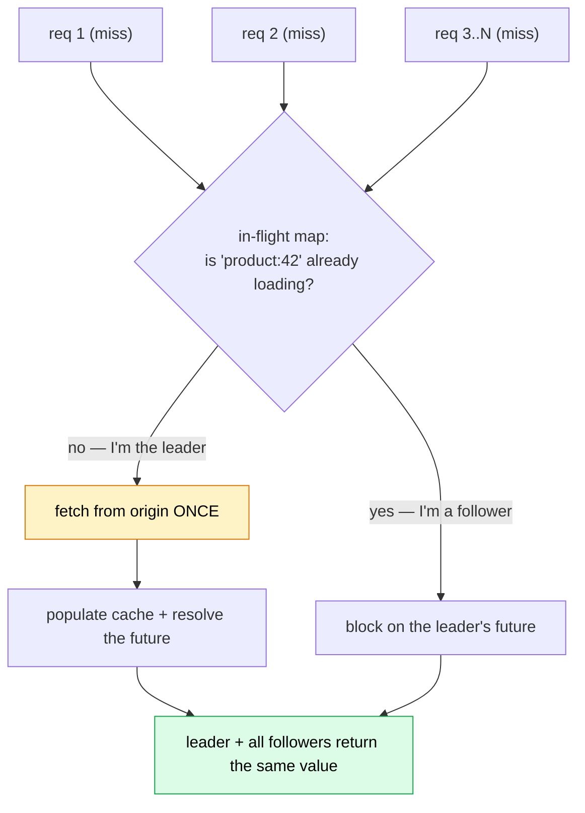
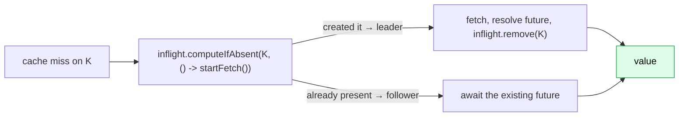
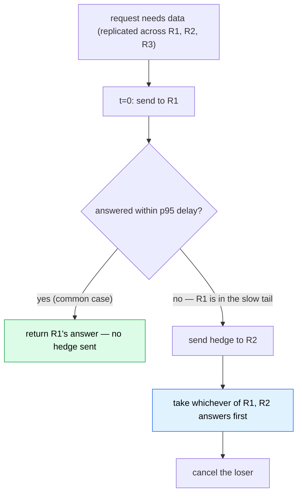
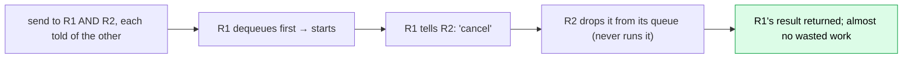
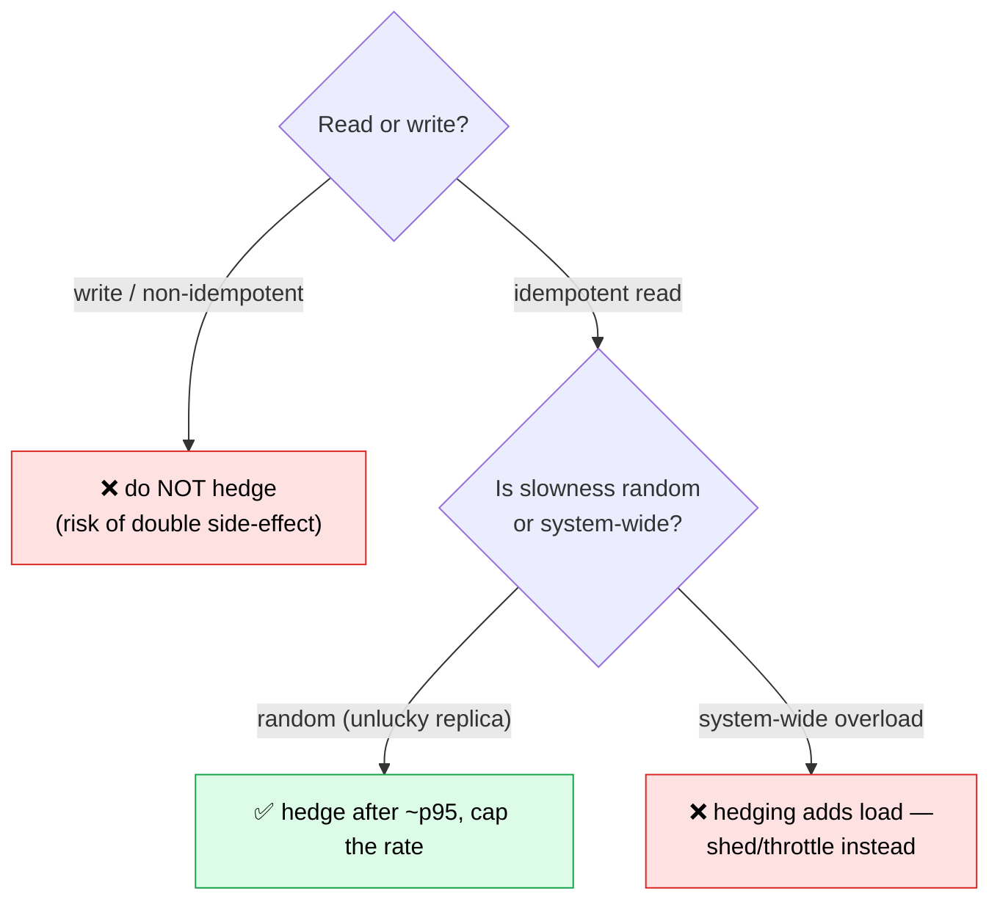
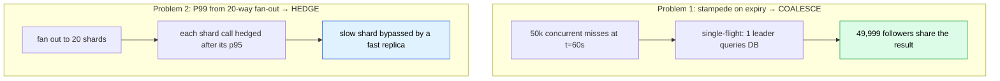
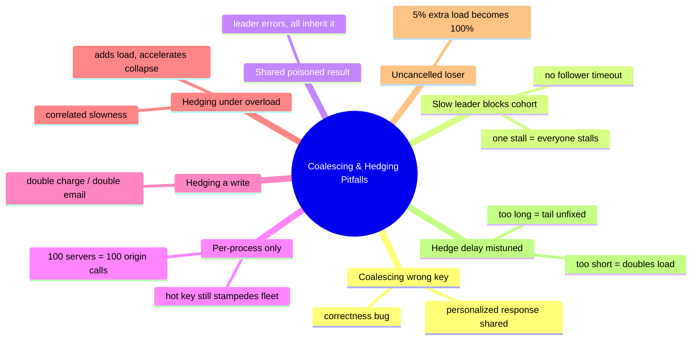

# Request Coalescing & Hedged Requests

> **One line:** Two mirror-image tactics for taming the tail: **request coalescing** (a.k.a. single-flight / dogpile suppression) *removes* duplicate work by collapsing many concurrent requests for the same thing into one origin call and sharing the result, protecting the backend from load; **hedged requests** deliberately *add* a little duplicate work — firing a second copy of a slow request after a short delay and taking whichever returns first — to protect the user from an unlucky slow tail.

---

## Table of Contents
1. [Why You Must Master This](#1-why-you-must-master-this)
2. [The Mental Model](#2-the-mental-model)
3. [Request Coalescing — One Flight Per Key](#3-request-coalescing--one-flight-per-key)
4. [How Coalescing Is Implemented](#4-how-coalescing-is-implemented)
5. [Hedged Requests — Racing the Tail](#5-hedged-requests--racing-the-tail)
6. [Tied Requests & Backup-After-Delay Tuning](#6-tied-requests--backup-after-delay-tuning)
7. [When Each One Backfires](#7-when-each-one-backfires)
8. [Worked Example — A Hot Key and a Slow Tail](#8-worked-example--a-hot-key-and-a-slow-tail)
9. [Real-Life Use Cases](#9-real-life-use-cases)
10. [Failure Modes](#10-failure-modes)
11. [🏋️ Practice Drills](#-practice-drills)
12. [🎤 Interview Q&A Bank](#-interview-qa-bank)
13. [🎯 Staff+ Nuances](#-staff-nuances)
14. [Cheat Sheet](#14-cheat-sheet)
15. [Connections & Further Reading](#15-connections--further-reading)

---

## 1. Why You Must Master This

These two techniques are currently taught in this section only as fragments — single-flight appears buried inside the [cache stampede](./Cache_Invalidation_Consistency.md) discussion, and hedging is mentioned in passing in [Performance_Metrics.md](./Performance_Metrics.md) as a tail-latency fix. They deserve one home because they're the same *idea* — spend a little extra coordination to fix a latency problem — pointed in opposite directions.

- **Coalescing is the difference between a cache miss and a cache-miss-induced outage.** When a hot key expires, every in-flight request for it misses simultaneously and stampedes the origin. Coalescing turns 10,000 simultaneous misses into *one* database query whose result is shared by all 10,000 waiters — it's the single most important stampede defense, and "how do you stop a dogpile?" is a staple systems question.
- **Hedging is how the giants hit low P99 despite unreliable components.** Google's "The Tail at Scale" (Dean & Barroso) showed that in a large fan-out service, the *median* is fine but the *tail* is dominated by a few unlucky slow replicas (a GC pause, a busy disk, a hot CPU). Hedging — send a backup request after the p95 latency, take the first to answer — collapses that tail for only a few percent of extra load. It's the canonical answer to "your P99 is bad but P50 is fine — what do you do?"
- **They're both cheap, and both dangerous if misapplied.** Coalescing a set of requests that *aren't* actually identical serves the wrong data; hedging a *non-idempotent* write duplicates the side effect (double charge, double email). Knowing the guardrails — same-key only, idempotent-only, cancel the loser — is what separates a candidate who's read the buzzword from one who's shipped it.
- **They pair with everything else in this section.** Coalescing is the active half of the stampede-defense trio (coalesce + jitter TTL + serve-stale). Hedging is the request-level twin of the tail-latency math in the metrics file. Understanding both lets you reason about the miss path *and* the slow path as one problem.

> **The core problem it solves:** *cutting tail latency and origin load on the paths a plain cache doesn't help — the simultaneous-miss path (coalescing collapses redundant work) and the occasionally-slow-backend path (hedging races around a stuck replica).*

**Prerequisites:** [Cache_Invalidation_Consistency.md](./Cache_Invalidation_Consistency.md) (cache stampede, the problem coalescing solves) and [Performance_Metrics.md](./Performance_Metrics.md) (P99/tail latency and fan-out amplification, the problem hedging solves).

---

## 2. The Mental Model

Both techniques manipulate *duplicate work* — but in opposite directions and for opposite reasons.

- **Coalescing removes duplicate work.** Many callers want the same answer at the same time. Instead of each doing the expensive fetch, one does it (the "leader") and the rest wait and piggyback on its result. Fewer origin calls, same answers. The beneficiary is the **backend** (less load).
- **Hedging adds duplicate work.** One caller wants an answer, but the backend it asked might be having a bad moment. So after a short wait, the caller *also* asks a second backend and takes whichever replies first. More total calls, one answer. The beneficiary is the **user** (lower tail latency).

Analogy: coalescing is a group of people at a coffee shop realizing they all want the same drink, so one person orders a big batch instead of ten separate orders clogging the barista. Hedging is ordering your coffee, and if it hasn't arrived in five minutes, quietly ordering the same drink at the shop next door and taking whichever comes first — you'll drink one and abandon the other, but you won't be late.



> **Hold onto this:** coalescing protects the *origin* by doing **less** (one call for many identical requests); hedging protects the *user* by doing **more** (a spare call to route around a slow replica). Same currency — duplicate work — spent in opposite directions.



> Top half: coalescing turns N misses into one origin call. Bottom half: hedging fires a backup only *after* a delay, so it adds ~5% load while erasing the P99 tail.

---

## 3. Request Coalescing — One Flight Per Key

**The problem, precisely.** A cache-aside system is only as good as its behavior on a miss. When a *popular* key expires (or is evicted, or was never warmed), every request that arrives in the window between "key is gone" and "key is repopulated" is a miss. For a hot key that's thousands of requests per second, all now bypassing the cache and hitting the database *at once* — the **cache stampede** (a.k.a. **dogpile** / **thundering herd**). The database, sized for the cached load, buckles; latency spikes; sometimes it cascades into an outage. The cache didn't fail — its *miss path* did.

**The fix: single-flight.** Recognize that all those concurrent misses want the *exact same value*. So allow only **one** request per key to actually go to the origin — the "leader." Every other concurrent request for that key (the "followers") registers interest and **blocks**, waiting for the leader's result, then all of them return that single shared value.



- **N concurrent misses → 1 origin call.** The origin sees load proportional to the number of *distinct hot keys expiring*, not the number of *requests*. This is the whole win.
- It only helps for **concurrent** requests for the **same** key. Requests spread out in time, or for different keys, don't coalesce (and shouldn't).

**Coalescing is one leg of the stampede-defense tripod** (the other two are covered in [Cache_Invalidation_Consistency.md](./Cache_Invalidation_Consistency.md)):
1. **Coalesce** concurrent misses (this file) — one flight per key.
2. **Jitter the TTLs** so a whole cohort of keys doesn't expire in the same instant (prevents the misses from being simultaneous in the first place).
3. **Serve stale while revalidating** — return the just-expired value immediately and refresh it in the background, so *no* request waits on the origin.

They compose: jitter reduces how often a stampede window opens, coalescing caps the damage when one does, and serve-stale hides the latency from users entirely.

> **The one takeaway:** coalescing (single-flight) collapses all concurrent misses for a key into one origin call whose result everyone shares — turning "N requests, N database hits" into "N requests, 1 database hit," which is what keeps a hot-key expiry from becoming a stampede.

---

## 4. How Coalescing Is Implemented

The core is a **per-key in-flight map** guarded so that exactly one caller becomes the leader.

**The canonical structure:**
- A concurrent map: `key → in-flight future/promise`.
- On a miss, atomically **check-and-insert**: if no entry exists for the key, insert your own future and become the leader; if one exists, you're a follower — grab that future and await it.
- The leader performs the fetch, resolves the future (delivering the value to all followers), and **removes the key from the map** so the next miss after this one starts fresh.

**Real implementations you can name:**
- **Go:** `golang.org/x/sync/singleflight` — `group.Do(key, fn)` runs `fn` once per key for all concurrent callers and returns the shared result. The standard library's DNS resolver uses it internally.
- **Java:** Caffeine's `LoadingCache.get(key, loader)` guarantees the loader runs **once per key** even under concurrent access — followers block on the same computation. This is coalescing built into the cache.
- **General pattern:** a `ConcurrentHashMap<Key, CompletableFuture<V>>` with `computeIfAbsent` to atomically elect the leader.



**Design decisions that matter:**
- **Local vs. distributed coalescing.** A `singleflight` map lives in *one process*. In a fleet of 100 app servers, that's *one origin call per server* (100 total), not one globally. To coalesce across the fleet you need a **distributed lock** (e.g., a Redis `SET key NX` "mutex key" that the leader holds while fetching, others poll/wait) — more robust against stampede but adds a network round-trip and lock-expiry complexity. Most systems accept per-process coalescing (100 calls is survivable; 100,000 is not) and reserve distributed locks for the very hottest keys.
- **Failure handling.** If the leader's fetch *fails*, followers must not hang forever — they should receive the error (and typically each retry independently, or a bounded number do) rather than all inheriting one transient failure permanently. Decide whether a leader failure is shared or whether followers re-elect.
- **Timeout.** A follower must have its own timeout so a stuck leader doesn't block the whole cohort indefinitely.

> **The one takeaway:** coalescing is a per-key in-flight map with an atomic "elect one leader" step (`singleflight.Do`, Caffeine's `get(key, loader)`, or `computeIfAbsent` on a futures map); the subtle parts are that it's per-process by default (a distributed lock is needed for fleet-wide suppression) and that leader *failure* and *timeout* must be handled so followers never hang.

---

## 5. Hedged Requests — Racing the Tail

**The problem, precisely.** In any large system, an individual request's latency is *variable* — most are fast, but a few are slow for reasons that have nothing to do with the request itself: the replica that answered was mid-GC-pause, its disk was busy, its CPU was contended, it was mid-compaction. In a service that **fans out** to many backends and waits for all of them, the *slowest* backend sets the response time — so even a 1-in-100 slow replica means a fan-out to 100 backends is *almost always* waiting on someone's bad moment. This is **tail-latency amplification** (see [Performance_Metrics.md](./Performance_Metrics.md)): P99 of the whole is driven by P99 of the parts, multiplied by fan-out.

**The fix: hedged requests.** Send the request to one replica. If it hasn't answered within a short delay (typically the **p95** latency of that call), send a *second* copy to a *different* replica. Take whichever response arrives first and **cancel/ignore the other**. The slow replica's bad moment no longer determines your latency — the fast one does.



**Why the delay is the whole trick.** If you sent *both* requests immediately, you'd double your backend load for *every* request — expensive and self-defeating (more load → more slow replicas). By waiting until the p95 first, you only ever send a hedge for the ~5% of requests that are *already* slow. So:
- **~5% extra load** (only the slow tail gets a second request), buys
- **a dramatic P99/P99.9 reduction**, because the tail requests now complete at roughly the *median* latency of a second replica instead of waiting out the first replica's stall.

**Real number (from "The Tail at Scale"):** in Google's benchmark, hedging after the 95th percentile reduced the 99.9th-percentile latency of a service from **1,800 ms to 74 ms** while increasing total requests by only **~2%**. That's the canonical result to cite.

> **The one takeaway:** a hedged request fires a backup copy to a different replica only *after* a short delay (the p95), so it adds a few percent of load while collapsing the tail — because the ~5% of requests that were about to be slow now finish at a healthy replica's normal speed instead of waiting out a stuck one.

---

## 6. Tied Requests & Backup-After-Delay Tuning

Plain hedging still sends *some* wasted work (the loser of each race runs to completion or must be cancelled). Two refinements reduce that waste.

**Tied requests (cross-server cancellation).** Send the request to *two* replicas immediately, but tell each one *"your tie-partner is replica X."* The instant one replica **starts executing** the request, it sends a cancellation to its partner, so the partner drops the request from its queue if it hasn't started yet. This tackles the biggest source of tail latency — **queueing delay** — because the win is decided by which replica *dequeues* first, and the loser is cancelled before it wastes real work. Google reported tied requests cut both latency *and* the extra resource cost versus plain hedging.



**Tuning the hedge delay — the central knob:**
- **Too short** (e.g., hedge at p50): you hedge half your requests, roughly doubling load — the delay's whole purpose (cheapness) is lost, and the extra load can *create* the congestion you were fighting.
- **Too long** (e.g., hedge at p99.9): you rarely hedge, so the tail you were trying to fix mostly still happens.
- **The sweet spot is around p95–p99** of the call's own latency distribution: high enough that only genuinely-slow requests trigger a hedge (keeping extra load to a few percent), low enough that those slow requests still get rescued well before they'd have timed out.
- **Cap the hedge rate.** Always bound the fraction of requests that may hedge (e.g., "no more than 5% of requests may have an outstanding hedge") so that if the *whole* backend slows down (making everything exceed the p95), you don't suddenly double total load and turn a slowdown into a meltdown. This cap is the critical safety valve.

> **The one takeaway:** tied requests improve on plain hedging by sending both copies immediately but cancelling the loser the moment either replica *starts*, attacking queueing delay directly; and whichever variant you use, the hedge delay (~p95) and a hard cap on hedge rate are the two knobs that keep the technique cheap and prevent it from amplifying a system-wide slowdown.

---

## 7. When Each One Backfires

Both are sharp tools. Misapplied, each creates the very problem it was meant to solve.

**Coalescing backfires when:**
- **The requests aren't actually identical.** Coalescing keys must capture *everything* that affects the response — user identity, permissions, locale, query parameters. If you coalesce on `product:42` but the response is personalized per user, followers get the *leader's* personalized data. **Correctness bug.** Rule: only coalesce requests whose full input (the cache key) is identical, and never coalesce responses that embed caller-specific state.
- **The leader is slow and blocks everyone.** All followers wait on the leader; if the leader's fetch is pathologically slow, the whole cohort's latency is the leader's latency. Followers need independent timeouts, and a very hot key may itself warrant hedging *inside* the leader's fetch.
- **A poisoned result is shared.** If the leader fetches and caches a *wrong* or error value, all followers get it too. Failures should generally not be shared as if they were successes.

**Hedging backfires when:**
- **The operation isn't idempotent.** Hedging a non-idempotent write means the side effect can happen *twice* — a double charge, a double-sent email, a double-decremented inventory. **Never hedge writes** unless they're genuinely idempotent (guarded by an idempotency key — see [02 · Idempotency](../02_API_Interface_Design/)). Hedging is for **reads** by default.
- **The backend is uniformly overloaded, not randomly slow.** Hedging assumes slowness is *uncorrelated* — a random unlucky replica while others are healthy. If *every* replica is slow because the whole tier is saturated, hedging just adds load to an already-drowning system, accelerating collapse. This is why the **hedge-rate cap** exists, and why hedging must be *disabled or throttled under high load*.
- **You forget to cancel the loser.** If the abandoned request keeps running, you pay for the duplicate work you meant to be rare — turning "5% extra load" into "up to 100% extra load." Cancellation (or at least ignoring + not retrying the loser) is mandatory.



> **The one takeaway:** coalescing is only safe when the coalesced requests are *truly* identical (never share personalized responses), and hedging is only safe for *idempotent* operations when slowness is *random* (never hedge writes, always cap the hedge rate and cancel the loser) — misjudge either precondition and the tactic manufactures the outage it was supposed to prevent.

---

## 8. Worked Example — A Hot Key and a Slow Tail

**The prompt:** "Your service serves a homepage feed. The 'trending items' block is one cache key refreshed every 60 seconds, read ~50,000 times/second. Two problems: (1) every 60s when it expires, the database gets hammered by a burst of simultaneous misses; (2) even on a hit, the feed is assembled by fanning out to 20 backend shards, and P99 is 400ms even though P50 is 40ms. Fix both."



**Fix for Problem 1 — coalescing (protect the origin):**
- Wrap the trending-feed load in single-flight so the 50,000 simultaneous misses elect **one leader** to query the DB; the other 49,999 block briefly and share the result. Origin load per expiry drops from ~50,000 queries to ~1 (per process; a handful across the fleet).
- Add **TTL jitter** (refresh at 60s ± a few seconds) so not every replica's copy expires in the same instant, and **serve-stale-while-revalidate** so users never actually wait on the leader — they get the just-expired feed instantly while the refresh happens in the background. Now the expiry is invisible to users *and* harmless to the DB.

**Fix for Problem 2 — hedging (protect the user):**
- The 400ms P99 is classic tail amplification: with a 20-way fan-out, if each shard has even a 2% chance of a slow response, the odds that *at least one* of the 20 is slow are `1 − 0.98²⁰ ≈ 33%` — so a third of all feed assemblies wait on some shard's bad moment.
- Hedge each shard call: if a shard hasn't responded within its p95 (say 50ms), fire a backup to a replica of that shard and take the first answer. Cap hedging at 5% of calls. Now a stalled shard is routed around, and P99 drops toward the healthy-shard latency.

**Closing the loop — the numbers that drive the decision:**
- **Coalescing** converts the every-60s DB burst from ~50,000 queries to ~1 per process — the database now sees load proportional to *distinct expiring keys*, not *request volume*, which is the only way a 50k-RPS hot key is survivable behind a cache.
- **Hedging** attacks the 33% "at least one slow shard" probability directly: by giving the ~5% of slow shard-calls a fast alternate, the fan-out's P99 collapses from ~400ms toward ~60–80ms for a ~2–5% increase in backend calls — the exact trade "The Tail at Scale" quantifies.
- **The two are complementary, not competing:** coalescing fixed the *miss path* (origin protection), hedging fixed the *hit-but-slow path* (user protection). Neither alone solves both; together they cover the two ways this feed was slow. And the guardrails matter — the shard calls are idempotent reads (safe to hedge), and the coalescing key must include any personalization (here, none — "trending" is global, so coalescing is safe).

This is the whole topic: reach for coalescing when *many want the same thing at once* and you must shield the backend; reach for hedging when *one thing is occasionally slow* and you must shield the user — and respect each one's preconditions.

---

## 9. Real-Life Use Cases

| Situation | Technique | The decision it forces |
|---|---|---|
| Hot cache key expires, thousands of simultaneous misses | Coalescing (single-flight) | One origin call per key; pair with jitter + serve-stale for full stampede defense |
| DNS resolution for the same host from many goroutines | Coalescing (`singleflight`) | Collapse concurrent identical lookups; Go's resolver does exactly this |
| `LoadingCache.get(key, loader)` under concurrent access | Coalescing (Caffeine) | Loader runs once per key; followers block on the same computation |
| Fleet-wide protection for the single hottest key | Distributed-lock coalescing (Redis `SET NX` mutex) | Accept a network round-trip + lock-expiry logic for cross-process suppression |
| Fan-out read service with good P50 but bad P99 | Hedged / tied requests | Hedge idempotent reads after p95, cap the rate; cancel the loser |
| Reading from a quorum store (Cassandra `speculative_retry`) | Hedging (built in) | The DB fires a redundant read to another replica after a percentile threshold |
| gRPC call to a replicated backend | Hedging (gRPC hedging policy) | Configure `hedgingPolicy` with delay + max attempts for idempotent methods only |
| Payment capture, send-email, inventory decrement | ❌ Neither hedge nor naive coalesce | Non-idempotent write: hedging risks a double side-effect; guard with idempotency keys instead |

> **The habit:** when you see "the backend melts every time a hot key expires," think *coalescing*; when you see "P50 is fine but P99 is terrible on a fan-out," think *hedging* — and immediately check the guardrails (identical requests? idempotent read? capped rate?) before recommending either.

---

## 10. Failure Modes



- **Coalescing on an incomplete key.** *Symptom:* users occasionally see each other's data or the wrong locale/permissions. *Root cause:* the coalescing key didn't include everything that varies the response. *Fix:* the coalescing key must equal the *full* cache key (user, locale, params); never coalesce responses containing caller-specific state.
- **Slow-leader head-of-line blocking.** *Symptom:* a hot key's latency occasionally spikes for *all* concurrent callers at once. *Root cause:* every follower waits on one leader, and that leader had a slow fetch. *Fix:* independent follower timeouts; consider hedging the leader's own fetch; serve stale so no one waits at all.
- **Shared failure.** *Symptom:* one transient DB error becomes an error for thousands of requests. *Root cause:* the leader's failure was delivered to all followers. *Fix:* don't cache/share errors as successes; let followers retry (bounded) rather than all inherit one failure permanently.
- **Per-process coalescing insufficient for a mega-hot key.** *Symptom:* stampede still knocks the DB over despite coalescing. *Root cause:* single-flight is per-process, so N servers still make N calls. *Fix:* a distributed lock (Redis mutex key) for the hottest keys, plus serve-stale and jitter.
- **Hedging a non-idempotent operation.** *Symptom:* duplicate charges, duplicate emails, over-decremented inventory. *Root cause:* the backup request re-ran a side-effecting operation. *Fix:* hedge reads only; make writes idempotent (idempotency keys) before ever hedging them.
- **Hedging into a system-wide slowdown.** *Symptom:* a minor latency bump becomes a full meltdown. *Root cause:* every request exceeds the p95 (because the whole tier is slow), so *every* request hedges, doubling load on an overloaded system. *Fix:* hard-cap the hedge rate (e.g., ≤5%) and disable hedging under detected overload — hedging assumes *uncorrelated* slowness.
- **Forgetting to cancel the loser.** *Symptom:* backend load is much higher than the expected few percent. *Root cause:* abandoned hedge requests run to completion. *Fix:* cancel the loser (tied-request cancellation, gRPC cancellation, context cancellation); at minimum ensure the loser isn't retried.
- **Mistuned hedge delay.** *Symptom:* either load doubled (delay too short) or the tail is unchanged (delay too long). *Root cause:* the delay isn't set from the call's real latency distribution. *Fix:* set the delay to the measured p95–p99 of that specific call, and re-tune as the distribution shifts.

---

## 🏋️ Practice Drills

> *Cover the solutions and attempt first — active recall is the point.*

**Drill 1 — Which technique, and why?** For each: (a) "every hour our config key expires and 8,000 pods all fetch it from the config service simultaneously, melting it." (b) "our search service fans out to 50 index shards; P50 is 30ms but P99 is 600ms." (c) "we hedge our payment-capture calls to improve tail latency and now finance is reporting double charges."

<details><summary>Solution</summary>

- **(a) Coalescing (single-flight), plus a distributed lock or jitter.** 8,000 identical concurrent fetches for the same key is a textbook stampede — collapse them into one fetch per pod (and, since 8,000 pods = 8,000 fetches even with per-process coalescing, add TTL jitter and ideally serve-stale so they don't all expire at the same instant, or a distributed lock for fleet-wide suppression).
- **(b) Hedging (or tied requests).** Good P50, bad P99 on a 50-way fan-out is classic tail amplification — hedge each shard call after its p95, cap the rate, cancel losers. P99 should collapse toward the healthy-shard latency.
- **(c) A bug: hedging was applied to a non-idempotent write.** Payment capture must *never* be hedged naively — the backup request captured the payment a second time. Fix: don't hedge writes; if you must, guard with an idempotency key so the duplicate is deduplicated server-side. Hedging is a read technique by default.
</details>

**Drill 2 — The hedge-delay trade-off.** Your call has P50=20ms, P95=80ms, P99=300ms. You're choosing a hedge delay. What happens if you set it to 20ms? To 300ms? What's a good value and roughly what extra load does it imply?

<details><summary>Solution</summary>

- **Delay = 20ms (P50):** ~50% of requests haven't finished by 20ms, so ~50% will fire a hedge → you roughly **1.5× your backend load**. That much extra load can itself create congestion and more slow requests — self-defeating.
- **Delay = 300ms (P99):** only ~1% of requests hedge, so load barely rises — but you've done almost nothing for the tail, because you only rescue requests that were *already* past the P99 you were trying to fix.
- **Good value ≈ P95 (80ms):** by construction only ~5% of requests are still outstanding at P95, so ~5% hedge → **~5% extra load**, and those are exactly the slow ones that get rescued. This is the "few percent load for a big P99 win" sweet spot. Always add a hard cap (≤~5%) so a system-wide slowdown can't push the hedge rate to 100%.
</details>

**Drill 3 — Why per-process coalescing may not be enough.** You added Go's `singleflight` to your cache-miss path, but a hot key expiring still spikes the database. You have 200 app servers. Explain the gap and two fixes.

<details><summary>Solution</summary>

`singleflight` coalesces within *one process*. With 200 servers, each server independently elects its own leader for the hot key, so an expiry produces **~200 simultaneous database queries** (one per server), not one. For a moderately hot key 200 queries may be fine, but if the DB is sized tighter or the key is extremely hot, 200 concurrent identical queries still spike it.

Two fixes: **(1)** A *distributed* lock — the leader across the whole fleet acquires a Redis mutex (`SET lock:key NX PX 5000`); only the holder queries the DB and writes the result back to the shared cache, while the other 199 servers briefly poll the cache or wait. This gives true fleet-wide single-flight at the cost of a network round-trip and lock-expiry handling. **(2)** *Serve-stale-while-revalidate* + TTL jitter — keep serving the just-expired value and refresh asynchronously, and stagger expiry times so the 200 servers' copies don't all lapse in the same instant; this removes the simultaneity that causes the spike in the first place. In practice you combine them.
</details>

---

## 🎤 Interview Q&A Bank

**Q1. What is request coalescing / single-flight, and what problem does it solve?**
> It's collapsing many *concurrent* requests for the same key into a single origin call whose result all the callers share. It solves the cache stampede (dogpile): when a hot key expires, thousands of requests miss the cache simultaneously and would each hit the database. With single-flight, one request becomes the "leader" that does the fetch while the rest block and piggyback on its result — turning N simultaneous misses into 1 origin call. It's implemented as a per-key in-flight map (Go's `singleflight`, Caffeine's `get(key, loader)`, or a `ConcurrentHashMap` of futures with `computeIfAbsent`).

**Q2. What are hedged requests, and why is the delay essential?**
> A hedged request sends the operation to one replica and, if it hasn't answered within a short delay, sends a *second* copy to a different replica and takes whichever returns first (cancelling the other). It cuts tail latency because slow responses usually come from an unlucky replica having a bad moment, not from the request being inherently slow — a second replica routes around the stall. The delay is essential because it's what keeps the technique cheap: waiting until roughly the p95 means only the ~5% of requests that are *already* slow ever trigger a hedge, so you add only a few percent of load. Sending both immediately would double backend load for every request.

**Q3. How are coalescing and hedging opposites?** *(signal: tests conceptual grasp, not memorization)*
> They both manipulate duplicate work but in opposite directions and for opposite beneficiaries. Coalescing *removes* duplicate work — many callers want the same answer, so one does the work and the rest share it — and the beneficiary is the *backend* (less load). Hedging *adds* duplicate work — one caller sends a spare request to route around a slow replica — and the beneficiary is the *user* (lower tail latency). Coalescing is for "many want the same thing at once"; hedging is for "one thing is occasionally slow."

**Q4. When must you NOT hedge?**
> Two cases. First, **non-idempotent operations**: hedging a write can execute the side effect twice — a double charge, a double email, a double inventory decrement. Hedging is a read technique by default; hedge a write only if it's guarded by an idempotency key. Second, **system-wide overload**: hedging assumes slowness is *random* (one unlucky replica while others are healthy). If the whole tier is saturated, *every* request exceeds the p95 and hedges, doubling load on an already-drowning system and accelerating collapse — which is why you always cap the hedge rate and disable hedging under detected overload.

**Q5. What's the famous result from "The Tail at Scale"?**
> Dean and Barroso showed that hedging after the 95th percentile reduced a Google service's 99.9th-percentile latency from about 1,800ms to 74ms while increasing total requests by only ~2%. It's the canonical demonstration that a tiny amount of well-timed redundant work can collapse the tail. The paper also introduced *tied requests*, where two replicas are sent the request simultaneously but each is told of the other, and whichever *starts* first cancels its partner — attacking queueing delay directly and cutting even the small extra cost of plain hedging.

**Q6. How do you coalesce across a fleet, not just one process?**
> In-process coalescing (`singleflight`) only elects one leader *per process*, so 200 servers still make 200 origin calls on a hot-key expiry. For true fleet-wide suppression you use a distributed lock: the global leader acquires a Redis mutex (`SET lock:key NX PX <ttl>`), fetches, and writes the result to the shared cache, while other servers briefly wait or poll the cache. It's more robust but adds a network round-trip and lock-expiry edge cases (what if the leader dies holding the lock?), so most systems reserve it for the very hottest keys and otherwise rely on per-process coalescing plus TTL jitter and serve-stale.

**Q7. What's the relationship between coalescing and the other stampede defenses?**
> Coalescing is one leg of a tripod. **Jittering TTLs** prevents a whole cohort of keys from expiring in the same instant (so the misses aren't simultaneous to begin with). **Coalescing** caps the damage when a simultaneous-miss window does open (one origin call per key). **Serve-stale-while-revalidate** returns the just-expired value immediately and refreshes in the background (so no user waits on the origin at all). They compose: jitter reduces how often a stampede window opens, coalescing bounds the blast radius when one does, and serve-stale hides the latency entirely.

---

## 🎯 Staff+ Nuances

- **These are the two halves of one principle: "manage redundant work to manage latency."** Coalescing deduplicates redundant work to protect throughput; hedging introduces redundant work to protect latency. Presenting them as a matched pair — same currency, opposite direction, different beneficiary — is a stronger framing than treating them as two unrelated tricks, and it's what lets you reason about a system's *miss path* and *slow path* as one design surface.
- **Hedging fights variance; coalescing fights volume — and knowing which you have is the diagnosis.** If your problem is "the backend is overwhelmed by identical requests," no amount of hedging helps (it makes it worse). If your problem is "P50 is fine but P99 is terrible," coalescing does nothing (the requests aren't duplicated). Misdiagnosing which regime you're in and applying the wrong tool is a classic senior-level mistake; the metrics (origin QPS vs. P99/P50 gap) tell you which.
- **Tied requests are the sophisticated form because queueing — not execution — is where tail latency usually lives.** Plain hedging waits out the p95 *then* sends a backup; tied requests send both immediately and cancel on *dequeue*, so the winner is decided by which replica has the shortest queue right now. Since a busy replica's slowness is dominated by its queue depth, cancelling-on-start reclaims almost all the wasted work. Naming this shows you understand *why* the tail is long, not just how to paper over it.
- **The hedge-rate cap is the difference between a safety feature and a footgun.** Uncapped hedging has a catastrophic failure mode: correlated slowness (a bad deploy, a cache flush, a dependency outage) pushes *every* request past the p95, so the hedge rate jumps to ~100%, doubling load exactly when the system can least afford it — a positive feedback loop into meltdown. The cap (and disabling hedging under load) converts hedging from "amplifies overload" to "helps only when slowness is idiosyncratic," which is the only regime where it's sound.
- **Coalescing has a subtle correctness surface that pure-performance framing misses.** The coalescing key is effectively a claim that "all requests with this key deserve identical responses." Any personalization, permission check, or request-scoped context that *isn't* in the key becomes a data-leak bug when the leader's response is shared. The discipline — coalescing key ≡ everything that varies the response — is identical to the discipline for a *cache* key, which is why coalescing and caching share the same class of bugs.
- **Both interact with cancellation propagation, which is where implementations quietly leak resources.** A hedge that doesn't cancel its loser, or a coalescing follower that doesn't propagate its own cancellation when *it* gives up, leaves work running that nobody's waiting for. In practice this means threading a cancellation context (Go `context`, gRPC cancellation, structured concurrency) all the way to the backend — the un-glamorous plumbing that determines whether "a few percent extra load" stays a few percent.
- **Speculative execution appears all over the stack under different names — recognize the pattern.** Cassandra's `speculative_retry`, DynamoDB/quorum "send to R, wait, send to R+1," gRPC's `hedgingPolicy`, MapReduce/Spark *speculative task execution* for stragglers, even CPU branch prediction, are all the same idea: do redundant work to avoid waiting on a straggler. Seeing hedging as one instance of speculative execution — and coalescing as its dual, deduplication — connects it to a much broader body of systems design than "a caching trick."

---

## 14. Cheat Sheet

```
REQUEST COALESCING & HEDGED REQUESTS — two ways to spend work on latency
══════════════════════════════════════════════════════════════════════

THE PAIR (same currency: duplicate work, opposite directions)
  COALESCING  removes duplicate work → protects the ORIGIN (load)
  HEDGING     adds  duplicate work → protects the USER   (tail latency)
  diagnosis: origin overwhelmed by identical reqs → coalesce
             P50 fine but P99 bad on a fan-out     → hedge

① REQUEST COALESCING / SINGLE-FLIGHT / DOGPILE SUPPRESSION
  problem: hot key expires → N concurrent misses → N origin hits (STAMPEDE)
  fix:     1 leader fetches, N-1 followers block + share the result
           N requests → 1 origin call
  impl:    Go singleflight.Do · Caffeine get(key, loader)
           ConcurrentHashMap<K, CompletableFuture<V>> + computeIfAbsent
  scope:   PER-PROCESS by default → 200 servers = 200 calls
           fleet-wide → distributed lock (Redis SET NX mutex key)
  tripod:  coalesce + JITTER ttl + SERVE-STALE-while-revalidate
  ⚠ coalescing key MUST equal full cache key (else share personalized data)
  ⚠ follower timeouts; don't share a leader's error as success

② HEDGED REQUESTS
  problem: fan-out waits on slowest replica; tail = unlucky replica's bad moment
  fix:     send to R1; if no answer by ~p95, send R2; take first; CANCEL loser
  why delay: only ~5% (the already-slow) hedge → ~5% extra load, big P99 win
  number:  "Tail at Scale": p95 hedge → P99.9 1800ms→74ms, +2% requests
  TIED REQUESTS: send both now, each knows the other, cancel on DEQUEUE
                 → attacks QUEUEING delay, less waste than plain hedging
  tune:    delay ≈ p95–p99 · HARD-CAP hedge rate (≤~5%) · cancel losers

WHEN EACH BACKFIRES
  coalescing: non-identical requests → wrong/leaked data · slow leader blocks all
  hedging:    NON-IDEMPOTENT op → double side-effect (NEVER hedge writes) ·
              system-wide overload → adds load, meltdown (cap + disable under load) ·
              uncancelled loser → 5% load becomes 100%

BROADER PATTERN
  hedging = speculative execution (Cassandra speculative_retry, gRPC hedging,
            Spark straggler tasks) · coalescing = its dual, deduplication
```

---

## 15. Connections & Further Reading

**Prerequisites (learn first):**
- [Cache_Invalidation_Consistency.md](./Cache_Invalidation_Consistency.md) — the cache stampede/dogpile, the problem coalescing solves; coalescing is one leg of its defense tripod (with TTL jitter and serve-stale).
- [Performance_Metrics.md](./Performance_Metrics.md) — P99/tail latency and fan-out amplification, the problem hedging solves; "The Tail at Scale" is cited there.

**Builds toward / pairs with:**
- [Hot_Key_Problem_Multi_Tier_Caching.md](./Hot_Key_Problem_Multi_Tier_Caching.md) — the hottest keys are exactly where coalescing (and a distributed lock) matters most.
- [Cache_Eviction_Policies.md](./Cache_Eviction_Policies.md) — a poorly-chosen eviction policy causes the hot-key expiries coalescing then has to absorb.
- [Profiling_Benchmarking.md](./Profiling_Benchmarking.md) — you *measure* the p95/p99 that sets the hedge delay, and load-test to confirm the hedge-rate cap holds.
- [10 · Circuit_Breaker_Bulkhead.md](../10_Microservices_Distributed_Systems/Circuit_Breaker_Bulkhead.md) — the complementary resilience patterns; hedging under overload must yield to shedding/breaking.
- [02 · Idempotency & API design](../02_API_Interface_Design/) — the precondition that makes hedging (or any retry) safe for writes.

**Gaps this topic exposes:**
- General *speculative execution* (Spark straggler tasks, MapReduce backup tasks) and load-adaptive concurrency control are close relatives that could earn a note in a distributed-systems or performance folder.

**External classics:**
- Dean & Barroso, *"The Tail at Scale"* (CACM, 2013) — hedged requests, tied requests, and the 1800ms→74ms result; the canonical source.
- [Go `singleflight` package](https://pkg.go.dev/golang.org/x/sync/singleflight) — the reference implementation of request coalescing.
- [Caffeine wiki](https://github.com/ben-manes/caffeine/wiki) — per-key load coalescing in `LoadingCache`.
- [gRPC hedging design](https://github.com/grpc/proposal/blob/master/A6-client-retries.md) — production hedging policy (delay, max attempts, idempotency).
- [Cassandra `speculative_retry`](https://cassandra.apache.org/doc/latest/) — hedging built into a database read path.

---

## TL;DR
**Coalescing and hedging are mirror images: both manipulate duplicate work to fix latency, in opposite directions.** Request coalescing (single-flight / dogpile suppression) *removes* duplicate work — when a hot key expires and thousands of requests miss at once, one "leader" fetches from the origin and the rest block and share its result, turning N simultaneous misses into 1 origin call. It's per-process by default (`singleflight`, Caffeine's `get(key, loader)`), needs a distributed lock for fleet-wide suppression, and is one leg of the stampede tripod with TTL jitter and serve-stale. Hedged requests *add* duplicate work — send a backup copy to another replica only *after* a short delay (~p95) and take whichever returns first, so only the ~5% already-slow requests hedge, buying a huge P99 reduction for a few percent of load (Google: P99.9 from 1800ms to 74ms for +2% requests). **Coalescing protects the origin from load; hedging protects the user from the tail — but coalescing is only safe when the requests are truly identical (never share personalized responses), and hedging is only safe for idempotent reads when slowness is random (never hedge writes, always cap the hedge rate and cancel the loser).**
