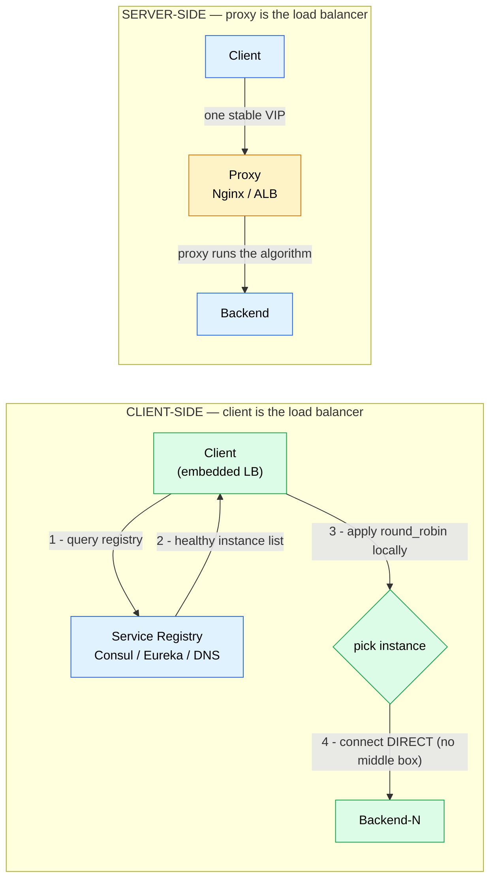
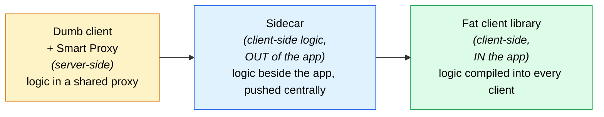

# Client-Side vs Server-Side Load Balancing

## 1. Why Should I Care About This?
- **Latency**: Server-side LB adds one extra network hop for every request. At 1ms per hop, that's 1ms added to a 5ms call — a 20% tax. Client-side LB removes it entirely.
- **Single Point of Failure**: A central proxy is one more thing that can die or become a bottleneck. If it saturates at 100k RPS, your whole fleet is capped at 100k.
- **Operational Reality**: The choice dictates *where your routing logic lives* — in one config file (server-side) or baked into every client in every language (client-side).

## 2. What Problem Does This Solve?
- **The Middle-Hop Cost**: Do you *need* a proxy sitting in the data path, or can the caller just talk to the backend directly?
- **Polyglot Consistency**: If you have Java, Go, and Python clients, where do you put the routing rules so they all behave the same?
- **Naive Approach**: Hardcoding a single backend IP in the client. Works for one server; falls apart the moment you scale to three.

## 3. Core Idea (Intuition First)
- **Server-Side LB**: Like calling a **company's main switchboard**. You dial ONE number; the operator (Nginx/HAProxy/AWS ALB) decides which desk to route you to. You never know or care about the individual extensions.
- **Client-Side LB**: Like having the **whole staff directory in your pocket**. You already know every desk's direct number (from service discovery), so you pick one yourself and dial it directly — no operator in the middle.
- **Lookaside LB**: Like calling a **dispatcher who just says "call desk #7"** and hangs up. You then dial #7 directly. Central brain picks; you make the connection.



> The same balancing algorithm runs in all three — the only question is *where* it lives: a shared proxy in the data path, the client itself, or a co-located sidecar.

## 4. How It Actually Works
### Server-Side
- Client sends to **one stable address** (a VIP or DNS name).
- The proxy holds the backend list, runs the algorithm (round robin, least-conn), and forwards the request.
- **Both** request and response flow *through* the proxy — it's in the data path.

### Client-Side
- Client queries a **service registry** (Consul, Eureka, etcd, or DNS) for the live instance list.
- Client applies an algorithm **locally** (`pick_first`, `round_robin`) and connects **directly** to a chosen instance.
- Examples: **gRPC** built-in LB policies, **Netflix Ribbon** (legacy Java), **Spring Cloud LoadBalancer**.

### Lookaside (Hybrid)
- A separate **LB "brain"** (e.g. gRPC-LB / Google's design) watches backend health and tells the client *which* instance to use.
- The client still makes the connection **directly** — policy is centralized, but there's **no data-path hop**.

The two data paths side by side — note the extra box (the proxy) that the server-side path forces every request through, versus the client-side path that goes straight to the chosen backend after a registry lookup:



- **Client-side**: 4 steps, but the request itself never leaves the client-to-backend path — discovery is out-of-band.
- **Server-side**: fewer moving parts for the client, but the proxy is *in* every request's path (and every response's).

## 5. Real-World Example
**A 40-service gRPC microservice fleet at 500k RPS — the three-stage evolution most teams actually walk through:**

**Stage 1 — Central L7 proxy (server-side).** Every inter-service call is routed through a shared Envoy/L7-proxy tier fronted by one VIP. It works and it's polyglot-friendly (Java, Go, and Python clients all just dial the VIP), but:
- The proxy tier adds ~1ms per internal hop. Across a 6-service call chain (API → auth → user → billing → ledger → notify) that compounds into ~6ms of pure proxy overhead per request.
- At 500k RPS the tier runs hot — it needs its own autoscaling, HA, and a big capacity buffer, and when it saturates at peak *every* service slows at once (a correlated failure).

**Stage 2 — gRPC client-side `round_robin` with DNS discovery.** Drop the proxy from the data path. Each service resolves `dns:///user-service.internal` to *all* backend A-records and load-balances locally.
- Zero proxy hops: the 6ms chain overhead disappears, and there's no shared tier to saturate.
- Service A can prefer a **same-zone** B pod, dodging cross-AZ latency and inter-AZ data-transfer fees.
- **But** the LB logic now lives in every client: the Java, Go, and Python gRPC stacks each carry their own LB config, DNS TTL caching serves **stale** IPs after a pod dies, and changing the policy (say, `round_robin` → `least_request`, or tuning health-check intervals) means **redeploying all 40 polyglot services**.

**Stage 3 — Istio/Envoy sidecar (the synthesis).** Inject an Envoy sidecar next to each pod. Clients still send plain gRPC to a local address; the sidecar does the picking.
- Direct pod-to-pod paths and locality routing are **kept** (client-side benefits), but the app code goes back to being dumb (server-side ergonomics).
- The LB policy — algorithm, outlier detection, zone-aware routing, retries — is declared **once** in the control plane and pushed to every sidecar. No client redeploy, and every language behaves identically because the logic left the app entirely.
- Trade: one Envoy container's CPU/RAM per pod, and a control plane to operate.

## 6. Code Example
gRPC client-side load balancing using DNS discovery + round_robin:
```python
import grpc

# "dns:///" tells gRPC to resolve ALL A-records for the host,
# not just the first one — that's the discovered endpoint list.
channel = grpc.insecure_channel(
    "dns:///user-service.internal:50051",
    options=[
        # Pick a backend LOCALLY per-call; no middle proxy involved.
        ("grpc.lb_policy_name", "round_robin"),
        # Re-resolve the instance list periodically to catch new/dead pods.
        ("grpc.dns_min_time_between_resolutions_ms", 30000),
    ],
)

# The channel now spreads calls across every resolved backend.
# The client itself is the load balancer — no Nginx/ALB in the path.
stub = UserServiceStub(channel)
response = stub.GetUser(GetUserRequest(id=42))
```

## 7. Design Variations & Alternatives
- **Lookaside LB**: Central policy engine + direct client connections. Best of both worlds; used by Google's gRPC-LB and Envoy's xDS.
- **DNS-based client-side**: Cheapest form — clients just resolve multiple A-records. Weakness: DNS caching serves **stale** IPs long after a pod dies.
- **Service Mesh Sidecar**: See Section 10 — the modern answer that dissolves the client-vs-server debate.

**The spectrum — "where does the LB logic live?"** It's not a binary; it's a slider from a dumb client leaning on a smart proxy, to a fat client carrying all the logic itself, with the sidecar sitting deliberately in the middle:



- Moving **left → right**, the logic moves *out of the shared infrastructure and into (or beside) the caller* — killing the hop but pushing the logic closer to (or inside) each client.
- The **sidecar is the sweet spot**: client-side placement (no shared bottleneck, direct paths) but the logic is out of the app code and managed centrally.

## 8. Pros and Cons
### Client-Side
- **Pros**: No extra hop (lower latency), no proxy SPOF/bottleneck, smart **locality-aware** routing (prefer same-zone).
- **Cons**: Every language needs its own LB library (**fat client / polyglot problem**), policy changes require **redeploying clients**, clients must handle discovery + stale lists.

### Server-Side
- **Pros**: **Language-agnostic** (logic lives in one place), centralized control, clients stay **dumb and thin**.
- **Cons**: Extra hop + latency, the proxy is **another tier to scale and make HA**.

## 9. Failure Scenarios & What Can Go Wrong
- **Stale Instance List**: A client-side LB keeps sending to a pod that died 2 minutes ago because its cached registry list is stale. (Solution: short TTLs + health-aware discovery.)
- **The "Fat Client" Bug**: A subtle round-robin bug ships in the Java LB library but not the Go one — now two languages route differently, and you must redeploy 200 services to fix it.
- **Proxy Meltdown (server-side)**: The shared LB tier saturates CPU at peak, and *every* service in the mesh slows down at once — a classic correlated failure.

## 10. Impact on Scalability, Reliability & Cost
- **The Service Mesh Sidecar is the key senior insight**: Envoy (in Istio/Linkerd) sits *next to* each app as a co-located proxy. It gives you client-side-LB **benefits** (per-client, locality-aware, no central bottleneck) with server-side-LB **ergonomics** (the app stays dumb — the sidecar, not app code, holds the LB logic, pushed centrally by the control plane).
- **Framing**: A sidecar is *"client-side LB extracted out of the app into a co-located proxy."* You update policy once (control plane) yet get direct pod-to-pod paths.
- **Cost**: Client-side/sidecar avoids a scaled proxy tier but adds a sidecar container's CPU/RAM per pod.

## 11. When NOT to Use This
- **Client-Side**: Avoid when clients are external/untrusted (you can't ship them your registry) or when you have many client languages and no bandwidth to maintain LB libs for each.
- **Server-Side**: Avoid for ultra-low-latency internal RPC where one extra hop per call is unacceptable across a deep call chain.

## 12. Interview Perspective
- **What interviewers expect**: Crisp articulation that the *same algorithms* run in both — the difference is **WHERE** they run (client vs proxy). Knowing the **fat-client / polyglot** trade-off.
- **The senior move**: Bringing up the **sidecar** as the synthesis, and mentioning **lookaside LB** for centralized policy without a data hop.
- **Common question**: "gRPC clients talk directly to backends — so how do they load balance without a proxy?"

## 13. Connections to Other Topics
- [Load Balancing Algorithms](./Load_Balancing_Algorithms.md) — round robin, least-conn, etc. apply in *both* models; only the location differs.
- [LB vs Reverse Proxy vs API Gateway](./LB_vs_Reverse_Proxy_vs_API_Gateway.md) — server-side LB *is* the reverse-proxy tier this file contrasts against.
- [Microservices & Distributed Systems](../10_Microservices_Distributed_Systems/) — service discovery and service mesh (Istio/Envoy) live here.
- [Communication Protocols](../08_Communication_Protocols/) — gRPC, whose built-in client-side LB is the canonical example.

## 14. Visual Aids
- **Animated SVG — `../assets/client_vs_server_lb.svg`** (embedded in Section 3): a three-column comparison that fades in column by column — SERVER-SIDE (client → one shared proxy → fan-out to backends), CLIENT-SIDE (client with an embedded LB queries a service registry, then connects directly to the chosen backend, no middle box), and SERVICE MESH SIDECAR (App + Envoy co-located in a pod, control plane pushing policy) — with a callout bar summarizing "same algorithms, the question is WHERE they run."
- **Mermaid — data-path flowchart** (Section 4): the client-side flow (query registry → local `round_robin` → connect direct to Backend-N) contrasted against the tiny server-side flow (Client → Proxy → Backend) as a second subgraph.
- **Mermaid — the spectrum flowchart** (Section 7): "Dumb client + Smart Proxy (server-side)" → "Sidecar (client-side logic, out of app)" → "Fat client library (client-side, in app)", with the sidecar highlighted as the middle sweet spot.

## 15. Summary (TL;DR)
**Server-side load balancing puts a proxy (Nginx/HAProxy/ALB) in the data path so clients stay dumb and routing lives in one language-agnostic place — at the cost of an extra hop and a tier to make HA. Client-side load balancing lets the client discover backends and pick one directly (gRPC, Ribbon), killing the hop and the SPOF but forcing LB logic into every client language. The service mesh sidecar (Envoy) is the modern synthesis: client-side-LB benefits with server-side ergonomics — client-side LB extracted out of the app into a co-located proxy, updated centrally by the control plane.**

## 16. Further Reading & Resources
- [gRPC Load Balancing (official blog)](https://grpc.io/blog/grpc-load-balancing/)
- [gRPC Load Balancing Docs](https://github.com/grpc/grpc/blob/master/doc/load-balancing.md)
- [Envoy: Service Mesh & Load Balancing](https://www.envoyproxy.io/docs/envoy/latest/intro/arch_overview/upstream/load_balancing/overview)
- [Spring Cloud LoadBalancer](https://docs.spring.io/spring-cloud-commons/reference/spring-cloud-commons/loadbalancer.html)
- [Istio: Traffic Management](https://istio.io/latest/docs/concepts/traffic-management/)
