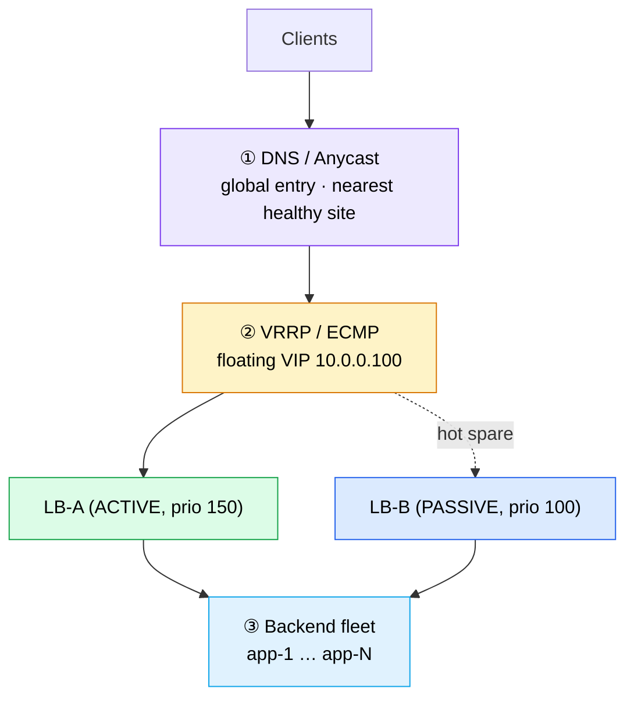
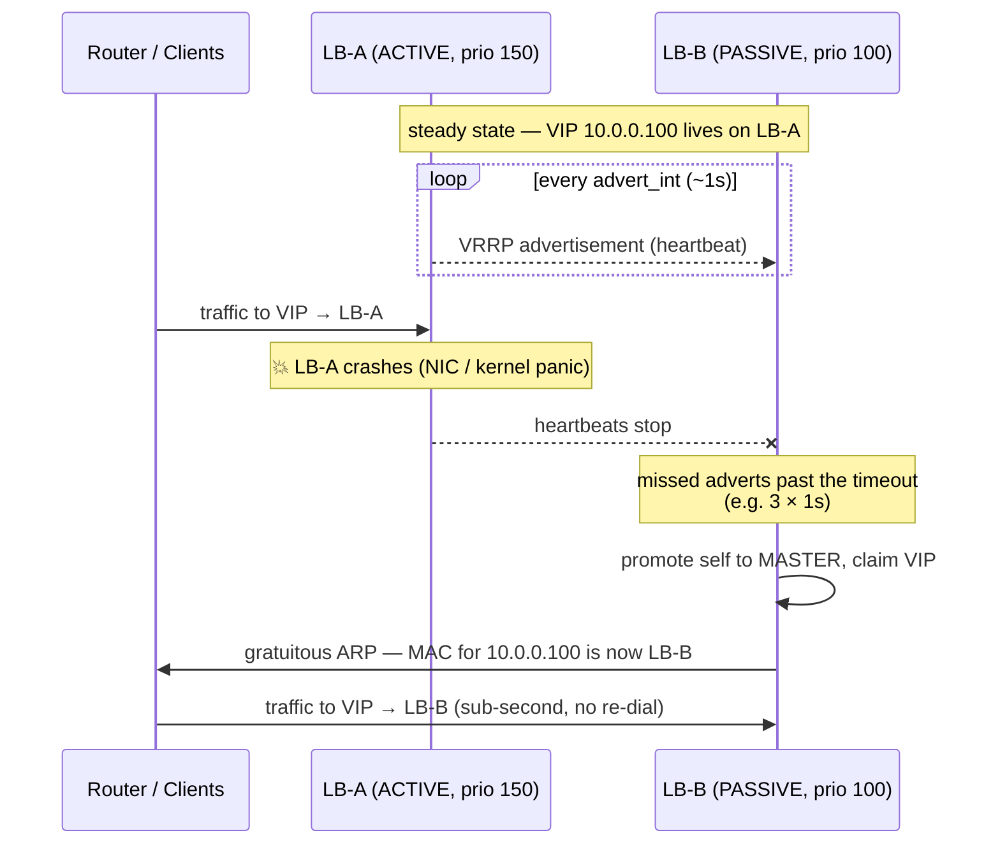

# Load Balancer High Availability

## 1. Why Should I Care About This?
- **The Interview Trap**: You draw a beautiful diagram with a Load Balancer in front of 50 servers. The interviewer smiles and asks: *"Isn't your load balancer a single point of failure?"* This file is your answer.
- **The Irony of the LB**: You added a Load Balancer to make servers redundant, and accidentally created a NEW single point of failure. If that one LB box dies, all 50 healthy servers behind it become unreachable.
- **Who Balances the Balancer?**: Real production systems layer multiple HA techniques so that *no single box, cable, or data center* can take you down.

## 2. What Problem Does This Solve?
- **The LB as a SPOF**: A single LB means one crashed process, one bad NIC, or one kernel panic = 100% outage.
- **Slow Failover**: If you rely only on DNS to swap in a backup LB, users are stuck hitting the dead IP for as long as their DNS cache (TTL) lasts.
- **Dropped Connections**: When one LB fails over to another, in-flight TCP connections and sessions can be silently killed.
- **Naive Approach**: Thinking "my LB has 99.99% uptime, so I'm fine." One box is never enough.

## 3. Core Idea (Intuition First)
- **The Backup Generator (VRRP)**: A hospital has a mains power line and a diesel generator. Both wire into the *same wall sockets* (the Virtual IP). If mains power drops, the generator kicks in within seconds - the sockets never know the difference.
- **The Phone Number That Never Changes (Virtual IP)**: Clients dial one number (the VIP). Behind the scenes, a real person (the active LB) answers. If they faint, a colleague grabs the *same* handset. The caller never re-dials.
- **The Layered Fortress**: You don't defend a castle with one wall. **DNS/Anycast** (global moat) -> **VRRP/ECMP** (the VIP gate) -> **the LB** (the guard) -> **the backend fleet**. Each layer removes a different SPOF.


> Read top-to-bottom: DNS/anycast spreads the *global* entry, a VRRP pair shares one *floating VIP* (LB-A active, LB-B a hot spare exchanging heartbeats), failover re-points the VIP via gratuitous ARP in under a second, and the LBs balance across an *already-redundant* backend fleet — each band erases one SPOF.



## 4. How It Actually Works
### Layer 1: DNS Round Robin (Global, Coarse)
- Publish **multiple A records** for one hostname; clients pick one.
- **Downside**: DNS is cached; a **TTL of 300s** means failover can take 5+ minutes, and DNS has **no health awareness** - it happily hands out a dead IP.

### Layer 2: Anycast (Global, Smart)
- The **same IP is announced from many locations** via BGP. The network routes each user to the **nearest/healthy** site automatically.
- If a site withdraws its BGP route, traffic re-converges elsewhere in seconds. Used by big **CDNs and DNS providers** (e.g., 1.1.1.1, 8.8.8.8).

### Layer 3: VRRP / keepalived Floating VIP (Regional, On-Prem Canonical)
- An **active-passive LB pair** shares one **Virtual IP (VIP)**.
- The passive node listens for the active's **VRRP advertisements (heartbeats)**, sent ~every 1s.
- If heartbeats stop, the passive **promotes itself**, claims the VIP, and sends a **gratuitous ARP** so switches re-point the MAC to the new box.
- **Priority** decides who is master (higher wins); **preemption** decides if the original master reclaims the VIP when it returns.



### Layer 4: ECMP / BGP (Regional, Active-Active)
- **Equal-Cost Multi-Path**: many LB nodes all announce the *same* route; upstream routers **hash-spread** traffic across them. Add a node = add capacity. Used for hyperscaler LB tiers.

## 5. Real-World Example
**The On-Prem Payment Gateway — planned patching, zero dropped connections**:
- Two **HAProxy + keepalived** boxes, `lb01` (priority 200) and `lb02` (priority 100), share VIP `10.0.0.100`. `advert_int 1` (1s heartbeat), failover after **3 missed adverts**.
- Steady state: ~**8,000 requests/sec** and ~**40,000 concurrent TCP connections** flow through `lb01`; `lb02` is a warm standby. HAProxy `peers` replication streams the **stick-table / connection state** from `lb01` to `lb02` continuously (a few hundred KB/s), so the spare already knows every in-flight flow.
- **The maintenance window**: an operator needs to reboot `lb01` to apply a kernel patch. Instead of yanking it, they trigger a **graceful failover** — `track_script` demotes `lb01`, so it lowers its VRRP priority and stops advertising.
- **Draining**: `lb01` stops accepting **new** connections and lets the ~40k existing ones finish (connection draining), while `lb02` sees the priority drop, promotes to MASTER, claims `10.0.0.100`, and sends a **gratuitous ARP**.
- **Result**: the switch re-points the MAC in **~1–3 seconds**; because state was already synced, the ~40k in-flight connections continue on `lb02` rather than resetting. **No DNS change, no client re-dial, no dropped payments** — measured blip well under 3 seconds, and `lb01` reboots cleanly. When it returns, preemption (or a manual switch-back) restores it as MASTER.
- **Contrast — cold failover**: with *no* state sync, that same event would reset all ~40,000 connections at once (truncated responses, broken payment sessions), which is exactly what session sync + draining exist to prevent.

## 6. Code Example
A minimal `keepalived.conf` VRRP pair (the MASTER node):
```conf
vrrp_instance VI_1 {
    state MASTER              # peer node uses BACKUP
    interface eth0            # NIC the VIP lives on
    virtual_router_id 51      # MUST match on both nodes
    priority 200              # higher = preferred master (backup = 100)
    advert_int 1              # send heartbeat every 1 second
    preempt                   # reclaim VIP when this node recovers

    authentication {
        auth_type PASS
        auth_pass s3cr3t      # both nodes must share this
    }

    virtual_ipaddress {
        10.0.0.100/24         # the floating VIP clients connect to
    }
    # track_script can demote this node if HAProxy dies
}
```

## 7. Design Variations & Alternatives
- **Active-Passive (VRRP)**: Simple, one node idle. Canonical on-prem.
- **Active-Active (ECMP/BGP)**: All nodes serve traffic; scales horizontally but needs consistent hashing to keep flows sticky.
- **Cloud-Managed LBs**: AWS ELB/NLB, GCP LB, Azure LB hide all of this - HA is built in and billed as a service.
- **Connection-State Sync**: For **stateful L4 LBs**, the pair replicates its **connection-tracking table** so failover preserves in-flight connections (**session sync**) instead of dropping them (**cold failover**).
- **Connection Draining**: On planned failover/removal, stop accepting **new** connections but let existing ones finish before killing the node (graceful shutdown).

## 8. Pros and Cons
### Pros
- **No LB SPOF**: The whole point - the balancer becomes redundant too.
- **Fast Failover**: VRRP recovers in **1-3 seconds** vs minutes for DNS.
- **Transparent to Clients**: The VIP never changes.

### Cons
- **Split-Brain Risk**: If heartbeats are lost but both LBs are alive, **both claim the VIP** - duplicate IPs, chaos.
- **Idle Capacity (Active-Passive)**: The standby earns nothing until disaster strikes.
- **State-Sync Overhead**: Replicating connection tables costs CPU/bandwidth and adds complexity.

## 9. Failure Scenarios & What Can Go Wrong
- **Split-Brain**: A switch glitch cuts the heartbeat link (not the data link). Both nodes think they're master and both grab the VIP. Fix: heartbeat over a **separate dedicated link**, use **higher priority + unicast peers**, add a tie-breaker.
- **Preemption Flapping**: A flaky master keeps recovering and reclaiming the VIP, causing repeated failovers. Fix: disable preemption or add a hold-down timer.
- **Cold Failover Drops**: L4 LB fails over without state sync - every in-flight connection resets. Users see truncated downloads / broken sessions.
- **Gratuitous ARP Ignored**: Some switches cache ARP too long; traffic keeps going to the dead node until the cache expires.

## 10. Impact on Scalability, Reliability & Cost
- **Reliability**: Removes the single biggest SPOF; enables true "Five Nines" front doors.
- **Scalability**: ECMP/BGP lets the LB *tier itself* scale horizontally, not just the backends.
- **Cost**: Active-passive means paying for a mostly-idle standby; anycast/ECMP make better use of spend but need BGP expertise.

## 11. When NOT to Use This
- **Small / Hobby Apps**: A single cloud LB with a 99.99% SLA is plenty; don't run keepalived for a blog.
- **Fully Managed Cloud**: If you use AWS ALB/NLB, the provider already does multi-AZ HA - rolling your own VRRP is redundant work.
- **Stateless + Fast DNS**: For read-only static sites, DNS round robin plus a CDN is often enough.

## 12. Interview Perspective
- **What interviewers expect**: You proactively say *"the LB itself needs HA"* before being asked. Name **VRRP/keepalived + Virtual IP** as the on-prem answer and **anycast/ECMP** for global/hyperscale.
- **The killer question**: *"Isn't your load balancer a single point of failure?"* -> Answer with the **layered picture**: DNS/anycast -> VRRP/ECMP VIP -> LB -> backends.
- **Follow-ups**: "What is split-brain and how do you prevent it?", "How does failover keep in-flight connections alive?" (state sync + connection draining).

## 13. Connections to Other Topics
- **[GSLB](../06_Caching_Performance/GSLB.md)**: The **global** layer of this story (GeoDNS/anycast multi-region routing). This file is the **regional/VIP HA** layer; GSLB is the **planet-scale** layer above it.
- **[Health Checks & Failover](./Health_Checks_Failover.md)**: Health checks are what *trigger* the failover here; VRRP heartbeats are essentially a health-check mechanism for the LBs themselves.
- **[High Availability (Active-Active vs Active-Passive)](./High_Availability_Active_Active_vs_Active_Passive.md)**: This file *applies* active-active (ECMP) vs active-passive (VRRP) specifically to the load-balancer tier.
- **[Hardware vs Software Load Balancers](./Hardware_vs_Software_Load_Balancers.md)**: Hardware LBs often ship with built-in VRRP-style HA; software LBs achieve it with keepalived.

## 14. Visual Aids
- **`../assets/lb_high_availability.svg`** (animated): the layered "remove every SPOF" stack, fading in top-to-bottom — DNS/Anycast (global) -> the VRRP pair sharing floating VIP `10.0.0.100` (LB-A active/prio 150, LB-B passive/prio 100, heartbeats between them) -> a sub-second failover callout (miss heartbeats -> promote -> gratuitous ARP) -> the backend fleet, with a side note contrasting Active-Passive (VRRP) vs Active-Active (ECMP/BGP).
- **Mermaid — layered SPOF-removal flowchart** (Section 3): `flowchart TD` of Clients -> DNS/Anycast -> VRRP/ECMP VIP -> LB-A (active) / LB-B (hot spare) -> backend fleet, colour-coded per layer.
- **Mermaid — VRRP failover sequence** (Section 4): `sequenceDiagram` of LB-A / LB-B / Router-Clients — periodic adverts, LB-A crashes, LB-B detects missed adverts past the timeout, promotes to MASTER, sends gratuitous ARP, traffic to the VIP flows to LB-B.
- **The Layered Stack**: A vertical stack - DNS/Anycast (global) -> VRRP/ECMP VIP (regional) -> LB -> Backend Fleet - with a note on each layer explaining which SPOF it removes.
- **VRRP Failover Timeline**: MASTER sending heartbeats -> heartbeats stop -> BACKUP promotes -> gratuitous ARP -> VIP now on new node.

## 15. Summary (TL;DR)
**A single load balancer is itself a single point of failure, so you make the LB layer highly available: DNS round robin and anycast spread entry points globally, while VRRP/keepalived gives an active-passive LB pair a shared floating Virtual IP that fails over in 1-3 seconds via gratuitous ARP, and ECMP/BGP lets active-active LB fleets scale horizontally. Use connection-state sync and connection draining so failover doesn't drop in-flight traffic, watch out for split-brain, and remember the layered answer to the classic interview trap - DNS/anycast to VRRP/ECMP to the LB to the backends - because each layer removes a different SPOF.**

## 16. Further Reading & Resources
- [Keepalived: VRRP Synopsis & Documentation](https://www.keepalived.org/manpage.html)
- [Cloudflare: What is Anycast?](https://www.cloudflare.com/learning/cdn/glossary/anycast-network/)
- [RFC 5798: Virtual Router Redundancy Protocol (VRRP) v3](https://datatracker.ietf.org/doc/html/rfc5798)
- [HAProxy: Reliable, High Performance Load Balancing (keepalived HA)](https://www.haproxy.com/blog/haproxy-and-keepalived-a-powerful-combination-for-high-availability)
- [Cloudflare: How we scale with Anycast and ECMP](https://blog.cloudflare.com/a-brief-anycast-primer/)
