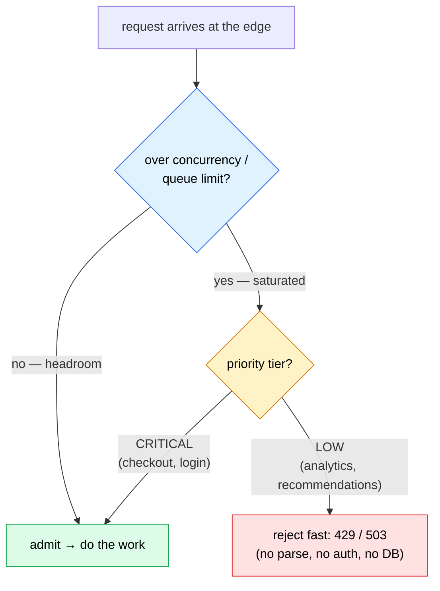
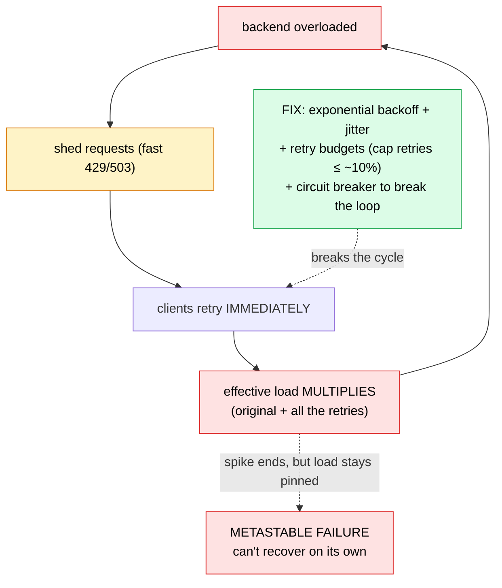

# Load Shedding & Graceful Degradation

## 1. Why Should I Care About This?
- **Survival Under Overload**: When your fleet is saturated, the choice is not "serve everyone" vs "serve everyone" — it's "serve 90% well" vs "serve 0% because you collapsed." Load shedding picks the first.
- **Autoscaling Is Too Slow**: New capacity takes **60-120 seconds** to boot; overload collapses a system in **seconds**. Shedding is the only lever fast enough.
- **Interview Signal**: Knowing *why* a saturated system dies (and how to stop it) is a senior-level distinction between "scaling" and "surviving."

## 2. What Problem Does This Solve?
- **Total Collapse**: Preventing the "everyone gets a timeout" outcome where the server is 100% busy but completes **zero** useful work.
- **Unbounded Latency**: A queue that grows forever means every request eventually times out anyway — you did the work but nobody got an answer.
- **Naive Approach**: Accepting every request politely and hoping the box holds. It won't — it will thrash, GC, and flatline.

## 3. Core Idea (Intuition First)
- **Load Shedding = A Bouncer at a Club**. The club holds 500 people safely. At person 501, the bouncer says "sorry, we're full" at the door — *instantly*. He does NOT let 2,000 people in, let them crush each other, and then try to sort it out. **A brownout, not a blackout.**
- **Graceful Degradation = A Restaurant in a Rush**. Kitchen is slammed, so they shrink the menu to 5 fast dishes instead of 40. You still eat — just a simpler meal. Better than closing the doors.
- **The distinction**: Shedding *rejects* some requests; degradation *simplifies* the response for the ones it keeps. Usually you do both.



> Left: with no gate, every request is admitted, the backend pegs at 100% CPU, and *everyone* gets a failure. Right: an admission gate rejects low-priority traffic with a fast 429/503 so the critical 80% (checkout, login) stays healthy — a brownout, not a blackout.

## 4. How It Actually Works
### Admission Control at the Edge
- Reject **early**, before any expensive work. Return `429 Too Many Requests` or `503 Service Unavailable` in microseconds.
- **Golden rule**: If you parse, authenticate, hit the DB, and *then* reject — you burned the exact capacity you were trying to save. Shedding must be **cheap and first**.

### Prioritized / Selective Dropping
- Tag traffic by **criticality tier**: `CRITICAL` (checkout, login) > `NORMAL` (browse) > `BACKGROUND` (analytics, prefetch, recommendations).
- Under pressure, drop the lowest tier first. A retailer sheds analytics beacons long before it sheds "Buy Now."

### Bounded Queues (Little's Law)
- Cap the queue length. Little's Law: `Latency = QueueLength / Throughput`. A **full queue means latency is already blown** — accepting more only adds requests that will time out before you reach them.
- **LIFO under overload**: Serving newest-first means the request you pick is still fresh; FIFO serves the oldest, which the client may have already abandoned.

### Degradation / Brownout
- Serve a **reduced-quality** response: skip personalization, serve **stale cache**, disable expensive joins, hide the recommendation carousel.

### The Admission Decision, Step by Step
Every request hits one cheap decision at the edge *before* any real work happens:



- The check is O(1) and runs *first*, so a rejection costs microseconds — the whole point is to spend nothing on the requests you drop.

## 5. Real-World Example
**The Black Friday Checkout Meltdown**:
- **10:00:00** — Deals drop. Traffic jumps from 2k to **50k req/s** in **4 seconds**. The fleet's proven-safe capacity is ~12k req/s; it is now **100% CPU-bound** and autoscaling is **~90 seconds** from adding capacity.
- **The traffic mix**: ~15% is `CRITICAL` (checkout, login, add-to-cart ≈ 7.5k req/s), ~50% is `NORMAL` (browse, search), ~35% is `BACKGROUND` (analytics beacons, recommendation carousels, prefetch).
- **Without shedding**: Every thread grabs a request indiscriminately, the queue balloons to **200k**, CPU pegs at 100%, latency climbs to **30s**, health checks fail, the load balancer marks nodes dead, survivors get *more* load → **death spiral**. Checkout and analytics fail *equally* — you complete **zero** useful work while 100% busy.
- **With shedding**: The edge admits ~12k req/s (proven-safe capacity) and returns fast `503`s to the rest — shedding **all 17.5k req/s of BACKGROUND first**, then trimming `NORMAL`, while the **7.5k req/s of CRITICAL checkout traffic flows through untouched**. Checkout stays at **~200ms**. Meanwhile autoscaling boots ~30 new nodes; **90 seconds later** the admission limit lifts and full traffic resumes. The site had a brownout, not a blackout — and it still took the revenue-critical orders throughout.

## 6. Code Example
Admission control with a bounded queue and priority shedding:
```python
import queue

MAX_QUEUE = 500          # proven-safe backlog; beyond this, latency is already blown
work_queue = queue.LifoQueue(maxsize=MAX_QUEUE)  # LIFO: serve freshest requests first

CRITICAL, NORMAL, BACKGROUND = 0, 1, 2

def admit(request):
    depth = work_queue.qsize()
    # Shed low-priority traffic earlier than critical traffic
    if request.tier == BACKGROUND and depth > MAX_QUEUE * 0.5:
        return reject(503, "shedding background")   # cheap, no work done yet
    if request.tier == NORMAL and depth > MAX_QUEUE * 0.8:
        return reject(503, "shedding normal")
    try:
        work_queue.put_nowait(request)              # CRITICAL still gets in
    except queue.Full:
        return reject(429, "queue full")            # reject fast, don't grow latency
    return accept(request)
```

## 7. Design Variations & Alternatives
- **Adaptive shedding (CoDel / Netflix concurrency-limits)**: Instead of a fixed limit, measure request latency and drop when the queue's *sojourn time* exceeds a target — self-tuning to real capacity.
- **Token bucket / rate limiting**: A blunter cousin — caps request *rate* per client rather than reacting to live saturation.
- **Cost-based shedding**: Weight by request expense (a full-text search costs 50x a key lookup); shed by predicted cost, not just count.

## 8. Pros and Cons
### Load Shedding
- **Pros**: Instant (no boot time), protects healthy capacity, prevents total collapse.
- **Cons**: Some users get rejected; picking *what* to shed needs good traffic classification.

### Graceful Degradation
- **Pros**: Users still get *something*; feels like a slow day, not an outage.
- **Cons**: Requires building fallback paths (stale cache, feature flags) ahead of time — engineering cost.

## 9. Failure Scenarios & What Can Go Wrong
- **Over-shedding (self-inflicted outage)**: A too-tight limit rejects healthy traffic; you cause the very outage you feared. (Solution: adaptive limits, alarm on shed-rate).
- **Retry Storms**: Clients retry every shed request → **more** load than the original spike. (Solution: exponential backoff + jitter + **retry budgets** capping retries to ~10% of traffic).
- **Shedding the Wrong Traffic**: Accidentally dropping **health checks** or control-plane traffic makes the LB mark healthy nodes dead. Never shed those.
- **Metastable Failure (Death Spiral)**: Load drops back to normal but the system *still* can't recover — the queue backlog, retry amplification, and cold caches keep it pinned. Only a hard shed (or restart) breaks it. (See [Circuit Breaker](../10_Microservices_Distributed_Systems/Circuit_Breaker_Bulkhead.md)).

### The Retry-Storm Death Spiral
This is the loop that turns a brief spike into a self-sustaining outage — the reason shedding *alone* is not enough without client-side discipline:



- The cruel irony: a shed response is *cheap to produce*, so clients get it fast and retry fast — **shedding can itself feed the storm** unless clients back off. Retry budgets + jitter + circuit breakers are the mandatory companions.

## 10. Impact on Scalability, Reliability & Cost
- **Reliability**: Massively improves. Converts catastrophic collapse into a bounded, partial degradation.
- **Scalability**: Buys the **60-120s** autoscaling needs. Shedding *reduces demand* (instant); autoscaling *adds capacity* (slow). They are partners.
- **Cost**: Nearly free — a few lines at the edge — and *saves* money by avoiding over-provisioning for rare peaks.

## 11. When NOT to Use This
- **Underloaded systems**: If you have headroom, shedding just throws away good requests. Only engages near saturation.
- **Every request is CRITICAL**: If you literally cannot drop *any* traffic (e.g., a life-safety alarm feed), you must over-provision or use hard admission quotas upstream instead.
- **Async pipelines**: For queue/stream consumers, **backpressure** is the right tool, not synchronous shedding (see below).

## 12. Interview Perspective
- **What interviewers expect**: The framing that *overload outpaces autoscaling*, so you shed to survive the gap. Bonus: mention retry storms and the "reject cheaply, first" rule.
- **Common question**: "Traffic spikes 10x instantly and autoscaling takes 2 minutes — what happens in those 2 minutes?" (Answer: admission control + priority shedding + graceful degradation keep the core flow alive until capacity arrives).

## 13. Connections to Other Topics
- **[../09_Message_Queues_Event_Streaming/Backpressure_Throttling.md](../09_Message_Queues_Event_Streaming/Backpressure_Throttling.md)**: The async sibling — backpressure pushes *back* through the pipeline; load shedding *drops* at the synchronous edge. Distinct but complementary.
- **[../10_Microservices_Distributed_Systems/Circuit_Breaker_Bulkhead.md](../10_Microservices_Distributed_Systems/Circuit_Breaker_Bulkhead.md)**: Circuit breakers stop *you* calling a broken downstream; load shedding protects *this* service from its callers. Opposite directions.
- **[./Auto_scaling_Horizontal_vs_Vertical.md](./Auto_scaling_Horizontal_vs_Vertical.md)**: Load shedding covers the autoscaling-lag gap — the two work as a pair.
- **[./Health_Checks_Failover.md](./Health_Checks_Failover.md)**: Never shed health-check traffic; a shedding node must still answer health checks honestly (pass, or deliberately fail if truly unhealthy).
- **[./Fault_Tolerance_vs_Resilience.md](./Fault_Tolerance_vs_Resilience.md)**: Load shedding and graceful degradation are core **resilience** tactics (see its Section 7).

## 14. Visual Aids
- **`../assets/load_shedding.svg` (animated, in Section 3)**: A two-panel contrast — *without shedding*, an ungated flood pegs the backend at 100% CPU and produces a total blackout; *with shedding*, an admission gate lets critical traffic (checkout/login) through and rejects low-priority traffic (analytics/recommendations) with a fast 429/503, keeping the backend healthy. Bottom callout: overload collapses in seconds while autoscaling is 60–120s away.
- **Admission-control decision flow (mermaid, Section 4)**: `flowchart TD` — request → over the concurrency/queue limit? → if no, admit; if yes, CRITICAL admits and LOW rejects fast (429).
- **Retry-storm death spiral (mermaid, Section 9)**: `flowchart TD` — overload → shed → clients retry immediately → more load → spiral into metastable failure, annotated with the fix (backoff + jitter + retry budgets + circuit breaker).
- **The Brownout Curve**: Two lines of "useful throughput vs offered load" — one collapses to zero past saturation (no shedding), the other plateaus flat at capacity (with shedding).
- **The Priority Funnel**: A funnel where BACKGROUND traffic gets skimmed off first, then NORMAL, with CRITICAL flowing through to the last drop.

## 15. Summary (TL;DR)
**Load shedding deliberately rejects a fraction of requests at the edge — cheaply and first — to keep the rest healthy, turning a total blackout into a survivable brownout; graceful degradation serves a simpler response instead of failing. Because overload collapses a system in seconds while autoscaling needs 1-2 minutes, shedding is the instant demand-reducing lever that buys time until new capacity arrives — but guard against over-shedding, retry storms, and dropping health-check traffic.**

## 16. Further Reading & Resources
- [Google SRE Book: Handling Overload](https://sre.google/sre-book/handling-overload/)
- [Amazon Builders' Library: Using load shedding to avoid overload](https://aws.amazon.com/builders-library/using-load-shedding-to-avoid-overload/)
- [Netflix: Performance Under Load (adaptive concurrency limits)](https://netflixtechblog.medium.com/performance-under-load-3e6fa9a60581)
- [Marc Brooker: Metastable failures in distributed systems](https://brooker.co.za/blog/2021/05/24/metastable.html)
- [ACM Queue: Controlling Queue Delay (CoDel)](https://queue.acm.org/detail.cfm?id=2209336)
