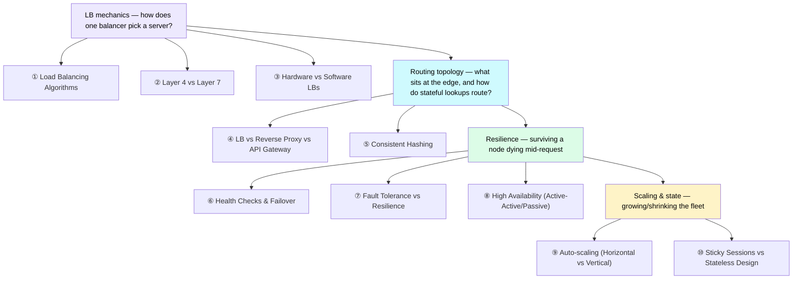
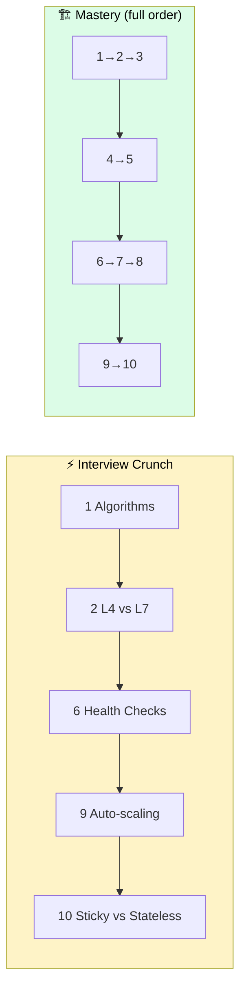

# 07 · Load Balancing & Scalability 🌐

> **Surviving the million-user spike.** The moment a system outgrows one machine, something has to decide which server handles the next request — that's the load balancer, choosing by algorithm, network layer, and cost profile. Behind it, the fleet itself has to breathe: growing under load, shrinking when it's quiet, and routing stateful lookups consistently even as membership changes. None of it matters if a node dying mid-request takes the user down with it, so health checks, failover, and active-active/passive design are what keep that death invisible.

---

## 🎯 What You'll Be Able To Do

- **Pick the right load-balancing algorithm** — round robin, weighted, least connections, least response time — for a workload's actual shape, not by default.
- **Choose the layer and the box** — L4 vs L7, hardware ASIC vs software (Nginx/HAProxy/Envoy/cloud ALB) — by the latency, cost, and routing intelligence the traffic needs.
- **Draw the edge correctly** — separate what a load balancer, a reverse proxy, and an API gateway each own instead of using the terms interchangeably.
- **Route stateful data without a stampede** — use consistent hashing so adding or removing a node moves ~1/N of the keys, not almost all of them.
- **Detect and survive failure** — design active health checks and automatic failover, and know when to mask a fault (fault tolerance) versus recover from one (resilience).
- **Scale a fleet safely** — horizontal vs vertical auto-scaling, reactive vs predictive triggers, and externalized state so no server holds a session hostage.

---

## 🗺️ How the 10 Topics Interlock



> **The spine:** *pick how one balancer chooses a server → decide what edge component owns which concern and how stateful keys route → detect failure and survive it → grow and shrink the fleet without losing state.* Consistent hashing (⑤) is what makes the hash-ring failover in ⑧ and the auto-scaling in ⑨ safe; statelessness (⑩) is what makes horizontal scaling (⑨) and active-active HA (⑧) actually work.

---

## 📚 The Complete File Index

| # | Topic | One-line | Key takeaway |
|---|-------|----------|--------------|
| 1 | [Load Balancing Algorithms](./Load_Balancing_Algorithms.md) | The hostess seating your traffic | Static (round robin/weighted/IP-hash) assumes uniform load; dynamic (least-conn/least-response-time) reacts to real server state |
| 2 | [Layer 4 vs Layer 7 Load Balancing](./Layer_4_vs_Layer_7_Load_Balancing.md) | Security guard vs hotel concierge | L4 routes blind on IP/port (fast, cheap); L7 terminates TLS and reads HTTP for smart, pricier routing |
| 3 | [Hardware vs Software Load Balancers](./Hardware_vs_Software_Load_Balancers.md) | Supercar vs jet-engine minivan | ASIC appliances win raw multi-terabit throughput; software (Nginx/HAProxy/Envoy/cloud ALB) wins flexibility and elastic cost |
| 4 | [LB vs Reverse Proxy vs API Gateway](./LB_vs_Reverse_Proxy_vs_API_Gateway.md) | Traffic cop, receptionist, concierge | Three distinct jobs — distribute load, hide/terminate a backend, own auth/rate-limit/transform — that stack, not substitute |
| 5 | [Consistent Hashing](./Consistent_Hashing.md) | The clock-face hash ring | Ring + virtual nodes cap remapped keys to ~1/N on resize, killing the cache-stampede that mod-N hashing causes |
| 6 | [Health Checks & Failover](./Health_Checks_Failover.md) | The doctor checking the pilot | Active HTTP checks catch "running but broken" zombies that TCP checks miss; thresholds tune detection speed vs false positives |
| 7 | [Fault Tolerance vs Resilience](./Fault_Tolerance_vs_Resilience.md) | Backup generator vs rubber band | Fault tolerance masks failure via redundancy (zero impact, $$$); resilience recovers via retries/circuit breakers/bulkheads (cheap, brief blip) |
| 8 | [High Availability: Active-Active vs Active-Passive](./High_Availability_Active_Active_vs_Active_Passive.md) | Spare tire vs multi-engine plane | Active-passive is simple and consistent but wastes capacity; active-active uses every node and fails over instantly at the cost of harder consistency |
| 9 | [Auto-scaling: Horizontal vs Vertical](./Auto_scaling_Horizontal_vs_Vertical.md) | Bigger suit vs hiring more workers | Vertical hits a hardware ceiling and needs a reboot; horizontal is unbounded but demands a stateless app and a scaling policy (reactive/predictive) |
| 10 | [Sticky Sessions vs Stateless Design](./Sticky_Sessions_vs_Stateless_Design.md) | Family doctor's drawer vs urgent care | Stickiness pins a user to one server and breaks scaling/failover; externalized state (Redis/JWT) is what makes horizontal scaling and HA actually work |

---

## 🧭 Suggested Study Paths



| Goal | Path | Why |
|------|------|-----|
| **⚡ Interview in 48h** | 1 → 2 → 6 → 9 → 10 | Algorithm + L4/L7 basics + failover + scaling + statelessness = the most-asked 80% |
| **🏗️ Deep mastery** | 1→2→3 → 4→5 → 6→7→8 → 9→10 | Mechanics → topology → resilience → scaling, in dependency order |
| **🧩 "Design the edge"** | 2 → 4 → 5 | Choosing the layer, then which edge component owns what, then how stateful routing survives a resize |
| **🛡️ Resilience focus** | 6 → 7 → 8 (+ [05 · Replication](../05_Databases_Storage/Replication.md), [03 · High Availability Design](../03_High_Level_Design/High_Availability_Design.md)) | Detect failure → the philosophy of masking vs recovering → the concrete active-active/passive pattern |

> **Study each file by** working through its Real-World Example before reading the Failure Scenarios, rehearsing the **Interview Perspective** section out loud, and closing with the **Summary (TL;DR)** for a fast recap.

---

## 🔑 The Decision Card (whole-section cheat sheet)

```
MECHANICS  round robin (uniform) · weighted RR (heterogeneous hardware) · least-conn (long-lived conns) ·
           least-response-time / resource-based (smartest, priciest, needs active probing)
           L4 = IP/port only, blind to payload, fast/cheap · L7 = terminates TLS, reads HTTP, path/header routing + WAF, pricier
           hardware = ASIC/FPGA, multi-terabit, $$$ upfront (F5, Citrix ADC) · software = Nginx/HAProxy/Envoy/cloud ALB, flexible, elastic cost
TOPOLOGY   LB (spread load across a cluster) ≠ reverse proxy (hide/terminate ONE backend) ≠ API gateway
           (auth + rate-limit + transform + service discovery, the microservices front door) — they STACK, never substitute
           naive `hash(key) % N` remaps ~ALL keys on resize · consistent hashing (ring + virtual nodes) remaps only ~1/N
RESILIENCE ACTIVE health checks (HTTP, app-aware: "can I reach the DB?") catch zombies that passive/TCP checks miss ·
           thresholds trade detection speed against false positives
           fault tolerance = MASK failure via redundancy (N+1/2N, zero impact, expensive) ·
           resilience = RECOVER from failure via retry+backoff, circuit breaker, bulkhead (cheap, brief blip)
           active-passive = simple, consistent, wastes capacity, pauses on failover · active-active = full utilization,
           instant failover, harder write consistency (multi-master conflicts)
SCALE      vertical = bigger box, hits a ceiling, needs a reboot · horizontal = unbounded, needs a STATELESS app ·
           reactive (CPU%/RPS threshold) vs predictive (forecasted traffic) scaling policies
           sticky sessions pin user→server (breaks scaling & failover) · externalize state (Redis/JWT) is what makes
           horizontal scaling AND active-active HA actually work
ANTI-PATTERNS  one algorithm for a mixed workload · TCP-only health checks on an app-level dependency ·
               no circuit breaker on a call chain (cascading failure) · scaling a stateful service horizontally
               without externalizing state first · treating LB/reverse-proxy/API-gateway as interchangeable
```

---

## 🎨 Conventions & Authoring

- Every file follows the depth bar in the root [TEMPLATE.md](../TEMPLATE.md) — why it matters, the core mental model, how it actually works, a real-world example, and failure scenarios, backed by concrete numbers rather than "fast"/"a lot."
- Each file closes with the same arc: **Interview Perspective**, **Connections to Other Topics**, **Visual Aids**, and a one-paragraph **Summary (TL;DR)**.

---

## ➡️ Where This Connects

- ⬅️ Built on [03 · High-Level Design](../03_High_Level_Design/) — stateless services and high-availability design set up the fleet this section load-balances and scales.
- ⬅️ [06 · Caching & Performance](../06_Caching_Performance/) — caches sit behind (or beside) the load balancer and shape which algorithm and hashing scheme make sense.
- ➡️ [08 · Communication Protocols](../08_Communication_Protocols/) — the protocols (HTTP/2, gRPC, WebSockets) that L4/L7 load balancers must route correctly.
- ➡️ [10 · Microservices & Distributed Systems](../10_Microservices_Distributed_Systems/) — service discovery, API gateways, and resilience patterns at full distributed-system scale.
- ➡️ [13 · Cloud-Native Infrastructure](../13_Cloud_Native_Infrastructure/) — where auto-scaling, health checks, and load balancing become managed cloud primitives (ASGs, ALBs, k8s HPA).

---
*Part of the [System Design & Architecture Master Repository](../README.md). Traffic gets spread here, the fleet breathes here, and a dying node stays invisible here.*
