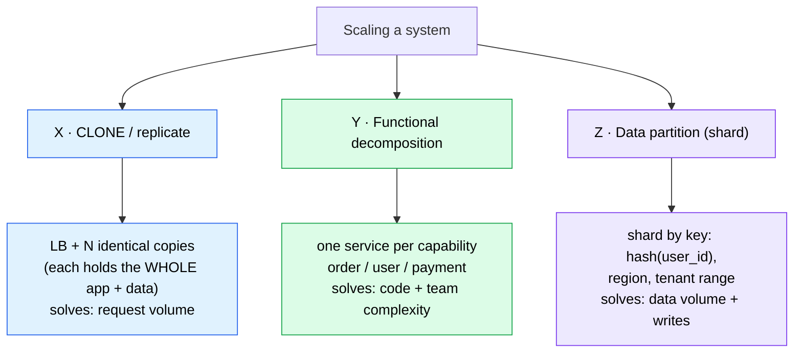
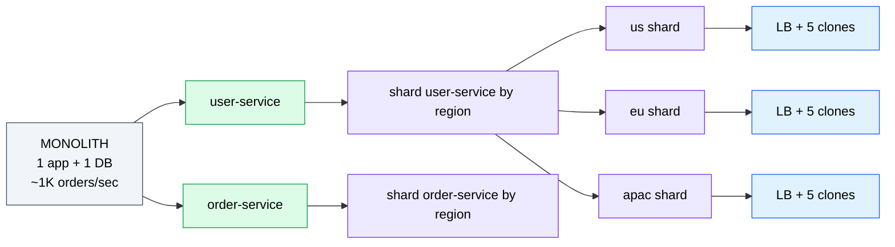

# The Scale Cube (X, Y, Z Axis Scaling)

## 1. Why Should I Care About This?
- **One vocabulary for the whole folder**: Almost every scaling topic you'll study — load balancers, auto-scaling, consistent hashing, sharding, microservices — is really just *one of three axes* of the AKF Scale Cube. Learn the three axes and the rest of the repo clicks into place.
- **Interview shorthand**: Saying *"that's a Z-axis problem, I'd shard by user_id"* signals seniority far faster than "let's add more infrastructure."
- **Stops wrong-axis waste**: Sharding a database (Z) when the real bottleneck is a CPU-bound monolith (needs X) is a multi-month migration that fixes nothing.

> **This file is the applied, folder-connective view.** For the deep, from-scratch treatment (scalability vs performance vs elasticity, Amdahl's Law, cost curves), **read [../01_Planning_Foundations/Scalability_Fundamentals_Scale_Cube.md](../01_Planning_Foundations/Scalability_Fundamentals_Scale_Cube.md) for the fundamentals.**

## 2. What Problem Does This Solve?
- **"Which dimension do I scale?"**: You have a system falling over. There are only three fundamentally different directions to grow it — the cube names them so you pick deliberately instead of guessing.
- **Disconnected mental models**: Beginners treat "add servers," "split into microservices," and "shard the DB" as unrelated tricks. The cube reveals they are three orthogonal axes of the *same* problem.
- **Naive approach**: "Just buy a bigger box." That's not even on the cube — it's vertical scaling, which hits a hard ceiling (see *Auto-scaling*).

## 3. Core Idea (Intuition First)
Think of a restaurant that's overwhelmed:
- **X-axis = Clone the cooks**: Hire 10 *identical* chefs, each cooking the *full menu*. Every chef can do every dish. **Analogy: photocopying the whole kitchen.**
- **Y-axis = Split by job**: One station does appetizers, one does mains, one does desserts. Split by **responsibility**. **Analogy: an assembly line.**
- **Z-axis = Split by customer**: Kitchen A serves tables 1-10, Kitchen B serves tables 11-20. Each handles a **subset of the data**. **Analogy: franchising by neighborhood.**

The magic: **these three are orthogonal and combinable.** You can clone the dessert station (X on Y) and give each clone half the customers (Z). A real scaling strategy is a *point inside the cube*, not a single axis.



> The origin corner is the monolith; each axis leads away from it independently, and the far corner (X+Y+Z) is a fully scaled system combining all three.

## 4. How It Actually Works

The three axes all branch from the same starting point — the thing you're scaling — but each grows it in a different, independent direction:



### X-axis — Horizontal Duplication / Cloning
- Run **N identical copies** of the app behind a load balancer; each handles ~1/N of requests.
- **Easiest lever**: no code change beyond statelessness. This *is* horizontal auto-scaling in practice.
- **Limit**: every clone still holds the *whole* dataset and *whole* codebase, so it does nothing for data volume or code complexity — all clones still hammer the *same* backing store.

### Y-axis — Functional Decomposition
- Split by **responsibility / verb / resource**: break the monolith into `order-service`, `user-service`, `payment-service`. This is **microservices**.
- Scales the **organization** (independent teams, deploys) and lets you scale *hot* services independently of cold ones.
- **Cost**: network hops, partial failure, eventual consistency between services.

### Z-axis — Data Partitioning / Sharding
- Split by a **lookup on the data itself**: each server owns a **subset** — users A-M vs N-Z, shard by `user_id % N`, hash range, geography, or tenant.
- Scales **data volume** and **write throughput** — the one thing X can't touch.
- **Cost**: rebalancing, cross-shard queries/joins, and **hot shards** from skewed keys.

## 5. Real-World Example
**An e-commerce order platform scaling from 1K to 100K orders/sec:**
- **Start**: one monolith, one DB, ~1,000 orders/sec.
- **X first**: make the app stateless (sessions to Redis), clone it 10x behind a load balancer. App tier now does 10K+ req/sec — but all clones still write to one DB leader capping ~5,000 writes/sec.
- **Z next**: shard the orders DB by `hash(user_id)` into 4 shards → 4 × 2,500/sec = 10,000 orders/sec.
- **Y last**: at 100K/sec the monolith's slow payment-gateway call blocks order threads. Split into `Order`, `Inventory`, `Payment`, `Shipping` services so Inventory (read-heavy) runs 40 replicas next to Payment's 8 — a `user-service` that is sharded by region (Z), cloned 5x per shard (X). **All three axes at once.**

The same platform seen as one evolving picture — each axis layered on top of the last:



> **Read the layering:** the monolith splits by **function (Y)** into services, each service is **sharded by region (Z)** into us/eu/apac, and each shard is **cloned 5× behind a load balancer (X)** — the final system is one point deep inside the cube.

## 6. Code Example
Illustrative pseudo-config showing the three axes layered together:
```yaml
# X-axis: N identical stateless replicas behind one load balancer
user_service:
  replicas: 5                 # clone the whole service 5x
  behind: load_balancer       # each replica handles ~1/5 of traffic

# Y-axis: functional decomposition — one monolith becomes many services
services:
  - order-service             # split by responsibility / business capability
  - user-service
  - payment-service

# Z-axis: shard the data so each store owns a SUBSET
routing:
  shard_key: user_id
  strategy: "hash(user_id) % N"     # or a hash-range / geography lookup
  shards:
    shard_0: users where hash(user_id) % 4 == 0   # subset A
    shard_1: users where hash(user_id) % 4 == 1   # subset B
    shard_2: users where hash(user_id) % 4 == 2   # subset C
    shard_3: users where hash(user_id) % 4 == 3   # subset D
# Real system = a POINT in the cube: user-service (Y),
# sharded by region (Z), cloned 5x per shard (X).
```

## 7. Design Variations & Alternatives
- **X variations**: stateless app fleets, read replicas, CDN edge nodes — all "run more identical copies."
- **Y variations**: microservices, serverless functions per capability, the "strangler fig" pattern for incremental decomposition.
- **Z variations**: range sharding, hash sharding, geo-partitioning, per-tenant databases. Consistent hashing (below) is the mechanism that keeps Z survivable.
- **Alternative framing**: some teams use "cells" (self-contained X+Y+Z bundles per customer group) as a higher-order composition of the cube.

## 8. Pros and Cons
### Pros
- **Shared vocabulary** that unifies load balancing, microservices, and sharding under one model.
- **Orthogonality**: mix and match freely; scale exactly the dimension that's saturated.
- **Diagnostic power**: naming the axis forces you to justify the invasiveness against the real bottleneck.

### Cons
- **It's a map, not a mechanism**: the cube tells you *which* axis, not *how* to implement it.
- **Invasiveness escalates X → Y → Z**: cheap cloning vs a painful shard-key decision.
- **Easy to over-apply**: teams shard (Z) or split into microservices (Y) prematurely because it feels "scalable."

## 9. Failure Scenarios & What Can Go Wrong
- **Wrong axis first**: A quarter-long sharding project ships and p99 barely moves — the bottleneck was CPU-bound app logic (an X problem). *Fix*: profile first — idle DB + saturated CPU = X; saturated DB writes + idle CPU = Z.
- **X-axis isn't free**: Adding nodes doesn't help because sessions live in local memory (sticky sessions) or every clone hits one shared DB. *Fix*: externalize state, verify true statelessness.
- **Hot shard (Z)**: Sharding by `merchant_id` when one merchant does 40% of orders — that shard is as overloaded as before. *Fix*: pick an even key; use consistent hashing + virtual nodes.
- **Distributed monolith (Y)**: Splitting by *technical layer* (UI/logic/DB) instead of business capability gives all the network cost of microservices with none of the independence.

## 10. Impact on Scalability, Reliability & Cost
- **Scalability**: This *is* the scalability framework — each axis removes a different ceiling (X: request volume, Y: code/team complexity, Z: data volume).
- **Reliability**: Y and Z shrink blast radius (one service or one shard fails, not everything); X provides redundancy.
- **Cost**: **X is cheapest & simplest**; Y adds operational/observability overhead; **Z is the hardest and most expensive** (rebalancing, cross-shard joins, hot-shard firefighting). Attack cheapest → most invasive.

## 11. When NOT to Use This
- **Small, stable systems**: If a single well-indexed box comfortably serves your load, don't invoke the cube — vertical scaling is the right first move (Stack Overflow ran on a few big SQL boxes for years by design).
- **Premature Z**: Never shard a dataset that fits on one modern DB "because we'll need it eventually" — the shard key is nearly a one-way door.
- **Premature Y**: Don't split into microservices for a 3-person team; the distributed-systems tax outweighs the benefit until team/deploy independence is a real constraint.

## 12. Interview Perspective
- **What interviewers expect**: When asked "scale this 10x/100x," you name an *axis* and show the arithmetic tying the target number to the choice.
- **The framework to say out loud**: "X first (cheap, buys time), Z when a single data store is the proven wall, Y when independent scaling/deploy of different functions — not raw throughput — is the constraint."
- **Common question**: "Our app is slow at peak — bigger box, more boxes, or split it up?" → Diagnose the bottleneck, then map it to X, Y, or Z.

## 13. Connections to Other Topics
- **[../01_Planning_Foundations/Scalability_Fundamentals_Scale_Cube.md](../01_Planning_Foundations/Scalability_Fundamentals_Scale_Cube.md)**: THE foundational treatment — **read this for the fundamentals** (scalability vs performance vs elasticity, Amdahl's Law, cost curves). This file is the applied, folder-connective view.
- **[./Auto_scaling_Horizontal_vs_Vertical.md](./Auto_scaling_Horizontal_vs_Vertical.md)**: X-axis cloning *is* horizontal auto-scaling in practice — the mechanism that adds/removes clones automatically.
- **[./Consistent_Hashing.md](./Consistent_Hashing.md)**: the mechanism that makes Z-axis sharding survive resizing, remapping only ~1/N of keys when nodes change.
- **[../03_High_Level_Design/](../03_High_Level_Design/)**: Y-axis functional decomposition is the microservices / service-decomposition topic.
- **[../05_Databases_Storage/](../05_Databases_Storage/)**: Z-axis data partitioning is database sharding & replication in full practice.

## 14. Visual Aids
- **`../assets/scale_cube.svg` (animated)** — the AKF Scale Cube drawn as a 3D cube: origin corner = the monolith, X-axis (blue) = clone behind an LB, Y-axis (green) = split by function, Z-axis (purple) = shard the data, far corner = X+Y+Z fully scaled. The three axes fade in one at a time, with a cost legend (X cheapest → Z hardest) and a callout that real systems combine all three. Embedded in Section 3.
- **Mermaid — axes branching (Section 4)**: a `flowchart TD` fanning "Scaling" into X (clone/replicate), Y (functional decomposition), Z (data partition), each colored by axis and annotated with the ceiling it removes.
- **Mermaid — combined evolution (Section 5)**: a `flowchart LR` showing the e-commerce platform grow Monolith → split by function (Y) → shard by region us/eu/apac (Z) → clone 5× per shard behind an LB (X), so the layering of all three axes is visible.
- **The Three Kitchens Sketch**: Side-by-side — identical chefs (X), an assembly line of stations (Y), neighborhood franchises (Z).
- **The Layered System**: A load balancer fanning to 5 clones (X), those clones being `order/user/payment` services (Y), each service backed by 4 shards (Z) — showing all three stacked.

## 15. Summary (TL;DR)
**The AKF Scale Cube gives you three orthogonal, combinable axes for scaling anything: X-axis clones the whole app behind a load balancer (cheapest, solves raw request volume but not data volume); Y-axis splits the monolith into services by business function (microservices — scales the codebase and team, lets hot services scale alone); Z-axis shards the data by a key like user_id (solves data volume and write throughput, but is the hardest — rebalancing, cross-shard joins, hot shards). Real systems are a point in the cube using all three. Attack cheapest-to-most-invasive: X first to buy time, Z when one data store is the proven wall, Y when independent scaling and deploy cadence — not throughput — is the real constraint. This is the unifying vocabulary that ties auto-scaling (X), microservices (Y), and sharding/consistent-hashing (Z) together; read the 01 file for the fundamentals.**

## 16. Further Reading & Resources
- [AKF Partners: The AKF Scale Cube](https://akfpartners.com/growth-blog/scale-cube) - the canonical article from the creators of the model.
- [Microservices.io (Chris Richardson): Scale Cube](https://microservices.io/articles/scalecube.html) - the cube framed around microservices and the Y-axis.
- [*The Art of Scalability* (Abbott & Fisher)](https://www.amazon.com/Art-Scalability-Architecture-Organizations-Enterprise/dp/0134032802) - the book that formalized the cube from real eBay scaling history.
- [System Design Primer: Scalability](https://github.com/donnemartin/system-design-primer#scalability) - broader context on how the axes map to real components.
