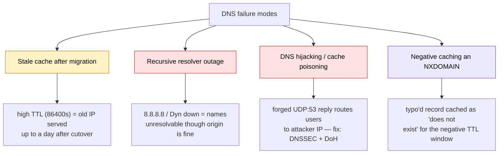
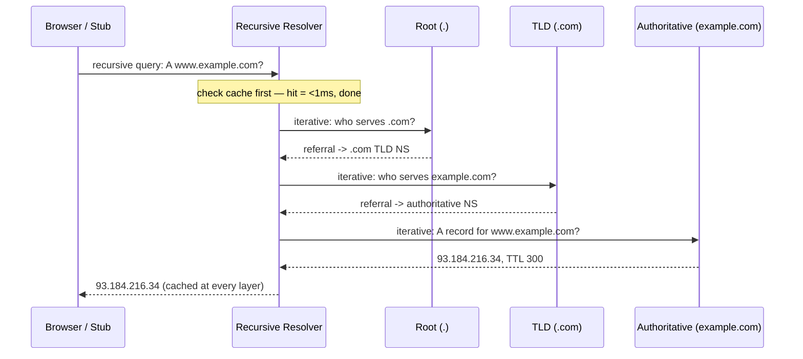

# DNS Deep Dive (How DNS Resolution Actually Works)

## 1. Why Should I Care About This?
- **It's the first hop of EVERY design**: Before a single byte of HTTP flows, before TLS, before the load balancer — the browser must turn `www.example.com` into an IP. If DNS is slow or wrong, *nothing* else runs. A cold resolution adds 20-120ms before your app has even been contacted.
- **It's your global routing lever**: DNS decides *which* datacenter, *which* IP, *which* CDN edge a user hits. Change a record and you reroute the planet's traffic — but only as fast as the TTL lets you.
- **It's a classic outage cause**: DNS misconfiguration and DNS DDoS have taken down Twitter, Netflix, GitHub, and half of Facebook. "It's always DNS" is an ops meme because it's usually true.

## 2. What Problem Does This Solve?
- **Humans can't remember IPs**: We remember `github.com`, not `140.82.121.4`. DNS is the internet's phone book.
- **IPs change, names shouldn't**: A service can move IPs, add servers, or fail over to another region without users ever knowing — the name stays constant while the record behind it changes.
- **Naive Approach**: Thinking there's "one big lookup table." In reality there's no central database — it's a *distributed, cached, hierarchical* lookup delegated across millions of servers.

## 3. Core Idea (Intuition First)
- **Think of a giant company phone directory that nobody keeps in one place.** You (the stub resolver) don't know anyone's extension. You call the front-desk operator (the recursive resolver) and say "get me the extension for www.example.com — I'll wait."
- **The operator does the legwork.** They call the *root* directory ("who handles `.com`?"), then the `.com` *TLD* desk ("who handles `example.com`?"), then finally `example.com`'s *own* receptionist (the authoritative server) who reads out the real extension: `93.184.216.34`.
- **And everyone writes it on a sticky note (the cache).** The operator, your phone's memory, and even your browser jot down the answer with an expiry (the **TTL**). Next time, if the sticky note is still fresh, you skip all the phone calls and answer in under a millisecond.


> The stub asks one recursive question and waits; the resolver does the three iterative hops (root → TLD → authoritative) and caches every step by its TTL — a hit answers in <1ms, a cold miss is 4 round-trips.

## 4. How It Actually Works
### 1. Stub vs Recursive Resolver
- **Stub resolver** (your OS/browser): asks ONE *recursive* question — "give me the final answer for `www.example.com`" — and blocks until it gets an IP.
- **Recursive resolver** (ISP box, `8.8.8.8`, `1.1.1.1`): does all the work *on the stub's behalf*, making multiple *iterative* queries down the hierarchy.

### 2. The Root → TLD → Authoritative Hierarchy
- **Root servers (`.`)**: 13 logical clusters worldwide. They don't know your IP; they know "who runs `.com`, `.org`, `.io`."
- **TLD servers (`.com`)**: know which authoritative nameserver owns `example.com`.
- **Authoritative server (`example.com`)**: the source of truth — actually holds the A record `93.184.216.34`.

### 3. Recursive vs Iterative Queries
- The stub↔resolver leg is **recursive** ("do it all for me").
- The resolver↔hierarchy legs are **iterative** — each server returns a *referral* ("I don't know, but ask them"), and the resolver chases each one.

### 4. Record Types You Must Know
- **A** → IPv4 address · **AAAA** → IPv6 address
- **CNAME** → alias ("`www` is really `example.com`") — costs an extra lookup, never at the zone apex
- **NS** → which nameserver is authoritative · **MX** → mail servers (with priority)
- **TXT** → arbitrary text (SPF, DKIM, domain verification) · **SRV** → service host+port (used by SIP, LDAP)

### 5. TTL & Multi-Layer Caching
- Every record carries a **TTL** in seconds. Browser cache, OS cache, and the recursive resolver each store the answer until it expires.
- **Low TTL (60-300s)** = fast failover/migration but more queries. **High TTL (86400s)** = cheap and cache-friendly but a moved IP can take a full day to propagate.

### 6. Transport: Mostly UDP:53
- DNS runs over **UDP port 53** (fast, one round-trip, small packets).
- Falls back to **TCP:53** for responses too big for a UDP datagram or for **zone transfers**.
- **DoT (DNS-over-TLS, port 853)** and **DoH (DNS-over-HTTPS, port 443)** encrypt lookups for privacy.

## 5. Real-World Example
**Website migration and the TTL that decides your cutover speed:**
- You're moving `api.example.com` from an old server (`203.0.113.10`) to a new one (`198.51.100.20`).
- **Scenario A — TTL was 86400s (1 day):** resolvers cached the old IP for up to 24 hours. Even after you flip the record, a large fraction of users keep hitting the *dead* old box for hours. Cutover is slow and messy; you must keep both servers alive for a day.
- **Scenario B — you lowered TTL to 300s a day *before* the move:** every resolver re-asks every 5 minutes, so within ~5-10 minutes of the flip, essentially all traffic lands on the new IP. Clean cutover. (The trick: *drop the TTL ahead of time*, migrate, then raise it back.)

**The 2016 Dyn DNS DDoS (Oct 21, 2016):** the Mirai botnet flooded Dyn's managed-DNS infrastructure with a ~1.2 Tbps attack. Dyn was the *authoritative* resolver for Twitter, Netflix, Reddit, GitHub, Spotify, and Airbnb. The origin servers were fine — but nobody could *resolve their names*, so for much of the US East Coast those sites were effectively offline for hours. The lesson: DNS is a single point of failure worth replicating across multiple providers.

## 6. Code Example
Tracing a full resolution with `dig +trace` and inspecting record types and TTLs:
```bash
# Full delegation trace: root -> .com TLD -> authoritative
$ dig +trace www.example.com
.                    518400  IN  NS  a.root-servers.net.   # root referral
com.                 172800  IN  NS  a.gtld-servers.net.   # .com TLD referral
example.com.         172800  IN  NS  a.iana-servers.net.   # authoritative NS
www.example.com.     300     IN  A   93.184.216.34         # <- final answer, TTL 300s

# Inspect specific record types
$ dig www.example.com A      +short   # 93.184.216.34
$ dig www.github.com  CNAME  +short   # github.github.io.  (an alias)
$ dig example.com     MX     +short   # 10 mail.example.com.
$ dig example.com     TXT    +short   # "v=spf1 include:_spf.google.com ~all"

# Watch the TTL count DOWN on repeat queries (proof of caching)
$ dig www.example.com | grep -A1 "ANSWER SECTION"
www.example.com.  287  IN  A  93.184.216.34   # 287, not 300 -> 13s already cached

# Windows equivalent
> nslookup -type=A www.example.com 8.8.8.8
```

## 7. Design Variations & Alternatives
- **GSLB / GeoDNS**: return *different* IPs based on the user's location or server health — DNS as a global load balancer (see GSLB).
- **Anycast DNS**: one IP announced from many locations; the network routes you to the nearest instance (how root servers and `1.1.1.1` scale).
- **DoH / DoT**: encrypted DNS for privacy, hiding lookups from the network.
- **Service discovery (Consul, k8s CoreDNS)**: internal DNS with very low TTLs for dynamic microservice addresses.

## 8. Pros and Cons
### DNS (as a system)
- **Pros**: Massively scalable via caching + hierarchy, human-friendly names, decouples name from IP, doubles as a global routing/failover lever.
- **Cons**: Caching means changes propagate *slowly* (TTL-bound), plaintext UDP is spoofable, and it's a tempting single point of failure/attack.

### Low vs High TTL
- **Low TTL Pros**: fast failover, quick migrations. **Cons**: more query volume, higher resolver load.
- **High TTL Pros**: fewer queries, cheaper, resilient to resolver blips. **Cons**: slow cutover, stale answers linger.

## 9. Failure Scenarios & What Can Go Wrong

- **Stale cache after a migration**: a high TTL means resolvers keep handing out the old IP long after you moved. Lower the TTL *before* the change.
- **Resolver outage**: if your recursive resolver (or authoritative provider) dies, names won't resolve even though the app is healthy — the 2016 Dyn scenario.
- **Cache poisoning / hijacking**: because classic DNS is unauthenticated UDP, an attacker can race a forged reply and poison a resolver's cache. Defenses: **DNSSEC** (signed records), source-port randomization, DoT/DoH.
- **Negative caching**: an `NXDOMAIN` ("no such name") is cached too, for the negative-TTL window — so a record you just created may appear "missing" for minutes.

## 10. Impact on Scalability, Reliability & Cost
- **Scalability**: Caching is what makes the internet survivable — most lookups never reach an authoritative server. A hot record answered from the resolver cache costs ~0 and returns in <1ms.
- **Reliability**: DNS *is* your failover mechanism (health-checked records, GSLB) but also a single point of failure — run **secondary DNS across two providers** for critical domains.
- **Cost**: Managed DNS is billed per million queries. Low TTLs multiply query volume (and cost); high TTLs cut cost but slow changes. Tune per-record: low for failover-critical A records, high for stable ones.

## 11. When NOT to Use This
- **Don't use DNS as your only failover for sub-minute recovery**: TTLs and client caching mean DNS-based failover is minutes-scale at best. For instant failover use a load balancer / floating IP / Anycast behind a *stable* name.
- **Don't put rapidly-changing state in DNS**: it's a cache-heavy read system, not a real-time config store. Use service discovery with purpose-built low TTLs, or a proper config plane.
- **Don't set absurdly low TTLs "to be safe"**: a 1s TTL on a hot record hammers resolvers and your authoritative servers for no benefit.

## 12. Interview Perspective
- **What interviewers expect**: Explain **recursive vs iterative** queries clearly; walk the **root → TLD → authoritative** path; know **A/AAAA/CNAME/NS/MX/TXT**; and articulate the **TTL trade-off** (fast failover vs query load).
- **Common questions**: "What happens, end to end, when I type a URL and hit enter?" (DNS is step one.) · "How would you migrate a service to a new datacenter with zero downtime?" (Lower TTL first, then flip the record.) · "Why does DNS use UDP?" (Fast, small, one round-trip; falls back to TCP for large responses/zone transfers.)
- **The senior signal**: mentioning that DNS doubles as a global routing lever (GSLB), that it's a common SPOF (Dyn 2016), and that DNSSEC/DoH address its trust gaps.

## 13. Connections to Other Topics
- [../06_Caching_Performance/GSLB.md](../06_Caching_Performance/GSLB.md) — GSLB uses DNS as a *global routing lever* (return different IPs per geo/health); this file explains DNS itself.
- [./TLS_SSL_Handshake.md](./TLS_SSL_Handshake.md) — DNS resolves the *name*; TLS then secures the *connection*. DNS is the hop **before** the handshake.
- [./HTTP_Versions.md](./HTTP_Versions.md) — after DNS resolves and TLS secures, HTTP carries the actual request.
- [./TCP_vs_UDP.md](./TCP_vs_UDP.md) — DNS runs mostly over **UDP:53** (small, fast, one round-trip), falling back to TCP.

## 14. Visual Aids
- **`dns_resolution.svg`** (Section 3): the full journey for `www.example.com` — cache layers checked first, then the stub's single recursive query, the resolver's three iterative hops (root → TLD → authoritative), and the answer cached by TTL at every layer.
- **The Resolution Sequence** (below): stub → recursive → root → TLD → authoritative → answer, showing cache checks.
- **The Failure Tree** (Section 9): the four ways DNS bites you — stale cache, resolver outage, poisoning, negative caching.



## 15. Summary (TL;DR)
**DNS turns human names into IPs through a distributed, cached, hierarchical lookup: your stub resolver asks a recursive resolver one question, and that resolver does the iterating — root (who runs `.com`?), TLD (who runs `example.com`?), then the authoritative server (the actual A record `93.184.216.34`). Records (A/AAAA/CNAME/NS/MX/TXT/SRV) each carry a TTL, and browser, OS, and resolver caches store answers until it expires — a hit answers in <1ms while a cold miss costs 4 round-trips. TTL is the central knob: low means fast failover but more queries, high means cheap caching but slow cutover. DNS runs mostly over UDP:53 (TCP for large responses/zone transfers, DoT/DoH for privacy), and as the first hop of every design it's both your most powerful global routing lever and a notorious single point of failure — as the 2016 Dyn DDoS proved when it knocked Twitter, Netflix, and Reddit offline.**

## 16. Further Reading & Resources
- [Cloudflare: What is DNS?](https://www.cloudflare.com/learning/dns/what-is-dns/) - the clearest visual walkthrough of the resolution path.
- [Julia Evans: How DNS works (zine + comics)](https://wizardzines.com/zines/dns/) - approachable, deeply practical.
- [RFC 1034 (DNS Concepts and Facilities)](https://datatracker.ietf.org/doc/html/rfc1034) and [RFC 1035 (Implementation)](https://datatracker.ietf.org/doc/html/rfc1035) - the foundational specs.
- [Dyn 2016 DDoS attack analysis (Wikipedia)](https://en.wikipedia.org/wiki/DDoS_attacks_on_Dyn) - the canonical DNS-as-SPOF case study.
- [Google Public DNS docs](https://developers.google.com/speed/public-dns/docs/using) - how a real recursive resolver behaves.
