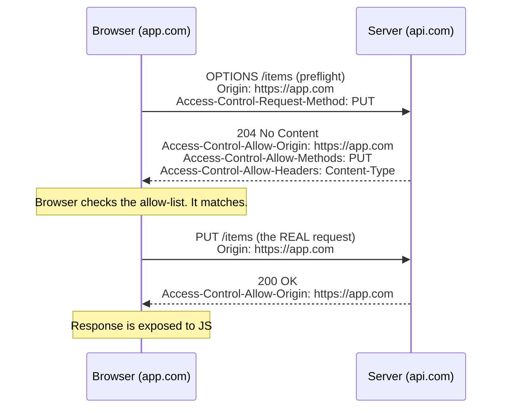
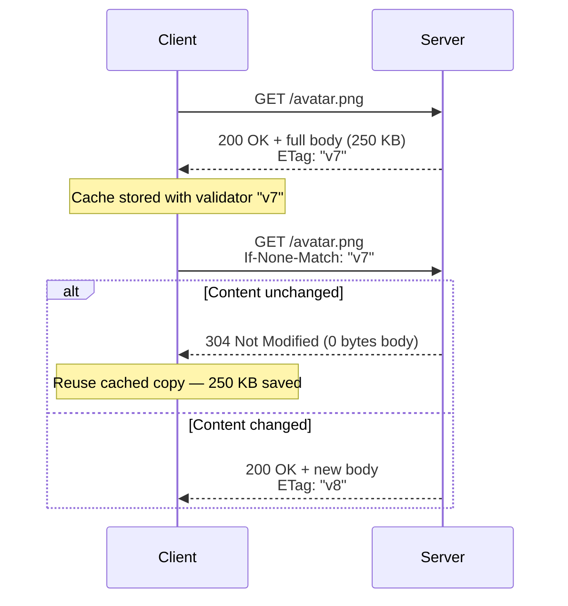

# HTTP Semantics & Headers Deep Dive

## 1. Why Should I Care About This?
- **Headers Run the Web Silently**: Every request and response carries a stack of key-value headers that decide language, compression, identity, caching, and security — you never see them, but they control everything.
- **The #1 Dev Frustration is Here**: "Why is my API call blocked by CORS?" is the single most Googled front-end error. Understanding headers is the only cure.
- **Free Performance**: Conditional requests (ETag / 304) and compression (`Accept-Encoding`) can cut your bandwidth bill by 60-90% without changing a line of business logic.

## 2. What Problem Does This Solve?
- **One Resource, Many Clients**: A mobile app wants JSON in Spanish, a browser wants HTML in English, a bot wants raw text — all from the *same* URL. Content negotiation solves this.
- **Statelessness vs. Identity**: HTTP is stateless, but you need to know "who is this user?" across requests. Cookies solve this.
- **Wasted Bandwidth**: Re-downloading a 2 MB file that hasn't changed is pure waste. Conditional requests solve this.
- **Browser Security**: Stopping `evil.com` from silently reading your bank's API using your logged-in session. CORS + `SameSite` cookies solve this.
- **Naive Approach**: Putting *everything* in the URL or body, opening a fresh connection per request, and re-sending full payloads every time.

> Note: HTTP **methods** (GET/POST/PUT) and **status codes** (2xx/4xx/5xx) are covered in [REST_API_Design.md](../02_API_Interface_Design/REST_API_Design.md). This file is about the **header-level mechanics** that wrap around them.

## 3. Core Idea (Intuition First)
Headers are the **shipping label and customs form** stapled to every HTTP package.
- **Content Negotiation** is like **ordering at a restaurant**: you say "I'd like it in Spanish, please, and I can digest gzip" (`Accept-Language`, `Accept-Encoding`); the kitchen replies with what it actually made (`Content-Type`, `Content-Encoding`).
- **Cookies** are the **coat-check ticket**: the server hands you a stub (`Set-Cookie`), and you show it on every future visit (`Cookie`) so it remembers you.
- **Conditional Requests** are like asking **"has this changed since I last saw it?"** — you quote the version tag you hold (`If-None-Match: "v7"`); if it matches, the server says "nope, use your copy" (`304`) and sends no body.
- **CORS** is the **bouncer at the door**: your browser asks "am I (from app.com) allowed in?" and the server must explicitly say yes (`Access-Control-Allow-Origin`).



> The whole picture: a request/response pair is wrapped in metadata headers answering four questions — who you are, what you accept, what you already have, and who's allowed.

## 4. How It Actually Works

### 1. Content Negotiation
- Client advertises preferences; server picks and echoes what it chose.
- `Accept: application/json` ↔ `Content-Type: application/json`
- `Accept-Language: en-US,en;q=0.9` ↔ `Content-Language: en-US` (the `q=` is a *quality weight*, 0-1).
- `Accept-Encoding: gzip, br` ↔ `Content-Encoding: br` (compression).
- **`Vary`** tells caches *which* request headers changed the response — e.g., `Vary: Accept-Encoding, Origin` means "cache a separate copy per encoding and per origin," so a gzip client never gets served a brotli body.

### 2. Cookies
- Server sets: `Set-Cookie: session=abc; HttpOnly; Secure; SameSite=Lax; Max-Age=3600`.
- Browser returns on every matching request: `Cookie: session=abc`.
- **Attributes that matter**:
  - `HttpOnly` — JavaScript cannot read it (blocks XSS token theft).
  - `Secure` — only sent over HTTPS.
  - `SameSite=Strict/Lax/None` — controls whether the cookie rides along on cross-site requests (the core CSRF defense).
  - `Domain` / `Path` — scope of the cookie.
  - `Max-Age` / `Expires` — **persistent** cookie; omit both → **session** cookie (dies when browser closes).

### 3. CORS (Cross-Origin Resource Sharing)
- The browser's **Same-Origin Policy** blocks JS from reading responses from a different origin (scheme + host + port) by default.
- **Simple requests** (GET/POST with standard headers) go straight through, but the browser hides the response unless the server returned `Access-Control-Allow-Origin`.
- **Preflighted requests** (PUT/DELETE, custom headers, JSON content-type) trigger an automatic `OPTIONS` "preflight" first — the browser asks permission *before* sending the real request.



### 4. Conditional Requests
- **Validators**: `ETag: "v7"` (an opaque content fingerprint) or `Last-Modified: <date>`.
- On the next request the client sends `If-None-Match: "v7"` (or `If-Modified-Since: <date>`).
- If unchanged → server returns **`304 Not Modified` with an empty body**; the client reuses its cached copy. If changed → `200` + fresh body + new ETag.



### 5. Keep-Alive / Persistent Connections
- `Connection: keep-alive` (default in HTTP/1.1) keeps the TCP (and TLS) connection open so multiple requests reuse it — avoiding a fresh handshake per request.
- Header carriage differs by version: HTTP/1.1 sends headers as plain text on each request; HTTP/2 compresses them with **HPACK** so repeated headers cost almost nothing (see [HTTP_Versions.md](./HTTP_Versions.md)).

## 5. Real-World Example
**The "Why is my API blocked by CORS?" debugging story:**
- A front-end at `https://app.com` calls `https://api.com/orders` with `fetch()` and a JSON body. The browser console screams: *"blocked by CORS policy: No 'Access-Control-Allow-Origin' header."*
- The dev checks the Network tab and sees a mysterious `OPTIONS` request they never wrote — that's the **preflight**. The server (built for server-to-server calls) returned `200` but *no* `Access-Control-Allow-*` headers, so the browser refused to send the real POST.
- **The fix is entirely server-side**: the API must reply to the `OPTIONS` with `Access-Control-Allow-Origin: https://app.com`, `Access-Control-Allow-Methods: POST`, `Access-Control-Allow-Headers: Content-Type`. Nothing about the front-end code was wrong — CORS is a *browser-enforced, server-declared* policy. (Curl and Postman "work" because they aren't browsers and never enforce it.)

**The conditional-request bandwidth win:**
- A news mobile app polls `/feed` every 30 seconds. Originally each poll re-downloaded the full 180 KB feed → ~500 MB/user/month of mostly-identical data.
- They added `ETag` + `If-None-Match`. Now 90%+ of polls return a 200-byte `304 Not Modified`. Bandwidth dropped ~85%, battery improved, and their CDN egress bill fell sharply — with zero change to the app's business logic.

## 6. Code Example
A raw request/response pair showing negotiation, cookies, conditional validators, and keep-alive — followed by a `curl -v` probe.
```http
# --- REQUEST ---
GET /api/items HTTP/1.1
Host: api.shop.com
Accept: application/json
Accept-Encoding: gzip, br
Cookie: session=abc123
Authorization: Bearer eyJhbGci...
If-None-Match: "v7"
Origin: https://shop.com
Connection: keep-alive

# --- RESPONSE (unchanged since "v7") ---
HTTP/1.1 304 Not Modified
ETag: "v7"
Cache-Control: max-age=60
Set-Cookie: session=abc123; HttpOnly; Secure; SameSite=Lax
Access-Control-Allow-Origin: https://shop.com
Vary: Accept-Encoding, Origin
Connection: keep-alive
# (no body — client reuses its cached copy)
```
```bash
# Watch the full header exchange, including the 304 short-circuit:
curl -v -H 'If-None-Match: "v7"' https://api.shop.com/api/items
# Look for '< HTTP/2 304' and note the absence of a response body.
```

## 7. Design Variations & Alternatives
- **Strong vs. Weak ETags**: `"v7"` (strong, byte-identical) vs. `W/"v7"` (weak, semantically equivalent — survives gzip/whitespace differences).
- **Token headers vs. Cookies**: SPAs often use `Authorization: Bearer <JWT>` instead of cookies to sidestep CSRF and CORS-credential complexity.
- **`Cache-Control` directives** as an alternative/complement to conditional requests: `no-cache` (revalidate every time), `no-store` (never cache), `immutable` (never revalidate).
- **Media-type versioning** (`Accept: application/vnd.api.v2+json`) reuses these same negotiation headers — see [API_Versioning.md](./API_Versioning.md).

## 8. Pros and Cons
### Header-Driven Negotiation & Caching
- **Pros**: Same URL serves all clients; huge bandwidth savings; standardized and cache-friendly.
- **Cons**: `Vary` misconfiguration causes wrong-encoding/wrong-language cache poisoning; invisible in the URL bar so harder to debug.

### Cookies
- **Pros**: Automatic, `HttpOnly` protects tokens from XSS, `SameSite` blocks CSRF.
- **Cons**: Sent on *every* request (overhead); cross-site cookie rules are notoriously confusing.

### CORS
- **Pros**: Lets browsers safely call third-party APIs with an explicit opt-in.
- **Cons**: Preflight adds a round-trip; the #1 source of front-end confusion; misconfigured `Allow-Origin: *` with credentials is a security hole.

## 9. Failure Scenarios & What Can Go Wrong
- **CORS with credentials + wildcard**: `Access-Control-Allow-Origin: *` is *rejected* by browsers when `credentials: 'include'` is set — you must echo the exact origin *and* send `Access-Control-Allow-Credentials: true`.
- **Missing `Vary` header**: A CDN caches a gzip body and serves it to a client that only accepts identity → garbled response. Always `Vary: Accept-Encoding`.
- **ETag mismatch across servers**: Two load-balanced servers generate different ETags for the same content (e.g., inode-based ETags) → every conditional request returns 200 instead of 304, silently killing your bandwidth savings.
- **`SameSite=Lax` default surprise**: Browsers now default cookies to `Lax`, so a cookie you expected on a cross-site POST silently vanishes and auth breaks.
- **Preflight cached too long/short**: `Access-Control-Max-Age` too short → an OPTIONS before every call (latency); too long → stale CORS policy after a change.

## 10. Impact on Scalability, Reliability & Cost
- **Cost**: Conditional requests + compression are among the cheapest, highest-ROI bandwidth reductions available — directly cutting CDN egress bills.
- **Scalability**: Correct `Cache-Control` + `ETag` lets CDNs and proxies serve or revalidate cheaply, shielding origin servers from load.
- **Reliability**: Keep-alive reduces connection churn and handshake load; misconfigured `Vary`/CORS is a common source of hard-to-reproduce "works on my machine" bugs.

## 11. When NOT to Use This
- **Highly personalized, always-changing responses**: If every response is unique per request, conditional caching yields nothing — skip the ETag overhead.
- **Server-to-server APIs**: CORS is purely a *browser* mechanism; backend-to-backend calls never trigger it, so don't waste time configuring it there.
- **Tiny internal payloads**: Compression and keep-alive gains are negligible on sub-1 KB responses over a fast LAN.

## 12. Interview Perspective
- **What interviewers expect**: Explain *why* a CORS preflight happens and that it's browser-enforced but server-declared. Explain how `ETag`/`If-None-Match` produces a `304`. Know the security-relevant cookie attributes (`HttpOnly`, `Secure`, `SameSite`).
- **Common questions**:
  - "A user reports a CORS error — walk me through debugging it." (Answer: check the OPTIONS preflight and the server's `Access-Control-Allow-*` headers.)
  - "How would you reduce bandwidth for a polling mobile client?" (Answer: conditional requests → 304.)
  - "What's the difference between a session and a persistent cookie?"

## 13. Connections to Other Topics
- [REST_API_Design.md](../02_API_Interface_Design/REST_API_Design.md) — HTTP **methods and status codes** live there; this file is the complementary **header-level mechanics** (don't duplicate methods/codes).
- [HTTP_Versions.md](./HTTP_Versions.md) — headers are *carried* differently across versions (plain text in H1.1, **HPACK-compressed** in H2/H3); pairs directly with this file.
- [HTTP_Caching.md](../06_Caching_Performance/HTTP_Caching.md) — `Cache-Control`, `ETag`, and conditional requests are the caching mechanics; this file introduces the headers, that file is the caching strategy.
- [API_Versioning.md](./API_Versioning.md) — media-type / header versioning uses these same content-negotiation (`Accept`) headers.

## 14. Visual Aids
- **Header Families Diagram** ([http_semantics.svg](../assets/http_semantics.svg)): an annotated request/response with negotiation, identity, conditional, and CORS headers color-coded, plus side panels for the CORS preflight and the conditional-GET 304 flow.
- **CORS Preflight Sequence** (Mermaid, Section 4): OPTIONS → allow-headers → real request.
- **Conditional GET Sequence** (Mermaid, Section 4): 200 + ETag → If-None-Match → 304.

## 15. Summary (TL;DR)
**HTTP headers are the metadata negotiation layer wrapped around every request and response: content negotiation (`Accept*` ↔ `Content-*` + `Vary`) lets one URL serve every client, cookies (`Set-Cookie` with `HttpOnly`/`Secure`/`SameSite`) carry identity across a stateless protocol, conditional requests (`ETag` + `If-None-Match` → `304 Not Modified`) save massive bandwidth by not re-sending unchanged bodies, CORS (the browser-enforced, server-declared `Access-Control-Allow-*` handshake with its `OPTIONS` preflight) governs who may call your API from a page, and keep-alive reuses connections to avoid handshake overhead — master these and you fix the web's most common bugs, from mystery CORS blocks to runaway bandwidth bills.**

## 16. Further Reading & Resources
- [MDN: HTTP Headers Reference](https://developer.mozilla.org/en-US/docs/Web/HTTP/Headers) - the definitive catalogue of every header.
- [MDN: CORS](https://developer.mozilla.org/en-US/docs/Web/HTTP/CORS) - the clearest explanation of simple vs. preflighted requests.
- [MDN: HTTP Conditional Requests](https://developer.mozilla.org/en-US/docs/Web/HTTP/Conditional_requests) - ETag, Last-Modified, and 304 in depth.
- [RFC 9110: HTTP Semantics](https://www.rfc-editor.org/rfc/rfc9110.html) - the authoritative spec for methods, headers, and status codes.
- [web.dev: Set-Cookie and SameSite](https://web.dev/articles/samesite-cookies-explained) - the modern cookie security model.
