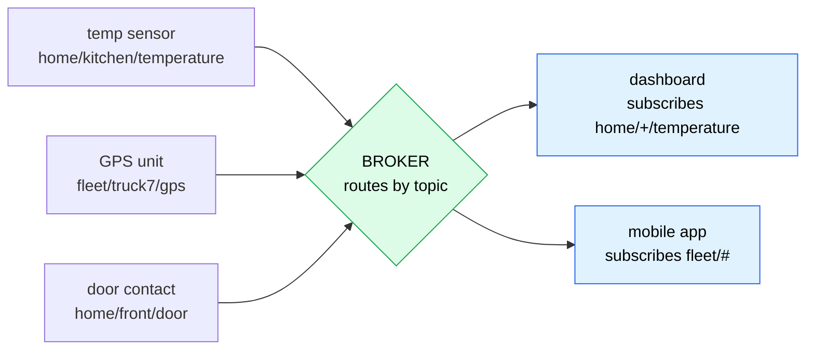
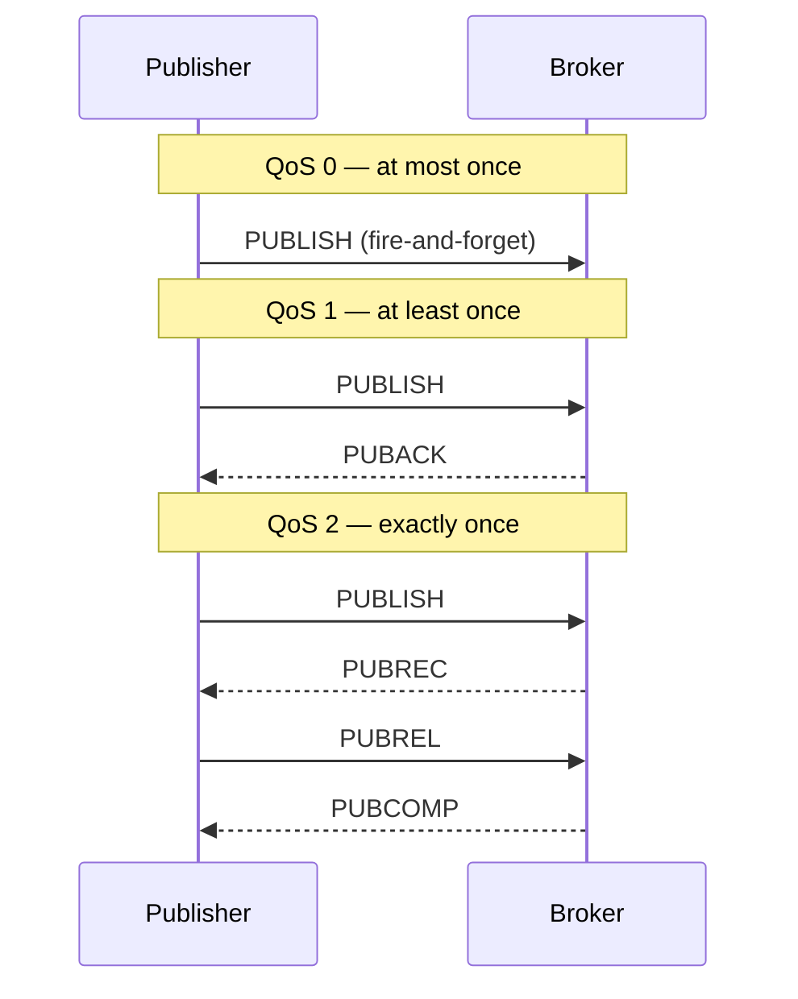

# MQTT / AMQP / IoT Protocols

## 1. Why Should I Care About This?
- **The world is filling up with tiny computers**: billions of sensors, smart meters, wearables, and connected cars. They all need to talk, but they run on a coin-cell battery and a flaky 2G/NB-IoT link — HTTP would kill them in a day.
- **HTTP is verbose and expensive**: a single `GET` is hundreds of bytes of text headers, plus a fresh TCP+TLS handshake per request. For a sensor sending one 4-byte temperature reading every minute, that overhead is 50x the payload — wasted battery and airtime.
- **Design interviews love the constraint**: "design a fleet-tracking system for 2 million trucks" is a real prompt, and the correct first move is *not* REST. Knowing MQTT (lightweight) vs AMQP (enterprise) vs CoAP (UDP) signals you understand the device edge, not just the datacenter.

## 2. What Problem Does This Solve?
- **Device constraints**: tiny RAM (a few KB), a battery that must last months, and bandwidth measured in *kilobits*. Every byte and every radio wake-up costs power.
- **Unreliable links**: cellular drops, Wi-Fi flickers, a truck drives through a tunnel. The protocol must survive disconnects and resume gracefully.
- **Fan-out to many consumers**: one sensor reading may be wanted by a dashboard, a mobile app, and an analytics pipeline at once — a point-to-point request model doesn't fit.
- **Naive Approach**: open a new HTTPS connection per reading (handshake cost every time), or long-poll (keeps the radio hot, drains the battery). Both ignore that the device is the bottleneck.

## 3. Core Idea (Intuition First)
- **MQTT (Message Queuing Telemetry Transport)**: like a **community bulletin board run by a caretaker**. Devices don't call each other; they pin a note under a labelled heading ("home/kitchen/temperature") on the board (the **broker**). Anyone interested walks up and reads the headings they care about. The caretaker keeps the *last* note pinned (a **retained message**) so a newcomer sees the current value instantly, and if a regular stops showing up, the caretaker reads out a pre-written "so-and-so has gone quiet" note (the **Last Will**).
- **The trick is decoupling over one skinny pipe**: publishers and subscribers never know about each other, and each device keeps *one* persistent TCP connection open with a **2-byte fixed header** — no re-handshaking, almost no overhead per message.



> Devices PUBLISH tiny messages to topics on a central broker; dashboards and apps SUBSCRIBE to topic filters (`home/+/temperature`). The three QoS levels trade round-trips for delivery certainty: QoS 0 fire-and-forget, QoS 1 PUBLISH/PUBACK, QoS 2 the four-step exactly-once handshake.

## 4. How It Actually Works
### 1. Topics, wildcards, and the broker
- **Topics** are slash-delimited strings: `fleet/truck7/gps`. There is no registry — you just publish to one and it exists.
- **Wildcards** let a subscriber filter: `+` matches one level (`home/+/temperature` = every room's temperature), `#` matches all remaining levels (`fleet/#` = everything under fleet).
- The **broker** (Mosquitto, EMQX, HiveMQ, AWS IoT Core) routes each PUBLISH to every matching subscriber.



### 2. The three QoS levels (the handshakes)
- **QoS 0 — at most once**: one PUBLISH, no acknowledgment. May be dropped. Cheapest; good for high-frequency telemetry you can afford to lose.
- **QoS 1 — at least once**: PUBLISH → PUBACK. The sender re-sends until acked, so the message *may duplicate* — consumers must be idempotent. The IoT workhorse default.
- **QoS 2 — exactly once**: a four-step handshake (PUBLISH → PUBREC → PUBREL → PUBCOMP) that guarantees no loss and no duplication. Slowest and most stateful; reserve for billing / commands that must not repeat.



### 3. Staying alive on a flaky link
- **Keep-alive / PINGREQ**: the client promises to speak within N seconds; if silent it sends a tiny PINGREQ so the broker knows it's still there. Miss it and the broker declares the client dead.
- **Retained messages**: the broker stores the last message per topic, so a new subscriber gets the current value immediately instead of waiting for the next reading.
- **Last Will & Testament (LWT)**: set on connect. If the client drops *ungracefully* (no clean DISCONNECT), the broker publishes the pre-registered will message — e.g. `fleet/truck7/status = offline` — so everyone learns the device vanished.

### 4. AMQP and CoAP — the neighbours
- **AMQP (RabbitMQ)**: a *heavier*, broker-rich protocol for the datacenter. It models **exchanges → bindings → queues** with routing keys, per-message acks, and transactions. Far more features than MQTT (guaranteed enterprise messaging), but too heavy for a battery sensor.
- **CoAP**: REST-like verbs (GET/POST) over **UDP** for the *most* constrained devices — no persistent connection at all, tiny datagrams, optional confirmable messages for reliability.

## 5. Real-World Example
**Connected-car fleet telemetry** (the classic MQTT case):
1. A logistics company runs **2 million trucks**, each with an on-board unit on a cellular modem. Every truck publishes GPS, speed, fuel, and engine faults to topics like `fleet/{vin}/telemetry` **every 5 seconds** — that's roughly **400,000 messages/second** at the broker.
2. The links are terrible: trucks enter tunnels, cross borders, sit in dead zones. Connections drop constantly.
3. **Why MQTT fits**:
   - **QoS 1** on telemetry: readings must arrive even across a reconnect, and the analytics pipeline is built to dedupe (idempotent), so occasional duplicates are fine.
   - **LWT** = instant offline detection: when a truck's modem drops, the broker publishes `fleet/{vin}/status = offline` within the keep-alive window — the ops dashboard lights up without polling 2 million devices.
   - **Retained** last-known-position: when the fleet dashboard subscribes, it sees every truck's current location immediately, not blank tiles.
   - **2-byte header**: over a metered cellular plan across millions of devices, header bytes are real money — MQTT's overhead is negligible next to HTTP's.
4. This is exactly why **AWS IoT Core** and **Azure IoT Hub** speak MQTT as their primary device protocol; you connect millions of devices to a managed broker and fan the data into Kafka/Kinesis for processing.

## 6. Code Example
A Python `paho-mqtt` client that sets a Last Will, subscribes to a wildcard topic, and publishes a reading at QoS 1:
```python
import paho.mqtt.client as mqtt

def on_connect(client, userdata, flags, rc):
    print(f"connected rc={rc}")
    client.subscribe("home/+/temperature", qos=1)   # + = any single level

def on_message(client, userdata, msg):
    print(f"{msg.topic} -> {msg.payload.decode()} (qos={msg.qos})")

client = mqtt.Client(client_id="kitchen-sensor")
# Last Will: broker publishes this if we drop off ungracefully
client.will_set("home/kitchen/status", payload="offline", qos=1, retain=True)
client.on_connect = on_connect
client.on_message = on_message

client.connect("broker.hivemq.com", 1883, keepalive=60)
client.loop_start()

# Publish a reading; retain=True so new subscribers get the last value instantly
client.publish("home/kitchen/temperature", payload="21.5", qos=1, retain=True)
client.publish("home/kitchen/status", payload="online", qos=1, retain=True)
```

## 7. Design Variations & Alternatives
- **MQTT over WebSocket**: wrap MQTT in a WebSocket so a **browser** can be a native MQTT client (dashboards talking straight to the broker).
- **MQTT-SN**: an even leaner variant for sensor networks that ride non-TCP links (ZigBee, UDP).
- **AMQP**: pick it when you need rich datacenter routing, transactions, and per-message reliability — enterprise messaging, not the device edge.
- **CoAP**: pick it for the most power-starved devices where even a persistent TCP socket is too much; REST semantics over UDP.
- **HTTP/2 or gRPC**: fine for gateways and app backends, still too heavy for the leaf device itself.

## 8. Pros and Cons
### Pros
- **Tiny footprint**: 2-byte header, minimal RAM, one connection — built for battery and 2G.
- **Decoupled pub/sub**: add consumers without touching publishers; wildcards make routing trivial.
- **Resilience built in**: QoS levels, retained messages, LWT, and keep-alive handle flaky links directly.

### Cons
- **The broker is a single dependency**: if it dies, everyone is deaf (mitigate with clustering — EMQX/HiveMQ clusters, managed IoT Core).
- **Weak native security**: MQTT itself is plaintext; you must layer TLS + auth (which adds handshake cost back).
- **No rich routing/transactions**: for complex enterprise workflows AMQP or a real broker is better.
- **QoS 1 duplicates**: at-least-once means consumers must be idempotent.

## 9. Failure Scenarios & What Can Go Wrong
- **The "ghost device"**: a truck loses signal but no LWT was set, so the dashboard shows it online forever. (Fix: always set an LWT.)
- **Retained-message staleness**: a device dies and its last retained reading sticks around looking current. (Fix: clear retained on LWT, or publish an offline retained value.)
- **QoS-2 storm**: using exactly-once everywhere quadruples the round-trips and broker state; millions of devices can overwhelm the broker. (Fix: default to QoS 1, reserve QoS 2.)
- **Broker overload / connection storm**: a firmware bug reconnects all devices at once (thundering herd). (Fix: reconnect backoff with jitter, broker connection limits.)
- **Topic explosion**: unbounded topics (`user/{id}/...` for millions of users) bloat the broker's subscription tree. (Fix: disciplined topic hierarchy.)

## 10. Impact on Scalability, Reliability & Cost
- **Scalability**: massive — a clustered broker (EMQX, HiveMQ, IoT Core) holds **millions** of concurrent connections; the skinny protocol keeps per-connection memory low.
- **Reliability**: QoS + retained + LWT give tunable delivery guarantees over links that would break naive HTTP.
- **Cost**: the 2-byte header and single persistent connection slash **cellular data bills** and **battery drain** versus HTTP-per-reading — often the deciding economic factor at fleet scale.

## 11. When NOT to Use This
- **Request/response with a return value**: if the client must get a computed answer back synchronously (a login, a price quote), use HTTP/gRPC — pub/sub is one-way by nature.
- **Rich enterprise workflows**: complex routing, transactions, dead-letter semantics → AMQP/RabbitMQ or Kafka, not MQTT.
- **Powered, high-bandwidth services**: two datacenter microservices on gigabit links gain nothing from MQTT's frugality — use gRPC/HTTP.
- **Massive ordered event replay/analytics**: that's Kafka's job (log + streaming), not a message broker's.

## 12. Interview Perspective
- **What interviewers expect**: explain **why HTTP is wrong at the device edge** (header bytes, handshake-per-request, battery), then the **3 QoS levels and their handshakes**, plus **retained vs LWT**. Bonus: contrast MQTT (light) vs AMQP (heavy) vs CoAP (UDP).
- **Common question**: "Design telemetry ingestion for millions of IoT devices." (Answer: MQTT + managed broker like AWS IoT Core, QoS 1, LWT for presence, retained for last-known state, then fan into Kafka/Kinesis for processing.)
- **Trap**: don't say "exactly-once everywhere" — QoS 2 is expensive; the pro answer is QoS 1 + idempotent consumers.

## 13. Connections to Other Topics
- [./Message_Queues_PubSub.md](./Message_Queues_PubSub.md) — MQTT *is* pub/sub, specialized for constrained devices; contrast it with the general broker pub/sub covered there (where it gets only a passing mention).
- [../09_Message_Queues_Event_Streaming/](../09_Message_Queues_Event_Streaming/) — where broker internals, Kafka, and event streaming go deep; MQTT telemetry is typically fanned into a streaming pipeline here.
- [./TCP_vs_UDP.md](./TCP_vs_UDP.md) — MQTT rides **TCP** (persistent connection); **CoAP** rides **UDP** for the most constrained devices.
- [./WebSockets.md](./WebSockets.md) — MQTT-over-WebSocket lets a browser speak MQTT directly to the broker.

## 14. Visual Aids
- **Topology + QoS diagram** (`../assets/mqtt_iot_qos.svg`, embedded in Section 3): sensors publishing to broker topics, subscribers reading topic filters, the three QoS lanes, and the retained/LWT note.
- **Mermaid #1** (Section 4): pub/sub flow of publishers → broker → wildcard subscribers.
- **Mermaid #2** (Section 4): the three QoS handshakes side by side (QoS 0 one arrow, QoS 1 PUBLISH/PUBACK, QoS 2 four-step).

## 15. Summary (TL;DR)
**MQTT is lightweight pub/sub built for the device edge: a tiny 2-byte header over one persistent TCP connection to a central broker, with slash-delimited topics and `+`/`#` wildcards — the answer to "HTTP is too heavy for a coin-cell sensor on 2G." It offers three tunable QoS levels (0 at-most-once fire-and-forget, 1 at-least-once PUBLISH/PUBACK — the IoT default, 2 exactly-once four-step handshake), plus retained messages (new subscribers get the last value instantly) and Last Will & Testament (the broker announces a device that dropped off), all kept alive by PINGREQ. AMQP (RabbitMQ) is the heavier, broker-rich enterprise cousin with exchanges, queues, and transactions; CoAP is REST-over-UDP for the most constrained devices. Reach for MQTT + QoS 1 + LWT + retained whenever millions of battery-powered devices on flaky cellular must stream telemetry cheaply — which is exactly why AWS IoT Core and Azure IoT Hub speak it.**

## 16. Further Reading & Resources
- [MQTT.org: The Standard for IoT Messaging](https://mqtt.org/) - specification hub and QoS/retained/LWT definitions.
- [HiveMQ MQTT Essentials](https://www.hivemq.com/mqtt-essentials/) - the best free deep-dive on topics, QoS, and LWT.
- [Eclipse Paho (paho-mqtt) Python client](https://www.eclipse.org/paho/index.php?page=clients/python/index.php) - the library used in the code example.
- [AWS IoT Core: MQTT Protocol](https://docs.aws.amazon.com/iot/latest/developerguide/mqtt.html) - how a managed broker runs MQTT at fleet scale.
- [RabbitMQ / AMQP 0-9-1 Model Explained](https://www.rabbitmq.com/tutorials/amqp-concepts.html) - the heavier enterprise contrast (exchanges, queues, routing keys).
