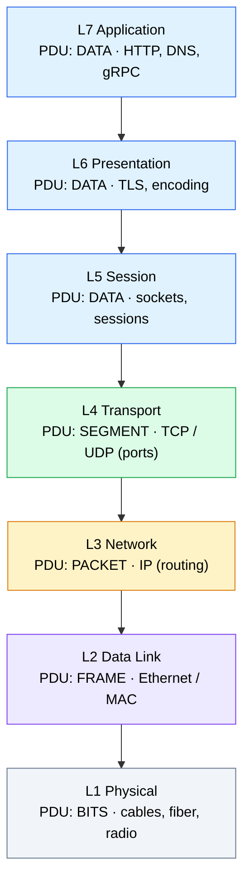

# OSI Model & TCP/IP Stack

## 1. Why Should I Care About This?
- **The Shared Vocabulary of All Networking**: When someone says "that's a Layer 3 problem" or "we need an L7 load balancer," they're using the OSI model. Without it, you can't participate in the conversation.
- **Debugging by Layer**: When something breaks, the model tells you *where* to look. Is the cable unplugged (L1)? Wrong IP route (L3)? Port blocked by a firewall (L4)? Bad TLS cert (L6)? You isolate the layer, then fix it.
- **Design Decisions Live at Layers**: Load balancers, firewalls, and proxies each operate at a specific layer. Choosing an L4 vs an L7 load balancer is a real architecture decision — and the model is how you reason about it.

## 2. What Problem Does This Solve?
- **Complexity Management**: Sending a message across the world involves electrical signals, addressing, routing, retransmission, encryption, and formatting. Doing it all in one blob is unmaintainable.
- **Interoperability**: A layer only needs to talk to the layer above and below it. So Google's router (L3) and your laptop's Wi-Fi chip (L1/L2) can cooperate without knowing anything about HTTP (L7).
- **Naive Approach**: Thinking "the network just sends my data." In reality it's a stack of independent, swappable layers — swap Ethernet for Wi-Fi at L2 and everything above keeps working unchanged.

## 3. Core Idea (Intuition First)
- **Layers Are Like the Postal System**: You write a letter (L7 app data). You seal it in an envelope with an address (L4/L3 — ports and IP). The post office sorts it by region (routing). A truck physically carries it (L1). At the destination, each step is *reversed*. You never talk to the truck driver; you just hand your envelope to the layer below you.
- **Encapsulation Is Wrapping**: Every layer takes what it receives from above and wraps it in its own header (like nesting envelopes inside envelopes). The receiver unwraps them in reverse order.
- **OSI (7 layers) vs TCP/IP (4 layers)**: OSI is the *textbook* model — great for talking. TCP/IP is what the internet *actually* runs. TCP/IP collapses OSI's top three (Session, Presentation, Application) into one "Application" layer, and the bottom two (Physical, Data Link) into one "Link" layer.


> The seven OSI layers on the left, each with its PDU (data → segment → packet → frame → bits), an example protocol, and an example device. The right side shows encapsulation: going *down*, each layer wraps the payload in its own header; going *up*, each layer strips it. Note where L4 vs L7 load balancers operate.

## 4. How It Actually Works
### The 7 OSI Layers (top to bottom)
- **L7 Application** — what the app speaks: HTTP, DNS, SMTP, gRPC. PDU = **data**.
- **L6 Presentation** — encoding, compression, and encryption (TLS lives around here). PDU = **data**.
- **L5 Session** — opens, manages, and closes conversations (sockets, session state). PDU = **data**.
- **L4 Transport** — **TCP** (reliable, ordered) or **UDP** (fast, best-effort); uses **port numbers**. PDU = **segment** (TCP) / datagram (UDP).
- **L3 Network** — **IP** addressing and routing across networks. PDU = **packet**.
- **L2 Data Link** — **Ethernet/Wi-Fi**, **MAC** addresses, hop-to-hop on one link. PDU = **frame**.
- **L1 Physical** — cables, fiber, radio, voltages. PDU = **bits**.

### The TCP/IP 4-Layer Model (what the internet runs)
- **Application** = OSI L5 + L6 + L7 (HTTP, DNS, TLS all live here).
- **Transport** = OSI L4 (TCP/UDP).
- **Internet** = OSI L3 (IP).
- **Link** = OSI L1 + L2 (Ethernet, Wi-Fi, drivers).

### PDUs and Encapsulation
Data changes name as it descends — **bits → frames → packets → segments → data** going *up*, and the reverse going *down*. Each descending layer adds a header (and L2 adds a trailer, the FCS checksum):



Encapsulation on the sender (headers added going down), decapsulation on the receiver (headers stripped going up):

```mermaid
flowchart LR
    subgraph SENDER["SENDER — encapsulate (add headers ↓)"]
        direction TB
        D1["App DATA"] --> S1["+ TCP header = SEGMENT"] --> P1["+ IP header = PACKET"] --> F1["+ Eth header/trailer = FRAME"] --> B1["→ BITS on the wire"]
    end
    subgraph RECEIVER["RECEIVER — decapsulate (strip headers ↑)"]
        direction TB
        B2["BITS off the wire"] --> F2["strip Eth = PACKET"] --> P2["strip IP = SEGMENT"] --> S2["strip TCP = App DATA"] --> D2["App reads DATA"]
    end
    B1 -->|"network"| B2
    style D1 fill:#e0f2fe,stroke:#2563eb,color:#000
    style D2 fill:#dcfce7,stroke:#16a34a,color:#000
    style B1 fill:#f1f5f9,stroke:#64748b,color:#000
    style B2 fill:#f1f5f9,stroke:#64748b,color:#000
```



## 5. Real-World Example
**You type `google.com` and press Enter** — trace it through the layers:
- **DNS lookup (L7 → L4 → L3)**: The browser asks a DNS resolver "what's the IP for google.com?" DNS is an **L7** protocol, but it rides on **UDP** (L4) inside an **IP** packet (L3). Answer comes back: e.g. `142.250.x.x`.
- **TCP 3-way handshake (L4)**: Your machine opens a TCP connection to that IP on **port 443** — SYN → SYN-ACK → ACK. Pure Layer 4.
- **TLS handshake (L5/L6-ish)**: Certificates are exchanged and keys negotiated so everything above is encrypted. This sits *between* transport and the application.
- **HTTP request (L7)**: The browser sends `GET / HTTP/2` — the actual application message.
- **IP routing (L3)**: Each packet hops router-to-router across the internet; routers read only the **IP header** (L3) to decide the next hop.
- **MAC & switching (L2)**: On each physical link, the packet is wrapped in an **Ethernet frame** addressed to the next device's **MAC**; switches forward by MAC. The MAC address changes at *every hop*; the IP stays the same end-to-end.
- **Signals (L1)**: The frame becomes electrical/optical/radio **bits** on the cable or Wi-Fi.
- **Reverse on arrival**: Google's server decapsulates bottom-up (bits → frame → packet → segment → HTTP), builds a response, and the whole dance runs back to you.

## 6. Code Example
Each command below inspects a specific layer of the stack:
```bash
# L1/L2 — link: your interfaces, MAC addresses, link state (up/down)
ip link show                 # or: ifconfig
# look for "state UP" (L1) and "link/ether 00:1a:2b:.." (L2 MAC)

# L2/L3 — MAC-to-IP neighbor table (ARP maps L3 IP -> L2 MAC)
ip neigh show                # or: arp -a

# L3 — network: can we reach the host? routing + ICMP
ping -c 3 google.com         # ICMP echo, pure Layer 3
traceroute google.com        # shows each L3 router hop on the path
ip route show                # the routing table that L3 consults

# L4 — transport: open TCP sockets and the PORTS in use
ss -tanp                     # or: netstat -tanp  (state, local:port, peer:port)

# L7 — application: the actual HTTP conversation (with TLS at L6)
curl -v https://google.com   # '* Connected' = L4, 'TLS handshake' = L6, '> GET /' = L7
```
Mapping: `ip link`/`ip neigh` = L1/L2, `ping`/`traceroute`/`ip route` = L3, `ss`/`netstat` = L4 (ports), `curl -v` walks L4 → L6 → L7 in one output.

## 7. Design Variations & Alternatives
- **Pure OSI vs TCP/IP**: OSI is the reference/teaching model; the real internet uses the leaner **TCP/IP 4-layer** model. Interviews expect you to know both and how they map.
- **The "5-layer" hybrid**: Many textbooks teach a pragmatic 5-layer model (Physical, Link, Network, Transport, Application) — TCP/IP with Physical split out.
- **Where TLS sits**: There's no clean OSI slot for TLS — it's usually described as **L5/L6** (session + presentation), sitting between transport and the application.

## 8. Pros and Cons
### The Layered Model
- **Pros**: Separation of concerns, swappable layers (Wi-Fi vs Ethernet at L2, no change above), a shared debugging/design vocabulary, interoperability across vendors.
- **Cons**: The abstraction leaks (TLS doesn't fit cleanly; QUIC blurs L4/L7); real headers add overhead; OSI's 7 layers are more granular than reality needs.

## 9. Failure Scenarios & What Can Go Wrong
- **"It's DNS" (L7/L3)**: The classic. Name resolution fails or is stale, so nothing connects even though the network is fine.
- **Layer confusion in debugging**: Blaming the app (L7) when the real issue is a blocked port (L4 firewall) or a bad route (L3). Wrong layer = wasted hours.
- **MTU / fragmentation (L3)**: Packets too large for a link get fragmented or dropped, causing mysterious hangs on large payloads.
- **MAC/ARP problems (L2)**: A stale or spoofed ARP entry sends frames to the wrong device on the local network.

## 10. Impact on Scalability, Reliability & Cost
- **Scalability**: L4 load balancers are cheap and fast (route by IP:port, no payload inspection); L7 load balancers cost more CPU but enable smart routing (by URL, header, cookie).
- **Reliability**: Isolating failures by layer makes systems debuggable and lets teams own layers independently.
- **Cost**: Deep packet inspection (reading up to L7) is more expensive than forwarding at L3/L4 — every layer you inspect costs compute.

## 11. When NOT to Use This
- **Don't over-literalize the 7 layers**: Real systems (especially with TLS and QUIC) don't map cleanly. Treat OSI as vocabulary, not gospel.
- **Don't cite OSI when TCP/IP is the answer**: For "how does the internet work," the TCP/IP 4-layer model is the accurate frame; pure OSI is the teaching aid.

## 12. Interview Perspective
- **What interviewers expect**: Name the 7 layers in order, map them to TCP/IP's 4, and give a protocol + PDU per layer. Explain **encapsulation**. Nail **L4 vs L7 load balancing**.
- **Common questions**: "What happens when you type a URL and hit Enter?" (trace the layers — Section 5). "Difference between an L4 and L7 load balancer?" (L4 = IP:port only; L7 = reads the HTTP request). "Where does TLS sit?" (between transport and app, ~L5/L6).

## 13. Connections to Other Topics
- **[Layer 4 vs Layer 7 Load Balancing](../07_Load_Balancing_Scalability/Layer_4_vs_Layer_7_Load_Balancing.md)** — this file defines the L4/L7 vocabulary that load-balancing decision relies on; that topic references the OSI model by name.
- **[TCP vs UDP](./TCP_vs_UDP.md)** — the two Transport (L4) protocols in detail.
- **[HTTP Versions](./HTTP_Versions.md)** — the Application (L7) protocol and its evolution.
- **[TLS/SSL Handshake](./TLS_SSL_Handshake.md)** — where encryption sits in the stack (~L5/L6, between transport and application).

## 14. Visual Aids
- **The Stack Diagram** (see the SVG in Section 3, [`../assets/osi_tcpip_stack.svg`](../assets/osi_tcpip_stack.svg)): all 7 OSI layers mapped to TCP/IP's 4, with PDU, protocol, device, and the encapsulation nesting on the right — plus where L4/L7 load balancers operate.
- **Mermaid #1** (Section 4): the 7 layers top-to-bottom, annotated with PDU + protocol, colored by tier.
- **Mermaid #2** (Section 4): encapsulation on the sender (adding headers) mirrored by decapsulation on the receiver (stripping them).

## 15. Summary (TL;DR)
**The OSI model breaks networking into 7 layers (Physical, Data Link, Network, Transport, Session, Presentation, Application), each talking only to its neighbors and each adding its own header as data descends — this encapsulation turns application data into segments (L4), packets (L3), frames (L2), and finally bits (L1). The internet actually runs on the leaner TCP/IP 4-layer model (Link, Internet, Transport, Application), but OSI remains the shared vocabulary: it's how you say "that's a Layer 3 problem" or choose an L4 vs L7 load balancer, and it's the map you follow when tracing a request or debugging where something broke.**

## 16. Further Reading & Resources
- [Computer Networking: A Top-Down Approach (Kurose & Ross)](https://www.pearson.com/en-us/subject-catalog/p/computer-networking-a-top-down-approach/P200000003208) - the standard textbook for the layered model.
- [Cloudflare: What is the OSI Model?](https://www.cloudflare.com/learning/ddos/glossary/open-systems-interconnection-model-osi/)
- [Cloudflare: What is the TCP/IP Model?](https://www.cloudflare.com/learning/ddos/glossary/tcp-ip/)
- [RFC 1122: Requirements for Internet Hosts (TCP/IP layering)](https://datatracker.ietf.org/doc/html/rfc1122)
- [MDN: How the Web Works / HTTP Overview](https://developer.mozilla.org/en-US/docs/Web/HTTP/Overview)
