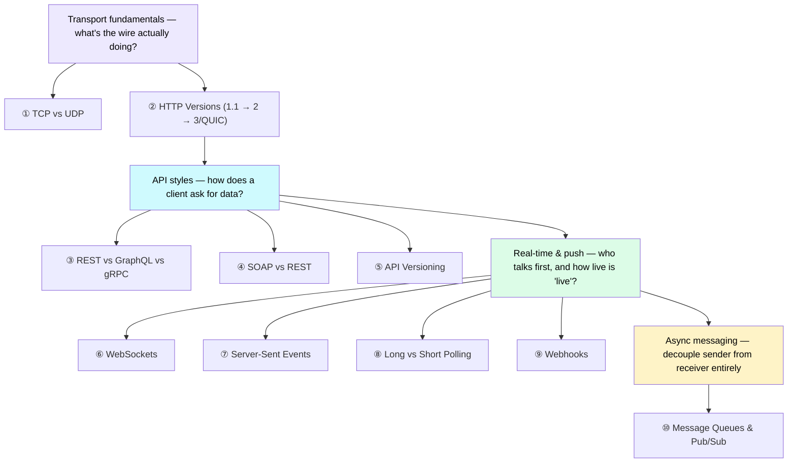
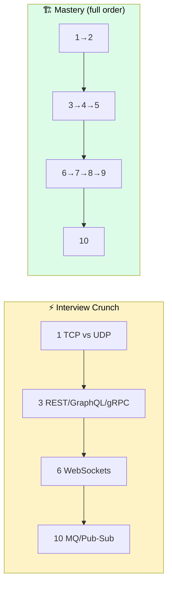

# 08 · Communication Protocols 📡

> **How the bytes actually move.** Underneath every API call sits a transport decision — TCP's guaranteed, ordered delivery or UDP's fire-and-forget speed — and on top of that, a request style: REST's resources, GraphQL's flexible queries, gRPC's fast typed calls, or SOAP's strict enterprise contract. Layer on how the server pushes updates back — WebSockets, SSE, polling, webhooks — and how services fan work out asynchronously through queues and pub/sub, and you have the full stack a distributed system talks over. Pick each layer deliberately: the wrong transport makes a game unplayable, the wrong push mechanism burns your server, and skipping async messaging turns one slow service into a cascading outage.

---

## 🎯 What You'll Be Able To Do

- **Choose the transport deliberately** — TCP when every byte must arrive in order, UDP when speed beats perfection.
- **Pick the right API style** — REST for cacheable public resources, GraphQL to kill over/under-fetching, gRPC for fast typed internal calls, SOAP where enterprise contracts and WS-Security are non-negotiable.
- **Evolve an API without breaking clients** — version by URI, header, or media type, and know which trade-off you're accepting.
- **Choose how the server pushes data back** — WebSockets for bidirectional real-time, SSE for one-way streams, polling as the fallback, webhooks to let other systems tell you first.
- **Decouple producers from consumers** — route work through a message queue or pub/sub broker with the right delivery guarantee.
- **Reason about protocol trade-offs on the spot** — head-of-line blocking, handshake overhead, and why "faster internet" isn't the same as "faster protocol."

---

## 🗺️ How the 10 Topics Interlock



> **The spine:** *pick the transport → choose the API style built on it → decide who pushes and how live "live" needs to be → decouple fully with a broker when nobody should have to wait.* HTTP/2's multiplexing (②) is what makes REST/GraphQL/gRPC (③) fast in the first place; WebSockets/SSE/polling/webhooks (⑥–⑨) are four answers to the same "who talks first" question at different cost points; queues and pub/sub (⑩) are the escape hatch when even a webhook is too tightly coupled.

---

## 📚 The Complete File Index

| # | Topic | One-line | Key takeaway |
|---|-------|----------|--------------|
| 1 | [TCP vs UDP](./TCP_vs_UDP.md) | Registered letter vs megaphone | Guaranteed ordered delivery vs fast best-effort; pick UDP only when stale data is worthless |
| 2 | [HTTP Versions](./HTTP_Versions.md) | Single lane → highway → helicopters | Multiplexing kills head-of-line blocking; QUIC/HTTP3 moves off TCP so one lost packet no longer stalls everything |
| 3 | [REST vs GraphQL vs gRPC](./REST_vs_GraphQL_vs_gRPC.md) | Fixed menu vs build-your-own vs pneumatic tube | Match the style to the caller: REST for public resources, GraphQL to stop over/under-fetching, gRPC for fast typed internal calls |
| 4 | [SOAP vs REST](./SOAP_vs_REST.md) | Legal contract vs informal email | Strict WSDL contract + built-in transactional security vs flexible ubiquitous JSON; legacy enterprise still runs on SOAP |
| 5 | [API Versioning](./API_Versioning.md) | Updating a legal form | URI versioning is simplest and most routable; header/media-type keep URLs clean at the cost of discoverability |
| 6 | [WebSockets](./WebSockets.md) | An open phone call | Full-duplex, stateful, persistent connection; the right call when both sides genuinely need to talk |
| 7 | [Server-Sent Events](./Server_Sent_Events.md) | Tuning into a radio broadcast | One-way server→client stream over plain HTTP; auto-reconnect, no library, built for token-by-token streaming |
| 8 | [Long Polling vs Short Polling](./Long_Polling_vs_Short_Polling.md) | Toddler asking vs patient pizza counter | Long polling holds the request open until data's ready — the pre-WebSocket fallback that's still everywhere |
| 9 | [Webhooks](./Webhooks.md) | Leaving your number at a restaurant | Inversion of control — the provider calls you via POST; ack fast (200 OK) or expect retries |
| 10 | [Message Queues & Pub/Sub](./Message_Queues_PubSub.md) | Deli ticket line vs magazine subscription | A broker decouples producer from consumer; at-least-once + idempotency is the default safe delivery guarantee |

### Deep-dive companions (the wire underneath the wire, and the design-question staples)

| # | Topic | One-line | Key takeaway |
|---|-------|----------|--------------|
| 11 | [DNS Deep Dive](./DNS_Deep_Dive.md) | The internet's phone book | Every request's first hop: stub → recursive → root/TLD/authoritative, cached by TTL at every layer; a cold lookup is ~4 round-trips, a cache hit is <1ms |
| 12 | [TLS/SSL Handshake](./TLS_SSL_Handshake.md) | Sealing the envelope before you send it | TLS 1.3 cut the handshake to 1-RTT (0-RTT on resume); certificate chains prove identity — the connection-setup latency that HTTP/2 and QUIC exist to shave |
| 13 | [WebRTC](./WebRTC.md) | A direct phone line between two browsers | Peer-to-peer media over UDP: signaling sets it up, STUN/TURN/ICE punch through NAT, then media flows P2P; SFU topology scales the group call — sub-500ms vs HLS's multi-second |
| 14 | [Video Streaming (HLS & DASH)](./Video_Streaming_Protocols_HLS_DASH.md) | One upload, every screen | HTTP adaptive bitrate: chop video into cacheable segments + a manifest, let the player pick quality per segment — how one stream serves a phone on 3G and a TV on fiber via CDN |
| 15 | [MQTT / AMQP / IoT Protocols](./MQTT_AMQP_IoT_Protocols.md) | A 2-byte message for a coin-cell sensor | HTTP is too heavy for constrained devices; MQTT's tiny header + pub/sub + QoS 0/1/2 + LWT/retained is the IoT answer, AMQP the heavier enterprise cousin |
| 16 | [OSI Model & TCP/IP Stack](./OSI_Model_TCP_IP_Stack.md) | The 7-layer shared vocabulary | What actually happens L1→L7 when a request is sent; encapsulation adds a header per layer; the model that makes "L4 vs L7" and "it's a layer-3 problem" mean something |
| 17 | [RPC Fundamentals (Thrift)](./RPC_Fundamentals_Thrift.md) | Calling a remote function as if it were local | Stubs + an IDL + marshalling hide the network — the paradigm behind Thrift/gRPC/JSON-RPC; just don't forget the network is *not* local (the Fallacies of Distributed Computing) |
| 18 | [HTTP Semantics & Headers Deep Dive](./HTTP_Semantics_Headers_Deep_Dive.md) | The metadata negotiation layer | Content negotiation, cookies, CORS preflight, conditional requests (ETag/304), keep-alive — the header mechanics between HTTP versions and API style |

---

## 🧭 Suggested Study Paths



| Goal | Path | Why |
|------|------|-----|
| **⚡ Interview in 48h** | 1 → 3 → 6 → 9 → 10 (+ skim 2, 5) | Transport + API style + push model + decoupling = the most-asked 80% |
| **🏗️ Deep mastery** | 1 → 2 → 3 → 4 → 5 → 6 → 7 → 8 → 9 → 10 | Transport → API style → real-time → async, in dependency order |
| **🧩 "Design the real-time feature"** | 6 → 7 → 8 → 9 | Compare every push mechanism side by side before picking one |
| **🔌 API design focus** | 3 → 4 → 5 | Style choice, legacy interop, and evolving the contract without breaking clients |

> **Study each file by** doing the 🏋️ **Practice Drills before the solutions**, rehearsing the 🎤 **Interview Q&A out loud**, and reading 🎯 **Staff+ Nuances** for senior-level depth.

---

## 🔑 The Decision Card (whole-section cheat sheet)

```
TRANSPORT  TCP = registered letter (ordered, reliable, handshake, retries) · UDP = megaphone (fast, no guarantee, no ordering)
           pick UDP when late data is USELESS data (gaming, VoIP, live video) · pick TCP when every byte must survive
HTTP       1.1 = single lane (6-connection hack) · 2 = multiplexed highway (one TCP conn, HOL blocking on packet loss) ·
           3/QUIC = independent helicopters over UDP (0-RTT, survives Wi-Fi→cellular handoff)
API STYLE  REST = fixed-menu resources (cacheable, ubiquitous JSON) · GraphQL = client picks exact fields (kills over/under-fetch) ·
           gRPC = protobuf + HTTP/2, contract-first, fastest for internal service-to-service
           SOAP = XML envelope + WSDL contract + WS-Security/transactions — still runs the banks
VERSIONING URI (/v1/, simplest, most routable) · header (clean URLs, defaults to latest) · media-type (most "correct", hardest to test)
PUSH       WebSocket = full-duplex open call (stateful, low overhead after handshake) ·
           SSE = one-way radio over plain HTTP (auto-reconnect, native EventSource, perfect for token streaming) ·
           long polling = hold the request until data's ready (pre-WebSocket fallback) · short polling = ask-ask-ask (simplest, wasteful)
           webhooks = inversion of control, THEY call YOU · ack fast (200 OK) or expect retries
ASYNC      queue = ticket line, one consumer per message (work distribution) · pub/sub = magazine subscription, every subscriber gets a copy (fan-out)
           delivery: at-most-once (may drop) · at-least-once (may dupe, DEFAULT — needs idempotency) · exactly-once (expensive, rare)
RECURRING  sync = simple but couples availability to the caller · async/push = resilient but adds eventual-consistency and retry logic to reason about
```

---

## 🎨 Conventions & Authoring

- Every file follows the root [TEMPLATE.md](../TEMPLATE.md). Animated SVGs live in [/assets](../assets/).
- Each file ends with the three mastery sections: 🏋️ Practice Drills, 🎤 Interview Q&A Bank, 🎯 Staff+ Nuances.

---

## ➡️ Where This Connects

- ⬅️ [02 · API & Interface Design](../02_API_Interface_Design/) — the contract shapes and design principles that these protocols carry over the wire.
- ⬅️ [03 · High-Level Design](../03_High_Level_Design/) — sync vs async communication is chosen at the architecture level; this section supplies the concrete mechanisms.
- ➡️ [09 · Message Queues & Event Streaming](../09_Message_Queues_Event_Streaming/) — where pub/sub and queueing (⑩) go deep: brokers, partitions, delivery semantics.
- ➡️ [10 · Microservices & Distributed Systems](../10_Microservices_Distributed_Systems/) — where these protocols become the service-to-service calls a distributed system depends on.

---
*Part of the [System Design & Architecture Master Repository](../README.md). Every request, stream, and event in this repo travels over something described here.*
