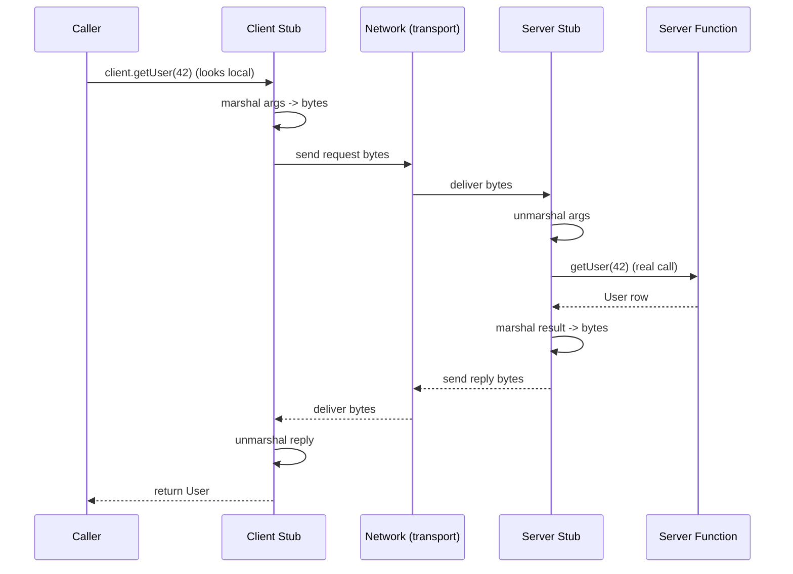
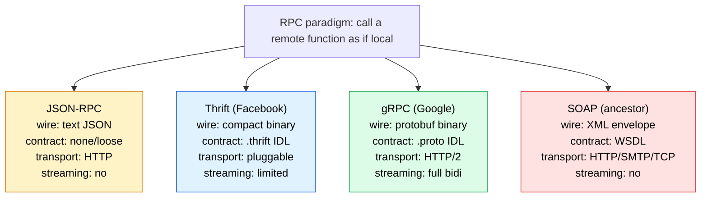

# RPC Fundamentals (Thrift, gRPC & the RPC Lineage)

## 1. Why Should I Care About This?
- **RPC is the paradigm underneath the buzzwords**: gRPC, Thrift, JSON-RPC, and even SOAP are all *flavors* of Remote Procedure Call. Understand RPC once and every one of them becomes "the same idea with a different wire format."
- **It is how microservices actually talk**: Inside a big company, service A calling service B is almost never a hand-rolled HTTP request — it is a generated stub that makes the remote call look like `client.getUser(42)`. That codegen is the RPC machinery.
- **The interview trap lives here**: RPC's whole selling point — "a remote call looks like a local call" — is also its biggest danger. Knowing *why* that illusion is a lie (the Fallacies of Distributed Computing) is what separates a junior answer from a senior one.

## 2. What Problem Does This Solve?
- **The plumbing tax**: Without RPC, every service call means manually opening a socket, serializing arguments, defining a byte layout, parsing the reply, and handling errors. RPC generates all of that from one interface file.
- **Polyglot interoperability**: A PHP frontend, a C++ storage service, and a Java search service need to call each other. RPC lets one Interface Definition Language (IDL) file generate a client and server in *every* language from a single contract.
- **Naive approach it replaces**: "Just POST some JSON and hope both sides agree on the shape." That works until the shape drifts, a field is renamed, or a third language joins — then you have a silent, untyped integration bug.

## 3. Core Idea (Intuition First)
- **RPC is a puppet show**: You (the client) talk to a puppet — the **stub** — that looks and behaves exactly like the real actor. Every gesture you make, the puppet relays across a curtain (the network) to the real actor (the **server function**) hidden backstage. You never see the strings.
- **The stub is a body double**: `client.getUser(42)` on your side is a fake `getUser` that secretly packs your `42` into bytes (**marshalling**), ships them over the wire, waits, and unpacks the answer. To your code it is indistinguishable from a local method.
- **The IDL is the shared script**: Both the client stub and the server skeleton are *generated from one file* (`.thrift` or `.proto`). That file — not the code — is the contract: it fixes the method signatures **and** the wire format.


> The stub hides marshalling + transport so a remote call *looks* local — but the network is not local. The IDL is the shared contract that generates both stubs; JSON-RPC, Thrift, gRPC, and SOAP are just different wire formats of the same paradigm.

## 4. How It Actually Works
The four moving parts of any RPC system:
- **IDL (Interface Definition Language)**: A language-neutral file declaring services, methods, and message types (`.thrift`, `.proto`, WSDL for SOAP).
- **Stubs / Skeletons**: A compiler reads the IDL and generates a **client stub** (a local-looking proxy) and a **server skeleton** (dispatches incoming bytes to your real function). You never write these by hand.
- **Marshalling / Unmarshalling**: Serializing arguments into a byte format for the wire and deserializing them on the other side. This *is* serialization — the wire format (binary for Thrift/protobuf, text for JSON-RPC/SOAP) is part of the contract.
- **Transport**: The actual bytes-on-a-socket layer — TCP, HTTP/1.1, or HTTP/2. Thrift makes this pluggable; gRPC pins it to HTTP/2 to get multiplexing and streaming.

The round trip, step by step:



- **Sync unary** is the default: one request, one response, caller blocks. Modern RPC (gRPC) adds **streaming** — server-streaming, client-streaming, and bidirectional — over one long-lived HTTP/2 connection.
- **Contract-first codegen**: change the IDL, regenerate, and both sides stay in lockstep. This is the opposite of REST's "convention and documentation" approach.

## 5. Real-World Example
**Facebook and the birth of Thrift**:
- By 2007 Facebook was a polyglot mess by necessity: the web tier was PHP, the storage and search services were C++, and internal tooling was Java and Python. These services had to call each other constantly.
- Hand-writing serialization for every language pair was a combinatorial nightmare — N languages meant N-squared integration surfaces, each a place for the byte layout to silently disagree.
- Facebook built **Thrift** (later donated to Apache): engineers write **one** `.thrift` IDL file describing a service, run the Thrift compiler, and get a working, type-safe client **and** server stub in PHP, C++, Java, Python, Ruby, and more — all guaranteed to speak the identical binary wire format.
- The payoff: a team owning the "User" service publishes `user.thrift`; ten other teams in ten languages generate clients from it and call `client.getUser(42)` as if it were a local function. The contract is the file, not tribal knowledge. Google's gRPC later generalized the same idea with protobuf over HTTP/2.

## 6. Code Example
A Thrift IDL `service` definition, then the generated stub called like a local function:

```thrift
// user.thrift  --  the SHARED CONTRACT (compiled to every language)
namespace java com.example.user

struct User {
  1: i32 id,
  2: string name,
  3: string email
}

exception NotFound { 1: string reason }

service UserService {
  User getUser(1: i32 id) throws (1: NotFound nf),
  bool  updateEmail(1: i32 id, 2: string email)
}
```

```java
// Generated client stub used as if getUser were LOCAL — no sockets, no
// serialization written by hand. The stub marshals args, does the round
// trip, and unmarshals the reply behind this single line:
TTransport transport = new TSocket("user-svc", 9090);
transport.open();
UserService.Client client =
    new UserService.Client(new TBinaryProtocol(transport));

User u = client.getUser(42);   // <-- looks exactly like a local call
System.out.println(u.name);    // stub hid marshalling + the network hop
```

The Thrift compiler generated `UserService.Client` (client stub) **and** `UserService.Iface`/`Processor` (server skeleton) from the same `user.thrift`. Swap `TBinaryProtocol` for a JSON protocol or `TSocket` for an HTTP transport and the calling code is unchanged — transport and protocol are pluggable.

## 7. Design Variations & Alternatives
The RPC lineage — Sun RPC → CORBA → SOAP → Thrift/Avro → gRPC/JSON-RPC — as a comparison:



- **JSON-RPC**: The minimalist — a tiny spec (method, params, id) over HTTP. Human-readable, dead simple, but no schema and no streaming.
- **Thrift**: Compact binary, huge language support, pluggable transport/protocol layers. Its own ecosystem rather than riding standard HTTP infrastructure.
- **gRPC**: The modern default — protobuf + HTTP/2 gives streaming, multiplexing, and deadlines. Covered in depth in the gRPC file.
- **Avro RPC**: Schema travels with the data; popular in the Hadoop/Kafka world.
- **REST**: The philosophical *opposite* — resources and HTTP verbs instead of remote *actions/verbs*. (See section 12.)

## 8. Pros and Cons
### Pros
- **Ergonomics**: Remote calls read like local method calls — no boilerplate socket/serialization code.
- **Type safety & one contract**: The IDL is a single source of truth; codegen keeps client and server in sync across languages.
- **Performance**: Binary wire formats (Thrift/protobuf) are compact and fast to parse versus JSON/XML.
- **Streaming & multiplexing** (gRPC): Many concurrent calls and long-lived streams over one connection.

### Cons
- **The dangerous illusion**: "Looks local" hides that a network hop happened — the root of most RPC production bugs.
- **Tight coupling to the IDL**: Both sides must share and evolve the contract carefully; breaking changes ripple everywhere.
- **Poor browser / debuggability**: Binary formats are not human-readable; gRPC needs a proxy (gRPC-web) for browsers.
- **Ecosystem lock-in**: Thrift's custom transport doesn't ride standard HTTP caches, proxies, and tooling the way REST does.

## 9. Failure Scenarios & What Can Go Wrong
- **The network is NOT reliable (Fallacy #1)**: A call can be lost *after* the server ran it but *before* the reply returned. Did `updateEmail` happen or not? RPC hides this — you must design for it.
- **Partial failure**: In a local call, either it runs or it doesn't. In RPC there is a third outcome: it ran on the server but the client got a timeout. This is the defining hazard of distributed systems.
- **Retries + non-idempotent methods = double execution**: The client times out and retries `chargeCard(42)`; the first call actually succeeded. Now the card is charged twice. Only **idempotent** methods are safe to retry blindly.
- **Latency is not zero (Fallacy #2)**: Treating `client.getUser(42)` as free leads to chatty code that makes 100 remote calls in a loop, each a network round trip — a performance cliff invisible in the source.
- **IDL drift / version skew**: Server adds a required field; old clients still send the old shape and break. Contract evolution rules (optional fields, never reuse field IDs) exist precisely to avoid this.

## 10. Impact on Scalability, Reliability & Cost
- **Scalability**: Binary RPC (Thrift/gRPC) is the backbone of large-scale internal fan-out — compact payloads and HTTP/2 multiplexing keep per-call overhead low across millions of inter-service calls.
- **Reliability**: RPC itself gives you *nothing* for free here — you must add deadlines/timeouts, retries with idempotency, circuit breakers, and hedging. The frameworks provide the hooks; using them is on you.
- **Cost**: Binary marshalling saves bandwidth and CPU versus JSON/XML at scale. But codegen and the IDL toolchain add build-time complexity, and the debugging cost of an opaque binary format is real.

## 11. When NOT to Use This
- **Public-facing / third-party APIs**: External developers expect REST + JSON they can `curl` and read. A binary Thrift/gRPC endpoint is hostile to them.
- **Simple CRUD over resources**: If your domain is naturally "things you fetch and update," REST maps cleanly and you avoid IDL tooling overhead.
- **Browser-first apps without a proxy**: gRPC needs gRPC-web; if that proxy hop negates the benefit, plain REST/JSON is simpler.
- **When you cannot enforce contract discipline**: RPC's safety depends on both sides sharing and evolving the IDL. Without that governance, loose JSON is less brittle.

## 12. Interview Perspective
- **What interviewers expect**: You can define IDL, stubs/skeletons, and marshalling in one breath, and you can explain the RPC-vs-REST philosophy — **RPC exposes verbs/actions** (`getUser`, `chargeCard`) while **REST exposes resources/nouns** (`GET /users/42`).
- **The senior signal**: Volunteering the Fallacies of Distributed Computing unprompted — "RPC's illusion that a remote call is local is exactly what makes engineers forget about partial failure, timeouts, and idempotent retries."
- **Common question**: "Why did Facebook build Thrift instead of using REST?" (Answer: polyglot type-safety and binary performance for internal service-to-service calls at scale — one IDL generates clients in every language.)
- **Follow-up trap**: "Your client times out on `chargeCard`. What do you do?" (Answer: do NOT blindly retry — make it idempotent with an idempotency key first, because the server may have already run it.)

## 13. Connections to Other Topics
- **[gRPC](../02_API_Interface_Design/gRPC.md)**: The modern RPC deep-dive — protobuf specifics, HTTP/2, and the four streaming modes. This file is the *generic* RPC framing; that file is the flagship implementation.
- **[REST vs GraphQL vs gRPC](./REST_vs_GraphQL_vs_gRPC.md)**: RPC (gRPC) vs resource (REST) vs query (GraphQL) — the three API styles side by side.
- **[Data Compression & Serialization](../06_Caching_Performance/Data_Compression_Serialization.md)**: Marshalling *is* serialization; Protobuf and Thrift binary formats are what actually travel on the wire.
- **[SOAP vs REST](./SOAP_vs_REST.md)**: SOAP (XML-RPC over an envelope, described by WSDL) is the enterprise ancestor in this RPC lineage.

## 14. Visual Aids
- **The marshalling round-trip diagram** (`../assets/rpc_marshalling.svg`, embedded in Section 3): the RPC illusion, the client-stub → network → server-stub → function loop, the one-IDL-generates-both-stubs idea, the JSON-RPC/Thrift/gRPC/SOAP comparison strip, and the Fallacies callout.
- **Sequence diagram** (Section 4): the exact marshal → transport → unmarshal → execute → marshal-back path of a single call.
- **Lineage flowchart** (Section 7): JSON-RPC vs Thrift vs gRPC vs SOAP across wire format, contract, transport, and streaming.

## 15. Summary (TL;DR)
**RPC is the paradigm of calling a remote function as if it were local: an IDL file (`.thrift`/`.proto`) is compiled into a client stub and a server skeleton, the stub marshals arguments into bytes, ships them over a transport, and unmarshals the reply — so `client.getUser(42)` hides all the plumbing. The lineage runs Sun RPC → CORBA → SOAP → Thrift (Facebook, binary + polyglot) → gRPC (Google, protobuf + HTTP/2 + streaming) and JSON-RPC (text, minimal), and RPC's verb/action style is the mirror image of REST's resource/noun style. Its superpower — making the network invisible — is also its trap: the Fallacies of Distributed Computing (the network is not reliable, not zero-latency, not infinite-bandwidth) mean you must add timeouts, idempotent retries, and partial-failure handling that a truly local call would never need.**

## 16. Further Reading & Resources
- [Apache Thrift: Official Documentation](https://thrift.apache.org/docs/)
- [Birrell & Nelson: "Implementing Remote Procedure Calls" (1984, the foundational paper)](https://dl.acm.org/doi/10.1145/2080.357392)
- [gRPC: Introduction & Core Concepts](https://grpc.io/docs/what-is-grpc/introduction/)
- [The Fallacies of Distributed Computing Explained (Rotem-Gal-Oz)](https://www.rgoarchitects.com/Files/fallacies.pdf)
- [JSON-RPC 2.0 Specification](https://www.jsonrpc.org/specification)
