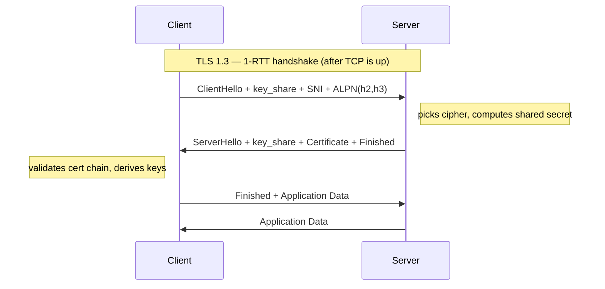
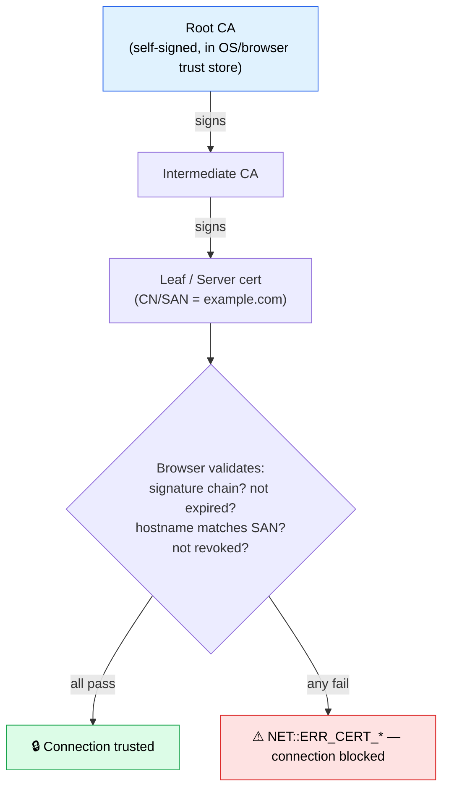

# TLS/SSL Handshake

## 1. Why Should I Care About This?
- **First-byte latency lives here**: Before *any* HTTPS byte flows, the client and server run a handshake. TLS 1.2 is **2 round-trips** on top of TCP's own 1-RTT — at 100ms RTT that's **~300ms** before the first app byte. TLS 1.3 cuts it to ~200ms; QUIC + 0-RTT to ~100ms.
- **It's the padlock**: TLS provides **confidentiality** (nobody reads it), **integrity** (nobody tampers), and **authentication** (you're really talking to `bank.com`). Get it wrong and users get a scary warning — or get MITM'd.
- **A top production-outage cause**: expired certificates take down giant services *routinely*. Silent until the second the cert lapses, then every client refuses to connect.

## 2. What Problem Does This Solve?
- **Talking secretly over a public wire**: the internet is a tappable medium. TLS negotiates a shared secret over that hostile channel so eavesdroppers see only ciphertext.
- **Proving identity**: how do you *know* the server is the real one? Certificates signed by trusted CAs answer this.
- **Doing it fast**: the handshake's evolution (1.2 → 1.3 → 0-RTT) is a relentless campaign to remove RTTs.
- **Naive approach**: "just encrypt with a shared password" doesn't scale (how do you distribute it?) and gives no identity proof. TLS solves key-distribution with asymmetric crypto + a chain of trust.

## 3. Core Idea (Intuition First)
- **The handshake is a two-part play**: (1) **agree on a secret** nobody watching can compute (ephemeral Diffie-Hellman / ECDHE), and (2) **prove who you are** (the server presents a certificate signed by a CA the client trusts). Once both are done, everything switches to fast symmetric encryption.
- **Analogy**: Two strangers meet in a crowded room. They shout math at each other (ECDHE) such that only *they* end up knowing a shared number, even though everyone heard the shouting. Then one shows a **notarized ID card** (certificate) so the other knows they're legit. From then on they whisper in a private code.
- **The whole optimization story is "fewer shouts"**: TLS 1.2 needs two exchanges; TLS 1.3 makes the client *guess* the key parameters up front so one exchange suffices; resumption lets returning clients skip almost all of it.



> Each lane is Client↔Server. TLS 1.2 needs two round-trips before app data; TLS 1.3 needs one (the client sends its key share in the very first message); 0-RTT sends application data in the *first* flight using a pre-shared key — free speed, but the early data is replayable.

## 4. How It Actually Works
The handshake steps (TLS 1.2 baseline):
- **ClientHello**: client sends supported TLS versions, a list of **cipher suites**, and a random nonce.
- **ServerHello + Certificate**: server picks one cipher suite, sends its **certificate chain**, and (for ECDHE) its key-exchange parameters.
- **Key exchange (ECDHE)**: both sides derive the same shared secret using ephemeral elliptic-curve Diffie-Hellman. "Ephemeral" gives **forward secrecy** — stealing the server's private key later can't decrypt yesterday's traffic.
- **Finished**: both send a MAC over the whole handshake to prove nothing was tampered with, then switch to symmetric encryption (AES-GCM / ChaCha20).

**TLS 1.2 (2-RTT) vs TLS 1.3 (1-RTT):**
- **1.2** takes two round-trips: negotiate, *then* exchange keys.
- **1.3** collapses this — the client sends its `key_share` speculatively in the ClientHello, so the server can reply with everything (its share, certificate, Finished) in one flight. **One RTT.** TLS 1.3 also **removed weak ciphers** (RSA key exchange, RC4, CBC-mode, SHA-1), making every 1.3 connection forward-secret by default.

**Session resumption + 0-RTT:**
- After a full handshake the server hands the client a **session ticket / pre-shared key (PSK)**. On reconnect the client presents it and skips certificate + key exchange.
- **0-RTT**: the client sends application data *with the very first flight* using the PSK — zero handshake RTTs to first byte. **The catch: early data is replayable** (an attacker can capture and re-send it), so it's only safe for **idempotent** requests (a GET, never a "transfer $100").

**Extensions that ride along:**
- **SNI (Server Name Indication)**: tells the server *which* hostname you want, so one IP can host many TLS sites (virtual hosting). Sent in the ClientHello.
- **ALPN (Application-Layer Protocol Negotiation)**: negotiates the app protocol (`h2` for HTTP/2, `h3` for HTTP/3) *inside* the handshake — no extra round-trip.

**Where TLS terminates:**
- Usually at the **edge** — a CDN or load balancer decrypts, then either forwards plaintext on a trusted internal network or **re-encrypts** to the backend. End-to-end TLS keeps it encrypted all the way to the origin.



The **certificate chain of trust** — what the browser actually validates:



## 5. Real-World Example
**The expired-certificate outage (the classic, costly failure):**
- In 2021, **Spotify** suffered a global outage traced to an expired TLS certificate — apps couldn't establish connections and users saw failures worldwide. The same root cause has hit **Microsoft Teams**, **Cisco**, **LinkedIn**, and countless others.
- **The symptom is brutal and binary**: at the exact second the cert's `notAfter` timestamp passes, every new handshake fails with a cert-invalid error. Existing connections may survive, but no *new* client can connect. Nothing changed in your code — the clock just ticked past a date.
- **Why it keeps happening**: certs are set-and-forget, the expiry is often owned by someone who left, and monitoring rarely alerts on "expires in 14 days." The fix is boring but essential: **automated renewal** (ACME / Let's Encrypt, cert-manager) plus expiry alerting.

**The latency win (the flip side):**
- A global site moving from **TLS 1.2 → TLS 1.3 + 0-RTT** removes ~1–2 RTTs per new connection. For a user 150ms from the edge, that's ~150–300ms shaved off *every* cold connection — compounding across the dozens of new connections a page and its third parties open.

## 6. Code Example
Inspecting a real TLS 1.3 handshake with `openssl s_client` — see the negotiated protocol, cipher, and full cert chain:
```bash
$ openssl s_client -connect example.com:443 -tls1_3 -servername example.com </dev/null
CONNECTED(00000003)
depth=2 C=US, O=DigiCert Inc, CN=DigiCert Global Root G2      # root CA
depth=1 C=US, O=DigiCert Inc, CN=DigiCert Global G3 TLS ECC   # intermediate
depth=0 CN=example.com                                        # leaf / server cert
---
Certificate chain
 0 s:CN=example.com          i:CN=DigiCert Global G3 TLS ECC   # leaf, signed by...
 1 s:CN=DigiCert G3 TLS ECC  i:CN=DigiCert Global Root G2      # ...intermediate
---
SSL-Session:
    Protocol  : TLSv1.3
    Cipher    : TLS_AES_256_GCM_SHA384          # AEAD suite, forward-secret
    Verify return code: 0 (ok)                  # chain validated to a trusted root
    Max Early Data: 0                           # 0-RTT not offered here
---
# Quick one-liner: check when the cert EXPIRES (the outage trigger)
$ echo | openssl s_client -connect example.com:443 2>/dev/null \
    | openssl x509 -noout -dates
notBefore=Jan 15 00:00:00 2026 GMT
notAfter=Apr 15 23:59:59 2026 GMT               # alert well before this date!
```

## 7. Design Variations & Alternatives
- **TLS termination point**: at the CDN/LB edge (simplest, cheapest, but plaintext internally) vs **end-to-end** to the origin vs **re-encryption** (decrypt at edge, re-encrypt to backend — common for L7 routing + WAF inspection while keeping the internal hop encrypted).
- **mTLS (mutual TLS)**: the *client* also presents a certificate, so both sides authenticate. Standard for service-to-service auth in zero-trust meshes.
- **Session tickets vs session IDs**: two ways to resume — tickets are stateless (server encrypts the state and hands it to the client), IDs require server-side session cache.
- **QUIC/HTTP-3**: folds the TLS 1.3 handshake into the transport handshake, reaching 0-RTT even more aggressively.

## 8. Pros and Cons
### TLS 1.3
- **Pros**: 1-RTT (or 0-RTT resumption), forward secrecy by default, weak ciphers removed, encrypted handshake (more of it is hidden from eavesdroppers).
- **Cons**: 0-RTT replay risk; some middleboxes/enterprise proxies choke on it; requires modern clients.
### TLS in general
- **Pros**: confidentiality + integrity + authentication in one protocol; universally supported; hardware-accelerated symmetric crypto is nearly free.
- **Cons**: handshake CPU + latency cost; certificate lifecycle is an operational burden; misconfiguration is easy and dangerous.

## 9. Failure Scenarios & What Can Go Wrong
- **Expired certificate**: `notAfter` passes → every new handshake fails. The #1 self-inflicted TLS outage. *Fix: automated renewal + expiry alerts.*
- **Hostname mismatch**: cert's SAN doesn't cover the hostname you dialed (cert for `www.site.com`, you hit `site.com`) → `ERR_CERT_COMMON_NAME_INVALID`.
- **Incomplete chain**: server forgot the **intermediate** cert. Some clients cache it and work; others can't build a path to a root and fail — the "works on my machine" bug.
- **Self-signed / untrusted root**: no path to a trusted root → `ERR_CERT_AUTHORITY_INVALID`.
- **Protocol/cipher mismatch**: an ancient client offers only ciphers the server disabled → handshake abort.
- **0-RTT replay**: an attacker re-sends captured early data; if it hit a non-idempotent endpoint, the action runs twice.
- **Clock skew**: a client with a wrong clock sees a valid cert as "not yet valid" or "expired."

## 10. Impact on Scalability, Reliability & Cost
- **Scalability**: handshakes are the expensive part (asymmetric crypto); resumption + session tickets slash CPU on repeat visitors. Terminating at the LB concentrates crypto where it can be hardware-accelerated.
- **Reliability**: cert automation converts a recurring outage class into a non-event; chain-of-trust monitoring (OCSP/CRL) matters.
- **Cost**: symmetric encryption of the stream is cheap — the RTTs and handshake CPU are the real cost, which is exactly why 1.3 and 0-RTT exist. Fewer RTTs = lower latency *and* higher connection throughput per core.

## 11. When NOT to Use This
- **Not "when to skip TLS"** — you basically never skip it on the public internet. But:
- **0-RTT for non-idempotent requests**: never send a payment or state-changing POST as early data — replay it and money moves twice.
- **Terminating at the edge with plaintext backends over an untrusted network**: if the internal hop crosses zones you don't fully control, terminate-and-forward-plaintext leaks everything.
- **Pinning certificates rigidly**: HPKP-style hard pinning can brick your own site if you rotate keys — largely abandoned for this reason.

## 12. Interview Perspective
- **What interviewers expect**: explain the **handshake steps** and *why* TLS 1.3 is 1-RTT vs 1.2's 2-RTT. Describe **ECDHE + forward secrecy**. Explain the **chain of trust** (root → intermediate → leaf). Know **SNI** (which host) vs **ALPN** (which protocol). Know **0-RTT and its replay risk**.
- **Common questions**: "Walk me through what happens between DNS resolving and the first HTTPS byte." "Why is TLS 1.3 faster?" "Where would you terminate TLS in this architecture and why?" "What breaks when a certificate expires, and how do you prevent it?"
- **Strong signal**: counting RTTs concretely (TCP 1 + TLS 1.2's 2 = 3 total) and connecting it to HTTP/2 (one connection amortizes the handshake) and HTTP/3 (QUIC folds it in).

## 13. Connections to Other Topics
- [../11_Security_Identity/Encryption_Rest_vs_Transit.md](../11_Security_Identity/Encryption_Rest_vs_Transit.md) — TLS *is* encryption-in-transit; that file covers the data-protection angle (what/why encrypt), this file covers the **wire-protocol and latency** angle (how the handshake works and its RTT cost). Read them as a pair.
- [./HTTP_Versions.md](./HTTP_Versions.md) — TLS handshake RTTs are *exactly why* HTTP/2 (one long-lived connection amortizes one handshake) and HTTP/3 (QUIC folds TLS in for 0-RTT) matter. Pairs directly.
- [./DNS_Deep_Dive.md](./DNS_Deep_Dive.md) — DNS resolves the name to an IP **first**, *then* TCP connects, *then* the TLS handshake runs. The full "cold connection" latency chain.
- [../15_Security_Deep_Dive_DevSecOps/API_Security_Scopes_mTLS.md](../15_Security_Deep_Dive_DevSecOps/API_Security_Scopes_mTLS.md) — **mutual TLS**, where the client *also* presents a certificate; the service-to-service authentication extension of this handshake.

## 14. Visual Aids
- **The RTT-lane diagram** (`../assets/tls_handshake.svg`, Section 3): TLS 1.2 (2-RTT) vs TLS 1.3 (1-RTT) vs 0-RTT resumption, stacked on top of TCP's own RTT — showing 3 → 2 → 1 RTT to first byte.
- **The 1.3 sequence diagram** (Section 4): the actual ClientHello+key_share / ServerHello+cert+Finished / Finished+AppData exchange.
- **The chain-of-trust flowchart** (Section 4): root → intermediate → leaf → browser validation, and what makes it block.

## 15. Summary (TL;DR)
**TLS gives you confidentiality, integrity, and authentication over a hostile wire by (1) deriving a shared secret with ephemeral ECDHE — giving forward secrecy — and (2) proving server identity via a certificate chained root → intermediate → leaf back to a CA in the client's trust store; the handshake's whole evolution is about killing round-trips: TLS 1.2 needs 2 RTTs (≈3 total with TCP), TLS 1.3 sends the client key share up front for 1 RTT (≈2 total) and drops weak ciphers, and session resumption with 0-RTT sends app data in the first flight (≈1 total) at the cost of replay risk on non-idempotent requests; SNI selects the host and ALPN selects the protocol (h2/h3) inside the handshake, TLS commonly terminates at the CDN/LB edge (with optional re-encryption to the backend), and the single most common self-inflicted outage is a certificate quietly expiring — so automate renewal and alert on expiry.**

## 16. Further Reading & Resources
- [Cloudflare: A Detailed Look at RFC 8446 (TLS 1.3)](https://blog.cloudflare.com/rfc-8446-aka-tls-1-3/) - the definitive readable explainer of the 1-RTT and 0-RTT changes.
- [RFC 8446 - The TLS 1.3 Protocol](https://datatracker.ietf.org/doc/html/rfc8446) - the spec itself.
- [High Performance Browser Networking - Transport Layer Security](https://hpbn.co/transport-layer-security-tls/) - Ilya Grigorik's chapter on TLS latency and optimization.
- [The Illustrated TLS 1.3 Connection](https://tls13.xargs.org/) - a byte-by-byte annotated walkthrough of a real handshake.
- [Let's Encrypt / ACME](https://letsencrypt.org/how-it-works/) - the automation that prevents expiry outages.
