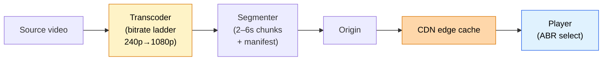
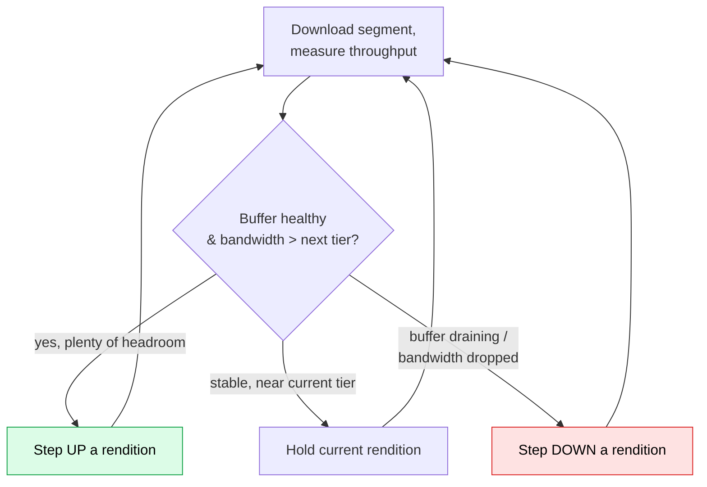

# Video Streaming Protocols (HLS & DASH)

## 1. Why Should I Care About This?
- **The "Design YouTube/Netflix/Twitch" Staple**: Almost every video-heavy system-design interview lands here. If you can't explain HTTP Adaptive Bitrate (ABR), you can't design the core of these products.
- **It's How One Stream Fits Every Screen**: The same upload plays on a phone on 3G *and* a 4K TV on fiber — because the **player**, not the server, chooses the quality. This is the single most important idea.
- **It Scales to Billions Because It's Just HTTP**: Video segments are plain files on a CDN. No special streaming servers, no persistent connections — the reason ABR crushed the old RTMP model.

## 2. What Problem Does This Solve?
- **One-Size-Fits-All Bitrate**: If you serve a single 6 Mbps file, the phone on 3G rebuffers forever and the TV on fiber gets needlessly low quality. ABR fixes both.
- **Rebuffering vs. Quality Trade-off**: The network changes every second (elevator, tunnel, WiFi→cellular). ABR continuously re-picks the quality that *won't stall*.
- **Naive Approach**: A single persistent stream server pushing one bitrate to every viewer. It can't cache, can't adapt, and melts the moment a live event hits a million concurrent viewers.

## 3. Core Idea (Intuition First)
ABR is like **a restaurant offering the same dish in small, medium, and large — and letting you swap sizes mid-meal based on how hungry you still are.**
- The **studio** cooks the video once at several quality levels (the **bitrate ladder**) and chops each into bite-size **segments** (2–6 seconds each).
- A **manifest** (`.m3u8` for HLS, `.mpd` for DASH) is just the menu: "here are the sizes, here's where each chunk lives."
- The **player** watches its download speed and buffer, then requests the biggest chunk it can finish *before playback catches up* — stepping **down** when bandwidth drops, **up** when it recovers, one segment at a time.


> One upload becomes a ladder of renditions cut into cacheable chunks; the CDN serves them like any static file, and the *player* adapts quality per segment — which is how a phone on 3G and a TV on fiber share one stream.

## 4. How It Actually Works
### 1. Encode the Bitrate Ladder
- The source is **transcoded** into N renditions, e.g. 240p/0.5 Mbps → 480p/1.5 Mbps → 720p/3 Mbps → 1080p/6 Mbps (plus 4K for premium).
- Each rendition is **segmented** into ~2–6 s chunks (`.ts` historically for HLS, now `fMP4`/`.m4s` shared by both HLS and DASH).

### 2. Write the Manifests
- **Master/multivariant playlist**: lists every rendition and its bandwidth/resolution.
- **Media playlist**: the ordered list of segment URLs for one rendition.
- HLS uses `.m3u8` text playlists; DASH uses a single XML `.mpd`. Same recipe — **HTTP + manifest + segments** — different file format.

### 3. Push to Origin → CDN
- Segments are static files. The origin uploads once; **CDN edges cache** them. A cache hit means the origin never sees the request. This is *why* ABR scales trivially.

### 4. Player ABR Loop
- Player fetches the master manifest, starts low, measures **throughput** and **buffer health**, then picks the highest rendition it can sustain — switching per segment as the network moves.



**VOD vs. Live.** For **VOD** (Netflix back catalog) all segments and manifests are pre-made once. For **live** (Twitch, sports) segments are created *continuously* and the media playlist is a **sliding window** of the last N chunks — the player keeps re-fetching the manifest for new entries. Longer segments/buffers add latency but improve resilience; **Low-Latency HLS (LL-HLS)** uses partial segments over HTTP **chunked transfer** to cut the ~10–30 s standard live delay to ~2–5 s.



## 5. Real-World Example
**Netflix: one upload, millions of screens.**
- A single show master is encoded into **a ladder of ~10+ renditions** (from ~235 kbps mobile up to 15+ Mbps 4K), each per-title tuned so a cartoon and an action film get different bitrates for the same quality.
- Every rendition is segmented and pushed to **Open Connect**, Netflix's own CDN appliances sitting inside ISPs. A viewer's player fetches segments from the *nearest* box — the origin is barely touched.

**Twitch: a live event no single server could carry.**
- A streamer's RTMP ingest is transcoded on the fly into an ABR ladder, segmented into ~2–4 s chunks, and pushed to the CDN. If **2 million** viewers watch a finals match, they don't hit 2 million connections to one server — they hit **CDN edges** serving the same cached ~2 s segment.
- With 4 s segments, the whole audience requests a new file only every 4 s, and 99%+ are cache hits. Contrast a single stream server: 2M persistent connections at even 3 Mbps each is 6 Tbps out of one origin — physically impossible. **ABR + CDN turns "impossible fan-out" into "serve a static file."**

## 6. Code Example
An HLS **master playlist** (bitrate ladder) and one **media playlist** (segments), plus a `<video>` + hls.js player:
```m3u8
#EXTM3U
#EXT-X-STREAM-INF:BANDWIDTH=500000,RESOLUTION=426x240,CODECS="avc1.42e01e,mp4a.40.2"
240p/index.m3u8
#EXT-X-STREAM-INF:BANDWIDTH=1500000,RESOLUTION=854x480,CODECS="avc1.4d401f,mp4a.40.2"
480p/index.m3u8
#EXT-X-STREAM-INF:BANDWIDTH=3000000,RESOLUTION=1280x720,CODECS="avc1.64001f,mp4a.40.2"
720p/index.m3u8
#EXT-X-STREAM-INF:BANDWIDTH=6000000,RESOLUTION=1920x1080,CODECS="avc1.640028,mp4a.40.2"
1080p/index.m3u8
```
```m3u8
# 480p/index.m3u8 — media playlist (VOD)
#EXTM3U
#EXT-X-TARGETDURATION:4
#EXT-X-PLAYLIST-TYPE:VOD
#EXTINF:4.0,
seg_001.m4s
#EXTINF:4.0,
seg_002.m4s
#EXT-X-ENDLIST
```
```html
<video id="v" controls></video>
<script src="https://cdn.jsdelivr.net/npm/hls.js"></script>
<script>
  const hls = new Hls();                 // hls.js does the ABR + segment fetching
  hls.loadSource('https://cdn.example.com/master.m3u8');
  hls.attachMedia(document.getElementById('v'));
</script>
```

## 7. Design Variations & Alternatives
- **HLS vs. MPEG-DASH**: HLS is Apple's (`.m3u8`, mandatory on iOS/Safari); DASH is the open ISO standard (`.mpd`, codec-agnostic). Most stacks ship **both** from the same fMP4 segments via **CMAF**.
- **LL-HLS / Low-Latency DASH**: partial segments + chunked transfer to shrink live latency to ~2–5 s.
- **WebRTC**: the sub-500 ms interactive alternative (video calls, auctions) — see the latency-tier trade-off in §13.
- **Progressive download / RTMP**: the old single-bitrate, non-cacheable approaches ABR replaced.

## 8. Pros and Cons
### Pros
- **Rides plain HTTP/CDN** — infinitely cacheable, firewall-friendly (port 443), scales to millions cheaply.
- **Adapts to any network** — no rebuffering on 3G, full quality on fiber, from one stream.
- **Standard everywhere** — every browser/TV/phone plays HLS or DASH natively or via JS.

### Cons
- **High latency** — 10–30 s for standard live (segment + buffer overhead); bad for real-time interaction.
- **Storage/encoding cost** — N renditions × M segments = a lot of transcoding and files.
- **Player complexity** — ABR heuristics, DRM, and manifest edge cases are subtle to get right.

## 9. Failure Scenarios & What Can Go Wrong
- **Rebuffering spiral**: buffer empties → player panics down to the lowest rendition → quality craters even though bandwidth recovered. Good ABR uses buffer-based logic, not just throughput, to avoid this.
- **Bitrate oscillation**: the player flip-flops 480p↔720p every segment on a borderline link, giving a jarring "breathing" quality. Fixed with hysteresis / switch dampening.
- **Live thundering herd**: everyone requests the *newest* segment at the same instant; if it's not yet at the edge, requests stampede the origin. Fixed with CDN request coalescing + slightly longer segments.
- **DRM/key failures**: a missing or expired **Widevine/FairPlay** license blocks playback entirely even though segments download fine.

## 10. Impact on Scalability, Reliability & Cost
- **Scalability**: near-infinite — the CDN absorbs fan-out; origin load is proportional to *distinct segments*, not viewers.
- **Reliability**: high — stateless HTTP GETs retry trivially; a dropped connection just re-fetches the next segment.
- **Cost**: CDN egress dominates the bill; encoding N renditions and storing many segments adds compute/storage, traded against not needing a stream-server fleet.

## 11. When NOT to Use This
- **Real-time interaction** (video calls, cloud gaming, live auctions): 10–30 s (or even 2–5 s LL-HLS) latency is unacceptable — use **WebRTC**.
- **Tiny/short clips**: a 3 s GIF-like loop doesn't need a bitrate ladder; a single MP4 is simpler.
- **Ultra-low-latency two-way**: anything conversational needs UDP-based WebRTC, not TCP-based HTTP segments.

## 12. Interview Perspective
- **What interviewers expect**: explain that the **player adapts** (not the server), the **bitrate ladder**, **segments + manifest**, and *why HTTP/CDN is the scaling superpower*. Know **HLS vs. DASH**, **VOD vs. live sliding window**, and the **latency tiers** vs. WebRTC.
- **Common question**: "Design YouTube/Netflix/Twitch" — the expected core is: upload → transcode to ladder → segment → CDN → ABR player. Bonus points for LL-HLS, DRM, and per-title encoding.

## 13. Connections to Other Topics
- **[CDN](../06_Caching_Performance/CDN.md)**: segments are cacheable HTTP files served from edges — *this is WHY ABR scales*; the origin barely sees traffic.
- **[WebRTC](./WebRTC.md)**: the low-latency (<0.5 s) interactive alternative. The trade-off: HLS/DASH buys massive scale + cacheability at the cost of 10–30 s latency; WebRTC buys real-time latency at the cost of scale and cacheability.
- **[HTTP Versions](./HTTP_Versions.md)**: ABR is built on plain HTTP GETs; **HTTP/2 multiplexing** lets a player fetch many segments over one connection efficiently.
- **[TCP vs. UDP](./TCP_vs_UDP.md)**: ABR uses **TCP/HTTP (reliable, ordered)** so every byte of every segment arrives — perfect for pre-buffered playback; WebRTC uses **UDP** to favor freshness over completeness, which is why it wins for real-time but loses for scale.

## 14. Visual Aids
- **The ABR pipeline SVG** (above): source → ladder → segments+manifest → CDN → adaptive player, with the phone-on-4G stepping 1080p→480p→up, plus the latency-tier ladder (WebRTC < 0.5 s · LL-HLS ~2–5 s · HLS/DASH ~10–30 s). See `../assets/video_abr_streaming.svg`.
- **Mermaid #1**: the encode→segment→origin→CDN→player pipeline.
- **Mermaid #2**: the player's ABR decision loop (measure → step up / hold / step down).

## 15. Summary (TL;DR)
**HTTP Adaptive Bitrate streaming (HLS and MPEG-DASH) is the same recipe — encode the source into a ladder of bitrate renditions, chop each into 2–6 s segments, describe them in a manifest (`.m3u8` for HLS, `.mpd` for DASH), and serve them as plain cacheable HTTP files from a CDN — where the *player*, not the server, measures bandwidth and buffer health and picks the highest quality it can sustain, switching up and down per segment; this is why one stream serves a phone on 3G and a TV on fiber, why it scales to millions of live viewers by turning fan-out into cache hits, and why it beat RTMP — the trade-off being 10–30 s latency (down to ~2–5 s with LL-HLS) versus WebRTC's sub-500 ms real-time channel.**

## 16. Further Reading & Resources
- [Apple: HTTP Live Streaming (HLS) Overview](https://developer.apple.com/streaming/) - the authoritative HLS docs and authoring spec.
- [MDN: DASH Adaptive Streaming for HTML5 Video](https://developer.mozilla.org/en-US/docs/Web/Media/Guides/DASH_Adaptive_Streaming_for_HTML_5_Video) - practical DASH primer.
- [hls.js GitHub](https://github.com/video-dev/hls.js/) - the reference JS HLS player and ABR implementation.
- [Netflix Tech Blog: Per-Title Encode Optimization](https://netflixtechblog.com/per-title-encode-optimization-7e99442b62a2) - how the bitrate ladder is tuned per title.
- [RFC 8216: HTTP Live Streaming](https://datatracker.ietf.org/doc/html/rfc8216) - the HLS specification.
