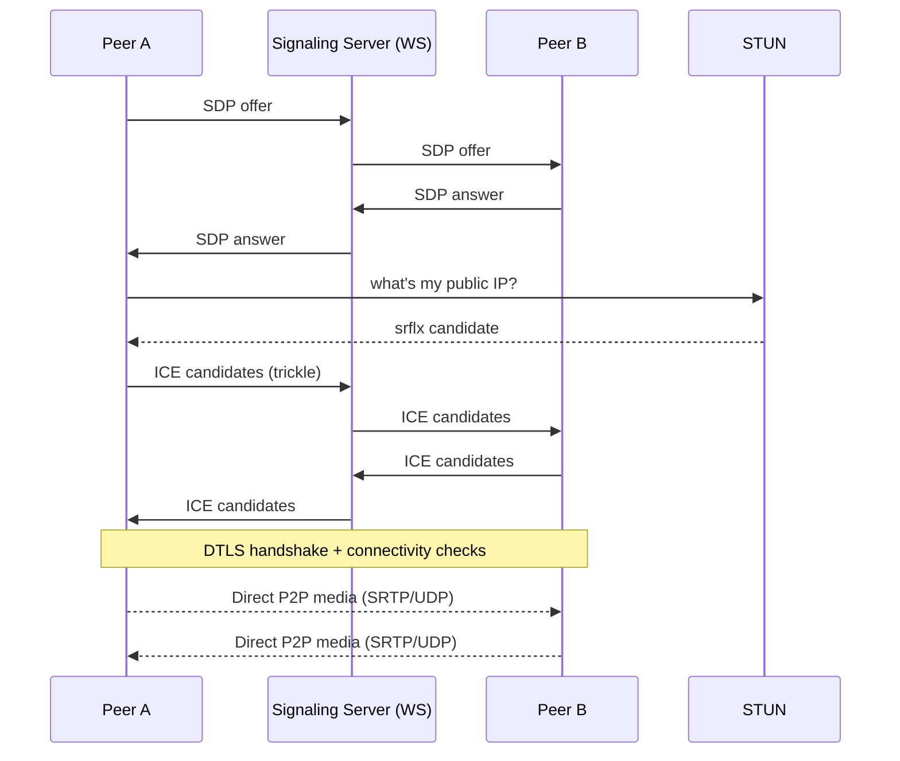

# WebRTC (Peer-to-Peer Real-Time Media)

## 1. Why Should I Care About This?
- **It's the "design Zoom/Google Meet" answer**: Every video-calling, live-audio, or screen-share interview eventually lands on WebRTC. It's the *only* browser-native way to do real-time media with no plugin.
- **Ultra-low latency**: Media flows peer-to-peer (or via a lean relay), hitting **sub-500ms** glass-to-glass latency. HLS/DASH streaming is **6-30 seconds** behind — fine for broadcast, useless for a conversation.
- **Browser-native**: Audio, video, *and* arbitrary data channels ship in every modern browser. No app install, no Flash, no proprietary SDK.

## 2. What Problem Does This Solve?
- **Real-time conversation**: You cannot have a phone call with a 10-second delay. WebRTC keeps latency low enough that people don't talk over each other.
- **NAT traversal**: Two laptops on home Wi-Fi are both behind routers with private IPs (`192.168.x.x`). Neither can be "dialed" directly. WebRTC's ICE framework figures out how to connect them anyway.
- **Server bandwidth**: Routing every video frame through your server is expensive. WebRTC lets media go **directly between peers**, so your servers only handle the tiny setup handshake.
- **Naive approach**: Uploading webcam frames as HTTP POSTs and polling for others' frames. This is multi-second-laggy, crushes your servers, and looks like a slideshow.

## 3. Core Idea (Intuition First)
WebRTC is like **two strangers arranging a private meeting through a mutual friend, then talking face-to-face**.
- **The mutual friend (Signaling Server)**: You can't reach the other person directly yet, so you pass notes through a friend everyone can reach — "here's how to find me, here's what languages I speak." This is **signaling** (SDP offer/answer + ICE candidates).
- **Finding each other (STUN/TURN/ICE)**: Both of you are behind locked gates (NATs). You ask a doorman (**STUN**) "what does my address look like from outside?" and try to meet directly. If the gates are too strict, you hire a courier (**TURN**) to shuttle messages between you.
- **The conversation (media)**: Once connected, you talk **directly, face-to-face** — the friend goes home. Media is encrypted and never touches the server again.

Crucially: **signaling is NOT part of WebRTC.** The spec defines the media and NAT-traversal machinery but leaves the "how do the two peers first find each other" channel entirely to you — almost always a WebSocket.



> Signaling sets it up; STUN/TURN/ICE punch through NAT; then media flows P2P (or relayed) — sub-500ms interactive latency versus multi-second buffering for HLS/DASH.

## 4. How It Actually Works
### 1. Signaling (you build it)
- Peer A creates an **SDP offer** (Session Description Protocol) describing its media: codecs, resolutions, encryption keys.
- A sends the offer to B **through your signaling channel** (typically a WebSocket to your server).
- B replies with an **SDP answer**. Now both sides know what the other can do.

### 2. ICE candidate gathering
- Each peer queries a **STUN server** to discover its **public IP:port** as seen from the internet (its "server-reflexive candidate").
- ICE (Interactive Connectivity Establishment) collects candidate addresses — **host** (local), **srflx** (STUN-discovered), **relay** (TURN) — and trickles them to the other peer via signaling.

### 3. Connectivity checks & connection
- ICE pairs up candidates and sends probes to find a working path. **DTLS** performs the key exchange to encrypt the channel.
- If a direct P2P path works (~85% of the time), great. If both peers are behind **symmetric NAT**, no direct path exists → media falls back to a **TURN relay**.

### 4. Media flows
- Audio/video ride **SRTP over UDP** — late frames are dropped, not retransmitted (a 200ms-old video frame is useless).
- Arbitrary application data uses **data channels over SCTP** (can be reliable or unreliable).



## 5. Real-World Example
**A 50-person Google Meet / Zoom call**:
- **Mesh would be impossible**: with every peer connected to every other, 50 participants = **50 × 49 = 2,450 streams**. One laptop would upload 49 copies of its own webcam ≈ **100 Mbps upload**. No home connection survives that, and the CPU melts.
- **The real design uses an SFU** (Selective Forwarding Unit): each participant sends **one** upstream copy (~2 Mbps up), and the SFU **forwards** the streams they need back down. Upload stays ~2 Mbps regardless of call size; download scales with tiles rendered (often capped — e.g. only the 9 loudest speakers).
- The SFU never decodes or mixes video — it just routes packets — so it scales to **dozens of participants** on commodity hardware. This is why Meet, Zoom, Teams, and Discord are all SFU-based.

## 6. Code Example
Minimal `RTCPeerConnection` setup (offerer side) using the real browser API:
```javascript
const pc = new RTCPeerConnection({
  iceServers: [
    { urls: "stun:stun.l.google.com:19302" },
    { urls: "turn:turn.example.com", username: "u", credential: "p" }
  ]
});

// 1. Add local camera/mic tracks
const stream = await navigator.mediaDevices.getUserMedia({ audio: true, video: true });
stream.getTracks().forEach(track => pc.addTrack(track, stream));

// 2. Trickle ICE candidates to the peer via YOUR signaling channel (a WebSocket)
pc.onicecandidate = (e) => { if (e.candidate) signaling.send({ candidate: e.candidate }); };

// 3. Render the remote peer's incoming media
pc.ontrack = (e) => { remoteVideo.srcObject = e.streams[0]; };

// 4. Create + send the SDP offer; peer replies with an answer
const offer = await pc.createOffer();
await pc.setLocalDescription(offer);
signaling.send({ sdp: offer });
// ...later, on receiving the answer:
signaling.on("answer", async (sdp) => await pc.setRemoteDescription(sdp));
```

## 7. Design Variations & Alternatives
Multiparty topologies are the key decision — how do N peers exchange media?

```mermaid
flowchart TD
    subgraph MESH["MESH — every peer to every peer"]
        M["N peers"] --> M2["N x (N-1) connections<br/>each peer uploads N-1 copies"]
        M2 --> M3["Good: no server media cost<br/>Bad: dies past ~4-5 peers"]
    end
    subgraph SFU["SFU — Selective Forwarding Unit"]
        F["N peers"] --> F2["each sends 1 up,<br/>server FORWARDS streams down"]
        F2 --> F3["Scales to dozens<br/>server routes, never decodes"]
    end
    subgraph MCU["MCU — Multipoint Control Unit"]
        C["N peers"] --> C2["server DECODES + MIXES<br/>into one composite stream"]
        C2 --> C3["Thin clients, 1 stream down<br/>but heavy server CPU, legacy"]
    end
    style M3 fill:#fef3c7,stroke:#d97706,color:#000
    style F3 fill:#dcfce7,stroke:#16a34a,color:#000
    style C3 fill:#fee2e2,stroke:#dc2626,color:#000
```



- **Mesh**: Pure P2P, no server media cost. Only viable for **small groups (2-4)** — the N² connection/upload explosion kills it.
- **SFU** (the standard): Each peer sends one stream up; server forwards. Scales to **dozens**, keeps server CPU low (no transcoding). Used by Meet, Zoom, Teams.
- **MCU** (legacy): Server decodes all streams, mixes into one composite, re-encodes. Clients see one stream (cheap for weak devices) but the server CPU cost is brutal and it adds latency. Mostly used for interop with old telephony/SIP gear.

## 8. Pros and Cons
### Pros
- **Lowest achievable latency** (sub-500ms) — real-time conversation.
- **P2P offloads bandwidth**: media can skip your servers entirely.
- **Encrypted by default** (DTLS-SRTP is mandatory, not optional).
- **Browser-native**: no plugins, works cross-platform.

### Cons
- **You must build signaling yourself** — the spec deliberately omits it.
- **NAT traversal is fiddly**: ~15% of connections need a **TURN relay**, which costs real bandwidth money.
- **Multiparty needs an SFU**: true mesh doesn't scale, so "P2P" becomes "peer-to-SFU" in practice.
- **Operationally complex**: STUN, TURN, SFU infrastructure, plus adaptive bitrate and packet-loss handling.

## 9. Failure Scenarios & What Can Go Wrong
- **Symmetric NAT / strict firewall**: No direct path exists, so the connection *must* use TURN. If you didn't provision a TURN server, the call silently fails to connect (~15% of users). **Always deploy TURN.**
- **TURN bandwidth blowout**: TURN relays every media byte. If too many calls fall back to relay, your bandwidth bill explodes and the relay saturates.
- **UDP blocked**: Some corporate networks block UDP entirely. Fallback: TURN over TCP/TLS on port 443 (looks like HTTPS, usually allowed).
- **ICE never completes**: Firewalls drop the connectivity-check probes; the connection hangs in "checking" state forever. Needs timeouts and reconnection logic.
- **Signaling server down**: New calls can't be set up (existing P2P calls survive, since media doesn't route through it).

## 10. Impact on Scalability, Reliability & Cost
- **Scalability**: P2P mesh is O(N²) and doesn't scale — the SFU is what makes large calls possible. SFUs scale horizontally, but a single call must live on one SFU (or you cascade SFUs for huge webinars).
- **Cost**: STUN is cheap (tiny stateless responses). **TURN is the cost driver** — you pay for every relayed byte, so you provision it for the minority (~15%) who need it. SFU compute is moderate (routing, not transcoding).
- **Reliability**: Direct P2P has no single point of failure once connected. The signaling server and TURN/SFU are the infrastructure you must keep highly available.

## 11. When NOT to Use This
- **One-to-many broadcast** (streaming to 100k viewers): Use **HLS/DASH** — CDN-cacheable, scales infinitely, and the multi-second latency is fine for one-way viewing.
- **Simple server→client push** (notifications, live scores): Use **SSE** or **WebSockets** — WebRTC is massive overkill.
- **File transfer where reliability matters more than latency**: Plain HTTPS is simpler than a WebRTC data channel.
- **You need recording/compliance on the server**: Pure P2P media never reaches your servers — you'd need an SFU/MCU anyway.

## 12. Interview Perspective
- **What interviewers expect**: You can explain the **signaling vs. media split** ("signaling is NOT WebRTC, you build it over WebSocket"), the **STUN vs. TURN** distinction, and **why mesh doesn't scale → SFU**.
- **Common question**: "Design Zoom / Google Meet." Winning answer: WebSocket signaling → STUN/TURN for NAT traversal → **SFU** for multiparty (never mesh past a few people) → mention adaptive bitrate and simulcast.
- **Sharp follow-up**: "Why UDP and not TCP for media?" → late frames are useless; you drop them rather than block the stream waiting for a retransmit (head-of-line blocking).
- **Gotcha to name**: symmetric NAT forcing TURN, and TURN's bandwidth cost.

## 13. Connections to Other Topics
- [WebSockets](./WebSockets.md) — the signaling channel is almost always a WebSocket; contrast its persistent-connection use as the *setup* path while WebRTC media rides UDP.
- [TCP vs. UDP](./TCP_vs_UDP.md) — WebRTC media rides UDP because a late video frame is worthless (drop it, don't retransmit and stall).
- [Video Streaming Protocols (HLS/DASH)](./Video_Streaming_Protocols_HLS_DASH.md) — the latency-tier contrast: WebRTC sub-500ms interactive vs. HLS/DASH multi-second broadcast.
- [Server-Sent Events](./Server_Sent_Events.md) — another push mechanism in the same real-time family; use it (not WebRTC) for simple one-way server→client updates.

## 14. Visual Aids
- **The connection story** (SVG above): [webrtc_nat_traversal.svg](../assets/webrtc_nat_traversal.svg) — signaling → NAT traversal (STUN/TURN/ICE) → P2P media, showing why the signaling server drops out once media flows.
- **Signaling sequence** (Mermaid, §4): SDP offer/answer + trickled ICE candidates through the signaling server, STUN query, then direct P2P media.
- **Topology comparison** (Mermaid, §7): MESH (N² connections) vs. SFU (forward once) vs. MCU (mix into one) and where each breaks.

## 15. Summary (TL;DR)
**WebRTC is the browser-native way to do real-time peer-to-peer audio, video, and data at sub-500ms latency, split into two halves: signaling (SDP offer/answer + ICE candidates), which the spec leaves to you and you build over a WebSocket, and the media path, which WebRTC handles — ICE gathers candidate addresses, STUN discovers a peer's public IP for NAT hole-punching, and TURN relays media (at real bandwidth cost) when a direct path is impossible, e.g. symmetric NAT. Media rides SRTP over UDP because late frames are dropped rather than retransmitted (DTLS encrypts, SCTP carries data channels). For multiparty, mesh is O(N²) and dies past a few peers, so Zoom and Google Meet use an SFU — each peer sends one stream up and the server forwards streams down — which is the answer any "design a video call" interview is looking for.**

## 16. Further Reading & Resources
- [MDN: WebRTC API](https://developer.mozilla.org/en-US/docs/Web/API/WebRTC_API)
- [WebRTC for the Curious (free book)](https://webrtcforthecurious.com/)
- [RFC 8825: Overview of WebRTC](https://datatracker.ietf.org/doc/html/rfc8825)
- [RFC 8445: Interactive Connectivity Establishment (ICE)](https://datatracker.ietf.org/doc/html/rfc8445)
- [webrtc.org — official project site](https://webrtc.org/)
