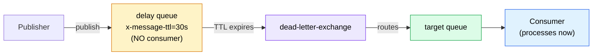
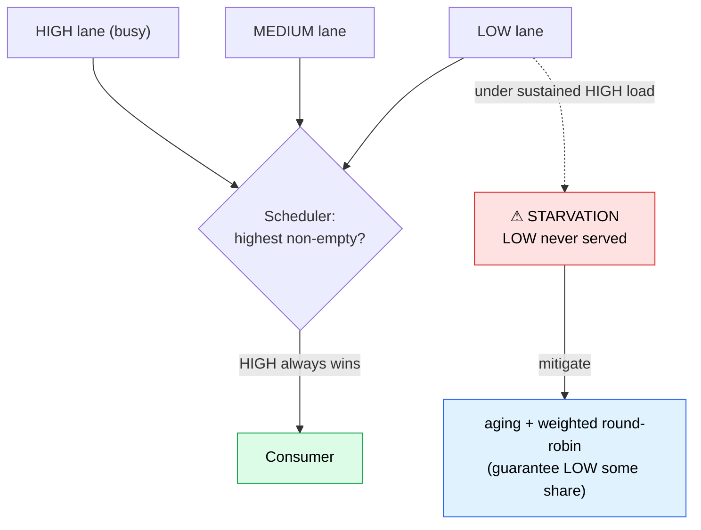

# Delayed Messages & Priority Queues

## 1. Why Should I Care About This?
- **The "job scheduler" interview staple**: "Design a reminder system," "cancel the order if unpaid in 30 min," "send a nudge in 24h" — all are delayed-delivery problems. You will be asked one.
- **Priority separates a toy from a real system**: A payment confirmation and a marketing email should NOT wait in the same line. Priority queues let urgent work jump ahead.
- **Broker choice hinges on this**: RabbitMQ/SQS do delay and priority natively; Kafka does neither. Knowing this stops you from picking the wrong tool in a design round.

## 2. What Problem Does This Solve?
- **"Do this later, not now"**: Retry backoff, scheduled jobs, timeouts ("expire the cart in 30 min"), reminders — work that must fire at a *future* time, not on arrival.
- **"Do this first, not in order"**: Under load, important messages should overtake unimportant ones instead of waiting behind a backlog.
- **Naive approach that fails**: A `sleep(30_000)` in the consumer holds a thread/connection hostage for 30 seconds. Multiply by a million pending jobs and you are out of threads. You need the *broker* or a *scheduler* to hold time, not your worker.

## 3. Core Idea (Intuition First)
- **Delayed delivery** = a **waiting room with a clock**. The message sits in a holding area and is *invisible* to consumers until its release time; only then does it walk into the ready queue.
- **Priority queue** = an **ER triage desk**. Patients aren't seen first-come-first-served; the heart attack (HIGH) jumps ahead of the sprained ankle (LOW). The danger: if heart attacks never stop arriving, the sprained ankle waits forever — **starvation**.


> Left: delayed delivery holds a message in a timing wheel and releases it only when due (SQS DelaySeconds, RabbitMQ TTL→DLX, or an external scheduler). Right: a priority queue always drains the highest non-empty lane — which starves LOW under sustained load unless you add aging or weighting. Kafka does neither natively.

## 4. How It Actually Works

### A. Delayed / Scheduled Delivery
- **SQS `DelaySeconds`** (0–900s): the message stays invisible for up to 15 minutes, then becomes deliverable. Distinct from the *visibility timeout* (which hides an in-flight message after a consumer picks it up). Hard cap of 15 min is the catch.
- **RabbitMQ TTL → Dead-Letter-Exchange (the canonical trick)**: publish into a queue that has **no consumer** and an `x-message-ttl` (e.g. 30s). When the message expires, RabbitMQ dead-letters it via `x-dead-letter-exchange` into the *real* queue where a consumer is waiting. Delay = the TTL.
- **RabbitMQ delayed-message plugin**: `x-delayed-message` exchange type holds messages per-message until a header-specified delay elapses — cleaner than the TTL trick but needs a plugin.
- **Timing wheels**: how schedulers, Netty's `HashedWheelTimer`, and Kafka's internal purgatory do millions of timers efficiently — buckets on a rotating wheel give **O(1)** insert/expire instead of a per-timer heap.
- **External scheduler + DB (at scale)**: store jobs with a `fire_at` column, index it, and a poller runs `SELECT ... WHERE fire_at <= now() LIMIT N` every second, enqueuing due rows. Survives billions of far-future jobs that no broker would hold.



### B. Priority Queues
- **RabbitMQ `x-max-priority`**: declare a queue with a max priority (e.g. 10); publish with a `priority` property. The broker delivers higher-priority messages first *among those currently queued*.
- **The scheduler rule**: always dequeue from the highest non-empty lane. Simple, but the root of starvation.
- **Fixes**: **aging** (a message's effective priority rises the longer it waits) and **weighted round-robin** (drain HIGH:MED:LOW in, say, a 5:3:1 ratio so LOW always gets *some* service).



### C. Why Kafka Has Neither
- Kafka is an **append-only log** with strict per-partition offset order. There is no "hold this until later" and no "reorder by importance" — reading position only moves forward.
- **Delay workaround**: a **retry-topic ladder** (`retry-5s`, `retry-30s`, `retry-5m`) where a consumer sleeps/waits the bucket delay, or an external store keyed by fire time.
- **Priority workaround**: one **topic per priority** consumed with **weighted polling** (poll HIGH more often than LOW).

## 5. Real-World Example
**Design a delayed-job system: "cancel an unpaid order after 30 minutes."** ~500k orders/day (~6/sec avg, ~50/sec peak); most get paid, so most timers are cancelled before firing.

- **Option 1 — SQS DelaySeconds**: fails immediately. Max delay is 900s (15 min) and we need 30 — you'd have to chain two messages. Ugly.
- **Option 2 — RabbitMQ TTL → DLX**: publish an `order-timeout` message into a 30-min-TTL delay queue with no consumer. You can't easily cancel one specific pending message, so the consumer *checks order state* on fire and no-ops if already paid. The broker holds ~150k in-flight timers at peak — fine for RabbitMQ.
- **Option 3 — DB-backed scheduler (real scale)**: insert `(order_id, fire_at = now + 30m, status)`. A poller grabs due rows every second and enqueues them; payment flips `status`, so fired jobs no-op. Scales to hundreds of millions of pending timers, survives restarts, and allows *arbitrary* delays (24h reminders, 7-day nudges) no broker delay field permits.

**Verdict**: SQS for delays ≤15 min and low volume; RabbitMQ TTL+DLX for medium volume and delays a broker can hold in RAM; a DB-backed scheduler once delays are long, far-future, or in the billions.

## 6. Code Example
RabbitMQ delayed delivery via the TTL + dead-letter-exchange trick (Python / `pika`):
```python
# The DELAY queue: no consumer, 30s TTL, dead-letters into the real exchange
channel.queue_declare(queue="order.delay.30s", arguments={
    "x-message-ttl": 30000,                     # 30s, then it expires
    "x-dead-letter-exchange": "order.ready",    # on expiry, route here
    "x-dead-letter-routing-key": "process",
})

# The TARGET queue where a consumer actually works
channel.exchange_declare(exchange="order.ready", exchange_type="direct")
channel.queue_declare(queue="order.process")
channel.queue_bind(queue="order.process", exchange="order.ready", routing_key="process")

# Publish a "cancel if unpaid" job — arrives at the consumer 30s later
channel.basic_publish(exchange="", routing_key="order.delay.30s",
                      body='{"order_id": 42, "action": "cancel_if_unpaid"}')

# Bonus — a PRIORITY queue: declare with x-max-priority, publish high vs low
channel.queue_declare(queue="tasks", arguments={"x-max-priority": 10})
channel.basic_publish(exchange="", routing_key="tasks", body="URGENT",
                      properties=pika.BasicProperties(priority=9))   # jumps ahead
channel.basic_publish(exchange="", routing_key="tasks", body="bulk",
                      properties=pika.BasicProperties(priority=1))   # waits
```

## 7. Design Variations & Alternatives
- **Redis sorted set (`ZADD` with score = fire-time)**: poll `ZRANGEBYSCORE 0 now` for due jobs — a lightweight delayed queue many teams build in an afternoon.
- **Cloud schedulers**: AWS EventBridge Scheduler / GCP Cloud Tasks for managed one-off future jobs (arbitrary delay, no server).
- **Quartz / cron + DB**: classic for recurring scheduled jobs versus one-shot delays.
- **Kafka retry-topic ladder** vs a dedicated scheduler: use the ladder for a handful of fixed backoff steps; use a scheduler for arbitrary times.

## 8. Pros and Cons
### Pros
- **Delay**: decouples "when it happens" from "when it was requested" — the backbone of timeouts, reminders, and backoff.
- **Priority**: urgent work is never stuck behind a backlog of trivia.
- **Broker-held time**: no threads wasted sleeping.

### Cons
- **Delay is approximate**: TTL/wheel delays fire "around" the target, not to the millisecond; broker caps (SQS 15 min) constrain you.
- **Priority breeds starvation**: low-priority work can wait forever without aging/weighting.
- **Cancellation is awkward**: most delay mechanisms can't pull one specific pending message back — you no-op on fire instead.

## 9. Failure Scenarios & What Can Go Wrong
- **Starvation**: sustained HIGH traffic means LOW *never* runs. Fix with aging or weighted round-robin so every lane gets a guaranteed slice.
- **Thundering herd on release**: a million jobs all scheduled for `midnight` fire at once and flatten the consumer. Add **jitter** to fire times.
- **Delay drift under load**: RabbitMQ only expires the message at the **head** of a TTL queue, so a short-TTL message stuck behind a long-TTL one is delayed late (per-queue TTL, not per-message ordering). Use the delayed-message plugin or per-delay queues.
- **Lost timers on restart**: in-memory-only delays vanish on crash. A DB/durable-broker-backed scheduler survives.
- **Double-fire**: a job fires, the consumer crashes before ack, it fires again — needs idempotency (see DLQ topic).

## 10. Impact on Scalability, Reliability & Cost
- **Scalability**: timing wheels give O(1) timer handling; DB schedulers scale to billions of far-future jobs a broker could never hold in RAM.
- **Reliability**: durable delay stores (DB, persistent queues) survive restarts; in-memory ones don't.
- **Cost**: holding millions of in-flight delayed messages in a broker costs RAM; a DB `fire_at` index is cheaper for long/large horizons but adds poll query load.

## 11. When NOT to Use This
- **Sub-second precision timers**: brokers fire "approximately" — for hard real-time, use an in-process scheduler.
- **Everything is "high priority"**: if 90% of traffic is HIGH, priority buys nothing — just scale consumers.
- **Kafka for a delay/priority-heavy workload**: fighting an append-only log with topic ladders is complexity you avoid by choosing RabbitMQ/SQS.
- **Huge far-future horizons in a broker**: don't hold a 30-day timer as an in-flight message; use a DB.

## 12. Interview Perspective
- **What interviewers expect**: name the three delay implementations (SQS DelaySeconds, RabbitMQ TTL+DLX, DB/timing-wheel scheduler), explain **why Kafka has neither**, and immediately flag **starvation** with its fix (aging / weighting) when you propose priority.
- **Common question**: "Design a reminder / order-timeout system." Strong answer: pick the mechanism by delay length and volume, mention idempotent no-op-on-fire for cancellation, and add jitter against the thundering herd.

## 13. Connections to Other Topics
- [Dead_Letter_Queues_Retry_Strategies.md](./Dead_Letter_Queues_Retry_Strategies.md) — retry backoff *is* delayed re-delivery, and the dead-letter-exchange mechanism is shared with the RabbitMQ delay trick.
- [RabbitMQ_vs_Kafka.md](./RabbitMQ_vs_Kafka.md) — RabbitMQ supports priority + TTL natively while Kafka does not; a core differentiator in broker selection.
- [../08_Communication_Protocols/Message_Queues_PubSub.md](../08_Communication_Protocols/Message_Queues_PubSub.md) — the queue and pub/sub fundamentals this builds on.
- [Backpressure_Throttling.md](./Backpressure_Throttling.md) — priority delivery and load shedding are related tactics for behaving well under overload.

## 14. Visual Aids
- **The two-halves diagram** (above): delayed delivery via timing wheel/TTL on the left; priority lanes with the starvation warning on the right — see [../assets/delayed_priority_queues.svg](../assets/delayed_priority_queues.svg).
- **Mermaid #1**: the RabbitMQ TTL → dead-letter-exchange delayed-delivery flow.
- **Mermaid #2**: a priority scheduler starving the LOW lane and the aging/weighting fix.

## 15. Summary (TL;DR)
**Delayed delivery decouples *when* a message fires from *when* it was sent — via SQS `DelaySeconds` (≤15 min), the RabbitMQ TTL → dead-letter-exchange trick, timing wheels for O(1) timer bucketing, or a DB-backed scheduler polling due `fire_at` rows at scale — and powers retry backoff, order timeouts, and reminders. Priority queues (RabbitMQ `x-max-priority`) let urgent work overtake a backlog but risk starving the low lane unless you add aging or weighted round-robin. Kafka, a strict append-only log, offers neither natively — you fake delay with a retry-topic ladder and priority with per-priority topics and weighted polling — which is exactly why RabbitMQ or SQS is the right pick for a job-scheduler or reminder system.**

## 16. Further Reading & Resources
- [AWS SQS: Delay Queues & DelaySeconds](https://docs.aws.amazon.com/AWSSimpleQueueService/latest/SQSDeveloperGuide/sqs-delay-queues.html)
- [RabbitMQ: TTL and Dead Letter Exchanges](https://www.rabbitmq.com/docs/dlx) — the mechanism behind the delayed-delivery trick.
- [RabbitMQ Delayed Message Plugin](https://github.com/rabbitmq/rabbitmq-delayed-message-exchange)
- [RabbitMQ Priority Queues](https://www.rabbitmq.com/docs/priority)
- [Netty HashedWheelTimer & the timing-wheel paper (Varghese & Lauck)](https://www.cs.columbia.edu/~nahum/w6998/papers/ton97-timing-wheels.pdf)
