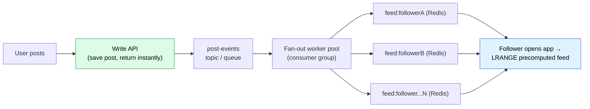
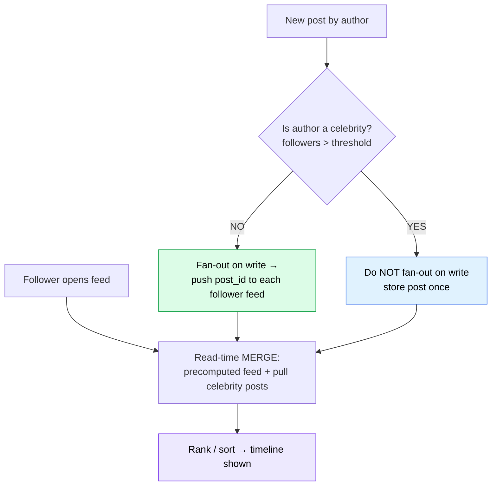

# Fan-out on Write vs Read

## 1. Why Should I Care About This?
- **The Classic "Design Twitter" Question**: Almost every senior system-design interview eventually reaches "how do you build a home timeline / newsfeed?" The entire answer hinges on this one trade-off.
- **It Decides Where You Pay**: Every social feed pays a latency cost *somewhere* — either on the write (precompute the feed when someone posts) or on the read (assemble the feed when someone opens the app). You cannot avoid the cost; you can only choose where it lands.
- **The Celebrity Problem Is Universal**: The moment one account has 100M followers, the "obvious" design (fan-out on write) explodes into 100M writes for a single tweet. Understanding this teaches you about hot keys, write amplification, and async queues all at once.

## 2. What Problem Does This Solve?
- **Feed Assembly at Scale**: A user follows 200 people; each opens the app expecting a fresh, time-ordered timeline in <200ms. Doing that naively for hundreds of millions of users is the core problem.
- **Read/Write Imbalance**: Social feeds are read-heavy (users scroll far more than they post — often 100:1). The design must optimize the common path.
- **Naive Approach**: On every feed open, run `SELECT * FROM posts WHERE author IN (my 200 follows) ORDER BY time LIMIT 50`. This works for 1,000 users and collapses at 100M — every read touches hundreds of rows across the whole dataset.

## 3. Core Idea (Intuition First)
Think of it like **a newspaper subscription**.
- **Fan-out on Write (Push)** = the printing press stuffs a copy of each article into **every subscriber's mailbox** the moment it's written. When you check your mailbox (read), everything is already there — instant. But printing a copy for 100M mailboxes is enormous work.
- **Fan-out on Read (Pull)** = nothing is pre-delivered. When you want news, you **run to every author's house** and collect their latest articles yourself, then sort them. Cheap for the authors (they write once), exhausting for you every single morning.
- **Hybrid** = normal authors mail you their articles (push); the one mega-celebrity whose column everyone reads is fetched on demand (pull) and merged in — because mailing 100M copies of *her* column would jam the whole postal system.


> Left: push precomputes every follower's feed on POST — reads are instant, but a celebrity with 100M followers means 100M writes per post. Right: pull assembles the feed on OPEN by merging the authors you follow — writes are one row, reads do all the work. Bottom: real systems go hybrid — push the long tail, pull celebrities, merge at read time.

## 4. How It Actually Works
### 1. Fan-out on Write (Push)
- User posts → the post is saved once → a **fan-out worker** looks up the author's follower list → writes the `post_id` into **each follower's precomputed feed** (a per-user list in Redis).
- The fan-out runs **asynchronously through a message queue**, so posting returns instantly (the 100M writes happen in the background).
- Reading is trivial: `LRANGE feed:{user_id} 0 49` — the feed is already assembled.

### 2. Fan-out on Read (Pull)
- User posts → save one row. Done. Writes are O(1).
- User opens feed → query the recent posts of everyone they follow, **merge and sort by time** at read time.
- Read cost scales with how many people you follow and how much they posted.

### 3. The Fan-out Worker Queue
- Post events land on a topic; a **pool of fan-out workers** (a consumer group) drains it and does the follower writes.
- This decouples posting latency from fan-out cost and lets you scale workers independently during spikes.



## 5. Real-World Example
**Designing the Twitter / Instagram home timeline:**
- **Normal user — Alice, 200 followers.** She tweets. Fan-out on write = **200 writes** to 200 Redis feed lists. Trivial. Every follower's timeline is instantly ready. Push is perfect here.
- **Celebrity — a pop star with 100M followers.** One tweet with fan-out on write = **100,000,000 writes**. At even 100k writes/sec that's ~17 minutes of churn *per tweet*, and it hammers Redis. Push is a disaster here.
- **The hybrid threshold.** Pick a follower cutoff (say **~10,000–1M**, tuned to your write budget). Below it → push. Above it → **don't fan out on write**; store the celebrity's posts once and **pull + merge** them at read time.
- **Rough cost math.** Average user has ~200 followers, so a typical post = ~200 cheap writes. A read merges one precomputed feed with a handful of followed celebrities' recent posts — usually <10 extra pulls. So writes stay bounded (no 100M explosion) and reads stay fast (mostly precomputed). This is why Twitter's real system historically mixed both.

## 6. Code Example
Both paths plus the hybrid branch (Python-ish pseudocode):
```python
CELEBRITY_THRESHOLD = 1_000_000

# --- FAN-OUT ON WRITE (push), run by an async fan-out worker ---
def fan_out_on_write(post_id, author_id):
    followers = db.get_followers(author_id)
    if len(followers) > CELEBRITY_THRESHOLD:
        return                                   # HYBRID: skip push for celebrities
    for follower in followers:                   # the write amplification
        feed_cache[follower].push(post_id)       # LPUSH feed:{follower} post_id

# --- FAN-OUT ON READ (pull) + HYBRID merge at read time ---
def build_timeline(user_id):
    feed = feed_cache[user_id].range(0, 50)      # precomputed (pushed) posts
    celebs = [a for a in db.following(user_id)
              if db.follower_count(a) > CELEBRITY_THRESHOLD]
    pulled = db.query(                            # pull celebrity posts on read
        "SELECT post_id FROM posts WHERE author IN (:celebs) ORDER BY time DESC LIMIT 50",
        celebs)
    return rank_and_merge(feed, pulled)[:50]      # merge precomputed + pulled, then rank
```

## 7. Design Variations & Alternatives
- **Pure Push**: precompute everything. Best read latency; dies on celebrities and wastes writes on inactive users.
- **Pure Pull**: assemble on read. Cheapest writes; slow reads for users following many.
- **Hybrid (recommended)**: push the long tail, pull celebrities, merge at read — the industry default.
- **Inactive-user optimization**: don't push to dormant accounts; rebuild their feed on next login (pull-style) to save wasted writes.



## 8. Pros and Cons
### Pros
- **Push**: instant reads (feed precomputed); read path is a single cache lookup.
- **Pull**: cheap O(1) writes; no wasted work on inactive followers; always fresh.
- **Hybrid**: bounded writes *and* fast reads — best of both.

### Cons
- **Push**: write amplification; the celebrity fan-out explosion; storage for millions of feed copies; wasted writes to inactive users.
- **Pull**: expensive reads; slow for users following thousands; heavy DB load on the read path.
- **Hybrid**: more complex — two code paths, a threshold to tune, and a read-time merge to maintain.

## 9. Failure Scenarios & What Can Go Wrong
- **The Celebrity Fan-out Explosion**: pure push + a 100M-follower account = one post triggers 100M writes, saturating the queue and Redis (a classic **hot key**).
- **Fan-out Lag**: during a spike, the worker queue backs up and some followers see the post minutes late — feeds become inconsistent.
- **Wasted Writes**: pushing to tens of millions of inactive accounts that never open the app burns write capacity for feeds nobody reads.
- **Merge Skew (hybrid)**: if celebrity pulls and the precomputed feed aren't ordered/ranked consistently, the timeline looks jumbled or duplicates appear.

## 10. Impact on Scalability, Reliability & Cost
- **Scalability**: hybrid scales because writes are bounded (celebrities excluded from push) and reads are mostly precomputed cache hits.
- **Reliability**: async fan-out via a queue means posting stays available even when fan-out lags; workers retry independently.
- **Cost**: push trades **storage + write cost** for read speed; pull trades **read compute** for cheap writes. Feeds living in Redis dominate the memory bill; the threshold directly controls it.

## 11. When NOT to Use This
- **Tiny Scale**: a forum with 5,000 users — just run the naive `SELECT ... WHERE author IN (following)` on read. Fan-out infrastructure is overkill.
- **No Follower Fan-out**: chat/DMs or a linear activity log don't have the one-to-many follower explosion, so this pattern doesn't apply.
- **Symmetric, Small Graphs**: if nobody has more than a few hundred connections, pure push alone is fine — no hybrid complexity needed.

## 12. Interview Perspective
- **What interviewers expect**: name both models, state the trade-off (push = fast reads/costly writes, pull = cheap writes/costly reads), then propose the **hybrid** and defend a threshold.
- **Common question**: "How do you handle a celebrity with 100M followers?" (Answer: exclude them from fan-out on write; pull their posts at read time and merge — plus run fan-out async through a queue.)
- **Bonus signal**: mention the async fan-out queue, inactive-user optimization, and that feeds live in Redis.

## 13. Connections to Other Topics
- [Message Queues & Pub/Sub](../08_Communication_Protocols/Message_Queues_PubSub.md) — the pub/sub fan-out mechanics this pattern rides on.
- [Consumer Groups & Rebalancing](./Consumer_Groups_Rebalancing.md) — the fan-out worker pool is a consumer group draining a post-events topic.
- [Hot Key Problem & Multi-Tier Caching](../06_Caching_Performance/Hot_Key_Problem_Multi_Tier_Caching.md) — the celebrity is a hot key; the same celebrity problem shows up in caching.
- [High-Level Design exercises](../03_High_Level_Design/) — the newsfeed/timeline system-design exercise.

## 14. Visual Aids
- **The SVG above** ([fanout_write_vs_read.svg](../assets/fanout_write_vs_read.svg)): push half (many green write arrows into follower feeds), pull half (blue read-time pulls + merge), and the hybrid strip merging both.
- **Mermaid #1 (Section 4)**: the push pipeline — Post → queue → worker pool → per-follower Redis feed → instant read.
- **Mermaid #2 (Section 7)**: the hybrid decision — celebrity? pull-at-read : push-on-write, then a read-time merge + rank.

## 15. Summary (TL;DR)
**Feed fan-out is a choice of where to pay: fan-out on write (push) precomputes every follower's feed the moment someone posts — giving instant reads but suffering write amplification and the celebrity explosion (one 100M-follower post = 100M writes) — while fan-out on read (pull) stores each post once and assembles the timeline by merging your follows at read time, giving cheap writes but expensive, slow reads; real systems like Twitter and Instagram go hybrid, pushing the long tail (average ~200 followers) into precomputed Redis feeds while pulling celebrities on read and merging them in, running the write fan-out asynchronously through a queue so posting returns instantly.**

## 16. Further Reading & Resources
- [System Design Interview – Design a News Feed (ByteByteGo / Alex Xu)](https://bytebytego.com/courses/system-design-interview/design-a-news-feed-system)
- [Twitter Engineering: The Infrastructure Behind Twitter Timelines](https://blog.twitter.com/engineering/en_us/topics/infrastructure/2017/the-infrastructure-behind-twitter-scale)
- [Instagram Engineering Blog](https://instagram-engineering.com/)
- [Grokking the System Design Interview – Designing Twitter](https://www.designgurus.io/course/grokking-the-system-design-interview)
- [Redis: Building a Twitter clone](https://redis.io/docs/latest/develop/tutorials/twitter-clone/)
