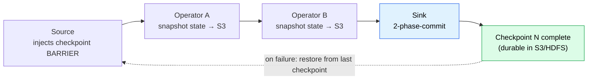
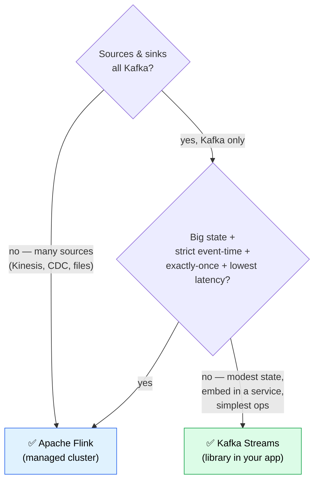

# Kafka Streams vs Flink (Stateful Stream Processing)

> This is the **senior extension** of [Stream_Processing.md](./Stream_Processing.md). Windowing, tumbling/sliding/session windows, and the "why real-time" pitch are assumed known — here we go deep on **deployment model**, **state stores**, **checkpointing / exactly-once**, and **watermarks & late events**.

## 1. Why Should I Care About This?
- **It's the #1 "which tool?" question** in streaming system design. "We're doing real-time X" always leads to "Kafka Streams or Flink?" — and the answer hinges on *how much state, how many sources, and how strict the correctness*.
- **Getting it wrong is expensive**: standing up a Flink cluster for a Kafka-in/Kafka-out microservice buys you a JobManager, TaskManagers, and an ops burden you didn't need. Cramming a 5 TB stateful join with multi-source event-time correctness into a Kafka Streams library ends in pain.
- **State is the whole ballgame**: both remember things (running totals, joins, sessions). *Where* that state lives and *how* it survives a crash is what separates the two — and what interviewers probe.

## 2. What Problem Does This Solve?
- **"Do I need a cluster?"**: Kafka Streams says no — it's a jar you embed. Flink says yes — it's a framework that runs your job.
- **Surviving failure with correct state**: a node holding 50 GB of running aggregates dies. How is that state rebuilt without recomputing from the beginning of time? (Changelog replay vs. checkpoint restore.)
- **Out-of-order reality**: mobile events arrive minutes late, out of sequence. Naive processing-time windows silently produce wrong numbers. Watermarks make "how complete is my window?" an explicit, tunable decision.

## 3. Core Idea (Intuition First)
- **Kafka Streams is a power tool you hold**: like a cordless drill. You bring it to the job (your app), plug in the battery (a Kafka topic), and it's part of *your* hands. No workshop required. But it only drills into Kafka.
- **Flink is a factory floor**: a whole plant (JobManager + TaskManagers) that you feed raw material from many conveyor belts (Kafka, Kinesis, files, CDC), and it runs the assembly line as a dataflow graph — heavier to stand up, but it handles enormous throughput and takes snapshots of the whole line so it can resume mid-job after a power cut.


> Two halves: (A) **deployment** — Streams is a jar in your pods (state in local RocksDB + changelog topic) while Flink is a cluster (state checkpointed to S3/HDFS). (B) **time** — events flow in event-time order, a watermark marks "how far event-time has progressed," and a late event arriving behind it is dropped or side-output.

## 4. How It Actually Works
### Deployment
- **Kafka Streams**: a **library**. `main()` builds a topology and calls `streams.start()`. To scale, run more instances of the *same app* in the same `application.id` — they form a **consumer group** and partitions rebalance across them. No master, no cluster, Kafka-in/Kafka-out only.
- **Flink**: a **cluster**. A **JobManager** schedules and coordinates; **TaskManagers** run the operator subtasks (parallelism = slots). Reads/writes many connectors (Kafka, Kinesis, JDBC, files, CDC). Richer APIs (DataStream, SQL, CEP).

### State
- **Streams**: each instance keeps state in an embedded **RocksDB** store on local disk, and every update is also written to a compacted **changelog topic** in Kafka. Instance dies → a new one **replays the changelog** to rebuild its store. Kafka *is* the durable backup.
- **Flink**: state lives in a configurable **state backend** (heap or RocksDB) and is periodically **checkpointed** as a consistent distributed snapshot to durable storage (S3/HDFS). **Savepoints** are manual, versioned snapshots for upgrades and job migration.

### Exactly-once via checkpoint barriers
- Flink injects a **checkpoint barrier** into the source stream. As it flows through the dataflow graph, each operator snapshots its state the moment the barrier passes (the **Chandy-Lamport** distributed-snapshot algorithm). Combined with **two-phase-commit** sinks, this gives true **end-to-end exactly-once**.
- Kafka Streams gets exactly-once (**EOS**) a different way: `processing.guarantee=exactly_once_v2` wraps consume→process→produce (including the state-store changelog write and offset commit) in a single **Kafka transaction**.



### Time & watermarks
- **Event time** = when the event actually happened (embedded timestamp). **Processing time** = wall-clock when the operator sees it.
- A **watermark** is a marker in the stream asserting "event-time has progressed to T; expect nothing older." Windows fire when the watermark passes their end.
- **Late events** (event-time < current watermark): with **allowed lateness** they can still update a fired window; beyond that they're dropped or routed to a **side output** for separate handling. This is *the* mechanism for correctness under out-of-order data.

## 5. Real-World Example
**Real-time fraud / metrics — two companies, two right answers:**

- **A payments microservice picks Kafka Streams.** The team already runs on Kafka: card authorizations land in an `auth-events` topic and they need "count declines per card in the last 5 minutes, flag > 3." Kafka-in, Kafka-out. They deploy the Streams jar **as just another Kubernetes pod** — no new cluster, no new on-call surface. Scaling is `kubectl scale`: more pods join the consumer group and partitions rebalance. Per-card counts sit in local RocksDB backed by a changelog topic; a dead pod's replacement replays the changelog. Simplest ops for a Kafka-native, embedded use case.

- **Uber / Netflix / Alibaba-scale runs Flink.** Now the job is *huge*: join a firehose of trip/click events against user-profile CDC **and** a Kinesis feed, keep **terabytes** of keyed state, honor **event time** (mobile events arrive seconds-to-minutes late), and guarantee **exactly-once** into a downstream store. That's a Flink job: JobManager + a TaskManager fleet, state in RocksDB checkpointed to S3, watermarks driving event-time windows, savepoints for zero-loss upgrades. Uber's fraud/metrics platforms and Alibaba's Singles'-Day pipelines are exactly this — state size, source count, and correctness bar all point to Flink. (Netflix's Keystone routes trillions of events/day through Flink.)

## 6. Code Example
Same job — "count events per key in 5-minute tumbling windows" — in each framework.

```java
// KAFKA STREAMS (Java) — a library; state materialized in a local store + changelog
StreamsBuilder builder = new StreamsBuilder();
KStream<String, String> events = builder.stream("events");

events.groupByKey()
      .windowedBy(TimeWindows.ofSizeWithNoGrace(Duration.ofMinutes(5)))
      .count(Materialized.as("counts-store"))   // RocksDB store, backed by changelog topic
      .toStream()
      .to("per-key-counts");

KafkaStreams streams = new KafkaStreams(builder.build(), props); // exactly_once_v2 in props
streams.start();   // runs inside THIS app — scale by launching more instances (consumer group)
```

```java
// FLINK (Java DataStream) — a job submitted to a cluster; event-time + watermarks
DataStream<Event> events = env.fromSource(kafkaSource,
        WatermarkStrategy.<Event>forBoundedOutOfOrderness(Duration.ofSeconds(30))
                         .withTimestampAssigner((e, ts) -> e.eventTime), "kafka");

events.keyBy(e -> e.key)
      .window(TumblingEventTimeWindows.of(Time.minutes(5)))
      .process(new CountFn());   // state checkpointed to S3/HDFS; exactly-once via barriers
// env.execute(): JobManager schedules operators onto TaskManagers
```

## 7. Design Variations & Alternatives
- **Spark Structured Streaming**: micro-batch (and continuous) processing; great if you already live in the Spark/lakehouse ecosystem, weaker on true low-latency event-time.
- **ksqlDB**: SQL layer *on top of* Kafka Streams — same engine, less code, less control.
- **Kafka Streams vs Flink** is the core decision:



## 8. Pros and Cons
### Kafka Streams
- **Pros**: no cluster; deploy like any app; elastic via consumer groups; simplest ops; tight Kafka integration.
- **Cons**: Kafka-only I/O; state bounded by local disk; event-time/late-data handling less rich than Flink; large state = slow rebalances/restores.

### Flink
- **Pros**: many sources/sinks; huge distributed state; best-in-class event-time & watermarks; true end-to-end exactly-once; savepoints for safe upgrades; DataStream/SQL/CEP APIs.
- **Cons**: you operate a cluster (JobManager/TaskManagers); more moving parts; checkpoint tuning and backpressure are real skills.

## 9. Failure Scenarios & What Can Go Wrong
- **Streams state rebuild is slow**: an instance with a 100 GB changelog dies; the replacement must **replay the whole changelog** before it's ready. Mitigation: **standby replicas** (`num.standby.replicas`) keep warm copies.
- **Flink checkpoint failures**: heavy backpressure makes barriers slow to align; checkpoints time out and the job can't make a durable snapshot. Mitigation: unaligned checkpoints, incremental RocksDB checkpoints, larger timeouts.
- **Watermark misconfiguration**: too-aggressive watermarks drop legitimate late data (silent data loss); too-lax ones make windows fire late and balloon state. This is the classic correctness footgun.
- **Rebalance storms (Streams)**: frequent scaling/instance churn triggers repeated partition rebalances, pausing processing. Mitigation: static membership, cooperative rebalancing.

## 10. Impact on Scalability, Reliability & Cost
- **Scalability**: Streams scales to the partition count of its input topics (one consumer group). Flink scales operator parallelism independently across a TaskManager fleet — higher ceiling.
- **Reliability**: Streams leans on Kafka (changelog + transactions); Flink leans on checkpoints to external durable storage. Both reach exactly-once.
- **Cost**: Streams adds ~zero infra beyond your app + changelog topics. Flink adds a standing cluster and object-storage checkpoint traffic — real money, justified only by scale/complexity.

## 11. When NOT to Use This
- **Don't run Flink** for a Kafka-in/Kafka-out job with modest state — the cluster is pure overhead; use Kafka Streams (or ksqlDB).
- **Don't force Kafka Streams** when you need many non-Kafka sources, terabytes of state, or the richest event-time semantics — you'll reimplement Flink badly.
- **Don't reach for either** if you don't need state or real-time at all — a batch job or a simple stateless consumer is cheaper (see [Stream_Processing.md](./Stream_Processing.md) §11).

## 12. Interview Perspective
- **What interviewers expect**: crisp articulation that Streams is a **library** (no cluster, consumer-group scaling, RocksDB + changelog) and Flink is a **cluster** (JobManager/TaskManager, checkpoints/savepoints, many sources). Bonus: *how* each achieves exactly-once.
- **Common question**: *"How does Flink guarantee exactly-once?"* → checkpoint **barriers** flow through the dataflow (Chandy-Lamport snapshot), each operator snapshots state to durable storage, and **two-phase-commit** sinks make it end-to-end; on failure the job restores from the last completed checkpoint.
- **Follow-up**: *"What are watermarks and why do they matter?"* → they track event-time progress so windows know when to fire, and they define which events are "late" (dropped or side-output) — the correctness knob for out-of-order data.

## 13. Connections to Other Topics
- [./Stream_Processing.md](./Stream_Processing.md) — the windowing/basics **foundation**; this file is the stateful/senior extension. Don't re-derive tumbling/sliding windows there — build on them.
- [./Exactly_once_Semantics.md](./Exactly_once_Semantics.md) — checkpointing + transactional/2PC sinks are *how* exactly-once is actually achieved in stream processing.
- [./Consumer_Groups_Rebalancing.md](./Consumer_Groups_Rebalancing.md) — Kafka Streams scales and recovers by rebalancing **exactly like a consumer group**.
- [./Log_Compaction_Retention_Policies.md](./Log_Compaction_Retention_Policies.md) — Streams state-store **changelog topics are compacted**, so replay rebuilds latest-value state without unbounded growth.

## 14. Visual Aids
- **Embedded SVG** (see §3): library-in-your-pods vs. JobManager/TaskManager cluster, plus the event-time/watermark/late-event timeline. Full file: [`../assets/streams_vs_flink.svg`](../assets/streams_vs_flink.svg).
- **Mermaid #1** (§4): checkpoint barrier flowing through operators → snapshot to durable store → restore on failure = exactly-once.
- **Mermaid #2** (§7): the pick-one decision tree (Kafka-only + embed + simple → Streams; multi-source + big state + event-time + strict EOS → Flink).

## 15. Summary (TL;DR)
**Kafka Streams is a library and Flink is a cluster — that single distinction drives everything else. Streams embeds in your app (no cluster), scales by consumer-group rebalancing, keeps state in local RocksDB backed by a compacted Kafka changelog topic, and gets exactly-once via Kafka transactions — perfect for embedded, Kafka-native microservices with modest state and the simplest ops. Flink runs your job as a dataflow graph on a JobManager + TaskManagers, ingests many sources, snapshots huge distributed state via Chandy-Lamport checkpoint barriers to S3/HDFS (savepoints for upgrades, two-phase-commit sinks for true end-to-end exactly-once), and has the richest event-time/watermark/late-event handling — the right call for large-scale, multi-source, low-latency, correctness-critical jobs. Pick by state size, source count, and event-time strictness.**

## 16. Further Reading & Resources
- [Apache Flink: Stateful Stream Processing & Checkpointing](https://nightlies.apache.org/flink/flink-docs-stable/docs/concepts/stateful-stream-processing/) — barriers, state backends, exactly-once.
- [Flink: Event Time & Watermarks](https://nightlies.apache.org/flink/flink-docs-stable/docs/concepts/time/) — the definitive treatment of late events and allowed lateness.
- [Confluent: Kafka Streams Architecture](https://docs.confluent.io/platform/current/streams/architecture.html) — state stores, changelog topics, and rebalancing.
- ["Lightweight Asynchronous Snapshots for Distributed Dataflows"](https://arxiv.org/abs/1506.08603) — the Flink checkpointing (Chandy-Lamport) paper.
- [Kleppmann, *Designing Data-Intensive Applications*, Ch. 11](https://dataintensive.net/) — stream processing, exactly-once, and event time.
