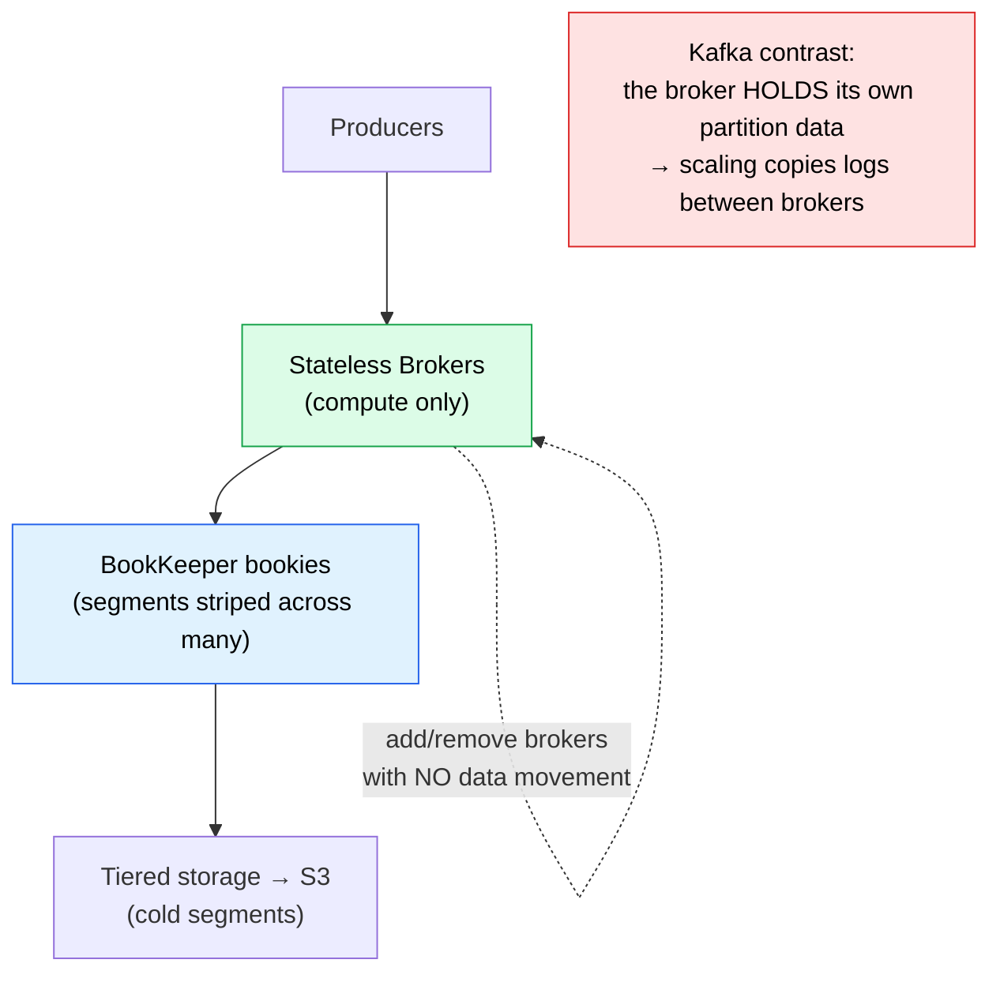
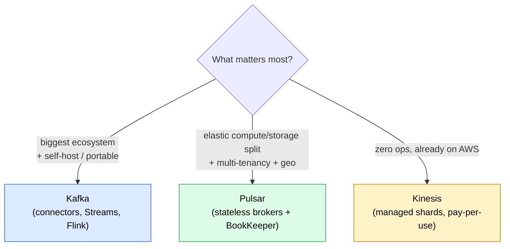

# Kafka vs Pulsar vs Kinesis (Broker Architecture)

## 1. Why Should I Care About This?
- **They look identical, they aren't**: All three are durable, partitioned, replayable logs. Pick on the surface ("they all stream events") and you inherit the wrong *storage architecture* — which decides how you scale, what you pay, and who you page at 3 AM.
- **The scaling bill is architectural**: Kafka *rebalancing* physically copies terabytes between brokers to add capacity; Pulsar adds a stateless broker in seconds; Kinesis just needs a `--shard-count` bump. Same "add capacity," wildly different cost and risk.
- **Lock-in is a one-way door**: Choosing Kinesis buys zero-ops but welds you to AWS. Choosing Kafka/Pulsar buys portability but hands you an ops team. This is a multi-year commitment interviewers love to probe.

## 2. What Problem Does This Solve?
- **Compute/storage coupling**: A Kafka broker both *serves* and *stores* its partitions. Storage and traffic grow together even when you only need one — the problem Pulsar's split and Kinesis's managed model each attack differently.
- **Operational burden**: Running ZooKeeper/KRaft, brokers, and rebalancing is a full-time job. Kinesis deletes that job entirely; Pulsar reshapes it.
- **Naive approach**: "Kafka is the standard, always use Kafka." Fine until you're a 3-person startup already all-in on AWS, or a SaaS needing hard tenant isolation.

## 3. Core Idea (Intuition First)
All three are the same **append-only log** underneath. The difference is **where the log's bytes physically live** and **who operates the machines**.
- **Kafka — the librarian who owns the shelves**: Each broker holds *its own* books on *its own* shelves. Want more shelf space? Hire a librarian and physically carry half the books over (rebalancing).
- **Pulsar — reception desk + a separate warehouse**: Brokers are a stateless front desk; the books live in a shared BookKeeper warehouse, sliced into segments spread across many shelves. Add desk staff without moving a single book.
- **Kinesis — a storage company you never visit**: You hand AWS your stream; it hides the shelves entirely. You buy space in fixed units (shards) and resize by asking for more.



> Same log idea, three storage models: **Kafka couples** compute + storage on the broker, **Pulsar splits** them (BookKeeper), **Kinesis hides** them (managed shards). Everything downstream — scaling cost, elasticity, lock-in — falls out of this one choice.

## 4. How It Actually Works
### 1. Kafka — coupled storage
- Broker = compute **and** storage. A partition's log segments sit on the broker that leads it.
- Scaling out means **rebalancing**: partition replicas are physically copied to the new broker before it can serve them.
- **KRaft** replaced ZooKeeper for metadata/consensus; **tiered storage** (offload cold segments to S3) is an opt-in add-on.

### 2. Pulsar — separated storage
- **Stateless brokers** own no data — they serve reads/writes and can be added/killed freely.
- Storage is **Apache BookKeeper**: a topic's data is a stream of **segments (ledgers)** striped across many **bookies**, not pinned to one node.
- **Tiered storage to S3** is native; **multi-tenancy** (`tenant/namespace/topic`) and **geo-replication** are first-class.



### 3. Kinesis — managed shards
- A stream is a set of **shards** (≈ partitions), each with **fixed capacity**: 1 MB/s or 1,000 records/s in, 2 MB/s out.
- Scale by **resharding** (split/merge shards); read with the **KCL** (Kinesis Client Library) or **enhanced fan-out** (dedicated 2 MB/s per consumer).
- Retention 24 h by default, extendable to 365 days. Deep AWS integration (Lambda, Firehose, IAM).

## 5. Real-World Example
- **Startup all-in on AWS → Kinesis**: A 4-engineer fintech ingests ~5 MB/s of clickstream. They provision **5 shards** (~5 MB/s in), pipe to Lambda + Firehose→S3, pay ~$0.015/shard-hour (~$55/mo for shards) + PUT payload units. **Zero servers, zero on-call for the bus.** Trade: capped at shard limits and welded to AWS.
- **Multi-tenant SaaS → Pulsar**: An analytics platform serves 400 customer tenants. Pulsar's `tenant/namespace` isolation gives each customer their own quota and retention; **tiered storage** dumps cold data to S3 so hot brokers stay lean; geo-replication mirrors EU/US. Handles ~200 MB/s across tenants; scaling ingest = add stateless brokers, no rebalance.
- **Big-data platform → Kafka**: A retailer standardizes its entire data platform (CDC, Flink, 300+ connectors) on Kafka at ~1 GB/s across a 30-broker cluster. The **ecosystem** (Connect, Streams, Schema Registry) is the whole reason; they pay for a dedicated 3-person streaming team.

## 6. Code Example
The *same* "create a stream with N partitions" across all three — note partitions vs shards:
```bash
# KAFKA — partitions live on brokers
kafka-topics.sh --create --topic orders \
  --partitions 12 --replication-factor 3 \
  --bootstrap-server localhost:9092

# PULSAR — fully-qualified name: persistent://tenant/namespace/topic
pulsar-admin topics create-partitioned-topic \
  persistent://shop/prod/orders --partitions 12
# subscription modes: exclusive | shared | failover | key_shared
pulsar-client consume persistent://shop/prod/orders -s sub1 -t Shared

# KINESIS — capacity in fixed shards (1MB/s in, 2MB/s out each)
aws kinesis create-stream --stream-name orders --shard-count 12
aws kinesis put-record --stream-name orders \
  --partition-key user123 --data "order-payload"
```

## 7. Design Variations & Alternatives
- **Kafka + tiered storage / Confluent**: closes much of Pulsar's elasticity gap without a second system.
- **Redpanda**: Kafka-API-compatible, C++, no JVM/ZooKeeper — simpler ops, same coupled model.
- **Google Pub/Sub**: the GCP analog of Kinesis (managed, no shard math, auto-scaling).



## 8. Pros and Cons
### Kafka
- **Pros**: Largest ecosystem, mature, portable, KRaft simplifies ops, huge talent pool.
- **Cons**: Coupled storage → rebalancing moves data; self-hosting is ops-heavy.

### Pulsar
- **Pros**: Independent compute/storage scaling, native tiered storage, multi-tenancy, geo-replication, unified queue + stream (subscription modes).
- **Cons**: Two systems to run (brokers **and** bookies + metadata); smaller ecosystem/community.

### Kinesis
- **Pros**: Zero infrastructure, tight AWS integration, pay-per-use, enhanced fan-out.
- **Cons**: Fixed per-shard throughput, shard/quota limits, AWS lock-in, pricier at very high scale.

## 9. Failure Scenarios & What Can Go Wrong
- **Kafka rebalance storm**: Adding brokers during peak triggers massive partition reassignment; the copy traffic saturates the network and *slows the very cluster you tried to grow*.
- **Pulsar bookie shortage**: If too few bookies are up to satisfy the write quorum (ack quorum), writes stall — the storage tier's health is now a separate failure domain from brokers.
- **Kinesis `ProvisionedThroughputExceeded`**: A hot partition key sends all traffic to one shard; you exceed 1 MB/s on that shard and get throttled while other shards sit idle (the shard equivalent of a hot partition).

## 10. Impact on Scalability, Reliability & Cost
- **Scalability**: Pulsar scales compute and storage *independently* (its headline win); Kafka scales both together and pays a data-movement tax; Kinesis scales in fixed shard steps.
- **Reliability**: All replicate for durability — Kafka via partition replicas (ISR), Pulsar via BookKeeper quorums, Kinesis via AWS-managed 3-AZ replication.
- **Cost**: Kinesis = low ops cost, usage-based (can get expensive at GB/s). Kafka/Pulsar = infra + a team, but cheaper per-byte at massive, steady scale.

## 11. When NOT to Use This
- **Don't pick Kafka** if you're a tiny team on AWS with no streaming expertise — the ops burden dwarfs the workload.
- **Don't pick Pulsar** unless you actually need its differentiators (multi-tenancy, elastic split, geo); otherwise you're running two systems for one job.
- **Don't pick Kinesis** if you need portability/multi-cloud, sustained multi-GB/s, or sub-millisecond latency — the shard limits and lock-in bite.

## 12. Interview Perspective
- **What interviewers expect**: Explain the **compute/storage coupling axis** — Kafka couples, Pulsar splits, Kinesis hides — and why that dictates scaling behavior. Know **partitions vs shards** is mostly vocabulary over the same idea.
- **Common question**: *"You need to double throughput at peak — walk me through it for each."* (Kafka: add brokers + rebalance, watch copy traffic; Pulsar: add stateless brokers instantly; Kinesis: reshard / bump `--shard-count`.)

## 13. Connections to Other Topics
- [Kafka Architecture](./Kafka_Architecture.md) — the baseline this compares against (partitions, brokers, replication).
- [RabbitMQ vs Kafka](./RabbitMQ_vs_Kafka.md) — the other broker-choice comparison (queue-broker vs log).
- [Log Compaction & Retention Policies](./Log_Compaction_Retention_Policies.md) — retention + tiered storage differ sharply across the three.
- [Cloud-Native Infrastructure](../13_Cloud_Native_Infrastructure/) — managed vs self-hosted operational trade-offs.

## 14. Visual Aids
- **The Storage-Model Diagram** (`../assets/kafka_pulsar_kinesis.svg`): three columns showing coupled (Kafka) vs split (Pulsar/BookKeeper) vs hidden (Kinesis) storage, plus the "where does partition data live" band.
- **Pulsar Flow (Mermaid #1)**: Producers → stateless brokers → BookKeeper bookies (segments) → S3 tier, contrasted with Kafka's self-storing broker.
- **Decision Tree (Mermaid #2)**: ecosystem/self-host → Kafka; elastic + multi-tenant + geo → Pulsar; zero-ops on AWS → Kinesis.

## 15. Summary (TL;DR)
**Kafka, Pulsar, and Kinesis are all durable, partitioned, replayable logs that differ on one decisive axis — storage architecture. Kafka couples compute and storage on the broker (mature, largest ecosystem, KRaft, tiered storage as an add-on, but scaling rebalances and copies data and it's ops-heavy to self-host). Pulsar splits stateless brokers from BookKeeper storage so compute and storage scale independently with no data movement, adding native tiered storage, multi-tenancy, geo-replication, and unified stream+queue subscription modes (exclusive/shared/failover/key_shared) — at the cost of running two systems. Kinesis hides everything behind AWS-managed shards with fixed per-shard throughput (1 MB/s in, 2 MB/s out), resharding to scale and the KCL/enhanced fan-out to read — zero ops but AWS-locked with shard limits. Partitions vs shards is mostly vocabulary; the real trade is elasticity vs operational simplicity vs lock-in: standardize a self-hosted platform on Kafka, pick Pulsar for elastic multi-tenant streaming, and reach for Kinesis when you're on AWS and want zero servers to run.**

## 16. Further Reading & Resources
- [Apache Kafka Documentation](https://kafka.apache.org/documentation/)
- [Apache Pulsar — Architecture Overview](https://pulsar.apache.org/docs/concepts-architecture-overview/)
- [Amazon Kinesis Data Streams Developer Guide](https://docs.aws.amazon.com/streams/latest/dev/introduction.html)
- [StreamNative: Pulsar vs Kafka](https://streamnative.io/blog/pulsar-vs-kafka-part-1-a-more-accurate-perspective-on-performance-architecture-and-features)
- [Confluent: Kafka Tiered Storage](https://docs.confluent.io/platform/current/kafka/tiered-storage.html)
