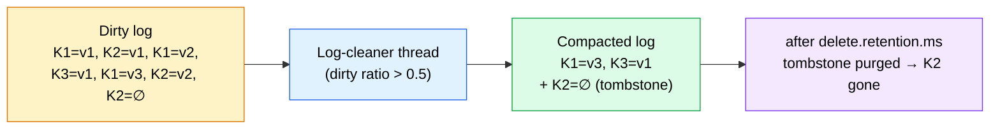
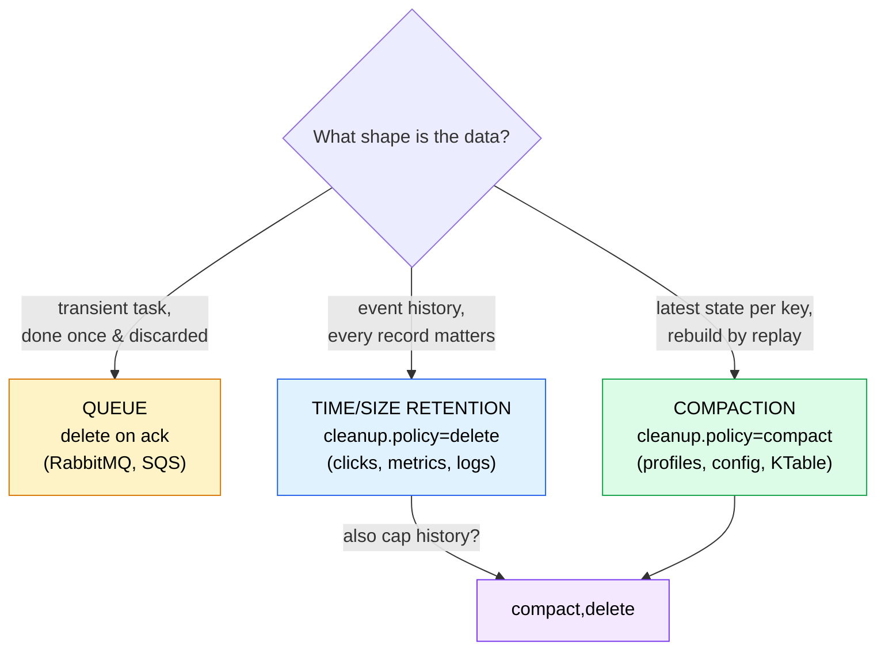

# Log Compaction & Retention Policies

## 1. Why Should I Care About This?
- **A log can't grow forever**: A topic taking 1,000,000 events/sec fills a disk in hours. Retention and compaction are *how* an "infinite" log stays finite — the difference between a durable system and a full-disk outage.
- **It changes what a topic MEANS**: The same append-only log is a transient **queue**, a replayable **event stream**, or a durable **key→value table** depending purely on its cleanup policy. One config flag flips a message bus into a database.
- **Kafka runs on it**: `__consumer_offsets` (who read what) and Kafka Connect's config/status topics are *compacted* topics. If you don't understand compaction, you don't understand how Kafka bootstraps itself.

## 2. What Problem Does This Solve?
- **Unbounded storage**: You want the durability of "keep everything" without the cost of literally keeping everything forever.
- **Slow cold starts**: A new consumer that must replay 6 months of "profile updated" events to learn the *current* profile does 100x wasted work. Compaction keeps only the latest, so bootstrap is O(keys), not O(events).
- **Naive approach**: A cron job that `DELETE`s old rows from a DB table used as a queue — locks, tombstone bloat, and no replay. The log solves this with **segment-level** deletion (drop whole files, no per-row work).

## 3. Core Idea (Intuition First)
Three ways a log forgets, like three kinds of paper:
- **Queue** = a **sticky note** you throw away the moment it's read (delete on ack).
- **Stream/log** = a **newspaper archive** — kept for 7 days so anyone can re-read, then recycled by *date* regardless of content.
- **Compacted log** = an **address book** — you only keep each person's *current* number; writing a new one erases the old, and crossing someone out (a tombstone) removes them entirely.


> Retention deletes by **AGE**; compaction deletes by being **SUPERSEDED**. A compacted topic is a durable key→latest-value table you can rebuild state from by replaying.

## 4. How It Actually Works
### 1. Segments (the unit of deletion)
- A partition is a chain of **segment files**. Only the **active (head) segment** is written to; older segments are closed and immutable.
- Retention and compaction only ever act on **closed** segments — the active segment is never deleted or compacted. `segment.ms` / `segment.bytes` control how often a new one rolls.

### 2. Time/Size Retention (`cleanup.policy=delete`)
- Once a closed segment's newest record is older than `retention.ms` (or total size exceeds `retention.bytes`), the *whole file* is dropped — cheap, O(1), key-agnostic.

### 3. Log Compaction (`cleanup.policy=compact`)
- A background **log-cleaner thread** rewrites closed segments, keeping only the **latest record per key** and discarding superseded values.
- It triggers when the "dirty ratio" (uncompacted bytes / total) exceeds `min.cleanable.dirty.ratio` (default 0.5).

### 4. Tombstones
- A record with a **key and `null` value** = a delete marker. Compaction removes all prior values for that key, then keeps the tombstone itself for `delete.retention.ms` (default 24h) so every consumer sees the delete before it too is purged.



## 5. Real-World Example
**A user-profile changelog vs. a click stream:**
- **Compacted topic `user-profiles`**: 50M users, each keyed by `user_id`. A profile is edited ~10 times over its life, so raw the topic would hold 500M records — but compacted it holds ~50M (one current value per key), roughly 10x smaller. When a new personalization service spins up, it replays the topic *once* and materializes the full current state of all 50M users into its local store — no separate "snapshot" DB needed. The log **is** the table.
- **Retention topic `click-events`**: 2B clicks/day, every click matters individually. Set `cleanup.policy=delete`, `retention.ms=604800000` (7 days); each day's segments drop off the tail after a week. Compaction would be pointless here — "latest click per session" is meaningless.
- **The contrast**: profiles care about *current state per key* → compact; clicks care about *recent history* → retain-then-delete. Same Kafka, opposite semantics, one config line.

## 6. Code Example
Kafka topic configs contrasting the two policies, plus producing a tombstone:
```bash
# STREAM: keep 7 days, then drop whole segments by age
kafka-topics.sh --create --topic click-events --partitions 12 \
  --config cleanup.policy=delete \
  --config retention.ms=604800000 \    # 7 days
  --config retention.bytes=-1 \        # no size cap (age only)
  --config segment.ms=86400000         # roll a new segment daily

# COMPACTED LOG: keep latest value per key forever
kafka-topics.sh --create --topic user-profiles --partitions 12 \
  --config cleanup.policy=compact \
  --config min.cleanable.dirty.ratio=0.5 \  # clean when 50% is stale
  --config delete.retention.ms=86400000 \   # keep tombstones 24h
  --config segment.ms=604800000             # active seg never compacted

# BOTH: compact live keys AND cap total age (compact,delete)
#   --config cleanup.policy=compact,delete --config retention.ms=2592000000

# TOMBSTONE = key + null value → deletes that key on next compaction
producer.send("user-profiles", key="user-42", value=null)  # forget user-42
```

## 7. Design Variations & Alternatives
- **`compact,delete` (both)**: Compact live keys *and* age-out everything past `retention.ms` — useful for a changelog you don't need history on beyond, say, 30 days.
- **Snapshots (Event Sourcing)**: Instead of compacting, periodically write a "current state" snapshot to a side store and truncate. Compaction is the log-native version of the same idea.
- **CDC connectors**: Debezium etc. emit naturally-compactable changelogs (latest row per PK).



## 8. Pros and Cons
### Pros
- **Bounded storage** with a meaningful policy (by age *or* by key).
- **Fast bootstrap**: a compacted topic replays to full current state in O(distinct keys).
- **Stream–table duality**: one artifact serves as both changelog and materialized table.
### Cons
- **Compaction ≠ instant**: keys are only cleaned lazily, after the dirty ratio trips and only on closed segments — stale values linger.
- **You lose history under compaction**: intermediate values are gone; if you need the full audit trail, compaction is the wrong tool.
- **Tombstone timing is subtle**: a consumer offline longer than `delete.retention.ms` can miss a delete entirely.

## 9. Failure Scenarios & What Can Go Wrong
- **Missed delete (tombstone expired)**: A consumer is down for 2 days but `delete.retention.ms=24h`. The tombstone is purged before it reconnects, so it never learns the key was deleted and keeps stale state forever.
- **Unbounded compacted topic**: You compact by key but a pathological producer creates millions of *unique* keys (e.g., keyed by UUID per event). Nothing is ever superseded, so the topic grows without bound — you wanted retention, not compaction.
- **Active segment never cleans**: Huge `segment.ms` on a low-traffic topic keeps the head segment open for months, so recent duplicate keys stay uncompacted and consumers see old values.
- **Dirty ratio too high**: `min.cleanable.dirty.ratio=0.9` means the cleaner barely runs; disk fills with superseded values.

## 10. Impact on Scalability, Reliability & Cost
- **Scalability**: Segment-level deletion is O(1) per file — retention scales to any throughput. Compaction cost scales with *distinct keys*, not total writes.
- **Reliability**: Compacted topics let a crashed service rebuild full state from the log alone — no external snapshot to drift out of sync.
- **Cost**: Compaction trades CPU/IO (the cleaner rewrites segments) for a dramatically smaller footprint on high-churn keyed data — often 5-20x storage savings.

## 11. When NOT to Use This
- **You need full history / audit**: Compaction destroys intermediate values. Use plain retention (long/infinite) or Event Sourcing with snapshots instead.
- **Records aren't keyed / keys are unique per record**: Compaction has nothing to supersede; it just adds cleaner overhead. Use time/size retention.
- **Tiny short-lived topics**: A queue that's drained in seconds doesn't need any of this — delete-on-ack is enough.

## 12. Interview Perspective
- **What interviewers expect**: Crisp articulation of the three semantics (queue vs stream vs compacted log) and that compaction deletes by *supersession*, retention by *age*.
- **Common question**: "How would a new service bootstrap current state cheaply from Kafka?" (Answer: read a **compacted** topic — it's a materialized table; replay is O(keys)).
- **Follow-up trap**: "How do you delete a key from a compacted topic?" (Answer: produce a **tombstone** — key with `null` value — kept for `delete.retention.ms`).

## 13. Connections to Other Topics
- [Kafka Architecture](./Kafka_Architecture.md) — the append-only log/segment internals that compaction and retention operate on.
- [Event Sourcing Pattern](./Event_Sourcing_Pattern.md) — snapshots vs. compaction as two ways to avoid unbounded replay.
- [Change Data Capture (CDC)](./Change_Data_Capture_CDC.md) — CDC changelogs are naturally compacted: latest row state per primary key.
- [Stream Processing](./Stream_Processing.md) — KTable and the stream–table duality; Kafka Streams state-store changelogs are compacted topics.

## 14. Visual Aids
- **SVG (Section 3)**: [log_compaction_retention.svg](../assets/log_compaction_retention.svg) — one source log split into two outcomes (delete-by-age vs. keep-latest-per-key) plus the stream–table duality callout.
- **Mermaid #1 (Section 4)**: before → cleaner → after compaction, including tombstone purge.
- **Mermaid #2 (Section 7)**: decision tree — queue vs. retention vs. compaction (and both).

## 15. Summary (TL;DR)
**A single append-only log becomes three different things depending on how it forgets: a QUEUE deletes on ack, a STREAM retains by time/size (`cleanup.policy=delete`, `retention.ms/bytes`) then drops whole old segments regardless of key, and a COMPACTED LOG (`cleanup.policy=compact`) keeps only the latest value per key forever — deleting by *supersession* rather than by *age*, with a background cleaner that triggers on `min.cleanable.dirty.ratio` and tombstones (key + `null`) that remove keys and linger for `delete.retention.ms` so consumers see the delete; the active head segment is never touched. This is the stream–table duality: replay a compacted changelog and you get a materialized key→latest-value table (KTable, `__consumer_offsets`, Connect configs), so compact for latest-state changelogs and retain-then-delete for event streams — or do both with `compact,delete`.**

## 16. Further Reading & Resources
- [Kafka Docs: Log Compaction](https://kafka.apache.org/documentation/#compaction)
- [Kafka Docs: Topic-Level Configs (cleanup.policy, retention.*, segment.*)](https://kafka.apache.org/documentation/#topicconfigs)
- [Jay Kreps: The Log — What every engineer should know about real-time data's unifying abstraction](https://engineering.linkedin.com/distributed-systems/log-what-every-software-engineer-should-know-about-real-time-datas-unifying)
- [Confluent: Kafka Streams and the Stream–Table Duality](https://docs.confluent.io/platform/current/streams/concepts.html#duality-of-streams-and-tables)
- [Confluent: Of Streams and Tables in Kafka](https://www.confluent.io/blog/kafka-streams-tables-part-1-event-streaming/)
