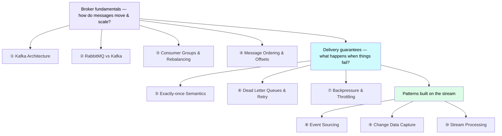
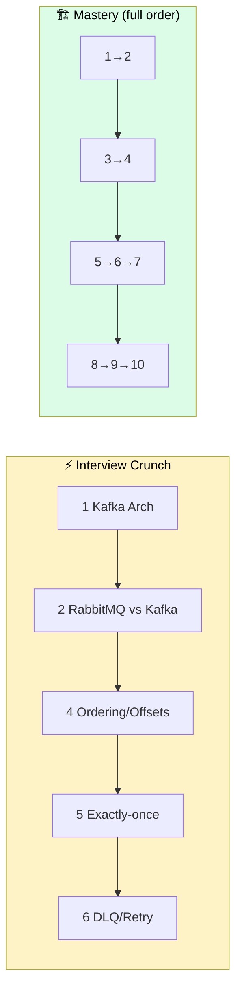

# 09 · Message Queues & Event Streaming 📨

> **Where synchronous calls become durable facts.** A queue or a log sits between a producer and a consumer so neither has to wait on, know about, or crash with the other — that's what actually makes event-driven architecture (Section 03's promise) work in production. This section covers the brokers that make it fast (Kafka, RabbitMQ), the guarantees that make it correct (ordering, exactly-once, DLQs, backpressure), and the patterns built on top (event sourcing, CDC, stream processing) that turn a stream of events into a first-class source of truth.

---

## 🎯 What You'll Be Able To Do

- **Pick the right broker for the job** — Kafka's durable, replayable log vs RabbitMQ's smart, push-based routing — and defend it with throughput/latency/routing trade-offs, not hype.
- **Scale consumption horizontally** — consumer groups, partition assignment, and rebalancing without duplicate or dropped work.
- **Reason about ordering correctly** — per-partition guarantees, partition keys, and offsets as the resumable bookmark.
- **Choose a delivery guarantee deliberately** — at-most-once vs at-least-once vs exactly-once, and what idempotence/transactions actually buy you.
- **Build a system that survives failure and floods** — dead-letter queues with backoff for poison messages, backpressure and throttling so a slow consumer never OOMs.
- **Use the stream as a product** — event sourcing for an immutable audit trail, CDC to sync systems off the DB log, and stream processing for real-time aggregation.

---

## 🗺️ How the 10 Topics Interlock



> **The spine:** *pick a broker and understand how it scales consumption and preserves order → decide what delivery guarantee the data needs and how it survives poison messages and floods → build patterns on top that treat the event log as truth.* Consumer groups (③) are meaningless without per-partition ordering (④); exactly-once (⑤) is what DLQs (⑥) and backpressure (⑦) protect around; event sourcing (⑧) and CDC (⑨) both produce the stream that stream processing (⑩) consumes in real time.

---

## 📚 The Complete File Index

| # | Topic | One-line | Key takeaway |
|---|-------|----------|--------------|
| 1 | [Kafka Architecture](./Kafka_Architecture.md) | The giant, infinite, append-only notebook | Brokers/topics/partitions; O(1) sequential disk I/O; order guaranteed only within a partition |
| 2 | [RabbitMQ vs Kafka](./RabbitMQ_vs_Kafka.md) | Post office vs bulletin board | Push + smart routing (RabbitMQ) vs pull + retained log (Kafka); pick by throughput vs routing needs |
| 3 | [Consumer Groups & Rebalancing](./Consumer_Groups_Rebalancing.md) | A team of waiters, one table each | One partition → one consumer in a group; rebalancing reassigns tables when workers join/die |
| 4 | [Message Ordering & Offsets](./Message_Ordering_Offsets.md) | The bookmark in the comic book | Order holds per-partition only; partition key keeps an entity's events together; offsets resume exactly |
| 5 | [Exactly-once Semantics](./Exactly_once_Semantics.md) | The bank check with a unique number | Idempotent producers dedupe by sequence number; transactions make read+write atomic across topics |
| 6 | [Dead Letter Queues & Retry Strategies](./Dead_Letter_Queues_Retry_Strategies.md) | The "return to sender" bin | Exponential backoff + jitter for transient failures; DLQ isolates poison messages so the queue keeps flowing |
| 7 | [Backpressure & Throttling](./Backpressure_Throttling.md) | The chef shouting "stop!" to waiters | Pull-based consumption pushes pressure back to the source; token/leaky bucket caps rate; shed load by priority |
| 8 | [Event Sourcing Pattern](./Event_Sourcing_Pattern.md) | The accountant's ledger, never erased | Store every event, not just current state; replay to rebuild; snapshot to avoid replaying millions of events |
| 9 | [Change Data Capture (CDC)](./Change_Data_Capture_CDC.md) | The professional eavesdropper on the DB log | Tail the binlog/WAL (Debezium) instead of dual writes or polling; keeps search/cache/lake in sync with zero DB impact |
| 10 | [Stream Processing](./Stream_Processing.md) | The guard watching the live feed, not the tape | Kafka Streams/Flink transform and aggregate over windows (tumbling/hopping/session) as events arrive, not in a nightly batch |

---

## 🧭 Suggested Study Paths



| Goal | Path | Why |
|------|------|-----|
| **⚡ Interview in 48h** | 1 → 2 → 4 → 5 → 6 | Broker mental model + ordering + the guarantee everyone probes on — the most-asked 80% |
| **🏗️ Deep mastery** | 1→2 → 3→4 → 5→6→7 → 8→9→10 | Broker fundamentals → scale consumption → delivery guarantees → patterns built on top |
| **🛡️ Resilience focus** | 3 → 6 → 7 | Rebalancing under load, poison-message isolation, and backpressure so nothing falls over |
| **🧩 "Design an event-driven pipeline"** | 1 → 4 → 9 → 10 | Broker choice → ordering → get data onto the stream (CDC) → do something with it in real time |

> **Study each file by** doing the 🏋️ **Practice Drills before the solutions**, rehearsing the 🎤 **Interview Q&A out loud**, and reading 🎯 **Staff+ Nuances** for senior-level depth.

---

## 🔑 The Decision Card (whole-section cheat sheet)

```
BROKER    Kafka = durable replayable log, pull-based, horizontal scale, high throughput ·
          RabbitMQ = smart broker, push-based, complex routing, low latency, deletes on ACK ·
          order guaranteed ONLY within a partition/queue, never across the whole topic
SCALE     consumer group = 1 partition → 1 consumer at a time · rebalance on join/leave/crash ·
          more consumers than partitions = idle workers · partition key pins an entity's order
DELIVERY  at-most-once (may lose) · at-least-once (default, may duplicate) ·
          exactly-once = idempotent producer (seq+id dedup) + transactions (atomic read+write) + read_committed
FAILURE   retry with EXPONENTIAL BACKOFF + jitter (no thundering herd) ·
          DLQ after N failures isolates poison messages so the main queue keeps moving
FLOW      backpressure = pull-based consumption signals the source to slow down, not crash ·
          throttling = token/leaky bucket caps RATE · load shedding drops low-priority work under stress
PATTERNS  event sourcing: the STREAM is truth, DB table is a cache; snapshot to avoid full replay ·
          CDC: tail the binlog/WAL (Debezium), never dual-write, zero perf hit on the source DB ·
          stream processing: transform/aggregate over WINDOWS (tumbling/hopping/session) as events arrive
RECURRING pick durability+replay (Kafka/log) or simplicity+routing (RabbitMQ/queue) — rarely both for free
```

---

## 🎨 Conventions & Authoring

- Every file follows the root [TEMPLATE.md](../TEMPLATE.md). Animated SVGs live in [/assets](../assets/).
- Each file ends with the three mastery sections: 🏋️ Practice Drills, 🎤 Interview Q&A Bank, 🎯 Staff+ Nuances.

---

## ➡️ Where This Connects

- ⬅️ Built on [03 · High-Level Design](../03_High_Level_Design/) — event-driven architecture is the "why"; this section is the runtime that makes it real.
- ⬅️ [08 · Communication Protocols](../08_Communication_Protocols/) — pub/sub and async messaging patterns that brokers implement concretely.
- ➡️ [05 · Databases & Storage](../05_Databases_Storage/) — CDC and the transactional outbox feed events onto the stream from the data tier.
- ➡️ [10 · Microservices & Distributed Systems](../10_Microservices_Distributed_Systems/) — Sagas, service-to-service events, and distributed workflows run on top of these guarantees.

---
*Part of the [System Design & Architecture Master Repository](../README.md). Decouple here, and every downstream service can scale, fail, and deploy on its own clock.*
