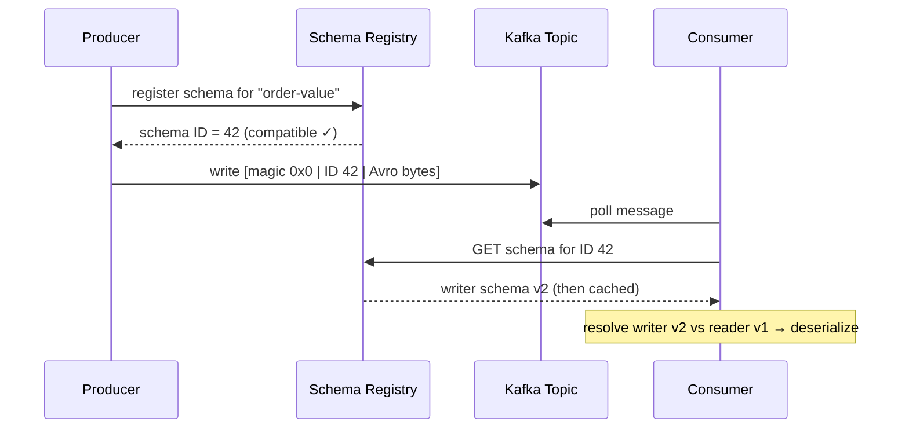
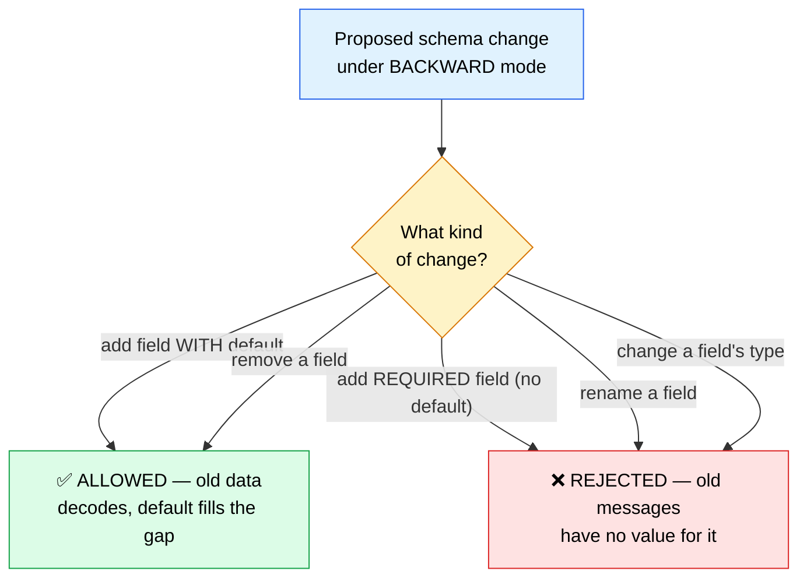

# Schema Registry & Message Schema Evolution

## 1. Why Should I Care About This?
- **The Contract Nobody Signed**: In an event-driven system, the producer and consumer never call each other directly. The *only* thing they share is the shape of the message. Change that shape carelessly and you break teams you've never met.
- **Independent Deploys**: The producer team ships a new field on Tuesday. The consumer team upgrades next month. Both must keep working *the whole time* — the new producer against old consumers, and later the new consumer against years of old messages still sitting in the log.
- **Silent, Delayed Failures**: A bad schema change doesn't crash immediately. It poisons the stream, and a consumer three days downstream falls over at 3 a.m. on a message it can no longer parse. A registry turns that into a loud, immediate rejection at deploy time.

## 2. What Problem Does This Solve?
- **Coordinated Releases**: Without a registry you must deploy producers and consumers in lockstep, which defeats the point of decoupling with a queue.
- **The Durable Log Trap**: Kafka retains messages for days or forever, so a topic holds a *mix* of v1, v2, and v3 at once. Every reader must handle every version it may meet.
- **Fat Messages**: The naive fix — embed the full schema (field names, types) in every message — is huge overhead on trillions of events.
- **Unenforced Encoding**: JSON with no schema lets a producer rename `total` to `amount` and nothing stops it — until consumers silently read `null`.

## 3. Core Idea (Intuition First)
Think of the registry as the **library's card catalog for message formats**.
- Each message on the wire carries a tiny **catalog number** (a 4-byte schema ID), not the whole book.
- The **Schema Registry** is the catalog: give it an ID, it hands back the exact schema version. Give it a *new* schema, and before issuing a card it checks the rule: *"would this change break anyone still reading the old cards?"* If yes, it refuses to file it.
- The producer serializes a record, registers its schema (getting an ID back), and writes `[magic byte + 4-byte schema ID + Avro binary]` to the topic. The schema itself is stored *once*, in the registry — not in every message.


> The message carries a 5-byte ID, not the schema; the registry stores each version once and rejects any change that would break a live consumer.

## 4. How It Actually Works
### 1. Subjects & Versions
- Schemas are grouped under a **subject** (a named history of compatible schema versions). Register a new schema under a subject → the registry assigns it a **version** (1, 2, 3...) and a globally unique **ID**.
- **Subject naming strategies**: `TopicNameStrategy` (default — subject = `<topic>-value`), `RecordNameStrategy` (subject = the record's fully-qualified name, so many topics can share it), and `TopicRecordNameStrategy` (both, for topics carrying multiple event types).

### 2. The Wire Format
- Byte 0 = **magic byte** (`0x0`). Bytes 1–4 = the **schema ID** (big-endian int). The rest is the raw **Avro binary** payload — compact, with no field names inlined.

### 3. Compatibility Modes
- **BACKWARD** (default): a *new* schema can read data written with the *old* schema. Safe changes: **add a field with a default**, **remove a field**. → upgrade consumers first.
- **FORWARD**: the *old* schema can read data written with the *new* one. Safe: **add a field**, **remove an optional field**. → upgrade producers first.
- **FULL**: both directions hold — only additive-with-default survives.
- **BACKWARD_TRANSITIVE / FORWARD_TRANSITIVE**: the check runs against *all* prior versions, not just the last one.
- **NONE**: no checks — you own the risk.
- **Always breaking**: renaming a field, changing a field's type, or adding a required field with no default.

### 4. Avro's Reader/Writer Resolution
- Decoding uses **two** schemas: the **writer's** (fetched by ID) and the **reader's** (what the consumer was compiled against). Avro reconciles them field-by-field — filling defaults for fields the writer omitted, skipping fields the reader dropped.





## 5. Real-World Example
**Adding a field to the `Order` event across two teams.**
- The **Checkout** team produces `Order` events; the **Analytics**, **Fulfillment**, and **Loyalty** teams each consume them independently. The topic is under `BACKWARD` compatibility.
- **The safe change**: Checkout wants to add `discountCode`. They add it as an *optional field with a default* (`"default": null`). The registry accepts the new version — old consumers that never heard of `discountCode` keep working (Avro supplies the default), and Checkout deploys cleanly without waiting for anyone.
- **The breaking change #1**: A junior engineer instead adds `discountCode` as a **required** field with no default. The producer starts up, tries to register the schema, and the registry **rejects it** — old messages in the log have no value for a required field, so a new consumer couldn't read them. The deploy fails fast, at the producer, before a single bad message is written.
- **The breaking change #2**: Someone renames `total` to `amount`. To the registry that's *drop `total` + add required `amount`* — every existing consumer reads its `total` field as missing. Rejected. The fix is to add `amount` alongside `total`, migrate consumers, then remove `total` in a later version.

## 6. Code Example
An Avro schema plus registering it and setting the compatibility mode via the Confluent Schema Registry REST API:
```json
// order-value.avsc — v2 adds discountCode SAFELY (optional + default)
{
  "type": "record", "name": "Order", "namespace": "com.shop.events",
  "fields": [
    {"name": "orderId", "type": "string"},
    {"name": "total",   "type": "double"},
    {"name": "discountCode", "type": ["null", "string"], "default": null}
  ]
}
```
```bash
# 1. Pin the subject to BACKWARD compatibility (upgrade consumers first)
curl -X PUT http://registry:8081/config/order-value \
  -H "Content-Type: application/vnd.schemaregistry.v1+json" \
  -d '{"compatibility": "BACKWARD"}'

# 2. Dry-run: is v2 compatible with the latest registered version?
curl -X POST http://registry:8081/compatibility/subjects/order-value/versions/latest \
  -H "Content-Type: application/vnd.schemaregistry.v1+json" \
  -d '{"schema": "<escaped-avsc-string>"}'
# -> {"is_compatible": true}   (false would block the producer at startup)

# 3. Register v2 under the subject; the registry returns its schema ID
curl -X POST http://registry:8081/subjects/order-value/versions \
  -H "Content-Type: application/vnd.schemaregistry.v1+json" \
  -d '{"schema": "<escaped-avsc-string>"}'   # -> {"id": 42}
```

## 7. Design Variations & Alternatives
- **Confluent Schema Registry**: the de facto standard for Kafka; Avro, Protobuf, and JSON Schema.
- **AWS Glue Schema Registry**: the managed AWS equivalent, integrated with MSK and Kinesis.
- **Apicurio Registry**: open-source, supports more formats and CNCF ecosystems.
- **Protobuf / Buf Schema Registry (BSR)**: for Protobuf-first shops; field tags give evolution guarantees without a runtime registry lookup.
- **No registry**: bake schemas into a shared library versioned in Git — simpler, but loses runtime enforcement and lets drift creep in.

## 8. Pros and Cons
### Pros
- **Breaks fail at deploy time, loudly** — at the producer, not at a downstream consumer days later.
- **Tiny messages**: a 5-byte ID instead of the full schema on every event.
- **Independent deploys**: producers and consumers evolve on their own timelines.
- **Central governance**: one place that documents and enforces every event contract.

### Cons
- **Another service to run** (and to make highly available — it's on the critical path for serialization).
- **A soft dependency**: if consumers can't reach the registry *and* haven't cached a schema, they can't decode.
- **Learning curve**: teams must understand compatibility modes and default rules.

## 9. Failure Scenarios & What Can Go Wrong
- **Wrong mode for your rollout order**: `BACKWARD` (consumers-first) but you deploy the *producer* first with a forward-only change — old consumers choke. Match the mode to who you upgrade first.
- **`NONE` mode "to move fast"**: checks disabled, a field renamed, every consumer silently reads nulls. The registry can't save you if you turn it off.
- **Registry unavailable + cold cache**: a freshly restarted consumer can't fetch schema ID 42 and stalls. Mitigate with an HA registry and local schema caches.
- **Non-transitive gap**: under plain `BACKWARD`, v3 is checked only against v2 — a consumer pinned to v1 may still break. Use `BACKWARD_TRANSITIVE` when very old readers exist.
- **Default confusion**: Avro requires a union's default to match its *first* type; misplace it and the change is rejected or resolves wrong.

## 10. Impact on Scalability, Reliability & Cost
- **Scalability**: shipping IDs keeps messages tiny at trillions of events; the registry is low-traffic (reads are cached).
- **Reliability**: raised overall by blocking poison messages, but adds a dependency — run it replicated with client-side caching so a blip doesn't halt decoding.
- **Cost**: negligible compute; the real saving is fewer 3 a.m. incidents and no lockstep-deploy tax across teams.

## 11. When NOT to Use This
- **A single team owns both ends** and deploys them together — a shared library may be enough.
- **Truly schemaless / free-form payloads** (opaque blobs, arbitrary documents) where there is no contract to enforce.
- **Ultra-low-latency internal hops** where even a cached lookup and serde cost is unacceptable and both sides are tightly coupled anyway.
- **One-off scripts or prototypes** where the operational overhead outweighs the benefit.

## 12. Interview Perspective
- **What interviewers expect**: that you can explain *why* the schema isn't in the message (the 5-byte ID + wire format), and that you can name and correctly apply `BACKWARD` vs `FORWARD` vs `FULL`.
- **Common question**: "How do you add a field to an event without breaking consumers?" (Answer: add it optional with a default under BACKWARD compatibility; never rename, retype, or add a required field.)
- **Follow-up**: "Which do you upgrade first — producers or consumers?" (BACKWARD = consumers first; FORWARD = producers first.)

## 13. Connections to Other Topics
- [../14_Performance_Optimization_Scalability/Binary_Protocols_Protobuf_Avro.md](../14_Performance_Optimization_Scalability/Binary_Protocols_Protobuf_Avro.md) — the wire-format encoding itself (Protobuf/Avro); this file is the registry + governance layer on top of it.
- [../06_Caching_Performance/Data_Compression_Serialization.md](../06_Caching_Performance/Data_Compression_Serialization.md) — the schema-evolution mechanics for Avro/Protobuf (reader/writer schemas, field tags, defaults).
- [./Kafka_Architecture.md](./Kafka_Architecture.md) — the durable log that retains years of old-format messages, which is *why* evolution matters at all.
- [./Stream_Processing.md](./Stream_Processing.md) — stream processors must decode every historical schema version they encounter in the log.

## 14. Visual Aids
- **`schema_registry_evolution.svg`** (embedded in Section 3): the producer→registry→topic→consumer data flow, the `[magic + ID + Avro]` wire format, and the BACKWARD/FORWARD/FULL compatibility rules with ✓/✗ examples.
- **Sequence diagram** (Section 4): register-and-get-ID on the produce side, fetch-by-ID on the consume side.
- **Compatibility flowchart** (Section 4): "is this change safe under BACKWARD?" routing each change type to ALLOWED or REJECTED.

## 15. Summary (TL;DR)
**A Schema Registry is the contract enforcer for an event stream: producers register each schema under a subject and get back a small integer ID, then write `[magic byte + 4-byte ID + Avro binary]` to the topic so the schema travels once (in the registry) instead of in every message; consumers read the ID, fetch and cache that schema version, and use Avro's reader/writer resolution to decode. Before accepting a new schema the registry applies a compatibility mode — BACKWARD (new reads old: add-with-default or remove a field), FORWARD (old reads new), or FULL — and rejects anything breaking (rename, type change, or a required field with no default), so a bad change fails loudly at the producer's deploy instead of silently poisoning a downstream consumer, letting independently-owned producers and consumers evolve on their own timelines over a log full of old-format messages.**

## 16. Further Reading & Resources
- [Confluent: Schema Registry Overview](https://docs.confluent.io/platform/current/schema-registry/index.html)
- [Confluent: Schema Evolution and Compatibility](https://docs.confluent.io/platform/current/schema-registry/fundamentals/schema-evolution.html)
- [Apache Avro Specification — Schema Resolution](https://avro.apache.org/docs/current/specification/#schema-resolution)
- [Schema Registry REST API Reference](https://docs.confluent.io/platform/current/schema-registry/develop/api.html)
- [AWS Glue Schema Registry](https://docs.aws.amazon.com/glue/latest/dg/schema-registry.html)
