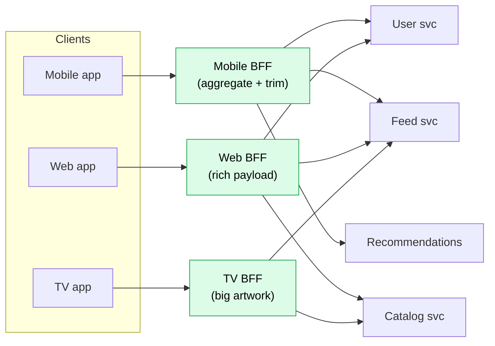
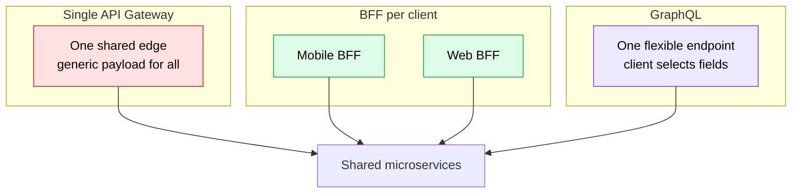

# Backend for Frontend (BFF)

## 1. Why Should I Care About This?
- **Every multi-client product hits this wall**: the moment you ship a mobile app *and* a web app *and* a smart-TV app against the same backend, one shared API starts pleasing nobody — it's the recurring pain behind "our mobile app feels slow and our API is a mess."
- **It fixes a real user-felt problem**: mobile users on a slow, high-latency link suffer most from over-fetching (wasted bytes and battery) and chatty round-trips (five calls to paint one screen). A BFF collapses that into one tailored response.
- **It shows up constantly in interviews**: "how would you serve mobile and web from the same services?" is a standard senior prompt. Knowing BFF — and *why it's a specialization of the API gateway, not a competitor* — is a strong signal.
- **It's an org pattern, not just tech**: Netflix and SoundCloud popularized it (SoundCloud coined the term "BFF") precisely because it lets the frontend team own its own edge and ship at its own pace.

## 2. What Problem Does This Solve?
- **Different clients need different data shapes**: a mobile home screen needs a trimmed feed with tiny thumbnails; the web dashboard wants rich metadata and wide tables; the TV app wants big artwork and few items. One response can't be ideal for all three.
- **Over-fetching**: to serve everyone, a shared API returns the *union* of all fields. Mobile downloads data it never renders — wasting bandwidth and battery on a cellular link.
- **Under-fetching / chatty round-trips**: alternatively the shared API stays generic and granular, so the client fires 5 sequential calls (user, then feed, then recommendations, then badges...) to assemble one screen — each round trip paying full mobile latency.
- **Versioning tension**: web and mobile evolve at different speeds. Mobile clients linger in the wild for months (users don't update), while web ships daily. A single shared API becomes a coordination bottleneck where one team's change risks breaking another's client.
- **Naive Approach**: expose **one shared, general-purpose API/gateway for every client type** and let each client take what it needs. It works with one client; with three it degrades into an over-fetched, chatty, version-locked compromise that serves none of them well.

## 3. Core Idea (Intuition First)
Think of a **restaurant with different service styles for different guests**. The kitchen (your microservices) is the same for everyone — but you don't hand every guest the raw ingredients and a recipe. A **dine-in waiter** plates a full multi-course meal; a **drive-thru window** hands over a compact bag sized for a car; **room service** delivers a tray tailored to the room. Each is a *dedicated front counter* that knows exactly what its guest wants, talks to the same kitchen, and shapes the order accordingly. A BFF is that dedicated counter — one per client experience — turning shared kitchen output into exactly the plate that client eats.

![Side-by-side comparison: on the left one shared general-purpose API that mobile, web, and TV clients all call, fanning out to User/Feed/Catalog/Orders microservices and causing over-fetching on mobile, chatty round-trips, and a one-size-fits-none payload; on the right a Backend-for-Frontend per client where a Mobile BFF, Web BFF, and TV BFF each owned by that client's frontend team aggregate and trim from the same shared downstream microservices into a payload tailored to each client in one round trip](../assets/bff_per_client_edge.svg)

> Left: one shared general API forces mobile to over-fetch fields it never shows and stitch 3-5 chatty round-trips per screen — one-size-fits-none. Right: a dedicated BFF per client experience (mobile, web, TV), each owned by that frontend team, aggregates and trims from the *same* shared downstream services into exactly the payload that client needs, in one round trip.

## 4. How It Actually Works
### 1. It Sits at the Edge, One per Experience
- A BFF is a thin server-side service deployed at the edge, dedicated to a single client experience: a **Mobile BFF**, a **Web BFF**, a **TV/desktop BFF**. The client talks *only* to its own BFF, never directly to the downstream services.

### 2. Aggregate, Trim, and Reshape
- On a request the BFF calls the relevant downstream microservices (often **in parallel**), then **aggregates** their responses, **trims** the fields the client won't render, and **reshapes** the result into the exact structure that client's screen expects — collapsing many network hops into one client round trip.

### 3. Client-Specific Concerns Live Here
- Client-specific **auth token handling**, response **formatting/serialization**, protocol translation (e.g. gRPC downstream, JSON to the client), pagination sizes, and image variant selection all live in the BFF — keeping the downstream services generic and client-agnostic.

### 4. Owned by the Frontend Team
- The frontend team that owns the client **also owns its BFF**. Because the BFF changes in lockstep with the UI, that team ships UI + edge together without cross-team coordination — the organizational payoff Netflix and SoundCloud championed.



## 5. Real-World Example
**A streaming app's mobile home screen (Netflix-style):**
- The home screen needs three things: the signed-in **user profile** (name, avatar), the personalized **feed** ("Continue Watching"), and **recommendations** ("Top Picks"). These live in three separate microservices.
- **Without a BFF** the mobile client makes 3+ sequential calls itself over a slow mobile link. At ~150 ms round-trip latency each, three serial calls ≈ **450 ms+** of pure network wait, plus the app must download full generic payloads and discard most fields.
- **With a Mobile BFF** the app makes **one** call. The BFF fans out to user + feed + recommendations **in parallel** (so downstream time ≈ the slowest single call, ~150 ms, not the sum), trims each response to just the fields the phone renders (say tiny thumbnail URLs, not 4K artwork), and returns one compact tailored payload — roughly **150-200 ms** total instead of 450 ms+, on a fraction of the bytes.
- **Different edge per client**: the same three services also back a **Web BFF** that returns richer metadata and a **TV BFF** that returns large artwork and fewer rows — same kitchen, three tailored counters.
- **Team ownership in practice**: SoundCloud built a BFF per client during its move off a monolith; Netflix used device-specific edge adapters so each device team could evolve its API independently.

## 6. Code Example
A Mobile BFF endpoint aggregating three downstream calls into one tailored payload (Python-ish pseudocode):
```python
import asyncio

# --- MOBILE BFF: one endpoint assembles the whole home screen ---
async def mobile_home(user_id, auth_token):
    verify_mobile_token(auth_token)                      # client-specific auth lives in the BFF

    # Fan out to 3 downstream services IN PARALLEL (not 3 serial client round trips)
    user, feed, recs = await asyncio.gather(
        user_svc.get_profile(user_id),                   # rich object: 30+ fields
        feed_svc.get_continue_watching(user_id, limit=10),
        reco_svc.get_top_picks(user_id, limit=10),
    )

    # AGGREGATE + TRIM + RESHAPE into exactly what the phone renders
    return {
        "greeting": user["display_name"],                # 1 field, not the whole profile
        "avatar":   user["avatar_thumb_url"],            # tiny thumbnail, not 4K art
        "continue_watching": [
            {"id": i["id"], "title": i["title"],
             "thumb": i["thumb_small"], "progress": i["progress_pct"]}
            for i in feed                                # trimmed to 4 fields per item
        ],
        "top_picks": [
            {"id": r["id"], "title": r["title"], "thumb": r["thumb_small"]}
            for r in recs
        ],
    }
# Result: ONE mobile round trip, compact payload.
# The Web BFF has its OWN endpoint returning richer fields + big artwork from the SAME services.
```

## 7. Design Variations & Alternatives
- **BFF per client (this pattern)**: a dedicated edge per experience — maximum tailoring, owned by each frontend team.
- **Single API Gateway**: one shared edge doing cross-cutting concerns (auth, rate limiting, routing) for everyone; simplest, but no per-client shaping — clients over-fetch or get chatty. A BFF is a *specialization* of this.
- **GraphQL**: one flexible endpoint where each client **selects exactly the fields it needs** in the query — solves over/under-fetching without N BFFs, at the cost of running a GraphQL server, query-cost/security controls, and caching complexity.
- **BFF + shared libraries**: keep per-client BFFs but extract common logic (auth, downstream clients, DTOs) into shared libraries to fight duplication.
- **Gateway Aggregation pattern**: aggregation done inside the gateway layer itself — a middle ground when you don't want fully separate BFF deployments.



## 8. Pros and Cons
### Pros
- **Tailored payloads**: each client gets exactly the shape it renders — no over-fetching, minimal bytes on mobile.
- **One round trip**: BFF aggregates downstream calls server-side (in parallel, on a fast internal network) so the client makes a single call over its slow link.
- **Team autonomy**: the frontend team owns its BFF and versions it in lockstep with the UI — no cross-team API coordination.
- **Decoupled evolution**: mobile and web can change independently; downstream services stay generic and client-agnostic.
- **Client-specific concerns isolated**: auth, formatting, protocol translation live at the edge, out of the core services.

### Cons
- **Logic duplication**: shared behavior (auth, downstream clients, error handling) tends to be re-implemented in each BFF unless extracted into shared libs.
- **More services to run**: N clients → N BFFs to deploy, monitor, secure, and pay for.
- **Fat-BFF drift**: BFFs can quietly absorb business logic and become mini-monoliths that belong in the domain services.
- **Extra hop**: one more network hop and a component that can fail on the request path.

## 9. Failure Scenarios & What Can Go Wrong
- **SYMPTOM**: the same auth/validation bug gets fixed in the mobile BFF but still bites web. **CAUSE**: logic **duplicated** across BFFs with no shared source of truth. **FIX**: extract cross-cutting logic into a shared library/module imported by every BFF; keep only client-specific shaping in each.
- **SYMPTOM**: a proliferation of nearly identical BFFs, high ops burden. **CAUSE**: **too many BFFs** — one spun up per minor client variant. **FIX**: consolidate to one BFF *per experience type* (mobile, web, TV), not per device model; or fall back to a gateway + GraphQL for low-differentiation clients.
- **SYMPTOM**: the "thin" BFF now holds pricing rules, entitlements, business decisions. **CAUSE**: **fat-BFF drift** — domain logic leaking into the edge. **FIX**: push business logic back into the owning microservice; keep the BFF to aggregate/trim/reshape only.
- **SYMPTOM**: home screen fails entirely when one minor service (e.g. recommendations) is down. **CAUSE**: BFF treats every downstream call as required and has no fallback. **FIX**: make aggregation **partial-failure tolerant** — timeouts, circuit breakers, and degrade gracefully (return the feed without recs).
- **SYMPTOM**: BFF latency balloons under load. **CAUSE**: downstream calls run **serially**, or one slow service blocks the whole response. **FIX**: fan out in parallel with per-call timeouts and a bulkhead so one slow dependency can't exhaust the BFF.

## 10. Impact on Scalability, Reliability & Cost
- **Scalability**: each BFF scales **independently** to its client's traffic profile — mobile (huge volume, small payloads) and TV (low volume, large payloads) scale on different curves. BFFs are typically **stateless**, so they scale horizontally behind a load balancer.
- **Reliability**: a BFF is an extra hop on the request path (more to fail), but done right it *improves* perceived reliability via **graceful degradation** — partial results when a non-critical dependency is down. Circuit breakers and timeouts at the BFF contain downstream failures.
- **Cost**: you trade **more infrastructure** (N BFF deployments) for **less mobile bandwidth/battery** and **fewer client round trips**, plus **higher team velocity** (no cross-team API coordination). The savings are real at scale but the pattern is over-provisioning for a single-client product.

## 11. When NOT to Use This
- **A single client**: one web app and nothing else — a plain API (or gateway) is enough; a BFF adds a service for no tailoring benefit.
- **Clients with near-identical needs**: if mobile and web want basically the same payload, one shared API avoids pointless duplication.
- **Tiny teams / early startups**: N BFFs mean N things to build, deploy, and operate — premature for a small team still finding product-market fit.
- **GraphQL already solves it**: if a single GraphQL endpoint lets each client select its fields and your team is comfortable operating it, that can replace a fleet of BFFs.
- **Latency-critical internal service-to-service calls**: BFF is a *client-edge* pattern, not for internal east-west traffic.

## 12. Interview Perspective
- **What interviewers expect**: define BFF as *a dedicated edge/aggregation service per client experience*, then contrast it precisely with an API gateway (**BFF = specialization; gateway = shared cross-cutting edge**) and GraphQL (**one flexible endpoint, client selects fields**).
- **Common question**: "Mobile and web hit the same services but need different data — how do you design the edge?" → Answer: a BFF per client; explain over-fetching vs chatty round-trips and how aggregation/trimming fixes both.
- **Common question**: "BFF vs API gateway vs GraphQL — when each?" → Gateway for shared cross-cutting concerns; BFF when clients diverge enough to warrant per-client shaping and team ownership; GraphQL when you want field selection without N edges.
- **Bonus signal**: mention **team ownership** (frontend owns its BFF; SoundCloud coined "BFF", Netflix pioneered device-specific edges), **parallel fan-out + graceful degradation**, and the pitfalls (logic duplication → shared libs, fat-BFF drift, too many BFFs).
- **Quantify it**: "3 serial mobile calls at ~150 ms each ≈ 450 ms; one BFF call with parallel fan-out ≈ ~150-200 ms" lands the point crisply.

## 13. Connections to Other Topics
- [API Gateway & Sidecar Pattern](./API_Gateway_Sidecar_Pattern.md) — BFF is a specialization of the gateway; the gateway handles shared cross-cutting concerns, the BFF adds per-client shaping.
- [API Gateway](../02_API_Interface_Design/API_Gateway.md) — the generic shared-edge pattern a BFF specializes.
- [GraphQL](../02_API_Interface_Design/GraphQL.md) — the field-selection alternative to running many BFFs.
- [REST vs GraphQL vs gRPC](../08_Communication_Protocols/REST_vs_GraphQL_vs_gRPC.md) — over/under-fetching trade-offs that motivate BFF vs GraphQL; gRPC often the BFF-to-service protocol.
- [Micro Frontends](../03_High_Level_Design/Micro_Frontends.md) — BFF is the backend counterpart of frontend-team ownership; each micro-frontend often gets its own BFF.
- [Stateless vs Stateful Services](../03_High_Level_Design/Stateless_vs_Stateful_Services.md) — BFFs are typically stateless so they scale horizontally at the edge.

## 14. Visual Aids
- **The SVG above** ([bff_per_client_edge.svg](../assets/bff_per_client_edge.svg)): left = one shared general API (over-fetching, chatty round-trips, one-size-fits-none); right = a BFF per client (mobile/web/TV), each frontend-team owned, aggregating and trimming from the *same* shared downstream services into tailored payloads; a takeaway band contrasting generic vs tailored.
- **Mermaid #1 (Section 4)**: three clients → three BFFs → shared microservices, showing each BFF fanning out to (and reshaping from) a common service set.
- **Mermaid #2 (Section 7)**: the three-way design choice — single gateway vs BFF-per-client vs GraphQL — all fronting the same shared services.

## 15. Summary (TL;DR)
**A Backend for Frontend is a dedicated edge/aggregation service per client experience — a mobile BFF, a web BFF, a TV BFF — instead of one shared general-purpose API for all, and it exists because different clients need different data shapes: a single shared API forces mobile to over-fetch fields it never renders (wasting battery and bandwidth) or forces chatty round-trips where the client fires 3-5 calls to build one screen over a slow link, while also creating versioning tension as web and mobile evolve at different speeds; a BFF sits at the edge, calls the downstream microservices (in parallel), and aggregates + trims + reshapes their responses into exactly the payload its one client needs in a single round trip, with client-specific auth and formatting living at the edge and the frontend team owning its own BFF (Netflix pioneered device-specific edges, SoundCloud coined the term) — making it a specialization of the API gateway (gateway = shared cross-cutting edge, BFF = per-client) and an alternative to GraphQL's single field-selecting endpoint, with the main pitfalls being logic duplication across BFFs (extract shared libraries), spinning up too many BFFs, and letting a BFF drift into a fat business-logic monolith.**

## 16. Further Reading & Resources
- [Sam Newman — Backends For Frontends](https://samnewman.io/patterns/architectural/bff/)
- [Microsoft Azure Architecture Center — Backends for Frontends pattern](https://learn.microsoft.com/en-us/azure/architecture/patterns/backends-for-frontends)
- [SoundCloud — BFF @ SoundCloud (how they coined the term)](https://developers.soundcloud.com/blog/bff)
- [Netflix Tech Blog — Embracing the Differences: Inside the Netflix API Redesign](https://netflixtechblog.com/embracing-the-differences-inside-the-netflix-api-redesign-15fd8b3dc49d)
- [ThoughtWorks Technology Radar — BFF](https://www.thoughtworks.com/radar/techniques/bff-backend-for-frontend)
