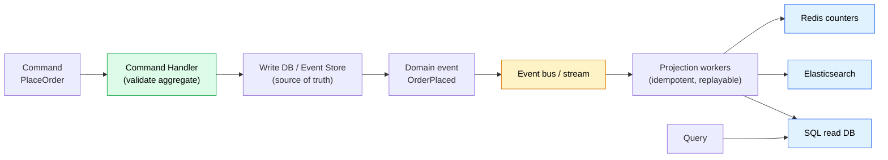
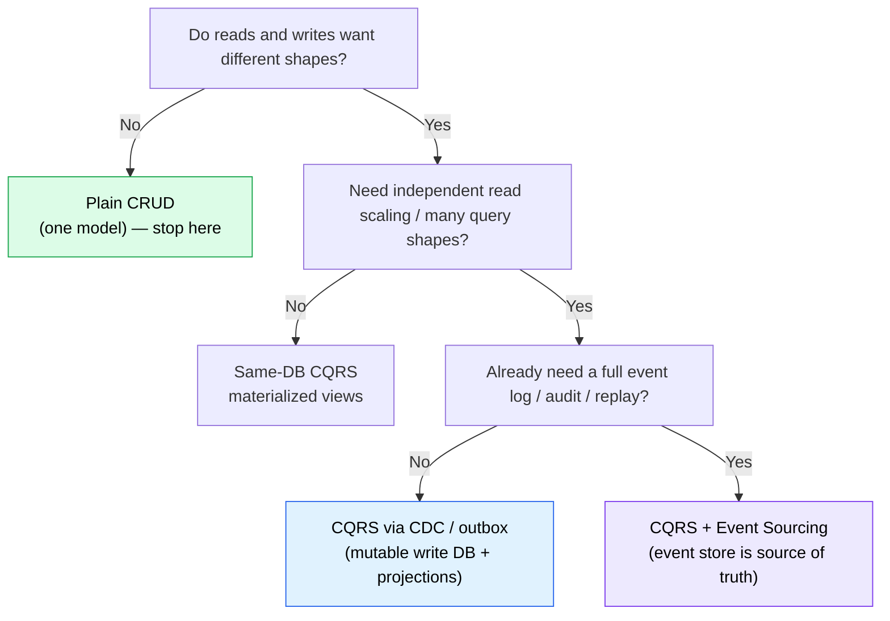

# CQRS (Command Query Responsibility Segregation)

## 1. Why Should I Care About This?
- **One model rarely serves both masters well**: A schema tuned for correct, transactional *writes* (normalized, aggregate-bound, foreign keys everywhere) is almost never the schema that answers *reads* fastest (denormalized, pre-joined, search-indexed). CQRS is the pattern that stops forcing one table to be both.
- **It is how read-heavy systems actually scale**: Most products read 10–100× more than they write. CQRS lets you scale the read side to dozens of replicas and specialized stores (search, cache) without touching — or being throttled by — the write side.
- **It is the interview gateway to event-driven design**: Once you say "separate read model, updated asynchronously via events," you are one step from Event Sourcing, CDC, sagas, and eventual consistency — the whole senior-level distributed-data toolkit.

## 2. What Problem Does This Solve?
- **Conflicting shapes for read and write**: The write path needs to enforce business rules against a consistent aggregate (e.g. "an order's total must equal the sum of its line items"). The read path needs a flat, denormalized row it can return in one lookup. A single model compromises both.
- **Read/write imbalance**: An e-commerce catalog might take 5,000 product-page reads for every 1 price update. You want to throw read capacity at the hot path without contending with write locks.
- **Query diversity**: The same order data must power a SQL "my orders" list, an Elasticsearch product search, and a Redis "units sold today" counter. No single storage engine is best at all three.
- **Naive Approach**: Use **one model for reads and writes** — the same normalized tables serve both. Complex queries then require expensive multi-table JOINs on every request, read replicas still carry the full write schema, and adding search means bolting indexes onto your transactional DB until write throughput suffers. It works until read volume and query variety outgrow the single shape.

## 3. Core Idea (Intuition First)
Think of it like **a restaurant kitchen versus its menu**.
- The **kitchen** (write side) is organized for *correctly making food*: raw ingredients, strict recipes, one chef owning each dish so nothing is half-cooked or double-served. It is optimized for correctness, not for browsing.
- The **menu** (read side) is organized for *the diner*: beautiful photos, prices, categories, dietary filters — a denormalized, pre-formatted view. Nobody reads the raw pantry inventory to decide what to order.
- Every time the kitchen changes a recipe or runs out of an ingredient (a write), someone **reprints the affected menu entries** (a projection) — asynchronously, so the kitchen never blocks waiting for the menu to update. For a brief moment the menu can be slightly stale (eventual consistency).

![CQRS architecture: on the left a green write side where a Command flows into a Command Handler that validates against an aggregate and persists to a Write DB or Event Store; in the middle an amber Event Bus and projection pipeline carrying domain events rightward with an eventual-consistency lag callout of tens of milliseconds to seconds; on the right a blue read side with three denormalized read models kept in sync asynchronously — a SQL read database, an Elasticsearch search index, and a Redis cache — each tailored to its own query shape and scaled independently](../assets/cqrs_read_write_split.svg)

> Left (green): commands are validated against an aggregate and committed to the write store — optimized for consistency. Middle (amber): domain events flow across an event bus into projection workers; this hop is where the eventual-consistency lag (tens of ms to seconds) lives. Right (blue): multiple denormalized read models, each tuned to one query shape and scaled independently of the write side.

## 4. How It Actually Works

### 1. The Write Side (Commands)
- A **command** is an intent to change state (`PlaceOrder`, `UpdatePrice`) — not data, but a request. It is handled by a **command handler** that loads the relevant **aggregate** (the consistency boundary, e.g. an `Order` with its line items), validates business invariants, and persists the change.
- The write store is **normalized** (a relational aggregate) or an **event store** (an append-only log of what happened). Either way it is the single source of truth and enforces **strong consistency** for the mutation.
- On commit, the write side **emits domain events** (`OrderPlaced`, `PriceUpdated`) describing what changed.

### 2. The Projection Pipeline
- Events flow onto an **event bus / stream** (Kafka, a message queue, or a DB change feed). **Projection workers** subscribe and **apply each event to a read model**, transforming the normalized write shape into a denormalized read shape.
- Projections are **idempotent** (safe to re-apply) and **replayable** — to build a brand-new read model, you replay the event history from the start. This is what makes adding a new read store cheap.

### 3. The Read Side (Queries)
- A **query** returns data and never mutates state. It hits a **read model** directly — usually a single-row/single-document lookup with no JOINs — so reads are fast and cache-friendly.
- You keep **multiple specialized read models**: SQL for relational list views, Elasticsearch for full-text search, Redis for counters. Each is populated by its own projection from the same event stream.

### 4. Eventual Consistency & Read-Your-Own-Writes
- Because projection is **asynchronous**, a read model trails the write model by the pipeline latency — the **consistency lag** (typically tens of ms, seconds under load). This is **eventual consistency**.
- The classic gotcha is **read-your-own-writes**: a user submits a command, immediately queries, and does not see their own change yet. Mitigations: return the new value from the command response, read from the write model for that one user, or have the client poll/version-check until the projection catches up.



## 5. Real-World Example
**An e-commerce product & order service at read-heavy scale:**
- **Traffic profile.** ~50,000 product/catalog reads per second at peak; ~500 writes per second (price changes, inventory decrements, new orders) — roughly a **100:1 read:write ratio**. The reads must return in <50 ms; the writes must never oversell inventory.
- **Write side.** A `PlaceOrder` command loads the `Order` aggregate, validates stock and pricing invariants, commits to a normalized PostgreSQL write DB, and emits an `OrderPlaced` event to Kafka.
- **Read side.** Three projections consume that stream: (1) a **PostgreSQL read replica set** holding a denormalized `order_summary` row per order (no JOINs on the "my orders" page); (2) an **Elasticsearch** index for product search and faceted filters; (3) a **Redis** counter for "units sold today" and inventory dashboards.
- **Scaling independently.** When Black Friday traffic hits, you add read replicas and Elasticsearch nodes for the 50k reads/s **without touching** the write DB, which is comfortably handling 500 writes/s. The two sides scale on their own axes.
- **Consistency lag, quantified.** Under normal load the projection catches up in **~20–80 ms**; during a spike or a Kafka consumer backlog it can stretch to **1–3 seconds**. So a buyer might place an order and, for a second or two, not see it in their list — acceptable for a catalog, handled by returning the confirmation directly from the command.

## 6. Code Example
Command (write) path and query (read) path, kept fully separate (Python-ish pseudocode):
```python
# ---------- WRITE SIDE: command handler ----------
def handle_place_order(cmd):                      # cmd = {user_id, items}
    order = Order.new(cmd.user_id)
    for item in cmd.items:
        order.add_line(item.sku, item.qty)        # aggregate enforces invariants
    order.validate_stock_and_total()              # business rules, strong consistency
    write_db.save(order)                          # normalized source of truth
    event_bus.publish(OrderPlaced(                # emit domain event (async fan-out)
        order_id=order.id, user_id=order.user_id,
        total=order.total, items=order.items))
    return order.id                               # return value → read-your-own-writes fix

# ---------- PROJECTION: builds/updates a read model (idempotent) ----------
def on_order_placed(evt):                         # projection worker, subscribed to bus
    read_db.upsert("order_summary", key=evt.order_id, row={
        "order_id": evt.order_id, "user_id": evt.user_id,
        "total": evt.total, "item_count": len(evt.items),
        "status": "PLACED"})                      # denormalized, 1 row = 1 query
    search_index.index(evt)                       # Elasticsearch projection
    redis.incr(f"units_sold:{today()}", n=len(evt.items))

# ---------- READ SIDE: query hits the read model directly, no JOIN ----------
def get_my_orders(user_id):
    return read_db.query(                         # single denormalized lookup
        "SELECT * FROM order_summary WHERE user_id = :u ORDER BY created DESC", user_id)
```

## 7. Design Variations & Alternatives
- **CQRS without Event Sourcing**: the write DB stays a normal mutable store; projections are fed by **CDC** (reading the DB change log) or by publishing events in the same transaction (transactional outbox). Simplest on-ramp.
- **CQRS with Event Sourcing**: the write store *is* the event log — state is derived by replaying events. A natural fit (events already exist to project from) but a separate, heavier commitment; the two are independent choices.
- **Same-DB CQRS**: read and write models are just different tables/materialized views in **one database**, refreshed synchronously or on a schedule — much of the benefit, far less operational cost, no cross-store consistency lag.
- **Synchronous read model**: update the read store inside the write transaction. Kills the lag and the read-your-own-writes problem, but reintroduces coupling and slows writes — only viable at modest scale.



## 8. Pros and Cons

### Pros
- **Independent scaling**: throw replicas/nodes at the read side (the 100:1 hot path) without touching write capacity, and vice versa.
- **Tailored stores**: each read model uses the best engine for its query shape — SQL, search, cache — instead of one compromise schema.
- **Simpler models**: the write model only worries about invariants; read models only worry about serving one query. Each is easier to reason about.
- **Replay & new views**: because projections rebuild from events, adding a brand-new read model (or fixing a buggy one) is a replay, not a migration.

### Cons
- **Eventual consistency**: read models lag writes; you must design for read-your-own-writes and stale reads.
- **Operational complexity**: more moving parts — event bus, projection workers, multiple stores to monitor and keep in sync.
- **Duplication & storage cost**: the same data lives in the write store and every read model.
- **Debugging is harder**: a wrong value on screen could be a command bug, a projection bug, a lagging consumer, or a poisoned event — more layers to trace.

## 9. Failure Scenarios & What Can Go Wrong
- **Stale reads after a write** — *SYMPTOM*: user places an order, refreshes, does not see it. *CAUSE*: asynchronous projection lag (read-your-own-writes). *FIX*: return the new state from the command response; or route that user's next read to the write model; or client-side version polling until the projection catches up.
- **Projection worker falls behind** — *SYMPTOM*: consistency lag grows from ~50 ms to minutes; dashboards go stale. *CAUSE*: consumer can't keep up with event throughput or a slow downstream store. *FIX*: scale out projection workers (partitioned consumer group), batch writes to the read store, and alert on consumer lag.
- **Poisoned / non-idempotent projection** — *SYMPTOM*: a read model has wrong counts or drifts from the source of truth. *CAUSE*: an event applied twice (or a bug) mutated the read model non-idempotently. *FIX*: make projections idempotent (upsert by key, track last-applied offset) and **replay from scratch** to rebuild the corrupted read model.
- **Dual-write inconsistency** — *SYMPTOM*: write DB committed but the event never published (or vice versa). *CAUSE*: writing to the DB and the bus as two separate operations without atomicity. *FIX*: **transactional outbox** — write the event to an outbox table in the same DB transaction, relay it via CDC.
- **Schema/event evolution breakage** — *SYMPTOM*: projections crash after a deploy. *CAUSE*: event format changed and old consumers can't parse it. *FIX*: versioned events and a schema registry with backward-compatible evolution.

## 10. Impact on Scalability, Reliability & Cost
- **Scalability**: the headline win — read and write scale on independent axes. Read replicas absorb the 100:1 traffic; the write side stays small and consistent. Projections parallelize across partitions.
- **Reliability**: the read side keeps serving (slightly stale) data even if the write side is degraded, and vice versa — a natural bulkhead. Replayable projections mean a corrupted read store is recoverable, not catastrophic.
- **Cost**: you pay in **duplicated storage** (data in the write store plus every read model) and **operational overhead** (a bus, workers, multiple stores to run and monitor). Justified when read scale/query diversity is high; pure waste when it isn't.

## 11. When NOT to Use This
- **Simple CRUD is enough**: if reads and writes want the same shape and a single table with a couple of indexes serves both, CQRS is pure overhead — use plain CRUD.
- **Low read/write ratio or low volume**: an internal admin tool with 20 users gains nothing from independent read scaling.
- **Strong read-after-write is mandatory everywhere**: if the domain cannot tolerate any staleness (e.g. a balance that must be exact on the next read), the eventual-consistency lag is a liability — keep a single consistent model or make the read model synchronous.
- **Small team, tight deadline**: the extra moving parts (bus, projections, multiple stores) are real ongoing cost; don't adopt them speculatively.

## 12. Interview Perspective
- **What interviewers expect**: define CQRS crisply (separate write model from one-or-more read models, synced **asynchronously via events**), and immediately name the trade-off — independent scaling + tailored reads **vs** complexity + eventual consistency.
- **Common question**: "How do you handle read-your-own-writes?" (Answer: return the value from the command, or read from the write model for that request, or version-poll — plus acknowledge the lag is tens of ms normally.)
- **Common question**: "Is CQRS the same as Event Sourcing?" (Answer: no — they pair beautifully but are independent; CQRS can run on a plain mutable write DB fed by CDC or an outbox.)
- **Bonus signal**: mention idempotent, replayable projections; the dual-write problem and the transactional outbox fix; and explicitly saying "for simple CRUD I would NOT use CQRS."

## 13. Connections to Other Topics
- [Event Sourcing Pattern](../09_Message_Queues_Event_Streaming/Event_Sourcing_Pattern.md) — the natural (but independent) partner: the event store becomes the write side that projections read from.
- [Change Data Capture (CDC)](../09_Message_Queues_Event_Streaming/Change_Data_Capture_CDC.md) — how you feed read-model projections from a plain mutable write DB without Event Sourcing.
- [Consistency Models](../05_Databases_Storage/Consistency_Models.md) — CQRS is a deliberate choice of eventual consistency between the two sides; this defines the guarantees.
- [Replication](../05_Databases_Storage/Replication.md) — read replicas are the simplest form of read scaling; CQRS generalizes it to differently-shaped stores.
- [Distributed Transactions](../05_Databases_Storage/Distributed_Transactions.md) — the dual-write problem and the transactional outbox that keeps write commit and event publish atomic.
- [Orchestration vs Choreography](./Orchestration_vs_Choreography.md) — the event-driven coordination (and sagas/compensations) that CQRS's domain events naturally feed into.
- [Database-per-Service & Data Ownership](./Database_per_Service_Data_Ownership.md) — a CQRS read model is one of the two canonical ways to answer cross-service queries without a shared database.
- [Saga Pattern & Distributed Transactions](./Saga_Pattern_Distributed_Transactions.md) — the domain events CQRS emits on the write side are the same events that drive saga steps and compensations.

## 14. Visual Aids
- **The SVG above** ([cqrs_read_write_split.svg](../assets/cqrs_read_write_split.svg)): green write side (Command → Handler → Write DB/Event Store), amber event bus in the middle carrying changes rightward with the eventual-consistency lag callout, and the blue read side with three independently-scaled denormalized read models.
- **Mermaid #1 (Section 4)**: the end-to-end flow — command → validated write → domain event → bus → idempotent projections → multiple read models, with queries hitting the read side directly.
- **Mermaid #2 (Section 7)**: the decision tree — plain CRUD vs same-DB materialized views vs CQRS-via-CDC vs CQRS + Event Sourcing.

## 15. Summary (TL;DR)
**CQRS splits one system into a write side and a read side: commands go through a validated write model (a normalized aggregate or an event store) that enforces strong consistency and emits domain events, while those events flow asynchronously across a bus into one or more denormalized read models — SQL for list views, Elasticsearch for search, Redis for counters — each tuned to a single query shape and scaled independently of the write side; the price you pay is extra moving parts and eventual consistency (a projection lag of tens of ms to a few seconds, and the read-your-own-writes gotcha), which is well worth it for read-heavy systems with diverse queries (e.g. an e-commerce catalog at 100:1 read:write) but pure overhead for simple CRUD, where you should not use it; CQRS pairs naturally with Event Sourcing but is independent of it and can run on a plain mutable write DB fed by CDC or a transactional outbox.**

## 16. Further Reading & Resources
- [Martin Fowler — CQRS](https://martinfowler.com/bliki/CQRS.html)
- [Microsoft Azure Architecture Center — CQRS Pattern](https://learn.microsoft.com/en-us/azure/architecture/patterns/cqrs)
- [Greg Young — CQRS Documents (the origin of the term)](https://cqrs.files.wordpress.com/2010/11/cqrs_documents.pdf)
- [microservices.io — CQRS Pattern (Chris Richardson)](https://microservices.io/patterns/data/cqrs.html)
- [Microsoft — Transactional Outbox Pattern](https://learn.microsoft.com/en-us/azure/architecture/best-practices/transactional-outbox-cosmos)
