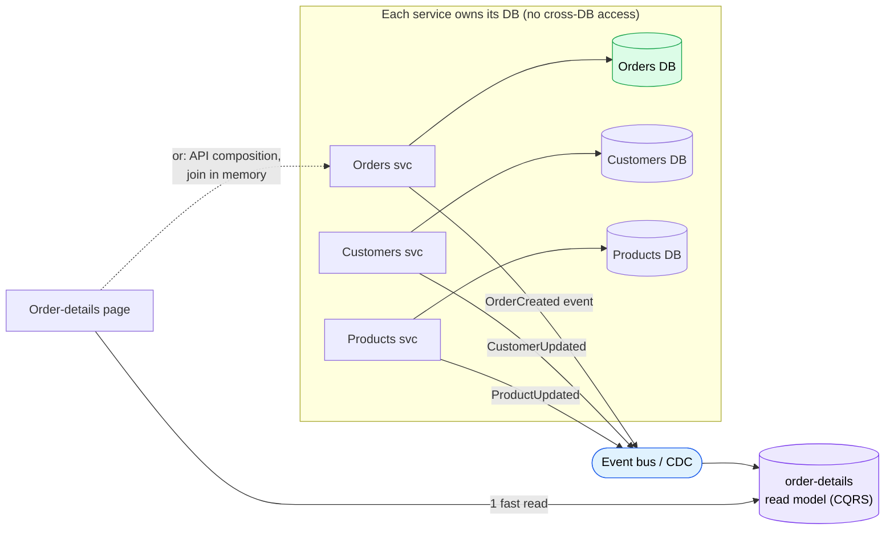
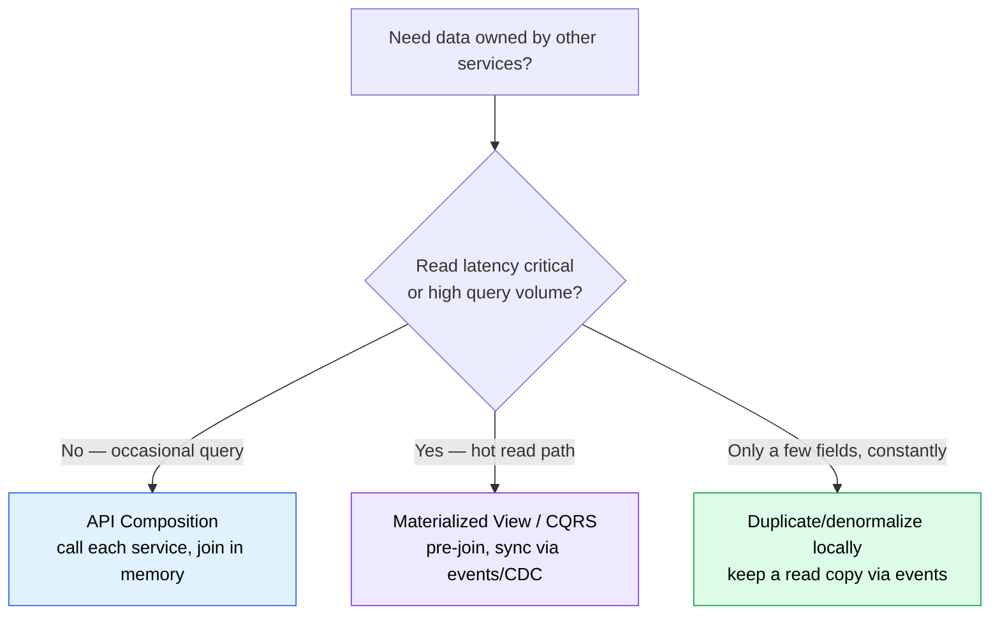

# Database per Service & Data Ownership

## 1. Why Should I Care About This?
- **It's the line between "microservices" and "distributed monolith"**: You can split code into 20 services, but if they all share one database, you have a distributed monolith — all the operational pain of microservices with none of the independence. Data ownership is what actually decouples them.
- **It reshapes every design answer that follows**: Once each service owns its data, you *lose* cross-service ACID transactions and foreign keys — which forces Sagas, eventual consistency, and new ways to run a simple `JOIN`. Interviewers probe this chain constantly.
- **It's where teams get their autonomy (or don't)**: Private data means a team can change its schema, re-index, or even switch database engines without a cross-team migration meeting. Shared data means every schema change is a company-wide event.

## 2. What Problem Does This Solve?
- **Independent deployability**: A service should be shippable on its own. That's impossible if another service reads its tables directly — you can't change a column without breaking the hidden reader.
- **Encapsulation of the data model**: The internal schema is an implementation detail. Exposing tables leaks that detail and freezes it; exposing an API lets the internals evolve freely behind a stable contract.
- **Fault + performance isolation**: One service's runaway query shouldn't lock rows or exhaust connections for everyone else.
- **Naive Approach**: One **shared database across all services**. Orders, Customers, and Inventory all connect to the same schema and read each other's tables. It feels efficient (easy joins, one connection pool, one ops target), but it creates **hidden coupling** — any schema change silently breaks unknown readers, **no service can deploy independently**, and every team fights over the same tables, locks, and connection budget. Sharing the database quietly re-couples everything you split apart.

## 3. Core Idea (Intuition First)
Think of each service as **a shop in a mall with its own private stockroom**.
- A shop **never lets another shop walk into its stockroom** to grab inventory — that would be chaos, and rearranging your shelves would trip up strangers.
- If Shop B needs something from Shop A, it **asks at the counter** (calls Shop A's API) or **subscribes to Shop A's newsletter** (listens to its events). Shop A decides how its stockroom is organized, and can reorganize it anytime as long as the counter still answers the same questions.
- The mall directory ("who owns what") is drawn along **bounded contexts** — natural business boundaries — not along tables.

![Left panel shows the shared-database anti-pattern: Orders, Customers, and Inventory services all reaching into one shared database, so a schema change breaks everyone and no service deploys independently. Right panel shows database per service: each service owns its own private store (Postgres, MongoDB, Redis) with no cross-database arrows, communicating only via API or events. A bottom band contrasts the two ways to run a cross-service query — API composition, which calls each service and joins in memory (~60ms), versus a materialized view / CQRS read model synced via events, which serves one ~5ms read with eventual consistency.](../assets/db_per_service_ownership.svg)

> Left: sharing one database re-couples every service — a schema change breaks unknown readers and no one deploys alone. Right: each service privately owns its store and is reached only via API/events, so internals evolve freely. Bottom: cross-service queries are the hard part — compose at read time (simple, slow) or maintain a pre-joined read model synced by events (fast, eventually consistent).

## 4. How It Actually Works
### 1. Private ownership & the encapsulation boundary
- Exactly **one service** may read/write a given dataset. Its tables are invisible to everyone else — no shared connection string, no direct SQL, not even read-only access.
- Other services reach that data **only through the owner's API or the events it publishes**. The database becomes a private implementation detail hidden behind the service contract.

### 2. Losing cross-service ACID & foreign keys
- A single transaction can no longer span services (no distributed `BEGIN…COMMIT` across separate databases). You also can't declare a **foreign key** from `orders.customer_id` into another service's `customers` table.
- Business operations that touch several services become **Sagas** — a sequence of local transactions coordinated by events, with compensating actions on failure — and you accept **eventual consistency** instead of one atomic write.

### 3. Polyglot persistence
- Because each store is private, each service **picks the database that fits its access pattern**: Postgres for transactional orders, a document store for flexible customer profiles, Redis/KV for hot inventory counters, a search index for catalog.

### 4. Cross-service queries (the hard problem)
- **API composition**: an aggregator calls each owning service and **joins the results in memory**. Simple and always fresh, but it's `N` network calls and an app-tier join.
- **Materialized view / CQRS read model**: keep a **pre-joined read model** updated from the source services' **events or CDC** stream. Reads become one fast lookup, at the cost of eventual consistency and extra infrastructure.



## 5. Real-World Example
**An e-commerce "order details" page** must show the customer's name/address, the order's line items and status, and each product's title and image. That data lives in **three separately owned services**:
- **Customers service** — owns `customers` (Postgres).
- **Orders service** — owns `orders` + `order_items` (Postgres).
- **Products service** — owns `products` catalog (a document store).

There is **no `JOIN`** across them — the tables live in three private databases. So the page is built one of two ways:
- **API composition**: the page's backend calls Orders → then Customers → then Products, and stitches the response together. Roughly **3 sequential ~20ms calls ≈ 60ms** (parallelizing the independent ones trims it, but you still pay the slowest hop plus fan-out).
- **Materialized view / CQRS**: a background consumer listens to `OrderCreated`, `CustomerUpdated`, `ProductUpdated` events and maintains a denormalized `order_details` document. The page does **one ~5ms read**. It's an order of magnitude faster, but the view can lag the source by milliseconds-to-seconds (eventual consistency).

Amazon, Uber, and Netflix all run exactly this shape: services own their data, and hot read paths get their own pre-joined read models fed by events.

## 6. Code Example
```python
# ---------- OPTION A: API COMPOSITION (join in memory at read time) ----------
async def get_order_details(order_id):
    order = await orders_svc.get(order_id)                 # ~20ms  (owning service)
    # these two are independent -> fire in parallel
    customer, products = await gather(
        customers_svc.get(order.customer_id),              # ~20ms
        products_svc.get_many(order.product_ids),          # ~20ms
    )
    return {                                                # in-memory "join"
        "customer": customer.name,
        "status":   order.status,
        "items":    [products[i.product_id] | {"qty": i.qty} for i in order.items],
    }
    # Simple + always fresh, but N calls; latency = slowest hop + fan-out overhead

# ---------- OPTION B: MATERIALIZED VIEW / CQRS READ MODEL ----------
# A consumer keeps a pre-joined document in sync from each owner's events (or CDC):
def on_event(evt):
    if evt.type == "OrderCreated":
        read_model.upsert(evt.order_id, order=evt.payload)          # eventual
    elif evt.type == "CustomerUpdated":
        read_model.patch_by_customer(evt.customer_id, customer=evt.payload)
    elif evt.type == "ProductUpdated":
        read_model.patch_by_product(evt.product_id, product=evt.payload)

def get_order_details_fast(order_id):
    return read_model.get(order_id)          # ONE ~5ms lookup, pre-joined
    # Fast reads, but eventually consistent + extra infra to run the sync
```

## 7. Design Variations & Alternatives
- **API composition** — compose at read time; simplest, always fresh, but latency stacks with call count.
- **Materialized view / CQRS read model** — pre-join via events/CDC; fast reads, eventual consistency, more moving parts.
- **Deliberate data duplication / denormalization** — a service keeps a **local read-only copy** of a few fields it constantly needs (e.g. Orders caches the customer's name), updated by events. Trades storage + sync for zero cross-service calls on the hot path.
- **Shared database (anti-pattern, sometimes pragmatic)** — acceptable only for a tiny team or an early monolith you'll split later; know you're trading autonomy for convenience.



## 8. Pros and Cons
### Pros
- **Independent deploy & schema evolution**: change your internals without breaking anyone.
- **Loose coupling**: contracts are APIs/events, not tables — no hidden readers.
- **Polyglot persistence**: each service uses the best-fit store.
- **Fault & performance isolation**: one service's load or bad query can't lock everyone's rows.

### Cons
- **No cross-service ACID / FKs**: consistency becomes Sagas + eventual consistency; referential integrity is now application logic.
- **Cross-service queries are hard**: joins require API composition or a maintained read model.
- **Data duplication & sync**: denormalized copies and read models can drift and must be reconciled.
- **More operational surface**: many databases to run, back up, monitor, and secure.

## 9. Failure Scenarios & What Can Go Wrong
- **SYMPTOM**: A schema change deploys fine, then an unrelated service starts throwing errors. **CAUSE**: A hidden reader was reaching into the shared/"private" tables directly. **FIX**: Enforce ownership at the boundary — separate credentials per service, no cross-service DB grants; expose data only via API/events.
- **SYMPTOM**: An `order-details` page shows a stale customer address for a few seconds after an update. **CAUSE**: The materialized view lags its source events (eventual consistency). **FIX**: Set explicit staleness SLAs, show "last updated," or read-through to the source for fields that must be fresh; monitor consumer lag.
- **SYMPTOM**: Money is debited but the order never gets created (or vice-versa). **CAUSE**: A multi-service operation had no atomic transaction and a step failed mid-way. **FIX**: Model it as a **Saga** with compensating transactions and idempotent handlers.
- **SYMPTOM**: The aggregator's p99 latency explodes under load. **CAUSE**: API composition makes N synchronous downstream calls; the slowest/most-loaded service drags the whole page. **FIX**: Parallelize independent calls, add timeouts + circuit breakers, or move the hot path to a materialized read model.

## 10. Impact on Scalability, Reliability & Cost
- **Scalability**: Each database scales independently — shard the hot one, add read replicas only where needed. Read models absorb heavy query traffic off the source stores. No single shared DB becomes the global bottleneck.
- **Reliability**: Blast radius shrinks — one DB outage degrades one capability, not the whole system (if composition paths degrade gracefully). Async events keep writers available even when consumers lag.
- **Cost**: More databases mean more infrastructure, backups, and ops overhead; duplicated data and read models add storage and a sync pipeline. You pay in operational complexity for autonomy and isolation.

## 11. When NOT to Use This
- **Small team / early-stage product**: A modular monolith with one well-structured database ships faster; premature service+DB splitting adds Sagas and eventual-consistency tax for no benefit.
- **Highly relational, transaction-heavy core**: If nearly every operation needs multi-entity ACID transactions and complex joins across the *same* domain, forcing separate databases creates painful distributed transactions — keep that domain together.
- **Reporting/analytics needs**: Don't solve BI with cross-service live queries; ship events to a **data warehouse/lake** and analyze there instead of fighting the pattern.
- **Unclear domain boundaries**: If you can't yet draw the bounded contexts, splitting data prematurely locks in the wrong seams.

## 12. Interview Perspective
- **Expected answer**: State the rule — *each service privately owns its data; others use its API/events, never its tables* — and immediately name the consequence: no cross-service ACID/FKs → Sagas + eventual consistency.
- **Classic question**: "How do you build a page that needs data from 3 services?" Answer both **API composition** (simple, N calls, in-memory join) and **materialized view/CQRS** (fast reads, eventual consistency, event/CDC sync), then pick based on latency/volume.
- **"Why not just share one database?"**: Name the anti-pattern — hidden coupling, no independent deploy, schema changes break everyone, contention. That's a distributed monolith.
- **Bonus signal**: Mention **polyglot persistence**, **deliberate denormalization** for hot-path fields, defining ownership along **DDD bounded contexts**, and keeping read models in sync via **CDC**.

## 13. Connections to Other Topics
- [Monolithic vs Microservices](./Monolithic_vs_Microservices.md) — data ownership is what makes services truly independent rather than a distributed monolith.
- [CQRS Pattern](./CQRS_Pattern.md) — the materialized read model for cross-service queries is CQRS applied across service boundaries.
- [Saga Pattern & Distributed Transactions](./Saga_Pattern_Distributed_Transactions.md) — how to keep data consistent once cross-service ACID is gone.
- [Sharding & Partitioning](../05_Databases_Storage/Sharding_Partitioning.md) — scaling an individual service's private database.
- [Domain-Driven Design](../04_Low_Level_Design/Domain_Driven_Design.md) — bounded contexts define where ownership boundaries should fall.
- [Change Data Capture (CDC)](../09_Message_Queues_Event_Streaming/Change_Data_Capture_CDC.md) — a common way to feed read models/duplicated data from a source service's DB.

## 14. Visual Aids
- **The SVG above** ([db_per_service_ownership.svg](../assets/db_per_service_ownership.svg)): left = the shared-DB anti-pattern (three services tangled into one DB); right = database per service (isolated service+DB pairs, polyglot); bottom band = API composition vs materialized view/CQRS for cross-service queries.
- **Mermaid #1 (Section 4)**: services owning private DBs, publishing events to a bus/CDC that feeds a CQRS read model, with API-composition as the alternative read path.
- **Mermaid #2 (Section 7)**: the decision tree — occasional query → compose; hot read path → materialize; a few constant fields → duplicate locally.

## 15. Summary (TL;DR)
**Database per service means each microservice privately owns its data — its tables are an implementation detail no other service may touch, and the only way in is through its API or the events it publishes; this is what actually decouples services (independent deploys, schema freedom, polyglot persistence, fault isolation) and is the difference between real microservices and a distributed monolith that merely shares one database (hidden coupling, contention, schema changes that break everyone). The price is steep: you lose cross-service ACID transactions and foreign keys, so multi-service writes become Sagas with eventual consistency, and cross-service reads (like an "order details" page spanning customer, order, and product services) can no longer JOIN — you either compose at read time by calling each service and joining in memory (simple, always fresh, but ~3×20ms of stacked calls) or maintain a pre-joined materialized view / CQRS read model synced via events or CDC (one ~5ms read, but eventually consistent and more infrastructure), with deliberate data duplication for hot-path fields and ownership boundaries drawn along DDD bounded contexts.**

## 16. Further Reading & Resources
- [Microservices.io — Database per Service pattern (Chris Richardson)](https://microservices.io/patterns/data/database-per-service.html)
- [Microservices.io — API Composition & CQRS query patterns](https://microservices.io/patterns/data/api-composition.html)
- [Chris Richardson, *Microservices Patterns* (Manning) — Ch. 4–7 on data](https://www.manning.com/books/microservices-patterns)
- [Martin Fowler — BoundedContext](https://martinfowler.com/bliki/BoundedContext.html)
- [AWS — Database per service and decoupled data stores](https://docs.aws.amazon.com/prescriptive-guidance/latest/modernization-data-persistence/database-per-service.html)
