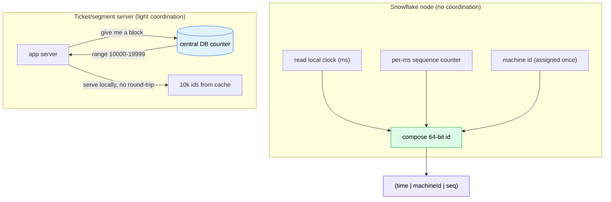
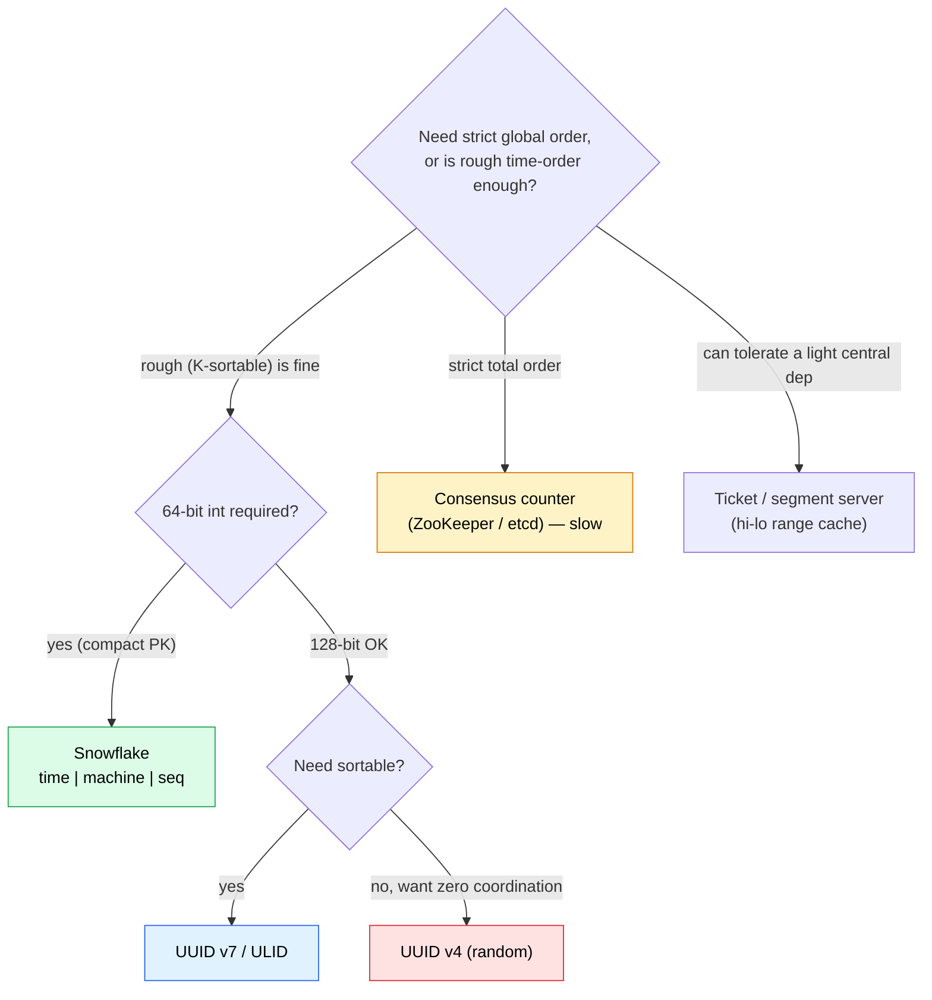

# Distributed ID Generation

## 1. Why Should I Care About This?
- **Every Sharded System Needs It**: The moment you split one database into many shards (or run many stateless app servers), you lose the free global `AUTO_INCREMENT` sequence. Something has to mint primary keys, order IDs, and message IDs that are unique *across the whole fleet* — this is that something.
- **It Silently Governs Your Index Performance**: The ID you choose becomes the primary key, which physically orders your B-tree or LSM storage. A bad choice (random UUIDv4) scatters writes across the index and quietly halves your insert throughput. A good choice (time-sortable) keeps writes sequential. Interviewers love this because juniors never connect ID format to storage locality.
- **The Classic "Design Twitter/Instagram" Follow-up**: "How do you generate the tweet ID?" is a standard drill-down. Snowflake is the canonical answer and shows you understand coordination-free design, clock skew, and bit packing all at once.

## 2. What Problem Does This Solve?
- **Uniqueness Without Coordination**: N machines each need to produce IDs that never collide, ideally *without* asking a central authority every time (which would be a round-trip per ID and a single point of failure).
- **Rough Time-Ordering (K-sortability)**: We want IDs that sort *approximately* by creation time so that "give me the newest 50 rows" is a cheap range scan, and so new rows append to the end of the index instead of scattering.
- **High Throughput**: Millions of IDs per second, generated locally, with sub-microsecond latency.
- **Naive Approach**: Point every service at a single database and use one `AUTO_INCREMENT` column as the global sequence. It gives perfect uniqueness and perfect ordering — and it is a **single point of failure and a hard throughput bottleneck**: every insert across every shard must serialize through one row/counter, one network hop away. It caps you at that one DB's write rate and dies when that DB dies.

## 3. Core Idea (Intuition First)
Think of it like **assigning seat numbers at a huge multi-venue festival with no central box office**. Instead of one clerk numbering everyone (a bottleneck), each venue gets a **unique venue code**, keeps its **own clock**, and stamps each ticket as `time + venueCode + counter-within-this-millisecond`. No two venues ever collide (different codes), tickets are roughly sorted by when they were issued (time comes first), and no venue ever has to phone anyone — it just stamps and hands out.


> Top: a 64-bit Snowflake ID packs time (high bits, so IDs sort by time), a machine id (guarantees cross-node uniqueness), and a per-ms sequence (uniqueness within one node in one millisecond). Bottom: because time is in the high bits, sequential IDs append to the end of the index (good locality); random UUIDv4 scatters inserts everywhere, splitting pages and thrashing the cache.

## 4. How It Actually Works
The high bits carry **time**, the middle bits carry a **node identity**, and the low bits carry a **per-node counter**. Time-first ordering gives K-sortability; node identity removes the need to coordinate; the counter absorbs multiple IDs within the same millisecond.

### Twitter Snowflake (64-bit)
Layout of the 64-bit integer, most-significant bit first:
- **1 bit** — unused **sign bit** (kept 0 so the value stays a positive signed 64-bit int).
- **41 bits** — **timestamp in milliseconds** since a *custom epoch*. 2^41 ms ≈ **69 years** of range. The custom epoch (e.g. 2010) buys you 69 years *from then*, not from 1970.
- **10 bits** — **machine / worker id** → 2^10 = **1024** distinct nodes. This bound is why 10 bits directly caps your cluster size.
- **12 bits** — **per-millisecond sequence** → 2^12 = **4096** ids per node per millisecond → **~4.096 million ids/sec/node**.

Each node keeps a local counter; if it exhausts 4096 ids inside one millisecond, it **busy-waits for the next millisecond** and resets the sequence to 0.

### UUID (128-bit, no coordination at all)
- **UUID v4**: 122 random bits (6 fixed version/variant bits). Collision probability is astronomically low, so *any* machine can mint one offline with zero coordination. But it is **not sortable** — random high bits mean each insert lands at a random spot in the primary-key index → **page splits, poor cache locality, write amplification** on B-trees.
- **UUID v7**: a **48-bit Unix-millisecond timestamp prefix** + random bits. Time-ordered like Snowflake, so it is **index-friendly** while still being coordination-free and globally unique. It is the **modern default** when you want UUID ergonomics without the index pain.

### Ticket / Segment Servers (DB hi-lo)
Instead of packing bits, a central DB hands out **ranges** ("tickets"): an app asks for a block (e.g. ids 10000–19999), caches it locally, and serves 10,000 ids from memory before asking again. This amortizes the central round-trip 1-in-10,000. Flickr used dual ticket servers (odd/even) for HA; Instagram embeds a shard id + time + per-shard sequence directly in sharded Postgres.



## 5. Real-World Example
**Designing tweet / message IDs for a sharded social platform:**
- **Twitter** replaced sequence-number IDs with **Snowflake** so every node could mint IDs independently while keeping tweets roughly time-ordered (essential for timeline range queries). Worker id = datacenter + machine bits.
- **Instagram** generates IDs inside sharded Postgres as `41 bits time | 13 bits shard id | 10 bits per-shard sequence` — a Snowflake variant tuned to their shard count so the ID also *tells you which shard the row lives on*.
- **Discord** uses Snowflake IDs directly as the primary key and even extracts the creation timestamp back out of the ID (`id >> 22`) instead of storing a separate `created_at`.
- **Flickr** used **ticket servers**: two MySQL boxes handing out even/odd ids so one could fail without halting id generation.

## 6. Code Example
Snowflake generator with bit-shifting composition (Python-ish pseudocode):
```python
CUSTOM_EPOCH = 1288834974657     # Twitter's epoch: 2010-11-04, in ms

MACHINE_ID_BITS = 10             # 1024 nodes
SEQUENCE_BITS   = 12             # 4096 ids / ms / node

MAX_MACHINE_ID  = (1 << MACHINE_ID_BITS) - 1   # 1023
MAX_SEQUENCE    = (1 << SEQUENCE_BITS)   - 1    # 4095

# how far to left-shift each field so time sits in the HIGH bits
MACHINE_SHIFT   = SEQUENCE_BITS                       # 12
TIMESTAMP_SHIFT = SEQUENCE_BITS + MACHINE_ID_BITS     # 22

class Snowflake:
    def __init__(self, machine_id):
        assert 0 <= machine_id <= MAX_MACHINE_ID
        self.machine_id   = machine_id
        self.last_ts      = -1
        self.sequence     = 0

    def _now(self):
        return current_time_millis()

    def next_id(self):
        ts = self._now()

        # --- CLOCK WENT BACKWARDS (NTP correction): refuse / wait ---
        if ts < self.last_ts:
            raise ClockMovedBackwards(self.last_ts - ts)   # or block until ts >= last_ts

        if ts == self.last_ts:                 # same millisecond → bump sequence
            self.sequence = (self.sequence + 1) & MAX_SEQUENCE
            if self.sequence == 0:             # 4096 exhausted this ms
                ts = self._wait_next_millis(self.last_ts)   # busy-wait for next ms
        else:                                  # new millisecond → reset counter
            self.sequence = 0

        self.last_ts = ts

        # --- COMPOSE: shift each field into place, OR them together ---
        return (((ts - CUSTOM_EPOCH) << TIMESTAMP_SHIFT)
                | (self.machine_id   << MACHINE_SHIFT)
                |  self.sequence)

    def _wait_next_millis(self, last_ts):
        ts = self._now()
        while ts <= last_ts:
            ts = self._now()
        return ts

# Decompose an id back into its parts:
def timestamp_of(id): return (id >> TIMESTAMP_SHIFT) + CUSTOM_EPOCH
```

## 7. Design Variations & Alternatives
- **Snowflake & clones** (Sonyflake, Baidu UidGenerator, Instagram's shard-embedded ids): 64-bit, time-sortable, coordination-free after machine-id assignment.
- **UUID v4**: max independence, zero coordination, but not sortable — bad index locality.
- **UUID v7 / ULID**: time-prefixed 128-bit — sortable *and* coordination-free; the modern default when 128 bits is acceptable.
- **Ticket / segment (hi-lo) servers**: central DB hands out ranges; simple, but the DB is a (mitigated) dependency.
- **Coordinated counters (ZooKeeper/etcd)**: strong ordering via consensus — correct but slow; use only when you truly need a *strict* total order.



## 8. Pros and Cons
### Pros
- **Snowflake**: coordination-free, K-sortable, compact 64-bit, ~4M ids/sec/node, decodable timestamp.
- **UUID v4**: trivially generated anywhere, no infra, no machine-id assignment.
- **UUID v7**: sortable + coordination-free; drop-in fix for v4's index problem.
- **Ticket servers**: simple, and can embed shard routing info in the id.

### Cons
- **Snowflake**: needs **machine-id assignment** (config or ZooKeeper) and is **sensitive to clock skew/rollback**; only 1024 nodes with 10 bits.
- **UUID v4**: **not sortable → page splits, poor locality, bigger 128-bit keys** bloat indexes and replication.
- **UUID v7**: 128 bits (double a bigint), and leaks a coarse creation timestamp.
- **Ticket servers**: central DB is a dependency; a crash can burn a whole cached range (gaps in ids).

## 9. Failure Scenarios & What Can Go Wrong
- **Clock moves backwards (the big one)** — SYMPTOM: duplicate ids appear or ordering inverts after an NTP correction / VM live-migration. CAUSE: Snowflake trusts wall-clock time in the high bits; if the clock jumps back, a timestamp it already used gets reused with a colliding sequence. FIX: **detect `now < last_ts` and refuse or block until the clock catches up**; disable large NTP step corrections (use slew), and consider a monotonic clock guard. Never emit ids while time is behind `last_ts`.
- **Duplicate machine ids** — SYMPTOM: two nodes mint identical ids under load. CAUSE: same worker id handed to two hosts (bad config, cloned VM, autoscaling reuse). FIX: assign machine ids from a **coordination service (ZooKeeper/etcd) with leases**, not static config; fail startup if the id is already held.
- **Sequence exhaustion in a millisecond** — SYMPTOM: latency spikes / stalls under burst. CAUSE: >4096 ids requested in one ms on one node. FIX: the generator busy-waits to the next ms (built in); if sustained, add more nodes or widen sequence bits.
- **Epoch / bit overflow** — SYMPTOM: ids wrap or turn negative decades out. CAUSE: 41-bit timestamp exhausts ~69 years after the custom epoch. FIX: choose a sensible epoch and plan a migration path before the horizon.
- **UUIDv4 as primary key** — SYMPTOM: insert throughput degrades as the table grows, high write I/O. CAUSE: random keys scatter B-tree writes → constant page splits and cache misses. FIX: switch to **UUID v7 / Snowflake** so inserts append sequentially.

## 10. Impact on Scalability, Reliability & Cost
- **Scalability**: coordination-free generation scales linearly — add nodes, add throughput, no central bottleneck. The **machine-id bit width caps cluster size** (10 bits → 1024 nodes); widen it if you need more, trading sequence/time bits.
- **Reliability**: no central id service means no SPOF on the id path (unlike the naive single-DB sequence or a fragile ticket server). Snowflake's weak point is **time**, not availability — protect it against clock rollback.
- **Cost**: K-sortable ids make inserts **sequential** → fewer page splits, better buffer-pool cache hit rate, cheaper LSM compaction, and smaller indexes (64-bit Snowflake vs 128-bit UUID). Choosing the id format is a real, ongoing storage-cost decision, not just a correctness one.

## 11. When NOT to Use This
- **Single small database**: if you have one DB that isn't sharded, plain `AUTO_INCREMENT`/`SERIAL` is simpler, ordered, and perfectly fine — don't build Snowflake for a blog.
- **IDs must be unguessable / secret**: sequential and time-sortable ids leak creation time and volume, and are enumerable. Use random UUIDv4 or a separate opaque public token instead (or encrypt the public id).
- **You genuinely need strict total ordering**: Snowflake is only *roughly* ordered (clock skew across nodes reorders within a few ms). If you need a strict global sequence (e.g. financial ledger ordering), use a consensus counter and accept the latency.

## 12. Interview Perspective
- **Expected answer**: "Don't use a single DB sequence — it's a SPOF and bottleneck. Use **Snowflake**: 64 bits = 1 sign + 41 ms-timestamp + 10 machine-id + 12 sequence, composed by bit-shifting so time is in the high bits → K-sortable and coordination-free."
- **Guaranteed follow-ups**: "What if the clock goes backwards?" (refuse/wait until `now >= last_ts`); "How many nodes can you have?" (2^10 = 1024 with 10 bits); "Max ids per node per second?" (4096 × 1000 ≈ 4M); "Why not UUIDv4?" (unique but random → destroys index locality; use UUIDv7 if you want a UUID).
- **Bonus signal**: mention machine-id assignment via ZooKeeper, embedding a shard id (Instagram), decoding the timestamp back out of the id, and the storage-locality argument for K-sortability.
- **Worked number to state out loud**: "12 sequence bits = 4096 ids/ms/node; 10 machine bits = 1024 nodes; so cluster ceiling ≈ 4096 × 1000 × 1024 ≈ 4.2 billion ids/sec — and that ceiling is set by the *bit budget*, not the hardware."

## 13. Connections to Other Topics
- [Distributed Locking & Leader Election](./Distributed_Locking_Leader_Election.md) — how machine ids / leases are handed out safely so no two nodes share a worker id.
- [Sharding & Partitioning](../05_Databases_Storage/Sharding_Partitioning.md) — the reason a single auto-increment stops working; ids can even encode the shard.
- [Database Indexing](../05_Databases_Storage/Database_Indexing.md) — why a random primary key causes page splits and index bloat.
- [B-Tree vs LSM Storage Engines](../05_Databases_Storage/B_Tree_vs_LSM_Storage_Engines.md) — the storage engines whose write locality K-sortable ids protect.
- [Logical Clocks & Time in Distributed Systems](./Logical_Clocks_Time_in_Distributed_Systems.md) — why wall-clock time is unreliable and how clock skew reorders Snowflake ids.
- [Distributed Consensus (Raft, Paxos)](./Distributed_Consensus_Raft_Paxos.md) — the machinery behind a strictly-ordered counter when rough ordering isn't enough.

## 14. Visual Aids
- **The SVG above** ([distributed_id_snowflake.svg](../assets/distributed_id_snowflake.svg)): top = the Snowflake 64-bit layout as a segmented bar (sign / timestamp / machine-id / sequence) with throughput and epoch annotations; bottom = UUIDv4 scattering B-tree inserts (page splits) vs Snowflake/UUIDv7 appending sequentially (good locality).
- **Mermaid #1 (Section 4)**: coordination-free Snowflake composition vs the light-coordination ticket-server range hand-out.
- **Mermaid #2 (Section 7)**: a decision tree for choosing Snowflake vs UUIDv7 vs UUIDv4 vs ticket server vs consensus counter.

## 15. Summary (TL;DR)
**Distributed ID generation replaces the single-DB auto-increment (a SPOF and throughput bottleneck) with ids that are unique, roughly time-sortable (K-sortable), and generated locally with no central coordination; the canonical answer is Twitter Snowflake — a 64-bit int of 1 sign bit + 41 ms-timestamp bits (~69 years from a custom epoch) + 10 machine-id bits (1024 nodes) + 12 per-ms sequence bits (4096 ids/ms/node ≈ 4M/sec/node) composed by bit-shifting so time lives in the high bits, making ids sort by creation time; UUID v4's 122 random bits are collision-safe and coordination-free but not sortable, so they scatter B-tree/LSM writes and cause page splits, while UUID v7 prepends a 48-bit millisecond timestamp to fix index locality (the modern default), and ticket/segment servers (hi-lo) hand out cached id ranges to amortize a central counter; the signature failure is the clock moving backwards after an NTP correction, which breaks Snowflake monotonicity and must be handled by refusing or waiting until the clock catches up, and the whole reason time-sortability matters is that sequential inserts keep index writes local and cheap while random ids thrash storage.**

## 16. Further Reading & Resources
- [Twitter Engineering: Announcing Snowflake](https://blog.twitter.com/engineering/en_us/a/2010/announcing-snowflake) and the [original Snowflake source](https://github.com/twitter-archive/snowflake/tree/snowflake-2010)
- [Instagram Engineering: Sharding & IDs at Instagram](https://instagram-engineering.com/sharding-ids-at-instagram-1cf5a71e5a5c)
- [Flickr: Ticket Servers — distributed unique primary keys on the cheap](https://code.flickr.net/2010/02/08/ticket-servers-distributed-unique-primary-keys-on-the-cheap/)
- [RFC 9562 — UUID (defines v4 and the new v7)](https://www.rfc-editor.org/rfc/rfc9562.html)
- [ULID specification](https://github.com/ulid/spec)
- [System Design Interview – Design a Unique ID Generator (ByteByteGo / Alex Xu)](https://bytebytego.com/courses/system-design-interview/design-a-unique-id-generator-in-distributed-systems)
