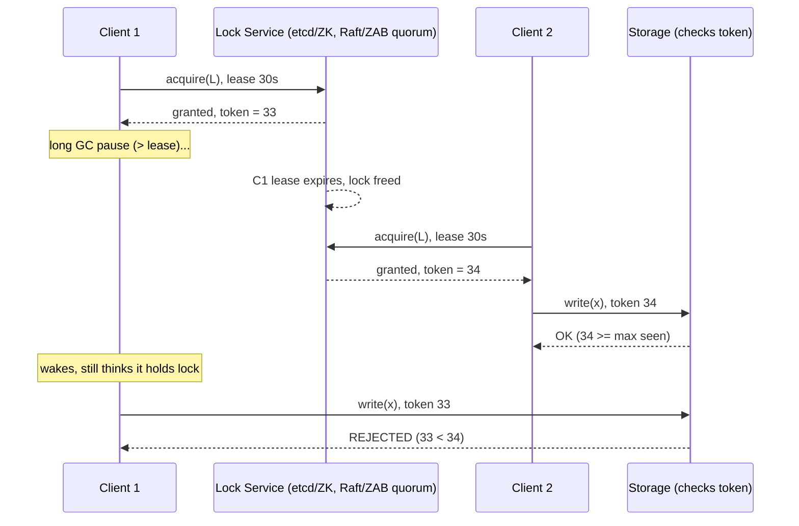
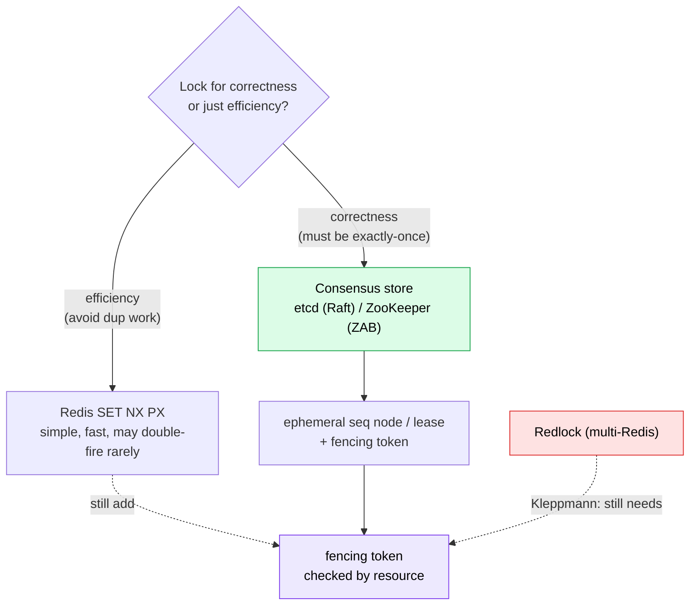

# Distributed Locking & Leader Election

## 1. Why Should I Care About This?
- **"Run This Exactly Once" Is Everywhere**: A nightly billing cron, a queue compactor, a cache warmer — you have N identical instances for availability, but the job must run on *exactly one*. Without coordination, all N fire at once and you double-charge customers or corrupt state.
- **It's a Classic Interview Landmine**: "How do you make sure only one worker processes this?" sounds trivial. The interviewer is really probing whether you know that a naive lock is *unsafe* under GC pauses and network delays — and whether you've heard of **fencing tokens**.
- **The Bug Is Silent and Catastrophic**: A broken distributed lock doesn't crash. It works 99.99% of the time, then a stop-the-world GC pause lets two nodes both "hold" the lock, and they both write. The corruption surfaces days later. Understanding this separates people who've operated distributed systems from people who've only read about them.

## 2. What Problem Does This Solve?
- **Mutual Exclusion Across Machines**: A single-process program uses a `mutex` — but that lives in one process's memory. When work is spread across many machines, you need a lock that *all of them* can see and respect.
- **Single-Leader Coordination**: Many patterns need one designated node — the primary that accepts writes, the scheduler that assigns work, the compactor that owns a partition. You need a way to *elect* one and detect when it dies so another takes over.
- **Naive Approach**: Use a single-node mutex, or set a lock in one database row (`UPDATE locks SET owner='me' WHERE id=1 AND owner IS NULL`) with no fencing and no fault tolerance. Two failure modes bite you: (1) that single node is a **single point of failure** — it dies and all coordination stops; (2) even when up, a client that acquires the lock then **pauses** (GC, VM migration, network partition) past its timeout has the lock silently reassigned — and when it wakes, *it still thinks it holds the lock*. Now two clients act as owner simultaneously. The row-lock protects nothing because the protected resource never checks *who really holds it now*.

## 3. Core Idea (Intuition First)
Think of it like **a single physical key to a shared workshop, handed out by a front desk**.
- Only one worker can hold the key at a time — that's **mutual exclusion**. The **front desk** (the lock service) hands it out and takes it back.
- To survive the desk clerk fainting, you don't trust one clerk — you have a **panel of clerks who vote** on who holds the key (a **consensus-backed store** like etcd/ZooKeeper). The key is granted only if a majority agrees.
- The key comes with a **lease**: "yours for 30 seconds unless you renew." If you vanish, it auto-expires so the workshop isn't locked forever.
- The subtle, dangerous part: a worker can walk off with the key, get stuck in traffic (a GC pause) past the lease, and the desk hands a *new* key to someone else. Now **two people believe they hold the key**. The fix: stamp each key with an **ever-increasing number (a fencing token)**, and make the workshop door **reject any key older than the last one it saw**.

![Three-panel diagram of distributed locking. Top: a client requests a lock from a consensus-backed lock service (etcd/ZooKeeper/Redis) and is granted the lock with fencing token 33. Middle: a timeline of the fencing-token safety scenario — Client 1 acquires token 33, suffers a long GC pause, its lease expires, Client 2 then acquires token 34 and writes to storage which is accepted, then Client 1 wakes and writes with the stale token 33 and storage rejects it because 33 is less than 34. Bottom: leader election where several candidates campaign, one wins via consensus or the lowest ephemeral sequential node, becomes leader, and the rest follow.](../assets/distributed_lock_fencing.svg)

> Top: a lock is granted with a monotonically increasing fencing token. Middle (the key lesson): a lock alone is *not* safe — a GC pause lets a stale holder (token 33) collide with the new holder (token 34); the storage layer must reject the lower token. Bottom: leader election picks one owner via a consensus-backed store, and even the leader must fence its writes.

## 4. How It Actually Works
### 1. Acquire with a lease (TTL)
- A client asks the lock service to acquire lock `L`. The grant carries a **lease / TTL** — e.g. 30s. If the client crashes, the lease expires and the lock frees itself; no human cleanup, no permanent deadlock.
- The client must **renew (heartbeat)** the lease before it expires to keep holding the lock during long work.

### 2. Get a fencing token
- Every successful acquire returns a **monotonically increasing token** (33, 34, 35 …). ZooKeeper's `zxid` / node version and etcd's `mod_revision` provide exactly this — a number that only ever goes up.
- The client attaches this token to *every write it makes to the protected resource*.

### 3. The protected resource enforces the token
- Storage remembers the **highest token it has accepted** and **rejects any write carrying a lower token**. This is what actually makes the system safe — the lock service alone cannot stop a paused client, but the resource can refuse its stale write.

### 4. Consensus underneath
- For correctness the lock must live in a **fault-tolerant, linearizable store**. etcd uses **Raft**, ZooKeeper uses **ZAB** — a majority quorum agrees on lock ownership, so no single node failure and no **split-brain** can hand the lock to two clients.



## 5. Real-World Example
**A partitioned stream processor that must have exactly one owner per partition (Kafka/Flink-style):**
- Each partition needs a single active worker. Workers **campaign** for the partition's lock in etcd; the winner processes; if it dies, its lease expires and another worker wins within seconds.
- The winner writes checkpoints to shared storage tagged with its fencing token. If the "dead" worker was merely GC-paused and comes back, its checkpoint write carries a stale token and is **rejected** — no corrupted offsets, no double-processing.
- **HDFS / GFS-style NameNode HA** uses this exact pattern: ZooKeeper elects the active NameNode, and the shared edit-log storage fences out a wrongly-alive old primary using an epoch number so two NameNodes can never both write metadata.

## 6. Code Example
Redis single-instance lock (`SET NX PX`) **plus** the fencing token that makes writes safe (Python-ish pseudocode):
```python
import os, time

# --- ACQUIRE: SET key value NX PX ttl  (atomic: set-if-not-exists + expiry) ---
def acquire_lock(redis, key, ttl_ms=30000):
    token = redis.incr("fencing:" + key)          # monotonic token from a counter
    owner = os.urandom(16).hex()                   # unique owner id, for safe release
    ok = redis.set(key, f"{owner}:{token}", nx=True, px=ttl_ms)  # NX=only if absent
    return (owner, token) if ok else None          # None => someone else holds it

# --- RELEASE: only if we still own it (compare-and-delete via Lua, atomic) ---
RELEASE_LUA = """
if redis.call('get', KEYS[1]) == ARGV[1] then return redis.call('del', KEYS[1])
else return 0 end
"""
def release_lock(redis, key, owner, token):
    redis.eval(RELEASE_LUA, 1, key, f"{owner}:{token}")

# --- The PROTECTED RESOURCE enforces fencing: reject any token <= last seen ---
class Storage:
    def __init__(self):     self.max_token = 0
    def write(self, data, token):
        if token <= self.max_token:                # stale holder after GC pause
            raise Exception(f"REJECTED: token {token} <= {self.max_token}")
        self.max_token = token                     # advance the high-water mark
        self._persist(data)                        # safe: this is the newest holder

# lock = acquire_lock(r, "job:billing")
# if lock: owner, token = lock; storage.write(rows, token)  # write carries the token
```

## 7. Design Variations & Alternatives
- **Redis single-instance (`SET NX PX`)**: fast and simple, but the Redis node is a SPOF and failover can *lose the lock* (replica hadn't received it) → **not safe for correctness without fencing**. Fine for efficiency ("avoid duplicate work") not correctness ("must never run twice").
- **Redlock (multi-node Redis)**: acquire on a majority of N independent Redis nodes. **Martin Kleppmann's critique**: it relies on bounded clocks and pause-free clients — a GC pause or clock jump still lets two clients hold it, so Redlock *still needs fencing tokens* and isn't a substitute for consensus.
- **ZooKeeper / etcd (ephemeral sequential nodes / leases)**: the **correct** choice for safety — Raft/ZAB give linearizable ownership, ephemeral nodes auto-release on session loss, and versions give free fencing tokens.
- **Database row lock / advisory lock**: works at small scale; the DB becomes the SPOF and bottleneck.



## 8. Pros and Cons
### Pros
- **Coordination Made Simple**: turns "which node does this?" into a single acquire call.
- **Auto-Recovery via Leases**: a crashed holder's lock frees itself — no permanent deadlock.
- **Fencing = Real Safety**: with monotonic tokens the protected resource is safe *even if the lock service is wrong*.
- **Consensus Stores Survive Failures**: quorum-based ownership means no SPOF and no split-brain.

### Cons
- **Latency & Throughput Cost**: every acquire is a quorum round-trip; the lock serializes work and becomes a bottleneck if held too coarsely.
- **The Pause Problem Is Fundamental**: no lock service can prevent a client from pausing past its lease — you *must* fence downstream.
- **Operational Weight**: running an etcd/ZK cluster (odd node count, quorum, backups) is real work.
- **Easy to Get Subtly Wrong**: naive Redis locks and Redlock feel safe but aren't, without fencing.

## 9. Failure Scenarios & What Can Go Wrong
- **SYMPTOM**: Two workers both process the same job / double-write. **CAUSE**: lock holder GC-paused past its lease; a second client acquired the lock; both are "owners." **FIX**: **fencing tokens** — the resource rejects the stale (lower) token; keep leases longer than worst-case pause and use liveness monitoring.
- **SYMPTOM**: After a Redis failover, two clients hold the "same" lock. **CAUSE**: the lock was set on the primary but not yet replicated when it failed over. **FIX**: don't use single-Redis for correctness — use a consensus store; if using Redis, treat the lock as best-effort and rely on fencing.
- **SYMPTOM**: Split-brain — two nodes both act as leader after a network partition. **CAUSE**: lock/election ran on a store without a majority quorum, so both sides "won." **FIX**: require a **majority (Raft/ZAB) quorum**; the minority partition cannot elect a leader and steps down.
- **SYMPTOM**: Lock held forever, all work stalls. **CAUSE**: holder crashed without releasing and there's no TTL, or renewal keeps a dead-but-slow client alive. **FIX**: always set a **lease/TTL** and use **ephemeral nodes** that vanish on session loss.
- **SYMPTOM**: Clocks disagree, lease expires early/late. **CAUSE**: relying on wall-clock across nodes. **FIX**: use the store's logical revision for fencing, not timestamps; keep NTP tight.

## 10. Impact on Scalability, Reliability & Cost
- **Scalability**: a lock is a **serialization point** — it deliberately limits concurrency. Keep critical sections short and locks fine-grained (per partition/key, not one global lock) or the lock caps your throughput.
- **Reliability**: a consensus-backed lock removes the SPOF and prevents split-brain, but adds a hard dependency — if the etcd/ZK quorum is down, coordination halts (a correct-but-unavailable trade, per CAP). Leases keep the system self-healing.
- **Cost**: running a 3–5 node etcd/ZK cluster (compute + ops) plus per-acquire quorum latency. The alternative — a corruption incident from a bad lock — is far costlier, so for correctness the spend is justified; for mere efficiency, a cheap Redis lock is enough.

## 11. When NOT to Use This
- **The Work Is Idempotent**: if running twice is harmless (idempotent writes, upserts keyed by id), you often don't need a lock at all — just make double-execution safe.
- **You Can Partition Instead**: sharding work by key so each key maps to exactly one owner (consistent hashing / static assignment) avoids runtime locking entirely.
- **Single Machine**: within one process, use a language `mutex` — a distributed lock is pointless overhead.
- **Ultra-High-Frequency Contention**: if you'd grab the lock millions of times/sec, the coordination cost dominates — redesign to avoid shared mutable state (per-worker queues, CRDTs).

## 12. Interview Perspective
- **What interviewers expect**: describe acquire-with-lease + renewal, name a real store (etcd/ZooKeeper for correctness, Redis for efficiency), and — the key signal — bring up **fencing tokens** unprompted.
- **The trap question**: "Is a Redis lock safe?" Correct answer: only for *efficiency*; for *correctness* a GC pause or failover can hand it to two clients, so you need a consensus store **and** fencing tokens. Bonus: cite Kleppmann's Redlock critique.
- **Leader election follow-up**: "How do you elect one leader?" → ephemeral sequential znode (lowest sequence wins; watch the node just below you) or etcd lease + campaign; on session loss the node vanishes and the next candidate takes over — and the leader **still fences** its writes.
- **Split-brain**: always mention that a majority quorum is what prevents two leaders.

## 13. Connections to Other Topics
- [Distributed Consensus (Raft, Paxos)](./Distributed_Consensus_Raft_Paxos.md) — the algorithm underneath etcd/ZK that makes lock ownership and election safe.
- [Service Discovery (Consul, Eureka)](./Service_Discovery_Consul_Eureka.md) — the same stores do discovery; the elected leader registers itself here.
- [Configuration Management (Vault)](./Configuration_Management_Vault.md) — Vault uses a lock in its storage backend for HA active-node election.
- [Distributed Caching (Redis, Memcached)](../06_Caching_Performance/Distributed_Caching_Redis_Memcached.md) — where the Redis `SET NX PX` lock lives; also the source of its failover pitfalls.
- [Distributed ID Generation](./Distributed_ID_Generation.md) — fencing tokens are essentially monotonic IDs; the same primitive appears here.
- [Gossip Protocol & Failure Detection](./Gossip_Protocol_Failure_Detection.md) — how nodes detect a dead leader/lock holder to trigger re-election.

## 14. Visual Aids
- **The SVG above** ([distributed_lock_fencing.svg](../assets/distributed_lock_fencing.svg)): top — normal grant with a fencing token; middle — the GC-pause fencing timeline where storage rejects the stale token 33; bottom — leader election among candidates via consensus.
- **Mermaid #1 (Section 4)**: the sequence where Client 1 pauses, Client 2 gets token 34 and writes, and Client 1's stale token-33 write is rejected.
- **Mermaid #2 (Section 7)**: the decision tree — efficiency vs correctness → Redis vs consensus store, with fencing tokens required on every path (including Redlock).

## 15. Summary (TL;DR)
**Distributed locking gives you mutual exclusion and single-leader coordination across machines, but a lock alone is *not* safe: a holder can GC-pause or get partitioned past its lease, a second client legitimately acquires the lock, and now two clients both believe they own it — so you attach a monotonically increasing fencing token to every acquire and make the protected resource reject any write bearing a token lower than the highest it has seen (Client 1's stale token 33 loses to Client 2's token 34); for correctness the lock must live in a fault-tolerant, linearizable, consensus-backed store (etcd via Raft, ZooKeeper via ZAB) that uses a majority quorum to avoid a single point of failure and split-brain, with leases/TTLs and ephemeral nodes for self-healing auto-release and heartbeat renewal to hold the lock during long work — while a single-instance Redis `SET NX PX` lock (or even Redlock, per Kleppmann's critique) is fine only for efficiency, never correctness, and still needs fencing; leader election is the same recipe (lowest ephemeral sequential node / etcd lease + campaign), and the elected leader must fence its writes too.**

## 16. Further Reading & Resources
- [Martin Kleppmann — "How to do distributed locking" (the Redlock critique + fencing tokens)](https://martin.kleppmann.com/2016/02/08/how-to-do-distributed-locking.html)
- [Redis docs — Distributed Locks with Redlock](https://redis.io/docs/latest/develop/use/patterns/distributed-locks/)
- [ZooKeeper Recipes — Locks & Leader Election](https://zookeeper.apache.org/doc/current/recipes.html)
- [etcd — Distributed locks and leader election (concurrency API)](https://etcd.io/docs/latest/dev-guide/api_concurrency_reference_v3/)
- [Designing Data-Intensive Applications (Kleppmann), Ch. 8–9 — fencing, leases, linearizability](https://dataintensive.net/)
