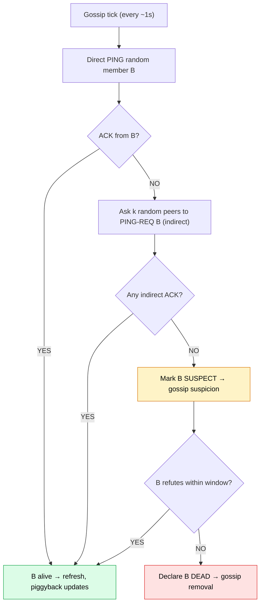
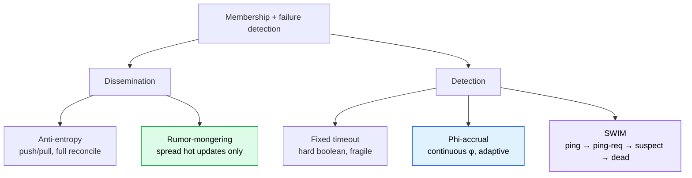

# Gossip Protocol & Failure Detection

## 1. Why Should I Care About This?
- **It Is How Big Clusters Stay Alive Without a Boss**: Cassandra, Consul, DynamoDB-style rings, and Redis Cluster all manage thousands of nodes with **no central controller**. Gossip is the mechanism that lets every node learn "who is alive, who is dead, who owns what" — the interviewer wants to know you understand decentralized membership.
- **Naive Failure Detection Is a Trap**: Fixed-timeout heartbeats look simple and then betray you in production — a 3-second GC pause or a routing blip makes a healthy node look dead, triggering spurious failovers, rebalances, and cascading load. Knowing *why* teaches you about false positives and the accuracy/speed trade-off.
- **It Scales Where Everything Else Explodes**: All-to-all heartbeats cost O(N^2) messages; a central monitor is a single point of failure and a bottleneck. Gossip spreads information in **O(log N) rounds** with **O(N) bandwidth per node** — a genuinely different scaling curve you can reason about on a whiteboard.

## 2. What Problem Does This Solve?
- **Decentralized Membership at Scale**: In a 1,000-node cluster, every node needs a reasonably fresh view of which peers are up, down, or joining — without a coordinator that everyone depends on.
- **Fast, Accurate Failure Detection**: Detect a genuinely dead node quickly, but *don't* declare a briefly-slow node dead. These two goals fight each other, and the design must balance them.
- **Naive Approach**: A **central heartbeat monitor** — every node pings one coordinator every second — or **all-to-all heartbeats** where each node pings every other node. The central monitor is a single point of failure and a bandwidth/CPU hotspot; all-to-all is **O(N^2)** messages (1,000 nodes = ~1M pings/interval) and still gives false positives the moment a node stalls on GC. Neither survives to thousands of nodes.

## 3. Core Idea (Intuition First)
Think of it like **spreading a rumor at a huge party**.
- Nobody stands on a stage announcing news to everyone (that's the central monitor — one overloaded person, and if they leave, news stops).
- Instead, whoever hears something juicy turns to **a couple of random people nearby** and whispers it. Those people each tell a couple more. Because the number of people "in the know" **doubles every round**, the whole party of N guests knows within about **log2(N) rounds** — ~10 rounds for 1,000 guests. This is **epidemic dissemination**: robust (no single point of failure), self-healing (redundant paths), and eventually consistent.
- Failure detection rides the same channel: if you whisper to someone and they don't whisper back, you don't immediately shout "they're dead!" — you ask a few others to check on them first, then raise suspicion, then confirm.

![A two-panel diagram of decentralized cluster health. Left panel titled GOSSIP SPREAD shows an epidemic doubling over three rounds — round 1 has a single green infected node A, round 2 A tells peers B and C so three know, round 3 doubles again to seven nodes, labeled converges in O(log N) rounds with no coordinator. Right panel titled SWIM FAILURE DETECTION shows node A pinging node B directly with no ACK in amber, then A asking two random peers to ping-req B indirectly which also fails, then B marked SUSPECT in amber and finally DEAD in red. A bottom band illustrates phi-accrual: regular green heartbeats keep suspicion phi near zero, then as the gap since the last heartbeat grows past the expected interval an amber curve climbs until phi crosses a threshold and the node is suspected, noted as used by Cassandra and Akka.](../assets/gossip_swim_failure_detection.svg)

> Left: gossip spreads state like an epidemic — one node knows, then two, then four; the "infected" set doubles each round so all N nodes converge in O(log N) rounds with no coordinator. Right: SWIM detects failure carefully — direct ping, then indirect ping-req via k random peers, then SUSPECT (refutable), then DEAD. Bottom: phi-accrual replaces a hard timeout with a continuous suspicion level φ that rises as the heartbeat gap outgrows the expected interval.

## 4. How It Actually Works
### 1. Gossip / Epidemic Dissemination
- Every node runs a periodic **gossip round** (e.g. once per second). Each round it picks **a few random peers** and exchanges membership + state (version-stamped key/values, heartbeat counters).
- Because informed nodes recruit more nodes each round, any update reaches the whole cluster in **O(log N) rounds**. No node is special; killing any subset barely slows propagation.

### 2. Anti-Entropy vs Rumor-Mongering
- **Anti-entropy (push/pull)**: two nodes reconcile their *entire* state by comparing version vectors / Merkle-tree digests and shipping only the diffs. Guarantees convergence but is heavier — good as a periodic background sync.
- **Rumor-mongering**: only actively spread "hot" (recent) updates for a limited number of rounds, then stop gossiping them. Cheap and fast for fresh news, but can miss a node — so systems run both: rumor-mongering for speed, anti-entropy as the safety net.

### 3. Failure Detection: From Hard Timeout to Phi-Accrual
- A **fixed timeout** ("no heartbeat in 5s = dead") is a hard boolean and fragile: too short → false positives on GC/network jitter; too long → slow detection.
- The **phi-accrual failure detector** instead records the **distribution of heartbeat inter-arrival times** and outputs a continuous suspicion value **φ**. φ ≈ 0 when beats arrive on schedule and rises smoothly as a beat grows overdue relative to what history predicts. The app picks a threshold (e.g. φ > 8), decoupling detection sensitivity from a magic timeout. Used by **Cassandra** and **Akka**.

### 4. SWIM Protocol
- **S**calable **W**eakly-consistent **I**nfection-style process group **M**embership. A node periodically **direct-pings** one random member. If no ACK, it asks **k random members to ping-req** that target **indirectly** (routing around a broken A↔B link). Only if all indirect probes also fail does it mark the target **SUSPECT**, broadcast that suspicion, allow a **refutation** window (the "dead" node can say "I'm alive!"), then finally declare **DEAD**. Membership changes are **piggybacked (infection-style)** on the ping traffic — no separate flood.



## 5. Real-World Example
**A 1,000-node cluster losing a node.**
- **Membership spread**: A new node joins and gossips its presence. With a fanout of ~3 peers per second, the "who's new" fact reaches all 1,000 nodes in roughly **log(1000) ≈ 10 rounds ≈ 10 seconds** — no coordinator touched.
- **Bandwidth**: each node gossips to a handful of peers per tick → **O(N) total messages per round** cluster-wide (per-node cost is tiny and constant). Compare all-to-all heartbeats: **O(N^2) = ~1,000,000 messages/interval**. Gossip is orders of magnitude cheaper at this scale.
- **A node dies**: its neighbor's direct ping fails; k indirect ping-reqs fail; it's marked SUSPECT, gossiped, and after the refutation window, DEAD. Meanwhile phi-accrual on the *other* nodes has been raising φ on that peer, so a slow-but-alive node (mid-GC) that resumes beating sees φ fall back and is never wrongly evicted.
- **Who does what**: **Consul** uses Serf (a SWIM variant) for membership; **Cassandra** combines a gossip protocol with a **phi-accrual** detector; **Redis Cluster** runs a binary gossip "cluster bus" for node health and slot ownership.

## 6. Code Example
A single gossip round plus a SWIM-style probe (Python-ish pseudocode):
```python
FANOUT = 3            # peers contacted per round
PHI_THRESHOLD = 8.0   # phi-accrual suspicion cutoff

def gossip_round(self):
    peers = random.sample(self.members.alive(), FANOUT)   # pick a few random peers
    for p in peers:
        # push/pull: exchange version-stamped state, keep the newer version of each key
        their_state = rpc(p, "gossip", self.digest())
        self.merge(their_state)          # anti-entropy reconciliation
    self.probe(random.choice(self.members.alive()))       # SWIM failure probe

def probe(self, target):
    if ping(target, timeout=self.rtt_estimate):
        self.mark_alive(target)                            # ACK → healthy
        return
    # no direct ACK → ask k random peers to probe INDIRECTLY (route around a bad link)
    helpers = random.sample(self.members.alive(), k=3)
    if any(ping_req(h, target) for h in helpers):
        self.mark_alive(target)
        return
    self.mark_suspect(target)            # gossip SUSPECT; target may refute within window

def phi(self, node):
    # continuous suspicion from the distribution of past inter-arrival gaps
    gap = now() - node.last_heartbeat
    mean, std = node.arrival_stats()     # learned online, no magic timeout
    return -math.log10(1 - cdf(gap, mean, std))   # rises smoothly as gap grows

def check(self, node):
    if self.phi(node) > PHI_THRESHOLD:
        self.mark_suspect(node)
```

## 7. Design Variations & Alternatives
- **Anti-entropy (push/pull)** vs **rumor-mongering**: full reconciliation (reliable, heavier) vs spread-hot-updates-only (fast, may miss nodes). Production systems run both.
- **Phi-accrual** vs **fixed-timeout** detection: continuous suspicion level vs hard boolean. Phi-accrual auto-adapts to a link's real latency distribution.
- **SWIM** vs **plain heartbeat gossip**: SWIM's indirect ping-req + suspicion + refutation drastically cut false positives versus naively gossiping raw heartbeat counters.
- **Central monitor / coordinator** (ZooKeeper-style ephemeral nodes): simpler and strongly consistent, but a scaling and availability ceiling — fine for hundreds of nodes, not tens of thousands.



## 8. Pros and Cons
### Pros
- **No coordinator / no single point of failure**: fully decentralized, self-healing via redundant gossip paths.
- **Scales**: O(log N) convergence, O(N) per-round bandwidth cluster-wide, constant per-node cost.
- **Robust to partial failures**: losing many nodes barely slows propagation; SWIM's indirect probes route around broken links.
- **Adaptive accuracy**: phi-accrual tunes to real network conditions, cutting false positives.

### Cons
- **Eventual consistency only**: at any instant, views differ across nodes — never a single authoritative membership snapshot.
- **Convergence latency**: O(log N) rounds is seconds, not milliseconds — not for instant coordination.
- **Constant background chatter**: gossip runs forever, using bandwidth even when idle.
- **Tuning is subtle**: fanout, intervals, suspicion timeouts, and φ threshold interact; bad values cause flapping or slow detection.
- **Metastable failure risk**: under load, suspicion + retries can feed back and destabilize the whole cluster.

## 9. Failure Scenarios & What Can Go Wrong
- **SYMPTOM**: Healthy nodes keep getting marked dead and re-added (flapping). **CAUSE**: fixed timeout too aggressive vs GC pauses / network jitter — classic false positive. **FIX**: switch to phi-accrual, raise the φ threshold / suspicion timeout, and use SWIM indirect ping-req so one bad link doesn't condemn a node.
- **SYMPTOM**: Membership takes far too long to converge. **CAUSE**: fanout too low or gossip interval too long for the cluster size. **FIX**: increase fanout or shorten the interval (bandwidth vs speed trade-off); ensure anti-entropy runs as a backstop.
- **SYMPTOM**: Split-brain — two halves each think the other is dead. **CAUSE**: network partition; gossip converges *within* each side independently. **FIX**: gossip detects liveness but does **not** decide truth — pair it with a quorum/consensus layer (Raft/Paxos) for authoritative decisions like leadership or ownership.
- **SYMPTOM**: Cluster-wide instability that worsens under load (metastable failure). **CAUSE**: a slowdown raises suspicion → retries/indirect probes add load → more slowdown, a feedback loop. **FIX**: cap probe/retry rates, add jitter and backoff, and use phi-accrual so transient slowness doesn't trip mass evictions.

## 10. Impact on Scalability, Reliability & Cost
- **Scalability**: the headline win — O(log N) convergence and O(N)/round total bandwidth beat the central monitor (bottleneck) and all-to-all (O(N^2)). This is what lets rings grow to thousands of nodes.
- **Reliability**: no coordinator to lose; redundant epidemic paths self-heal; SWIM + phi-accrual keep false positives low so failover fires only on real deaths. But it provides *only eventual* consistency — layer consensus on top for authoritative state.
- **Cost**: continuous background gossip is a steady, predictable bandwidth/CPU tax (small per node). The knobs — fanout, interval, suspicion window — directly trade **detection speed and freshness against network cost**.

## 11. When NOT to Use This
- **Small, static clusters**: a handful of nodes with a coordinator (ZooKeeper/etcd) is simpler and gives you strong consistency for free — gossip's machinery is overkill.
- **When you need an authoritative, instant membership snapshot**: gossip is eventually consistent and takes rounds to converge; use consensus if a decision must be globally agreed *now*.
- **Strong consistency / leadership decisions**: don't use gossip to *elect a leader* or decide ownership by itself — that needs quorum (Raft/Paxos). Gossip informs; consensus decides.
- **Ultra-low-latency detection needs**: if you must detect failure in single-digit milliseconds, gossip's multi-round convergence is too slow.

## 12. Interview Perspective
- **What interviewers expect**: explain *why* a central monitor / all-to-all heartbeats don't scale (SPOF, O(N^2)), then introduce gossip (O(log N), no coordinator, eventually consistent) and a smart failure detector.
- **Common question**: "Your heartbeat monitor keeps declaring healthy nodes dead — why, and how do you fix it?" (Answer: false positives from GC/jitter under a hard timeout → move to **phi-accrual** for a continuous suspicion level, and **SWIM indirect ping-req** to route around single bad links, with a refutation window.)
- **Follow-up**: "Gossip says node X is dead — do you immediately reassign its data?" (Answer: gossip detects *liveness*, it doesn't establish *truth*; for authoritative ownership/leadership decisions defer to a **consensus** layer, and beware split-brain during partitions.)
- **Bonus signal**: name-drop the trade-offs — anti-entropy vs rumor-mongering, fanout/interval tuning, O(N) bandwidth, metastable failures, and real users (Cassandra, Consul/Serf, Dynamo, Redis Cluster).

## 13. Connections to Other Topics
- [Service Discovery (Consul, Eureka)](./Service_Discovery_Consul_Eureka.md) — Consul's Serf uses SWIM gossip for membership; discovery is a direct consumer of this.
- [Distributed Consensus (Raft, Paxos)](./Distributed_Consensus_Raft_Paxos.md) — the complement: gossip detects liveness, consensus decides authoritative truth (leadership, ownership).
- [Logical Clocks & Time in Distributed Systems](./Logical_Clocks_Time_in_Distributed_Systems.md) — gossip merges state using version stamps / vector clocks to pick the newer value.
- [Replication](../05_Databases_Storage/Replication.md) — Dynamo/Cassandra-style rings gossip membership and ring topology to drive replica placement and anti-entropy repair.
- [Circuit Breaker & Bulkhead](./Circuit_Breaker_Bulkhead.md) — failure detection is the signal; circuit breakers are the local reaction to an unhealthy dependency.
- [Distributed Locking & Leader Election](./Distributed_Locking_Leader_Election.md) — election needs consensus, but often relies on gossip-based membership to know who the candidates are.

## 14. Visual Aids
- **The SVG above** ([gossip_swim_failure_detection.svg](../assets/gossip_swim_failure_detection.svg)): left = the epidemic doubling of gossip over three rounds; right = SWIM's ping → indirect ping-req → SUSPECT → DEAD flow; bottom = phi-accrual suspicion φ rising as the heartbeat gap grows.
- **Mermaid #1 (Section 4)**: the SWIM decision flow — direct ping, indirect ping-req via k peers, suspect, refute, dead.
- **Mermaid #2 (Section 7)**: the design space — dissemination (anti-entropy vs rumor-mongering) and detection (fixed timeout vs phi-accrual vs SWIM).

## 15. Summary (TL;DR)
**Gossip protocols give large clusters decentralized, eventually-consistent membership by having each node periodically exchange state with a few random peers, so any update spreads like an epidemic in O(log N) rounds with O(N) per-round bandwidth and no coordinator — beating both the central-monitor SPOF and all-to-all heartbeats' O(N^2); dissemination mixes anti-entropy (full push/pull reconciliation) with rumor-mongering (spread hot updates), while failure detection avoids the false positives of fixed-timeout heartbeats (which mistake GC pauses and network blips for death) by using the phi-accrual detector — a continuous suspicion level φ derived from the distribution of heartbeat inter-arrival times (Cassandra, Akka) — and the SWIM protocol, which does a direct ping, then k indirect ping-reqs through random peers, then a refutable SUSPECT state, then DEAD, piggybacking membership changes on the probes; real systems (Consul/Serf, Cassandra, DynamoDB-style rings, Redis Cluster) rely on it, but because gossip only detects liveness and never establishes truth, you pair it with a consensus layer for authoritative decisions and watch for split-brain and metastable failure loops.**

## 16. Further Reading & Resources
- [SWIM: Scalable Weakly-consistent Infection-style Process Group Membership Protocol (Das, Gupta, Motivala)](https://www.cs.cornell.edu/projects/Quicksilver/public_pdfs/SWIM.pdf)
- [The Phi Accrual Failure Detector (Hayashibara et al.)](https://www.computer.org/csdl/proceedings-article/srds/2004/22390066/12OmNvT2phv)
- [HashiCorp Serf: Gossip Protocol](https://www.serf.io/docs/internals/gossip.html)
- [Cassandra: Internals — Gossip & Failure Detection](https://cassandra.apache.org/doc/latest/cassandra/architecture/dynamo.html)
- [Amazon Dynamo Paper (membership & failure detection via gossip)](https://www.allthingsdistributed.com/files/amazon-dynamo-sosp2007.pdf)
- [Redis Cluster Specification (the cluster gossip bus)](https://redis.io/docs/latest/operate/oss_and_stack/reference/cluster-spec/)
