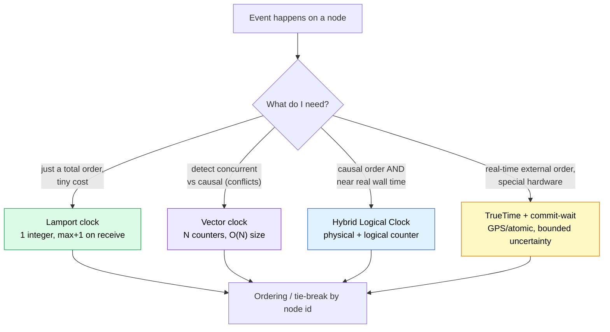
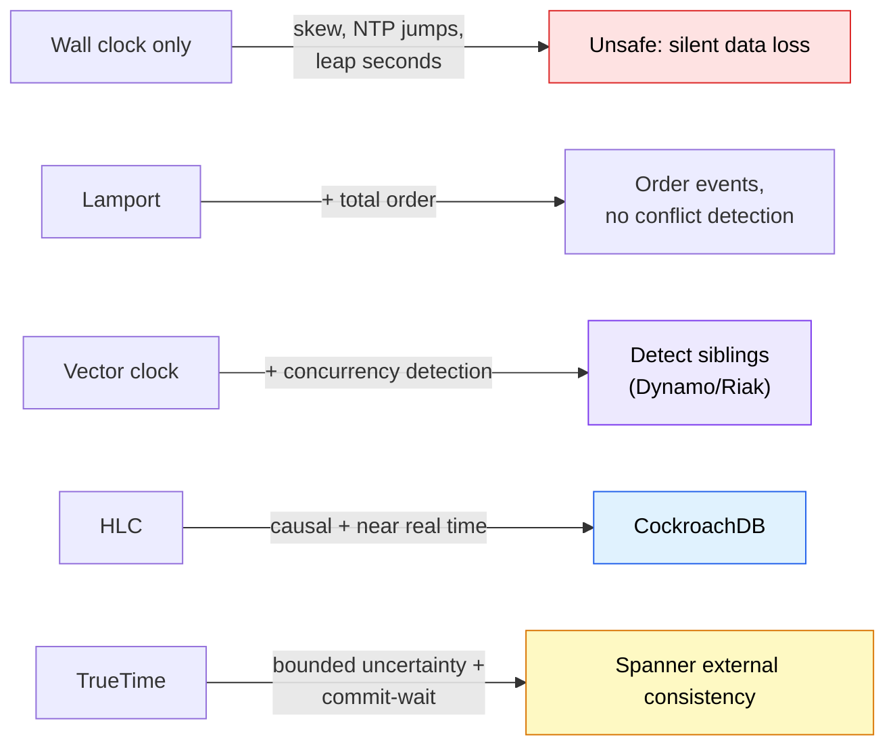

# Logical Clocks & Time in Distributed Systems

## 1. Why Should I Care About This?
- **Every distributed system needs to order events, and the clock lies to you.** "Which write happened first?" sounds trivial until you realize the two writes hit two machines whose wall clocks disagree by 200ms. Get this wrong and you overwrite newer data with older data.
- **It underpins conflict resolution, causality, and consensus.** Dynamo-style databases, CRDTs, distributed tracing, Git, and Raft/Paxos all lean on some notion of "happened-before" that does *not* come from a wall clock.
- **It is a favorite senior interview probe.** "Two nodes both claim their write is the latest — how do you decide?" separates people who reach for `timestamp > timestamp` (wrong) from people who say "you can't trust wall clocks; use a logical clock and detect concurrency."

## 2. What Problem Does This Solve?
- **Ordering events across machines that share no clock.** In a single process, program order gives you a total order for free. Across a network there is no shared "now" — you must *manufacture* an ordering.
- **Detecting causality vs coincidence.** Did event B *depend on* event A (A caused B), or did they happen independently at the same time? Physical timestamps cannot answer this.
- **Naive Approach**: trust wall-clock timestamps — attach `System.currentTimeMillis()` to each event and order by that value. This fails because:
  - **Clock skew**: two servers' clocks drift apart (cheap crystals drift seconds/day); "later" timestamp can be the *earlier* event.
  - **NTP jumps**: the daemon *steps* a clock backward to correct drift, so time literally goes in reverse — a later event gets a smaller timestamp.
  - **No global "now" (relativity of simultaneity)**: message latency means there is no way to say two remote events were "simultaneous."
  - **Leap seconds**: an inserted 23:59:60 has broken production systems (the 2012 leap second froze many servers). Wall clocks are not monotonic and not comparable across hosts.

## 3. Core Idea (Intuition First)
Think of **a group email thread with no timestamps you can trust**. You can't know the exact minute anyone hit "send," but you *can* reason about causality: if Bob's email **quotes** Alice's email, then Alice's message *must* have come first — the quote is proof of a causal link. If two people reply to the original at the same time without seeing each other's message, their replies are **concurrent** — there is no "first," and you have a fork in the conversation.

That "if you saw it, it came before you" rule is exactly **happens-before (→)**. Logical clocks are just counters that encode this relation so a machine can compute it.

![Three process timelines P1, P2, P3 exchanging messages; each event is tagged with a green Lamport counter that increments locally and takes max(local, received)+1 on message receipt, and with a purple vector clock; two writes on different processes carry vector clocks [2,0,0] and [0,0,1] where neither is less-than-or-equal to the other, flagged in red as concurrent and therefore a conflict, while Lamport would falsely order them by 2 greater than 1](../assets/logical_clocks_lamport_vector.svg)

> Green numbers are Lamport counters: they increment on every event and jump to `max(local, received)+1` on receive, giving a total order. Purple vectors are per-process counters: comparing them reveals that write B `[2,0,0]` and write D `[0,0,1]` are **concurrent** (neither dominates) — a real conflict Lamport's `2 > 1` would silently hide.

## 4. How It Actually Works
The foundation is Lamport's **happens-before** relation (→): (1) if `a` and `b` are in the same process and `a` comes first, `a → b`; (2) if `a` is a send and `b` is its receive, `a → b`; (3) transitivity. If neither `a → b` nor `b → a`, the events are **concurrent** (`a ∥ b`).

### Lamport Clocks
A single integer counter `C` per process. Rules:
- **Local event**: `C = C + 1`.
- **Send**: `C = C + 1`; attach `C` to the message.
- **Receive**: `C = max(C, C_msg) + 1`.

Guarantee: `a → b ⟹ C(a) < C(b)`. This gives a **total order consistent with causality** (break ties by process id). Crucial limitation: the converse is false — `C(a) < C(b)` does **not** imply `a → b`. So Lamport clocks **cannot distinguish causal from concurrent** events.

### Vector Clocks
Each process `i` keeps a vector `V` of length `N` (one counter per process). Rules:
- **Local/send event on `i`**: `V[i] = V[i] + 1`; attach the whole vector on send.
- **Receive at `i`**: `V[k] = max(V[k], V_msg[k])` for all `k`, then `V[i] = V[i] + 1`.

Comparison: `V_a ≤ V_b` iff every component `V_a[k] ≤ V_b[k]`. Then `a → b` iff `V_a < V_b` (≤ and not equal). If **neither** `V_a ≤ V_b` **nor** `V_b ≤ V_a`, the events are **concurrent** — this is exactly how Dynamo/Riak detect conflicting writes (**siblings**). Cost: **O(N) size** per timestamp — grows with the number of processes.

### Hybrid Logical Clocks (HLC)
Combine **physical time** and a **logical counter** into one timestamp `(pt, l)`. On each event, take `pt = max(local_physical, received_pt)`; if `pt` didn't advance, bump the logical part `l`. Result: timestamps stay **within a bounded distance of wall-clock time** (great for human-readable / TTL / range queries) **and** are **causally consistent** (monotonic, respect happens-before). **CockroachDB** uses HLC. Related but different: **Google TrueTime** (Spanner) exposes an *uncertainty interval* `[earliest, latest]` from GPS + atomic clocks; Spanner does **commit-wait** (sleep out the uncertainty, a few ms) so external order matches real time.



## 5. Real-World Example
**Amazon DynamoDB's ancestor (Dynamo) and Riak — shopping cart conflict.** A user adds item X on a node in the US and, before replication catches up, adds item Y on a node in the EU. Two writes to the same cart key happen on two nodes with **no causal link** between them.
- With **wall-clock last-write-wins**, one write's timestamp is larger by chance (or by skew), so the other item is **silently lost** — the customer's cart drops an item.
- With **vector clocks**, the two versions carry `[2,0,0]` and `[0,0,1]`. Neither dominates → the system knows they are **concurrent siblings** and keeps *both*, handing the conflict to the application (merge the carts, union the items). No data lost.
- **CockroachDB** instead uses **HLC** so that transaction timestamps are causally consistent *and* close to real time, enabling sensible time-travel queries and TTLs without a global clock. **Spanner** uses **TrueTime** commit-wait to give true external consistency at the cost of a few ms of latency and atomic-clock hardware.

## 6. Code Example
Lamport and vector clock update rules (Python-ish pseudocode):
```python
# ---------- LAMPORT CLOCK (one integer) ----------
class LamportClock:
    def __init__(self):
        self.c = 0
    def local_event(self):        # rule 1
        self.c += 1
        return self.c
    def send(self):               # rule 2: bump, then attach
        self.c += 1
        return self.c             # piggyback this on the message
    def receive(self, ts_msg):    # rule 3: catch up, then bump
        self.c = max(self.c, ts_msg) + 1
        return self.c
# Guarantee: a -> b implies C(a) < C(b). But C(a) < C(b) does NOT imply a -> b.

# ---------- VECTOR CLOCK (one counter per node) ----------
class VectorClock:
    def __init__(self, node_id, n):
        self.i = node_id
        self.v = [0] * n
    def local_or_send(self):
        self.v[self.i] += 1
        return list(self.v)                       # attach the whole vector
    def receive(self, v_msg):
        self.v = [max(a, b) for a, b in zip(self.v, v_msg)]  # merge
        self.v[self.i] += 1

def relation(a, b):
    le_ab = all(x <= y for x, y in zip(a, b))
    le_ba = all(y <= x for x, y in zip(a, b))
    if le_ab and a != b: return "a -> b (a happened-before b)"
    if le_ba and a != b: return "b -> a"
    if a == b:           return "same event"
    return "a || b  (CONCURRENT -> conflict / sibling)"

# Worked example from the diagram:
print(relation([2, 0, 0], [0, 0, 1]))   # -> "a || b (CONCURRENT -> conflict)"
# Lamport would compare 2 vs 1 and FALSELY declare an order.
```

## 7. Design Variations & Alternatives
- **Lamport clock**: cheapest (1 int), total order — but blind to concurrency.
- **Vector clock**: detects concurrency/conflicts — but O(N) size and needs stable membership.
- **Dotted Version Vectors**: vector-clock refinement that avoids sibling explosion under many concurrent clients (used by Riak).
- **HLC**: causal order + near-real-time; small fixed size — the pragmatic default for modern DBs.
- **TrueTime / bounded-uncertainty clocks**: true external consistency, but needs GPS/atomic hardware and adds commit-wait latency.



## 8. Pros and Cons
### Pros
- **Lamport**: tiny (one integer), trivial to implement, gives a consistent total order for tie-breaking.
- **Vector**: precisely distinguishes **causal vs concurrent** — the only way to *safely* detect write conflicts without a global clock.
- **HLC**: causal consistency **and** timestamps you can read/compare against wall time; small fixed size.
- **All**: independent of unreliable physical clocks; no coordination round-trips (unlike consensus).

### Cons
- **Lamport**: cannot tell concurrency from causality → can silently mis-order and lose data if used for LWW.
- **Vector**: **O(N)** storage/bandwidth per timestamp; painful with many or churning nodes; sibling growth.
- **HLC**: still bounded by clock skew assumptions; not a substitute for consensus on *agreement*.
- **TrueTime**: requires special hardware and adds deliberate commit-wait latency.

## 9. Failure Scenarios & What Can Go Wrong
- **SYMPTOM**: a newer write disappears, overwritten by an older one. **CAUSE**: last-write-wins on **wall-clock** timestamps + clock skew/NTP step made the older event look "later." **FIX**: use logical/vector clocks or HLC; if you must use physical LWW, bound skew with tight NTP/PTP and accept the risk.
- **SYMPTOM**: conflicting concurrent writes silently merged into one (data lost). **CAUSE**: Lamport clock used to "order" events that were actually concurrent. **FIX**: switch to **vector clocks** to detect `a ∥ b` and surface siblings for application merge.
- **SYMPTOM**: vector-clock timestamps balloon; storage/latency creep up. **CAUSE**: O(N) vectors with a large or churning membership; sibling explosion from many clients. **FIX**: **dotted version vectors**, prune retired nodes, or move to HLC when full concurrency detection isn't required.
- **SYMPTOM**: HLC timestamps drift far from real time / stall. **CAUSE**: one node's physical clock is badly wrong, dragging `max(pt)` forward. **FIX**: cap acceptable skew, reject/fence nodes exceeding it, keep NTP healthy.

## 10. Impact on Scalability, Reliability & Cost
- **Scalability**: logical clocks need **zero coordination** — each node updates its counter locally and piggybacks it on existing messages, so they scale horizontally. The catch is vector-clock **size grows with node count (O(N))**, which bounds how wide you go before switching to HLC/DVV.
- **Reliability**: they make replication and conflict resolution *correct under skew and partitions* — the difference between silently losing a cart item and safely keeping both versions.
- **Cost**: Lamport/HLC are nearly free (a few bytes). Vector clocks add per-key metadata and bandwidth; TrueTime adds real hardware (GPS + atomic clocks) and a few ms of commit-wait latency per transaction.

## 11. When NOT to Use This
- **Single-node / single-process systems**: program order already gives a perfect total order — a logical clock is pointless overhead.
- **You genuinely need real-time / external ordering**: logical clocks don't tell you *when* in real time; use TrueTime-style bounded clocks or a consensus-ordered log instead.
- **You need agreement, not just ordering**: electing a leader or committing a value requires **consensus (Raft/Paxos)**; a logical clock orders events but doesn't make nodes *agree*.
- **A single source of truth already serializes writes**: one primary DB assigning a monotonic sequence (or a Kafka partition offset) already gives order — no distributed clock needed.

## 12. Interview Perspective
- **Expected**: state that wall clocks are untrustworthy (skew, NTP jumps, leap seconds, no global now), then define **happens-before** and reach for a **logical clock**.
- **The killer follow-up**: "Two nodes each claim the latest write — how do you decide?" → "You can't trust timestamps; use **vector clocks** to detect they're **concurrent**, then keep both as siblings and merge (Dynamo), or use **HLC** for causal + near-real-time ordering."
- **Know the tradeoff cold**: Lamport = total order, no concurrency detection; Vector = concurrency detection but O(N); HLC = causal + wall-clock-close; TrueTime = external consistency via bounded uncertainty + commit-wait.
- **Bonus signal**: mention that Lamport's converse fails (`C(a) < C(b)` ⇏ `a → b`), name CockroachDB (HLC) and Spanner (TrueTime), and note vector clocks power Dynamo/Riak siblings.

## 13. Connections to Other Topics
- [Distributed Consensus (Raft, Paxos)](./Distributed_Consensus_Raft_Paxos.md) — consensus gives *agreement*; logical clocks give *ordering*. They solve different halves of coordination.
- [Consistency Models](../05_Databases_Storage/Consistency_Models.md) — causal consistency is defined *in terms of* happens-before; logical clocks are how you implement it.
- [Replication](../05_Databases_Storage/Replication.md) — conflict detection on concurrent replica writes is exactly the vector-clock/sibling problem.
- [Message Ordering & Offsets](../09_Message_Queues_Event_Streaming/Message_Ordering_Offsets.md) — a partition offset is a per-partition monotonic logical clock; same idea, single writer.
- [Gossip Protocol & Failure Detection](./Gossip_Protocol_Failure_Detection.md) — gossip metadata and heartbeat versioning often ride on vector/logical clocks.
- [Distributed ID Generation](./Distributed_ID_Generation.md) — Snowflake-style IDs embed time + node id, echoing HLC's "physical time + counter" structure.

## 14. Visual Aids
- **The SVG above** ([logical_clocks_lamport_vector.svg](../assets/logical_clocks_lamport_vector.svg)): three process timelines with diagonal message arrows; green Lamport counters (1, 2, 3, 4, 5 with `max+1` on receive) and purple vector clocks, highlighting the concurrent pair `[2,0,0] ∥ [0,0,1]` in red as a conflict Lamport would mis-order.
- **Mermaid #1 (Section 4)**: decision tree for choosing Lamport vs Vector vs HLC vs TrueTime by what you need.
- **Mermaid #2 (Section 7)**: the evolution from unsafe wall-clock ordering through Lamport, Vector, HLC, and TrueTime, and what each unlocks.

## 15. Summary (TL;DR)
**Wall clocks can't order distributed events — skew, NTP jumps, leap seconds, and the absence of a global "now" all lie — so we use logical clocks built on the happens-before (→) relation: Lamport clocks (one integer, increment locally, `max(local, received)+1` on receive) give a total order consistent with causality but cannot tell concurrent events from causally-related ones; vector clocks (one counter per node, O(N) size) fix this by making `a ∥ b` detectable when neither vector dominates the other — which is exactly how Dynamo/Riak spot conflicting concurrent writes and keep them as siblings instead of silently losing data; Hybrid Logical Clocks (used by CockroachDB) fuse physical time with a logical counter so timestamps stay causally consistent *and* close to real wall time, while Google's TrueTime (Spanner) takes the hardware route with GPS/atomic clocks, bounded uncertainty, and commit-wait for true external consistency.**

## 16. Further Reading & Resources
- [Leslie Lamport — "Time, Clocks, and the Ordering of Events in a Distributed System" (1978)](https://lamport.azurewebsites.net/pubs/time-clocks.pdf)
- [Amazon Dynamo Paper (vector clocks / siblings)](https://www.allthingsdistributed.com/files/amazon-dynamo-sosp2007.pdf)
- [Kulkarni et al. — "Logical Physical Clocks and Consistent Snapshots" (HLC paper)](https://cse.buffalo.edu/tech-reports/2014-04.pdf)
- [Google Spanner & TrueTime (OSDI 2012)](https://research.google/pubs/pub39966/)
- [Martin Kleppmann — *Designing Data-Intensive Applications*, Ch. 8–9 (clocks, ordering, consistency)](https://dataintensive.net/)
- [Jepsen — analyses of clocks and consistency in real databases](https://jepsen.io/analyses)
