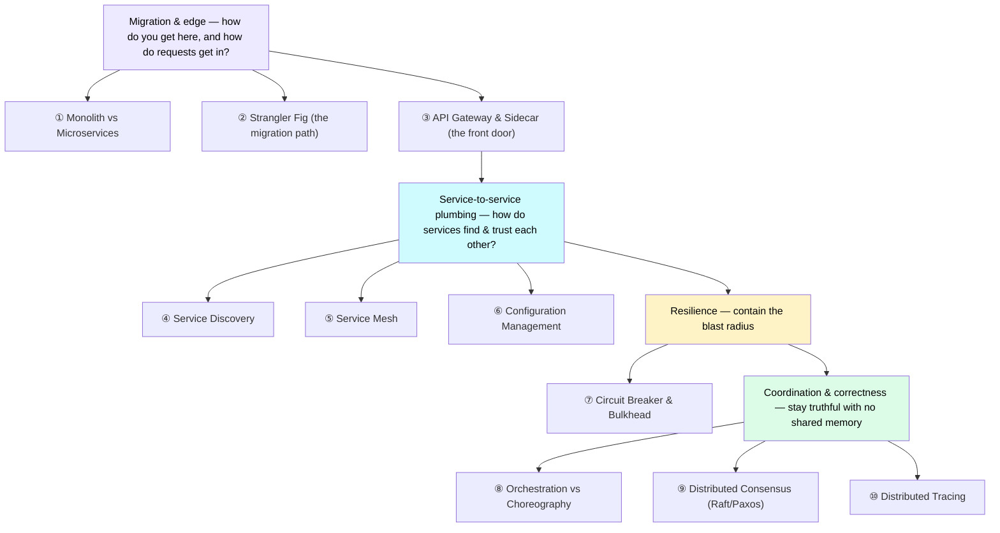
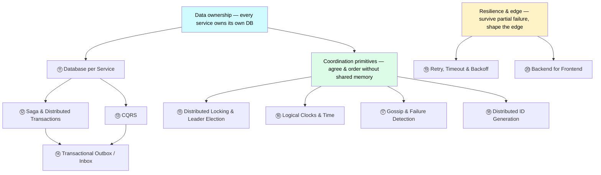
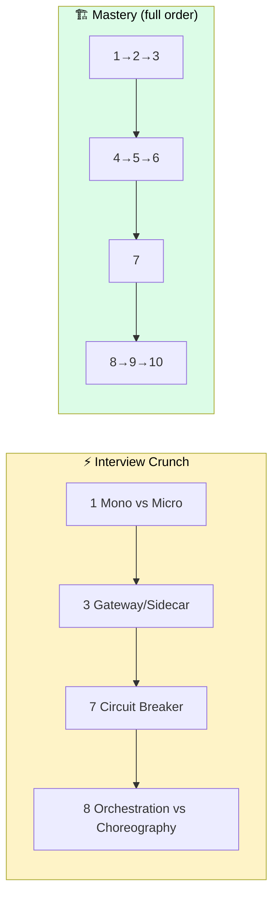

# 10 · Microservices & Distributed Systems 🕸️

> **Leaving the single process behind.** Once a system splits into independently-deployed services, two new jobs appear: the runtime plumbing that lets those services find, route to, and trust each other (gateways, discovery, mesh, config), and the theory that keeps them correct once nobody shares memory anymore (consensus, coordination style, tracing). This section walks that path — from the decision to split, through the edge and the wiring, to the resilience and correctness guarantees a distributed system has to earn on its own.

---

## 🎯 What You'll Be Able To Do

- **Decide when to split a monolith into microservices** — and migrate incrementally with the Strangler Fig pattern instead of a big-bang rewrite.
- **Design the edge** — route external traffic through an API Gateway and offload cross-cutting network concerns (mTLS, retries) to a sidecar, without touching application code.
- **Wire service-to-service plumbing** — service discovery, a service mesh, and centralized configuration/secrets — so services find and trust each other automatically as they scale up and down.
- **Contain failure** — apply circuit breakers and bulkheads so one slow dependency can't cascade into a full outage.
- **Choose a coordination style for multi-service workflows** — orchestration vs choreography — and reason about distributed consensus (Raft/Paxos) when nodes must agree despite failures.
- **Debug a request that crosses a dozen services** using distributed tracing instead of matching timestamps across scattered logs.
- **Keep data consistent without a shared database** — own data per service, replace cross-service ACID with sagas + compensating transactions, split reads from writes with CQRS, and publish events reliably via the transactional outbox.
- **Coordinate nodes with no shared memory** — distributed locks with fencing tokens and leader election, order events with logical clocks, detect failures with gossip/SWIM, and mint unique time-sortable IDs (Snowflake/UUIDv7).
- **Make calls resilient without making outages worse** — timeouts, retries with backoff + jitter and retry budgets — and shape a tailored edge per client with a Backend for Frontend.

---

## 🗺️ How the 20 Topics Interlock

This section is now two layers. **Layer 1 (①–⑩)** is the *runtime platform* — how you split a monolith, put an edge in front, wire discovery/mesh/config, contain failure, and coordinate & observe. **Layer 2 (⑪–⑳)** is the *data & coordination theory* a distributed system must earn once every service owns its own database and no one shares memory.

### Layer 1 — the runtime platform (①–⑩)



> **The spine:** *split the monolith and put an edge in front of it → wire the plumbing that lets services find and trust each other → contain failure so one slow dependency can't sink the fleet → coordinate multi-service workflows and prove correctness even when nodes disagree.* The Gateway/Sidecar (③) is the front door the plumbing (④⑤⑥) sits behind; bulkheads (⑦) isolate what the mesh can't fix alone; consensus (⑨) is the engine quietly running inside the registry (④) and the mesh control plane (⑤); tracing (⑩) is how you observe all of it end to end.

### Layer 2 — data & coordination patterns (⑪–⑳)



> **The through-line:** *database-per-service (⑪) is the decision that makes everything else necessary* — it kills cross-service ACID, so you reach for **sagas (⑫)** with compensating transactions and **CQRS (⑬)** read models, and you make their events reliable with the **transactional outbox (⑭)**. Once state is spread out, services must still coordinate: **locks & leader election (⑮)** for mutual exclusion, **logical clocks (⑯)** to order events without a global clock, **gossip (⑰)** to detect failures at scale, and **distributed IDs (⑱)** to mint keys without a central sequence. Finally, **retry/backoff (⑲)** keeps calls resilient without causing retry storms, and the **BFF (⑳)** tailors the edge per client — a specialization of the Gateway (③).

---

## 📚 The Complete File Index

### Runtime Platform (①–⑩)

| # | Topic | One-line | Key takeaway |
|---|-------|----------|--------------|
| 1 | [Monolithic vs Microservices](./Monolithic_vs_Microservices.md) | Swiss Army knife vs tool chest | Monolith-first; split by org/team pain (Conway's Law), not hype; database-per-service is the real boundary |
| 2 | [Strangler Fig Pattern](./Strangler_Fig_Pattern.md) | The vine that swallows the old tree | Proxy at the front, migrate one feature at a time; never big-bang rewrite a live system |
| 3 | [API Gateway & Sidecar Pattern](./API_Gateway_Sidecar_Pattern.md) | Hotel concierge + a motorcycle sidecar | Gateway handles north-south (auth, routing, aggregation); sidecar handles east-west (mTLS, retries) with zero app changes |
| 4 | [Service Discovery (Consul, Eureka)](./Service_Discovery_Consul_Eureka.md) | A live Waze map for services | Registry + health checks replace hardcoded IPs; client-side vs server-side discovery |
| 5 | [Service Mesh (Istio, Linkerd)](./Service_Mesh_Istio_Linkerd.md) | Air traffic control for every sidecar | Data plane (Envoy) + control plane give mTLS, traffic splitting, and retries for free, language-independent |
| 6 | [Configuration Management (Vault)](./Configuration_Management_Vault.md) | The city's power grid + its bank vault | Centralize config for runtime changes; Vault issues dynamic, short-lived secrets instead of hardcoded ones |
| 7 | [Circuit Breaker & Bulkhead](./Circuit_Breaker_Bulkhead.md) | House fuse + a watertight ship hull | CLOSED→OPEN→HALF-OPEN trips fast; bulkheads isolate thread/connection pools so one slow service can't starve the rest |
| 8 | [Orchestration vs Choreography](./Orchestration_vs_Choreography.md) | Conductor vs a dance party | Orchestration centralizes Saga logic in one brain; choreography distributes it via events — pick per workflow |
| 9 | [Distributed Consensus (Raft, Paxos)](./Distributed_Consensus_Raft_Paxos.md) | A parliamentary election for machines | Majority quorum (2F+1 nodes survive F failures) makes replicated state agree; Raft = the understandable Paxos |
| 10 | [Distributed Tracing (Jaeger)](./Distributed_Tracing_Jaeger.md) | A GPS tracker riding on a package | Trace ID + spans stitch one request across N services into a Gantt chart; the only real fix for the "blame game" |

### Data & Coordination Patterns (⑪–⑳)

| # | Topic | One-line | Key takeaway |
|---|-------|----------|--------------|
| 11 | [Database per Service & Data Ownership](./Database_per_Service_Data_Ownership.md) | Every service keeps its own diary | Private DB per service; shared-DB is the anti-pattern; cross-service reads via API composition vs a materialized/CQRS view |
| 12 | [Saga Pattern & Distributed Transactions](./Saga_Pattern_Distributed_Transactions.md) | Book a trip with no travel agent | Local txns + compensating txns (compensate forward, don't roll back); orchestration vs choreography; 2PC doesn't scale |
| 13 | [CQRS Pattern](./CQRS_Pattern.md) | Separate the kitchen from the menu | Split write model from denormalized read models, synced async via events; eventual consistency; pairs with event sourcing |
| 14 | [Transactional Outbox & Inbox](./Transactional_Outbox_Inbox_Pattern.md) | Mail the letter in the same envelope | Beat the dual-write problem: write row + outbox in one txn, relay via CDC/poll; idempotent inbox dedupes at-least-once delivery |
| 15 | [Distributed Locking & Leader Election](./Distributed_Locking_Leader_Election.md) | One key, and a numbered ticket | Redlock/etcd/ZK locks + leases; a lock alone isn't safe — fencing tokens stop a stale holder; consensus-backed store for correctness |
| 16 | [Logical Clocks & Time](./Logical_Clocks_Time_in_Distributed_Systems.md) | Order events without a clock you trust | Wall clocks lie; Lamport = total order (no concurrency detect); vector clocks detect concurrent/conflict; HLC adds real-time closeness |
| 17 | [Gossip Protocol & Failure Detection](./Gossip_Protocol_Failure_Detection.md) | Spread the rumor, notice the silence | Epidemic dissemination in O(log N) rounds, no coordinator; SWIM indirect probes + phi-accrual avoid false-positive failure calls |
| 18 | [Distributed ID Generation](./Distributed_ID_Generation.md) | Mint keys with no central counter | Snowflake 64-bit (time\|machine\|seq) & UUIDv7 = unique + time-sortable (index-friendly); UUIDv4 scatters index writes; mind clock rollback |
| 19 | [Retry, Timeout & Backoff](./Retry_Timeout_Backoff_Patterns.md) | Knock again — but not all at once | Timeout everything; retry only idempotent+transient; exponential backoff WITH jitter; retry budgets + deadlines stop retry storms |
| 20 | [Backend for Frontend (BFF)](./Backend_for_Frontend_BFF.md) | A tailored counter per customer | One edge per client (mobile/web/TV): tailored payloads, one round trip, frontend-team owned — a specialization of the API gateway |

---

## 🧭 Suggested Study Paths



| Goal | Path | Why |
|------|------|-----|
| **⚡ Interview in 48h** | 1 → 3 → 7 → 8 (+ skim 4, 5) | Split decision + edge pattern + resilience + workflow coordination = the most-asked 80% |
| **🏗️ Deep mastery** | 1→2→3 → 4→5→6 → 7 → 8→9→10 | Migrate → plumb → contain failure → coordinate, in dependency order |
| **🔌 "Design the platform"** | 3 → 4 → 5 → 6 | Gateway, discovery, mesh, config — the runtime a platform team actually owns |
| **🧠 Coordination theory** | 8 → 9 → 10 | Workflow style → consensus → tracing, the correctness-and-observability trio |
| **💾 Distributed data** | 11 → 12 → 13 → 14 | Own data per service → sagas → CQRS → reliable events (outbox), the data-consistency toolkit |
| **⏱️ Coordination primitives** | 15 → 16 → 17 → 18 | Locks/leader election → logical clocks → gossip → distributed IDs, the "no shared memory" theory |
| **🛡️ Resilient edge** | 19 → 20 (+ 7) | Retry/backoff + BFF, paired with the circuit breaker, to survive partial failure and tailor the edge |

> **Study each file by** doing the 🏋️ **Practice Drills before the solutions**, rehearsing the 🎤 **Interview Q&A out loud**, and reading 🎯 **Staff+ Nuances** for senior-level depth.

---

## 🔑 The Decision Card (whole-section cheat sheet)

```
SPLIT      monolith-first (small team, fast) · microservices only when team-count/deploy pain justifies the tax
           Conway's Law: architecture mirrors org · database-per-service, never shared
MIGRATE    Strangler Fig: proxy at the front, peel ONE feature at a time · never big-bang rewrite a live system
EDGE       API Gateway = north-south (auth, routing, aggregation) · Sidecar = east-west (mTLS, retries), zero app code changes
PLUMBING   Service Discovery = live phone book (registry + health checks), replaces hardcoded IPs
           Service Mesh = sidecars (data plane) + control plane → mTLS, traffic splitting, retries FOR FREE
           Config/Secrets = centralize config · Vault = dynamic, short-lived secrets · never hardcode
RESILIENCE Circuit Breaker: CLOSED→OPEN→HALF-OPEN, fail FAST instead of hanging threads
           Bulkhead: isolate thread/connection pools so one slow dependency can't starve the rest
COORDINATE Orchestration = central conductor, Saga logic lives in ONE place, easy to trace
           Choreography = events, logic distributed, loosely coupled but harder to see the whole picture
CONSENSUS  Raft/Paxos: majority quorum (2F+1 nodes survive F failures) → leader election + replicated log
           the engine under Etcd/ZooKeeper/Consul, quietly powering discovery registries & mesh control planes
OBSERVE    Distributed Tracing: Trace ID + Spans stitch one request across N services into a Gantt chart
           without it, debugging microservices = matching timestamps across 50 log files by hand
── DATA & COORDINATION PATTERNS ──────────────────────────────────────────────
OWN DATA   Database-per-Service: private DB, NEVER a shared DB · cross-service reads = API composition OR CQRS/materialized view
TXNS       Saga: local txns + COMPENSATE forward (no rollback) · orchestration=central brain, choreography=events · 2PC blocks, don't
CQRS       split write model from denormalized read models · synced ASYNC via events · eventual consistency · pairs w/ event sourcing
OUTBOX     dual-write problem: write row + outbox row in ONE txn · relay via CDC/poll · idempotent INBOX dedupes at-least-once
LOCKING    Redlock/etcd/ZK + lease · a lock ISN'T safe alone → FENCING TOKENS stop a stale holder · leader election needs consensus
TIME       wall clocks lie (skew/NTP) · Lamport=total order, no concurrency detect · VECTOR clocks detect conflicts · HLC≈real time
GOSSIP     epidemic spread O(log N) rounds, no coordinator · SWIM indirect probes + phi-accrual → no false-positive "dead" calls
IDS        Snowflake 64-bit = time|machine|seq · UUIDv7/Snowflake time-sortable (index-friendly) · UUIDv4 scatters writes · clock rollback!
RETRY      timeout EVERYTHING · retry only idempotent+transient · exponential backoff WITH jitter · retry budget + deadline → no storms
BFF        one edge per client (mobile/web/TV) · tailored payload, 1 round trip · frontend-team owned · specialization of API gateway
```

---

## 🎨 Conventions & Authoring

- Every file follows the root [TEMPLATE.md](../TEMPLATE.md). Animated SVGs live in [/assets](../assets/).
- Each file ends with the three mastery sections: 🏋️ Practice Drills, 🎤 Interview Q&A Bank, 🎯 Staff+ Nuances.

---

## ➡️ Where This Connects

- ⬅️ Built on [03 · High-Level Design](../03_High_Level_Design/) — the architectural style decision (monolith vs microservices) this section takes as its starting point.
- ⬅️ [09 · Message Queues & Event Streaming](../09_Message_Queues_Event_Streaming/) — the transport that choreography and async service-to-service communication run on.
- ⬅️ [05 · Databases & Storage](../05_Databases_Storage/) — distributed transactions (2PC/Saga) and per-service data ownership play out here at the architecture level.
- ➡️ [11 · Security & Identity](../11_Security_Identity/) — securing the mesh, the gateway, and service-to-service auth (mTLS, JWT, mTLS certs).
- ➡️ [12 · Monitoring, Logging & Observability](../12_Monitoring_Logging_Observability/) — the metrics and logs that pair with distributed tracing to run this fleet in production.
- ➡️ [13 · Cloud-Native Infrastructure](../13_Cloud_Native_Infrastructure/) — Kubernetes and the platforms that host discovery, meshes, and gateways at scale.

---
*Part of the [System Design & Architecture Master Repository](../README.md). A fleet of services is only as strong as the plumbing and the theory that keep it one coherent system.*
