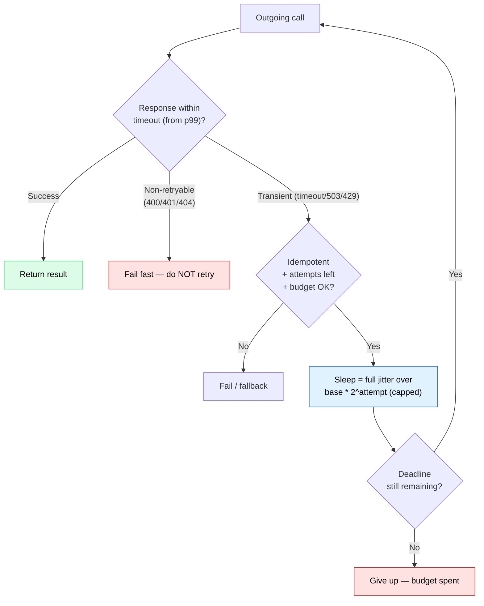
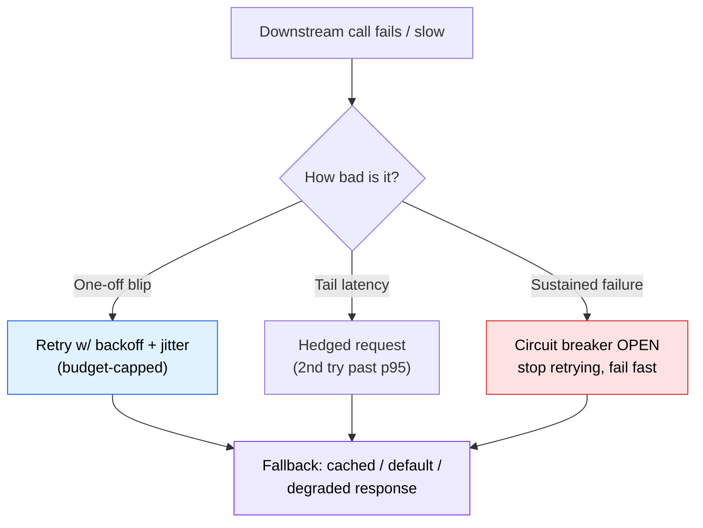

# Retry, Timeout & Backoff Patterns

## 1. Why Should I Care About This?
- **Retries Are the #1 Cause of Self-Inflicted Outages**: More large-scale outages are amplified (or outright caused) by aggressive client retries than by the original fault. A 2-second blip becomes a 20-minute outage because everyone retried at once. Getting this right is the difference between a resilient system and a fragile one.
- **It's the First Thing That Breaks Under Load**: A dependency slows down slightly, timeouts fire, retries pile on, the dependency slows more — a feedback loop that turns a brown-out into a full outage. Interviewers probe this because it separates people who've *operated* systems from those who've only drawn boxes.
- **Every Distributed Call Needs It**: The moment you make a network call to another service, you must decide: how long do I wait, do I retry, and how do I avoid making a bad situation worse? There is no "we'll figure it out later" — the defaults (wait forever, retry immediately, forever) are actively dangerous.

## 2. What Problem Does This Solve?
- **Transient Failures Are Normal**: In distributed systems, packets drop, a node restarts, a GC pause stalls a request. Many failures are *transient* — the exact same request succeeds a moment later. We want to survive these without failing the user.
- **But Recovery Must Not Amplify the Fault**: The naive fix (just retry) can turn a small hiccup into a stampede that keeps a recovering service down. The real problem is **recovering from transient faults without amplifying a real overload**.
- **Naive Approach**: Immediate, fixed-interval retries with no timeout — "wait forever for a response; if it errors, retry instantly; repeat up to N times." This fails three ways: (1) *no timeout* means one hung dependency ties up a caller thread indefinitely, exhausting the pool; (2) *immediate retries* pile load onto a struggling server the instant it's weakest; (3) *fixed interval across many clients* synchronizes everyone's retries into aligned spikes — a **thundering herd** that hammers the server back down each time it tries to recover.

## 3. Core Idea (Intuition First)
Think of it like **calling a busy phone line**.
- **Timeout** = you don't hold the phone to your ear forever. If nobody picks up in a reasonable time, you hang up and move on — otherwise you're stuck holding a dead line while other calls queue behind you.
- **Retry** = you call back. But only if it makes sense to — you'd redial a dropped call (transient), but you would *not* re-submit a payment you're unsure went through (a non-idempotent write you might double-charge).
- **Exponential backoff** = if the line's busy, you don't redial every 2 seconds forever. You wait 1s, then 2s, then 4s, then 8s — giving the other side breathing room to recover.
- **Jitter** = the trap is that if *everyone* redials on the same 1s-2s-4s schedule, all their calls land at the exact same instants — synchronized spikes. So you add randomness: each caller waits *a random amount within* their backoff window, spreading the calls out so the line is never slammed all at once.

![Left panel: a retry storm where many clients retry at the same fixed interval, producing aligned vertical spikes that grow and hammer an already-struggling server (thundering herd). Right panel: the same retries under exponential backoff plus jitter, spread out and thinned across increasing randomized delays of 1s, 2s, 4s, 8s so load drops and the server recovers. Bottom panel: a retry-amplification tree where one user request becomes 3 at layer A, 9 at layer B, and 27 at layer C, showing how retries multiply at every layer and how a retry budget caps the blast radius](../assets/retry_backoff_jitter.svg)

> Left: fixed-interval retries with no jitter synchronize into growing spikes — a thundering herd that keeps a failing server down. Right: exponential backoff spreads retries over 1s, 2s, 4s, 8s and jitter scatters them within each window, so load thins and the server recovers. Bottom: retries multiply layer-by-layer (3 × 3 × 3 = 27× downstream load) — a retry budget and deadline propagation cap the blast radius.

## 4. How It Actually Works
### 1. Timeouts — Never Wait Forever
- Every remote call gets a deadline. Pick it from the dependency's **p99 latency** plus headroom — e.g. if p99 is 80ms, a 200–300ms timeout catches genuinely stuck calls without falsely killing slow-but-healthy ones. Setting it at the mean (say 30ms) would time out half your normal traffic.
- A timeout frees the caller's thread/connection so it isn't held hostage by one hung downstream call — this is what prevents thread-pool exhaustion cascading upward.

### 2. Retries — Only Transient + Idempotent
- Retry only **transient** failures: timeouts, connection resets, `503`/`429`, not `400`/`404`/`401` (those fail identically every time).
- Retry only **idempotent** operations. A `GET` or an idempotent-keyed write is safe; a raw non-idempotent `POST /charge` retried after a timeout may **double-charge** — the first call may have *succeeded* and you never saw the response. Use an **idempotency key** to make writes safely retryable.

### 3. Exponential Backoff + Jitter
- Backoff delay grows geometrically: `delay = base * 2^attempt`, **capped** at a max (e.g. base=100ms, cap=10s) so it never grows unbounded.
- **Jitter** randomizes the delay so independent clients don't retry in lockstep. **Full jitter**: `sleep = random(0, min(cap, base*2^attempt))` — the AWS-recommended default, it spreads retries most evenly. **Equal jitter**: half the backoff plus a random half. **Decorrelated jitter**: `sleep = min(cap, random(base, prev*3))` — bases the next delay on the last one, spreading well while staying bounded.

### 4. Retry Budgets & Deadline Propagation
- **Retry budget**: cap total retries as a *fraction* of requests (e.g. retries ≤ 10% of successful requests, as in Finagle/Envoy). When a dependency is broadly failing, the budget is exhausted and retries stop — preventing amplification.
- **Deadline propagation**: the caller passes its *remaining* time budget downstream; each hop subtracts elapsed time. A nested call never runs longer than the parent has left to wait, so work isn't done for a result nobody's still waiting for.



## 5. Real-World Example
**A checkout request tree turning a blip into a self-inflicted DDoS:**
- The topology: `API Gateway → Order Service → Payment Service → Bank Adapter`. Each layer is configured to retry 3× on failure — a seemingly reasonable default set by three different teams.
- **The blip.** The Bank Adapter has a 2-second GC pause. Suddenly its calls time out.
- **Amplification.** Payment retries 3× → Order retries 3× → Gateway retries 3×. One user click now becomes up to **3 × 3 × 3 = 27 calls** to the Bank Adapter. Multiply by thousands of concurrent users and the adapter, already mid-recovery, is hit with **27× its normal load** — it never recovers. The brief pause becomes a sustained outage. This is **retry amplification** — a self-inflicted DDoS.
- **Taming it with numbers.** Now apply the patterns: (1) **retry only at the edge** (Gateway) — inner layers don't retry, killing the multiplication (27× → 3×). (2) **Retry budget** of 10% — if failures exceed the budget, retries stop entirely, capping worst case near 1.1×. (3) **Backoff + full jitter** — the 3 retries spread over 1s/2s/4s windows, scattered, so the adapter sees a gentle trickle instead of aligned spikes. (4) **Deadline propagation** — the Gateway's 1s budget means once ~1s is spent, no layer wastes effort retrying. Result: the 2s pause causes a handful of failed requests, the adapter recovers on its own, and the storm never forms.

## 6. Code Example
Exponential backoff with full jitter, a deadline, and idempotency/transient guards (Python-ish pseudocode):
```python
import random, time

def call_with_retry(request, *, deadline_s, base=0.1, cap=10.0, max_attempts=4):
    start = time.monotonic()
    attempt = 0
    while True:
        remaining = deadline_s - (time.monotonic() - start)
        if remaining <= 0:
            raise DeadlineExceeded()                 # deadline propagation: no time left

        try:
            # per-call timeout never exceeds the remaining parent budget
            return do_call(request, timeout=min(remaining, per_call_timeout()))
        except Exception as e:
            attempt += 1
            retryable = is_transient(e) and request.is_idempotent
            if not retryable or attempt >= max_attempts:
                raise                                 # fail fast on 4xx / non-idempotent
            if not retry_budget.try_spend():          # retries <= 10% of requests
                raise                                 # budget exhausted -> stop amplifying

            # exponential backoff with FULL jitter, capped
            backoff = min(cap, base * (2 ** attempt))
            sleep = random.uniform(0, backoff)        # full jitter spreads the herd
            sleep = min(sleep, deadline_s - (time.monotonic() - start))
            if sleep <= 0:
                raise DeadlineExceeded()
            time.sleep(sleep)
```

## 7. Design Variations & Alternatives
- **Retry-After honoring**: when a server returns `429`/`503` with a `Retry-After` header, obey it instead of your own backoff — the server is telling you exactly when to come back.
- **Hedged requests**: instead of retrying *after* a failure, send a second request once the first exceeds p95, take whichever returns first. Cuts tail latency but costs extra load — use with a small budget.
- **Circuit breaker**: once a dependency is clearly down, *stop retrying entirely* for a cooldown window — trips open, fails fast, and probes with a trickle before closing. Retries handle blips; the breaker handles sustained failure.
- **Fallback / graceful degradation**: return a cached or default response, or a partial result, instead of retrying into the void.



## 8. Pros and Cons
### Pros
- **Survives transient faults transparently**: users never see the packet drop or the GC pause that a retry papered over.
- **Backoff + jitter prevent stampedes**: spreading retries lets an overloaded dependency actually recover instead of being re-slammed.
- **Budgets + deadlines bound the blast radius**: worst-case load and worst-case latency are both capped, not open-ended.

### Cons
- **Retries add latency and load**: every retry is extra work and extra delay for the end user — sometimes failing fast is better.
- **Amplification is easy to get wrong**: retrying at multiple layers multiplies traffic; without a budget it's a footgun.
- **Non-idempotent retries corrupt data**: double-charges, duplicate orders — retries demand idempotency discipline you may not have.
- **Tuning is fiddly**: timeouts from p99, backoff caps, budgets, and jitter all interact and need real production data.

## 9. Failure Scenarios & What Can Go Wrong
- **SYMPTOM**: A brief downstream blip escalates into a sustained outage. **CAUSE**: Retry amplification — every layer retries, multiplying load (3×3×3 = 27×). **FIX**: Retry only at the edge (or one layer), enforce a retry budget (≤10%), and cap total attempts.
- **SYMPTOM**: Traffic arrives in sharp synchronized spikes every few seconds. **CAUSE**: Fixed-interval retries with no jitter — all clients retry in lockstep (thundering herd). **FIX**: Add jitter (full jitter as default) so retries scatter across each backoff window.
- **SYMPTOM**: Caller thread pools exhaust and the *caller* goes down too. **CAUSE**: No timeout — threads block indefinitely on hung downstream calls. **FIX**: Set timeouts from p99 latency; bound the wait so threads are freed.
- **SYMPTOM**: Duplicate charges / duplicate orders after a slow response. **CAUSE**: Retrying a non-idempotent write whose first attempt actually succeeded. **FIX**: Only retry idempotent operations; attach an idempotency key to make writes safe.
- **SYMPTOM**: Deep in the call tree, services keep working on a request the user already gave up on. **CAUSE**: No deadline propagation — nested calls outlive the parent's timeout. **FIX**: Propagate the remaining deadline; abandon work when no time is left.

## 10. Impact on Scalability, Reliability & Cost
- **Scalability**: Correct backoff + budgets keep effective load bounded during faults, so a struggling tier can shed and recover rather than being driven further down; capacity planning must include *retry* traffic, not just first-attempt traffic.
- **Reliability**: This is the core mechanism for surviving transient faults — done right it dramatically raises effective availability; done wrong (naive retries) it is the single biggest amplifier of outages.
- **Cost**: Retries are duplicated work — extra CPU, network, and (for metered dependencies) real dollars per retry. A retry budget directly caps this overhead; hedged requests trade cost for lower tail latency and should be budgeted deliberately.

## 11. When NOT to Use This
- **Non-idempotent operations without an idempotency key**: don't retry a raw payment/charge/order-create — you risk duplicates. Fix idempotency first, then retry.
- **Client-error (4xx) responses**: `400`/`401`/`403`/`404` fail deterministically; retrying just wastes resources and delays the inevitable error.
- **Real-time / latency-critical paths**: if a result is useless after 50ms (live bidding, a game tick), fail fast or fall back — a retry that arrives late is worthless.
- **When the dependency is already known-down**: don't retry into a tripped circuit breaker; that's exactly the case the breaker exists to short-circuit.

## 12. Interview Perspective
- **What interviewers expect**: When you add a service call, proactively state "timeout from p99, retry only transient + idempotent errors, exponential backoff with jitter, capped by a retry budget." Naming jitter and retry budgets unprompted is a strong senior signal.
- **Classic question**: "Your retries are making the outage worse — why?" (Answer: retry amplification across layers + synchronized retries without jitter; fix with edge-only retries, budgets, and jitter.)
- **Classic question**: "How do you pick a timeout?" (Answer: from the dependency's p99 latency plus headroom, not the mean; too tight kills healthy slow calls, too loose exhausts threads.)
- **Classic question**: "How do retries and circuit breakers relate?" (Answer: retries handle brief blips; the breaker handles sustained failure by stopping retries entirely — they're complementary.)
- **Watch for the trap**: interviewers love baiting you into "just retry it" on a payment. Catch the idempotency issue.

## 13. Connections to Other Topics
- [Circuit Breaker & Bulkhead](./Circuit_Breaker_Bulkhead.md) — the breaker stops retrying a sustained-failing dependency; bulkheads isolate the thread pools that timeouts protect.
- [Idempotency](../02_API_Interface_Design/Idempotency.md) — the precondition that makes a write safe to retry without double-effects.
- [Rate Limiting](../02_API_Interface_Design/Rate_Limiting.md) — the server side of the contract; `429`/`Retry-After` tells retriers exactly when to back off.
- [Request Coalescing & Hedged Requests](../06_Caching_Performance/Request_Coalescing_Hedged_Requests.md) — hedging is a proactive cousin of the retry, trading load for lower tail latency.
- [Distributed Tracing (Jaeger)](./Distributed_Tracing_Jaeger.md) — how you actually *see* retry amplification and deadline overruns across a call tree.
- [Dead Letter Queues & Retry Strategies](../09_Message_Queues_Event_Streaming/Dead_Letter_Queues_Retry_Strategies.md) — the asynchronous/messaging counterpart, where exhausted retries land in a DLQ.

## 14. Visual Aids
- **The SVG above** ([retry_backoff_jitter.svg](../assets/retry_backoff_jitter.svg)): left = the retry storm (aligned fixed-interval spikes hammering a failing server); right = exponential backoff + jitter (scattered, thinning retries so the server recovers); bottom = the retry-amplification tree (1 → 3 → 9 → 27) capped by a retry budget.
- **Mermaid #1 (Section 4)**: the per-call decision flow — timeout → retryable? → idempotent + budget + deadline check → jittered backoff → retry or give up.
- **Mermaid #2 (Section 7)**: choosing the right resilience tool by failure type — blip → retry, tail latency → hedge, sustained failure → circuit breaker, all falling through to a fallback.

## 15. Summary (TL;DR)
**Making service-to-service calls resilient means always setting a timeout (derived from the dependency's p99, never waiting forever), retrying only transient failures on idempotent operations (a retried non-idempotent write can double-charge), and spacing those retries with exponential backoff (delay = base × 2^attempt, capped) plus jitter (full/equal/decorrelated) so independent clients don't retry in lockstep and create a thundering-herd retry storm; the subtle killer is retry amplification — retries stacked at every layer multiply (3 layers × 3 retries = up to 27× downstream load) and turn a brief blip into a self-inflicted DDoS, so you cap total attempts, enforce a retry budget (retries ≤ ~10% of requests, à la Finagle/Envoy), propagate the caller's remaining deadline downstream so nested calls never outlive the parent, and lean on circuit breakers, load shedding, and fallbacks to fail fast when a dependency is genuinely down rather than retrying it into the ground.**

## 16. Further Reading & Resources
- [AWS Architecture Blog: Exponential Backoff and Jitter](https://aws.amazon.com/blogs/architecture/exponential-backoff-and-jitter/)
- [Google SRE Book — Handling Overload & Addressing Cascading Failures](https://sre.google/sre-book/handling-overload/)
- [Envoy Proxy: Automatic Retries & Retry Budgets](https://www.envoyproxy.io/docs/envoy/latest/intro/arch_overview/http/http_routing#retry-semantics)
- [Finagle: Retry Budgets & Requeue Filters](https://twitter.github.io/finagle/guide/Clients.html#retries)
- [gRPC: Deadlines and Deadline Propagation](https://grpc.io/docs/guides/deadlines/)
- [Michael Nygard, *Release It!* — Stability Patterns (Timeouts, Circuit Breaker, Bulkhead)](https://pragprog.com/titles/mnee2/release-it-second-edition/)
